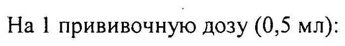
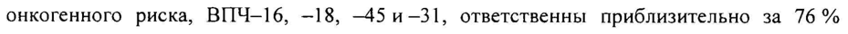
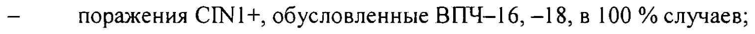
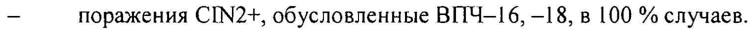
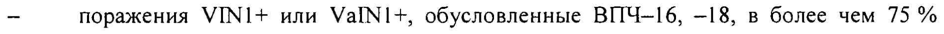
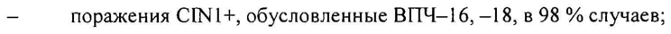
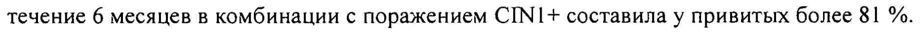
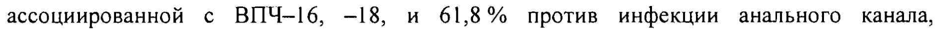
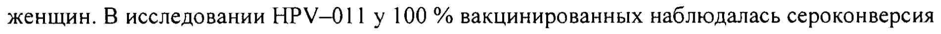

# L1 протеин вируса папилломы человека типа 16 — парентерально

- Препарат: Церварикс® (суспензия для внутримышечного введения;)
- АТХ: J07BM02
- Источник: ГРЛС, инструкция по медицинскому применению, РУ ЛСР-006423/08, файл от 2023-11-01 (https://grls.rosminzdrav.ru/Grls_View_v2.aspx?routingGuid=74a77c48-c131-41c4-ab9d-88f8daa7fa64)
- Распознано автоматически (OCR): 14 из 14 стр.
- Инструкция к другому РУ того же препарата: ЛСР-006423/08 (национальное РУ, переоформленное по правилам ЕАЭС, решение от 25.10.2023). Текст может быть старше действующего
- Сомнительных строк после OCR: 9 (см. раздел «Проверка распознавания»)
- Проверено вручную строк: 1

## Общие сведения

МИНЗДРАВ, РОССИИ .
| РОО 260716 | МИНИСТЕРСТВО ЗДРАВООХРАНЕНИЯ РОССИИСКОИ ФЕДЕРАЦИИ
СОГЛАСОВА ИНСТРУКЦИЯ по применению лекарственного препарата для медицинского применения
Е ® x® ЦЕРВАРИКС / CERVARI Регистрационный номер:
Торговое наименование препарата: Церварикс® / Cervarix®.
® Лекарственная форма: суспензия для внутримышечного введения.
- Группировочное наименование: вакцина против вируса папилломы человека рекомбинантная, адсорбированная, содержащая адъювант AS04.

## 2. Состав

Ha 1 прививочную дозу (0,5 мл):
Ha 1 прививочную дозу (0,5 мл):
ГДейетвующие вещества Ll протеин вируса папилломы человека типа 16 20 мкг
(ВПЧ-161.1)
Ы протеин вируса папилломы человека типа 18 20 мкг
(BITU-18L1)
| Benomozamenvyme вещеета 3-О-дезацил-4*-монофосфориллипид A
$ 0,624 мг | ОПИСАНИЕ Гомогенная непрозрачная суспензия белого цвета без посторонних включений, при отстаивании разделяющаяся на 2 слоя: верхний — прозрачная бесцветная жидкость; | нижний — белый осадок.
ХАРАКТЕРИСТИКА ПРЕПАРАТА | Церварикс® — вакцина против вируса папилломы человека, представляющая собой смесь | вирусоподобных частиц рекомбинантных поверхностных белков ВПЧ типов 16 и 18, действие которых усилено с помощью адъювантной системы AS04.
С. | из 14 , ГЛ белки ВИЧ-16 и ВПЧ-18 получены с использованием рекомбинантных бакуловирусов
ВПЧ-16 и ВПЧ-18 на культуре клеток Trichoplusia п! (Hi-5 Rix4446). АЗО4 состоит из алюминия гидроксида и 3-О-дезацил-4’-монофосфориллипида А (МФЛ).
ФАРМАКОТЕРАПЕВТИЧЕСКАЯ ГРУППА МИБН- вакцина.

Код ATX: JO7BMO02.
ИММУНОЛОГИЧЕСКИЕ СВОЙСТВА Практически во всех случаях рак шейки матки обусловлен персистенцией онкогенных вирусов папилломы человека. Вирусы папилломы человека 16 и 18 типов ответственны
® за возникновение более 70 % случаев рака шейки матки, 80 % случаев рака вульвы и влагалища, 90% случаев рака анального канала, 70% случаев низкодифференцированной интраэпителиальной неоплазии вульвы (VIN 2/3) и влагалища (\Уа[М 2/3) и 78 % случаев низкодифференцированной интраэпителиальной неоплазии анального канала. Четыре наиболее распространенных типа ВПЧ ‘высокого онкогенного риска, ВПЧ-16, -—18, —5 и-31, ответственны приблизительно за 76 % случаев плоскоклеточного рака шейки матки и 91 % случаев аденокарциномы.
После завершения курса первичной вакцинации формируется иммунологическая память к
ВПЧ-16 и -—18, что подтверждается вторичным ответом, который регистрируется через 6,8 лет. Анамнестический иммунный ответ также регистрировали в отношении родственных типов ВПЧ-45 и -31.
Эффективная защита была зарегистрирована в течение как минимум 9,4 лет после
* введения первой дозы вакцины. Исследования по изучению длительности защитного иммунитета продолжаются.
Профилактическая эффективность у женщин в возрасте от 15 до 25 лет
Выводы о клинической эффективности вакцины Церварикс® сделаны на основании результатов клинических исследований у 19 778 женщин в возрасте от 15 до 25 лет.
В клинических исследованиях эффективность вакцины оценивали по профилактике
`предраковых поражений CINI+ (цервикальная интраэпителиальная неоплазия первой степени и выше), CIN2+ (цервикальная интраэпителиальная неоплазия второй степени и выше), CIN3+ (цервикальная интраэпителиальная неоплазия третьей степени и выше),
ASC-US (атипичные клетки неясного значения); персистирующей в течение 6 и 12 месяцев ВИЧ-инфекции; VINI+ (интраэпителиальная неоплазия вульвы первой степени и выше), ValNI+ (интраэпителиальная неоплазия влагалища первой степени и
С. 2 из 14 выше).

В популяции исходно неинфицированных женщин (исследования НРУ-001/007/023)

вакцина Церварикс® эффективно предотвращала:

- персистирующую в течение 6 и 12 месяцев ВПЧ-инфекцию, обусловленную

ВПЧ-16/18, в более чем 98 % и 97 % случаев соответственно;

— поражения СПУ1+, обусловленные ВПЧ-16, —18, в 100 % случаев;

_ поражения CIN2+, обусловленные ВПЧ-16, —18, в 100 % случаев.

При этом эффективная защита против вышеуказанных вирусологических и/или

цитологических состояний у исходно неинфицированных женщин сохранялась в течение

9,4 лет с момента введения первой дозы.

Но результатам исследования (HPV—008, анализ в конце исследования) в популяции

® исходно неинфицированных женщин вакцина Церварикс® эффективно предотвращала:

— поражения CIN3+, обусловленные ВПЧ-16, —18, в 100 % случаев;

- поражения VINI+ или VaINI+, обусловленные ВПЧ-16, —18, в более чем 75 %

случаев (данные окончательного анализа исследования НРУ-008).

В смешанной популяции (26 % исходно инфицированных женщин: текущая ВПЧ-

инфекция или ВПЧ-инфекция в анамнезе) вакцина Церварикс® эффективно

предотвращала:

_ персистирующую в течение 6 месяцев ВПЧ-инфекцию, обусловленную ВПЧ-16,

—18, более чем в 94 % случаев;

— поражения СПУ 1+, обусловленные ВПЧ-16, —18, в 98 % случаев;

- поражения CIN2+, обусловленные ВПЧ-16, —18, более чем в 98 % случаев.

Вакцина Церварикс® не обеспечивала защиту от заболеваний, обусловленных генотипами
* BITY, по которым женщины были ДНК-позитивны на момент включения в исследование.

Однако те женщины, которые были уже инфицированы одним типом ВПЧ до вакцинации,

были защищены от заболеваний, обусловленных другим вакцинным типом.

Вакцина Церварикс® обеспечивала эффективную защиту против инфицирования и

предраковых состояний, обусловленных генотипами ВИЧ, не входящими в состав

вакцины (ВПЧ-31, —33, —35, —39, —45, -51, —52, —56, —58, —59, —66, —68):

- 54 %-ная защита в отношении CIN2+ по 12 онкогенным типам (исключая

ВПЧ-16 и-18) в популяции исходно неинфицированных женщин;

- профилактическая эффективность вакцины Церварикс® против CIN2+ и CIN3+ у

женщин с исходно отрицательной ПЦР по 14 онкогенным типам ВПЧ, независимо от типа

ДНК в области поражения и независимо от исходного серологического статуса, составила

65 % и более 93 %, соответственно.

С. 3 из 14 Профилактическая эффективность у женщин 26 лет и старше

Эффективность вакцины Церварикс® оценивалась в двойном слепом рандомизированном

клиническом исследовании, которое включало 5 777 женщин в возрасте 26 лет и старше.

Профилактическая эффективность против персистирующей инфекции ВПЧ-16, —18 в |

течение 6 месяцев в комбинации с поражением СПУ1+ составила у привитых более 81 %.

Клиническая эффективность в отношении ВПЧ-инфекции анального канала у женщин в

возрасте от 18 до 25 лет

Эффективность вакцины Церварикс® оценивали в исследовании НРУ-009. Через 4 года

после начала наблюдения эффективность вакцины у изначально ДНК-негативных и

серонегативных женщин составила 83,6 % против инфекции анального канала,

ассоциированной с ВПЧ-16, -18, и 61,8% против инфекции анального канала,

6 ассоциированной с ВПЧ-31, —33, +45.

Иммуногенность вакцины

Иммуногенность вакцины Церварикс® оценивалась более чем у 5 000 женщин в возрасте

от 9 до 55 лет, а также у более чем 800 мужчин в возрасте от 10 до 18 лет.

Полный курс вакцинации (по схеме 0-1-6 месяцев) приводит к образованию

специфических антител против ВПЧ-16 и ВПЧ-18 более чем у 99% изначально

серонегативных женщин. Индуцируемое вакциной Церварикс® среднее геометрическое

титров IgG было выше, чем после перенесенной естественной ВПЧ-инфекции. Женщины,

как серопозитивные, так и серонегативные, на момент введения первой дозы, развивали

сходный иммунный ответ на вакцинацию.

Иммуногенность у женщин от 15 до 25 лет

Иммуногенность вакцины Церварикс® в отношении ВПЧ-1[6 и ВПЧ-18 оценивалась в
® течение 76 месяцев после введения первой дозы в исследовании HPV—001/007 у женщин в

возрасте 15—25 лет.

В исследовании НРУ-023 продолжительность изучения иммунного ответа составила

приблизительно 113 месяцев (9,4 лет) после введения первой дозы вакцины. Результаты

этого исследования показали, что 100 % женщин были серопозитивными в течение 9,4 лет

после курса первичной вакцинации.

Титр антител достигал максимума к 7 месяцу наблюдения, затем несколько снижался,

достигая плато к 18 месяцу, и оставался в 10 раз выше уровня антител при естественной

ВПЧ-инфекции на протяжении всего периода наблюдения (113 месяцев). Сходные

результаты были получены в исследовании НРУ-008, где период наблюдения составил

48 месяцев.

Иммуногенность в других возрастных когортах

С. 4 из 14 По данным объединенного анализа (исследования НРУ-029, —030, —048), у девочек в возрасте 9 лет наблюдалась 99,7 %-я и 100 %-я сероконверсия к ВПЧ типов 16 и 18, соответственно, к 7 месяцу наблюдения (введены все три дозы вакцины). Среднее геометрическое титров антител было, по крайней мере, в 1,4 и 2,4 раза выше по сравнению с когортами девочек возраста 10-14 лет и 15—25 лет, соответственно.
В двух клинических исследованиях (НРУ-012, —013) среди девочек 10-14 лет наблюдалась 100 %-я сероконверсия как к 16, так и к 18 типу ВПЧ к 7 месяцу наблюдения
(введены все три дозы вакцины). Среднее геометрическое титров антител было, по крайней мере, в 2 раза выше в этой возрастной когорте по сравнению с когортой 15—25 лет.
В продолжающемся клиническом исследовании (НРУ-070) среди девочек 9-14 лет,
# вакцинированных по 2-дозовой схеме (0—6 месяцев или 0-12 месяцев), у всех вакцинированных наблюдалась сероконверсия к вирусам таких типов как ВПЧ-16 и —18 через 1 месяц после введения второй дозы вакцины. Иммунный ответ у девочек 9-14 лет после введения двух доз вакцины был не менее эффективен, чем иммунный ответ у девушек 15—25 лет после введения трех доз вакцины.
Вывод об эффективности 2-дозовой схемы введения вакцины Церварикс® был сделан на основании данных по иммуногенности, полученных среди девочек, вакцинированных в возрасте от 9 до 14 лет.
Иммуногенность у женщин 26 лет и старше В клиническом исследовании Ш фазы (НРУ-015) среди женщин 26 лет и старше к 48 месяцу, т.е. через 42 месяца после завершения полной схемы вакцинации, у исходно серонегативных женщин в 100 % и 99,4 % сохранялись высокие концентрации антител к
® ВПЧ-16 и ВПЧ-18, соответственно. Титр антител достигал максимума к 7 месяцу наблюдения, а затем постепенно понижался к 18 месяцу и стабилизировался, достигая | плато к 48 месяцу.
В другом клиническом исследовании (НРУ-014), проведенном среди женщин 26—55 лет
(N=362), все женщины были серопозитивными к ВИЧ-16 и —18 после введения третьей дозы вакцины (до 7 месяца). Среднее геометрическое титров антител было ниже в данной | популяции по сравнению с когортой вакцинированных возраста 15—25 лет. Однако все | женщины оставались серопозитивными к BITU-16, и практически все женщины :
оставались серопозитивными к ВПЧ-!8 в период последующего наблюдения (до | 48 месяца), при этом уровень антител был существенно выше, чем при естественной |
BIT4-undekunn.
Иммуногенность у ВИЧ-инфицированных женщин
С. 5 из 14 В клиническом исследовании, проведенном у 120 ВИЧ-позитивных лиц без клинического проявления заболевания, в возрасте от 18 до 25 лет (60 участниц получили вакцину
Церварикс®), все женщины, вакцинированные препаратом Церварикс®, были серопозитивны по отношению к ВПЧ-16 и ~18 после третьей дозы (до 7 месяца), и серопозитивность для типов 16 и 18 сохранялась до 12 месяца. Среднее геометрическое титров антител было ниже в этой группе по сравнению с группой ВИЧ-негативных лиц, но в 15 раз превышало уровни антител, регистрируемые при естественной ВПЧ-инфекции.
При этом ВИЧ-позитивные лица в возрасте 18—25 лет хорошо переносили вакцинацию препаратом Церварикс®, и вакцинация не влияла на уровень СО4+ Т-лимфоцитов, показатели вирусной нагрузки и прогрессию ВИЧ-инфекции.
Иммуногенность у мужчин от 10 до 18 лет ® Иммуногенность у мужчин оценивали в 2 клинических исследованиях (НРУ-01| и
НРУ-040). Данные свидетельствуют о сопоставимой иммуногенности у мужчин и женщин. В исследовании НРУ-011 у 100 % вакцинированных наблюдалась сероконверсия к вирусам ВПЧ-16 и —18, а среднее геометрическое титров антител было не ниже значения, отмеченного у женщин в возрасте от 15 до 25 лет в исследовании НРУ-012.

## 4.1. Показания к применению

Профилактика персистирующей инфекции, предраковых поражений шейки матки, вульвы, влагалища и анального канала, рака шейки матки, вульвы, влагалища, анального канала (плоскоклеточного и аденокарциномы), обусловленных вирусами папилломы человека высокого онкогенного риска, в возрасте от 9 до 45 лет.
Профилактика персистирующей инфекции, предраковых поражений шейки матки, вульвы, влагалища и анального канала, рака шейки матки, вульвы, влагалища, анального канала (плоскоклеточного и аденокарциномы), обусловленных вирусами папилломы человека высокого онкогенного риска, в возрасте от 9 до 45 лет.
® ПРОТИВОПОКАЗАНИЯ ® Повышенная чувствительность к любому из компонентов вакцины в анамнезе.
` ® Реакции повышенной чувствительности, сильная реакция (температура выше 40°С, | отек и гиперемия в месте введения свыше 8 см в диаметре) или осложнение на предыдущее введение вакцины Церварикс®.
® Острые инфекционные или неинфекционные заболевания, обострение хронических заболеваний являются временными противопоказаниями для проведения вакцинации. |
Прививки проводятся через 2-4 недели после выздоровления или в период реконвалесценции или ремиссии. При нетяжелых ОРВИ, острых кишечных заболеваниях прививки проводят после нормализации температуры.

## 4.6. Применение при беременности и в период грудного вскармливания

ВСКАРМЛИВАНИЯ С. 6 из 14 Беременность Воздействие вакцины Церварикс® на внутриутробную, перинатальную и постнатальную выживаемость и развитие изучено на животных моделях (крысы). Подобные исследования у животных не подтверждают наличие прямого или косвенного вредного воздействия на фертильность, беременность, внутриутробное развитие, роды или постнатальное развитие.
Данные о беременных женщинах, собранные в ходе клинических исследований, из реестров беременных женщин, в ходе эпидемиологических исследований, не дают оснований предполагать, что риск патологий среди новорожденных, включая пороки развития, изменится. Для заключения о наличии или отсутствии влияния вакцины
Церварикс® на риск спонтанного аборта данных недостаточно.

® Беременным женщинам и женщинам, планирующим беременность, рекомендуется отложить вакцинацию до завершения беременности.
Период грудного вскармливания Воздействие на детей, находящихся на грудном вскармливании в момент вакцинации их матерей препаратом Церварикс®, в клинических исследованиях не ощенивалост,
Данные серологических исследований показали, что возможно выделение антител к антигенам вакцины с молоком во время лактационного периода у крыс. Неизвестно, происходит ли аналогичная экскреция поствакцинальных антител с человеческим молоком. Применение вакцины Церварикс® в период грудного вскармливания возможно, только если ожидаемая польза превышает риск.

## 4.2. Способ применения и дозы

Г Способ введения Вакцина Церварикс® вводится внутримышечно, в область дельтовидной мышцы.
Вакцину Церварикс® ни при каких обстоятельствах нельзя вводить внутривенно или внутрикожно. Данные о подкожном введении отсутствуют.
Перед использованием вакцину необходимо визуально проверить на отсутствие посторонних частиц и хорошо встряхнуть шприц или флакон, чтобы получить непрозрачную суспензию белого цвета. При хранении образуется белый осадок с
‚ прозрачной бесцветной надосадочной жидкостью, что не является признаком ухудшения качества, после встряхивания осадок должен полностью разбиваться. Если вакцина не соответствует приведенному описанию или содержит посторонние частицы, ее следует уничтожить.
Вакцину следует использовать сразу после извлечения из холодильника.
С. 7 из 14 Инструкция по применению вакцины в шприце
1. Открутите защитный колпачок шприца, поворачивая его против часовой стрелки
(при этом следует удерживать шприц за цилиндр, избегая контакта с поршнем шприца).
2. Крутящим движением по часовой стрелке соедините иглу со шприцем до момента, когда вы ощутите их защелкивание друг на друге (см. рисунок 1).
3. Удалите защитный колпачок с иглы (в отдельных случаях он может быть туго закреплен на игле).
4. Введите вакцину.
Рисунок 1.
@ Колпачок И иглы | гла — \ en Ai ль о, Шприц | о $ —,.
р PS = Поршень Цилиндр и шприца шприца Колпачок шприца
® fhe С | ИФ: KS к | Неиспользованный препарат и отходы от его использования должны быть уничтожены в соответствии с требованиями, принятыми в РФ.
Схемы вакцинации Разовая доза для всех возрастов составляет 0,5 мл.
Выбор схемы вакцинации зависит от возраста вакцинируемого на момент введения первой дозы вакцины.
Возраст от 9 до 14 лет включительно С. 8 из 14
Вводят 2 дозы вакцины. Вторую дозу вводят через 5—13 месяцев после введения первой дозы.
Если у девочек/мальчиков данной возрастной группы вторая доза была введена ранее, чем через 5 месяцев после введения первой дозы, третья доза должна вводиться обязательно. В этом случае для данной возрастной группы рекомендована схема вакцинации, включающая введение 3 доз вакцины.
Возраст 15 лет и старше Начиная с возраста 15 лет и старше, рекомендована исключительно схема вакцинации, включающая введение 3 доз вакцины.
Схема вакцинации, включающая введение 3 доз вакцины: O-I-6 месяцев. При необходимости изменения графика вакцинации вторая доза может быть введена через
® 1-2,5 месяца после введения первой дозы, а третья доза — через 5—12 месяцев после введения первой дозы.
Необходимость ревакцинации к настоящему времени не установлена.
Установлено наличие анамнестического ответа на введение провокационной дозы.

## 4.8. Побочное действие

Нежелательные реакции, приведенные ниже, перечислены в соответствии с поражением органов и систем органов и частотой встречаемости. Частота встречаемости определяется следующим образом: очень часто (> 1/10), часто (> 1/100 и < 1/10), нечасто (> 1/1 000 и
Нежелательные реакции, приведенные ниже, перечислены в соответствии с поражением органов и систем органов и частотой встречаемости. Частота встречаемости определяется следующим образом: очень часто (> 1/10), часто (> 1/100 и < 1/10), нечасто (> 1/1 000 и
< 1/100), редко (> 1/10 000 и < 1/1 000), очень редко (< 1/10 000, включая отдельные случаи). Категории частоты были сформированы на основании клинических исследований препарата и пострегистрационного наблюдения.
©® В ходе клинических исследований было введено около 45 000 доз вакцины Церварикс® приблизительно 16 000 женщин в возрасте от 9 до 72 лет и около 7 800 доз — 2 600 мужчинам в возрасте от 10 до 18 лет.
Инфекционные и паразитарные заболевания Нечасто: инфекции верхних дыхательных путей.
Нарушения со стороны крови и лимфатической системы
Нечасто: лимфаденопатия.
Нарушения со стороны нервной системы | |
Очень часто: головная боль.
Нечасто: головокружение.
Нарушения со стороны желудочно-кишечного тракта
Часто: тошнота, рвота, диарея, боли в области живота.
С. 9 из 14 | :
| | | | Нарушения со стороны кожи и подкожных тканей
| Часто: зуд, сыпь, крапивница.
Нарушения со стороны скелетно-мышечной и соединительной ткани
| | Очень часто: миалгия.
Часто: артралгия.
| Общие расстройства и нарушения в месте введения
Очень часто: чувство усталости, местные реакции, включающие боль, покраснение,
| припухлость.
Часто: лихорадка (> 38°С).
Нечасто: прочие реакции в месте введения, включающие уплотнение, снижение местной чувствительности.
& Данные пострегистрационного наблюдения:
Нарушения со стороны иммунной системы Редко: аллергические реакции (включая анафилактические и анафилактоидные реакции), отек Квинке.
Нарушения со стороны нервной системы Редко: обморок или вазовагальные реакции на инъекцию, иногда сопровождающиеся тонико-клоническими судорогами.

## 4.9. Передозировка

До настоящего времени о случаях передозировки не сообщалось.
До настоящего времени о случаях передозировки не сообщалось.

## 4.5. Взаимодействие с другими лекарственными средствами

Не допускается смешивать вакцину с другими препаратами в одном шприце!
® Вакцина Церварикс® может применяться одновременно с другими вакцинами, такими как:
инактивированная вакцина для профилактики полиомиелита, инактивированная вакцина для профилактики гепатита A, вакцина для профилактики гепатита В рекомбинантная и комбинированная вакцина для профилактики гепатитов А и В. В этом случае вакцины должны вводиться в разные участки тела разными шприцами.
В ходе клинических исследований было установлено, что примерно 60% женщин, получавших вакцину Церварикс®, применяли пероральные контрацептивы (ПОК). Данные об отрицательном влиянии ПОК на эффективность вакцины Церварикс® отсутствуют.
| Как и для любой другой вакцины, предполагается, что у пациентов, получающих | иммунодепрессанты, адекватный иммунный ответ может быть не достигнут.
С. 10 из 14 ОСОБЫЕ УКАЗАНИЯ

Перед вакцинацией необходимо выяснить анамнез, обращая особое внимание на предыдущие вакцинации и возможные нежелательные явления, и провести медицинский осмотр, термометрию.

Как и при внутримышечном введении других вакцин, Церварикс® следует с осторожностью применять при тромбоцитопении или нарушениях свертывающей системы крови, поскольку во время внутримышечного введения возможно возникновение кровотечений.

После вакцинации или иногда перед ней возможны обмороки или выраженная слабость как психологическая реакция на инъекцию. Перед вакцинацией важно удостовериться, что пациент не получит повреждений в случае обморока.

* В связи с возможностью развития в редких случаях анафилактической реакции, привитые должны находиться под медицинским наблюдением в течение 30 минут, а процедурные кабинеты должны быть обеспечены средствами противошоковой терапии.

Как и при введении других вакцин, введение вакцины Церварикс® должно быть отложено у лиц с острым лихорадочным состоянием. Однако наличие минимальных признаков инфекции, таких, как «простуда», не должно служить основанием для отвода от вакцинации.
Вакцина Церварикс® не обеспечивает защиту от всех онкогенных вирусов папилломы человека.
Маловероятно, что вакцина Церварикс® может вызвать регрессию поражений, а также предотвратить прогрессирование заболевания, вызванного ВПЧ-16 и/или ВПЧ-18, имевшегося до начала вакцинации, в связи с чем применение вакцины с этой целью не
® показано. Клинические данные свидетельствуют, что вакцина Церварикс® безопасна и иммуногенна при назначении не только серонегативным лицам без какой-либо цервикальной патологии, но и лицам, серопозитивным в отношении ВПЧ-16 и/или
ВПЧ-18 типов, у которых при цитологическом исследовании не обнаружены признаки интраэпителиального поражения или имеются только атипичные плоские клетки неясного
| значения (ASC-US).
Вакцинация является методом первичной профилактики и не отменяет необходимость
| проведения регулярных обследований у врача (вторичной профилактики), а также не
| предупреждает экспозицию вируса папилломы человека и не защищает от заболеваний,
| передаваемых половым путем.
Как и для любой другой вакцины, иммунный ответ может быть достигнут не у всех
| вакцинированных лиц.
С. 11 из 14 | | | | Исключая лиц с бессимптомной ВИЧ-инфекцией, для которых в настоящее время получены данные по эффективности вакцины Церварикс® (см. раздел «Иммунологические свойства»), какая-либо другая информация об эффективности вакцины Церварикс® улицс нарушенным иммунным ответом на вакцинацию (например, пациенты, получающие иммуносупрессивную терапию) отсутствует. В этих группах адекватный иммунный ответ может быть не достигнут.
Подтвержденная длительность профилактической эффективности вакцины Церварикс® B настоящее время составляет 9,4 года. Мониторинг эффективности продолжается.

## 4.7. Влияние на способность управлять транспортными средствами, механизмами

СРЕДСТВАМИ, МЕХАНИЗМАМИ Специальных исследований влияния вакцины на способность к управлению автомобилем
® или работе с механизмами не проводилось. Однако следует учитывать клиническое состояние вакцинированных и профиль нежелательных реакций.

## 6.5. Форма выпуска

По 0,5 мл во флаконе из нейтрального стекла тип I (Евр.Ф.), укупоренном пробкой из синтетической бутиловой резины (Евр.Ф.) и алюминиевым колпачком под обкатку, снабженным защитной пластиковой крышечкой.
По 0,5 мл во флаконе из нейтрального стекла тип I (Евр.Ф.), укупоренном пробкой из синтетической бутиловой резины (Евр.Ф.) и алюминиевым колпачком под обкатку, снабженным защитной пластиковой крышечкой.
По 0,5 мл в шприце из нейтрального стекла тип Г (Евр.Ф.). Носик шприца закрыт защитным колпачком.
Комплектность По 1 флакону в картонной пачке вместе с инструкцией по применению.
По | шприцу в блистере из поливинилхлорида (ПВХ), закрытом пленкой из 9 полиэтилентерефталата (ПЭТ). По 1 блистеру в картонной пачке вместе с инструкцией по применению.
По | шприцу с | иглой в пластиковом контейнере с канюлей, закрытой пластиковым колпачком, в блистере из ПВХ, закрытом пленкой из ПЭТ. По | блистеру в картонной пачке вместе с инструкцией по применению.
По | шприцу с 2 иглами в пластиковых контейнерах с канюлями, закрытыми пластиковыми колпачками, в блистере из ПВХ, закрытом пленкой из ПЭТ. По | блистеру в картонной пачке вместе с инструкцией по применению.
Упаковка для лечебно-профилактических учреждений
Флаконы По 10 флаконов в картонной пачке вместе с инструкцией по применению.
По 100 флаконов в картонной пачке вместе с инструкцией по применению.
С. 12 из 14 | | Шприцы По 5 шприцев в блистере из ПВХ, закрытом пленкой из ПЭТ. По 2 блистера в картонной пачке вместе с инструкцией по применению.
По 10 шприцев в блистере из ПВХ, закрытом пленкой из ПЭТ. По 1 блистеру в картонной пачке вместе с инструкцией по применению.
По 10 шприцев в картонной пачке со встроенным картонным лотком с защитной перфорацией от несанкционированного вскрытия вместе с инструкцией по применению.
Шприцы могут поставляться без иглы или в комплекте с | или 2 иглами в пластиковых контейнерах с канюлями, закрытыми пластиковым колпачком.

## 6.3. Срок годности

4 года.
4 года.
6 Не использовать после истечения срока годности, указанного на упаковке.
Датой окончания срока годности является последний день месяца, указанного на упаковке.

## 6.4. Условия хранения

Хранить при температуре от 2 до 8°С. Не замораживать.
Хранить при температуре от 2 до 8°С. Не замораживать.
Хранить в защищенном от света месте.
Хранить в недоступном для детей месте.
УСЛОВИЯ ТРАНСПОРТИРОВАНИЯ При температуре от 2 до 8°С. Не замораживать.
* УСЛОВИЯ ОТПУСКА Упаковка, содержащая | шприц или 1 флакон — по рецепту.
Упаковка, содержащая 10 шприцев или 10, 100 флаконов, предназначена для лечебнопрофилактических учреждений.
ПРОИЗВОДИТЕЛЬ Производитель готовой лекарственной формы
«ГлаксоСмитКляйн Байолоджикалз с.а.», Бельгия
Фасовщик (первичная упаковка)
«ГлаксоСмитКляйн Байолоджикалз с.а.», Бельгия
Упаковщик (вторичная (потребительская) упаковка)
«ГлаксоСмитКляйн Байолоджикалз с.а.», Бельгия
С. 13 из 14 «ГлаксоСмитКляйн Байолоджикалз», Франция
ООО «СмитКляйн Бичем-Биомед», Россия Выпускающий контроль качества
«ГлаксоСмитКляйн Байолоджикалз с.а.» / GlaxoSmithKline Biologicals s.a.
Рю де л’Энститю, 89, 1330 Риксенсарт, Бельгия / Rue de |’Institut, 89, 1330 Rixensart,
Belgium ООО «СмитКляйн Бичем-Биомед»
143422, Россия, Московская обл., Красногорский р-н, с. Петрово-Дальнее, «Биомед» им.
Мечникова НАИМЕНОВАНИЕ И АДРЕС ДЕРЖАТЕЛЯ ИЛИ ВЛАДЕЛЬЦА
©® РЕГИСТРАЦИОННОГО УДОСТОВЕРЕНИЯ ЗАО «ГлаксоСмитКляйн Трейдинг»
119180, г. Москва, Якиманская наб., д. 2 зРекламации на качество препарата и развитие поствакцинальных осложнений направлять ы 8 адрес Федеральной службы по надзору в сфере здравоохранения (Росздравнадзор):
. 109074, Москва, Славянская пл., 4, ctp.1
BEE Тело: (495) 698-45-38; (499) 578-02-30
_ _ www.roszdravnadzor.ru О АИ в`адрес ЗАО «ГлаксоСмитКляйн Трейдинг»
Py i ae 121614 Москва, ул. Крылатская, д. 17, корп. 3, эт. 5 ae “ Buasiéc Tap «Крылатские холмы»
, "Иа Тел.: (495) 777 89 00; факс: (495) 777 89 04
РИ] ес;
Менеджер отдела Kf oye в Zon Артеменко И.Н.
LF ky )~ регуляторных отношений Sif >< =
ЗАО «ГлаксоСмитКляйн Трейдинг» Lf @xoSmithk 2 >
| Trading "°) 3 3 % \z, Ss ma Fon ymouis® х tt - FY
ЧосквА 3 С. 14 из 14
## Проверка распознавания

Страницы-сканы распознаны автоматически. В 9 строках с дозировками цифры могли распознаться с ошибкой — сверьте с вырезкой из оригинала:

- стр. 1: «Ha 1 прививочную дозу (0,5 мл):» — низкая уверенность: «1» (58)  
  
- стр. 2: «онкогенного риска, ВПЧ-16, -—18, —5 и-31, ответственны приблизительно за 76 %» — низкая уверенность: «-—18,» (27), «—5» (65)  
  
- стр. 3: «— поражения СПУ1+, обусловленные ВПЧ-16, —18, в 100 % случаев;» — низкая уверенность: «СПУ1+,» (72)  
  
- стр. 3: «_ поражения CIN2+, обусловленные ВПЧ-16, —18, в 100 % случаев.» — низкая уверенность: «ВПЧ-16,» (79)  
  
- стр. 3: «- поражения VINI+ или VaINI+, обусловленные ВПЧ-16, —18, в более чем 75 %» — низкая уверенность: «ВПЧ-16,» (79)  
  
- стр. 3: «— поражения СПУ 1+, обусловленные ВПЧ-16, —18, в 98 % случаев;» — низкая уверенность: «1+,» (0)  
  
- стр. 4: «течение 6 месяцев в комбинации с поражением СПУ1+ составила у привитых более 81 %.» — низкая уверенность: «СПУ1+» (65)  
  
- стр. 4: «ассоциированной с ВПЧ-16, -18, и 61,8% против инфекции анального канала,» — низкая уверенность: «ВПЧ-16,» (17), «-18,» (71)  
  
- стр. 6: «женщин. В исследовании НРУ-011 у 100 % вакцинированных наблюдалась сероконверсия» — низкая уверенность: «НРУ-011» (47)  
  