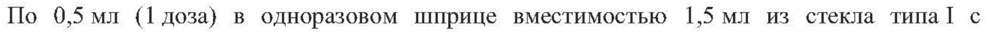

# Streptococcus pneumoniae — парентерально

- Препарат: Пневмовакс® 23 (Вакцина пневмококковая, поливалентная) (раствор для внутримышечного и подкожного введения)
- АТХ: J07AL01
- Источник: ГРЛС, инструкция по медицинскому применению, РУ ЛП-№002310-(РГ-RU), файл от 2023-09-12 (https://grls.rosminzdrav.ru/Grls_View_v2.aspx?routingGuid=7ded6546-8feb-4afd-9a4d-1fce9414a552)
- Распознано автоматически (OCR): 11 из 11 стр.
- Сомнительных строк после OCR: 1 (см. раздел «Проверка распознавания»)
- Проверено вручную строк: 1

## Общие сведения

от 01.09.2023 № 16968 Инструкция по применению лекар сАвённого препарат для 003)
медицинского применения Пневмовакс® 23 (Вакцина пневмококковая, поливалентная)

РЕГИСТРАЦИОННЫЙ НОМЕР:
ТОРГОВОЕ НАЗВАНИЕ: Пневмовакс® 23 (Вакцина пневмококковая, поливалентная}
ГРУППИРОВОЧНОЕ НАЗВАНИЕ: вакцина для профилактики пневмококковых инфекций

## 3. Лекарственная форма

раствор для внутримышечного и подкожного введения
раствор для внутримышечного и подкожного введения

## 2. Состав

Одна доза (0,5 мл} содержит:
Одна доза (0,5 мл} содержит:
Действующие вещества Streptococcus pneumoniae полисахариды (по датской номенклатуре серотипы 1, 2, 3, 4, 5, 6B, 7F, 8, 9N, 9V, 10A, ПЛА, 12Е, 14, 15В, 17F, 18С, 19A, 19F, 20, 22F, 23F, 33F) по 25 мкг каждого серотипа.
Вспомогательные вещества Натрия хлорид 4,5 мг, фенол 1,25 мг, вода для инъекций до 0,5 мл.
ОПИСАНИЕ Прозрачная бесцветная жидкость.
ХАРАКТЕРИСТИКА ПРЕПАРАТА В состав вакцины Пневмовакс® 23 (вакцина для профилактики пневмококковых инфекций, поливалентная} входит смесь высокоочищенных капсульных полисахаридов из 23 наиболее распространённых и инвазивных серотипов Streptococcus pneumoniae.
23-валентная вакцина содержит приблизительно 90% серотипов, вызывающих инвазивные пневмококковые инфекции в развитых и развивающихся странах. В соответствии с научными публикациями в России наиболее распространены серотипы 3, 6B, 14, 19F и 23F. Серотипы, которые наиболее часто являются причиной инвазивной лекарственнорезистентной пневмококковой инфекции, — 6B, 19F, 19A, 23F.
Вакцину Пневмовакс® 23 производят по технологии, разработанной в исследовательских лабораториях компании Мерк Шарп и Доум.
ФАРМАКОТЕРАПЕВТИЧЕСКАЯ ГРУППА: МИБП-вакцина
КОД АТХ: JO7ALO1

СООТВЕТСТВУЕТ ЭКСПЕРТНОМУ ОТЧЕТУ от 01.09.2023 № 16968

Пневмококковая инфекция является одной из ведущих причин смерти во всем мире и одной из основных причин пневмонии, бактериемии, менингита и отита. Штаммы
5. pneumoniae, обладающие лекарственной устойчивостью, становятся все более распространенными в США и в других регионах мира. Сообщается, что в некоторых регионах более 35% штаммов пневмококков устойчивы к пенициллину. Многие устойчивые к пенициллину пневмококки являются также устойчивыми к другим антимикробным препаратам (например, эритромицину, триметоприму-сульфаметоксазолу и цефалоспоринам широкого спектра действия}, что еще раз подчеркивает важность вакцинопрофилактики пневмококковой инфекции.
Иммуногенность Было установлено, что очищенные капсульные полисахариды пневмококков вызывают выработку антител, которые эффективно защищают от пневмококковой инфекции. В клинических исследованиях поливалентной вакцины подтверждена иммуногенность каждого из входящих в состав вакцины 23 типов капсульных антигенов.
Защитные уровни антител к типоспецифическим капсульным антигенам пневмококков обычно появляются к третьей неделе после вакцинации. Бактериальные капсульные полисахариды стимулируют выработку антител, главным образом, посредством механизмов, которые не зависят от участия Т-лимфоцитов. Вследствие этого у детей в возрасте до 2-х лет, чья иммунная система является еще незрелой, иммунный ответ на большинство типов пневмококковых капсульных антигенов, как правило, слабый или неустойчивый.
Продолжительность приобретенного иммунитета
После введения пневмококковой вакцины уровни серотип-специфических антител снижаются через 5-10 лет. У некоторых групп лиц (например, у детей} снижение уровня антител может происходить быстрее. Ограниченные (по количеству} опубликованные данные показывают, что уровни антител могут снижаться более быстрыми темпами у лиц пожилого возраста (старше 60 лет). Эти результаты показывают, что для обеспечения постоянной защиты может потребоваться ревакцинация (см. раздел «ПОКАЗАНИЯ К
ПРИМЕНЕНИЮ», подраздел «Ревакцинация»).
Исследование распространенности серотипов в рамках системы наблюдения за пневмококковыми инфекциями Центра по контролю и профилактике заболеваний США продемонстрировало 57% защитную эффективность вакцинации против инвазивных инфекций, вызванных серотипами, входящими в состав вакцины, у лиц старше 6 лет;
65-84% эффективность у пациентов особых групп (например, лиц с диабетом,

СООТВЕТСТВУЕТ ЭКСПЕРТНОМУ ОТЧЕТУ

от 01.09.2023 № 16968 ишемической болезнью сердца, застойной сердечНоЙ Сб 4 odP bie! СХроНИЧедкой болезнью легких и анатомической аспленией}; и 75% эффективность y иммунокомпетентных лиц старше 65 лет. Эффективность вакцины не была подтверждена для некоторых групп иммунокомпрометированных пациентов, поскольку в группы каждого заболевания не удалось набрать достаточное количество невакцинированных пациентов. Результаты исследования позволяют предположить, что вакцинация может обеспечивать защиту в течение не менее 9 лет с момента получения первой дозы.
В другом исследовании было продемонстрировано снижение эффективности с увеличением времени после вакцинации, особенно у очень пожилых лиц (старше 85 лет}.

## 4.1. Показания к применению

Вакцина Пневмовакс® 23 предназначена для профилактики пневмококковой инфекции, вызываемой типами пневмококка, антигены которых входят в состав вакцины. Вакцина вводится лицам в возрасте 50 лет и старше, а также лицам старше 2 лет с повышенным риском развития пневмококковых инфекций.
Вакцина Пневмовакс® 23 предназначена для профилактики пневмококковой инфекции, вызываемой типами пневмококка, антигены которых входят в состав вакцины. Вакцина вводится лицам в возрасте 50 лет и старше, а также лицам старше 2 лет с повышенным риском развития пневмококковых инфекций.
Иммунокомпетентные лица:

e Плановая вакцинация лиц в возрасте 50 лет и старше.

e Лица старше 2 лет, страдающие хроническими сердечно-сосудистыми заболеваниями (в том числе застойной сердечной недостаточностью и кардиомиопатией), хроническими заболеваниями легких (включая хроническую обструктивную болезнь легких и эмфизему} или сахарным диабетом.

e Лица старше 2 лет, страдающие алкоголизмом, хроническими заболеваниями печени (в том числе цирроз печени} или с вытеканием спинномозговой жидкости.

e Лица старше 2 лет с функциональной или анатомической аспленией (включая серповидно-клеточную анемию и спленэктомию).

e Лица старше 2 лет, живущие в особых условиях внешней среды или особых социальных условиях (в том числе народы Крайнего Севера).

Иммунокомпрометированные лица:

e Лица старше 2 лет, в том числе страдающие ВИЧ-инфекцией, лейкозом, лимфомой, болезнью Ходжкина, множественной миеломой, распространенной злокачественной опухолью, хронической почечной недостаточностью или нефротическим синдромом, лица, получающие иммуносупрессивную химиотерапию (включая кортикостероиды), а также реципиенты после пересадки костного мозга или трансплантации органов (для пациентов из особых групп см. раздел «ОСОБЫЕ УКАЗАНИЯ», подраздел «Сроки вакцинации» }.

Ревакцинация СООТВЕТСТВУЕТ ЭКСПЕРТНОМУ ОТЧЕТУ от 01.09.2023 № 16968

» Обычно ревакцинацию вакциной невмове®2 5 Дун биНолентиЫ 3 Ниц, ранее вакцинированных 23-валентной полисахаридной вакциной, проводить не рекомендуется.

e Tem не менее, однократная ревакцинация вакциной Пневмовакс® 23 рекомендуется лицам от 2 лет и старше, которые подвергаются наибольшему риску серьезных пневмококковых инфекций, и тем, у кого может быстро снизиться уровень антипневмококковых антител, при условии, что прошло по крайней мере пять лет с тех пор, как была введена первая доза пневмококковой вакцины. В группу наиболее высокого риска пневмококковых инфекций входят люди с функциональной или анатомической аспленией (например, страдающие серповидно-клеточной анемией или после спленэктомии}, лица, страдающие ВИЧинфекцией, лейкемией, лимфомой, болезнью Ходжкина, множественной миеломой, распространенной — злокачественной опухолью, хронической — почечной недостаточностью, нефротическим синдромом, или с другими состояниями, связанными с иммуносупрессией (например, пересадка костного мозга или трансплантация органов}, и лица, получающие — иммуносупрессивную химиотерапию (в том числе длительные курсы системных кортикостероидов}
(см. раздел «ОСОБЫЕ УКАЗАНИЯ», подраздел «Сроки вакцинации»).

e У детей 10 лет и младше, относимых к группе высокого риска тяжелых пневмококковых инфекций (например, дети с функциональной или анатомической аспленией, включая серповидно-клеточную анемию или после спленэктомии, или при наличии состояний, связанных с быстрым снижением уровня антител после первичной вакцинации, включая нефротический синдром, почечную недостаточность или после трансплантации почек}, может рассматриваться вопрос о ревакцинации вакциной Пневмовакс® 23 через три года после введения предыдущей дозы вакцины Пневмовакс® 23.

e Если предшествующий статус в отношении вакцинации неизвестен, пациентам из группы высокого риска развития пневмококковых инфекций следует провести прививку пневмококковой вакциной.

e Все лица 65 лет и старше, которые не прививались в течение 5 лет (и находились в возрастной группе младше 65 лет на момент вакцинации}, должны получить еще одну дозу вакцины Пневмовакс® 23. Поскольку данные, касающихся безопасности пневмококковой вакцины при ее введении три или более раз, являются недостаточными, дополнительную вакцинацию после введения второй дозы вакцины обычно проводить не рекомендуется.

СООТВЕТСТВУЕТ ЭКСПЕРТНОМУ ОТЧЕТУ от 01.09.2023 № 16968 e Лицам от 2 лет и старше, подве гающи Я Cabnédnpinemy picky ЭсаВБЕЗных пневмококковых инфекций и ранее привитым конъюгированной пневмококковой вакциной, рекомендуется ревакцинация вакциной Пневмовакс® 23. Интервал между введением конъюгированной пневмококковой вакцины и введением вакцины Пневмовакс® 23 должен быть не менее 8 недель.

## 4.3. Противопоказания

e Гиперчувствительность к любому компоненту вакцины. На случай развития острой анафилактоидной реакции на какой-либо компонент введенной вакцины, наготове должен иметься раствор эпинефрина (1:1000) для немедленного введения.

e Сильная реакция или поствакцинальное осложнение на предыдущее введение.

e Острые инфекционные и неинфекционные заболевания, обострение хронических заболеваний являются временными противопоказаниями для проведения прививок.
Плановые прививки проводятся через 2-4 недели после выздоровления или в период реконвалесценции или ремиссии. При нетяжелых острых респираторных вирусных инфекциях, острых кишечных — заболевания и других — заболеваниях, сопровождающихся повышением температуры, прививки проводятся сразу после нормализации температуры.

e Любое лихорадочное респираторное заболевание или другие острые инфекции являются причиной для Toro, чтобы отложить вакцинацию препаратом
Пневмовакс® 23, кроме случаев, когда по мнению врача подобная задержка влечет за собой еще больший риск.

## 4.3. С осторожностью

Следует проявлять осторожность при введении вакцины лицам, получающим

иммуносупрессивную терапию, лицам с тяжелыми формами нарушений сердечно-

сосудистой и/или легочной функций (см. раздел «ОСОБЫЕ УКАЗАНИЯ»)}.

## 4.6. Применение при беременности и в период грудного вскармливания

ВСКАРМЛИВАНИЯ

Не изучено.

ОСОБЫЕ ГРУППЫ ПАЦИЕНТОВ

Дети

Вакцина Пневмовакс® 23 не применяется у детей младше 2 лет, потому что у детей

данной возрастной группы не развивается эффективный иммунный ответ на капсульные

антигены, входящие в состав полисахаридной вакцины.
СООТВЕТСТВУЕТ ЭКСПЕРТНОМУ ОТЧЕТУ от 01.09.2023 № 16968

Пациенты пожилого возраста (ПОСЛЕДОВАТЕЛЬНОСТЬ 0003)
Клинические исследования вакцины Пневмовакс® 23, в которых принимали участие лица в возрасте 65 лет и старше, проводились до и после регистрации данного препарата. В самом крупном из этих исследований показатели безопасности вакцины Пневмовакс® 23 при ее использовании у взрослых в возрасте 65 лет и старше (п = 629} сравнивали с безопасностью Пневмовакс® 23 при введении взрослым пациентам возрастной группы от 50 до 64 лет (п = 379). Участники этого исследования были амбулаторными пациентами, и распространенность связанных с возрастом хронических заболеваний была ожидаемой.
Клинические данные не позволили выявить повышенную частоту и тяжесть нежелательных реакций у лиц в возрасте старше 65 лет, по сравнению с показателями у пациентов из группы 50—64 лет. Однако, поскольку толерантность пожилых людей в отношении медицинских вмешательств может быть не такой, как у более молодых пациентов, нельзя исключать более высокую частоту и/или более выраженную тяжесть реакций у некоторых пожилых людей. Были получены постмаркетинговые сообщения, в которых отмечалось, что у некоторых ослабленных пожилых людей с несколькими сопутствующими заболеваниями после проведения вакцинации имели место тяжелые нежелательные явления и осложнение клинического течения имевшихся заболеваний.

## 4.2. Способ применения и дозы

Способ введения:
Способ введения:
ТОЛЬКО ДЛЯ ВНУТРИМЫШЕЧНОГО ИЛИ ПОДКОЖНОГО ВВЕДЕНИЯ!
Не вводить внутривенно или внутрикожно!
Перед введением содержимое флакона или шприца проверяют на наличие механических частиц и изменение цвета. Вакцина Пневмовакс® 23 — прозрачная бесцветная жидкость.
Вакцину Пневмовакс® 23 вводят в объеме 0,5 мл подкожно или внутримышечно
(предпочтительно в дельтовидную мышцу или боковую поверхность средней части бедра), соблюдая при этом необходимые меры предосторожности, чтобы избежать внутрисосудистого введения.
Для предотвращения передачи возбудителей инфекций от одного человека к другому важно использовать отдельный стерильный шприц и иглу для каждого конкретного пациента.
Разведения или восстановления препарата не требуется.
Введение вакцины, поставляемой во флаконе
Содержимое флакона полностью набирают в шприц, не содержащий консервантов, антисептиков и детергентов.
Введение вакцины, поставляемой в предварительно заполненном шприце

СООТВЕТСТВУЕТ ЭКСПЕРТНОМУ ОТЧЕТУ от 01.09.2023 № 16968

Предварительно заполненный шприц преди азначен Чейн Дор днокрафието> peeheHus.
Вводят все содержимое шприца.

## 4.8. Побочное действие

В клиническом исследовании вакцины Пневмовакс® 23 принимали участие впервые вакцинируемые и ревакцинируемые взрослые пациенты, среди которых 379 лиц было в возрасте от 50 до 64 лет и 629 лиц в возрасте 65 лет и старше. Частота появления реакций в месте инъекции у вакцинируемых впервые и ревакцинируемых пациентов была 72,8% и 79,6% соответственно у лиц в возрасте от 50 до 64 лети 52,9% и 79,3% соответственно у лиц в возрасте 65 лет и старше. Частота появления реакций в месте инъекции в старшей возрастной группе ревакцинируемых была сравнима с частотой, наблюдаемой в младшей возрастной группе ревакцинируемых. Реакции в месте инъекции появлялись в течение трех дней после вакцинации и обычно исчезали на пятый день после вакцинации. Частота появления системных реакций у вакцинируемых впервые и ревакцинируемых пациентов была 48,8% и 47,4% соответственно у лиц в возрасте от 50 до 64 лет и 32,1% и 39,1% соответственно у лиц в возрасте 65 лет и старше. Частота появления установленных вакцин-ассоциированных системных реакций у вакцинируемых впервые и ревакцинируемых пациентов была 35,5% и 37,5% соответственно у лиц в возрасте от 50 до 64 лет и 21,7% и 33,1% соответственно у лиц в возрасте 65 лет и старше. Частота появления системных и вакцин-ассоциированных системных реакций в старшей возрастной группе ревакцинируемых была сравнима с частотой, наблюдаемой в младшей возрастной группе ревакцинируемых.
В клиническом исследовании вакцины Пневмовакс® 23 принимали участие впервые вакцинируемые и ревакцинируемые взрослые пациенты, среди которых 379 лиц было в возрасте от 50 до 64 лет и 629 лиц в возрасте 65 лет и старше. Частота появления реакций в месте инъекции у вакцинируемых впервые и ревакцинируемых пациентов была 72,8% и 79,6% соответственно у лиц в возрасте от 50 до 64 лети 52,9% и 79,3% соответственно у лиц в возрасте 65 лет и старше. Частота появления реакций в месте инъекции в старшей возрастной группе ревакцинируемых была сравнима с частотой, наблюдаемой в младшей возрастной группе ревакцинируемых. Реакции в месте инъекции появлялись в течение трех дней после вакцинации и обычно исчезали на пятый день после вакцинации. Частота появления системных реакций у вакцинируемых впервые и ревакцинируемых пациентов была 48,8% и 47,4% соответственно у лиц в возрасте от 50 до 64 лет и 32,1% и 39,1% соответственно у лиц в возрасте 65 лет и старше. Частота появления установленных вакцин-ассоциированных системных реакций у вакцинируемых впервые и ревакцинируемых пациентов была 35,5% и 37,5% соответственно у лиц в возрасте от 50 до 64 лет и 21,7% и 33,1% соответственно у лиц в возрасте 65 лет и старше. Частота появления системных и вакцин-ассоциированных системных реакций в старшей возрастной группе ревакцинируемых была сравнима с частотой, наблюдаемой в младшей возрастной группе ревакцинируемых.
Среди наиболее распространенных системных нежелательных явлений были астения/усталость, миалгия и головная боль. Симптоматическое лечение приводило к полному выздоровлению в большинстве случаев.
Ниже представлены нежелательные реакции, которые наблюдались во время клинических исследований и/или в пострегистрационном периоде. Частота нежелательных реакций определялась следующим образом: очень часто (21/10), часто (21/100, но <1/10), нечасто
(>1/1000, но <1/100}, редко (=1/10000, но <1/1000), очень редко (< 1/10000), неизвестно
(частоту данных нежелательных реакций невозможно установить из имеющихся данных, поскольку они были получены добровольно от населения неизвестного количественного состава).
Нарушения со стороны крови и лимфатической системы
Неизвестно: гемолитическая анемия“, лейкоцитоз, лимфаденит, лимфаденопатия, тромбоцитопения**

СООТВЕТСТВУЕТ ЭКСПЕРТНОМУ ОТЧЕТУ от 01.09.2023 № 16968

Нарушения со стороны иммунной системы (ПОСЛЕДОВАТЕЛЬНОСТЬ 0003)
Неизвестно: анафилактоидные реакции, отек Квинке, сывороточная болезнь
Нарушения со стороны нервной системы Неизвестно: фебрильные судороги, синдром Гийена-Барре, головная боль, парестезии, радикулоневропатия
Нарушения со стороны желудочно-кишечного тракта
Неизвестно: тошнота, рвота Нарушения со стороны кожи и подкожных тканей
Неизвестно: сыпь, крапивница, мультиформная эритема
Нарушения со стороны скелетно-мышечной и соединительной ткани
Неизвестно: артралгия, артрит, миалгия Общие расстройства и нарушения в месте введения
Очень часто: лихорадка (< 38,8°С} и следующие реакции в месте введения: эритема, местное уплотнение, болезненность, чувствительность, отек, прилив тепла
Редко: флегмона в месте инъекции!
Неизвестно: астения, озноб, лихорадка, снижение подвижности конечности, в которую была сделана инъекция, недомогание, периферический отек!
Лабораторные и инструментальные данные Неизвестно: повышение уровня С-реактивного белка
* у пациентов, имевших иные гематологические заболевания
** у пациентов со стабилизированной идиопатической тромбоцитопенической пурпурой
+ с быстрым появлением после введения вакцины
+? конечности, в которую была сделана инъекция

## 4.9. Передозировка

Данные о случаях передозировки отсутствуют.
Данные о случаях передозировки отсутствуют.

## 4.5. Взаимодействие с другими лекарственными средствами

Применение с другими вакцинами Пневмококковую вакцину можно вводить одновременно с вакциной для профилактики гриппа {которую вводят в другую руку). Такое введение не приводит к повышению частоты побочных эффектов или снижению интенсивности иммунного ответа на введение каждой из вакцин. Пневмококковую вакцину можно вводить одновременно (в один день} с другими вакцинами (за исключением вакцин для профилактики туберкулеза} в разные участки тела с использованием разных шприцев. (Информация об интервале между введением конъюгированной пневмококковой вакцины и введением вакцины

СООТВЕТСТВУЕТ ЭКСПЕРТНОМУ ОТЧЕТУ от 01.09.2023 № 16968

Пневмовакс® 23 представлена в разделе «Покаваййя” к ‘арименанию. Таба Неле
«Ревакцинация»).

## 4.4. Особые указания

Вакцинация с использованием вакцины Пневмовакс® 23 не будет защищать от заболеваний, вызываемых пневмококками тех капсульных типов, которые не входят в состав данной вакцины.
Вакцинация с использованием вакцины Пневмовакс® 23 не будет защищать от заболеваний, вызываемых пневмококками тех капсульных типов, которые не входят в состав данной вакцины.
Если введение вакцины Пневмовакс® 23 осуществляется лицам, получающим иммуносупрессивную терапию, уровень сывороточных антител может быть ниже ожидаемого и может иметь место недостаточность иммунного ответа на антигены пневмококка (см. подраздел «Сроки вакцинации» }.
Внутрикожное введение может вызвать тяжелые местные побочные реакции.
Как и в случае любой вакцины, вакцинация препаратом Пневмовакс® 23 может не привести к полной защите всех привитых.
Вакцинация препаратом Пневмовакс® 23 может оказаться неэффективной для предотвращения инфекции, возникшей в результате перелома основания черепа или вытекания спинномозговой жидкости во внешнюю среду.
У пациентов, состояние которых требует введения пенициллина (или других антибиотиков} для профилактики пневмококковой инфекции, такая профилактика не должна прекращаться после вакцинации препаратом Пневмовакс® 23.
Следует проявлять oco6oe внимание и принимать соответствующие меры предосторожности при введении препарата Пневмовакс® 23 лицам с тяжелыми формами нарушений сердечно-сосудистой и/или легочной функций.
Сроки вакцинации При некоторых заболеваниях пневмококковая вакцина должна быть введена не менее чем за две недели до плановой спленэктомии. При планировании химиотерапии рака или других вариантов иммуносупрессивной терапии (например, у пациентов с болезнью
Ходжкина или у тех, кому предстоит пересадка костного мозга или трансплантация органов} интервал между вакцинацией и началом иммуносупрессивной терапии должен составлять не менее двух недель. Проведения вакцинации во время химиотерапии или лучевой терапии следует избегать. Пневмококковая вакцина может быть введена спустя несколько месяцев после завершения химиотерапии или лучевой терапии опухолевых заболеваний. При болезни Ходжкина после интенсивной химиотерапии (в комбинации с лучевой терапией или без Hee) иммунный ответ на вакцинацию может быть снижен в течение двух лет и более. У некоторых пациентов в течение двух лет после завершения химиотерапии или других вариантов иммуносупрессивной терапии (в комбинации с

СООТВЕТСТВУЕТ ЭКСПЕРТНОМУ ОТЧЕТУ от 01.09.2023 № 16968

лучевой терапией или без нее} наблюдается значит ЛЬ Нов Ани им унНнот о бЕВета, особенно с увеличением интервала между окончанием лечения и введением пневмококковой вакцины.
Лица с бессимптомной или клинически выраженной ВИЧ-инфекцией должны быть привиты как можно скорее после установления указанного диагноза.

## 4.7. Влияние на способность управлять транспортными средствами, механизмами

Влияние вакцины на способность управлять транспортными средствами и работать с механизмами не изучалось.

## 6.5. Форма выпуска

Раствор для внутримышечного и подкожного введения.
Раствор для внутримышечного и подкожного введения.
Флакон По 0,5 мл (1 доза} во флаконе из бесцветного стекла вместимостью 3 мл. Флакон укупорен бромбутиловой пробкой с силиконовым покрытием, под алюминиевой обкаткой и закрыт отщелкивающейся пластиковой крышкой с контролем первого вскрытия.
1 флакон с вакциной помещен в пачку картонную с инструкцией по медицинскому применению. Может присутствовать контроль вскрытия упаковки.
Одноразовый шприц По 0,5 мл (1 доза} в одноразовом шприце вместимостью 1,5 мл из стекла типа[ с адаптером типа «Луер-Лок», защитным стиролбутадиеновым колпачком, соединенным с пластиковой крышечкой, и поршнем, покрытым пробкой из бромбутила.
1 одноразовый шприц с иглой из нержавеющей стали (или без иглы), помещен в контурную упаковку, покрытую плёнкой с логотипом фирмы (графический символ и аббревиатура на латинице} или без него.
1 контурная упаковка помещена в пачку картонную с инструкцией по применению.
Может присутствовать контроль вскрытия упаковки.
10 контурных упаковок помещено в пачку картонную с инструкцией по медицинскому применению. Может присутствовать контроль вскрытия упаковки.

## 6.4. Условия хранения

Хранить при температуре от 2 до 8 °С в защищенном от света месте.
Хранить при температуре от 2 до 8 °С в защищенном от света месте.
Хранить в недоступном для детей месте.

## 6.3. Срок годности

2 года.
2 года.
Не использовать после истечения срока годности, указанного на упаковке.

от 01.09.2023 № 16968

УСЛОВИЯ ОТПУСКА (ПОСЛЕДОВАТЕЛЬНОСТЬ 0003)
Отпускают по рецепту.
ЮРИДИЧЕСКОЕ ЛИЦО, НА ИМЯ КОТОРОГО ВЫДАНО РЕГИСТРАЦИОННОЕ
УДОСТОВЕРЕНИЕ Мерк Шарп и Доум Б.В., Нидерланды
ПРОИЗВОДИТЕЛЬ Произведено:
Мерк Шарп и Доум ЛЛС, США Merck Sharp & Dohme LLC, 770 Sumneytown Pike, West Point, Pennsylvania 19486, USA
Выпускающий контроль качества:
Мерк Шарп и Доум Б.В., Нидерланды Merck Sharp & Dohme B.V., Waarderweg 39, 2031 ВМ Haarlem, The Netherlands
ПРЕТЕНЗИИ ПОТРЕБИТЕЛЕЙ НАПРАВЛЯТЬ ПО АДРЕСУ:
ООО «МСД Фармасьютикалс»
ул. Тимура Фрунзе, д. 11, стр. 1, г. Москва, Россия, 119021 тел.: (495) 916-71-00; факс: (495) 916-70-94
## Проверка распознавания

Страницы-сканы распознаны автоматически. В 1 строках с дозировками цифры могли распознаться с ошибкой — сверьте с вырезкой из оригинала:

- стр. 10: «По 0,5 мл (1 доза} в одноразовом шприце вместимостью 1,5 мл из стекла типа[ с» — низкая уверенность: «0,5» (55), «(1» (55)  
  
