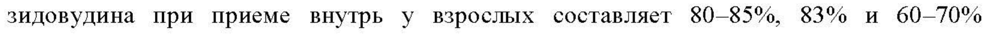
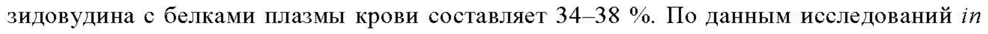
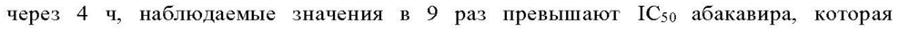
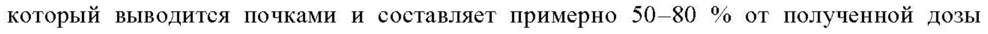
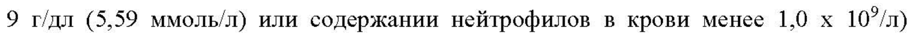
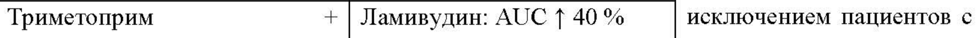
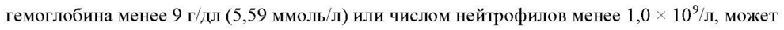

# Абакавир + Зидовудин + Ламивудин — внутрь

- Препарат: Акимасол (таблетки, покрытые пленочной оболочкой)
- АТХ: J05AR04
- Источник: ГРЛС, инструкция по медицинскому применению, РУ ЛП-№001458-(РГ-RU), файл от 2022-12-14 (https://grls.rosminzdrav.ru/Grls_View_v2.aspx?routingGuid=e206c757-a945-4e10-abd7-49bc0d44a562)
- Распознано автоматически (OCR): 32 из 32 стр.
- Сомнительных строк после OCR: 7 (см. раздел «Проверка распознавания»)

## Общие сведения

СООТВЕТСТВУЕТ ЭКСПЕРТНОМУ ОТЧЕТУ от 23.11.2022 № 27270
ИНСТВУКПИЯПОСЛЕДОВАТЕЛЬНОСТЬ 0001)
по медицинскому применению лекарственного препарата
Акимасол Регистрационный номер:
Торговое наименование: Акимасол Международное непатентованное или группировочное наименование:
абакавир + зидовудин + ламивудин Лекарственная форма: таблетки, покрытые пленочной оболочкой
Состав на 1 таблетку Действующие вещества:
Абакавира сульфат 351,0 мг в пересчете на абакавир 300,0 мг
Зидовудин 300,0 мг Ламивудин 150,0 мг Вспомогательные вещества
Ядро: гипролоза низкозамещенная — 199,8 мг; гипромеллоза E15 — 3,2 мг; натрия карбоксиметилкрахмал — 58,0 мг, магния стеарат — 12,0 мг; целлюлоза микрокристаллическая — 216,0 мг.
Состав водорастворимой пленочной оболочки: гипромеллоза Е5 — 21,0 мг, макрогол 6000
— 2,7 мг, полисорбат 80 — 0,3 мг, титана диоксид — 6,0 мг.
Описание Таблетки, покрытые пленочной оболочкой белого цвета, двояковыпуклые, овальной формы. На поперечном разрезе таблетки белого или почти белого цвета.
Фармакотерапевтическая группа противовирусные средства системного действия; противовирусные средства прямого действия; комбинации противовирусных средств для лечения ВИЧ-инфекции.
Код ATX: JOSARO4 Фармакологические свойства

## 5.1. Фармакодинамика

Механизм действия Ламивудин, зидовудин и абакавир относятся к группе нуклеозидных аналогов ингибиторов обратной транскриптазы и являются мощными селективными ингибиторами ВИЧ-1 и ВИЧ-2.
Механизм действия Ламивудин, зидовудин и абакавир относятся к группе нуклеозидных аналогов ингибиторов обратной транскриптазы и являются мощными селективными ингибиторами ВИЧ-1 и ВИЧ-2.
Все три активных компонента препарата Акимасол — последовательно
СООТВЕТСТВУЕТ ЭКСПЕРТНОМУ ОТЧЕТУ

метаболизируются под действием внутр клеточнЫ® Кина MO! собтБетСтвУюНиХ 5'- трифосфатов (ТФ). Ламивудин-ТФ, абакавир-ТФ и зидовудин-ТФ выступают в качестве субстрата и являются конкурентными ингибиторами обратной транскриптазы
ВИЧ. Однако их основное противовирусное действие заключается в способности встраиваться в форме монофосфата в цепь вирусной ДНК, приводя к ее обрыву.
Трифосфаты ламивудина, абакавира и зидовудина проявляют значительно меньшее сродство к ДНК-полимеразам клетки-хозяина.
Не отмечалось антагонизма в противовирусной активности абакавира в культуре клеток при комбинации с нуклеозидными ингибиторами обратной транскриптазы
(НИОТ) диданозином, эмтрицитабином, ламивудином, ставудином, тенофовиром, залцитабином или зидовудином, ненуклеозидным ингибитором обратной транскриптазы (ННИОТ) невирапином или ингибитором протеазы (ИП) ампренавиром.
Не отмечалось антагонистических эффектов in vitro при одновременном применении ламивудина и других антиретровирусных препаратов (исследованные вещества:
абакавир, диданозин, невирапин, залцитабин и зидовудин). Не отмечалось антагонистических эффектов in vitro при одновременном применении зидовудина и других антиретровирусных препаратов (исследованные вещества: абакавир, диданозин, ламивудин и интерферон альфа).
Фармакодинамические эффекты Резистентные к абакавиру штаммы ВИЧ-1 были получены in vitro и характеризуются специфичными генотипическими изменениями в кодонах обратной транскриптазы
(ОТ) (кодоны M184V, K65R, L74V и У115Е). Резистентность вируса к абакавиру т vitro и т vivo формируется относительно медленно. Для клинически значимого увеличения ICso (ингибирующая концентрация в отношении 50% штаммов) в 8 раз относительно «дикого» штамма вируса требуются множественные мутации.
Резистентные к абакавиру штаммы могут также проявлять сниженную чувствительность к ламивудину, залцитабину и/или диданозину, но сохранять чувствительность к зидовудину и ставудину. Неэффективность терапии первой линии, включающей абакавир, ламивудин и зидовудин, преимущественно связана с M184V, что сохраняет возможность широкого выбора режимов терапии второй линии.
Развитие перекрестной резистентности между абакавиром, зидовудином или ламивудином и ингибиторами протеазы или ННИОТ маловероятна. Штаммы ВИЧ со сниженной чувствительностью к абакавиру были выделены у пациентов с неконтролируемой репликацией вируса, у которых предшествующая терапия другими
НИОТ была неэффективна.

СООТВЕТСТВУЕТ ЭКСПЕРТНОМУ ОТЧЕТУ от 23.11.2022 № 27270

## 5.2. Фармакокинетика

Всасывание При приеме внутрь ламивудин, абакавир и зидовудин быстро и хорошо всасываются в желудочно-кишечном тракте. Абсолютная биодоступность ламивудина, абакавира и зидовудина при приеме внутрь у взрослых составляет 80-85%, 83% и 60-70% соответственно. Прием пищи уменьшает скорость всасывания абакавира, зидовудина, ламивудина, приводя к незначительному снижению максимальной концентрации
(Стах) (в среднем на 18-32%) и увеличению времени достижения максимальной концентрации (tmax) (примерно на | 4), но не влиял на степень всасывания (AUC).
Эти изменения фармакокинетических параметров не считаются клинически значимыми, поэтому препарат Акимасол можно принимать вне зависимости от приема пищи.
Распределение Исследования показали, что при внутривенном введении средний кажущийся объем распределения ламивудина, абакавира и зидовудина составляет 1,3 л/кг, 0,8 л/кг и 1,6 л/кг соответственно. Ламивудин характеризуется линейной фармакокинетикой в терапевтическом диапазоне доз и незначительным связыванием с основным белком плазмы крови альбумином (менее 36 % сывороточного альбумина in vitro). Связывание зидовудина с белками плазмы крови составляет 34—38 %. По данным исследований т vitro абакавир в терапевтических концентрациях связывается с белками плазмы крови человека слабо или умеренно (примерно 49 %). Это указывает на низкую вероятность взаимодействий с другими лекарственными препаратами посредством их вытеснения из связи с белками плазмы крови. Следовательно, при применении препарата
Акимасол не ожидаются взаимодействия с лекарственными препаратами посредством их вытеснения из связи с белками плазмы крови.
Имеющиеся данные свидетельствуют о том, что ламивудин, абакавир и зидовудин проникают через гематоэнцефалический барьер и попадают в спинномозговую жидкость (СМЖ). Отношение концентрации ламивудина и зидовудина в СМЖ к их сывороточной концентрации через 2—4 ч после приема внутрь составляет в среднем около 0,12 и 0,5 соответственно. Истинная степень проникновения ламивудина в ЦНС, как и клиническое значение этого явления, до настоящего времени не установлены.
По данным исследований у ВИЧ-инфицированных пациентов, абакавир хорошо проникает в СМЖ, при этом отношение AUC абакавира в СМЖ к AUC в плазме крови составляет 30—44 %. В фармакокинетическом исследовании I фазы изучалось проникновение абакавира в СМЖ после применения в дозе 300 мг два раза в сутки.

от 23.11.2022 № 27270

Средняя концентрация абакавира в СМ дости ВЕ : Jos БПЬНОСЬЬ ait Ma И составляла 0,14 мкг/мл. В другом исследовании фармакокинетики при применении абакавира в дозе 600 мг два раза в сутки его концентрация в СМЖ увеличивалась со временем, достигая около 0,13 мкг/мл через 0,5—1 ч после приема, и около 0,74 мкг/мл через 3—4 ч после приема. Хотя максимальная концентрация может быть не достигнута через 4 4, наблюдаемые значения в 9 раз превышают 1С5о абакавира, которая составляет 0,08 мкг/мл или 0,26 мкмоль/Л.
Метаболизм Ламивудин практически не подвергается метаболизму и выводится преимущественно в неизменном виде почками. Метаболические взаимодействия ламивудина с другими препаратами маловероятны вследствие низкой степени его метаболизма в печени (5—10
%) и незначительного связывания с белками плазмы крови.
Основным метаболитом зидовудина в плазме крови и моче является 5’-глюкуронид, который выводится почками и составляет примерно 50-80 % от полученной дозы препарата. Другим метаболитом зидовудина является 3’-амино-3’-дезокситимидин
(АМТ), образующийся при внутривенном введении.
Абакавир метаболизируется главным образом в печени, менее 2 % введенной дозы выводится почками в неизмененном виде. В организме человека абакавир метаболизируется в основном под действием алкогольдегидрогеназы с образованием 5’-карбоновой кислоты и путем конъюгации с глюкуроновой кислотой с образованием 5’-глюкуронида, что составляет около 66 % от общего количества препарата, выводимого почками.
Выведение Период полувыведения ламивудина составляет 18—19 ч. Средний системный клиренс ламивудина составляет около 0,32 л/ч/кг, большую его часть занимает почечный клиренс (более 70 %), осуществляемый посредством системы транспорта органических катионов. В исследованиях с участием пациентов с почечной недостаточностью было показано, что нарушение функции почек влияет на выведение ламивудина. Пациентам с клиренсом креатинина, равным 50 мл/мин и менее, необходимо снижение дозы.
По данным исследований с внутривенным введением зидовудина его средний конечный период полувыведения из плазмы крови составлял 1,1 4, а средний системный клиренс — 1,6 л/ч/кг. Расчетный почечный клиренс зидовудина составляет 0,34 л/ч/кг, что указывает на клубочковую фильтрацию и активную канальцевую секрецию почками. У пациентов с тяжелым нарушением функции почек концентрация зидовудина в плазме крови повышена.

СООТВЕТСТВУЕТ ЭКСПЕРТНОМУ ОТЧЕТУ

Средний период полувыведения абакавира ОН ree ВбнолаЬНО5- 100 деле многократного приема абакавира в дозе 300 мг два раза в сутки значимая кумуляция не наблюдается. Выведение абакавира осуществляется посредством метаболизма в печени с последующей экскрецией метаболитов преимущественно почками. Около 83% введенной дозы абакавира выводится почками в виде метаболитов и абакавира в неизмененном виде, оставшееся количество выводится через кишечник.
Особые группы пациентов Пациенты пожилого возраста
Данные по фармакокинетике препарата у пациентов старше 65 лет отсутствуют.
Пациенты с нарушением функции почек В исследованиях с участием пациентов с почечной недостаточностью было показано, что нарушение функции почек влияет на выведение ламивудина вследствие снижения почечного клиренса. Пациентам с клиренсом креатинина менее 50 мл/мин требуется снижение дозы. Также было показано, что у пациентов с тяжелым нарушением функции почек повышена концентрация зидовудина в плазме крови. Абакавир метаболизируется главным образом в печени, менее 2 % его выводится почками в неизмененном виде.
Фармакокинетика абакавира у пациентов с терминальной стадией почечной недостаточности сходна с таковой у пациентов с нормальной функцией почек.
Поскольку у пациентов со сниженной функцией почек (клиренс креатинина менее 50 мл/мин) может потребоваться коррекция дозы ламивудина и зидовудина, таким пациентам рекомендуется применять ламивудин, зидовудин и абакавир в виде отдельных препаратов.
Пациенты с нарушением функции печени Отсутствуют данные по применению препарата Акимасол у пациентов с нарушением функции печени. Ограниченные данные, полученные у пациентов с циррозом печени, указывают на возможность кумуляции зидовудина в связи со снижением скорости образования глюкуронида. Данные, полученные при применении ламивудина у пациентов с нарушением функции печени средней и тяжелой степени, указывают на то, что нарушение функции печени не оказывает существенного влияния на фармакокинетику ламивудина.
Абакавир метаболизируется главным образом в печени. Фармакокинетика абакавира изучалась у пациентов с нарушением функции печени легкой степени (5—6 баллов по шкале Чайлд-Пью). Результаты исследования свидетельствуют об увеличении AUC абакавира в среднем в 1,89 раза и увеличении периода полувыведения абакавира в 1,58 раза. Нарушение функции печени не влияет на значение AUC метаболитов абакавира, однако скорость их образования и выведения при этом снижается. Следовательно, у

СООТВЕТСТВУЕТ ЭКСПЕРТНОМУ ОТЧЕТУ от 23.11.2022 № 27270

пациентов с нарушением функции печени легкой letter “tpesveres МейьшьнИО Нозы

абакавира.

Фармакокинетика абакавира у пациентов с нарушением функции печени средней и

тяжелой степени не изучалась, поэтому применение препарата Акимасол у этих групп

пациентов не рекомендуется.

## 4.1. Показания к применению

® Лечение ВИЧ-инфекции у взрослых и детей старше 12 лет в составе

антиретровирусной терапии.

## 4.3. Противопоказания

® Повышенная чувствительность к абакавиру, ламивудину или зидовудину или любому другому компоненту препарата;

® печеночная недостаточность средней и тяжелой степени (класс В и С по шкале
Чайлд-Пью), в связи с отсутствием клинических данных и рекомендованного режима дозирования;

® печеночная недостаточность легкой степени (класс А по шкале Чайлд-Пью), в связи с невозможностью обеспечить режим дозирования;

® нарушение функции почек (клиренс креатинина менее 50 мл/мин);

® выраженное снижение содержания нейтрофилов (менее 0,75 x 10’/л) или концентрации гемоглобина (менее 7,5 г/дл или 4,65 ммоль/л) из-за содержания зидовудина;

* возраст до 12 лет (в связи с отсутствием возможности коррекции дозы);

® масса тела менее 40 кг (в связи с отсутствием рекомендованного режима дозирования).

## 4.3. С осторожностью

® Угнетении костномозгового кроветворения (при концентрации гемоглобина менее 9 г/дл (5,59 ммоль/л) или содержании нейтрофилов в крови менее 1,0 x 10°/л)
может потребоваться коррекция дозы зидовудина, при развитии этих нежелательных реакций абакавир, зидовудин и ламивудин применяют в виде отдельных препаратов.

® Панкреатит (в том числе в анамнезе).

® Гепатомегалия, гепатит, любые факторы риска заболеваний печени.

® Наличие факторов риска развития ишемической болезни сердца.

® Пожилой возраст.

## 4.6. Применение при беременности и в период грудного вскармливания

СООТВЕТСТВУЕТ ЭКСПЕРТНОМУ ОТЧЕТУ от 23.11.2022 № 27270

Фертильность (ПОСЛЕДОВАТЕЛЬНОСТЬ 0001)
Отсутствуют данные по влиянию абакавира, ламивудина и зидовудина На фертильность у женщин. В отношении зидовудина показано, что его применение у мужчин не влияет на число, морфологию и подвижность сперматозоидов.
Беременность Безопасность применения препарата Акимасол у женщин во время беременности до настоящего времени не изучена. Имеются данные исследований о влиянии абакавира, ламивудина и зидовудина на развитие плода у животных. Поэтому во время беременности препарат Акимасол назначают только в том случае, если предполагаемая польза для матери превышает потенциальный риск для плода.
Имеются данные о незначительном транзиторном повышении концентрации лактата в плазме крови, возможно, вследствие митохондриальных нарушений, у новорожденных и грудных детей, матери которых во время беременности и в перинатальном периоде принимали нуклеозидные ингибиторы обратной транскриптазы. Клиническая значимость этого повышения в настоящее время не установлена.
Кроме того, имеются отдельные сообщения о задержке развития, судорожных припадках и других неврологических нарушениях, например, увеличение тонуса мыпщ. Однако причинно-следственная связь этих нарушений с действием НИОТ во время внутриутробного и перинатального периодов не установлена. Эти данные не отменяют существующих рекомендаций по проведению антиретровирусного лечения во время беременности для предотвращения вертикальной передачи ВИЧ.
Период грудного вскармливания Специалисты не рекомендуют ВИЧ-инфицированным пациенткам грудное вскармливание, чтобы избежать передачи ВИЧ-инфекции ребенку. Поскольку абакавир, его метаболиты и ВИЧ проникают в трудное молоко, грудное вскармливание противопоказано.

## 4.2. Способ применения и дозы

Препарат Акимасол предназначен для приема внутрь, независимо от приема пищи.
Препарат Акимасол предназначен для приема внутрь, независимо от приема пищи.
Терапия должна проводиться врачом, имеющим опыт лечения ВИЧ-инфекции.
Взрослые и дети старше 12 лет Рекомендуемая доза препарата Акимасол для взрослых и детей старше 12 лет — по 1 таблетке 2 раза в сутки.
Препарат Акимасол не применяют у подростков и взрослых с массой тела менее 40 кг, поскольку данный препарат представляет собой комбинацию фиксированных доз, в связи с чем снижение дозы для каждого действующего вещества в отдельности

СООТВЕТСТВУЕТ ЭКСПЕРТНОМУ ОТЧЕТУ от 23.11.2022 № 27270

невозможно. При необходимости отмены йли сниЖжёНИя дозы оно Hy mete Te : щих веществ препарата Акимасол следует применять отдельные препараты абакавира, ламивудина и зидовудина (необходимо обратиться к инструкциям по применению для данных лекарственных средств).
Особые группы пациентов Пациенты пожилого возраста
Данные по фармакокинетике препарата Акимасол у лиц старше 65 лет отсутствуют. В связи с возможностью возрастных изменений, включая снижение функции почек и гематологические нарушения, назначение препарата Акимасол лицам данной возрастной группы требует особой осторожности.
Пациенты с нарушением функции почек Хотя для пациентов с нарушением функции почек коррекция дозы абакавира не требуется, концентрации ламивудина и зидовудина повышаются у пациентов с почечной недостаточностью из-за снижения клиренса (см. раздел «Особые указания»).
В связи с этим, пациентам с нарушением функции почек (клиренс креатинина < 50 мл/мин) рекомендуется применять абакавир, ламивудин и зидовудин в виде отдельных препаратов. Акимасол не следует назначать пациентам с терминальной стадией почечной недостаточности (см. разделы «Противопоказания» и «Фармакокинетика»).
Пациенты с нарушением функции печени Абакавир в первую очередь метаболизируется в печени. Клинические данные для пациентов со средней или тяжелой печеночной недостаточностью отсутствуют, поэтому применение препарата Акимасол не рекомендуется, если не будет признано необходимым. У пациентов с легкой степенью печеночной недостаточности (5—6 баллов по шкале Чайлд-Пью) требуется тщательный мониторинг, включая мониторинг уровней абакавира в плазме, если это возможно (см. разделы «Противопоказания» и
«Фармакокинетика»).
Коррекция дозы при развитии гематологических нежелательных реакций
При концентрации гемоглобина менее 9 г/дл (5,59 ммоль/л) или содержании нейтрофилов в крови менее 1,0 x 10’/л может потребоваться коррекция дозы зидовудина. Поэтому у таких пациентов следует применять абакавир, зидовудин и ламивудин в виде отдельных препаратов.
Дети Безопасность и эффективность Акимасола у детей в возрасте от 0 до 12 лет на данный момент не установлены. Данные отсутствуют.

## 4.8. Побочное действие

СООТВЕТСТВУЕТ ЭКСПЕРТНОМУ ОТЧЕТУ от 23.11.2022 № 27270
Поскольку в состав препарата Акимасол вкодят абакавир- аминь ли ИС ЧидовЗ Dott OH может вызывать Те же нежелательные реакции, что и эти три действующих вещества в отдельности (см. таблицу 1). Для многих указанных ниже нежелательных реакций остается неясным, связано ли их появление с одним из действующих веществ либо с другими лекарственными препаратами широкого спектра для лечения ВИЧ-инфекции, или же они обусловлены основным заболеванием. В клинических исследованиях оценка профиля безопасности препарата Акимасол до настоящего времени не проводилась.
Табличное резюме нежелательных реакций Нежелательные реакции (НР), характерные для приема абакавира, ламивудина и зидовудина сгруппированы по системам и органам в соответствии со словарем Мед ОКА и классификацией частоты развития НР ВОЗ: очень часто (21/10), часто (21/100, но <1/10), нечасто (21/1 000, но <1/100), редко (21/10 000, но <1/1 000), очень редко (<1/10 000), частота неизвестна (на основании имеющихся данных оценить невозможно). Категории частоты были сформированы на основании данных клинических исследований препарата и пострегистрационного наблюдения.
Таблица 1. Нежелательные реакции каждого из действующих веществ препарата
Акимасол (нежелательные реакции, возникающие не менее, чем у 5 % пациентов, выделены полужирным шрифтом)
«Особые указания»
Абакавир Ламивудин Зидовудин организма Нарушения со Нечасто: анемия, Часто: анемия, стороны крови и нейтропения, нейтропения, лимфатической тромбоцитопения. лейкопения. Нечасто:
системы Очень редко: тромбоцитопения, истинная панцитопения эритроцитарная (вследствие аплазия. гипоплазии костного мозга). Редко:
истинная эритроцитарная аплазия. Очень редко:
СООТВЕТСТВУЕТ ЭКСПЕРТНОМУ ОТЧЕТУ от 23.11.2022 № 27270
— ae ALITA HCC KAA анемия Po Нарушения co Часто:
стороны гиперчувствительно иммунной СТЬ.
системы Нарушения Часто: анорексия. Очень редко: Редко: анорексия, метаболизма и Очень редко: лактоацидоз. лактоацидоз без питания лактоацидоз. гипоксемии.
Психические Редко: тревога, нарушения депрессия.
Нарушения со Часто: головная Часто: головная Очень часто: головная стороны нервной | боль. боль, бессонница. боль, головокружение.
системы Очень редко: Редко: бессонница, периферическая парестезия, нейропатия сонливость, снижение
(парестезия). умственных способностей, судороги.
Нарушения со Редко:
стороны сердца кардиомиопатия.
Нарушения co Часто: кашель, Нечасто: одышка.
стороны назальные симптомы | Редко: кашель.
дыхательной системы, органов грудной клетки и средостения
Желудочно- Часто: тошнота, Часто: тошнота, Очень часто: тошнота.
кишечные рвота, диарея. рвота, диарея, боль | Часто: рвота, диарея, нарушения Редко: панкреатит. |B верхних отделах боль в животе.
живота. Нечасто: метеоризм.
Редко: повышение Редко: пигментация сывороточной слизистой оболочки амилазы, панкреатит. | рта, нарушение вкуса, от 23.11.2022 № 27270
ПОС: ОВЕАТЕЛЬНОСТ O Po Нарушения co Нечасто: Часто: повышение стороны печени и транзиторное концентрации желчевыводящих повышение билирубина и путей активности активности печеночных печеночных ферментов ферментов в крови.
аланинамино- Редко: поражение трансферазы (АЛТ) и | печени, включая аспартатамино- выраженную трансферазы (АСТ), |тгепатомегалию co повышение стеатозом.
активности сывороточной амилазы.
Редко: гепатит.
Нарушения со Часто: сыпь без Часто: сыпь, Нечасто: сыпь, зуд.
стороны кожии |системных алопеция. Редко: пигментация подкожных проявлений. Очень ногтей и кожи, тканей. редко: полиморфная крапивница, эритема, включая ПОТЛИВОСТЬ.
синдром СтивенсаДжонсона и токсический эпидермальный некролиз.
Нарушения со Часто: миопатия, Часто: миалгия.
стороны артралгия. Нечасто: миопатия мышечной, Редко: рабдомиолиз.
скелетной и соединительной ткани ПО ОО О от 23.11.2022 № 27270 стороны почек и мочеиспускание мочевыводящих путей
Нарушения со Редко: гинекомастия.
стороны репродуктивной системы и молочных желез
Общие нарушения | Часто: лихорадка, | Часто: усталость, Часто: недомогание.

и реакции в месте |апатичность, недомогание, Нечасто: лихорадка, введения усталость. лихорадка. генерализованная боль, астения.
Редко: озноб, боль в груди, гриппоподобный синдром.
Описание отдельных нежелательных реакций
Реакции гиперчувствительности к абакавиру
Многие из приведенных выше нежелательных реакций, связанных с приемом абакавира
(тошнота, рвота, диарея, лихорадка, утомляемость, сыпь), обычно развиваются как проявления реакции гиперчувствительности к абакавиру. Поэтому при появлении любого из этих симптомов показано тщательное обследование пациента для подтверждения развития реакции гиперчувствительности. Если препарат Акимасол был отменен в связи с появлением любого из вышеперечисленных симптомов и принято решение возобновить терапию препаратом Акимасол, ее следует начинать только под непосредственным медицинским наблюдением. Необходимо тщательное медицинское наблюдение в течение первых 2 месяцев с консультациями каждые 2 недели.
Реакция гиперчувствительности (РГЧ) к абакавиру была определена как общая нежелательная реакция при лечении препаратами, содержащими абакавир. Признаки и симптомы РГЧ приведены ниже. Данные признаки и симптомы были выявлены во время клинических исследований или при пострегистрационном наблюдении. Признаки и симптомы, встречающиеся не менее чем у 10% пациентов с PIU, выделены полужирным шрифтом.
Практически у всех пациентов с РГЧ развиваются лихорадка и/или сыпь (обычно
СООТВЕТСТВУЕТ ЭКСПЕРТНОМУ ОТЧЕТУ от 23.11.2022 № 27270

макулопапулезная или уртикарная) как частн синд ром Облако ARIMA MOT pr iporekarn и без сыпи или лихорадки. Другие основные симптомы включают симптомы со стороны желудочно-кишечного тракта, конституциональные симптомы, такие как сонливость и недомогание.
Нарушения со стороны кожи и подкожных тканей: сыпь (обычно макулопапулезная или уртикарная).
Нарушения со стороны желудочно-кишечного тракта: тошнота, рвота, диарея, боль в животе, изъязвление слизистой оболочки рта.
Нарушения со стороны дыхательной системы, органов грудной клетки и средостения:
одьшика, кашель, боль в горле, респираторный дистресс-синдром взрослых, дыхательная недостаточность.
Нарушения со стороны нервной системы/психики: головная боль, парестезии, утомляемость.
Нарушения со стороны крови и лимфатической системы: лимфопения, лимфаденопатия.
Нарушения со стороны печени и желчевыводящих путей: повышение биохимических показателей проб печени, гепатит, печеночная недостаточность.
Нарушения со стороны скелетно-мыщечной системы и соединительной ткани: миалгия, редко миолиз, артралгия, повышение уровня креатинфосфокиназы.
Нарушения со стороны почек и мочевыводящих путей: повышение концентрации креатинина в плазме крови, почечная недостаточность.
Нарушения со стороны иммунной системы: анафилактические реакции.
Нарушения со стороны органа зрения: конъюнктивит.
Нарушения со стороны сосудов: артериальная гипотензия.
Общие нарушения и реакции в месте введения: лихорадка, недомогание, отеки.
Возобновление приема препарата Акимасол после РГЧ на абакавир приводит к быстрому появлению симптомов в течение нескольких часов. Повторная РГЧ обычно протекает более тяжело, чем изначальная, и может включать угрожающую жизни артериальную гипотензию и смерть. В редких случаях реакции также возникают при возобновлении терапии препаратом Акимасол после его отмены, вызванной появлением только одного из основных симптомов гиперчувствительности (см. выше), и в очень редких случаях эта реакция возникает при возобновлении приема препарата Акимасол пациентами, у которых до отмены препарата не отмечалось никаких симптомов РГЧ (т.е. у пациентов, которых ранее считали переносящими терапию абакавиром).
Подробную информацию о клиническом ведении в случае подозрения на РГЧ к абакавиру см. в разделе «Особые указания».

СООТВЕТСТВУЕТ ЭКСПЕРТНОМУ ОТЧЕТУ от 23.11.2022 № 27270

Нежелательные реакции на зидовудин со стороны «ИВЯЕСЛЕДОВАТЕЛЬНОСТЬ 0001)
Лечение зидовудином может приводить к развитию анемии, нейтропении, лейкопении и апластической анемии. Эти осложнения встречались чаще при применении более высоких доз зидовудина (1200—1500 мг/сутки) и у пациентов с поздней стадией ВИЧ-инфекции (в частности, при сниженном резерве костного мозга до начала лечения), особенно у пациентов с числом CD4 клеток менее 100/мм?. Нейтропения также встречается чаще у пациентов с пониженным содержанием нейтрофилов, концентрацией гемоглобина и сывороточной концентрацией витамина В12 в начале терапии зидовудином. В связи с этим у пациентов, принимающих препарат Акимасол, необходимо тщательно оценивать гематологические показатели. При развитии анемии, нейтропении и лейкопении может потребоваться снижение дозы или прекращение терапии препаратом Акимасол. При развитии анемии может потребоваться переливание крови.
Лактоацидоз Имеются сообщения о развитии лактоацидоза, в том числе с летальным исходом, обычно сопровождающегося тяжелой гепатомегалией со стеатозом, вследствие антиретровирусной терапии аналогами нуклеозидов.
Метаболические нарушения Применение комбинированной антиретровирусной терапии (кАРТ) сопровождалось метаболическими нарушениями, такими как гипертриглицеридемия, гиперхолестеринемия, инсулинорезистентность, гипергликемия и гиперлактатемия.
Липодистрофия Лечение зидовудином сопровождалось потерей подкожной жировой клетчатки, что было наиболее выражено на лице, конечностях и ягодицах. Во время терапии препаратом
Акимасол пациентов следует регулярно обследовать на предмет признаков липоатрофии, и при подозрении на развитие липоатрофии терапию препаратом Акимасол следует прекратить.
Синдром восстановления иммунитета У ВИЧ-инфицированных пациентов с тяжелым иммунодефицитом на момент начала комбинированной антиретровирусной терапии возможно развитие воспалительной реакции на фоне бессимптомных оппортунистических инфекции или их остаточных явлений. Так же были зарегистрированы случаи аутоиммунных заболеваний (например, болезнь Грейвса, аутоиммунный гепатит) на фоне восстановления иммунитета, однако время первичных проявлений варьировало, и заболевание могло возникать через много месяцев после начала терапии.
Остеонекроз

СООТВЕТСТВУЕТ ЭКСПЕРТНОМУ ОТЧЕТУ от 23.11.2022 № 27270

Были зафиксированы случаи остеонекрова, особа о Е Hatten Tow | ЧО asec Ыми факторами риска, поздней стадией ВИЧ-инфекции или долговременным применением комбинированной АРТ. Частота этого явления неизвестна.

## 4.9. Передозировка

Симптомы Случаи передозировки препаратом Акимасол не зарегистрированы. Не были выявлены специфические симптомы или признаки острой передозировки зидовудином или ламивудином, помимо симптомов, перечисленных в качестве нежелательных реакций.
Симптомы Случаи передозировки препаратом Акимасол не зарегистрированы. Не были выявлены специфические симптомы или признаки острой передозировки зидовудином или ламивудином, помимо симптомов, перечисленных в качестве нежелательных реакций.
Случаи летального исхода не зарегистрированы, состояние всех пациентов восстановилось. Клинические исследования по оценке применения абакавира в однократных дозах до 1200 мг и в суточных дозах до 1800 мг не выявили непредвиденных нежелательных реакций. Действие абакавира в более высоких дозах до настоящего времени не изучено.
Лечение В случае передозировки препаратом Акимасол пациент должен находиться под наблюдением врача с целью выявления признаков токсического действия препарата, при необходимости проводят стандартную поддерживающую терапию. Поскольку ламивудин выводится посредством диализа, при передозировке препаратом Акимасол может быть использован непрерывный гемодиализ, хотя исследований применения этого метода не проводилось. Было выявлено, что гемодиализ и перитонеальный диализ малоэффективны для выведения зидовудина, однако ускоряют выведение его глюкуронидного метаболита.
Эффективность гемодиализа и перитонеального диализа для выведения абакавира до настоящего времени не установлена.
Для получения дополнительной информации врачу следует ознакомиться с инструкциями по применению отдельных препаратов ламивудина, абакавира и зидовудина.

## 4.5. Взаимодействие с другими лекарственными средствами

Поскольку препарат Акимасол содержит абакавир, ламивудин и зидовудин, он может вступать в любые лекарственные взаимодействия, характерные для каждого из этих компонентов по отдельности. В ходе клинических исследований не были выявлены клинически значимые взаимодействия между абакавиром, ламивудином и зидовудином.
Абакавир метаболизируется ферментами уридиндифосфат-глюкуронилтрансферазы
(УДФ-ГТ) и алкогольдегидрогеназой; совместное применение индукторов или ингибиторов ферментов УДФ-ГТ, либо соединений, которые выводятся с участием алкогольдегидрогеназы, может повлиять на экспозицию абакавира. Зидовудин в основном метаболизируется ферментами УДФ-ГТ; совместное применение индукторов или

СООТВЕТСТВУЕТ ЭКСПЕРТНОМУ ОТЧЕТУ от 23.11.2022 № 27270 ингибиторов ферментов УДФ-ГТ может повлиять нА бпозищиюа Идо! р Да НДИ дин выводится из организма почками. Активная почечная секреция ламивудина в мочу происходит через систему транспорта органических катионов (ОСТ); одновременное применение ламивудина с ингибиторами ОСТ может увеличить экспозицию ламивудина.
Абакавир, ламивудин и зидовудин существенно не метаболизируются изоферментами цитохрома P450 (такими как CYP 3A4, CYP 2С9 или CYP 2106), также они не ингибируют и He индуцируют данную ферментную систему. Таким образом, взаимодействие абакавира, ламивудина и зидовудина с антиретровирусными ингибиторами протеазы, ненуклеозидными ингибиторами обратной транскриптазы и другими лекарственными препаратами, которые метаболизируются основными изоферментами P450, маловероятно.
Исследования лекарственных взаимодействий были проведены только с участием взрослых пациентов. Представленный ниже перечень взаимодействий не следует считать исчерпывающим, однако в нем отражены типичные представители исследованных классов лекарственных препаратов.
Лекарственные препараты Взаимодействие Рекомендации по областям применения Среднее геометрическое относительно изменение (%) совместного применения
(возможный механизм)
Ставудин + зидовудин In vitro антагонизм активности против ВИЧ между ставудином и зидовудином может привести к снижению эффективности обоих препаратов.
от 23.11.2022 № 27270 Атоваквон + зидовудин Зидовуди ГАОС 133-56 Е Елиничеекая- | НЧ ость |
(750 мг два раза в сутки во | Атоваквон: АЙС <> неизвестна.
время еды + 200 мг три раза в сутки)
Кларитромицин + зидовудин Зидовудин: AUC | 12 % кларитромицина должен
(500 мг два раза в сутки + 100 составлять не менее 2 4.
мг каждые 4 часа)
Триметоприм + | Взаимодействие не изучено. | Коррекция дозы сульфаметоксазол препарата Акимасол не
(ко-тримоксазол) + абакавир требуется, за
Триметоприм + | Ламивудин: AUC 1 40 % исключением пациентов с сульфаметоксазол Триметоприм: AUC <> нарушением функции
(ко-тримоксазол) + ламивудин | Сульфаметоксазол: AUC <> | почек. В случае, если
(160 мг + 800 мг один раз в | (ингибирование системы | одновременное сутки в течение 5 суток + 300 | транспорта — органических | применение мг однократно) катионов) ко-тримоксазола является
Триметоприм + | Взаимодействие не изучено. | оправданным, пациенты сульфаметоксазол должны находиться под
(ко-тримоксазол) + зидовудин клиническим наблюдением. Совместное применение с высокими дозами триметоприма + сульфаметоксазола — для лечения пневмонии, вызванной Риеитосу5бИ5
Лтоуесй (пневмоцистная пневмония, ШО, И токсоплазмоза не изучено, и его следует избегать.
от 23.11.2022 № 27270

Флуконазол + зидовудин Зидовуди ГАС 1174-56 =O Елиничеекая- | ЗН иость |

(400 мг один раз в сутки + 200 | (ингибирование УДФ-ГТ) неизвестна. Необходимо

мг три раза в сутки) отслеживать признаки

токсичности зидовудина.

Рифампицин + абакавир Взаимодействие не изучено. | Недостаточно данных для
Возможно незначительное | рекомендации коррекции снижение концентрации 1 дозы.
абакавира в плазме крови вследствие индуцирования
УДФ-ГТ.

Рифампицин + зидовудин Зидовудин: AUC | 48 %

(600 мг один раз в сутки + 200 | (индуцирования УДФ-ГТ)

мг три раза в сутки)

Фенобарбитал + абакавир Взаимодействие не изучено. | Недостаточно данных для
Возможно незначительное | рекомендации коррекции снижение концентрации 1 дозы.
абакавира в плазме крови вследствие индуцирования
УДФ-ГТ.

Фенобарбитал + зидовудин Взаимодействие не изучено.

Возможно незначительное снижение концентрации зидовудина в плазме крови вследствие индуцирования
УДФ-ГТ.

Фенитоин + абакавир Взаимодействие не изучено. | Недостаточно данных для
Возможно незначительное | рекомендации коррекции снижение концентрации 1 дозы. Необходимо абакавира в плазме крови | контролировать вследствие индуцирования | концентрацию фенитоина.

от 23.11.2022 № 27270 о юм

Вальпроевая кислота + | Взаимодействие не изучено. | Поскольку доступны абакавир ограниченные данные,
Вальпроевая кислота + | Взаимодействие не изучено. | клиническая значимость
Вальпроевая кислота + | Зидовудин: AUC 1 80 % отслеживать признаки зидовудин (ингибирование УДФ-ГТ) токсичности зидовудина.
(250 мг или 500 мг три раза в сутки + 100 мг три раза в сутки)
АНТИГИСТАМИННЫЕ СРЕДСТВА (АНТАГОНИСТЫ Н2-ГИСТАМИНОВЫХ
Ранитидин + ламивудин Взаимодействие не изучено. 1 дозы.

Клинически значимое

взаимодействие

маловероятно. Ранитидин

выводится путем активной

канальцевой секреции через

систему транспорта

органических катионов

только частично.
Циметидин + ламивудин Взаимодействие не изучено. 1 дозы.

Клинически значимое

взаимодействие

маловероятно. Циметидин

выводится путем активной

канальцевой секреции через

систему транспорта

органических катионов

от 23.11.2022 № 27270 Riemann | Reamoseiermememre |
Кладрибин + ламивудин Взаимодействие не изучено. | Таким образом,

In vitro ламивудин | совместное применение ингибирует ламивудина и кладрибина внутриклеточное не рекомендуется.
фосфорилирование кладрибина, что ведет к возможному риску потери эффективности кладрибина
В случае их комбинирования в условиях клинической практики.
Некоторые клинические данные также подтверждают возможное взаимодействие между ламивудином и кладрибином.
Метадон + абакавир Абакавир: AUC <> Поскольку доступны
(от 40 до 90 мг один раз в Cmax | 35 % ограниченные данные, сутки в течение 14 суток + 600 | Метадон: CL/F f 22 % клиническая значимость мг однократно, затем 600 мг неизвестна. Необходимо два раза в сутки в течение 14 отслеживать признаки суток) токсичности зидовудина.
Метадон + зидовудин Зидовудин: AUC ft 43 % необходимость B
(от 30 до 90 мг один раз в| Метадон: АОС <> коррекции дозы метадона сутки + 200 мг каждые 4 ч) маловероятна, но в редких случаях может потребоваться повторное титрование дозы метадона.
от 23.11.2022 № 27270 РЕТИНОИДЫ Ретиноидные соединения Взаимодействие не изучено. | Недостаточно данных для
(напр. изотретиноин) + | Существует вероятность | рекомендации коррекции абакавир взаимодействия в связи с 1 дозы.
общим путем выведения с участием алкогольдегидрогеназы.
Ретиноидные соединения Взаимодействие не изучено.
(напр. изотретиноин) а ламивудин Ретиноидные соединения Взаимодействие не изучено.
(напр. изотретиноин) + зидовудин Пробенецид + зидовудин Зидовудин: AUC fT 106 % клиническая значимость
(500 мг четыре раза в сутки + | (ингибирование УДФ-ГТ) неизвестна. Необходимо 2 мг/кг три раза в сутки отслеживать признаки токсичности зидовудина.
Этанол + абакавир Абакавир: AUC f 41 % He требуется коррекция
(0,7 г/кг однократно + 600 мг | Этанол: АЙС <=> дозы.
однократно) (ингибирование алкогольдегидрогеназы)
Раствор сорбитола (3,2 г, 10,2 | Ламивудин B форме | По возможности следует г, 13,4 г) + ламивудин раствора для приема | избегать длительного внутрь, 300 мг, однократно | одновременного
Ламивудин: применения препарата AUC | 14%, 32 %, 36 % Акимасол и
Cmax | 28 %, 52 %, 55 % лекарственных препаратов, содержащих от 23.11.2022 № 27270
—__ ПОСЛЕРЕбрбивя ЭлибьсОЯБугие | многоатомные спирты или моносахаридные спирты, обладающие осмотическими свойствами (например, ксилитол, маннитол, лактитол, мальтитол).
Следует рассмотреть возможность более частого контроля вирусной нагрузки ВИЧ-1
В случаях, когда невозможно избежать длительного одновременного применения этих препаратов.
Сокращения: 1 = увеличение; | = уменьшение; <> = нет существенных изменений; AUC = площадь под кривой зависимости концентрации от времени; Cmax = максимальная наблюдаемая концентрация; CL/F = кажущийся общий клиренс.
Были зарегистрированы случаи обострения анемии в связи с применением рибавирина, когда в схему лечения ВИЧ-инфекции был включен зидовудин, однако точный механизм данного явления в настоящее время неизвестен. Одновременное применение рибавирина и зидовудина не рекомендуется в связи с повышенным риском развития анемии. В случае применения комбинированной АРТ, содержащей зидовудин, следует рассмотреть возможность замены зидовудина. Это особенно важно для пациентов с наличием в анамнезе анемии, вызванной применением зидовудина.
Сопутствующее лечение, в особенности интенсивная терапия, потенциально нефротоксическими или миелосупрессивными лекарственными препаратами (такими как:
пентамидин для системного применения, дапсон, пириметамин, ко-тримоксазол, амфотерицин, флуцитозин, ганцикловир, интерферон, винкристин, винбластин и доксорубицин) также может привести к повышению риска развития нежелательных реакций на зидовудин. В случае необходимости одновременного применения препарата от 23.11.2022 № 27270

Акимасол и любого из перечисленных ле арствени С Нренаралов- ебу тоя OcodeHHO тщательный контроль за функцией почек и гематологическими показателями. При необходимости следует уменьшить дозу одного или нескольких лекарственных препаратов.
Ограниченные данные, полученные в ходе клинических исследований, не указывают на значительное повышение риска развития нежелательных реакций на зидовудин при одновременном применении с ко-тримоксазолом (см. выше информацию о взаимодействии ламивудина с ко-тримоксазола), пентамидином в форме аэрозоля, пириметамином и ацикловиром в профилактических дозах.
Риоцигуат Абакавир ингибирует СУР1А1 in vitro. У пациентов с ВИЧ-инфекцией, получающих комбинацию фиксированных доз абакавир + долутегравир + ламивудин (600 мг + 50 мг + 300 мг, один раз в сутки), при одновременном однократном применении риоцигуата примерно в три раза превышало значения АО С(-»)риоцигуата, полученные исторически у здоровых добровольцев. Может потребоваться снижение дозы риоцигуата; рекомендации по подбору дозы см. в инструкции по медицинскому применению риоцигуата.

## 4.4. Особые указания

В данном разделе представлены особые указания относительно применения абакавира, ламивудина и зидовудина. Не существует дополнительных особых указаний, относящихся к комбинированному препарату Акимасол.
В данном разделе представлены особые указания относительно применения абакавира, ламивудина и зидовудина. Не существует дополнительных особых указаний, относящихся к комбинированному препарату Акимасол.
Реакции гиперчувствительности Применение абакавира связано с риском развития реакций гиперчувствительности (РГЧ), характеризующихся появлением лихорадки и/или сыпи и другими симптомами, указывающими на полиорганное поражение. РГЧ наблюдались при применении абакавира, некоторые из них представляли угрозу для жизни и в редких случаях приводили к летальному исходу при отсутствии надлежащего лечения.
Риск развития РГЧ к абакавиру повышен у пациентов с положительным результатом теста на наличие аллеля НГА-В*5701. Однако РГЧ к абакавиру также отмечались с более низкой частотой у пациентов, не являющихся носителями этого аллеля.
Следует придерживаться следующих правил:
® Статус в отношении аллеля HLA-B*5701 должен быть установлен в обязательном порядке до начала терапии абакавиром.
® Ни при каких обстоятельствах не следует начинать лечение препаратом Акимасол у пациентов с положительным статусом в отношении аллеля НГА-В*5701, а также у пациентов с отрицательным статусом в отношении HLA-B*5701, у которых ранее была

СООТВЕТСТВУЕТ ЭКСПЕРТНОМУ ОТЧЕТУ от 23.11.2022 № 27270

заподозрена РГЧ к абакавиру во время терапии с п рии нение М aoukabupa НОСТЬ 0001)
° При подозрении на PIU терапия препаратом Акимасол должна быть немедленно прекращена даже в случае отсутствия аллеля НГА-В*5701. Задержка прекращения терапии препаратом Акимасол после возникновения РГЧ может привести к развитию угрожающей жизни реакции.
® После прекращения лечения препаратом Акимасол по причине подозрения на РГЧ ни при каких обстоятельствах нельзя возобновлять применение препарата
Акимасол или любых других лекарственных препаратов, содержащих абакавир.
® Возобновление применения препаратов, содержащих — абакавир, после подозреваемой РГЧ к абакавиру может привести к быстрому возвращению симптомов в течение нескольких часов. Повторная PIU, как правило, протекает в более тяжелой форме, чем при первичном проявлении, и может включать угрожающую жизни артериальную гипотензию и летальный исход.
® Пациентов с подозрением на РГЧ следует проинструктировать о необходимости передачи остатков препарата Акимасол лечащему врачу во избежание возобновления приема абакавира.
Клиническая картина РГЧ к абакавиру РГЧ к абакавиру были хорошо охарактеризованы в рамках клинических исследований и во время пострегистрационного наблюдения. Симптомы обычно появлялись в течение первых 6 недель (медиана времени начала этой реакции — 11 суток) после начала терапии абакавиром, однако эти реакции могут развиваться в любой момент проведения терапии.
Практически все РГЧ к абакавиру включают лихорадку и/или сыпь. Другие признаки и симптомы, которые наблюдались при РГЧ к абакавиру, включают симптомы со стороны органов дыхания и желудочно-кишечного тракта, которые могут привести к ошибочной диагностике PIU как респираторного заболевания (пневмонии, бронхита, фарингита) или гастроэнтерита.
При продолжении лечения тяжесть симптомов, связанных с РГЧ, возрастает, и они могут принимать угрожающий жизни характер. Как правило, эти симптомы исчезают после прекращения применения абакавира.
В редких случаях у пациентов, прекративших прием абакавира по иным причинам, чем симптомы PIU, также развивались угрожающие жизни реакции в течение нескольких часов после возобновления терапии абакавиром. Возобновление лечения абакавиром у таких пациентов следует проводить только при наличии быстрого доступа к медицинской помощи.

СООТВЕТСТВУЕТ ЭКСПЕРТНОМУ ОТЧЕТУ от 23.11.2022 № 27270
Лактоацидоз

При применении зидовудина были зарегистрированы случаи развития лактоацидоза, обычно с гепатомегалией и стеатозом печени. Ранние проявления (симптоматическая гиперлактатемия) включают незначительные симптомы со стороны пищеварительной системы (тошнота, рвота и боли в животе), неспецифическое общее недомогание, потерю аппетита, потерю массы тела, респираторные симптомы (учащенное и/или глубокое дыхание) или неврологические симптомы (в том числе моторная слабость).
Лактоацидоз характеризуется высокой смертностью и может развиваться на фоне панкреатита, печеночной недостаточности или почечной недостаточности.
Лактоацидоз обычно развивается после нескольких месяцев лечения.
Лечение зидовудином необходимо прекратить в случае развития симптоматической гиперлактатемии и метаболического — ацидоза/лактоацидоза, — прогрессирующей гепатомегалии или быстрого повышения активности аминотрансфераз.
Следует соблюдать осторожность при применении зидовудина для лечения любого пациента (в особенности — женщин с ожирением) с гепатомегалией, гепатитом или другими известными факторами риска поражения печени и стеатозом печени (включая применение определенных лекарственных препаратов и употребление алкоголя).
Пациенты с коинфекцией вирусом гепатита С, получающие лечение интерфероном альфа и рибавирином, могут представлять собой группу особого риска.
Пациенты с повышенным риском должны находиться под тщательным наблюдением.
Митохондриальная дисфункция в результате внутриутробного воздействия
Аналоги нуклеозидов и нуклеотидов способны в различной степени влиять на митохондриальную функцию, что наиболее ярко проявляется при применении ставудина, диданозина и зидовудина. Были зафиксированы случаи митохондриальной дисфункции у
ВИЧ-отрицательных детей, которые подвергались воздействию аналогов нуклеозидов внутриутробно и/или после рождения; главным образом это относится к схемам лечения, включающим — зидовудин. Основными нежелательными реакциями являлись гематологические нарушения (анемия, нейтропения) и нарушения обмена веществ
(гиперлактатемия, гиперлипаземия). Эти нежелательные реакции часто являлись транзиторными. Были зарегистрированы редкие неврологические расстройства с поздним началом (гипертония, судороги, нарушения поведения). Являются ли данные неврологические расстройства транзиторными или постоянными, в настоящее время неизвестно. Вероятность митохондриальной дисфункции следует рассматривать у любого ребенка, подвергавшегося внутриутробному воздействию аналогами нуклеозидов и нуклеотидов, с выраженными клиническими симптомами неясной этиологии, в

СООТВЕТСТВУЕТ ЭКСПЕРТНОМУ ОТЧЕТУ от 23.11.2022 № 27270

особенности неврологическими расстройствами. (ПОСЛЕДОВАТЕЛЬНОСТЬ 0001)
Представленные данные не влияют на текущие национальные рекомендации по применению антиретровирусной терапии у беременных женщин для профилактики вертикальной передачи ВИЧ-инфекции.
Липоатрофия Лечение зидовудином сопровождалось потерей подкожной жировой клетчатки, что обусловлено митохондриальной токсичностью. Частота возникновения и степень тяжести липоатрофии связаны с суммарной экспозицией. Такая потеря жировой клетчатки, наиболее выраженная в области лица, конечностей и ягодиц, может быть необратима после перехода на схему лечения, не содержащую зидовудин. Во время терапии зидовудином и препаратами, содержащими зидовудин, пациентов следует регулярно обследовать на предмет признаков липоатрофии. При подозрении на развитие липоатрофии следует перейти на альтернативный режим терапии.
Вес и метаболические параметры Во время антиретровирусной терапии может происходить увеличение массы тела и повышение концентрации липидов и глюкозы крови. Контроль заболевания и образ жизни также могут вносить вклад в этот процесс. В некоторых случаях были получены данные, свидетельствующие о связи повышения концентрации липидов с проводимой терапией, однако отсутствуют веские доказательства относительно связи увеличения массы тела с какой-либо конкретной терапией. Определение концентрации липидов и глюкозы крови следует проводить в соответствии с установленными руководствами по лечению ВИЧинфекции. Нарушения липидного обмена необходимо корректировать в соответствии с клиническими проявлениями.
Нежелательные реакции со стороны крови У пациентов, получающих лечение зидовудином, можно ожидать развитие анемии, нейтропении и лейкопении (обычно вторичной по отношению к нейтропении). Чаще всего данные явления развиваются при применении более высоких доз зидовудина (1200-1500 мг/сутки), а также у пациентов со сниженным костномозговым резервом до начала лечения, особенно на поздней стадии ВИЧ-инфекции. Поэтому у пациентов, принимающих препарат Акимасол, необходимо тщательно — контролировать гематологические показатели. Данные гематологические нарушения обычно возникают не ранее чем через 4—6 недель после начала терапии. Для пациентов с поздней стадией ВИЧинфекции с наличием симптомов рекомендуется проведение анализа крови, по крайней мере, каждые две недели в течение первых трех месяцев терапии и впоследствии не менее одного раза в месяц.

СООТВЕТСТВУЕТ ЭКСПЕРТНОМУ ОТЧЕТУ от 23.11.2022 № 27270

У пациентов с ранней стадией ВИЧ-инфекции неже а ьЫ pe ва о ООВови встречаются нечасто. В зависимости от общего состояния пациента анализ крови можно проводить реже, например, каждые 1-3 месяца. При развитии тяжелой анемии или миелосупрессии во время лечения препаратом Акимасол, а также у пациентов с уже существующим нарушением функции костного мозга, например, с концентрацией гемоглобина менее 9 г/дл (5,59 ммоль/л) или числом нейтрофилов менее 1,0 х 10/л, может также потребоваться коррекция дозы зидовудина. Поскольку при применении препарата
Акимасол коррекция дозы невозможна, таким пациентам следует назначать зидовудин, абакавир и ламивудин в виде отдельных препаратов. Для получения более подробной информации следует обратиться к инструкциям по применению отдельных препаратов зидовудина, абакавира и ламивудина.
Панкреатит У пациентов, получавших лечение абакавиром, ламивудином и зидовудином, были зарегистрированы редкие случаи панкреатита. Однако неясно, обусловлены ли эти случаи действием лекарственных препаратов или являются следствием ВИЧ-инфекции. При появлении клинических признаков, симптомов или отклонений лабораторных показателей, предполагающих возможность развития панкреатита, лечение препаратом
Акимасол следует немедленно прекратить.
Заболевания печени Эффективность и безопасность препарата Акимасол не были установлены у пациентов с выраженными сопутствующими заболеваниями печени. Препарат Акимасол не рекомендуется пациентам с печеночной недостаточностью средней и тяжелой степени тяжести (см. раздел «Способ применения и дозы» и подраздел «Фармакокинетика»).
Пациенты с хроническим гепатитом В или С, получающие комбинированную антиретровирусную терапию (кАРТ), имеют повышенный риск развития тяжелых и потенциально летальных нежелательных реакций со стороны печени.
У пациентов с уже существующим нарушением функции печени, включая активный хронический гепатит, отмечается увеличение частоты нарушений функции печени во время кАРТ.
Сопутствующий вирусный гепатит В или С Не рекомендуется одновременное применение зидовудина и рибавирина по причине повышенного риска развития анемии.
Дети и подростки В связи с невозможностью коррекции дозы противопоказано применение препарата
Акимасол у детей и подростков в возрасте до 12 лет и/или с массой тела менее 40 кг.

СООТВЕТСТВУЕТ ЭКСПЕРТНОМУ ОТЧЕТУ

Синдром восстановления иммунитета (ПОСЛЕДОВАТЕЛЬНОСТЬ 0001)
У ВИЧ-инфицированных пациентов с тяжелым иммунодефицитом на момент начала комбинированной антиретровирусной терапии (кАРТ) возможно развитие воспалительной реакции в ответ на активацию возбудителей бессимптомных или остаточных оппортунистических инфекций, что может стать причиной серьезного ухудшения состояния или усугубления симптоматики. Обычно эти реакции возникают в течение первых нескольких недель или месяцев после начала кАРТ. Типичными примерами являются цитомегаловирусный ретинит, генерализованная и/или очаговая инфекция, вызванная микобактериями, и пневмония, вызванная Pneumocystis Игоуесй. Появление любых симптомов воспаления требует обследования и, при необходимости, лечения.
Аутоиммунные заболевания (такие как болезнь Грейвса, аутоиммунный гепатит) также наблюдались на фоне восстановления иммунитета, однако время первичных проявлений варьировало, и заболевание могло возникать через много месяцев после начала терапии.
Остеонекроз Несмотря на то, что этиология данного заболевания является многофакторной (включая применение глюкокортикостероидов, употребление алкоголя, тяжелую иммуносупрессию, высокий индекс массы тела), случаи остеонекроза чаще всего наблюдались у пациентов на поздней стадии ВИЧ-инфекции и/или длительно принимающих кАРТ. Пациентам следует обратиться к врачу, если они испытывают боли и скованность в суставах или трудности при движении.
Оппортунистические инфекции Пациентов следует проинформировать о том, что применение препарата Акимасол или любых других антиретровирусных препаратов не излечивает ВИЧ-инфекцию и не исключает возможность развития оппортунистических инфекций и других осложнений
ВИЧ-инфекции. Поэтому пациенты должны оставаться под тщательным клиническим наблюдением врача, имеющего опыт лечения ВИЧ-ассоциированных заболеваний.
Инфаркт миокарда Наблюдательные исследования продемонстрировали наличие связи между развитием инфаркта миокарда и применением абакавира. В них принимали участие в основном пациенты, ранее получавшие антиретровирусную терапию. Данные клинических исследований показали ограниченное количество случаев инфаркта миокарда и не позволяют исключить незначительное повышение риска его возникновения. В целом, данные, полученные от наблюдаемых когорт и в ходе рандомизированных исследований, несколько противоречивы и таким образом не позволяют сделать вывод о причинноследственной связи между терапией абакавиром и риском развития инфаркта миокарда.

СООТВЕТСТВУЕТ ЭКСПЕРТНОМУ ОТЧЕТУ от 23.11.2022 № 27270

На сегодняшний день не установлен биоло ический хану ЗМ Виозво вещий об Янить потенциальное увеличение риска. При назначении препарата Акимасол следует принять меры для минимизации всех поддающихся изменению факторов (например, курения, артериальной гипертензии и гиперлипидемии).
Заболевания почек У пациентов с клиренсом креатинина от 30 до 49 мл / мин, получающих Акимасол, воздействие ламивудина (площадь под кривой «концентрация — время» (AUC)) может быть в 1,6-3,3 раза выше, чем у пациентов с клиренсом креатинина > 50 мл / мин. Нет данных по безопасности рандомизированных контролируемых исследований, в которых сравнивали комбинацию абакавир + зидовудин + ламивудин с отдельными компонентами у пациентов с клиренсом креатинина от 30 до 49 мл / мин, получавших ламивудин с коррекцией дозы. В регистрационных клинических исследованиях ламивудина в сочетании с зидовудином более высокие дозы ламивудина были связаны с более высокими показателями гематологической токсичности (нейтропения и анемия), хотя прекращение приема из-за нейтропении или анемии происходило у <1 % пациентов.
Могут возникать другие побочные эффекты, связанные с ламивудином (например, желудочно-кишечные и нарушения со стороны печени).
Пациенты с устойчивым клиренсом креатинина от 30 до 49 мл / мин, получающие
Акимасол, должны находиться под наблюдением на предмет нежелательных явлений, связанных с ламивудином, особенно гематологической токсичности. При развитии или ухудшении имеющихся нейтропении или анемии, показано изменение дозы ламивудина в соответствии с инструкцией по применению ламивудина, чего нельзя добиться с помощью Акимасола. Прием препарата Акимасол следует прекратить, и использовать отдельные препараты абакавира, ламивудина и зидовудина.
Передача ВИЧ-инфекции Хотя было доказано, что эффективное подавление вируса с помощью антиретровирусной терапии существенно снижает риск передачи ВИЧ другим людям при половых контактах, исключить этот риск полностью нельзя. Следует соблюдать меры предосторожности для предотвращения передачи ВИЧ в соответствии с национальными руководствами.
Лекарственные взаимодействия В настоящее время недостаточно данных по эффективности и безопасности одновременного применения препарата Акимасол с ННИОТ и ИП.
Препарат Акимасол не следует применять одновременно с лекарственными препаратами, содержащими ламивудин или эмтрицитабин.
Следует избегать одновременного применения ставудина и зидовудина.

СООТВЕТСТВУЕТ ЭКСПЕРТНОМУ ОТЧЕТУ от 23.11.2022 № 27270
Применение ламивудина в комбинации с клал рибин МЕ pendMetiyeres ОСТЬ 0001)
Предупредительная карточка для пациента Внимание!
Акимасол, таблетки, покрытые пленочной оболочкой абакавир + зидовудин + ламивудин
Всегда носите с собой эту карточку!

Поскольку препарат Акимасол содержит абакавир, у некоторых пациентов,

принимающих Акимасол, может развиться реакция гиперчувствительности (серьезная

аллергическая реакция), нередко угрожающая жизни, если не отменить препарат.

НЕМЕДЛЕННО ОБРАТИТЕСЬ К СВОЕМУ ЛЕЧАЩЕМУ ВРАЧУ за

консультацией по поводу возможности дальнейшего приема препарата Акимасол в

случае, если:

1) y Вас появилась кожная сыпь ИЛИ

2) у Вас появился один или более из перечисленных ниже симптомов:

— лихорадка;

— одышка, боли в горле или кашель;

— тошнота или рвота, боль в животе, диарея;

— повышенная утомляемость, болевые ощущения или общее недомогание.

Если Вы прекратили прием препарата Акимасол в результате этой реакции, БОЛЬШЕ

НИКОГДА НЕ ПРИНИМАЙТЕ Акимасол или любой другой препарат, содержащий

абакавир (Зиаген, Кивекса), так как это немедленно может привести к угрожающему

жизни падению артериального давления или к смерти.

## 4.7. Влияние на способность управлять транспортными средствами, механизмами

Исследования влияния препарата Акимасол и входящих в его состав действующих веществ (абакавира, ламивудина и зидовудина) на способность управлять автотранспортом и работать с механизмами не проводились. Фармакологические свойства действующих веществ не позволяют предсказать влияние препарата Акимасол на эти виды деятельности. При оценке способности пациента управлять автотранспортом и работать с механизмами следует учитывать его клиническое состояние и профиль нежелательных реакций препарата Акимасол.

## 6.5. Форма выпуска

Таблетки, покрытые пленочной оболочкой, 300 мг + 300 мг + 150 мг.
Таблетки, покрытые пленочной оболочкой, 300 мг + 300 мг + 150 мг.
Первичная упаковка лекарственного препарата

от 23.11.2022 № 27270

По 10 таблеток в контурную ячейковую упаковк и енки Ost E AST Soto pH HOH МАрки
ЭП-73 и фольги алюминиевой печатной лакированной.
По 30, 60, 90, 120 таблеток в банку полимерную из полиэтилена низкого давления с крышкой натягиваемой с контролем первого вскрытия. Свободное пространство заполняют ватой медицинской. На банки наклеивают этикетки из бумаги этикеточной или писчей или из полимерных материалов, самоклеящиеся.
Вторичная упаковка лекарственного препарата
По 3, 6, 9 контурных ячейковых упаковок вместе с инструкцией по медицинскому применению и предупредительной карточкой помещают в пачку из картона для потребительской тары подгрупп хромовый или хром - эрзац или другого аналогичного качества. Пачки помещают в групповую упаковку.
По 1 банке вместе с инструкцией по медицинскому применению и предупредительной карточкой помещают в пачку из картона для потребительской тары подгрупп хромовый или хром - эрзац или другого аналогичного качества. Пачки помещают в групповую упаковку.

## 6.3. Срок годности

3 года. Не применять после истечения срока годности.
3 года. Не применять после истечения срока годности.

## 6.4. Условия хранения

В защищенном от света месте при температуре не выше 25 °С.
В защищенном от света месте при температуре не выше 25 °С.
Хранить в недоступном для детей месте.
Условия отпуска Отпускают по рецепту.
Производитель Российская Федерация АО «Фармасинтез»
Юридический адрес: 664007, Иркутская обл., г. Иркутск, ул. Красногвардейская, д. 23, офис 3
Тел.: +7 (3952) 55-03-55 Факс: +7 (3952) 55-03-25
Адрес электронной почты: info@pharmasyntez.com
Владелец регистрационного удостоверения/Организация, принимающая претензии потребителей:
АО «Фармасинтез», Россия, 664040, г. Иркутск, ул. Р. Люксембург, д. 184
Тел.: 8-800-100-1550

СООТВЕТСТВУЕТ ЭКСПЕРТНОМУ ОТЧЕТУ от 23.11.2022 № 27270

Адрес электронной почты: info@pharmasyntgz.com (ПОСЛЕДОВАТЕЛЬНОСТЬ 0001)
Вице-президент по развитию бизнеса

Малых Н.Ю.
АО «Фармасинтез»
## Проверка распознавания

Страницы-сканы распознаны автоматически. В 7 строках с дозировками цифры могли распознаться с ошибкой — сверьте с вырезкой из оригинала:

- стр. 3: «зидовудина при приеме внутрь у взрослых составляет 80-85%, 83% и 60-70%» — низкая уверенность: «80-85%,» (69)  
  
- стр. 3: «зидовудина с белками плазмы крови составляет 34—38 %. По данным исследований т» — низкая уверенность: «34—38» (63)  
  
- стр. 4: «через 4 4, наблюдаемые значения в 9 раз превышают 1С5о абакавира, которая» — низкая уверенность: «1С5о» (62)  
  
- стр. 4: «который выводится почками и составляет примерно 50-80 % от полученной дозы» — низкая уверенность: «50-80» (70)  
  
- стр. 6: «9 г/дл (5,59 ммоль/л) или содержании нейтрофилов в крови менее 1,0 x 10°/л)» — низкая уверенность: «10°/л)» (68)  
  
- стр. 17: «Триметоприм + | Ламивудин: AUC 1 40 % исключением пациентов с» — низкая уверенность: «1» (73)  
  
- стр. 27: «гемоглобина менее 9 г/дл (5,59 ммоль/л) или числом нейтрофилов менее 1,0 х 10/л, может» — низкая уверенность: «10/л,» (53)  
  
