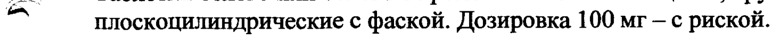
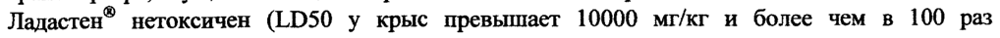
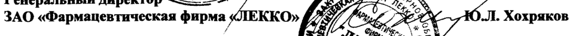

# Адамантилбромфениламин — внутрь

- Препарат: Ладастен® (таблетки;)
- АТХ: A13A
- Источник: ГРЛС, инструкция по медицинскому применению, РУ ЛСР-010257/08, файл от 2023-10-09 (https://grls.rosminzdrav.ru/Grls_View_v2.aspx?routingGuid=252be9b7-8af3-4c46-aa03-2454b60a2e29)
- Распознано автоматически (OCR): 2 из 2 стр.
- Инструкция к другому РУ того же препарата: ЛСР-010257/08 (национальное РУ, переоформленное по правилам ЕАЭС, решение от 29.09.2023). Текст может быть старше действующего
- Сомнительных строк после OCR: 3 (см. раздел «Проверка распознавания»)

## Общие сведения

.. ЛСР-010257/08-191208 ИНСТРУКЦИЯ по медицинскому применению препарата
Ладастен® Регистрационный номер:
Торговое название препарата: Ладастен® Химическое рациональное название: М-(2-адамантил)-М-(2-п-бромфенил)амин.
МНН или группировочное название: Адамантилбромфениламин.

## 3. Лекарственная форма

таблетки.
таблетки.

## 2. Состав

Каждая таблетка содержит:
Каждая таблетка содержит:
Активное вещество: адамантилбромфениламин (адамантилфениламин) — 0,05 ги 0,10 г.
Вспомогательные вещества: крахмал картофельный, целлюлоза микрокристаллическая, магния стеарат.
Описание BS Таблетки белого или белого с кремоватым оттенком цвета, круглой формы,
^ плоскоцилиндрические с фаской. Дозировка 100 мг — с риской.
Фармакотерапевтическая группа: антиастеническое средство.
Код ATX: ~~ Фармакодинамика Ладастен® является производным адамантана, позитивно влияющим на показатели физической и умственной работоспособности. В спектре действия препарата сочетаются активирующее, анксиолитическое, иммуностимулирующее действия и элементы актопротекторной активности. У Ладастена® отсутствуют гипноседативные и миорелаксантные свойства, препарат не обладает аддиктивным потенциалом. При его применении, в отличие от действия типичных психостимуляторов, практически не развиваются явления гиперстимуляции, а также последействия в виде истощения функциональных возможностей организма.
Терапевтическое действие Ладастена® у больных с астеническими и тревожноастеническими расстройствами проявляется с первых дней его применения в виде отчетливой редукции астенической симптоматики, показателей эмоционального напряжения,
BS соматовегетативных проявлений; препарат способствует восстановлению активности и
= повышению выносливости.
Механизм действия Ладастена связан с усилением выброса дофамина из пресинаптических терминалей, блокадой его обратного захвата и усилением биосинтеза, обусловленного экспрессией гена тирозин-гидроксилазы, а также с его модулирующим влиянием на ГАМКбензодиазепиновый-хлорионоформный рецепторный комплекс, устраняющий снижение бензодиазепиновой рецепции, развивающейся при стрессе. Ладастен® усиливает ГАМКергическую медиацию, снижая экспрессию гена, контролирующего синтез ГАМКтранспортера, осуществляющего обратный захват медиатора.
Ладастен® нетоксичен (1050 у крыс превышает 10000 мг/кг и более чем в 100 раз превосходит эффективные дозы).

## 5.2. Фармакокинетика

Время достижения максимальной концентрации (Tmax) составляет 2-4 часа, максимальная концентрация (С„„х) составляет 363,3 нг/мл, период полувыведения препарата
Время достижения максимальной концентрации (Tmax) составляет 2-4 часа, максимальная концентрация (С„„х) составляет 363,3 нг/мл, период полувыведения препарата
(Tiz) — 11,21 часа.

## 4.1. Показания к применению

Астенические состояния различного генеза, в том числе при соматических заболеваниях и после перенесенных инфекционных заболеваний.
Астенические состояния различного генеза, в том числе при соматических заболеваниях и после перенесенных инфекционных заболеваний.
Неврастения. р JECLTULY сим ae ome -. < Противопоказания
Беременность, период лактации, детский возраст до 18 лет, индивидуальная непереносимость препарата.

## 4.2. Способ применения и дозы

Применяется внутрь, независимо от приема пищи. Оптимальные разовые дозы препарата — 50-100 мг; суточные — 100-200 мг, распределенные на 2 приема в течение дня. Препарат не следует применять после 16 часов дня. Длительность курсового применения препарата составляет 2-4 недели.
Применяется внутрь, независимо от приема пищи. Оптимальные разовые дозы препарата — 50-100 мг; суточные — 100-200 мг, распределенные на 2 приема в течение дня. Препарат не следует применять после 16 часов дня. Длительность курсового применения препарата составляет 2-4 недели.

## 4.8. Побочное действие

Могут отмечаться проявления избыточной активации и расстройства засыпания, которые не требуют отмены препарата, целесообразно уменьшение его дозы. При повышенной индивидуальной чувствительности к препарату возможно развитие аллергических реакций.
Могут отмечаться проявления избыточной активации и расстройства засыпания, которые не требуют отмены препарата, целесообразно уменьшение его дозы. При повышенной индивидуальной чувствительности к препарату возможно развитие аллергических реакций.

## 4.9. Передозировка

При значительной передозировке возможно развитие седативного эффекта.
При значительной передозировке возможно развитие седативного эффекта.
Е Лечение: неспецифическая дезинтоксикационная терапия.

## 4.5. Взаимодействие с другими лекарственными средствами

Ладастен® уменьшает гипнотическое действие тиопентала натрия, не ослабляет анксиолитического эффекта бензодиазепинов.

## 6.5. Форма выпуска

Таблетки 50 мг и 100 мг. По 25 таблеток в контурной ячейковой упаковке из пленки поливинилхлоридной и фольги алюминиевой печатной лакированной.
Таблетки 50 мг и 100 мг. По 25 таблеток в контурной ячейковой упаковке из пленки поливинилхлоридной и фольги алюминиевой печатной лакированной.
1 или 2 контурные ячейковые упаковки вместе с инструкцией по применению в пачке из картона.

## 6.4. Условия хранения

В сухом, защищенном от света месте при температуре не выше 25°С.
В сухом, защищенном от света месте при температуре не выше 25°С.
Хранить в местах, недоступных для детей.

## 6.3. Срок годности

2 года. Не использовать позже срока, указанного на упаковке.
2 года. Не использовать позже срока, указанного на упаковке.
р Условия отпуска из аптек a По рецепту врача.
Производитель ЗАО «Фармацевтическая фирма «ЛЕККО», 601125, Владимирская обл., Петушинский район, пос. Вольгинский, т/ф (49243) 71-5-52.
=e Претензии потребите Е PR адрес ЗАО «Фармацевтическая фирма «ЛЕККО», 601125, Владимирск8 opt deny dete й район, пос. Вольгинский, т/ф (49243) 71-5-52.
Я оо ЧЕЙ СЕВ тие BF о СГедсть is fre директора We x oe, sacra ME у, А.Н. Васильев
| меду очи ine ss Москв’ 4 оке Hoy - Генеральный директог les Py Ч
ЗАО «Фармацевтическая фирма «ЛЕККО» Lk 7 г Я 2: Ю.Л. Хохряков о ey seg
A% * ast > = og | ме"
## Проверка распознавания

Страницы-сканы распознаны автоматически. В 3 строках с дозировками цифры могли распознаться с ошибкой — сверьте с вырезкой из оригинала:

- стр. 1: «^ плоскоцилиндрические с фаской. Дозировка 100 мг — с риской.» — повторное чтение: «~ плоскоцилиндрические с фаской. Дозировка 100 мг — с риской.»  
  
- стр. 1: «Ладастен® нетоксичен (1050 у крыс превышает 10000 мг/кг и более чем в 100 раз» — низкая уверенность: «(1050» (51)  
  
- стр. 2: «ЗАО «Фармацевтическая фирма «ЛЕККО» Lk 7 г Я 2: Ю.Л. Хохряков» — низкая уверенность: «7» (50), «2:» (12); повторное чтение: «ЗАО «Фармацевтическая фирма ХЛЕККО» [i Cp 7 OI. Хохряков»  
  
