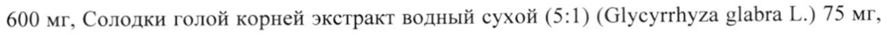
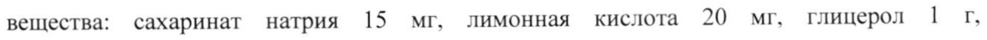

# Адатоды сосудистой листьев экстракт сухой; Солодки голой корней экстракт сухой; Перца длинного плодов и корней экстракт сухой; Фиалки душистой цветков экстракт сухой + Зизифуса настоящего плодов экстракт сухой; Оносмы прицветковой листьев и цветков экстракт сухой + Иссопа лекарственного листьев экстракт сухой; Альпинии галанги корней и корневищ экстракт сухой; Кордии широколистной плодов экстракт сухой; Алтея лекарственного цветков экстракт сухой — внутрь

- Препарат: Линкас® БСС (раствор для приема внутрь;)
- АТХ: R05CA
- Источник: ГРЛС, инструкция по медицинскому применению, РУ ЛП-000740, файл от 2022-07-11 (https://grls.rosminzdrav.ru/Grls_View_v2.aspx?routingGuid=ad433314-a670-412c-beae-c5e6535bbdd5)
- Распознано автоматически (OCR): 4 из 4 стр.
- Инструкция к другому РУ того же препарата: ЛП-000740 (национальное РУ, переоформленное по правилам ЕАЭС, решение от 27.04.2022). Текст может быть старше действующего
- Сомнительных строк после OCR: 2 (см. раздел «Проверка распознавания»)

## Общие сведения

МИНИСТЕРСТВО ЗДРАВООХРАНЕНИЯ РОССИЙСКОЙ ФЕДЕРАЦИИ
| ! Ир | ДГ) 000740-300976 | ИНСТРУКЦИЯ | rAACOBAHO по применению лекарственного препарата для медицинского применения —
Линкас” BCC Регистрационный номер | Торговое наименование
Линкас” BCC Международное непатентованное или группировочное наименование: —

## 3. Лекарственная форма

Сироп Состав | В 19 мл сиропа содержится:
Сироп Состав | В 19 мл сиропа содержится:
Адатоды сосудистой листьев экстракт водный сухой (4,29:1) (Adhatoda vasica Ness.)
600 mr, Солодки голой корней экстракт водный сухой (5:1) (Glycyrrhyza glabra Г.) 75 мг,
Перца длинного плодов и корней экстракт водный сухой (4,35:1) (Piper longum Г.) 100
Mr, Фиалки душистой цветков экстракт водный сухой (4,17:1) (Viola odorata L.) 25 мг,
Иссопа лекарственного листьев экстракт водный сухой (4,17:1) (Hyssopus officinalis Г.)
50 мг, Альпинии галанга корней и корневищ экстракт водный сухой (4,17:1) (Alpinia galanga L.) 50 mr, Кордии широколистной плодов экстракт водный сухой (4,35:1) |
(Cordia latifolia Roxb.) 100 mr, Алтея лекарственного цветков экстракт водный сухой
(4,35:1) (Althaea officinalis L.) 100 мг, Зизифуса настоящего плодов экстракт водный сухой (4,35:1) (Zizyphus jujuba Mill.) 100 мг, Оносмы прицветковой листьев и цветков экстракт водный сухой (4,35:1) (Onosma bracteatum Wall.) 100 mr. Вспомогательные вещества: сахаринат натрия 15 мг, лимонная кислота 20 мг, глицерол г, пропиленгликоль 1,252 г, 70 % раствор сорбитола 4 г, метилпарагидроксибензоат 10,928 мг, пропилпарагидроксибензоат 2,168 мг, мяты перечной масло 2,75 мкл, гвоздичное масло 1,25 мкл, вода очищенная до 10 мл.
SS ee

Описание

Вязкая жидкость коричневого цвета с характерным запахом. Допускается наличие

незначительного осадка, исчезающего при взбалтывании.

Фармакотерапевтическая группа

Отхаркивающее средство растительного происхождения.

Код АТХ

ROSCA

Фармакологическое действие

Комбинированный препарат на основе растительных экстрактов. Снижает

интенсивность и увеличивает продуктивность кашля, оказывает отхаркивающее,

муколитическое и противовоспалительное действие.

## 5.2. Фармакокинетика

®

Поскольку Линкас `БСС является многокомпонентным растительным препаратом,

изучение его фармакокинетики не представляется возможным.

Показания для применения

Симптоматическая терапия инфекционно-воспалительных заболеваний дыхательных

путей, сопровождающихся кашлем с трудноотделяемой мокротой (на фоне острых

респираторных заболеваний, гриппа, трахеита, бронхита, трахеобронхита, пневмонии,

бронхита «курильщиков» и других воспалительных заболеваний дыхательных путей).

## 4.3. Противопоказания

Повышенная индивидуальная чувствительность к компонентам препарата, тяжелые

нарушения функции печени и почек.

Возраст до 18 лет.

## 4.6. Применение при беременности и в период грудного вскармливания

В связи с отсутствием до настоящего времени достаточных исследований препарат не

рекомендуется применять в период беременности и грудного вскармливания.
| 7 | Способ применения и дозы Внутрь по 2 чайные ложки 3-4 раза в день.
Длительность применения препарата 5-7 дней. Увеличение продолжительности и проведение повторных курсов лечения возможно по рекомендации врача. |

## 4.8. Побочное действие

Возможны аллергические реакции. При появлении побочных эффектов, неописанных в | данной инструкции, следует сообщить об этом лечащему врачу.
Возможны аллергические реакции. При появлении побочных эффектов, неописанных в | данной инструкции, следует сообщить об этом лечащему врачу.

## 4.9. Передозировка

Не зарегистрировано.
Не зарегистрировано.

## 4.5. Взаимодействие с другими лекарственными средствами

Не рекомендуется одновременный прием с противокашлевыми препаратами, а также с лекарственными средствами, уменьшающими образование мокроты.

## 4.4. Особые указания

| Поскольку Линкас® BCC не содержит сахарозы, его можно применять пациентам с сахарным диабетом. При сохранении симптомов заболевания или ухудшении состояния
| Поскольку Линкас® BCC не содержит сахарозы, его можно применять пациентам с сахарным диабетом. При сохранении симптомов заболевания или ухудшении состояния
| на фоне применения препарата в течение 5-7 дней, следует сообщить об этом лечащему
| врачу.

## 4.7. Влияние на способность управлять транспортными средствами, механизмами

| Препарат не влияет на выполнение потенциально опасных видов деятельности, требующих особого внимания и быстрых реакций (управление автомобилем и др.
транспортными средствами, работа с движущимися механизмами, работа диспетчера и оператора и т. п.).

## 6.5. Форма выпуска

Сироп. По 90 мл, 120 мли 150 мл сиропа в стеклянный флакон коричневого цвета. По |
Сироп. По 90 мл, 120 мли 150 мл сиропа в стеклянный флакон коричневого цвета. По |
1 флакону вместе с мерным колпачком и инструкцией по применению в картонную пачку.

## 6.4. Условия хранения

При температуре не выше 25 °С.
При температуре не выше 25 °С.
Хранить в недоступном для детей месте.

## 6.3. Срок годности

3 года.
3 года.
Не использовать по истечении срока годности.
Условия отпуска Без рецепта.
Производитель Herbion Хербион Пакистан Прайвет Лимитед, 30/28, Промышленная зона Коранги, Карачи,
Пакистан.
www.herbion.com Организация, принимающая претензии потребителей
Представительство ЗАК Хербион Интернейшнл Инк 117198, г. Москва, ул. Миклухо-Маклая, владение 8, стр. 3
Тел.: (495) 781-46-43; Факс: (495) 781-45-69
Представитель ВУ ЗМ .. 2/5 ее К Компании «Хербион Пакистан Прайвет Лимитеду:=! | 1 \х Амир Саид as Е |= к
| |
## Проверка распознавания

Страницы-сканы распознаны автоматически. В 2 строках с дозировками цифры могли распознаться с ошибкой — сверьте с вырезкой из оригинала:

- стр. 1: «600 mr, Солодки голой корней экстракт водный сухой (5:1) (Glycyrrhyza glabra Г.) 75 мг,» — повторное чтение: «600 мг, Солодки голой корней экстракт водный сухой (5:1) (Glycyrrhyza glabra Г.) 75 мг,»  
  
- стр. 1: «вещества: сахаринат натрия 15 мг, лимонная кислота 20 мг, глицерол г,» — повторное чтение: «вещества: сахаринат натрия 15 мг, лимонная кислота 20 мг, глицерол 1 г,»  
  
