# Алглюкозидаза альфа — парентерально

- Препарат: Майозайм® (лиофилизат для приготовления концентрата для приготовления раствора для инфузий;)
- АТХ: A16AB07
- Источник: ГРЛС, инструкция по медицинскому применению, РУ ЛП-002290, файл от  (https://grls.rosminzdrav.ru/Grls_View_v2.aspx?routingGuid=0b044930-f7a3-483c-8afa-0c324af00c17)
- Распознано автоматически (OCR): 30 из 30 стр.
- Инструкция к другому РУ того же препарата: ЛП-002290 (срок действия истёк, решение от 09.06.2020). Текст может быть старше действующего
- Сомнительных строк после OCR: 11 (см. раздел «Проверка распознавания»)
- Проверено вручную строк: 1

## Общие сведения

МИНИСТЕРСТВО ЗДРАВООХРАНЕНИЯ РОССИЙСКОЙ ФЕДЕРАЦИИ
ИНСТРУКЦИЯ ПО МЕДИЦИНСКОМУ ПРИМЕНЕНИЮ ЛЕКАРСТВЕННОГО ПРЕПАРАТА
Майозайм“ Регистрационный номер: ЛП-002290.
Торговое наименование: Майозайм”.
Международное непатентованное или группировочное наименование: алглюкозидаза альфа.

## 3. Лекарственная форма

лиофилизат для приготовления концентрата для приготовления раствора для инфузий.
лиофилизат для приготовления концентрата для приготовления раствора для инфузий.
Состав а. Каждый флакон лиофилизата для приготовления концентрата для приготовления раствора для инфузий содержит:
-
Натрия гидрофосфата гептагидрат 9.4 мг (+ 0,5 мг избыток наполнения)
Натрия дигидрофосфата моногидрат 29,7 мг (+ 0,5 мг избыток наполнения)
б. Каждый мл восстановленного раствора препарата (концентрата) Майозайм® для приготовления раствора для инфузий содержит:
422949 ЛИ \ U-Z/UZZU

Активное вещество:
Алглюкозидаза альфа 5,0 мг Вспомогательные вещества:
Маннитол 20 мг Полисорбат 80 0,05 мг Натрия гидрофосфата гептагидрат 0,94 мг
Натрия дигидрофосфата моногидрат |2,97 мг
Вода для инъекций До 1,00 мл

. Описание а. Лиофилизат. Компактная масса (лиофилизат) или порошок белого или почти белого цвета.
6. Восстановленный раствор. Прозрачный или слегка опалесцирующий, бесцветный или светло-желтый раствор, возможно наличие белых нитей и полупрозрачных волокон.
Фармакотерапевтическая группа: ферментное средство.
Код ATX: А16АВО7.
Фармакологические свойства et | Болезнь Помпе — это редкая прогрессирующая метаболическая миопатия, заканчивающаяся

= смертельным исходом, в мире ее частота составляет около | случая на 40000. Другие названия болезни Помпе: болезнь накопления гликогена II типа (GSD-I1), дефицит кислой мальтазы (AMD) и гликогеноз II типа. Болезнь Помпе относится к лизосомальным болезням накопления, так как она возникает в результате дефицита природной лизосомальной гидролазы, кислой @-глюкозидазы (KAT), которая обеспечивает распад гликогена до глюкозы. Недостаток этого фермента вызывает накопление гликогена в различных тканях, особенно в сердце, дыхательных и скелетных мышцах, приводя к развитию гипертрофической кардиомиопатии и прогрессирующей мышечной слабости, включая нарушение функции дыхания.
Клинический спектр проявлений болезни Помпе характеризуется ее различными формами - от быстро прогрессирующей младенческой, или инфантильной (появление симптомов в

ILL VUZZ9YU-Z 10220 течение первого года жизни, прогнозируемая продолжительность жизни очень коротка), до медленно прогрессирующей формы с поздним началом заболевания.

Младенческая форма болезни Помпе характеризуется массивным отложением гликогена в сердце и скелетных мышцах, что всегда приводит к развитию быстро прогрессирующей кардиомиопатии, генерализованной мышечной слабости и гипотонии. Развитие двигательных навыков часто полностью останавливается, или в случае достижения определенного этапа их развития, они впоследствии утрачиваются. Смерть возникает главным образом из-за сердечной и/или дыхательной недостаточности до достижения возраста | года.
В ретроспективном исследовании естественного течения болезни у пациентов с младенческой формой болезни Помпе (п=168) средний возраст начала появления симптомов

© составлял 2.0 месяца, а средний возраст смертельного исхода составлял 9.0 месяцев.
Коэффициент выживаемости по Каплан-Майеру в возрасте 12, 24 и 36 месяцев составлял, соответственно, - 26 %, 9% и 7 %.
Был описан нетипичный, более медленно прогрессирующий вариант младенческой формы болезни Помпе, характеризующийся менее тяжелой кардиомиопатией и поэтому - более длительной продолжительностью жизни.
Клинические проявления болезни Помпе с поздним началом впервые могут появляться в период новорожденности, детского, подросткового возраста или даже во взрослом возрасте.
Эта форма болезни прогрессирует намного медленнее, чем младенческая форма. Обычно она характеризуется наличием остаточной активности КАГ, достаточной для предупреждения развития кардиомиопатии, однако некоторые изменения со стороны ‘сердца были описаны приблизительно у 4% пациентов с болезнью Помпе с поздним началом.

~ У пациентов с болезнью Помпе с поздним началом обычно отмечается прогрессирующая миопатия, главным образом проксимальных мышц пояса верхних и нижних конечностей, а также различной степени нарушения функции дыхания, в конечном итоге прогрессирующие до абсолютной потери трудоспособности и/или необходимости проводить искусственную вентиляцию легких (ИВЛ). Период прогрессирования заболевания очень вариабелен и его нельзя спрогнозировать: у некоторых пациентов рано возникают нарушения функции скелетных и дыхательных мышц, что приводит к потере способности передвигаться и дыхательной недостаточности; у других прогрессирование происходит медленнее, и еще есть группа пациентов, у которых отмечается несоответствие прогрессирования заболевания при сравнении изменений со стороны скелетных и дыхательных мышц.

422949 Be YU-Z /UZZU Механизм действия Предполагается, что препарат Майозайм® восстанавливает активность лизосомальной KAT’, приводя к стабилизации или восстановлению функций сердца и скелетных мышц (включая дыхательные мышцы). Вследствие наличия гематоэнцефалического барьера и размера молекулы фермента, маловероятен захват алглюкозидазы альфа на уровне центральной нервной системы.
Клиническая эффективность и безопасность
Младенческая форма болезни Помпе; клиническое исследование с пациентами в возрасте 6 месяцев и младше
Безопасность и эффективность препарата Майозайм® была оценена в базовом
© ретроспективном рандомизированном открытом исследовании у 18 пациентов с младенческой формой заболевания, не требующих дыхательной поддержки, в возрасте 6 месяцев и младше на момент начала проведения терапии. Ретроспективная группа, не получавшая терапии, была подобрана в соответствии с базовой исследуемой группой, ее данные были взяты из ретроспективного исследования с изучением естественного течения болезни (п=42) у пациентов с младенческой формой болезни Помпе. Пациенты были рандомизированы для получения 20 мг/кг либо 40 мг/кг препарата однократно раз в две недели в течение 52 недель. После 52 недель 16 из этих 18 пациентов были включены в фазу продолжения клинического исследования для последующего получения терапии в той же дозе, и общая продолжительность терапии составила около трех лет (150 недель).
Первичной конечной точкой была доля живых пациентов, не находящихся на ИВЛ. Однако выживаемость у пациентов, не находящихся на ИВЛ, не регистрировалась в ретроспективном
- когортном исследовании, поэтому сравнить эти конечные точки не представлялось возможным. После 52 недель терапии все 18 пациентов, получавших препарат Майозайм*, были живы, а 15 из них были живы и не находились на ИВЛ, в то время как в ретроспективном когортном исследовании живым в возрасте 18 месяцев был только | из 42 пациентов. Два пациента погибли и не вошли к продолжение клинического исследования. По прошествии 104 недель терапии все 16 пациентов, вошедших в фазу продолжения клинического исследования, были живы, а 10 из этих 16 не находились на ИВЛ. В конце исследования (индивидуальная продолжительность терапии пациента колебалась от 60 до 150 недель; средний период последующего наблюдения составил 119 недель) 14 из 16 пациентов 422949 id IZZYU-Z /UZZV были живы, а 9 из 16 пациентов были живы и не находились на ИВЛ. Один пациент погиб после окончания исследования, а другой - после выхода из исследования.

Сравнение кривых выживаемости от момента постановки диагноза относительно ретроспективной группы пациентов с естественным течением болезни, не получавших терапию, было проведено с помощью регрессионного анализа пропорциональных рисков
Кокса. Пациенты, получавшие препарат Майозайм®, продемонстрировали увеличение продолжительности жизни в сравнении с пациентами, не получавшими терапию (см. таблицу 1).
Таблица 1: Результаты оценки конечной точки выживаемости с помощью регрессионной модели Кокса
Данные & группы Отношение 95% Пациенты, сравнения из Конечная рисков доверитель получавшие р р-величина ретроспектив точка эффективност НЫЙ лечение ного и терапии интервал исследования
Выживаемос 0.015 N=18 N=42 0.05 (0.015, | <0,0001
Tb 0.147 Примечание: Результаты регрессионного анализа пропорциональных рисков Кокса, включающие терапию как изменяемую во времени ковариату, а также возраст постановки диагноза и возраст появления симптомов заболевания.
В начале исследования возраст пациентов составлял 6 месяцев и младше.
Пациенты из группы ретроспективного исследования, не получавшие терапию, родились в 1993 и позже.
Эхокардиографические показатели кардиомиопатии улучшились, что проявлялось уменьшением массы левого желудочка (МЛЖ). По прошествии 52 недель терапии МЛЖ
- снизилась, по сравнению с исходной, у всех 14 пациентов и была в нормальных пределах у 3 из этих 14 пациентов. После первого года (от 64 до 130 недель) терапии МЛЖ также снизилась у 8 пациентов. На 104 неделе терапии имелись в наличии результаты оценки 8 пациентов, из которых у 5 она уменьшилась до нормальных пределов.
Как было определено по баллам развития двигательных функций согласно возрастным эквивалентам Шкалы развития двигательных функций у новорожденных Альберта (AIMS), у 7 из 18 пациентов в период исследования было отмечено усиление развития двигательных навыков, а к моменту последней оценки в исследовании они уже самостоятельно ходили
(индивидуальная продолжительность терапии у пациентов колебалась от 52 до 130 недель;
средний период последующего наблюдения составил 94 недели). У других 4 пациентов в
= Г 7’) OH / O 422949 Mil VUZZ90-2 10120 период исследования было отмечено увеличение двигательных навыков, а на момент последней оценки, проводимой в исследовании, они уже могли самостоятельно сидеть
(индивидуальная продолжительность терапии колебалась от 78 до 130 недель; средний период последующего наблюдения составил 110 недель), хотя функционально они не использовали ноги. У оставшихся 7 пациентов не было отмечено клинически значимого улучшения двигательных навыков или они были не способны поддерживать увеличение числа двигательных навыков, у них было отмечено ограниченное число движений на момент оценки в конце исследования (индивидуальная продолжительность терапии колебалась от 52 до 142 недель; средний период последующего наблюдения составил 103 недели).

По прошествии 52 недель терапии у 14 из 18 пациентов (77.8%) сохранились или улучшились
© показатели отношения массы тела к возрасту (выше Зго перцентиля), у 14 из 15 (93.3%) они были выше Зго перцентиля по длине тела, ау 12 из 15 (80.0%) они были выше Зго перцентиля по показателю окружности головы. На втором году терапии у 15 из 17 пациентов отмечалось продолжающееся улучшение показателей отношения массы тела к возрасту
(индивидуальная продолжительность терапии колебалась от 78 до 142 недель; средний период последующего наблюдения составил 111 недель), у 10 из 16 пациентов отмечалась положительная динамика показателя отношения длины тела к возрасту (индивидуальная продолжительность терапии колебалась от 90 до 130 недель; средний период последующего наблюдения составил 113 недель), а у 11 из 15 пациентов отмечалось последующее улучшение показателей отношения окружности головы к возрасту (индивидуальная
| продолжительность терапии колебалась on 90 до 130 недель; средний период последующего | наблюдения составил 110 недель). На 104 неделе терапии у всех 13 пациентов (данные для
- которых имелись) сохранились или улучшились показатели отношения массы тела к возрасту
(выше Зго перцентиля), у всех 12 пациентов (данные для которых имелись) результаты были выше Зго перцентиля по длине тела и у всех 12 пациентов они были выше Зго перцентиля по окружности головы.
Анализ эффективности не выявил значимых различий между 2 группами дозирования относительно выживаемости, выживаемости без пребывания на ИВЛ и выживаемости без использования вентиляции легких, снижения МЛЖ, увеличения показателей роста и приобретения двигательных навыков. На основе этих результатов рекомендована доза 20 мг/кг | раз в две недели.
422949 10220 Младенческая форма болезни Помпе; клиническое исследование у пациентов в возрасте от 6 месяцев до 3,5 лет
Второе открытое клиническое исследование, также оценивающее безопасность и эффективность препарата Майозайм® у 21 пациента с преобладанием атипичного варианта инфантильной формы болезни Помпе, возраст которых колебался от 6 месяцев до 3,5 лет на момент начала терапии. Пациенты получали препарат Майозайм® в дозе 20 мг/кг | раз в две недели в течение 52 недель, за исключением 8 пациентов, получавших 40 мг/кг после не менее 26 недель терапии. По прошествии 52 недель все пациенты продолжили лечение, общая длительность которого составила более 3 лет (168 недель с медианой в 121 неделю).
Первичной конечной точкой в базовом исследовании был процент выживших пациентов. По
© прошествии 52 недель терапии 16 из 21 пациента (76.2%), получавших терапию препаратом
Майозайм®, были живы. После 104 недели терапии 14 из 21 пациента были живы (66.7%), а 1 пациент был жив, но прекратил участие в исследовании. Такие пропорции сохранялись до конца исследования (индивидуальная продолжительность терапии колебалась от | до 168 недель; средний период последующего наблюдения составил 109 недель). В группе ретроспективного исследования, не получавшей терапию, 5 из 47 пациентов (для которых имелись данные) (10.6%) были живы в возрасте 30 месяцев (2.5 года).
Выживаемость у пациентов, получавших терапию, была сравнена с выживаемостью в сходной группе ретроспективного исследования, не получавшей терапию с помощью регрессионного анализа пропорциональных рисков Кокса (см. таблицу 2).
| Таблица 2: Результаты оценки конечной точки — выживаемости с помощью регрессионной модели ow Данные группы Отношение 95%
Пациенты, рсравнения из рисков доверитель получавшие Конечная точка 5 величи ретроспективно эффективност НЫЙ лечение на го исследования и терапии интервал 0.112 <0.016
N=21 N=48 Выживаемость 0.301 ( ° 0.804) 6
Примечание: Результаты регрессионного анализа пропорциональных рисков Кокса, включающие терапию как изменяемую во времени ковариату, а также возраст постановки диагноза и возраст появления симптомов заболевания.
В начале исследования возраст пациентам составлял от 6 месяцев до 3,5лет.
Пациенты из группы ретроспективного исследования, не получавшие терапию, родились в 1995 г. и позже.
Га ^^ 122949 0-2 10220 Дополнительные данные по эффективности показали, что из 16 пациентов, которые на исходном уровне не находились на ИВЛ, остались таковыми и после 104 недель терапии. 9 оставшихся пациентов либо погибли (5 пациентов), либо находились на ИВЛ (4 пациента). У всех 5 пациентов, у которых проводилась инвазивная ИВЛ на исходном уровне, сохранялась потребность в ее продолжении на протяжении всего исследования (4 пациента остались живыми после 104 недель, | погиб).
По прошествии 52 недель терапии МЛЖ снизилась по сравнению с исходным уровнем у всех 12 пациентов (для которых имелись данные) и была в нормальных пределах у 6 из этих 12 пациентов. После первого года (от 58 до 168 недель) терапии МЛЖ также снизилась у 9 из 12 пациентов (для которых были данные). На 104 неделе терапии результаты оценки МЛЖ были
© доступны только для 10 пациентов, у 9 из которых она снизилась до границ нормы.
По прошествии 52 недель терапии у 3 из 8 пациентов было отмечено усиление развития двигательных навыков по сравнению с исходным уровнем, что было определено по исходным баллам и баллам оценки возрастного эквивалента по сравнению с исходным уровнем по AIMS.
У шести из 1| пациентов (для которых имелись данные) продолжали улучшаться характеристики двигательной активности и по прошествии 52 недель (индивидуальная продолжительность терапии у пациента колебалась от 58 до 168 недель; средний период последующего наблюдения составил 121 неделю), включая 3 пациентов, способных ходить, и 3 пациентов, способных только сидеть к последнему визиту исследования. Оставшиеся 5 ацибнтов не показали каких-либо значимых изменений в развитии двигательных навыков по
| прошествии 52 недель (индивидуальная продолжительность терапии колебалась от 104 до
~ 168 недель: средний период последующего наблюдения составил 140 недель), включая 4 пациентов без значимых двигательных навыков в любом из оцениваемых положений и | пациента, способного только сидеть на момент последнего визита исследования.
Подавляющее большинство пациентов с младенческой формой болезни Помпе, получавших терапию препаратом Майозайм®, продемонстрировали улучшение функции сердца, а также стабилизацию и улучшение показателей роста. Однако ответная реакция на лечение в отношении двигательной активности и функции дыхания была более разнообразной.
Пациенты с младенческой формой болезни Помпе, у которых было отмечено улучшение двигательных навыков, обладали более сохранной двигательной функцией и меньшим содержанием гликогена в четырехглавой мышце в начале исследования. Необходимо 422949
JUL VUZZ9U0-Z /UZZU отметить, что большая доля пациентов с лучшими исходами по двигательной активности продемонстрировали стабилизацию или улучшение показателей роста (масса тела), в то время как у большинства пациентов, несмотря на исходные характеристики и изменение показателей двигательной активности, наблюдалось обратное развитие кардиомиопатии согласно /-показателю МЛЖ.

Большинство результатов показали, что ранняя постановка диагноза и лечение на ранней стадии заболевания могут являться критическими точками для достижения лучших исходов у пациентов с младенческой формой болезни Помпе.
Болезнь Помпие с поздним началом; базовое клиническое исследование
Безопасность и эффективность препарата Майозайм® была оценена в рандомизированном
= двойном слепом плацебоконтролируемом исследовании у 90 пациентов с болезнью Помпе с поздним началом, возраст которых колебался от 10 до 70 лет в начале терапии, все они ранее не получали ферментозаместительной терапии. Пациенты были рандомизированы в соотношении 2:1 и получали соответственно препарат Майозайм® 20 мг/кг (n=60) или плацебо (n=30) | раз в две недели в течение 78 недель (18 месяцев).
Комбинированной первичной точкой оценки эффективности была способность пройти определенное расстояние (метры) за 6 минут (тест с 6-минутной ходьбой, 6МУТ) и % предполагаемой ФЖЕЛ (форсированная жизненная емкость легких) в положении сидя. После 78 недель пациенты, получавшие препарат Майозайм®, продемонстрировали улучшение показателей ходьбы на расстояние по данным OMWT и стабилизацию функции легких по данным % предполагаемой ФЖЕЛ по сравнению с пациентами, получавшими плацебо.
| Расстояние, пройденное за 6 минут, в среднем увеличилось на 15.0 метров у пациентов,
~ получавших препарат Maiiosaiim”, и снизилось в среднем на 7,5 метра у пациентов, получавших плацебо, что указывало на статистическую достоверность эффекта терапии препаратом Майозайм® в сравнении с плацебо (р=0.0283). % предполагаемой ФЖЕЛ изменился в среднем на 0.0 у пациентов, получавших препарат Майозайм®, и снизился в среднем на 3% у пациентов, получавших плацебо, указывая на статистическую значимость эффекта проводимой терапии (р=0.0026). Результаты приведены в Таблице 3.
Таблица 3: Изменения по сравнению с исходным уровнем: оценка эффективности в плацебо контролируемом исследовании 422949
JILL UUZZ9YU-Z /UZZU N= 60 N=30 Расстояние, пройденное в 6-минутном тесте ходьбы (метров)
До проведения | Cenee + CKO 332.20 + 126.69 317.93 + 132.29 лечения (исходный Медиана 360.0 339.0 уровень) | | a Среднее + CKO 357.85 + 141.32 313.07 + 144.69
NONEa NORE Медиана 367.5 307.0 наблюдение | |
Изменения на 78 неделе/при i Среднее + CKO 26.08 + 64.41 -4.87 + 45.24
© ны ROH Tie Медиана 15.0 -7.5 сравнению с у | исходным ровнем*
Критерий Вилкоксона- р-величина 0.0283 Манна-Уитни
Форсированная жизненная емкость легких (% предполагаемой нормы)
До проведения | Среднее + CKO 55.43 + 14.44 53.00 + 15.66 лечения (исходный Длинна 53.5 49.0 уровень) у | ie Среднее + CKO 56.67 + 16.17 50.70 + 14.88 неделя/последнее Меиана 55 5 49.0 наблюдение | |
Изменения на 78 | неделе/при ~ ad aa Среднее + СКО 1.25 + 5.55 2,344.33 наблюдении по Мана 00 30 сравнению с | у исходным ровнем*
Критерий Вилкоксона- р-величина 0.0026 Манна-Уитни
*Один пациент, для которого не было получено данных после оценки на исходном уровне, был исключен из анализов.
Болезнь Помпие с поздним началом; другие клинические исследования и анализы
Исследователями были также проведены три независимых открытых неконтролируемых исследования препарата Майозайм*:
422949 ИЕ VUZZYU-Z 1420 ® одно исследование было проведено в Италии и включало 74 пациента с поздним началом заболевания с периодом последующего наблюдения, длящимся до 48 месяцев;
® одно исследование, проведенное в Германии, включало 38 пациентов с поздним началом болезни с периодом последующего наблюдения, длящимся 36 месяцев;
® OHO исследование было проведено в Нидерландах и включало 69 пациентов с поздним началом заболевания с периодом последующего наблюдения, длящимся до 23 месяцев.
Эти три исследования препарата Майозайм® (с периодом последующего наблюдения не менее 3 лет в двух исследованиях и в среднем 23 месяца в другом исследовании)
® продемонстрировали стабилизацию или улучшение двигательной активности и стабилизацию функции дыхания.
В исследовании с 69 пациентами с поздним началом заболевания, проведенном в
Нидерландах, применение препарата Майозайм® привело к увеличению мышечной силы пациентов. Однако функция мышц улучшилась только у пациентов, не зависимых от инвалидного кресла, и у тех, у которых мышечная слабость была менее выражена.
В двух других открытых клинических исследованиях препарата Майозайм® с периодом последующего наблюдения, длящимся до 24 месяцев, с участием десяти пациентов с тяжелой формой болезни Помпе с поздним началом (нарушение двигательной функции средней и тяжелой степени и ИВЛ) были показаны различные ответные реакции по показателям двигательной функци и функции дыхания, главным образом, - в форме умеренного улучшения (AGLU03105, АСТ 004107).
-
В открытом клиническом исследовании проводилась оценка эффективности и безопасности применения препарата Майозайм® у 5 пациентов с болезнью Помпе с поздним началом, возраст которых находился в диапазоне от 5 до 15 лет на момент начала терапии
(AGLU02804). Пациенты получали препарат Майозайм® в дозе 20 мг/кг один раз в две недели в течение 26 недель. Все пациенты свободно передвигались и всем, за исключением одного пациента, не требовалось никакой дыхательной поддержки (1 пациенту требовалась неинвазивная вентиляция легких ночью). Из 3 пациентов со значительными изменениями со стороны легких на момент скрининга/исходного уровня (% предполагаемой форсированной жизненной емкости легких в положении сидя колебался от 58 до 67%), у двух было 422949
IVZZ9U0-Z /UZZU продемонстрировано клинически значимое улучшение ФЖЕЛ (+11.5% и +16.0%) в положении сидя к 26 неделе. Оценка двигательной активности дала различные результаты.
Десять пациентов с прогрессирующей болезнью Помпе с поздним началом (т.е. 10/10 зависимых от инвалидного кресла, и 9/10 на вентиляции легких) в возрасте 9-54 лет получали терапию алглюкозидазой альфа в дозе 20-40 мг/кг один раз в две недели в течение различных периодов времени - от 6 месяцев до 2,5 лет. Улучшения со стороны легких, отмеченные у пациентов, включали явные улучшения ФЖЕЛ до 35% у одного пациента, и значимое снижение числа часов пребывания на вентиляции легких у 2 пациентов. У некоторых пациентов наблюдались положительные эффекты лечения в отношении двигательной активности, включая восстановление утраченных двигательных навыков. Только один
© пациент перестал быть зависимым от инвалидного кресла. В этой группе пациентов показатели ответной реакции в отношении двигательной функции также варьировали.
Регистр пациентов с болезнью Помпе Врачам и медицинским работникам рекомендуется регистрировать пациентов с болезнью
Помпе на сайте www.PompeRegistry.com. В данном регистре собраны анонимные данные по пациентам. Целью создания регистра пациентов с болезнью Помпе было улучшение понимания болезни Помпе и мониторинг эффективности ферментозаместительной терапии в динамике, с основной целью улучшения клинических исходов заболевания у данных пациентов.

## 5.2. Фармакокинетика

Младенческая форма болезни\Помпе |
Младенческая форма болезни\Помпе |
| В базовом клиническом исследовании, включавшем 18 пациентов, проводилась оценка
- фармакокинетических свойств алглюкозидазы альфа у 15 пациентов с младенческой формой болезни Помпе (возраст всех был менее 6 месяцев на момент начала терапии), которые получали препарат в дозе 20 мг/кг и 40 мг/кг в форме инфузии длительностью, соответственно, около 4 — 6,5 часов.
Распределение и выведение После первой и шестой инфузии препарата Майозайм® средние максимальные концентрации в плазме крови (Cmax) колебались от 178.2 до 263.7 мкг/мл соответственно в группах с дозами в 20 мг/кг и 40 мг/кг. Средняя площадь под кривой «концентрация — время» (AUC)
колебалась от 977.5 до 1872.5 мкгечас/мл, соответственно, в группах с дозами 20 мг/кг и 40 мг/кг. Средний клиренс плазмы (CL) составил 21.4 мл/час/кг, а средний объем распределения 422949 1111 092299-270220 в равновесном состоянии (Vss) был 66.2 мг/кг в обеих группах с небольшой вариабельностью между пациентами, составляющей соответственно 15% и 11%. Средний период полувыведения (Т1/2) составил 2.75 часов в обеих группах.
Линейность/ отсутствие линейности Фармакокинетические свойства были пропорциональны дозе и не изменялись во времени.
Фармакокинетика алглюкозидазы альфа была также оценена в отдельном исследовании с участием 21 пациента с младенческой формой болезни Помпе (возраст всех пациентов был от 6 месяцев до 3,5 лет на момент начала терапии); пациенты получали алглюкозидазу альфа в дозе 20 мг/кг. У 12 пациентов (данные для которых были известны) показатели AUCs и Cinax приблизительно соответствовали тем, которые наблюдались в группе с дозой в 20 мг/кг в
© базовом исследовании. 1/2, составляющий приблизительно 2 — 3 часа, также соответствовал этой группе пациентов.
Болезнь Помпе с поздним началом Фармакокинетика алглюкозидазы альфа была оценена в исследовании с участием 5 пациентов с поздним началом болезни Помпе в возрасте от 6 до 15 лет, получавших алглюкозидазу альфа в дозе 20 мг/кг один раз в две недели. Не было отмечено различий в фармакокинетических свойствах алглюкозидазы альфа у этих пациентов с поздним началом заболевания по сравнению с пациентами с младенческой формой болезни.
Фармакокинетика алглюкозидазы альфа была исследована в популяционном анализе с 32 пациентами с поздним началом болезни Помпе из рандомизированного двойного слепого плацебоконтролируемого исследования, возраст которых находился в диапазоне от 21 до 70
; лет, которые получали препарат Майозайм® 20 мг/кг один раз в две недели. AUC» и Cinax
© были сходными при измерении на 0, 12 и 52 неделе, указывая Ha TO, что фармакокинетика алглюкозидазы альфа не зависит от времени (Таблица 4).
Таблица 4: Фармакокинетика алглюкозидазы альфа после первой инфузии и после 12 и 52 недель терапии 422949 11100: 0-770220 полувыведения (час) |
Нет данных о том, что наличие антител класса IgG к алглюкозидазе альфа влияет на фармакокинетические свойства препарата. Более высокий средний клиренс, меньший показатель средней AUC» и меньшая средняя Cmax наблюдались у 5 пациентов, у которых была выявлена положительная реакция на ингибирование захвата фермента клетками.
Однако нет данных о явной связи ингибирования захвата и комбинированными первичными конечными точками эффективности.

## 4.1. Показания к применению

Препарат Майозайм® показан в качестве средства длительной ферментозаместительной
Препарат Майозайм® показан в качестве средства длительной ферментозаместительной
. терапии (ФЗТ) у пациентов с подтвержденным диагнозом болезни Помпе (недостаточность w кислой о-глюкозидазы).
Препарат Майозайм® может применяться у взрослых и детей любого возраста.

## 4.3. Противопоказания

Угрожающая жизни гиперчувствительность (анафилактическая реакция) к активному веществу или к одному из вспомогательных веществ, указанных в разделе «Состав», в случае если повторная инфузия препарата дала неблагоприятный результат.
Угрожающая жизни гиперчувствительность (анафилактическая реакция) к активному веществу или к одному из вспомогательных веществ, указанных в разделе «Состав», в случае если повторная инфузия препарата дала неблагоприятный результат.
Ограничения по применению препарата при беременности и в период грудного вскармливания приведены в разделе «Применение при беременности и в период грудного
| вскармливания». | | - С осторожностью Следует соблюдать осторожность при повторном введении препарата Майозайм® пациентам, у которых развивались нежелательные лекарственные реакции (НЛР) во время инфузии или в течение 2 часов после (инфузионные реакции (ИР)), особенно анафилактические.

## 4.6. Применение при беременности и в период грудного вскармливания

Препарат Майозайм® не следует применять во время беременности, если нет абсолютных показаний. Потенциальный риск для человека неизвестен. Исследований о применении алглюкозидазы альфа у беременных женщин не проводилось, но исследования на животных продемонстрировали репродуктивную токсичность.
Клинические данные о влиянии алглюкозидазы альфа на фертильность отсутствуют.
422949 ИГО Y0-2 /0220 Алглюкозидаза альфа может выделяться с грудным молоком. При применении препарата
Майозайм® рекомендуется прекратить грудное вскармливание, поскольку данные о влиянии алглюкозидазы альфа через грудное молоко на новорожденных отсутствуют.

## 4.2. Способ применения и дозы

Лечение препаратом Майозайм® должно проводиться под наблюдением врача, имеющего опыт работы с пациентами с болезнью Помпе или другими наследственными метаболическими или нейромышечными заболеваниями.
Лечение препаратом Майозайм® должно проводиться под наблюдением врача, имеющего опыт работы с пациентами с болезнью Помпе или другими наследственными метаболическими или нейромышечными заболеваниями.
Рекомендованный режим дозирования алглюкозидазы альфа: 20 мг/кг массы тела | раз каждые 2 недели в виде внутривенной инфузии.
© Инфузии следует проводить с постепенным увеличением скорости введения препарата, начиная с | мг/кг/ч и постепенно увеличивать дозу на 2 мг/кг/ч каждые 30 минут, в отсутствии связанных с инфузией реакций, до достижения максимальной скорости 7 мг/кг/ч.
Специальные рекомендации по препарату Майозайм® для каждой возрастной группы (дети, подростки, взрослые или пожилые пациенты) отсутствуют.
Оценка безопасности и эффективности препарата Майозайм® у пациентов с почечной или печеночной недостаточностью не проводилась, и, соответственно, рекомендаций об особом режиме дозирования препарата для таких пациентов нет.
Следует регулярно оценивать реакцию пациента на лечение, основываясь на подробном анализе всех клинических проявлений заболевания.
Инструкция по восстановлению и разведению препарата
Препарат Майозайм® восстанавливают водой для инъекций с последующим разведением с
- помощью 0,9 % раствора натрия хлорида для в/в инъекций и затем вводят путем в/в инфузии.
Восстановление и разведение должны проводиться в соответствии с принятыми нормами, главным образом в отношении асептики.
Вследствие белковой природы препарата может произойти образование механических включений в восстановленном растворе и в готовых пакетах для инфузии. Таким образом, для введения рекомендуется использовать проходной фильтр, обладающей низкой белковосвязывающей активностью. Было показано, что применение фильтра с диаметром пор 0.2 мкм приводит к удалению видимых частиц и не приводит к потерям белка или его активности.
122943 ИО‘ 0-2 10220 На основании индивидуального для пациента режима дозирования (мг/кг) необходимо определить число флаконов, содержимое которых должно быть восстановлено, и достать их из холодильника для того, чтобы температура достигла значения комнатной (приблизительно в течение 30 минут). Каждый флакон препарата Майозайма® предназначен только для однократного применения.
Восстановление и разведение препарата должно проводиться в асептических условиях.
Восстановление Содержимое каждого флакона препарата Майозайм* на 50 мл восстанавливают добавлением 10,3 мл воды для инъекций. Добавляют воду для инъекций медленно, по каплям по стенке флакона, а не прямо на лиофилизат, после чего осторожно наклоняют флакон. Нельзя
© переворачивать, вращать или взбалтывать содержимое флакона. Объем восстановленного раствора составляет 10,5 мл с содержанием действующего вещества 5 мг/мл, он должен быть прозрачным, бесцветным или светло-желтым и может содержать частицы в форме тонких белых полос или прозрачных нитей. Необходимо провести визуальный контроль на наличие механических включений и изменения цвета. Если при промежуточном контроле были выявлены посторонние частицы, отличные от описанных выше, или в случае изменения цвета раствора, его нельзя использовать. рН восстановленного раствора — приблизительно 6,2.
После восстановления необходимо сразу же развести содержимое флаконов (см. ниже).
Разведение Восстановленный раствор содержит 5 мг алглюкозидазы альфа в | мл. Извлекаемый объем восстановленного раствора из каждого флакона составляет 10.0 мл (для дозировки 50 мг).
Далее его необходимо развести следующим образом: медленно извлекается восстановленный
~ раствор из каждого флакона до получения объема согласно необходимой пациенту дозе.
Рекомендованная конечная концентрация алглюкозидазы в пакете для инфузии составляет от 0,5 мг/мл до 4 мг/мл. Удалить воздух из пакета. Так же извлечь равный объем раствора натрия хлорида 9 мг/мл (0.9 %) для в/в инъекций, который будет замещен восстановленным препаратом Майозайм®. Медленно ввести восстановленный препарат Майозайм® прямо в раствор натрия хлорида 9 мг/мл (0,9%) для в/в инъекций. Осторожно перевернуть или помять пакет для инфузий для смешивания разведенного раствора. Не взбалтывать или не трясти пакет для инфузий.
Рекомендуется начинать вводить раствор в течение 3-х часов после разведения. Общее время от момента восстановления и до завершения инфузии не должно превышать 24 часов.
922949 JUL 002290-270220 Весь неиспользованный препарат и остаточные материалы должны быть уничтожены в соответствии с установленными требованиями.

## 4.8. Побочное действие

Обзор данных о безопасности
Обзор данных о безопасности
Младенческая форма болезни Помпе Наиболее частыми побочными реакциями являлись реакции на инфузию. В ходе двух клинических исследований продолжительностью 52 недели у пациентов с младенческой формой болезни Помпе реакции на инфузию были зарегистрированы примерно у 50% w пациентов, получавших алглюкозидазу альфа. Большинство из этих реакций были легкой или умеренной степени тяжести, при этом реакции на инфузию, наблюдавшиеся более чему | пациента в ходе проведения клинических исследований и реализации программы исследований с расширенным доступом, включали сыпь, приливы крови, крапивницу, гипертермию, кашель, тахикардию, снижение насыщения крови кислородом, рвоту, тахипноэ, ажитацию, повышение артериального давления, цианоз, гипертензию, гипотензию, раздражительность, бледность кожных покровов, зуд, позывы на рвоту, дрожь, тремор, бронхоспазм, эритему, отек лица, чувство жара, головную боль, гипергидроз, повышенное слезотечение, сетчатое ливедо. тошноту, периорбитальный отек, беспокойство, свистящее дыхание. vent реакции на инфузию, наблюдавшиеся более чем у | пациента, включали гипертермию. снижение насыщения крови кислородом, тахикардию, аноз и гипотензию.
- Пациенты с поздним началом болезни Помпе
В плацебо контролируемом исследовании, продолжительностью 78 недель, 90 пациентов с
“ „. ® поздним началом болезни Помпе в возрасте от 10 до 70 лет получали препарат Майозайм или плацебо с рандомизацией в соотношении 2:1. В общем, число пациентов, у которых были отмечены нежелательные реакции, было сопоставимо в двух группах. Большинство обычно наблюдаемых нежелательных реакций были реакциями на инфузию. У незначительно большего числа пациентов в группе, получавшей препарат Майозайм®, чем в группе с плацебо, были отмечены реакции на инфузию (28% по сравнению с 23%). Большинство этих реакций были несерьезными, легкой или средней степени тяжести, и они разрешались самостоятельно. Реакции на инфузию, наблюдавшиеся не менее чем у 5 % пациентов,
| 122949 получавших алглюкозидазу альфа, включали головную боль, тошноту, головокружение, крапивницу, сыпь, дискомфорт в области грудной клетки, анафилаксию, рвоту, гипергидроз, приливы крови, повышенное артериальное давление.
Серьезными нежелательными реакциями, описанными у 4 пациентов, получавших препарат
Майозайм®, были: ангионевротический отек, ощущение дискомфорта в грудной клетке, чувство стеснения в горле, боль за грудиной несердечного генеза и суправентрикулярная тахикардия. У двух из них реакции были 15Е-опосредованными реакциями гиперчувствительности.
Нежелательные реакции, отмеченные не менее чем у 2 пациентов, приведены в Таблице 5.
> Перечень нежелательных реакций в форме таблицы
Таблица 5. Нежелательные реакции (описанные не менее чем у 2 пациентов) и нежелательные реакции, описанные на пострегистрационном этапе, выявленные при использовании программ расширенного доступа или в неконтролируемых клинических исследованиях в соответствии с системно-органным классом и частотой возникновения:
очень часто (>1/10), часто (>1/100 и <1/10), нечасто (>1/1,000 и <1/100), редко (>1/10,000 и
<1/1,000), очень редко (<1/10,000), частота неизвестна (частоту нельзя установить по имеющимся данным). Вследствие малого количества пациентов нежелательные реакции, описанные у 2 пациентов, были классифицированы как частые. В каждой группе по частоте нежелательные реакции приведены согласно уменьшению их серьезности. |
& Системно- Частота Нежелательная реакция Другие нежелательные органный (Термин предпочтительного реакции* класс потребления
Младенчес| — Болезнь Помпес Младенческая кая форма| поздним началом? форма болезни болезни Помпе и форма с
Помпе! поздним началом Нарушения со | Часто Гиперчувствительность стороны иммунной системы
Нарушения — | Часто Ажитация[ | психики Частота Ажитация неизвестна Беспокойство
Нарушения со | Часто Тремор |Головокружение стороны Парестезия о М Fi as 122949
LY 270220 нервной о оовнаябо | неизвестна Головная боль
Нарушения со | Частота Конъюнктивит стороны органа | неизвестна зрения стороны сердца | часто ия
Часто | Цианоз J Частота Остановка сердца неизвестна Брадикардия
Тахикардия Цианоз стороны часто крови w сосудов Часто Гипертенз| Приливы крови ия
Бледность кожных покровов Частота Гипертензия неизвестна Гипотензия
Вазоконстрикция Бледность кожных покровов стороны часто Кашель дыхательной Часто Чувство стеснения в органов Частота Остановка sain ine грудной клетки | неизвестна Апноэ и средостения Респираторный w дистресс-синдром
Бронхоспазм Свистящее дыхание Отек глотки
Диспноэ Тахипноэ Чувство стеснения в горле
Стридор Кашель стороны часто желудочно- Часто Позывы |Диарея кишечного на рвоту |Рвота тракта Тошнота |Тошнота?
122949 ] ) 0220 ПО ПО ОО ПОНИ Г о неизвестна Позывы на рвот
Нарушения со | Очень Крапивни стороны кожи | часто ца и подкожных Сыпь тканей Часто Эритема | Крапивница
Макуло- |Папулезная сыпь папулезна| Зуд Я СЫПЬ Гипергидроз
Макулезн ая сыпь Папулезн ая сыпь Зуд & Частота Периорбитальный неизвестна отек
Ливедо сетчатое Слезотечение Сыпь Эритема
Гипергидроз Нарушения со | Часто Мышечный спазм стороны Мышечные скелетно- подергивания мышечной и Миалгия й ткани неизвестна
Нарушения со | Частота Нефротический | стороны почек | неизвестна синдром | и Протеинурия мочевыводящи w х путей расстройства и | часто MHA нарушения в Часто Раздражит| Гипертермия месте введения ельность | Ощущение
Озноб дискомфорта за грудиной Периферический отек
Локальный отек Повышенная усталость?
Чувство жара Частота Боль за грудиной неизвестна Отек лица
Чувство жара Гипертермия 422949 JU Ui YU-~Z /UZ jt)
Озноб Ощущение дискомфорта за грудиной Раздражительность
Снижение температуры периферических частей тела
Боль в месте инфузии Реакция в месте инфузии
Отек в месте введения Уплотнения в месте
& инфузии Экстравазация в месте инфузии Исследования | Очень Снижение часто насыщени я крови кислородо
M Часто Повышен | Повышение ие артериального частоты | давления сердечны
X сокращен uit | ere | ие “ артериаль ного давления
Повышен ие температу ры тела Частота Снижение неизвестна насыщения крови кислородом
Повышение частоты сердечных сокращений | Реакции были отмечены у 39 пациентов с младенческой формой болезни Помпе в 2 клинических исследованиях.
Pah 422949 У У АО,
2 Реакции были отмечены у 60 пациентов с поздним началом болезни Помпе в плацебо контролируемом клиническом исследовании.
3 Реакции отмечались чаще в группе с плацебо, чем в группе с препаратом Майозайм® у пациентов с поздним началом болезни Помпе.
4 Другие нежелательные реакции, описанные Ha пострегистрационном этапе, выявленные при использовании программ расширенного доступа или в неконтролируемых клинических исследованиях.
Описание отдельных нежелательных реакций
У небольшого числа пациентов (<1%) в клинических исследованиях и при оценке пострегистрационного опыта применения развились анафилактический шок и/или остановка сердца во время инфузии препарата Майозайм®, что потребовало реанимационных
. мероприятий. Реакции, как правило, возникали сразу после начала инфузии. У пациентов
= отмечалась совокупность признаков и симптомов, в основном CO стороны дыхательной системы, сердечно-сосудистой системы, отеки и/или кожные проявления (бронхоспазм, свистящее дыхание, остановка дыхания, угнетение дыхания, апноэ, стридор, одышка, снижение насыщения крови кислородом, остановка сердца, артериальная гипотензия, брадикардия. тахикардия, цианоз, сужение сосудов, приливы крови, боль и дискомфорт в области грудной клетки, чувство стеснения в горле, ангионевротический отек, отек глотки, отек лица, периферический отек, крапивница, сыпь) (см. раздел «Особые указания», подраздел «Реакции на инфузию»).
‚ Помимо реакций Ha инфузию, о которых сообщалось в ходе проведения клинических
| исследований и программы клинических ncontapannam с расширенным доступом, после
© регистрации лекарственного препарата в мировой научной литературе были найдены сообщения о следующих реакциях на инфузию. в том числе зарегистрированных в ходе продолжающихся клинических исследований: конъюнктивит, периферический/локальный отек, боль в животе и артралгия. У пациентов с высоким титром антител IgG (> 102 400)
нежелательные лекарственные реакции также включали протеинурию и нефротический синдром.
У некоторых пациентов, получавших лечение алглюкозидазой альфа, отмечались периодически возникающие реакции, включающие гриппоподобный синдром или сочетание таких симптомов как лихорадка, озноб, миалгия, артралгия, боли и повышенная утомляемость, возникающие после инфузии и обычно продолжающиеся в течение нескольких дней. У большинства пациентов отмечался благоприятный эффект при 422949
ИЕ UUZZLZYUHZ/ULLU

повторных инфузиях алглюкозидазы альфа с применением меньших доз и/или с предварительным применением противовоспалительных препаратов и/или глюкокортикостероидов, пациенты продолжали получать лечение под тщательным клиническим наблюдением.
У пациентов с реакциями на инфузию средней и тяжелой степени или при рецидивирующих реакциях на инфузию проводилась оценка наличия специфических антител класса IgE к алглюкозидазе альфа; у некоторых пациентов наблюдалась положительная реакция, включая некоторых из тех, у кого была отмечена анафилактическая реакция.
Нефротический синдром, а также тяжелые реакции со стороны кожи, вероятно

7 иммуноопосредованные, описывались при применении алглюкозидазы альфа, они могли включать язвенные и некротические поражения кожи.
Сообщения о нежелательных реакциях Сообщения о нежелательных реакциях, отмеченных после регистрации лекарственного препарата, очень важны. Это позволяет продолжить мониторинг соотношения «риск — ожидаемая польза» лекарственного препарата.

## 4.9. Передозировка

Случаев передозировки не выявлено. В клинических исследованиях применялись дозы до 40 мг/кг массы тела. |
Случаев передозировки не выявлено. В клинических исследованиях применялись дозы до 40 мг/кг массы тела. |

- Взаимодействие с другими лекарственными средствами
Исследований взаимодействий с другими лекарственными препаратами не проводилось. Так как алглюкозидаза альфа является рекомбинантным белком человека, маловероятно, что она включается в опосредованные цитохромом Р450 взаимодействия с другими лекарственными препаратами.
Вследствие отсутствия исследований несовместимости препарат Майозайм® нельзя смешивать с другими лекарственными препаратами.
Следует сообщить лечащему врачу или провизору, если Вы принимаете, недавно принимали или должны принимать любые другие препараты.

Ta S or ~ yy 4229 49 tid J YU-Z(/UZZU Особые указания
Гиперчувствительность/анафилактические реакции
При проведении инфузий препаратом Майозайм® у пациентов с младенческой формой болезни Помпе и у пациентов с поздним началом заболевания сообщалось о серьезных и угрожающих жизни анафилактических реакциях, включающих анафилактический шок и/или остановку сердца. Некоторые их этих реакций были опосредованы IgE. Вследствие возможности развития тяжелых реакций на инфузию препарата Майозайм® (которые могут проявляться в виде бронхоспазма, стерторозного дыхания, свистящего дыхания, угнетения дыхания, апноэ, стридора, одышки, пониженного насыщения крови кислородом, остановки сердца, артериальной гипотензии, брадикардии, тахикардии, цианоза, вазоконстрикции,
© гиперемии, боли и дискомфорта в области грудной клетки, чувства стеснения в горле, ангионевротического отека отека глотки, отека лица, периферического отека, крапивницы и сыпи) должны быть подготовлены соответствующие средства медицинского обеспечения, включающие оборудование для сердечно-легочной реанимации, особенно при введении пациентам с гипертрофией миокарда и со сниженной функцией дыхания. При развитии тяжелых реакций гиперчувствительности и анафилактических реакций необходимо немедленно прекратить инфузию препарата Майозайм® и начать проводить соответствующую терапию. Необходимо соблюдать действующие медицинские стандарты по проведению интенсивной терапии анафилактических реакций.
Реакции на инфузию В клинических исследованиях приблизительно у половины пациентов с ранним началом и у
Ч 28% пациентов с поздним началом болезни Помпе, получавших препарат Майозайм®,
- развились реакции на инфузию. Реакции на инфузию определяются как любые нежелательные явления, возникшие во время инфузии или в течение нескольких часов после нее. Большинство реакций оценивались как реакции легкой или умеренной степени тяжести;
некоторые из них были отнесены к тяжелым реакциям.
У пациентов с младенческой формой болезни Помпе, получавших более высокую дозу (40 мг/кг), отмечалась тенденция к увеличению числа симптомов при развитии реакции на инфузию. Было показано, что у пациентов с инфантильной формой болезни Помпе, у которых появились высокие титры антител IgG, был высокий риск более частого появления реакций на инфузию.
422949 DERI j . /UZZU

Пациенты с острыми заболеваниями (например, пневмония, сепсис) во время введения препарата имели более высокий риск появления реакции на инфузию. Необходимо уделять должное внимание клиническому состоянию пациента перед введением препарата
Майозайм®. Необходим тщательный контроль состояния пациентов.
У пациентов в случае развития реакций на инфузию (и, в частности, анафилактических реакций) при повторном назначении препарата Майозайм® терапия должна проводиться с осторожностью (см. разделы «Противопоказания» и «Побочное действие»). Легкие и преходящие эффекты могут не требовать проведения терапии или прекращения инфузии.
Снижение скорости инфузии, временное прерывание инфузии или премедикация антигистаминными, жаропонижающими и/или глюкокортикостероидами эффективно

© купируют большинство реакций. В случае развития тяжелых реакций, следует рассмотреть возможность немедленного прекращения инфузии алглюкозидазы альфа и проведения реанимационных мероприятий, на этот случай должно иметься оборудование, необходимое для сердечно-легочной реанимации.
Реакции на инфузию могут развиться в любой момент в период проведения инфузии препарата Майозайм®, чаще всего в течение 2 часов после нее, и они наиболее вероятны при высокой скорости инфузии. У некоторых пациентов реакции на инфузию развивались даже после проведения премедикации.
У пациентов с болезнью Помпе в поздней стадии могут быть нарушены функции сердца и дыхательной системы, что может предрасполагать к более высокому риску появления тяжелых осложнений реакций на инфузию. Эти пациенты должны подвергаться тщательному

ь контролю во время введения препарата Maiiosaiim®.

- Иммуногенность
В клинических исследованиях у большинства пациентов антитела IgG к алглюкозидазе альфа появлялись обычно уже в течение первых 3 месяцев терапии. Таким образом, предполагается, что у всех пациентов, получающих терапию препаратом Майозайм®, развивается сероконверсия. Тенденция к появлению более высоких титров антител 1С и склонности к развитию реакций на инфузию наблюдалась у пациентов с младенческой формой заболевания, получающих более высокую дозу препарата (40 мг/кг). Не было отмечено корреляции между возникновением реакции на инфузию и временем появления антител IgG.
Ограниченное число пациентов с антителами IgG показали положительную реакцию в исследованиях in vitro на ингибирующие эффекты. Вследствие редкости возникновения

122949 LLL UUZZYUHZIVULLU данного состояния и ограниченного количества имеющихся в настоящее время данных, влияние образования антител IgG на безопасность и эффективность еще не было окончательно установлено.

Вероятность неблагоприятного исхода и развития высоких и длительно сохраняющихся титров антител IgG оказалась выше среди пациентов с отрицательной реакцией на CRIM
(Cross Reactive Immunologic Material - перекрестно реагирующий иммунологический материал; пациенты, у которых методом вестерн-блоттинга не было обнаружено эндогенного белка GAA и/или CRIM отсутствует по данным прогностического генотипирования), чем среди СЕМ-положительных пациентов (пациенты, у которых методом вестерн-блоттинга был обнаружен эндогенный белок САА). Однако высокие и длительно сохраняющиеся титры
© антител класса IgG также появлялись у некоторых СЕМ-положительных пациентов.
Считается, что причина неблагоприятного клинического исхода и появления высокого и длительно сохраняющегося титра антител зависит от многих факторов. Рекомендуется регулярно определять титры антител класса IgG.
У пациентов, у которых были отмечены реакции гиперчувствительности, можно также провести исследование на антитела класса IgE к алглюкозидазе альфа и другим медиаторам анафилаксии. Пациенты, у которых появились антитела класса IgE к алглюкозидазе альфа, имеют более высокий риск появления реакций на инфузию при повторном назначении препарата Майозайм® (см. раздел «Побочное действие»). Таким образом, за этими пациентами необходимо внимательнее наблюдать при введении препарата Майозайм®. У некоторых пациентов с положительной реакций на IgE повторная инфузия препарата
Майозайм® протекала благополучно при более низкой скорости инфузии и более низкой
- начальной дозировке; пациенты продолжали получать препарат Майозайм® под тщательным клиническим наблюдением.
Иммуноопосредованные реакции Тяжелые кожные реакции, вероятно иммуноопосредованные, описывались при применении алглюкозидазы альфа, они включали язвенные и некротические поражения кожи (см. раздел
«Побочное действие»). При анализе биоптата кожи у одного пациента было обнаружено скопление антител против рекомбинантной КГА в очаге поражения. Нефротический синдром был отмечен у некоторых пациентов с болезнью Помпе, получавших алглюкозидазу альфа и имевших высокие титры антител класса IgG (> 102 400) (см. раздел «Побочное действие»). У этих пациентов при биопсии почек были выявлены отложения иммунных комплексов.
ILE UULZZYU-Z/ULZLZU Состояние пациентов улучшилось после прерывания терапии. Таким образом, рекомендуется периодически проводить анализ мочи у пациентов с высокими титрами антител класса IgG.
При применении алглюкозидазы альфа должен проводиться контроль на наличие признаков и симптомов системных иммуноопосредованных реакций, в которые вовлекается кожа и другие органы. При появлении таких реакций встает вопрос о прекращении применения алглюкозидазы альфа и начале соответствующего лечения. Должны быть учтены риски и польза повторного назначения алглюкозидазы альфа после иммуноопосредованной реакции.
У некоторых пациентов повторное назначение алглюкозидазы альфа дало благоприятный эффект, и они продолжали получать данный препарат под строгим клиническим наблюдением.
© Иммуномодуляция

Данные по иммуногенности у СЕМ-отрицательных пациентов с младенческой формой болезни Помпе, полученные в ходе клинических исследований и опубликованные в научной литературе, указывают на то, что индукция иммунной толерантности (ИИТ) у пациентов, ранее не получавших лечение алглюкозидазой альфа (профилактическая ИИТ), может быть эффективной в отношении предотвращения или снижения риска развития высокоустойчивого титра антител (HSAT) к алглюкозидазе альфа. Данные, полученные от небольшого числа предварительно леченных пациентов с HSAT (с или без ингибирующей активности), свидетельствуют об ограниченном эффекте лечения. Наилучший ответ на лечение наблюдался у более молодых пациентов на менее поздней стадии заболевания, получивших профилактическую ИИТ до развития HSAT, указывая на то, что раннее начало ИИТ маркет

к улучшить клинические исходы. В некоторых ситуациях схемы ИИТ должны подбираться

~ индивидуально в зависимости от потребностей пациента.
У пациентов с болезнью Помпе имеется риск развития инфекций дыхательных путей вследствие прогрессирования заболевания с вовлечением дыхательных мышц. Пациенты с болезнью Помпе, получающие иммуносупрессивную терапию, могут иметь еще более высокий риск развития тяжелых инфекций дыхательных путей, поэтому таких пациентов следует наблюдать особенно тщательно. У некоторых из этих пациентов отмечались жизнеугрожающие респираторные инфекции (включая с летальным исходом).
Аритмия сердиа и внезапная смерть во время проведения общей анестезии для установки центрального венозного катетера 122949
WIL UULZYU-Z 14229 У пациентов с младенческой формой болезни Помпе и гипертрофией сердца следует соблюдать осторожность при проведении общей анестезии для установки центрального венозного катетера или выполнения других хирургических вмешательств, так как проведение общей анестезии у этих пациентов ассоциировалось с развитием аритмии сердца, включая желудочковую фибрилляцию, желудочковую тахикардию и брадикардию, которая приводила к остановке сердца, летальному исходу или требовала восстановления сердечной деятельности или дефибрилляции.
Острая сердечная и дыхательная недостаточность
У нескольких пациентов с младенческой формой болезни Помпе и гипертрофией сердца после инфузии алглюкозидазы альфа наблюдалась острая сердечная и дыхательная
© недостаточность, потребовавшая интубации и введения инотропных препаратов, что вероятно было вызвано скоплением жидкости в результате внутривенного введения алглюкозидазы альфа. Информацию о соответствующих объемах инфузии см. раздел
«Способ применения и дозы» (подраздел «Инструкция по восстановлению и разведению препарата»).
Указание, при необходимости, особенностей действия лекарственного препарата при первом применении или при его отмене
Никаких особенностей действия лекарственного препарата при первом применении или отмене не установлено. При возникновении вопросов по поводу первого применения препарата Майозайм*® или при его отмене пациент должен проконсультироваться с врачом.
| Описание, при необходимости, действий врача (фельдшера), пациента при пропуске | ь применения одной или нескольких 003 лекарственного препарата
~ Если пациент пропустил применение одной или нескольких доз препарата Maiiosaiim™ или у него возникли каких-либо вопросы, то ему необходимо проконсультироваться с врачом.
При уничтожении неиспользованных упаковок препарата специальных мер предосторожности не требуется.
Любой неиспользованный продукт или отходы следует утилизировать согласно официальным местным требованиям.

## 4.7. Влияние на способность управлять транспортными средствами, механизмами

JILL VUZZYU-Z 14229 Исследований о влиянии на способность управлять транспортными средствам и механизмами не проводилось. В день проведения внутривенной инфузии следует соблюдать особую осторожность в связи с возможным головокружением.

## 6.5. Форма выпуска

Лиофилизат в количестве, эквивалентном 50 мг активного вещества, во флакон из стекла 1-го типа вместимостью 20 мл, укупоренный пробкой резиновой силиконизированной и обжатый колпачком алюминиевым шести — или восьмигранным с пластиковой крышкой.
Лиофилизат в количестве, эквивалентном 50 мг активного вещества, во флакон из стекла 1-го типа вместимостью 20 мл, укупоренный пробкой резиновой силиконизированной и обжатый колпачком алюминиевым шести — или восьмигранным с пластиковой крышкой.
Флаконы с лиофилизатом помещают в пачку картонную вместе с инструкцией по применению. По 1, 10 или 25 флаконов в пачке.
Примечание: допускается использование хлор- или бромбутиловых резиновых силиконизированных пробок, а также аналогичных пробок с фторполимерным покрытием на верхней поверхности пробки, не контактирующей с содержимым флакона.

## 6.4. Условия хранения

При температуре от 2 °C до 8 °С.
При температуре от 2 °C до 8 °С.
Хранить в недоступном для детей месте.
‚ Срок годности 5 года. | & He использовать по истечении срока годности.

Условия отпуска Отпускают по рецепту.
Юридическое лицо, на имя которого выдано регистрационное удостоверение
Джензайм Европа Б.В., Нидерланды Производитель
Джензайм Ирландия Лимитед, Ирландия.
ИДА Индастриал Парк, Олд Килмиден Роуд, Уотефорд, Ирландия.

и? “) > a” ry 1 &, у, 3 4 3 ЦЕ QUZZYU-Z /UZZU
Претензии потребителей направлять по адресу в России:
АО «Санофи Россия».
125009, г. Москва, ул. Тверская, д. 22.
Телефон: (495) 721-14-00.
Факс: (495) 721-14-11.
Руководитель Регуляторного Центра Экспертизы ^ и 7, х |
& Евразийского региона me Маликова М.Н.
ey й — ДВОЕ / / M3 Pb м ЭКСПЕРТНЫЙ ОТЧЕТ =
Ss) гонт ы | Е. PIEACTBHTEJIEH ДЛЯ ДАННОЙ] №
| 9 | веРСИИ ДОКУМЕНТА Е 00000000015 122949
## Проверка распознавания

Страницы-сканы распознаны автоматически. В 11 строках с дозировками цифры могли распознаться с ошибкой — сверьте с вырезкой из оригинала:

- стр. 2: «Алглюкозидаза альфа 5,0 мг» — повторное чтение: «ГАлглюкозидаза альфа |5,0 Mr»  
  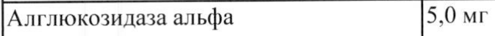
- стр. 2: «Маннитол 20 мг» — низкая уверенность: «20» (80)  
  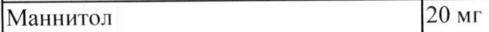
- стр. 2: «Полисорбат 80 0,05 мг» — повторное чтение: «|[Полисорбат 80 10,05 Mr»  
  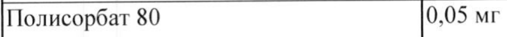
- стр. 2: «Натрия гидрофосфата гептагидрат 0,94 мг» — повторное чтение: «|Натрия гидрофосфата гептагидрат |0,94 Mr»  
  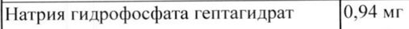
- стр. 2: «Натрия дигидрофосфата моногидрат |2,97 мг» — низкая уверенность: «|2,97» (66); повторное чтение: «[Натрия дигидрофосфата моногидрат [2,97 Mr»  
  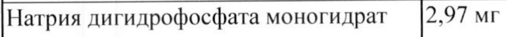
- стр. 3: «соответственно, - 26 %, 9% и 7 %.» — низкая уверенность: «9%» (22), «7» (66)  
  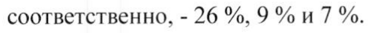
- стр. 5: «& группы Отношение 95%» — повторное чтение: «ww | Пациенты, | _ труппы > | Монеинаа | Фтноление | в.»  
  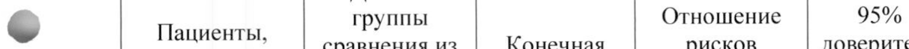
- стр. 6: «© показатели отношения массы тела к возрасту (выше Зго перцентиля), у 14 из 15 (93.3%) они» — повторное чтение: «| ал к ии»  
  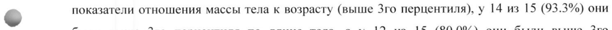
- стр. 7: «© прошествии 52 недель терапии 16 из 21 пациента (76.2%), получавших терапию препаратом» — повторное чтение: «ИЯ о лол ин»  
  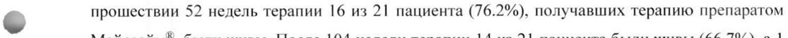
- стр. 12: «в 20 мг/кг и 40 мг/кг. Средняя площадь под кривой «концентрация — время» (AUC)» — низкая уверенность: «20» (28), «40» (71)  
  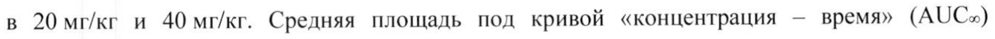
- стр. 29: «Лиофилизат в количестве, эквивалентном 50 мг активного вещества, во флакон из стекла 1-го» — низкая уверенность: «1-го» (72)  
  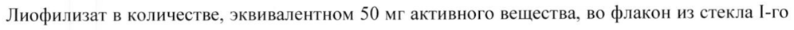
