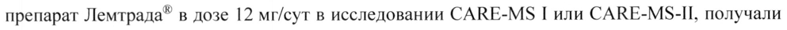
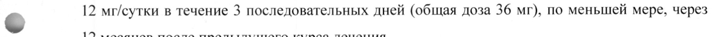

# Алемтузумаб — парентерально

- Препарат: Лемтрада® (концентрат для приготовления раствора для инфузий;)
- АТХ: L04AA34
- Источник: ГРЛС, инструкция по медицинскому применению, РУ ЛП-003714, файл от 2023-09-11 (https://grls.rosminzdrav.ru/Grls_View_v2.aspx?routingGuid=a71991c0-0850-49d8-a418-143480ec44c7)
- Распознано автоматически (OCR): 36 из 36 стр.
- Сомнительных строк после OCR: 2 (см. раздел «Проверка распознавания»)

## Общие сведения

ЛП-003714-210720 МИНИСТЕРСТВО ЗДРАВООХРАНЕНИЯ РОССИЙСКОЙ ФЕДЕРАЦИИ
ИНСТРУКЦИЯ ПО МЕДИЦИНСКОМУ ПРИМЕНЕНИЮ ЛЕКАРСТВЕННОГО ПРЕПАРАТА
Лемтрада® Регистрационный номер: ЛП-003714.
Торговое наименование: Лемтрада®.
© Международное непатентованное наименование: алемтузумаб.

## 3. Лекарственная форма

концентрат для приготовления раствора для инфузий.
концентрат для приготовления раствора для инфузий.

## 2. Состав

1 мл препарата содержит:
1 мл препарата содержит:
действующее вещество: алемтузумаб — 10 мг;
вспомогательные вещества: динатрия эдетата дигидрат — 0,0187 мг, фосфатный забуференный солевой раствор pH 7,2 (калия хлорид - 0,2 мг, калия дигидрофосфат — 0,2 мг, натрия хлорид — 8,0 мг, динатрия гидрофосфат безводный' — 1,15 мг, полисорбат-80 — 0,1 мг, вода для инъекций — до 1,0 мл).
' соответствует 1,44 мг динатрия гидрофосфата дигидрата.
Описание - Прозрачная или опалесцирующая бесцветная или светло-желтая жидкость.
Фармакотерапевтическая группа: селективный иммунодепрессант.
Код ATX: L04AA34.
Фармакологические свойства Фармакодинамика
Механизм действия Алемтузумаб — это гуманизированное IgGl каппа моноклональное антитело к гликопротеинам CD52 с молекулярной массой 21-28 кДа. Производится по технологии рекомбинантной ДНК с использованием суспензионной культуры клеток яичника китайского хомячка. Алемтузумаб представляет собой человеческий 12С1 (вариабельные и константные 125835
ЛП-003714-210720 участки каппа цепи) с участками, определяющими комплементарность, полученными ОТ моноклональных антител мыши (крысы). Молекулярная масса антитела составляет примерно 150 кДа.

Алемтузумаб связывается с гликопротеинами CD52, которые присутствуют в больших количествах на поверхности В- и Т-лимфоцитов, и в более низких количествах — на поверхности естественных клеток-киллеров, моноцитов и макрофагов. На поверхности нейтрофилов, плазматических клеток и стволовых клеток костного мозга гликопротеины
CD52 не определяются или определяются в небольших количествах. Действие алемтузумаба реализуется путем антитело-зависимого цитолиза и комплемент-опосредованного лизиса, которые развиваются после связывания алемтузумаба с В- и Т-лимфоцитами.
; Точный механизм действия алемтузумаба при рассеянном склерозе до конца не изучен, но,
- предположительно, может быть связан с иммуномодулирующим эффектом после истощения популяции лимфоцитов и их последующей репопуляции, включая:
© изменение количества, процентного соотношения и свойств некоторых субпопуляций лимфоцитов после лечения, e увеличение количества субпопуляций регуляторных Т-лимфоцитов, e увеличение количества Т- и В-лимфоцитов памяти,
® транзиторное влияние на врожденную иммунную систему (например, На нейтрофилы, макрофаги и естественные клетки-киллеры).
Снижение препаратом Лемтрада® количества циркулирующих В- и Т-лимфоцитов и их последующая репопуляция уменьшает вероятность обострения рассеянного склероза, что, в конечном счете, замедляет прогрессирование заболевания.
© Фармакодинамические эффекты Препарат Лемтрада® снижает количество циркулирующих В- и Т-лимфоцитов после каждого курса лечения с наименьшими наблюдавшимися значениями их количества через месяц после курса лечения. Co временем популяция лимфоцитов восстанавливается, при этом восстановление популяции В-клеток обычно завершается в течение 6 месяцев. Количество лимфоцитов с экспрессией CD3+ и CD4+ увеличивается до нормы гораздо медленнее и обычно не восстанавливается до исходных значений к 12 месяцу после лечения.
Приблизительно у 40 % пациентов общее количество лимфоцитов достигало нижней границы нормы через 6 месяцев после каждого курса лечения, а приблизительно у 80 % пациентов 125835
ЛП-003714-210720 общее количество лимфоцитов достигало нижней границы нормы через 12 месяцев после каждого курса лечения.

На нейтрофилы, моноциты, эозинофилы, базофилы и естественные клетки-киллеры препарат
Лемтрада*® оказывает только кратковременное воздействие.
Влияние на фертильность у мужчин Данные небольшой выборки пациентов мужского пола, принимавших участие в двух клинических исследованиях Ш фазы (N=13), свидетельствуют о том, что лечение алемтузумабом не оказывает нежелательного влияния на качество спермы, ее количество или подвижность сперматозоидов.
Клиническая эффективность и безопасность
Безопасность и эффективность препарата Лемтрада® оценивались у пациентов с
- ремиттирующим рассеянным склерозом (РРС) в 3-х рандомизированных клинических исследованиях с активным препаратом сравнения и с сокрытием выбора метода лечения от оценивающего результат специалиста и одном не контролируемом активным препаратом продолжении клинического исследования с сокрытием выбора метода лечения от оценивающего результат специалиста.
Тяжесть обострений Кроме влияния на частоту обострений, дополнительный анализ, проведенный в рамках исследования 3 фазы (CAMMS323), показал, что, по сравнению с использованием интерферона бета-!а (ИФНбета-1а), применение препарата Лемтрада® в дозе 12 мг в сутки приводило к значимому снижению числа пациентов с тяжелыми обострениями (снижение на
| 61 %, р=0,0056), а также к значимому снижению числа обострений, требующих назначения
- глюкокортикостероидов (снижение на 58 %, р<0,0001).
Подтвержденное уменьшение инвалидизации Сохранение на протяжении 6 месяцев уменьшения баллов по шкале EDSS, по меньшей мере, на | балл при исходном балле >2 расценивалось как подтвержденное уменьшение инвалидизации. Подтвержденное уменьшение инвалидизации является мерой устойчивого улучшения с точки зрения инвалидизации. В рамках исследования 3 фазы этого показателя достигли 29% пациентов, получавших препарат Лемтрада®, и лишь 13% пациентов, получавших ИФНбета-1а подкожно. Различие было статистически значимым (р=0,0002).
Данные долгосрочного исследования по эффективности
В продолженном исследовании были получены данные по эффективности среди пациентов, 125835
ЛП-003714-210720 наблюдавшихся до 6 лет после включения в исследования 3 фазы. В продолженное исследование 4 вошли 91,8 % пациентов, получавших препарат Лемтрада® в дозе 12 мг в исследованиях CARE-MS [и CARE-MS-IL.

Абсолютное снижение среднегодовой частоты обострений (СЧО) у пациентов, изначально получавших препарат Лемтрада®, оставалось низким на протяжении всего исследования, при этом сохранялся высокий процент пациентов, у которых не было обострений в течение всех лет наблюдения. У большинства пациентов не наблюдалось подтвержденного прогрессирования инвалидизации. Средние показатели степени инвалидизации на протяжении всего наблюдения были стабильными или улучшились. Через 6 лет после первого лечения препаратом Лемтрада® 32,7 % и 42,5 % пациентов из исследований CARE-
® MS [и CARE-MS-II, соответственно, достигли подтвержденного уменьшения инвалидизации.
Пациенты также продолжали демонстрировать низкие риски образования новых Т2 или контрастируемых гадолинием очагов на МРТ. Объем очагов Т2 оставался меньшим в течение всего периода наблюдения, чем до первоначального лечения препаратом
Лемтрада® (среднее процентное изменение на 6-й год составляло -8,5 и -0,1 для исследования
Ти 2, соответственно), только с небольшими колебаниями в разные годы наблюдения.
Медиана ежегодного процентного изменения (уменьшения) паренхиматозной фракции головного мозга была ниже в течение периода продолженного исследования, чем в предыдущих исследованиях 3 фазы. Примерно половина (51,2 %) пациентов, которые первоначально получили препарат Лемтрада* в дозе 12 мг/сутки в исследованиях САВЕ-М$ | и CARE-MS-II, и которые были включены в продолженное исследование, получили только начальные 2 курса лечения препаратом Лемтрада® и никакого другого лечения заболевания в
~ течение 6 лет наблюдения.
Эти результаты демонстрируют стабильную эффективность препарата Лемтрада® в снижении риска развития обострения рассеянного склероза, подавлении образования очагов рассеянного склероза, замедлении потери объема головного мозга (атрофии головного мозга)
и прогрессирования инвалидизации при отсутствии непрерывного лечения.
Дополнительное лечение в случае необходимости
В открытом продолжении клинических исследований препарата Лемтрада® некоторые пациенты «в случае необходимости» (при документальном подтверждении возобновления активности рассеянного склероза) получали дополнительные дозы препарата. В рамках дополнительных курсов препарат Лемтрада® в дозе 12 мг в сутки вводили на протяжении 3 125835
ЛП-003714-210720 дней подряд (суммарная доза 36 мг), по меньшей мере, через 12 месяцев после предыдущего курса лечения. Польза и риски >2 курсов лечения до конца не установлены, однако полученные результаты позволяют предположить, что дополнительные курсы терапии не привели к изменению профиля безопасности. Дополнительные курсы терапии должны проводиться не ранее, чем через 12 месяцев после предыдущего курса.

В рамках продолженного исследования 40 % пациентов, первоначально получавших препарат Лемтрада® в дозе 12 мг/сут в исследовании CARE-MS [ или САВЕ-М5-П, получали дополнительные курсы в связи с подтвержденными документально показателями активности рассеянного склероза (обострение и/или МРТ- изменения) при решении лечащего врача о возобновлении лечения. Дополнительный(ые) курс(ы) препарата Лемтрада® назначали по

© 12 мг/сутки в течение 3 последовательных дней (общая доза 36 мг), по меньшей мере, через 12 месяцев после предыдущего курса лечения.
Эти данные показывают, что пациенты с обострением рассеянного склероза после предыдущего курса лечения препаратом Лемтрада® могут достичь клинического улучшения по клиническим и МРТ-показателям (снижение частоты обострений в пересчете на год, уменьшение количества и размеров очагов и стабилизация или снижение степени инвалидизации) после дополнительных курсов лечения препаратом Лемтрада*®.
Преимущества и риски, связанные с 5 или более курсами лечения, не были полностью установлены, но результаты свидетельствуют о том, что профиль безопасности не меняется с дополнительными курсами. В случае необходимости проведения дополнительных курсов лечения, их необходимо проводить, по меньшей мере, через 12 месяцев после предыдущего курса.

- Фармакокинетика
Фармакокинетику алемтузумаба оценивали в исследовании с участием 216 пациентов с ремиттирующим рассеянным склерозом, получавших внутривенные инфузии препарата в дозах 12 мг или 24 мг в сутки в течение 5 дней подряд, а затем — в течение 3 дней подряд через 12 месяцев после начального курса терапии. Концентрация алемтузумаба в сыворотке крови в пределах одного курса лечения возрастала после введения каждой последующей дозы, а максимальная концентрация (Cmax) достигалась после последней инфузии курса.
Введение препарата в дозе 12 мг в сутки позволяло достичь значение Cmax, равное 3014 нг/мл, на 5 сутки начального курса лечения и 2276 нг/мл - на 3 сутки второго курса лечения. Период полувыведения составлял приблизительно 2 дня и его значения существенно не различались

125835 ЛП-003714-210720 в ходе начального и последующего курсов терапии; концентрации в сыворотке крови в течение приблизительно 30 дней после каждого курса лечения были низкими или неопределяемыми.
Алемтузумаб - белок, предполагаемым путем метаболизма которого является распад на небольшие пептиды и отдельные аминокислоты под действием широко распространенных протеолитических ферментов. Классические исследования биотрансформации не проводились.
Фармакокинетика препарата не изучалась у пациентов в возрасте 55 лет и старше.
Популяционная фармакокинетика препарата Лемтрада® лучше всего описывается линейной, двухкамерной моделью. Системный клиренс снижается с количеством лимфоцитов
© вследствие потери CD52 антигена на периферии, однако его снижение от курса | до курса 2 было менее 20 %. Центральный объем распределения был пропорционален массе тела и приближался к объему внеклеточной жидкости (14,1 л), что подтверждает преимущественное распределение алемтузумаба в крови и интерстициальном пространстве. Не наблюдалось влияния возраста, расовой принадлежности или пола на фармакокинетику алемтузумаба.

## 4.1. Показания к применению

Препарат Лемтрада® показан в качестве препарата, изменяющего течение рассеянного склероза, для монотерапии высокоактивного ремиттирующего рассеянного склероза (РРС) у следующих групп взрослых пациентов:
Препарат Лемтрада® показан в качестве препарата, изменяющего течение рассеянного склероза, для монотерапии высокоактивного ремиттирующего рассеянного склероза (РРС) у следующих групп взрослых пациентов:

» пациенты, у которых сохраняется высокая активность течения заболевания, несмотря на проведение полного и адекватного курса лечения как минимум одним препаратом, изменяющим течение рассеянного склероза, или

~ e пациенты с быстропрогрессирующим (агрессивным) ремиттирующим рассеянным склерозом (т.е. перенесшие 2 или более инвалидизирующих обострения в течение года и имеющие | или более контрастируемых гадолинием очагов по данным магнитнорезонансной томографии (МРТ) головного мозга либо значительное увеличение объема поражения в режиме Т2 по сравнению с результатами последней проведенной
МРТ).

## 4.3. Противопоказания

e Повышенная чувствительность к алемтузумабу или к какому-либо из вспомогательных веществ препарата.

» ВИЧ-инфекция.

125835 ЛП-003714-210720 ® Тяжелые активные инфекционные заболевания до их полного разрешения.
e Неконтролируемая артериальная гипертензия.
e Диссекция (расслоение) цервикоцефальных артерий в анамнезе.
® Инсульт в анамнезе.
® Стенокардия или инфаркт миокарда в анамнезе.
e Коагулопатия или сопутствующее применение антитромбоцитарной или антикоагулянтной терапии.
e Другие сопутствующие аутоиммунные заболевания (помимо рассеянного склероза).
» Возраст до 18 лет (безопасность и эффективность препарата не установлены) (см. в разделе «Способ применения и дозы» подраздел «Дети»).
© Ограничения по применению препарата при беременности приведены в разделе «Применение при беременности и в период грудного вскармливания».

## 4.3. С осторожностью

Применение препарата Лемтрада® не рекомендуется для пациентов с неактивным заболеванием или у пациентов со стабильным течением заболевания на фоне терапии.
Применение препарата Лемтрада® не рекомендуется для пациентов с неактивным заболеванием или у пациентов со стабильным течением заболевания на фоне терапии.
На фоне лечения препаратом Лемтрада® могут образовываться аутоантитела, что может привести к развитию аутоиммунных заболеваний, включая заболевания щитовидной железы, иммунную тромбоцитопеническую пурпуру (ИТП) или, редко, нефропатию (например, антиTBM болезнь [гломерулонефрит, обусловленный антителами к гломерулярной базальной мембране]) (см. раздел «Особые указания»).
Следует соблюдать осторожность при применении препарата Лемтрада® у носителей вирусов
© гепатита В (ВГ-В) и/или гепатита С (ВГ-С), поскольку есть риск реактивации вируса и развития необратимой печёночной недостаточности у пациентов этой группы.
Следует с осторожностью назначать препарат Лемтрада® пациентам с предшествовавшими и/или имеющимися злокачественными новообразованиями (см. раздел «Особые указания»).

## 4.6. Применение при беременности и в период грудного вскармливания

Женщины с детородным потенциалом После окончания каждого из курсов терапии препаратом Лемтрада” концентрация алемтузумаба в сыворотке крови была низкой или находилась на неопределяемом уровне приблизительно в течение 30 дней. Женщины с детородным потенциалом должны использовать надёжные методы контрацепции во время лечения препаратом Лемтрада® и в течение 4 месяцев после каждого курса лечения.
125835 ЛП-003714-210720 Беременность Не проводилось адекватных и хорошо контролируемых исследований применения препарата
Лемтрада® у беременных женщин. Данные о применении препарата Лемтрада® для лечения беременных женщин с рассеянным склерозом ограничены. Препарат Лемтрада® можно применять во время беременности, только если предполагаемая польза превышает потенциальный риск для плода.
Известно, что человеческий иммуноглобулин IgG проходит через плацентарный барьер;
алемтузумаб также может проходить через плацентарный барьер, и, следовательно, потенциально представляет риск для плода. В исследованиях на животных было выявлено токсическое действие на репродуктивную функцию. Неизвестно, способен ли алемтузумаб
© оказывать отрицательное воздействие на плод при его введении беременной женщине или негативно влиять на репродуктивную функцию.
Заболевания щитовидной железы представляют особый риск для беременных женщин. При отсутствии лечения гипотиреоза во время беременности имеется повышенный риск невынашивания беременности и воздействия на плод, результатами которого могут быть задержка умственного развития и карликовость. У беременных женщин с диффузным токсическим зобом антитела к рецепторам тиреотропного гормона могут передаваться развивающемуся плоду и вызвать развитие транзиторного диффузного токсического зоба у новорожденного.
Период грудного вскармливания Алемтузумаб (при его введении в дозе 10 мг/кг в течение 5 последующих дней после родов)
| был обнаружен в молоке лактирующих мышей иу их детёнышей.
wr Неизвестно, проникает ли алемтузумаб в грудное молоко у человека. Однако нельзя исключить наличие риска для ребенка, получающего грудное молоко. Таким образом, грудное вскармливание должно быть прекращено на протяжении каждого курса лечения препаратом Лемтрада*, а также в течение 4 месяцев после проведения последней инфузии в рамках любого курса лечения. При этом польза от передачи иммунитета через грудное молоко может превосходить риски от возможного попадания алемтузумаба в организм ребенка.
Влияние на фертильность Достоверные данные по клинической безопасности, касающиеся влияния препарата
Лемтрада® на репродуктивную функцию, отсутствуют. В рамках 2-х дополнительных 125835
ЛП-003714-210720 исследований с участием 13 мужчин, получавших алемтузумаб (в дозах 12 мг или 24 мг), не было получено никаких подтверждений развития аспермии, азооспермии, устойчивого снижения количества сперматозоидов, нарушений подвижности или увеличения числа морфологических изменений сперматозоидов.

Известно, что рецепторы CD52 присутствуют в тканях репродуктивных органов человека и грызунов. Данные, полученные в исследованиях на животных, выявили наличие влияния на репродуктивную функцию у гуманизированных мышей, однако имеющиеся данные не позволяют судить о том, влияет ли применение препарата Лемтрада® на репродуктивную функцию человека.

## 4.2. Способ применения и дозы

© Лечение препаратом Лемтрада® следует начинать и проводить только под контролем невролога, имеющего опыт лечения пациентов с рассеянным склерозом, при доступности специалистов и оборудования для своевременной диагностики и лечения нежелательных реакций, особенно ишемии миокарда, инфаркта миокарда, цереброваскулярных нежелательных реакций, аутоиммунных реакций и инфекций.
Лечение должно проводиться в условиях доступа к средствам для купирования синдрома высвобождения цитокинов, реакций гиперчувствительности и (или) анафилактических реакций.
Пациенты должны быть проинформированы о рисках, связанных с терапией алемтузумабом, а также о необходимости находиться под наблюдением врача в период лечения и в течение 48 месяцев после последней инфузии.
Режим дозирования

lw Рекомендованная доза алемтузумаба составляет 12 мг в сутки в виде внутривенной инфузии.
Проводят два начальных курса лечения, и, при необходимости, до двух дополнительных курсов.
Начальное лечение состоит из двух курсов лечения:

e первый курс лечения: 12 мг в сутки в течение 5 дней подряд (общая доза — 60 мг);

» второй курс лечения: 12 мг в сутки в течение 3 дней подряд (общая доза — 36 мг), назначается через 12 месяцев после первого курса лечения. Более длительный перерыв между курсами инфузий не изучался.

125835 ЛП-003714-210720

При необходимости может назначаться до двух дополнительных курсов лечения

e Третий и четвертый курсы лечения: по 12 мг/сут в течение 3 дней подряд (общая доза —

36 мг), назначаются не ранее чем через 12 месяцев после предыдущего курса лечения.
Пропущенные дозы не следует вводить в один и тот же день с введением запланированных
ДОЗ.
Премедикация Пациентам необходимо проводить премедикацию кортикостероидами непосредственно перед введением препарата Лемтрада® в каждые первые 3 дня каждого курса лечения. В ходе клинических исследований премедикацию пациентам проводили с помощью 1000 мг метилпреднизолона, который вводили в каждый из первых 3 дней каждого курса лечения
© препаратом Лемтрада®.
Кроме того, дополнительно, можно рассмотреть вопрос о премедикации антигистаминными и/или жаропонижающими средствами перед введением препарата Лемтрада®
У всех пациентов необходимо применять пероральные средства для профилактики герпеса, начиная их применение в первый день каждого курса лечения и продолжая в течение как минимум 1 месяца после лечения препаратом Лемтрада®. При проведении клинических исследований пациенты принимали ацикловир в дозе 200 мг 2 раза в сутки или его эквивалент.
Особые группы пациентов Пациенты пожилого возраста
В клинических исследованиях препарата Лемтрада® не участвовали пациенты старше 61 года. Не установлено каких-либо различий в реакции на лечение по сравнению с более
_ молодыми пациентами.
Пациенты с почечной недостаточностью Применение препарата Лемтрада® у пациентов с нарушением функции почек не изучалось.
Пациенты с печеночной недостаточностью Применение препарата Лемтрада® у пациентов с нарушением функции печени не изучалось.
Дети Безопасность и эффективность применения препарата Лемтрада® у детей с рассеянным склерозом младше 18 лет не установлена. Нет данных о применении алемтузумаба у детей младше 10 лет для лечения рассеянного склероза.
125855 ЛП-003714-210720 Способ применения
Содержимое флакона перед введением следует визуально проверить на наличие твердых частиц и изменение цвета. Не использовать препарат в случае наличия в концентрате видимых частиц или изменения цвета.
Не встряхивать флакон перед использованием.
Для внутривенного введения следует набрать 1,2 мл концентрата из флакона в стерильный шприц, соблюдая правила асептики. Ввести набранный концентрат в 100 мл раствора натрия хлорида 9 мг/мл (0,9 %) для инфузий или раствора глюкозы (5 %) для инфузий. Нельзя разводить данный лекарственный препарат другими растворами. Осторожно перевернуть
© емкость для перемешивания раствора.
Препарат Лемтрада® не содержит антимикробных консервантов и, следовательно, необходимо соблюдать меры предосторожности, чтобы сохранить приготовленный раствор в стерильном состоянии. Рекомендуется вводить разведенный препарат немедленно. Каждый флакон предназначен только для однократного использования.
Любое количество неиспользованного лекарственного средства или отходы после его использования должны быть утилизированы в соответствии с местными нормативными требованиями.
Длительность внутривенной инфузии составляет приблизительно 4 часа. Если инфузия плохо переносится пациентом, можно уменьшить скорость введения препарата.
В случае крайней необходимости допускается хранение готового для применения раствора в защищенном от света месте при температуре 2 °- 8 °С не более 8 часов.
- Побочное действие

Резюме профиля безопасности При проведении совокупного анализа безопасности препарата Лемтрада® в выборку были включены 1486 пациентов с PPC, получавших препарат Лемтрада® (в дозах 12 мг или 24 мг) с медианой наблюдения 6,1 лет (максимум 12 лет), что соответствовало 8635 пациенто-годам наблюдения за безопасностью в рамках клинических исследований. Исследование | и исследование 2 представляли собой двухлетние контролируемые активным препаратом сравнения исследования с участием пациентов с PPC, которым проводили лечение препаратом Лемтрада® в дозе 12 мг/сут в течение 5 дней подряд в начале исследования и в

125835 течение 3 дней подряд через 12 месяцев исследования, либо вводили ИФНбета-!а подкожно
(п/к) в дозе 44 мкг 3 раза в неделю.
В исследовании 3 (САММ$223) оценивали безопасность и эффективность препарата
Лемтрада® у пациентов с РРС в течение 3-х лет. В неконтролируемом (не сравнительном)
продолжении клинических исследований (исследование 4) (САММ$03409), оценивался длительный период (4 дополнительных года) безопасности и эффективности препарата
Лемтрада® у пациентов, участвующих в исследованиях 1, 2 и 3. В связи с увеличением количества курсов доступны данные, полученные у меньшего числа пациентов, и при краткосрочном периоде последующего наблюдения.
Наиболее важными нежелательными реакциями были: аутоиммунные заболевания
© (заболевания щитовидной железы, иммунная тромбоцитопеническая пурпура (ИТП), нефропатии и цитопении), инфузионные реакции и инфекционные заболевания.
Наиболее частыми нежелательными реакциями (> 20 % пациентов) были сыпь, головная боль, лихорадка и инфекции дыхательных путей.
Табличное резюме нежелательных реакций Нежелательные реакции, которые возникали у > 0,5 % пациентов, распределены по системноорганным классам (СОК) согласно Медицинскому словарю для нормативно-правовой деятельности (Мед ОКА) и по терминам предпочтительного употребления (ТПУ). Частота оценивалась согласно следующим условным обозначениям: очень часто (21/10), часто
(>1/100 и <1/10), нечасто (>1/1000 и < 1/100), редко (>1/10 000 и < 1/1000), частота неизвестна
(невозможно определить по имеющимся данным частоту встречаемости нежелательной реакции). Внутри каждой группы частоты встречаемости нежелательные реакции w представлены в порядке уменьшения их серьезности.
Таблица 1: Нежелательные реакции, наблюдавшиеся у пациентов, получавших препарат Лемтрада® в дозе 12 мг в клинических исследованиях 1, 2, 3, 4 и пострегистрационных наблюдениях
Классы и системы | Очень часто Часто Нечасто Редко Частота неизвестна органов
Инфекции и инвазии | Инфекции верхних | Инфекции, вызванные | Онихомикоз, Листериоз/листериоз дыхательных вирусом Herpes точег, | гингивит, микозы НЫЙ менингит, путей, инфекции | инфекции нижних | КОЖИ, TOHSHILIMT, инфекция, вызванная
. | острый синусит, В < в мочевыводящих дыхательных путеи, вирусом Эпштейна-
. целлюлит, путей, гастроэнтерит, — Кандидоз | пневмонит, Барр герпетические полости . рта, туберкулез, инфекции вульвовагинальный цитомегаловирусная кандидоз, грипп, ушные инфекция инфекции, пневмония, вагинальные инфекции, инфекции зубов
[ Hosoobpasosann о еимомак р ЛП-003714-210720 доброкачественные, злокачественные и неуточненные
(включая кисты и полипы)
Нарушения со | Лимфопения, Лимфаденопатия, Панцитопения, стороны крови и | лейкопения, иммунная гемолитическая лимфатической включая тромбоцитопеническая анемия, системы нейтропению пурпура, тромбоцитопения, | приобретенная снижение гематокрита, | гемофилия А обусловленное — анемией, лейкоцитоз
Нарушения со Синдром высвобождения Гемофагоцит стороны иммунной цитокинов*, арный системы гиперчувствительность, лимфогистио включая анафилаксию* iuTO3
Нарушения со | Диффузный Аутоиммунный тиреоидит, стороны токсический 306, | Включая подострый эндокринной гипертиреоз, тиреоидит, 300, euereias гипотиреоз положительный тест на антитиреоидные антитела
Soe | ee расстройства питания Психические Бессонница*, тревога, расстройства. депрессия
Нарушения со Головная боль* Обострение рассеянного Нарушение Инсульт стороны нервной склероза, чувствительности, (ишемический и системы головокружение*, гиперестезия, геморрагический)**, гипестезия, парестезия, головная боль расслоение тремор, дисгевзия*, напряжения мигрень* (диссекция)
цервикоцефальных артерий** Нарушения со Конъюнктивит, Диплопия стороны органа эндокринная зрения офтальмопатия, нечеткость зрения ome | стороны органа слуха и равновесия
Нарушения со Тахикардия* Брадикардия*, ощущение Фибрилляция Ишемия миокарда**, стороны сердца сердцебиения* предсердий* инфаркт миокарда** a ae a 7 стороны сосудов артериальная гипертензия*
< Нарушения со Одышка*, кашель, носовое | Чувство стеснения в Легочное стороны кровотечение, икота, глотке*, раздражение альвеолярное дыхательной орофарингеальная боль, глотки кровотечение** системы, — органов agra грудной клетки и средостения
Нарушения со Тошнота* Боль в животе, рвота, Запор, стороны желудочно- диарея, диспепсия*, гастроэзофагеальная кишечного тракта стоматит рефлюксная болезнь, кровоточивость рту, дисфагия, желудочнокишечные расстройства, гематохезия (кровь в кале
Нарушения со Повышение активности Холецистит, включая Аутоиммунный стороны печени и аспартатаминотрансферазы | некалькулезный гепатит, гепатит.
желчевыводящих (АСТ), повышение холецистит и острый ассоциированный с путей активности некалькулезный вирусом Эпштейнааланинаминотрансферазы холецистит Вр
ЛП-003714-210720 О Sy ОО ООО ООО Нарушения со Крапивница*, Эритема*, кровоподтеки, Волдыри, ночная стороны кожи и сыпь*, зуд*, алопеция, повышенное потливость, подкожных тканей генерализованная потоотделение, акне, отечность лица, сыпь* поражение кожи, дерматит | экзема
Нарушения со Миалгия, мышечная Костно-мышечная стороны скелетно- слабость, артралгия, больв | скованность, мышечной и спине, боль в конечностях, | дискомфорт в соединительной мышечные спазмы, боль в конечностях ткани шее, костно-мышечные боли
Нарушения со Протеинурия, гематурия Нефролитиаз, стороны почек и кетонурия, мочевыводящих нефропатии, включая путей анти-ГБМ болезнь
Нарушения со Меноррагия, нерегулярные | Цервикальная стороны половых менструации дисплазия, аменорея органов и молочной железы
Общие нарушения и | Пирексия Дискомфорт в грудной нарушения в месте (повышение клетке*, боль*, введения температуры периферический отек, тела)*, усталость* , | астения, гриппоподобное
© озноб* состояние, общий дискомфорт (чувство общего недомогания), боль в месте внутривенного введения препарата
Лабораторные и Увеличение концентрации Снижение массы инструментальные креатинина в крови тела, увеличение данные массы тела, снижение количества эритроцитов, положительный бактериальный тест, повышение концентрации глюкозы в крови, увеличение объема клеток
Травмы, отравления Контузия, связанные с и процедурные инфузией реакции осложнения
: Термин «герпетические инфекции» включает в себя следующие ТПУ: герпес полости рта
. > простой герпес, генитал ЬНЫЙ герпес, герпес-вирусная инфекция, простой генитальный герпес, кожный герпес, офтальмогерпес, вызванный вирусом Herpes simplex, простой герпес с положительным серологическим исследованием.
2 Термин «инфекции, вызванные вирусом Herpes zoster) включает в себя следующие ТПУ:
опоясывающий лишай, кожный диссеминированный лишай, опоясывающий герпес с
ЛП-003714-210720 поражением глаза, офтальмогерпес, вызванный вирусом Herpes zoster, неврологическая инфекция, вызванная вирусом Herpes zoster, менингит, вызванный вирусом Herpes Zoster.
*Нежелательные реакции, которые включают связанные с инфузией реакции (СИР).
**Нежелательные реакции, наблюдаемые в ходе пострегистрационного применения препарата, которые развивались в большинстве случаев в течение 1-3 дней после инфузии любой дозы препарата Лемтрада® в ходе лечения препаратом.

Нейтропения Сообщалось о случаях тяжелой нейтропении (включая случаи с летальным исходом) в течение 2 месяцев после инфузии препарата Лемтрада*®.
Описание отдельных нежелательных реакций
© Виды нежелательных реакций (НР) (включая их тяжесть и серьезность), наблюдавшиеся в группах лечения препаратом Лемтрада® во время всего доступного периода наблюдений, включая пациентов, которые получали дополнительные курсы лечения, были сопоставимыми с таковыми, наблюдаемыми в исследованиях, контролируемых применением препарата сравнения.
Связанные с инфузией реакции наблюдались чаще во время первого курса лечения, чем при последующих.
У пациентов из клинических исследований, контролируемых применением препарата сравнения, не получавших после первых двух курсов лечения никаких дополнительных курсов лечения препаратом Лемтрада“, за которыми продолжалось дальнейшее наблюдение, частота (количество случаев на человека в год) большинства нежелательных реакций была
© сопоставима или уменьшалась в отдельно взятых 3-6 годах наблюдения по сравнению с | и2 годами наблюдения. Частота побочных реакций со стороны щитовидной железы была самой высокой в течение третьего года наблюдения и затем снижалась.
Иммуногенность Как и любые другие лекарственные препараты белкового происхождения, алемтузумаб обладает потенциальной иммуногенностью. Полученные данные отражали процент пациентов с положительными результатами на наличие антител к алемтузумабу (по данным фермент-связанного иммуносорбентного исследования (ELISA), подтвержденного анализом конкурентного связывания). Затем положительные образцы изучались на наличие признаков ингибирования in vitro методом проточной цитометрии. В рамках клинических исследований с участием пациентов с рассеянным склерозом для выявления антител к алемтузумабу 125835
ЛП-003714-210720 образцы плазмы крови собирали через 1, 3 и 12 месяцев после каждого курса терапии. Во время исследований антитела к алемтузумабу обнаруживались приблизительно у 85% пациентов, получавших препарат Лемтрада*®, при этом у более чем 90 % из этих пациентов были положительными результаты тестирования также и на наличие антител, ингибирующих связывание препарата Лемтрада® in vitro. Те пациенты, у которых выработались антитела к алемтузумабу, продолжали демонстрировать их наличие на протяжении 15 месяцев с момента первого введения препарата. Во время двух курсов лечения взаимосвязи между наличием антител к алемтузумабу или ингибирующих антител к алемтузумабу и снижением эффективности, изменением фармакодинамики или развитием нежелательных реакций, включая связанные с инфузиями реакции, не выявлено. Высокие титры антител к

© алемтузумабу, наблюдаемые у некоторых пациентов, ассоциировались с неполным истощением лимфоцитов после третьего или четвертого курса лечения, но явного влияния наличия антител к алемтузумабу на клиническую эффективность или профиль безопасности препарата Лемтрада® не наблюдалось.
Частота выявления антител в значительной степени зависит от чувствительности и специфичности используемого метода анализа. Кроме того, частота выявления антител
(включая ингибирующие антитела) может зависеть от целого ряда факторов, таких как методика анализа, обработка образцов, время забора образцов, одновременный прием других препаратов и сопутствующие заболевания. По этим причинам сравнение частоты выявления антител к препарату Лемтрада® с частотой выявления антител к другим препаратам может быть ошибочным.

Опыт пострегистрационного применения алемтузумаба для лечения заболеваний, помимо

- рассеянного склероза
Алемтузумаб был зарегистрирован в 2001 г. как средство для лечения В-клеточного хронического лимфоцитарного лейкоза (В-ХЛЛ). Нижеописанные нежелательные реакции были выявлены при пострегистрационном применении алемтузумаба для лечения В-ХЛЛ, а также, для лечения других заболеваний, обычно препарат применялся с большей частотой и в более высоких дозах (например, 30 мг), чем рекомендуемые для лечения рассеянного склероза (> 12 мг/сут).

e Аутоиммунные заболевания К аутоиммунным заболеваниям, о которых сообщалось у пациентов, получавших лечение алемтузумабом, относились нейтропения, гемолитическая анемия (включая случай с 125855
ЛП-003714-210720 летальным исходом), приобретенная гемофилия, анти-ГБМ болезнь (гломерулонефрит, обусловленный антителами к гломерулярной базальной мембране) и заболевания щитовидной железы. У пациентов, которые получали алемтузумаб для лечения заболеваний, отличных от рассеянного склероза, наблюдались такие серьезные и иногда летальные аутоиммунные заболевания, как аутоиммунная гемолитическая анемия, аутоиммунная тромбоцитопения, апластическая анемия, синдром Гийена-Барре и хроническая воспалительная демиелинизирующая полирадикулонейропатия. Положительные результаты пробы Кумбса были отмечены у получавшего алемтузумаб онкологического пациента. У другого получавшего алемтузумаб онкологического пациента была зарегистрирована связанная с гемотрансфузией реакция «трансплантат против хозяина», которая завершилась

© летальным исходом.
® Связанные с инфузией реакции У пациентов, которые для лечения состояний, отличных от рассеянного склероза, получали алемтузумаб с большей частотой и в более высоких дозах, чем дозы, применяемые для лечения рассеянного склероза, наблюдались серьезные и иногда летальные связанные с инфузией реакции, такие как бронхоспазм, гипоксия, синкопальные состояния, легочные инфильтраты, острый респираторный дистресс-синдром, остановка дыхания, инфаркт миокарда, аритмии, острая сердечная недостаточность и остановка сердца. Также сообщалось о случаях тяжелых анафилаксий и прочих реакций гиперчувствительности, включая анафилактический шок и ангионевротический отек (отек Квинке).
» Инфекционные и паразитарные заболевания
У пациентов, которые для лечения состояний, отличных от рассеянного склероза, получали р - алемтузумаб с большей частотой и в более высоких дозах, чем дозы, использующиеся при рассеянном склерозе, наблюдались серьезные и иногда летальные вирусные, бактериальные, протозойные и грибковые инфекции, в том числе возникающие вследствие реактивации латентных инфекций.
У пациентов с В-ХЛЛ, получавших или не получавших лечение алемтузумабом, регистрировались случаи прогрессирующей мультифокальной лейкоэнцефалопатии (ИМЛ).
Частота возникновения ПМЛ у получавших алемтузумаб пациентов с В-ХЛЛ не превышала общую частоту развития таких явлений.
125835 ЛП-003714-210720

e Нарушения со стороны крови и лимфатической системы
У пациентов с отличными от рассеянного склероза состояниями были отмечены случаи тяжелых кровотечений.

e Нарушения со стороны сердца У пациентов, которые получали алемтузумаб для лечения отличных от рассеянного склероза состояний и ранее лечились потенциально кардиотоксическими препаратами, были зафиксированы случаи застойной сердечной недостаточности, кардиомиопатии и снижения сердечной фракции выброса.

e Лимфопролиферативные заболевания, связанные с вирусом Эпштейна-Барр
В периоде пострегистрационного применения наблюдались лимфопролиферативные

© заболевания, ассоциирующиеся с вирусом Эпштейна-Барр.

## 4.9. Передозировка

В ходе контролируемых клинических исследований два пациента с рассеянным склерозом по ошибке получили почти по 60 мг препарата Лемтрада® (т.е. полную дозу начального курса лечения) в одной инфузии, что привело к развитию тяжёлых нежелательных реакций
В ходе контролируемых клинических исследований два пациента с рассеянным склерозом по ошибке получили почти по 60 мг препарата Лемтрада® (т.е. полную дозу начального курса лечения) в одной инфузии, что привело к развитию тяжёлых нежелательных реакций
(головная боль, сыпь, гипотензия или синусовая тахикардия). Применение препарата
Лемтрада® в дозах, превышающих изученные в клинических исследованиях, может увеличить интенсивность и/или продолжительность инфузионных реакций или усилить воздействие препарата на иммунную систему.
Антидот при передозировке препарата Лемтрада® неизвестен. Лечение заключается в прекращении применения препарата и проведении терапии, поддерживающей основные функции организма.
- Взаимодействие с другими лекарственными средствами
Исследования с участием пациентов с рассеянным склерозом, направленные на изучение взаимодействия препарата Лемтрада®, применяемого в рекомендованных дозах, с другими лекарственными средствами, не проводились. В контролируемом клиническом исследовании у пациентов с рассеянным склерозом, которые незадолго до этого получали лечение бетаинтерфероном и глатирамера ацетатом, требовалось прекращение лечения за 28 дней до начала терапии препаратом Лемтрада®.
При лечении пациентов с рассеянным склерозом препарат Лемтрада® не применяли одновременно с другими антинеопластическими или иммуносупрессивными препаратами или вслед за ними. Также, как в случае с другими иммуномодуляторами, принимая решение о 125835
ЛП-003714-210720 назначении препарата Лемтрада®, следует учитывать потенциальные сочетанные воздействия данных лекарственных средств на иммунную систему пациента. Применение препарата
Лемтрада® одновременно с любым из препаратов данных групп может увеличить риск иммуносупрессии.

Ввиду отсутствия исследований по изучению совместимости, не следует смешивать алемтузумаб с другими лекарственными препаратами. Не следует добавлять другие лекарственные препараты или одновременно вводить их по одной и той же линии для внутривенных инфузий.
Для разведения данного лекарственного препарата не следует использовать иные растворители, кроме указанных в разделе «Способ применения и дозы».
© Известные случаи несовместимости алемтузумаба и поливинилхлоридных (ПВХ)
инфузионных пакетов, ПВХ инфузионных систем с выстилкой из ПВХ или полиэтилена, а также фильтров с низким уровнем связывания белков отсутствуют.

## 4.4. Особые указания

Необходимо прекратить прием интерферонов бета и глатирамера ацетата за 28 дней до начала лечения препаратом Лемтрада®.
Необходимо прекратить прием интерферонов бета и глатирамера ацетата за 28 дней до начала лечения препаратом Лемтрада®.
Применение препарата Лемтрада® не рекомендуется для пациентов с неактивным заболеванием или у пациентов со стабильным течением заболевания на фоне терапии.
Перед началом лечения пациенты должны быть обучены и проинформированы о рисках и преимуществах терапии, а также о необходимости наблюдения с момента начала лечения и в течение как минимум 48 месяцев после последней инфузии второго курса лечения препаратом Лемтрада®. При назначении дополнительного курса, последующее наблюдение
- для оценки безопасности следует продолжать не менее 48 месяцев после последней инфузии.
Следует напомнить пациенту о необходимости внимательно наблюдать за своим состоянием для выявления симптомов, которые могут у него развиться, и о необходимости при возникновении каких-либо проблем сразу же обратиться за медицинской помощью.
Аутоимунные заболевания Лечение препаратом Лемтрада® может привести к образованию аутоантител, что может повысить риск развития аутоиммунных заболеваний, которые могут быть серьезными и жизнеугрожающими. Сообщалось о развитии аутоиммунных заболеваний, включая заболевания щитовидной железы, иммунную тромбоцитопеническую пурпуру (ИТП), нефропатию (например, анти-ГБМ болезнь [гломерулонефрит, обусловленный антителами к 125835
ЛП-003714-210720 гломерулярной базальной мембране]), аутоиммунный гепатит и приобретенную гемофилию
А.
В пострегистрационном периоде отмечались случаи развития множественных аутоиммунных нарушений на фоне применения препарата Лемтрада“. При назначении препарата Лемтрада® пациентам с аутоиммунными заболеваниями следует оценить возможность наличия других аутоиммунных нарушений. Пациенты и врачи должны быть информированы о вероятности позднего развития аутоиммунных нарушений после окончания мониторинга в течение 48 месяцев.
e /Приобретенная гемофилия A Случаи приобретенной гемофилии А (антитела против фактора VIII) были зарегистрированы
© как в клинических исследованиях, так и в пострегистрационном периоде. У пациентов
| обычно возникают спонтанные подкожные гематомы и обширные кровоподтеки, хотя возможно развитие гематурии, носового кровотечения, желудочно-кишечного или других видов кровотечений. У всех пациентов с такими симптомами должна быть проведена лабораторная диагностика коагулопатий, включая оценку АЧТВ (активированное частичное тромбопластиновое время). Пациентов следует информировать о признаках и симптомах приобретенной гемофилии А и рекомендовать немедленно обратиться к врачу при возникновении каких-либо из этих симптомов.
® Иммунная тромбоцитопеническая пурпура (ИТП)
Серьезные случаи ИТП наблюдались у 12(1 %) пациентов с рассеянным склерозом, принимавших участие в контролируемых клинических исследованиях (соответствует частоте ы в пересчете на год 4,7 событий/1000 пациентов/год). Дополнительные 12 серьезных случаев
- ИТП наблюдались при медиане последующего наблюдения 6,1 лет (максимум 12 лет)
(суммированный кумулятивный показатель в пересчете на год 2,8 событий/1000 пациентов/год). У | пациента развилась ИТП, которая протекала нераспознанно до внедрения в практику требований о ежемесячном мониторинге анализа крови, и пациент умер от геморрагического инсульта. Начало развития ИТП обычно отмечается между 14 и 36 месяцами после первой инфузии препарата Лемтрада®. В 79,5 % случаев ИТП обычно развивается в течение 4 лет после первой инфузии препарата. Тем не менее, в некоторых случаях, ИТП развивается на несколько лет позже. Симптомы ИТП могут включать (но не ограничиваться ими) легко возникающие кожные кровоизлияния, точечные кровоизлияния
(петехии), спонтанные кожно-слизистые кровотечения (например, носовое кровотечение, 125835
ЛП-003714-210720 кровохарканье), более обильные, чем обычно, либо нерегулярные менструальные кровотечения. Кровохарканье может также быть проявлением анти-ГБМ болезни, поэтому следует проводить соответствующую дифференциальную диагностику. Пациент должен быть информирован о возможности возникновения этих симптомов, и в случае любых сомнений немедленно обращаться к врачу.

Полный клинический анализ крови с подсчетом форменных элементов и лейкоцитарной формулы следует выполнить до начала лечения, и затем ежемесячно - в течение как минимум 48 месяцев после последней инфузии. После окончания данного периода анализы выполняются на основании клинических данных, позволяющих предположить ИТП. При подозрении на ИТП следует немедленно выполнить полный клинический анализ крови.

© При подтверждении диагноза ИТП должны быть немедленно предприняты соответствующие меры, включая срочное направление к специалисту. Данные клинических исследований по изучению рассеянного склероза показали, что соблюдение требований режима мониторинга анализа крови, а также обучение распознаванию признаков и симптомов ИТП, привело к ранней диагностике и лечению ИТП в большинстве случаев, развившихся при применении первого курса терапии. Потенциальный риск развития ИТП, связанный с дополнительными курсами лечения препаратом Лемтрада® пациентов с развившейся ИТП, неизвестен.

® Нефропатии

Нефропатии, включая анти-ГБМ болезнь, наблюдались у 6 (0,4 %) пациентов с рассеянным склерозом, принимавших участие в клинических исследованиях при медиане последующего наблюдения 6,1 лет (максимум 12 лет). Как правило, они отмечались в течение 39 месяцев после последней инфузии препарата Лемтрада®. В клинических исследованиях отмечено два

~ случая анти-ГБМ болезни. Оба случая были тяжелыми, однако благодаря клиническому и лабораторному мониторингу были своевременно выявлены, и их лечение было успешным.
Клинические проявления нефропатии могут включать повышение концентрации креатинина в сыворотке крови, гематурию и/или протеинурию. Несмотря на отсутствие случаев альвеолярного кровотечения в ходе клинических исследований, этот вид кровотечения, проявляющийся кровохарканьем, может развиваться при анти-ГБМ болезни. Кровохарканье также может быть признаком ИТП и приобретенной гемофилии А (см. выше), поэтому следует провести надлежащую дифференциальную диагностику. Анти-ГБМ болезнь может привести к развитию почечной недостаточности, требующей проведения диализа и/или

125835 ЛП-003714-210720 трансплантации при несвоевременно начатой терапии. При отсутствии лечения может возникнуть угроза для жизни.

Пациент должен быть информирован о необходимости внимательно относиться к возможности появления этих симптомов, а в случае их развития немедленно обратиться за медицинской помощью.

Необходимо определить концентрацию креатинина и провести клинический анализ мочи с микроскопией осадка до начала терапии препаратом Лемтрада®. Данные обследования необходимо проводить ежемесячно в течение курса лечения, а также в дальнейшем в течение не менее 48 месяцев после последней инфузии препарата Лемтрада®. Выявление клинически значимых отклонений от исходного значения концентрации креатинина в сыворотке крови,
© необъяснимой гематурии и/или протеинурии может потребовать дополнительного обследования для срочной диагностики нефропатии, включая незамедлительное обращение к соответствующему специалисту. Ранняя диагностика и лечение нефропатии могут снизить риск неблагоприятного исхода. После окончания периода 48 месяцев после последней инфузии анализы проводятся на основании клинических данных, позволяющих предположить нарушение функции почек. Потенциальный риск развития нефропатии, связанный с дополнительными курсами лечения препаратом Лемтрада® после развития у

пациента нефропатии , неизвестен.

® Заболевания щитовидной железы Нарушения со стороны эндокринной системы, включая аутоиммунные заболевания щитовидной железы наблюдались у 36,8 % пациентов с рассеянным склерозом, которые
. получали препарат Лемтрада® в дозе 12 мг при медиане последующего наблюдения 6,1 лет
- (максимум 12 лет) после первого введения препарата Лемтрада®. Как в группе пациентов, получавших препарат Лемтрада*, так и в группе пациентов, получавших интерферон бета-1а
(ИНФбета-1а), частота выявления заболеваний щитовидной железы была выше у пациентов с такой патологией в анамнезе. У участников исследований отмечались как гипертиреоз, так и гипотиреоз. В большинстве случаев эти нарушения были легкой или умеренной степени тяжести. Тяжелые эндокринные заболевания наблюдались у 4,4 % пациентов, диффузный токсический 306, гипертиреоз, гипотиреоз, аутоиммунный тиреоидит и 300 (увеличения объема щитовидной железы) наблюдались более чем у одного пациента. Для лечения заболеваний щитовидной железы применялась стандартная медикаментозная терапия, однако некоторым пациентам потребовалось хирургическое вмешательство. В клинических 125835
ЛП-003714-210720 исследованиях пациентам, у которых развивались заболевания щитовидной железы, допускалось проведение повторного курса лечения препаратом Лемтрада”. Имеются ограниченные данные о том, что у пациентов, получавших повторный курс, обычно не наблюдалось ухудшения течения заболевания щитовидной железы. Вопрос о продолжении лечения препаратом Лемтрада® следует рассматривать индивидуально, учитывая при этом клиническое состояние пациента.

Исследования функции щитовидной железы, такие как контроль концентрации тиреотропного гормона, следует проводить до начала лечения и затем каждые 3 месяца в течение 48 месяцев после последней инфузии. По окончании этого периода соответствующие анализы проводятся на основании клинических данных, позволяющих предположить
© нарушение функций щитовидной железы, или в случае беременности. Заболевание щитовидной железы представляет особенный риск у беременных женщин (см. раздел
«Применение при беременности и в период грудного вскармливания»).
В клинических исследованиях у 74 % с исходными положительными титрами антител к тиреоидной пероксидазе (АТ-ТПО) и 38 % пациентов с исходными отрицательными титрами
АТ-ТПО в дальнейшем отмечались заболевания щитовидной железы. Подавляющее большинство (приблизительно 80%) пациентов, у которых после лечения развились нежелательные явления со стороны щитовидной железы, имели исходный отрицательный титр АТ-ТПО. Следовательно, нежелательные явления со стороны щитовидной железы могут развиться у пациента вне зависимости от исходного результата АТ-ТПО, и пациент периодически должен проходить все обследования, как описано выше.
® [[umonenuu - В клинических исследованиях у пациентов с рассеянным склерозом аутоиммунные цитопении, такие как нейтропения, гемолитическая анемия и панцитопения, отмечались нечасто. Для своевременного выявления цитопений (включая нейтропению) следует ежемесячно выполнять полный клинический анализ крови (см. подраздел «Иммунная тромбоцитопеническая пурпура»). При подтверждении любой цитопении следует немедленно предпринять соответствующие меры, включая направление пациента к специалисту.
® Дутоиммунный гепатит (АИГ) и поражения печени
Случаи аутоиммунного гепатита (в том числе с летальным исходом и случаи, требующие трансплантации печени), вызывающие клинически значимое поражение печени, включая 125835
ЛП-003714-210720 острую печеночную недостаточность, требующую трансплантации, были зарегистрированы у пациентов, получавших препарат Лемтрада” в пострегистрационном периоде. Если у пациента развиваются такие клинические признаки, как необъяснимое повышение активности «печеночных» ферментов или симптомы, указывающие на дисфункцию печени
(например, необъяснимая тошнота, рвота, боль в животе, усталость, анорексия или желтуха и/или темная моча), незамедлительно должны быть проведены лабораторные тесты для определения концентрации сывороточных трансаминаз и общего билирубина. Лечение препаратом Лемтрада® должно быть прервано или прекращено, в зависимости от клинической ситуации.
Необходимо контролировать показатели функции печени до начала лечения и ежемесячно, в
© течение не менее 48 месяцев после последней инфузии. Пациентов следует информировать о риске развития аутоиммунного гепатита, инфекционных поражений печени и связанных с ними симптомах.
Гемофагоцитарный лимфогистиоцитоз Во время пострегистрационного применения сообщалось о развитии гемофагоцитарного лимфогистиоцитоза (ГЛГ) (включая случаи с летальным исходом) у пациентов, получавших препарат Лемтрада®. ГЛГ представляет собой жизнеугрожающий синдром патологической активации иммунной системы, характеризующийся клиническими признаками и симптомами крайне тяжелого системного воспаления. Симптомами ГЛГ являюся лихорадка, гепатомегалия и цитопения. При отсутствии ранней диагностики и своевременного лечения
ГЛГ связан с высокими показателями смертности. Симптомы ГЛГ появляются в течение от нескольких месяцев до четырех лет после начала лечения препаратом Лемтрада®. Пациенты we должны быть информированы о симптомах ГЛГ и о возможном отстроченном начале развития заболевания. Необходимо незамедлительно провести оценку состояния пациентов, у которых развились ранние признаки патологической активации иммунной системы, в таких случаях необходимо учитывать возможность развития ГЛГ.
Связанные с инфузией реакции (СИР)
В клинических исследованиях связанными с инфузией реакциями считались любые нежелательные явления, отмечавшиеся во время инфузии препарата Лемтрада® или в течение 24 часов после окончания инфузии. Большая часть из них может быть вызвана высвобождением цитокинов во время инфузии. В клинических исследованиях у большинства пациентов с рассеянным склерозом, которые получали препарат Лемтрада®, развивались 4 4 24 25835
ЛП-003714-210720 инфузионные реакции легкой или умеренной степени тяжести во время и/или в течение 24 часов после введения препарата Лемтрада® в дозе 12 мг. Частота СИР была выше при проведении первого курса лечения, чем в последующих курсах. Среди всех доступных наблюдений, в том числе наблюдения за пациентами, которые получали дополнительные курсы лечения, наиболее частыми СИР были головная боль, сыпь, пирексия (повышение температуры тела), тошнота, крапивница, кожный зуд, бессонница, озноб, «приливы», усталость, одышка, дисгевзия, дискомфорт в грудной клетке, генерализованная сыпь, тахикардия, брадикардия, диспепсия, головокружение и боль. Серьезные реакции возникали у 3% пациентов и включали случаи головной боли, пирексии, крапивницы, тахикардии, фибрилляции предсердий, тошноты, дискомфорта’ в грудной клетке и артериальной
© гипотензии. Клинические проявления анафилаксии могут быть сходными с клиническими проявлениями инфузионных реакций, но они, как правило, являются более тяжелыми и жизнеугрожающими. В отличие от инфузионных реакций, анафилактические реакции встречаются редко.
Другие серьезные реакции, имеющие временную связь с инфузией препарата Лемтрада®
При пострегистрационном применении препарата Лемтрада” были зарегистрированы серьезные, иногда летальные и непредсказуемые нежелательные реакции со стороны различных систем органов. Сообщалось о развитии легочного альвеолярного кровотечения, ишемии миокарда, инфаркта миокарда, инсульта (ишемический и геморрагический инсульт), диссекции цервикоцефальных артерий (например, позвоночной, сонной) и тромбоцитопении.
Нежелательные реакции могут развиться после введения любой дозы во время курса лечения.
В большинстве случаев продолжительность периода до начала развития реакции составляла
- 1-3 дня после инфузии препарата Лемтрада”. Реакции развивались после введения любой дозы, а также после второго курса лечения. Пациенты должны быть проинформированы о проявлениях и симптомах, а также о времени развития нежелательных явлений. Пациентов следует проинформировать о необходимости немедленно обратиться к врачу при возникновении какого-либо из этих симптомов, а также о возможной задержке начала развития нежелательных явлений.
e Геморрагический инсульт У пациентов с доступной документацией было отмечено повышение артериального давления относительно исходного уровня перед развитием кровоизлияния. Большинство пациентов не имели явных факторов риска развития инсульта.
125835 ЛП-003714-210720 e Ишемия миокарда и инфаркт миокарда
Было отмечено, что у некоторых пациентов во время инфузии артериальное давление и/или частота сердечных сокращений были временно не соответствующими нормальным значениям. Большинство пациентов не имели явных факторов риска развития ишемии или инфаркта миокарда.
e Диссекция (расслоение) цервикоцефальных артерий
О случаях расслоения цервикоцефальных артерий, включая множественные расслоения, сообщалось как в первые дни после инфузии препарата Лемтрада*, так и позднее, в течение первого месяца после инфузии.
e Легочное альвеолярное кровотечение © Отмеченные временные случаи не были связаны с анти-ГБМ болезнью (синдром
Гудпасчера).
® Тромбоцитопения Тромбоцитопения развивалась в первые дни после инфузии (в отличие от ИТП).
Тромбоцитопения часто была самолимитирующей и относительно умеренной, хотя тяжесть и исход были неизвестны во многих случаях.
Премедикация и контроль состояния пациента
Для уменьшения тяжести инфузионных реакций рекомендуется проведение премедикации пациентов кортикостероидами непосредственно перед началом инфузии алемтузумаба в первые 3 дня каждого курса лечения. В клинических исследованиях пациенты предварительно получали 1000 мг метилпреднизолона в первые 3 дня каждого курса лечения
& препаратом Лемтрада®. Также может быть рассмотрена премедикация антигистаминными и
(или) жаропонижающими средствами перед введением препарата Лемтрада*.
В контролируемых клинических исследованиях большая часть пациентов получала антигистаминные препараты и/или жаропонижающие средства, по меньшей мере, перед первой инфузией препарата Лемтрада®. Проведение премедикации не исключает развитие инфузионных реакций. Рекомендуется тщательно наблюдать за состоянием пациента во время инфузии препарата Лемтрада® и, как минимум, в течение 2-х часов после окончания каждой инфузии препарата Лемтрада®. Врач должен информировать пациентов о возможном развитии связанных с инфузией реакциях в течение 48 часов после введения препарата
Лемтрада®. Необходимо проводить мониторинг основных показателей жизнедеятельности до 125835
ЛП-003714-210720

инфузии и периодически во время инфузии. Как правило, длительность инфузии составляет 4

часа. При необходимости следует рассмотреть увеличение периода наблюдения
(госпитализации). При возникновении тяжелых инфузионных реакций нужно немедленно прекратить инфузию препарата. Во время проведения инфузии должны быть доступны средства для лечения анафилактических или иных серьезных реакций.

Инструкции по проведению инфузий, направленные на уменьшение серьезных реакций, имеющих временную связь с инфузией препарата Лемтрада®

e До выполнения инфузии

о На исходном уровне выполняют ЭКГ-исследование и проводят оценку основных показателей жизнедеятельности, включая измерение частоты сердечных

© сокращений (ЧСС) и артериального давления.

о Выполняют лабораторные исследования (общий клинический анализ крови с лейкоцитарной формулой, уровень активности трансаминаз в сыворотке крови, креатинин сыворотки крови, оценка функции щитовидной железы и клинический анализ мочи с микроскопией осадка).

® Во время выполнения инфузии о Проводят непрерывный/частый (не реже 1 раза в час) мониторинг ЧСС, артериального давления и общего клинического состояния пациента:
" в случае развития серьезного нежелательного явления:
— прерывают ифузию;
— до принятия решения о возобновлении терапии, выполняют
© медицинскую оценку состояния пациента, руководствуясь профилем нежелательных реакций препарата Лемтрада";
— при необходимости проводят соответствующее лечение.
"„ В случае развития у пациента клинических симптомов, свидетельствующих о развитии серьезных нежелательных реакций, связанных с инфузией препарата (ишемия миокарда, геморрагический инсульт, диссекция цервикоцефальных артерий или легочное альвеолярное кровотечение), следует рассмотреть возможность окончательного прекращения инфузии препарата Лемтрада*.
® После выполнения инфузии 125835 ЛП-003714-210720

о Рекомендуется наблюдение за развитием инфузионных реакций в течение как минимум 2 часов после введения препарата Лемтрада®. Следует обеспечить тщательный мониторинг состояния пациентов с клиническими симптомами, свидетельствующими о развитии серьезных нежелательных явлениях, связанных с инфузией препарата (ишемии миокарда, геморрагического инсульта, расслоения цервикоцефальных артерий или альвеолярного кровоизлияния в легких), вплоть до полного разрешения симптомов.

о Время наблюдения должно быть увеличено соответствующим образом. Пациентов следует проинформировать о возможном или отсроченном развитии инфузионных реакций и проинструктировать о необходимости сообщать о симптомах врачу,

© чтобы получить соответствующую медицинскую помощь.

о Необходимо провести анализ для определения числа тромбоцитов сразу после инфузии в дни 3 и 5 первого курса инфузий, а также сразу после инфузии в день 3 любого последующего курса. Необходимо наблюдать за течением клинически значимой тромбоцитопении вплоть до ее разрешения. Рекомендуется консультация гематолога.

Инфекционные заболевания

В контролируемых клинических исследованиях продолжительностью до двух лет с участием пациентов с рассеянным склерозом инфекционные заболевания возникали у 71 % пациентов, получавших препарат Лемтрада® в дозе 12 мг, тогда как в группе пациентов, получавших интерферон бета-1а (ИФНбета-1а) (44 мкг 3 раза в неделю), они возникали у 53 % пациентов;
. большинство этих инфекционных заболеваний были легкой или умеренной степени тяжести.
- Инфекционные заболевания, возникавшие более часто у пациентов, получавших препарат
Лемтрада®, по сравнению с группой ИФНбета-!а, включали назофарингит, инфекции мочевыводящих путей, инфекции верхних дыхательных путей, синусит, герпес ротовой полости, грипп и бронхит. В контролируемых клинических исследованиях с участием пациентов с рассеянным склерозом тяжелые инфекционные заболевания развивались у 2,7 % пациентов, получавших препарат Лемтрада*®, иу | % пациентов, получавших ИФНбета-1а.
Тяжелые инфекционные заболевания в группе пациентов, получавших препарат Лемтрада*, включали аппендицит, гастроэнтерит, пневмонию, опоясывающий лишай и инфекции зубов.
Как правило, продолжительность заболеваний была обычной, и они разрешались после

применения стандартного медикаментозного лечения.

125835 ЛП-003714-210720 Кумулятивная частота инфекций в персчете на год наблюдения составила 0,99 при медиане наблюдения 6,1 лет (максимум 12 лет) после первого введения препарата Лемтрада®, по сравнению с 1,27 в контролируемых клинических исследованиях.
® Прогрессирующая мультифокальная лейкоэнцефалопатия (ИМЛ)
Прогрессирующая мультифокальная лейкоэнцефалопатия (ИМЛ) — это оппортунистическая вирусная инфекция головного мозга, обусловленная активацией вируса JC (полиомавирус человека 2). Как правило, она возникает как правило у пациентов с иммунодефицитом и обычно приводит к смерти или тяжелой инвалидности. Типичные симптомы ИМЛ разнообразны, прогрессируют в течение нескольких дней или недель, включают в себя прогрессирующую слабость с одной стороны тела или неловкость в движениях конечностей,
© нарушение зрения, изменения мышления, памяти и ориентации в пространстве, что приводит к спутанности сознания и изменению личности.
В рамках клинических исследований алемтузумаба у пациентов с рассеянным склерозом не было зарегистрировано ни одного случая ПМЛ. Случаи развития ПМЛ наблюдались в пострегистрационном периоде у пациентов с другими факторами риска, особенно у пациентов, ранее получавших терапию препаратами для лечения рассеянного склероза, применение которых связанно с развитием ИМЛ.
Результаты МРТ могут явно указывать на наличие заболевания еще до появления клинических признаков или симптомов. Случаи развития ПМЛ, которые диагностировали на основании результатов МРТ и выявления ДНК вируса JC в спинномозговой жидкости при отсутствии клинических признаков или симптомов, характерных для TIMJI, были
| зарегистрированы у пациентов, получавших другие препараты для лечения рассеянного
> склероза, связанные с развитием ПМЛ. У многих из этих пациентов в дальнейшем проявились симптомы ПМЛ. Поэтому может быть рекомендован МРТ-контроль симптомов, которые могут быть вероятно связаны с ПМЛ, в том числе до начала лечения препаратом
Лемтрада*. и при любых подозрениях следует проводить дальнейшее обследование с целью ранней диагностики ПМЛ в случае наличия таковой. После прекращения применения другого препарата для лечения рассеянного склероза, связанного с развитием ПМЛ, сообщалось о снижении уровня смертности и заболеваемости вследствие ПМЛ у пациентов с диагностированным бессимптомным заболеванием по сравнению с пациентами, у которых при диагностике присутствовали характерные клинические признаки и симптомы ИМЛ.
125835 ЛП-003714-210720 Неизвестно, связаны ли эти различия с ранним выявлением и прекращением лечения рассеянного склероза или с различиями в характеристиках заболевания у этих пациентов.
» Инфекция, вызванная вирусом Varicella zoster
В клинических исследованиях серьезные инфекции, вызванные вирусом ветряной оспы
(Varicella zoster), включая первичное инфицирование и реактивацию инфекции, чаще отмечались у пациентов, получавших препарат Лемтрада® в дозе 12 мг (0,4 %), чем у пациентов, получавших ИФНбета-Та (0 %).
e Инфекция, вызванная вирусом папилломы человека
У пациентов, получавших препарат Лемтрада® в дозе 12 мг, отмечались случаи инфекций, вызываемых вирусом папилломы человека (ВПЧ) (2 %), включая цервикальную дисплазию и
© аногенитальные бородавки. Рекомендуется проводить ежегодный осмотр всех пациентов для выявления ВПЧ.
e Цитомегаловирусная инфекция У пациентов, получающих лечение препаратом Лемтрада® (также при одновременном применении препарата с глюкокортикостероидами), наблюдались инфекции, вызванные цитомегаловирусом (ЦМВ), включая случаи повторного заражения ЦМВ. Большинство случаев отмечалось в течение 2 месяцев после применения препарата Лемтрада®. У пациентов с симптомами инфекционного заболевания должна проводиться клиническая оценка для исключения цитомегаловирусной инфекции во время и в течение как минимум двух месяцев после каждого курса лечения препаратом Лемтрада®.
® Инфекция, вызванные вирусом Эпштейна-Барр
: Сообщалось о развитии инфекции, вызванной вирусом Эпштейна-Барр, включая тяжелые и
© иногда летальные случаи гепатита, ассоциированного с вирусом Эпштейна-Барр, у пациентов, получавших лечение препаратом Лемтрада*.
® Туберкулез В контролируемых клинических исследованиях также были выявлены случаи туберкулеза, как в группе пациентов, получавших препарат Лемтрада®, так и в группе пациентов, получавших ИФНбета-1а. Активный и латентный туберкулез был выявлен у 0,3 % пациентов, получавших препарат Лемтрада®. Чаще всего эти случаи регистрировались в эндемичных зонах. До начала лечения препаратом Лемтрада® необходимо провести скрининг на наличие активного или латентного туберкулеза в соответствии с локальными требованиями.
® Листериоз/Листериозный менингит 125835
ЛП-003714-210720 У пациентов, получавших лечение препаратом Лемтрада®, отмечались случаи развития листериоза/листериозного менингита. Продолжительность повышенного риска возникновения листериозного менингита неясна, хотя обычно такие случаи возникали в течение одного месяца после инфузии препарата Лемтрада®. Без надлежащего лечения листериозной инфекции она может привести к тяжелым осложнениям или летальному исходу. Пациентам следует избегать употребления пищи, которая может быть потенциальным источником Listeria monocytogenes, или подвергать такую пищу достаточной термической обработке. Для снижения данного риска, пациенты, получающие препарат
Лемтрада®, должны избегать употребления в пищу сырого и недостаточно термически обработанного мяса, сыров мягких сортов и непастеризованной молочной продукции как
© минимум за 2 недели до, во время и в течение одного месяца после лечения препаратом
Лемтрада*.
e = Muxo3oi В контролируемых клинических исследованиях с участием пациентов с рассеянным склерозом поверхностные микозы, особенно кандидоз полости рта и вагинальный кандидоз, чаще возникали у пациентов, получавших препарат Лемтрада® (12%), чем у пациентов, получавших ИФНбета-1а (3 %).
e Пневмонит Сообщалось о развитии пневмонита у пациентов, получавших лечение препаратом
Лемтрада®. Большинство случаев отмечалось в течение первого месяца после лечения препаратом Лемтрада®. Пациенты должны быть информированы о необходимости сообщать лечащему врачу о симптомах пневмонита (учащение дыхания, кашель, свистящее дыхание,
© боль или чувство сдавленности в груди и кровохарканье).
® Дополнительная информация Если у пациента наблюдается тяжелое активное инфекционное заболевание, врач должен отложить начало лечения препаратом Лемтрада® до достижения полного контроля над течением заболевания. Пациентам, принимающим препарат Лемтрада®, следует рекомендовать сообщать о симптомах инфекционных заболеваний врачу.
Профилактика с помощью пероральных противогерпетических препаратов должна начинаться с первого дня лечения препаратом Лемтрада® и продолжаться в течение, как минимум, еще 1 месяца после каждого курса терапии.
125835 ЛП-003714-210720

Препарат Лемтрада® для лечения рассеянного склероза не применялся одновременно или сразу после курсов противоопухолевой или иммуносупрессивной терапии. Одновременное применение препарата Лемтрада® с любыми другими из этих препаратов может повысить риск иммуносупрессии.
Нет данных о влиянии препарата Лемтрада® на реактивацию вирусов гепатита В (ВГ-В) или гепатита С (ВГ-С), поскольку пациентов с признаками активных или хронических инфекционных заболеваний исключали из участия в клинических исследованиях. До начала лечения препаратом Лемтрада® следует проводить скрининг на носительство вирусов ВГ-В и/или ВГ-С. Следует проявлять осторожность при назначении препарата Лемтрада® носителям вирусов ВГ-В и/или ВГ-С, поскольку есть риск реактивации вируса и развития

© необратимой печеночной недостаточности у пациентов этой группы.
Инсульт и расслоение (диссекция) стенок цервикоцефальных артерий
При пострегистрационном применении алемтузумаба сообщалось о серьезных и жизнеугрожающих инсультах (ишемический и геморрагический) и расслоении стенок цервикоцефальных артерий (например, позвоночной, сонной), причем некоторые случаи были зарегистрированы в течение 3 дней после введения препарата Лемтрада®.
Пациенты должны быть информированы о симптомах инсульта и расслоения стенок цервикоцефальных артерий (ассиметрия лица, внезапная сильная головная боль, слабость с одной стороны тела, трудности с речью, боль в шее) и необходимости немедленно обратиться за медицинской помощью в случае развития подобных симптомов.
Острый некалькулезный холецистит

© Применение препарата Лемтрада® может увеличить риск развития острого некалькулезного холецистита. В контролируемых клинических исследованиях у 0,2 % пациентов, получавших препарат Лемтрада®, развился острый некалькулезный холецистит по сравнению с 0% пациентов, получавших ИФНбета-1а. При пострегистрационном применении алемтузумаба отмечались случаи острого некалькулезного холецистита у пациентов, получавших лечение препаратом Лемтрада®. Время начала симптомов варьировало от менее 24 часов до 2 месяцев после инфузии препарата Лемтрада®. Большинство пациентов получало консервативное лечение антибиотиками, выздоровление наступало без хирургического вмешательства, в то время как в других случаях потребовалось проведение холецистэктомии.
Симптомы острого некалькулезного холецистита включают боль в животе, болезненность живота, лихорадку, тошноту и рвоту. Пациент должен быть информирован о необходимости

125835 " ЛП-003714-210720 обратиться к лечащему врачу при появлении подобных симптомов. Острый некалькулезный холецистит является заболеванием, которое при отсутствии ранней диагностики и лечения может быть связано с тяжелыми осложнениями и высокой смертностью. При подозрении на острый некалькулезный холецистит необходима незамедлительная диагностика и лечение.
Злокачественные новообразования Так же, как и в случае с другими иммуномодуляторами, следует с осторожностью назначать препарат Лемтрада® пациентам с предшествовавшими и/или имеющимися злокачественными новообразованиями. В настоящий момент неизвестно, повышает ли алемтузумаб риск развития злокачественной опухоли щитовидной железы, поскольку аутоиммунное заболевание щитовидной железы может само по себе быть фактором риска малигнизации.

© Контрацепция Трансплацентарное поступление алемтузумаба в кровь плодов и возможность фармакологического действия на них препарата Лемтрада® наблюдались у мышей как во время гестации, так и после рождения потомства. Женщины детородного потенциала должны использовать надежные методы контрацепции во время лечения препаратом Лемтрада® и в течение 4 месяцев после последней инфузии препарата Лемтрада*.
Вакцинация Пациентам рекомендуется завершить вакцинацию согласно локальным требованиями, как минимум, за 6 недель до начала лечения препаратом Лемтрада®. Способность организма формировать иммунный ответ на какую-либо вакцину после лечения препаратом Лемтрада® не изучена.
В контролируемых клинических исследованиях с участием пациентов с рассеянным

- склерозом безопасность иммунизации живыми вирусными вакцинами после курса лечения препаратом Лемтрада® не изучалась. Пациентам, недавно прошедшим курс лечения препаратом Лемтрада®, не рекомендуется проводить иммунизацию живыми вирусными вакцинами.
Тестирование на наличие антител к вирусу ветряной оспы (Varicella зояег)/вакцинация против инфекции, вызванной вирусом Varicella zoster
Как и в случае с любым другим иммуномодулирующим препаратом, до начала курса лечения препаратом Лемтрада® пациентам с отсутствием в анамнезе ветряной оспы и вакцинации против инфекции, вызванной вирусом Varicella zoster, следует пройти тестирование на антитела к вирусу Varicella zoster. Вакцинацию пациентов с отрицательным тестом антител к вирусу Varicella zoster следует проводить до начала лечения препаратом Лемтрада®. Для

125855 ЛП-003714-210720 того, чтобы эффект вакцинации проявился полностью, лечение препаратом Лемтрада® нужно назначать не ранее, чем через 6 недель после вакцинации.

Рекомендуемые лабораторные исследования для наблюдения за пациентами
Клиническое обследование и лабораторные тесты следует проводить с определенной периодичностью во время всего курса лечения, а также в течение как минимум 48 месяцев после последней инфузии препарата Лемтрада*®, что позволит своевременно диагностировать аутоиммунные заболевания:
® полный клинический анализ крови с лейкоцитарной формулой, определение сывороточных трансаминаз и определение концентрации креатинина в сыворотке крови (до начала лечения и затем ежемесячно);
© ® общий анализ мочи и микроскопия осадка (до начала лечения и затем ежемесячно);
® исследование функции щитовидной железы, например, определение концентрации тиреотропного гормона (ТТГ) (до начала лечения и затем каждые 3 месяца).
Дополнительная информация Неизвестно, влияет ли алемтузумаб на результаты рутинных лабораторных исследований.
Не было никаких сообщений о злоупотреблении или зависимости в отношении препарата
Лемтрада®.

## 4.7. Влияние на способность управлять транспортными средствами, механизмами

Исследований по оценке влияния препарата Лемтрада® на способность управлять транспортными средствами и заниматься другими потенциально опасными видами деятельности не проводилось.
Ч У многих пациентов во время введения препарата Лемтрада® или в течение 24 часов после
- проведения инфузии развивались инфузионные реакции. Некоторые из этих реакций
(например, головокружение) могут оказать временное влияние на способность пациента управлять транспортными средствами и заниматься другими потенциально опасными видами деятельности. С учетом возможных побочных эффектов, необходимо соблюдать осторожность при управлении транспортом и работе с механизмами.

## 6.5. Форма выпуска

Концентрат для приготовления раствора для инфузий, 10 мг/мл.
Концентрат для приготовления раствора для инфузий, 10 мг/мл.
По 1,2 мл препарата во флаконы из прозрачного бесцветного стекла гидролитического типа номинальной вместимостью 2 мл, которые укупоривают серыми бутилкаучуковыми 125835
ЛП-003714-210720 пробками и закатывают алюминиевыми колпачками, снабженными отрывными пластиковыми дисками.

По 1 флакону в пластиковой ячейковой упаковке вместе с инструкцией по применению

помещают в картонную пачку.

В случае упаковки на ЗАО «Санофи-Авентис Восток» или ООО «Нанолек», Россия:

По 1 флакону в пластиковой ячейковой упаковке вместе с инструкцией по применению

помещают в картонную пачку.

## 6.4. Условия хранения

Хранить в защищенном от света месте при температуре 2 °- 8 °С.

Хранить в недоступном для детей месте.

© Срок годности

3 года.

Не применять по истечении срока годности.

Условия отпуска

Отпускают по рецепту.

Владелец регистрационного удостоверения

Джензайм Европа Б.В., Нидерланды.

Производитель готовой лекарственной формы

Берингер Ингельхайм Фарма ГмбХ и Ко. КГ, Германия.

Boehringer Ingelheim Pharma GmbH & Co. KG, Germany.

Birkendorfer Str. 65, 88397 Biberach a.d.R., Germany.

Фирма-производитель (выпускающий контроль качества)

© Джензайм Лтд., Великобритания.

Genzyme Ltd., United Kingdom.

37 Hollands Road, Haverhill, Suffolk CB9 8PU, United Kingdom.

ИЛИ

Джензайм Ирландия Лимитед, Ирландия.

Genzyme Ireland Limited, Ireland.

IDA Industrial Park, Old Kilmeaden Road, Waterford, Ireland.

ИЛИ

ЗАО «Санофи-Авентис Восток», Россия.

302516, Орловская область, Орловский район, c/n Большекуликовское, ул. Ливенская, д.1.

125835 ЛП-003714-210720 ИЛИ ООО «Нанолек», Россия.
Кировская область, Оричевский муниципальный район, Лёвинское городское поселение,
Биомедицинский комплекс НАНОЛЕК территория.
Организация, принимающая претензии от потребителей:
Представительство АО «Санофи-авентис груп», Россия.
125009, г. Москва, ул. Тверская, д. 22.
Телефон: (495) 721-14-00.
Факс: (495) 721-14-11.
"Руководитель Регуляторного Центра Экспертизы fos : A
Евразийского региона Ke Ри ‘i М.Н. Маликова
M3 P®

> | ЭКСПЕРТНЫЙ ОТЧЕТ Е

2. ДЕЙСТВИТЕЛЕН ДЛЯ ДАННОЙ| &

© | виРсии документа | §

00000000011 125835
## Проверка распознавания

Страницы-сканы распознаны автоматически. В 2 строках с дозировками цифры могли распознаться с ошибкой — сверьте с вырезкой из оригинала:

- стр. 5: «препарат Лемтрада® в дозе 12 мг/сут в исследовании CARE-MS [ или САВЕ-М5-П, получали» — низкая уверенность: «САВЕ-М5-П,» (50)  
  
- стр. 5: «© 12 мг/сутки в течение 3 последовательных дней (общая доза 36 мг), по меньшей мере, через» — повторное чтение: «Фо Ио в течение 3 последовательных дней (орщия лоза 20 мп} по меньшей мере, чер»  
  
