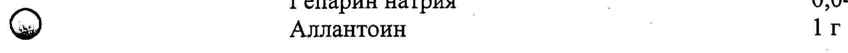
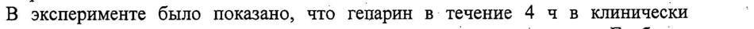

# Аллантоин + Гепарин натрия + Лука репчатого луковиц экстракт жидкий — наружно

- Препарат: Контрактубекс (гель для наружного применения;)
- АТХ: D03AX
- Источник: ГРЛС, инструкция по медицинскому применению, РУ П N015096/01, файл от 2024-01-11 (https://grls.rosminzdrav.ru/Grls_View_v2.aspx?routingGuid=3e6df91b-62a2-4e5e-9dcb-34a593037a1c)
- Распознано автоматически (OCR): 3 из 3 стр.
- Инструкция к другому РУ того же препарата: П N015096/01 (национальное РУ, переоформленное по правилам ЕАЭС, решение от 25.12.2023). Текст может быть старше действующего
- Сомнительных строк после OCR: 2 (см. раздел «Проверка распознавания»)

## Общие сведения

| ИНСТРУКЦИЯ ПО ПРИМЕНЕНИЮ ЛЕКАРСТВЕННОГО ПРЕПАРАТА |
Контрактубекс (Contractubex) | Регистрационный номер в РФ: |
_ Торговое название: Контрактубекс Лекарственная форма: гель для наружного применения
Описание: светло-коричневый, матовый гель с характерным запахом.

## 2. Состав

на 100 ггеля Активные вещества: о
на 100 ггеля Активные вещества: о
Экстракт лука репчатого луковиц жидкий 10r
Гепарин натрия | 0,04 г (5000 МЕ)
(> Аллантоин 1г о | Вспомогательные вещества:
‚ Кислота сорбиновая | Метилпарагидроксибензоат
Камедь ксантановая (нетрол F)
| | Макрогол 200 (Полиэтиленгликоль 200)
| Масло ароматизированное (Дром 2700)
| ‚ Вода очищенная Фармакотерапевтическая группа: D03AX. ,
Гиперрубцевания средство лечения. | Фармакологические свойства |

## 5.1. Фармакодинамика

| Комбинированный препарат, действие которого обусловлено свойствами
| Комбинированный препарат, действие которого обусловлено свойствами
© ‘входящих в его состав компонентов. Оказывает фибринолитическое .
| | противовоспалительное (за счет присутствия экстракта Серае), | антитромбическое ( за счет присутствия гепарина ) и кератолитическое ( за счет = присутствия аллантоина) действие. Стимулирует клеточную регенерацию без гиперплазии. Ингибирует пролиферацию коллоидных фибробластов.

## 5.2. Фармакокинетика

‹ В эксперименте было показано, что гепарин в течение 4 ч в клинически |
‹ В эксперименте было показано, что гепарин в течение 4 ч в клинически |
‚достаточном количестве проникает в соединительную ткань дермы. Глубокое проникновение обеспечивается комбинацией гепарина с экстрактом луковиц -
Серае и аллантоином (трансэпидермальная гепаринизация). `
| При использовании препарата Контрактубекс системная абсорбция не | о наблюдается.
Показания к применению f SE Boe facia .
: - . пак oy, FA? NO _ -Гипертрофические и келоидные рубцы, возникающие после хирургиЗеских”/ к. о)
т операций, ампутаций, ожогов и травм | #8 WA. | В а . tly ИУ oO};
| AS Ay, | | ^^ ты" УХ `.
| , 7 Ка res WEEE | | -Анкилозы ( контрактуры) суставов
-Контрактура Дюпюитрена . Е
-Травматические сухожильные контрактуры
-Растяжки после беременности
- -Атрофические рубцы (в частности, возникающие после acne или фурункулеза)
-Профилактика образования патологических рубцов в послеоперационном периоде или после несчастного случая =. | ate Возможно применение у детей.

## 4.3. Противопоказания

; | р | Повышенная чувствительность к компонентам препарата. Действие препарата во время беременности и периода лактации не изучалось.
; | р | Повышенная чувствительность к компонентам препарата. Действие препарата во время беременности и периода лактации не изучалось.
| Способ применения и дозы Расход препарата в одно применение в среднем 0,5 см геля на рубцовую
, поверхность площадью 20-25 см”. Применять 2-3 раза в сутки, легко втирая в рубцовую ткань. Курс лечения при свежих рубцах составляет в среднем 4 недели. При застарелых плотных рубцах на ночь накладывают окклюзионную
© повязку с гелем. Курс лечения составляет в среднем 3-6 месяцев. При | контрактуре Дюпюитрена курс лечения составляет в среднем 12 месяцев. Для профилактики используют фазу после эпителизации раны (на грануляции не наносят).
| Побочное действие Редко: местные кожные реакции. р |
| Взаимодействие с другими лекарственными препаратами
Не описано.
| Передозировка : , Не описано.
` Особые указания | Для усиления действия препарата наносить на предварительно распаренную кожу. Возможно его применение в сочетании ‘с. физиотерапевтическими
©. мероприятиями. | - При лечении свежих рубцов следует избегать ультрафиолетового облучения, , воздействия холода и интенсивного массажа. |
| Форма выпуска | | и Гель для наружного применения по 20 или 50 гв тубу алюминиевую. Тубу вместе с инструкцией по применению помещают в картонную пачку. 7
. Условия хранения |.” ‚ При температуре не выше 25°C в сухом месте. | о Хранить в местах, недоступных для детей. | о = Срок годности , Cs 4 года. Vay ae \
’ Не применять по истечении срока годности. | fie vf : 7 > cA о fg у a Sle)
., ; . Не (MLZ у. | 4 аб FR 2 oS | | Ke у - a7 gg
Условия отпуска из аптек Без рецепта. :
Предприятие-производитель | «Мерц Фарма ГмбХ и Ко. КГаА» D-6031 8, Германия, Франкфурт-на-Майне
‚ Представительство в Москве «Мерц Фарма ГмбХ и Ко.КГаА»: | | 1-я ул.Ямского поля 9/13 телефон: (495) 257 3810
= ыы . APCT ES . ; бредет aN We RpaHeHis We О .
hy $5? . 2,5 | о $ Институ “oe д Е 55 ¢ доклинической SEF |
. а 4 & и. клинической п < 5.0 экспертизы / rom директор ИДЕ aC, лекарствен ) 20 X
| Фа one, JA og р :
профессор 79 АЕ CH ‚ В.В. Чельцов . 2` <, мы № д ty 5g ha 9т CLP >
. top Е и .
; у | Mock и Глава представительства фирмы | - KC. Саядян |
— Na, ы - Ирарма о Le : Я 3 : Inia gf @\e
И 6 3:
ier | LAL |.. TI у i . , а С & a) ‘ \ “ONG / ss SSF, р
Е ЗЕ 5 .
## Проверка распознавания

Страницы-сканы распознаны автоматически. В 2 строках с дозировками цифры могли распознаться с ошибкой — сверьте с вырезкой из оригинала:

- стр. 1: «(> Аллантоин 1г» — повторное чтение: «© Аллантоин = | Ir»  
  
- стр. 1: «В эксперименте было показано, что гепарин в течение 4 ч в клинически |» — повторное чтение: «В эксперименте было показано, что гепарин в течение 4 чв клинически»  
  
