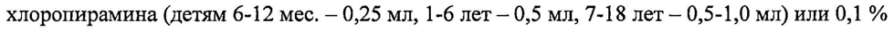
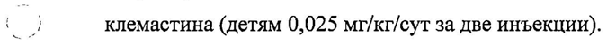
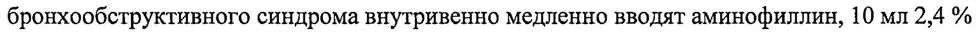

# Аллерген из пыльцы ясеня обыкновенного — парентерально

- Препарат: Аллерген из пыльцы ясеня обыкновенного для диагностики и лечения (раствор для внутрикожного и подкожного введения, накожного скарификационного нанесения и проведения прик-теста;)
- АТХ: V01AA05
- Источник: ГРЛС, инструкция по медицинскому применению, РУ ЛС-000564, файл от 2023-07-06 (https://grls.rosminzdrav.ru/Grls_View_v2.aspx?routingGuid=6ee1f57a-6480-45c4-b8d8-67836c29f766)
- Распознано автоматически (OCR): 11 из 11 стр.
- Инструкция к другому РУ того же препарата: ЛС-000564 (национальное РУ, переоформленное по правилам ЕАЭС, решение от 15.06.2023). Текст может быть старше действующего
- Сомнительных строк после OCR: 3 (см. раздел «Проверка распознавания»)
- Проверено вручную строк: 2

## Общие сведения

от 14.06.2023 № 11004 | МИНИСТЕРСТВО ЗДРАВООХРАНЕНИЯ РОССИЙСКОЙ ФЕДЕРАЦИИ /
ИНСТРУКЦИЯ ПО МЕДИЦИНСКОМУ ПРИМЕНЕНИЮ ЛЕКАРСТВЕННОГО ПРЕПАРАТА
Аллерген из пыльцы ясеня обыкновенного для диагностики и лечения

Регистрационный номер: |

Торговое наименование. Аллерген из пыльцы ясеня обыкновенного для © диагностики и лечения.

Международное непатентованное или группировочное наименование.
Аллергены деревьев пыльцевые.
=. Лекарственная форма. Раствор для внутрикожного и подкожного введения,
< ы накожного скарификационного нанесения и проведения прик-теста.

## 2. Состав

В 1 мл препарата содержится:
В 1 мл препарата содержится:

Действующее вещество: |

- аллерген из пыльцы ясеня обыкновенного ~ - 10000 РМО"

Примечание:

* РМО (Protein Nitrogen Unit) - международная

единица, принятая для выражения концентрации белкового азота в аллергенах, равная содержанию

1x10° мг белкового азота.

Вспомогательные вещества:

. - фосфатно-солевой буферный раствор - до 1 мл.
г“ Фосфатно-солевой буферный раствор содержит (в 1 мл): натрия хлорид, натрия
— гидрофосфата додекагидрат, калия дигидрофосфат, фенол (консервант) - 2,0 - 4,0 мг, воду для инъекций. ,
В комплекте с аллергеном выпускают тест-контрольную и разводящую жидкости.
Тест-контрольная жидкость (фосфатно-солевой буферный раствор) содержит (в 1 мл):
| натрия хлорид, натрия гидрофосфата додекагидрат, калия дигидрофосфат, denon
(консервант) - 2,0 - 4,0 мг, воду для инъекций.

Разводящая жидкость (фосфатно-солевой буферный раствор, в который добавлен полисорбат-80) содержит (в 1 мл): натрия хлорид, натрия гидрофосфата додекагидрат, калия дигидрофосфат, фенол (консервант) - 2,0 - 4,0 мг, полисорбат-80, воду для инъекций.

Описание. Препарат представляет собой прозрачную жидкость от желтого до коричневого цвета. Тест-контрольная жидкость и разводящая жидкость представляют собой бесцветные прозрачные жидкости.
СООТВЕТСТВУЕТ ЭКСПЕРТНОМУ ОТЧЕТУ

Характеристика препарата. Аллерген - водноаелевой " эклракл “белковополисахаридных комплексов, выделенных из пыльцы ясеня обыкновенного экстрагированием в нейтральном фосфатно-солевом буферном растворе.

Фармакотерапевтическая группа. МИБП - аллерген.

, Код ATX: VO1AA0S. |

Фармакологические свойства. Основным действующим началом аллергена является белково-полисахаридный комплекс, позволяющий диагностировать у пациента при постановке кожных проб гиперчувствительность к пыльце ясеня обыкновенного и применять его для иммунотерапии поллинозов и атопической бронхиальной астмы.

Показания к ‘применению. Специфическая диагностика и специфическая иммунотерапия поллинозов и атопической бронхиальной астмы, обусловленных гиперчувствительностью к пыльце ясеня обыкновенного.

| (1 Показаниями для диагностики являются клинические проявления заболевания и данные анамнеза.

Показания для проведения специфической иммунотерапии определяет врачаллерголог на основании данных анамнеза, клинических проявлений заболевания,

| результатов кожного тестирования, с учетом противопоказаний.

## 4.3. Противопоказания

| С целью выявления противопоказаний врач в день постановки аллергических проб и в день проведения специфической иммунотерапии проводит осмотр пациента.

1. Обострение аллергического заболевания.

2. Острые инфекции.

3. Хронические заболевания в стадии обострения и/или декомпенсации.

Г - 4. Иммунодефицитные состояния.
~ 5. Аутоиммунные заболевания.

6. Туберкулез любой локализации в период обострения.

7. Тяжелая бронхиальная астма, плохо контролируемая фармакологическими препаратами (объем форсированного выхода за 1 с менее 70 % после проведения адекватной фармакотерапии).

8. Злокачественные новообразования и болезни крови. |

9. Психические заболевания в период обострения.

10. Системные заболевания соединительной ткани.

11. Детский возраст до 5 лет (для специфической иммунотерапии). Проведение кожных тестов для специфической диагностики возможно у детей в возрасте старше одного года, с учетом состояния ребенка, но обычно кожные тесты проводятся у детей старше 4 лет.

12. Беременность и период грудного вскармливания.
СООТВЕТСТВУЕТ ЭКСПЕРТНОМУ ОТЧЕТУ
13. Сердечно-сосудистые заболевания, |при которы ОВбЗМЖНЫ 'обложнения при использовании адреналина (эпинефрина) (для специфической иммунотерапии).
14. Тяжелая форма атопической экземы (для специфической иммунотерапии).
15. Терапия В-адреноблокаторами (для специфической иммунотерапии).
16. Системная глюкокортикостероидная терапия, терапия В-адреномиметиками и антигистаминными препаратами (для специфической диагностики).

## 4.3. С осторожностью

| У особо чувствительных пациентов может возникнуть системная аллергическая реакция и анафилактический шок. В связи с этим, в кабинете, где проводится специфическая диагностика и специфическая иммунотерапия пациентов, должны находиться фармакологические препараты и инструментарий для оказания неотложной помощи.
. ( - р Оказание помощи при реакциях общего типа и анафилактическом шоке.
~ После введения аллергена могут развиться симптомы клинических проявлений повышенной чувствительности к аллергену. При парентеральном введении аллергена возможно развитие реакции немедленного типа, в т.ч. анафилаксии, которая проявляется в виде крапивницы и сосудистого отека, отека гортани, затрудненного дыхания и удушья.
Эти симптомы часто возникают после ощущения генерализованного зуда, чувства жжения, гиперемии кожных покровов, а также ощущения страха смерти.
Вследствие анафилактического шока может развиться некупирующийся бронхоспазм, асфиксия, обусловленная отеком верхних дыхательных путей, и коллапс.
В этом случае требуются неотложные лечебные мероприятия.
Догоспитальная помощь при анафилактическом шоке.
) 1. Немедленно прекратить введение аллергена, вызвавшего реакцию, уложить
~ пациента На кушетку (голова ниже ног), голову повернуть в сторону, выдвинуть нижнюю
| челюсть, удалить имеющиеся зубные протезы.
2. Наложить жгут на место выше введения аллергена, если это возможно.
3. В конечность, свободную от жгута, ввести 0,3-0,5 мл 0,1 % раствора адреналина внутримышечно (в/м) или внутривенно (в/в) (детям 0,01 мг/кг, максимально до 0,3 мг).
При необходимости, введение этих доз повторяют с интервалом 10-20 мин. Общая доза
. адреналина не должна превышать 1 мл 0,1 % раствора. Кратность и доза вводимого адреналина зависит от тяжести шока и показателей артериального давления. Повторное введение малых доз адреналина более эффективно, чем однократное введение большой
ДОЗЫ. |
4. Обколоть место инъекции 0,3-0,5 мл раствора адреналина (1 мл 0,1 % раствора адреналина развести в 3-5 мл натрия хлорида раствора 0,9 %).
СООТВЕТСТВУЕТ ЭКСПЕРТНОМУ ОТЧЕТУ
5. К месту инъекции приложить пузырь Бы

6. Обеспечить доступ свежего воздуха или дать кислород. При нарушении ритма дыхания или его затруднении проводить искусственную вентиляцию легких (ИВЛ).

7. Срочно вызвать врача, одновременно вызывается реанимационная бригада.

До приезда реанимационной бригады необходимо оказывать медицинскую помощь и проводить постоянный контроль за гемодинамическими показателями и состоянием функции внешнего дыхания (ФВД).

Госпитальная помощь при анафилактическом шоке.

1. При крайне тяжелом состоянии пациента и при выраженных нарушениях

гемодинамики вводят в/в медленно 5 мл 0,01 % раствора адреналина, при достижении эффекта введение прекращают. Детям 0,1 мл/кг 0,01 % раствора вводят медленно в течение нескольких минут.

\ 2. Если артериальное давление (АД) не стабилизируется, срочно начать внутривенное капельное введение норэпинефрина (фенилэфрина, допамина) 0,2% 1,0-2,0 мл на 500 мл 5 % раствора глюкозы для инфузий или натрия хлорида раствора 0,9 %.

3. Внутривенно струйно ввести глюкокортикостероиды: преднизолон — 60-180 мг
(детям 5 мг/кг) или дексаметазон - 8-20 мг (детям 0,3-0,6 мг/кг), или гидрокортизон — 200-400 мг (детям 4-8 мг/кг). По состоянию введение гормонов повторяют и продолжают не менее 4-6 сут для предотвращения аллергических реакций по иммунокомплексному или замедленному типу.

4. Только при стабилизации АД внутримышечно ввести 2,0 мл 2 % раствора хлоропирамина (детям 6-12 мес. — 0,25 мл, 1-6 ner 0,5 мл, 7-18 лет - 0,5-1,0 мл) или 0,1 %

7 . } клемастина (детям 0,025 мг/кг/сут за две инъекции).

Di Симптоматическая терапия по показаниям. При сохранении бронхообструктивного синдрома внутривенно медленно вводят аминофиллин, 10 мл 2,4 % раствора которого предварительно разводят в 20 мл натрия хлорида раствора 0,9 %
(взрослым 5-6 мг/кг, детям 2-3 мг/кг). Аминофиллин необходимо применять осторожно в связи с возможным появлением аритмии.

6. При необходимости отсасывают из дыхательных путей скопившийся секрет и рвотные массы, начинают оксигенотерапию.

7. При остром отеке гортани показана интубация или трахеотомия.

Все пациенты с анафилактическим шоком подлежат обязательной госпитализации на срок не менее 10 дней с целью продолжения наблюдения и лечения, т.к. у 2-5 % пациентов, перенесших анафилактический шок, наблюдаются поздние аллергические реакции.
СООТВЕТСТВУЕТ ЭКСПЕРТНОМУ ОТЧЕТУ Дозы вводимых лекарств и тактика ее оч всех случаях необходимо, в первую очередь, введение — адреналина, глюкокортикостероидных препаратов. Введение препаратов ‘`фенотиазинового ряда и препаратов кальция противопоказано.

## 4.6. Применение при беременности и в период грудного вскармливания

Противопоказано.

## 4.2. Способ применения и дозы

Г. Специфическая диагностика.
Препарат используют для постановки кожных проб (скарификация, прик-тест и внутрикожно). Специфическую диагностику, как правило, проводят одновременно с другими пыльцевыми аллергенами. В течение одной процедуры разрешается проводить до 15 проб с пыльцевыми аллергенами различных наименований. За 2-3 дня до постановки i) кожных проб должны быть отменены антигистаминные препараты. При сомнительных результатах кожных проб их можно повторить через 2 сут после стихания местной реакции на предыдущие пробы. В случае положительного результата, кожные пробы с пыльцевыми аллергенами можно повторять не чаще одного раза в месяц.
Постановка скарификационных кожных проб, прик-тестов.
Скарификационные кожные пробы, прик-тесты ставят на внутренней поверхности предплечья или, при необходимости, на коже спины.
Одновременно с аллергеном проводят постановку кожных проб с тест-контрольной жидкостью и с 0,0] % раствором гистамина, который готовят разведением 0,1 % гистамина дигидрохлорида раствора (1 часть) натрия хлорида раствором 0,9 %
(9 частей), положительная реакция на который не менее «+» свидетельствует о наличии
| oS достаточной реактивности кожи. Разведенный раствор гистамина годен в течение 6 4 Cc момента приготовления.
Металлический колпачок флаконов (с аллергеном, тест-контрольной жидкостью)
протирают спиртом. Удаляют стерильным пинцетом центральную крышку колпачка, а резиновую пробку, предварительно обработанную 70 % этиловым спиртом, прокалывают стерильной иглой.
Кожу внутренней поверхности предплечья протирают 70 % этиловым спиртом и дают ей высохнуть. На дезинфицированную кожу с помощью стерильного шприца наносят каплю испытуемого аллергена, каплю тест-контрольной жидкости и каплю 0,01 % раствора гистамина на расстоянии (30-40) мм друг от друга. Аллерген, набранный в шприц, нельзя выливать обратно во флакон.
СООТВЕТСТВУЕТ ЭКСПЕРТНОМУ ОТЧЕТУ | | При постановке скарификационных Ире ВЫ стерильными скарификаторами или инъекционными иглами наносят две параллельные царапины длиной 5 мм.

При постановке прик-тестов через капли нанесенных растворов стерильными инъекционными иглами, укороченными или с ограничителем глубины укола или иглами для прик-теста (ланцетами) производят укол кожи на глубину 1,0-1,5 мм. При использовании инъекционных игл кожу прокалывают под углом 45° так, чтобы не выступила кровь; затем иглу вынимают, слегка приподнимая кожу.

Кожную реакцию учитывают через 20 мин. Стерильными ватными тампонами
«промокают» капли нанесенных растворов в месте царапин или прокола кожи (ватный тампон должен быть отдельным для каждой капли нанесенных растворов) и учитывают

| реакцию кожи.
7 Постановка внутрикожных проб.
| Внутрикожные пробы ставят в тех случаях, если скарификационная кожная проба дает отрицательную реакцию, а HO анамнезу имеется подозрение на повышенную чувствительность к пыльце ясеня обыкновенного, и/или если необходимо проведение аллергометрического титрования перед началом специфической иммунотерапии.

Внутрикожные пробы проводят на внутренней поверхности предплечья. Кожу натягивают движением пальца книзу, иглу вводят под углом 15° к поверхности кожи, при этом необходимо следить за тем, чтобы отверстие иглы полностью скрывалось в эпидермисе, игла должна быть тонкой с коротким острием.

Стерильными, индивидуальными для аллергена и тест-контрольной жидкости, маркированными шприцами со шкалой деления 0,02 мл, строго внутрикожно вводят по

г) 0,02 мл аллергена и тест-контрольной жидкости, пробу с 0,01 % раствором гистамина ставят методом скарификации. Аллерген, набранный в шприц, нельзя выливать обратно во флакон.

Оценка диагностических кожных проб.

Местную реакцию кожи при постановке скарификационных кожных проб, приктестов, внутрикожных проб учитывают через 20 мин, при отсутствии реакции на тестконтрольную жидкость и при наличии положительной пробы на гистамин (не менее «+»)
(табл. 1).
СООТВЕТСТВУЕТ ЭКСПЕРТНОМУ ОТЧЕТУ [Входящий МЗ №424 “Еыблица 1
Схема учета скарификационных кожных проб, прик-тестов выраженности реакции*
Отрицательная Отсутствие волдыря (папулы), гиперемия как в comment | трой sapcoan размерами, превышающими таковые в контроле с тест-контрольной жидкостью натягивании кожи, гиперемия
Положительная ++ Волдырь (папула) 4-5 мм, гиперемия
(для скарификационных проб);
ИВ —— тестов Положительная +++ Волдырь (папула) 6-10 мм, гиперемия или
‚- волдырь (папула) 6-10 мм с псевдоподиями, 7 _ гиперемия (для скарификационных проб);
Волдырь (папула) 11-15 мм, гиперемия (для прик-тестов
Положительная +4+4++ Волдырь (папула) более 10 мм, гиперемия или
| гиперемия (для скарификационных проб);
Волдырь (папула) более 15 мм с псевдоподиями, гиперемия (для прик-тестов
Схема учета внутрикожных проб Оценка реакции Степень Размер и характер реакции
— = реакции* [Отрицатльня | - [Размеры такие же, ккивконрое | медленнее, чем в контроле
_ окруженный гиперемией №8 окруженный гиперемией с псевдоподиями, окруженный гиперемией с псевдоподиями и (или) эритемой вокруг
(дополнительные волдыри по периферии розовоили ярко-красного цвета
Примечание:
* Степень выраженности реакции:
— _ Отрицательная;
=: Сомнительная:
+ Слабоположительная;
++ Положительная;
+++ Резко положительная;
+++ Очень резко положительная.
СООТВЕТСТВУЕТ ЭКСПЕРТНОМУ ОТЧЕТУ | от 14.06.2023 № 11004 8
IL. Специфическая иммунотерапия. (Входящий МЗ №24241437
Специфическая иммунотерапия проводится в тех случаях, когда невозможно исключить контакт сенсибилизированного пациента с аллергеном.
Иммунотерапию начинают с дозы в 10 раз меньшей, чем та, которая вызвала минимальную положительную реакцию при внутрикожном введении.
Аллерген при специфической иммунотерапии вводят подкожно.
За правильность приготовления и использования разведений аллергена с соблюдением асептики ответственность несет врач-аллерголог.
Разведения препарата, вводимый объем (доза) и рекомендуемая схема применения приведены в табл. 2.
Таблица 2 Примерная схема специфической иммунотерапии при поллинозах и. Разведение Доза (мл) Примечания аллергена
ОО ОО ПО ОИ ПО ЗО 10° 0,1 Специфическую иммунотерапию начинают 1:100000 0,2 после диагностирования атопического 0,1 РМО/мл 0,4 заболевания не позднее, чем за 3-4 мес. до начала 0,8 цветения и завершают не позднее, чем за 1,5 мес.
10“ 0,1 до начала цветения растений.
1:10000 0,2 Инъекции делают строго подкожно в область 1,0 РМО/мл 0,4 нижней трети плеча. Первые инъекции (при 0,8 разведении аллергена 10⁻⁵, 10⁻⁴, 10⁻³) делают 103 0,1 ежедневно или через день, последующие 1:1000 0,2 инъекции (разведения 107, 10`') — с интервалом
10 PNU/mn 0,4 7-10 дней. Дозу аллергена 0,9-1,0 мл в разведении
0,8 10-' повторяют с интервалом 5-7 дней до начала 102 0,1 цветения растений. Срок использования аллергена
( ^) 1:100 0,2 после его разведения - 1 мес. |
> 100 РМО/мл 0,3 После каждой инъекции аллергена пациента 0,4 наблюдают в кабинете не менее 60 мин. Врач 0,5 | отмечает реакцию кожи на месте введения 0,6 аллергена и общее состояние пациента.
0,7 Противопоказанием для увеличения дозы 0,8 является местная реакция в виде инфильтрата 0,9 размером более 25 мм, возникшая в течение суток 1,0 на месте инъекции, общая реакция организма, 10°! 0,1 обострение основного заболевания. В этих 1:10 0,2 случаях дозу уменьшают, интервалы между | - 1000 РМО/мл 0,3 инъекциями удлиняют, пока установится хорошая 0,4 переносимость.
0,5 0,6 0,7 0,8 0,9 1,0 ` от 14.06.2023 № 11004 9

## 4.8. Побочное действие

(Входящий М3 №4241437
(Входящий М3 №4241437
Согласно классификации ВОЗ (Всемирной организации здравоохранения)
нежелательные реакции классифицированы следующим образом: очень часто (>1/10), часто (>1/100 до <1/10), нечасто (>1/1000 до<1/100), редко (>1/10000 до <1/1000), очень редко (до < 1/10000) и частота неизвестна (невозможно оценить на основании имеющихся данных). |
При введении аллергена возможны местные и общие реакции.
Местные реакции:
Нарушения в месте введения:
Часто: отёк, гиперемия.
Общие реакции:
. Нарушения со стороны нервной системы:
ИВ Нечасто: головная боль.
Нарушения со стороны кожи и подкожных тканей:
Нечасто: отек лица.
Нарушения со стороны дыхательной системы, органов грудной клетки и средостения:
Нечасто: кашель, чихание, ринит, бронхоспазм.
Нарушения со стороны органа зрения:
Редко: конъюнктивит.
Нарушения со стороны иммунной системы:
Редко: обострение основного заболевания, крапивница, анафилактический шок.
После каждой инъекции аллергена пациент должен наблюдаться врачом-
`_ / аллергологом не менее 60 мин. В течение этого времени врач должен отмечать реакцию кожи на введение препарата и общее состояние пациента. Об отдаленных реакциях пациент должен информировать врача. В кабинете, где проводится специфическая иммунотерапия пациентов, должны находиться фармакологические препараты и инструментарий для оказания неотложной помощи.

## 4.9. Передозировка

В случае превышения предписанной дозы возрастает риск возникновения побочных эффектов, что требует симптоматического лечения.
В случае превышения предписанной дозы возрастает риск возникновения побочных эффектов, что требует симптоматического лечения.

## 4.5. Взаимодействие с другими лекарственными средствами

Кожные пробы и лечение аллергеном следует проводить не ранее, чем через:
- 1 неделю после туберкулиновой пробы;
- 1 месяц после вакцинации инактивированными вакцинами;
- 3 месяца после прививок живыми вакцинами (как вирусными, так и бактериальными, включая вакцину БЦЖ).
СООТВЕТСТВУЕТ ЭКСПЕРТНОМУ ОТЧЕТУ от 14.06.2023 № 11004 10
Не применять одновременно с одновременный прием симптоматических препаратов для лечения аллергии для лучшей переносимости АСИТ — (В2-адреномиметиков, кортикостероидов, — ингибиторов дегрануляции тучных клеток, в случае необходимости в дальнейшем в ходе иммунотерапии возможно применение Н1-антигистаминных препаратов).

Возможно одновременное использование с пыльцевыми аллергенами других наименований.

## 4.7. Влияние на способность управлять транспортными средствами, механизмами

Некоторые нежелательные реакции, связанные с действием препарата, могут оказывать воздействие на способность управлять транспортным средством или движущимися механизмами. Для пациентов, у которых наблюдались нежелательные реакции при введении препарата, управление транспортным средством или

р движущимися механизмами возможно только после исчезновения симптомов нежелательных реакций.

## 6.5. Форма выпуска

Раствор для внутрикожного и подкожного введения, накожного скарификационного нанесения и проведения прик-теста, 10000 РМО/мл.
Раствор для внутрикожного и подкожного введения, накожного скарификационного нанесения и проведения прик-теста, 10000 РМО/мл.

По 5,0 мл аллергена, по 4,5 мл разводящей жидкости, по 4,5 мл тест-контрольной жидкости в стеклянных флаконах, укупоренных резиновыми пробками и закатанных алюминиевыми колпачками. Комплект состоит из 1 флакона аллергена, 1 флакона тест-контрольной жидкости, 7 флаконов разводящей жидкости, 1 пустого стерильного флакона, помещенных в пачку из картона с инструкцией по медицинскому применению.

## 6.4. Условия хранения

, В соответствии с СанПиН 3.3686-21 при температуре от 2 до 8 °С в защищенном от света месте. Не замораживать.
, В соответствии с СанПиН 3.3686-21 при температуре от 2 до 8 °С в защищенном от света месте. Не замораживать.

{ 7 Хранить в недоступном для детей месте.

Условия транспортирования. В соответствии с СанПиН 3.3686-21 при температуре от 2 до 8 °С. Не замораживать.

## 6.3. Срок годности

Аллерген — 2 года, тест-контрольная и разводящая жидкости - 5 лет.
Аллерген — 2 года, тест-контрольная и разводящая жидкости - 5 лет.
Срок годности комплекта определяется по наименьшему сроку годности одного из компонентов, входящих в состав комплекта. Препарат с истекшим сроком годности применению не подлежит.

Условия отпуска. Отпускают по рецепту.

Владелец регистрационного удостоверения.

АО «НПО «Микроген».

Россия, 115088, г. Москва, ул. 1-я Дубровская, д. 15, стр. 2.
СООТВЕТСТВУЕТ ЭКСПЕРТНОМУ ОТЧЕТУ _от 14.06.2023 № 11004_ 11
Производитель. (Входящий МЗ №4241437)
АО «НПО «Микроген».
Россия, 115088, г. Москва, ул. 1-я Дубровская, д. 15, стр. 2, тел. (495) 710-37-87, факс (495) 783-88-04, e-mail: info@microgen.ru.
Адрес производства: Россия, 355019, Ставропольский край, г. Ставрополь, ул. Биологическая, д. 20, тел. (8652) 24-40-84.
Организация, принимающая претензии потребителя.
АО «НПО «Микроген».
Россия, 115088, г. Москва, ул. 1-я Дубровская, д. 15, стр. 2, тел. (495) 710-37-87, факс (495) 783-88-04, e-mail: info@microgen.ru. | р f (Ss „т en
72. = op oo | Представитель АО «НПО «Микроген» 3s PN, z | по доверенности 4 Diy А, алова
\ 3, 4 / 20, а >. а / \ < а v26 : 7 4 С.
## Проверка распознавания

Страницы-сканы распознаны автоматически. В 3 строках с дозировками цифры могли распознаться с ошибкой — сверьте с вырезкой из оригинала:

- стр. 4: «хлоропирамина (детям 6-12 мес. — 0,25 мл, 1-6 ner 0,5 мл, 7-18 лет - 0,5-1,0 мл) или 0,1 %» — низкая уверенность: «0,5» (73)  
  
- стр. 4: «7 . } клемастина (детям 0,025 мг/кг/сут за две инъекции).» — низкая уверенность: «7» (59)  
  
- стр. 4: «бронхообструктивного синдрома внутривенно медленно вводят аминофиллин, 10 мл 2,4 %» — низкая уверенность: «2,4» (74)  
  