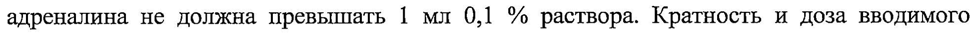

# Аллерген из рисовой крупы — прочее

- Препарат: Аллерген из рисовой крупы для диагностики (раствор для накожного скарификационного нанесения и проведения прик-теста;)
- АТХ: V01AA08
- Источник: ГРЛС, инструкция по медицинскому применению, РУ Р N000891/01, файл от 2024-01-12 (https://grls.rosminzdrav.ru/Grls_View_v2.aspx?routingGuid=ac2aa0cb-5528-43e9-b7f6-820d5bba6e57)
- Распознано автоматически (OCR): 8 из 8 стр.
- Инструкция к другому РУ того же препарата: Р N000891/01 (национальное РУ, переоформленное по правилам ЕАЭС, решение от 06.12.2023). Текст может быть старше действующего
- Сомнительных строк после OCR: 1 (см. раздел «Проверка распознавания»)

## Общие сведения

; от 30.06.2023 № 12262 МИНИСТЕРСТВО ЗДРАВООХРАНЕНИЯ РОССИЙСКОЙ ФЕДЕРАЦИИ
ИНСТРУКЦИЯ ПО МЕДИЦИНСКОМУ ПРИМЕНЕНИЮ ЛЕКАРСТВЕННОГО ПРЕПАРАТА
Аллерген из рисовой крупы для диагностики

Регистрационный номер:

Торговое наименование. Аллерген из рисовой крупы для диагностики.

Международное непатентованное или группировочное наименование.

Аллергены пищевые.

## 3. Лекарственная форма

Раствор для накожного скарификационного нанесения и проведения прик-теста.
Раствор для накожного скарификационного нанесения и проведения прик-теста.

— Состав. В 1 мл препарата содержится:
| VU . Действующее вещество: | - аллерген из рисовой крупы - 10000 РМО"
Примечание:

- *PNU (Protein Nitrogen Unit) - международная единица, принятая для выражения концентрации белкового азота в аллергенах, равная содержанию 1x10° мг белкового азота.

Вспомогательные вещества:

- фосфатно-солевой буферный раствор - до 1 мл.

Фосфатно-солевой буферный раствор содержит (в 1 мл): натрия хлорид, натрия гидрофосфата додекагидрат, калия дигидрофосфат, фенол (консервант) - 2,0 - 4,0 мг, воду

( \ для инъекций.
7 ° В комплекте с аллергеном выпускают тест-контрольную жидкость.

'Тест-контрольная жидкость (фосфатно-солевой буферный раствор) содержит (в 1 мл):
натрия хлорид, натрия гидрофосфата додекагидрат, калия дигидрофосфат, фенол
(консервант) ~ 2,0 - 4,0 мг, воду для инъекций. | |

7 Описание. Препарат представляет собой прозрачную ЖИДКОСТЬ от светло-желтого до желтого цвета. Тест-контрольная жидкость представляет собой бесцветную прозрачную
Жидкость.

Характеристика препарата. .Аллерген - водно-солевой раствор белковополисахаридных комплексов, выделенных из рисовой крупы экстрагированием в фосфатно-солевом буферном растворе.

Фармакотерапевтическая группа. МИБП - аллерген.

Код ATX: VO1AA08.
от 30.06.2023 № 12262 2

| Фармакологические свойства. Основным ленив uti НАаном 3 Валле preHa

является белково-полисахаридный комплекс, позволяющий диагностировать у пациента при постановке кожных проб гиперчувствительность к рисовой крупе. |

## 4.1. Показания к применению

Специфическая диагностика повышенной чувствительности к рисовой крупе у пациентов с различными формами аллергических заболеваний (крапивница, отек Квинке, нейродермит, астматический бронхит и др.).
Специфическая диагностика повышенной чувствительности к рисовой крупе у пациентов с различными формами аллергических заболеваний (крапивница, отек Квинке, нейродермит, астматический бронхит и др.).

Показаниями для диагностики являются клинические проявления заболевания и данные анамнеза. |

## 4.3. Противопоказания

С целью выявления противопоказаний врач в день постановки аллергических проб проводит осмотр пациента.

и. 1. Обострение аллергического заболевания.

We 2. Тяжелая бронхиальная астма, плохо контролируемая фармакологическими препаратами (объем форсированного выдоха за 1 с менее 70 % после проведения адекватной фармакотерапии).

3. Острые инфекции.
4. Хронические заболевания в стадии обострения и/или декомпенсации.
5. Иммунодефицитные состояния.
6. Аутоиммунные заболевания.
7. Туберкулез любой локализации в период обострения.
8. Злокачественные новообразования и болезни крови.
9. Психические заболевания в период обострения.
В 10. Системные заболевания соединительной ткани.

( . 11. Детский возраст до 1 года (проведение кожных тестов для специфической диагностики возможно у детей в возрасте старше 1 года, с учетом состояния ребенка, но обычно кожные тесты проводятся у детей старше 4 лет).

12. Беременность и период грудного вскармливания.
, 13. Системная ‚глюкокортикостероидная терапия, терапия В-адреномиметиками и.
антигистаминными препаратами.

## 4.3. С осторожностью

У особо чувствительных пациентов может возникнуть системная аллергическая реакция и анафилактический шок. В связи с этим, в кабинете, где проводится специфическая диагностика пациентов, должны находиться фармакологические препараты и инструментарий для оказания неотложной помощи.
от 30.06.2023 № 12262 3 Оказание помощи при реакциях общего
После проведения кожных проб могут развиться симптомы клинических проявлений повышенной чувствительности к аллергену; возможно развитие реакции немедленного типа, в тм. анафилаксии, которая проявляется в виде крапивницы и сосудистого отека, отека гортани, затрудненного дыхания и удушья. Эти симптомы часто возникают после ощущения генерализованного зуда, чувства жжения, гиперемии кожных покровов, а также ощущения страха смерти.
Вследствие анафилактического шока может развиться некупирующийся бронхоспазм, асфиксия, обусловленная отеком верхних дыхательных путей, и коллапс.
В этом случае требуются неотложные лечебные мероприятия. |
Догоспитальная помощь при анафилактическом шоке.
7 1. Немедленно прекратить введение аллергена, вызвавшего реакцию, уложить we, пациента Ha кушетку (голова ниже ног), голову повернуть в сторону, выдвинуть нижнюю челюсть, удалить имеющиеся зубные протезы.
2. Наложить жгут на место выше введения аллергена, если это возможно.
3. В конечность, свободную от жгута, ввести 0,3-0,5 мл 0,1 % раствора адреналина внутримышечно (в/м) или внутривенно (в/в) (детям 0,01 мг/кг, максимально до 0,3 мг).
При необходимости, введение этих доз повторяют с интервалом 10-20 мин. Общая доза адреналина не должна превышать 1 мл 0,1 % раствора. Кратность и доза вводимого адреналина зависит от тяжести шока и показателей артериального давления. Повторное введение малых доз адреналина более эффективно, чем однократное введение большой
Дозы.
a 4. Обколоть место инъекции 0,3-0,5 мл раствора адреналина (1 мл 0,1 % раствора и адреналина развести в 3-5 мл натрия хлорида раствора 0,9 %).
5. К месту инъекции приложить пузырь со льдом.
6. Обеспечить доступ свежего воздуха или дать кислород. При нарушении ритма дыхания или его затруднении проводить искусственную вентиляцию легких (ИВЛ).
` 7. Срочно вызвать врача, одновременно вызывается реанимационная бригада.
До приезда реанимационной бригады необходимо оказывать медицинскую помощь и проводить постоянный контроль за гемодинамическими показателями и состоянием функции внешнего дыхания (ФВД).
Госпитальная помощь при анафилактическом шоке.
1. При крайне тяжелом состоянии пациента и при выраженных нарушениях гемодинамики вводят в/в медленно 5 мл 0,01 % раствора адреналина, при достижении от 30.06.2023 № 12262 4 эффекта введение прекращают. Детям р ae течение нескольких минут.

2. Если артериальное давление (АД) не стабилизируется, срочно начать внутривенное капельное введение норэпинефрина (фенилэфрина, допамина) 0,2 %
1,0-2,0 мл на 500 мл 5 % раствора глюкозы для инфузий или натрия хлорида раствора 0,9 %.

3. Внутривенно струйно ввести глюкокортикостероиды: преднизолон — 60-180 мг
(детям 5 мг/кг) или дексаметазон - 8-20 мг (детям 0,3-0,6 мг/кг), или гидрокортизон — 200-400 мг (детям 4-8 мг/кг). По состоянию введение гормонов повторяют и продолжают не менее 4-6 сут для предотвращения аллергических реакций по иммунокомплексному или замедленному типу.

м 4. Только при стабилизации АД внутримышечно ввести 2,0 мл 2 % раствора
` хлоропирамина (детям 6-12 мес. — 0,25 мл, 1-6 лет — 0,5 мл, 7-18 лет - 0,5-1,0 мл) или 0,1 % клемастина (детям 0,025 мг/кг/сут за две инъекции).

5. Симптоматическая терапия по показаниям. При сохранении бронхообструктивного синдрома внутривенно медленно вводят аминофиллин, 10 мл
2,4 % раствора которого предварительно разводят в 20 мл натрия хлорида раствора 0,9 %
(взрослым 5-6 мг/кг, детям 2-3 мг/кг). Аминофиллин необходимо применять осторожно в связи с возможным появлением аритмии.

6. При необходимости отсасывают из дыхательных путей скопившийся секрет и рвотные массы, начинают оксигенотерапию.

7. При остром отеке гортани показана интубация или трахеотомия.

7 Все пациенты с анафилактическим шоком подлежат обязательной госпитализации на

CU срок не менее 10 дней с целью продолжения наблюдения и лечения,

тк. у 2-5 % пациентов, перенесших анафилактический шок, наблюдаются поздние аллергические реакции.

Дозы вводимых лекарств и тактика врача определяются клинической картиной, но во

: всех ‘случаях необходимо, В первую очередь, введение адреналина, глюкокортикостероидных препаратов. Введение препаратов фенотиазинового ряда и препаратов кальция противопоказано.

## 4.6. Применение при беременности и в период грудного вскармливания

Противопоказано.

## 4.2. Способ применения и дозы

Препарат используют для постановки кожных проб (скарификация, прик-тест).
Слецифическую диагностику, как правило, проводят одновременно с другими

| от 30.06.2023 № 12262 5 аллергенами. За 2-3 дня до a ae антигистаминные препараты и бронхолитические средства. При сомнительных результатах кожных проб их можно повторить через 2-3 дня (после стихания местной реакции на предыдущие пробы). В случае положительного результата, кожные пробы с аллергенами можно повторять не чаще одного раза в месяц.
Постановка скарификационных кожных проб, прик-тестов.
Скарификационные кожные пробы, прик-тесты ставят на внутренней поверхности предплечья или, при необходимости, на коже спины.
Одновременно с аллергеном проводят постановку кожных проб с тест-контрольной жидкостью и с 0,01 % раствором гистамина, который готовят разведением 0,1 % гистамина дигидрохлорида раствора (1 часть) натрия хлорида раствором 0,9 % .
ри (9 частей), положительная реакция на который не менее «+» свидетельствует о наличии
Le достаточной реактивности кожи. Разведенный раствор гистамина годен в течение 6 4 с момента приготовления.
Металлический колпачок флаконов (с аллергеном, тест-контрольной жидкостью)
протирают спиртом. Удаляют стерильным пинцетом центральную крышку колпачка, а резиновую пробку, предварительно обработанную 70 % этиловым спиртом, прокалывают стерильной иглой.
Кожу внутренней поверхности предплечья протирают 70 % этиловым спиртом и дают ей высохнуть. На дезинфицированную кожу с помощью стерильного шприца наносят каплю испытуемого аллергена, каплю тест-контрольной жидкости и каплю 0,01 % раствора гистамина на расстоянии (30-40) мм друг от друга. Аллерген, набранный ий в шприц, нельзя выливать обратно во флакон.
a al При постановке скарификационных кожных проб через капли нанесенных растворов стерильными скарификаторами или инъекционными иглами наносят две параллельные царапины длиной 5 мм.
При постановке прик-тестов через капли нанесенных растворов стерильными инъекционными иглами, укороченными или с ограничителем глубины укола или иглами для прик-теста (ланцетами) производят укол кожи на глубину 1,0-1,5 мм. При использовании инъекционных игл кожу прокалывают под углом 45° так, чтобы не выступила кровь; затем иглу вынимают, слегка приподнимая кожу.
Кожную реакцию учитывают через 20 мин. Стерильными ватными тампонами
«промокают» капли нанесенных растворов в месте царапин или прокола кожи (ватный тампон должен быть отдельным для каждой капли нанесенных растворов) и учитывают реакцию кожи.
СООТВЕТСТВУЕТ ЭКСПЕРТНОМУ ОТЧЕТУ Ц д ых п ИБ ae

Оценка диагностических кожных проб. [Входящий МЗ №4234933

Местную реакцию кожи при постановке скарификационных кожных проб, приктестов, учитывают через 20 мин при отсутствии реакции на тест-контрольную жидкость и при наличии положительной пробы на гистамин (не менее «+») (табл. 1).

Таблица | Схема учета скарификационных кожных проб, прик-тестов выраженности реакции*

Отрицательная Отсутствие волдыря (папулы), гиперемия как в
ПИ ИЕ Сомнительная + Отсутствие волдыря (папулы), гиперемия с

размерами, превышающими таковые в контроле с тест-контрольной жидкостью
YA натягивании кожи, гиперемия Положительная ++ Волдырь (папула) 4-5 мм, гиперемия
(для скарификационных проб);
Волдырь (папула) 4-10 мм, гиперемия для прик-тестов
Положительная ++ Волдырь (папула) 6-10 мм, гиперемия или волдырь (папула) 6-10 мм с псевдоподиями, гиперемия (для скарификационных проб);
Волдырь (папула) 11-15 мм, гиперемия для прик-тестов
Положительная +++ Волдырь (папула) более 10 MM, гиперемия или волдырь (папула) более 10 мм с псевдоподиями, гиперемия (для скарификационных проб);
Волдырь (папула) более 15 мм >. с псевдоподиями, гиперемия (для прик-тестов
С Примечание:
* Степень выраженности реакции:
— _ Отрицательная;
= Сомнительная;
+ Слабоположительная;
. 3+ Положительная; , ° +++ Резко положительная;
++++ Очень резко положительная.

## 4.8. Побочное действие

Согласно классификации ВОЗ (Всемирной организации здравоохранения)
нежелательные реакции классифицированы следующим образом: очень часто (>1/10), часто (21/100 до <1/10), нечасто (>1/1000 до <1/100), редко (>1/10000 до <1/1000), очень редко (до < 1/10000) и частота неизвестна (невозможно оценить на основании имеющихся данных).
от 30.06.2023 № 12262 7 При введении аллергена возможны а |
Местные реакции: ° Нарушения в месте введения:
Часто: отёк, гиперемия.
Общие реакции:
Нарушения со стороны нервной системы:
Нечасто: головная боль.
Нарушения со стороны кожи и подкожных тканей:
Нечасто: отек лица. | | Нарушения со стороны дыхательной системы, органов грудной клетки и средостения:
— Нечасто: кашель, чихание, ринит, бронхоспазм.
{ a Нарушения co стороны органа зрения:
Редко: конъюнктивит.
Нарушения со стороны иммунной системы:
Редко: обострение основного заболевания, крапивница, анафилактический шок. -
После каждой инъекции аллергена пациент должен наблюдаться врачомаллергологом не менее 60 мин. В течение этого времени врач должен отмечать реакцию кожи на введение препарата и общее состояние пациента. Об отдаленных реакциях пациент должен информировать врача. В кабинете, где проводится специфическая иммунотерапия пациентов, должны находиться фармакологические препараты и инструментарий для оказания неотложной помощи.
г Передозировка. В случае превышения предписанной дозы возрастает риск
_ возникновения побочных эффектов, что требует симптоматического лечения.

## 4.5. Взаимодействие с другими лекарственными средствами

Кожные пробы следует проводить не ранее, чем через:
- 1 неделю после туберкулиновой пробы; .
` `- | месяц после вакцинации инактивированными вакцинами;
- 3 месяца после прививок живыми вакцинами (как вирусными, так и бактериальными, включая вакцину БЦЖ).
Не применять одновременно с приемом В-адреноблокаторов. Возможно одновременное использование с аллергенами других наименований.

## 4.7. Влияние на способность управлять транспортными средствами, механизмами

Некоторые нежелательные реакции, связанные с действием препарата, могут оказывать воздействие на способность управлять транспортным средством или от 30.06.2023 № 12262 8

движущимися механизмами. Для би реакции при введении препарата, управление транспортным средством или движущимися механизмами возможно только после исчезновения симптомов нежелательных реакций.

## 6.5. Форма выпуска

Раствор для накожного скарификационного нанесения и проведения прик-теста, 10000 РМО/мл.
Раствор для накожного скарификационного нанесения и проведения прик-теста, 10000 РМО/мл.

По 4,5 мл аллергена, по 4,5 мл тест-контрольной жидкости в стеклянных флаконах, укупоренных резиновыми пробками и закатанных алюминиевыми колпачками. Комплект

состоит из 1 флакона аллергена, | флакона тест-контрольной жидкости, помещенных в пачку из картона с инструкцией по применению. |

## 6.4. Условия хранения

В соответствии с СанПиН 3.3686-21 при температуре
В соответствии с СанПиН 3.3686-21 при температуре

р от 2 до 8 °С взащищенном от света месте. Не замораживать.
\/ Хранить в недоступном для детей месте.

Условия транспортирования. В соответствии с СанПиН 3.3686-21 при температуре от 2 до 8 °С. Не замораживать.

## 6.3. Срок годности

Аллерген — 2 года, тест-контрольная жидкость - 5 лет. Срок годности комплекта определяется по наименьшему сроку годности одного из компонентов, входящих в состав комплекта. Препарат с истекшим сроком годности применению не подлежит.
Аллерген — 2 года, тест-контрольная жидкость - 5 лет. Срок годности комплекта определяется по наименьшему сроку годности одного из компонентов, входящих в состав комплекта. Препарат с истекшим сроком годности применению не подлежит.

Условия отпуска. Отпускают по рецепту.

Владелец регистрационного удостоверения.

АО «НПО «Микроген».

и Россия, 115088, г. Москва, ул. 1-я Дубровская, д. 15, стр. 2. ;
< Производитель.

АО «НПО «Микроген».

Россия, 115088, г. Москва, ул. 1-я Дубровская, д. 15, стр. 2, тел. (495) 710-37-87, факс (495) 783-88-04, e-mail: info@microgen.ru.

| Адрес производства: Россия, 355019, Ставропольский край, г. Ставрополь, ул. Биологическая, д. 20, тел. (8652) 24-40-84.

Организация, принимающая претензии потребителя.

АО «НПО «Микроген».

Россия, 115088, г. Москва, ул. 1-я Дубровская, д. 15, стр. 2, тел. (495) 710-37-87, факс (495) 783-88-04, e-mail: info@microgen.ru. ИЯ х

SS a Представитель АО «НПО «Микроген» gs Ah gh)?
по доверенности 35) 4 ‘ toi = Е.В. Побидаш
О aren aaa
## Проверка распознавания

Страницы-сканы распознаны автоматически. В 1 строках с дозировками цифры могли распознаться с ошибкой — сверьте с вырезкой из оригинала:

- стр. 3: «адреналина не должна превышать 1 мл 0,1 % раствора. Кратность и доза вводимого» — повторное чтение: «адреналина не должна превышать | мл 0,1 % раствора. Кратность и доза вводимого»  
  
