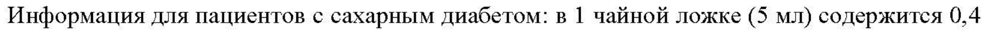
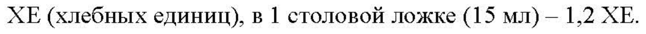

# Алтея корней экстракт — внутрь

- Препарат: Алтея сироп-АКОС (сироп)
- АТХ: R05CA05
- Источник: ГРЛС, инструкция по медицинскому применению, РУ ЛП-№001828-(РГ-RU), файл от 2023-08-22 (https://grls.rosminzdrav.ru/Grls_View_v2.aspx?routingGuid=c380342d-3a9d-4814-8b48-fdf75292e052)
- Распознано автоматически (OCR): 3 из 3 стр.
- Сомнительных строк после OCR: 2 (см. раздел «Проверка распознавания»)

## Общие сведения

СООТВЕТСТВУЕТ ЭКСПЕРТНОМУ ОТЧЕТУ от 10.02.2023 № 2620
ИНСТВУК ИЯ ОСЛЕДОВАТЕЛЬНОСТЬ 0003)
ПО МЕДИЦИНСКОМУ ПРИМЕНЕНИЮ ЛЕКАРСТВЕННОГО ПРЕПАРАТА
Алтея сироп-АКОС Регистрационный номер:
Торговое наименование: Алтея сироп-АКОС Международное непатентованное или группировочное наименование: Алтея корней экстракт

## 3. Лекарственная форма

сироп Состав на 1000 мл:
сироп Состав на 1000 мл:
Активный компонент: алтея корней экстракт (алтея корней экстракт сухой) (с содержанием суммы восстанавливающих моносахаридов в пересчете на глюкозу не менее 1,0 %) — 25 г.
Вспомогательные вещества: натрия бензоат, сахароза (сахар белый), вода очищенная.
Описание Густая жидкость от светло-желтого до желтовато-коричневого цвета, характерного запаха.
Фармакотерапевтическая — группа: отхаркивающее средство растительного происхождения.
Код ATX: ROSCAO5 Фармакологическое действие
Обладает рефлекторным отхаркивающим, а также местным противовоспалительным действием, снижает вязкость бронхиального секрета.

## 4.1. Показания к применению

Лекарственный препарат Алтея сироп-АКОС применяется у взрослых и у детей с нуля при заболеваниях дыхательных путей, сопровождающихся кашлем с трудноотделяемой мокротой (трахеит, трахеобронхит, бронхит).
Лекарственный препарат Алтея сироп-АКОС применяется у взрослых и у детей с нуля при заболеваниях дыхательных путей, сопровождающихся кашлем с трудноотделяемой мокротой (трахеит, трахеобронхит, бронхит).

## 4.3. Противопоказания

— Гиперчувствительность к алтея корней экстракту (алтея корней экстракт сухой) или к другим компонентам препарата;
— Гиперчувствительность к алтея корней экстракту (алтея корней экстракт сухой) или к другим компонентам препарата;
— дефицит сахарозы/изомальтазы;
— непереносимость фруктозы;
— глюкозо-галактозная мальабсорбция.

## 4.3. С осторожностью

Пациентам с сахарным диабетом и лицам, находящимся на диете с пониженным содержанием углеводов, перед применением препарата обязательно следует проконсультироваться с врачом.
Пациентам с сахарным диабетом и лицам, находящимся на диете с пониженным содержанием углеводов, перед применением препарата обязательно следует проконсультироваться с врачом.
СООТВЕТСТВУЕТ ЭКСПЕРТНОМУ ОТЧЕТУ (ПОСЛЕДОВАТЕЛЬНОСТЬ 0003)

## 4.6. Применение при беременности и в период грудного вскармливания

Применение при беременности и в период грудного вскармливания возможно, если ожидаемая польза для матери превышает потенциальный риск для плода и ребенка.
Необходимо проконсультироваться с врачом.

## 4.2. Способ применения и дозы

Внутрь.
Внутрь.
Взрослым - по 1 столовой ложке сиропа, предварительно разведенной в 1/2 стакана теплой воды, 4—5 раз в день после еды.
Дети Детям до 12 лет - по 1 чайной ложке сиропа, предварительно разведенной в 1/4 стакана теплой воды, 4—5 раз в день после еды.
Режим дозирования для детей от 12 до 18 лет не отличается от режима дозирования для взрослых.
Длительность лечения составляет 10-15 дней. Увеличение продолжительности и проведение повторных курсов лечения возможно по согласованию с врачом.

## 4.8. Побочное действие

Возможны аллергические реакции.
Возможны аллергические реакции.
Если у Вас отмечаются побочные эффекты, указанные в инструкции или они усугубляются, или Вы заметили любые другие побочные эффекты, не указанные в инструкции, сообщите об этом врачу.

## 4.9. Передозировка

Симптомы: тошнота, рвота.
Симптомы: тошнота, рвота.
Лечение: отмена препарата, промывание желудка.

## 4.5. Взаимодействие с другими лекарственными средствами

Не следует применять одновременно с препаратами, содержащими кодеин и другие противокашлевые лекарственные средства, так как это затрудняет откашливание разжиженной мокроты.

## 4.4. Особые указания

Информация для пациентов с сахарным диабетом: в 1 чайной ложке (5 мл) содержится 0,4
Информация для пациентов с сахарным диабетом: в 1 чайной ложке (5 мл) содержится 0,4
ХЕ (хлебных единиц), в 1 столовой ложке (15 мл) — 1,2 XE.
Если при применении препарата симптомы сохраняются без улучшения более 2 недель или ухудшаются, следует обратиться к врачу.

## 4.7. Влияние на способность управлять транспортными средствами, механизмами

Применение препарата не оказывает влияния на способность к выполнению потенциально опасных видов деятельности, требующих повышенной концентрации внимания и быстроты
СООТВЕТСТВУЕТ ЭКСПЕРТНОМУ ОТЧЕТУ от 10.02.2023 № 2620 р психомоторных реакций (управление трансперзенынии-ередетвами-рабеза-е-яевзиелеузнниимниея механизмами, работа диспетчера, оператора).

## 6.5. Форма выпуска

Сироп.
Сироп.
По 95 мл во флаконы из оранжевого стекла с винтовой горловиной, укупоренные колпачками алюминиевыми винтовыми или крышками с контролем первого вскрытия и защитой от детей, или крышками с защитой от вскрытия детьми.
Каждый флакон с инструкцией по применению помещают в пачку из картона.

## 6.4. Условия хранения

При температуре не выше 25 °С в оригинальной упаковке (флакон в пачке).
При температуре не выше 25 °С в оригинальной упаковке (флакон в пачке).
Хранить в недоступном для детей месте.

## 6.3. Срок годности

2 года.
2 года.
Не применять по истечении срока годности.
Условия отпуска Отпускают без рецепта.
Держатель регистрационного удостоверения/организация, принимающая претензии потребителей
Публичное акционерное общество «Акционерное Курганское общество медицинских препаратов и изделий «Синтез» (ПАО «Синтез»), Россия.
640008, Курганская обл.., г. Курган, проспект Конституции, д. 7.
Телефон: +7 (495) 646-28-68 e-mail: info@binnopharmgroup.ru
Производитель Публичное акционерное общество «Акционерное Курганское общество медицинских препаратов и изделий «Синтез» (ПАО «Синтез»), Россия.
Курганская обл. г.о. г. Курган, г. Курган, проспект Конституции, стр. 7/28.
Выпускающий контроль качества Курганская обл.., г.о. г. Курган, г. Курган, проспект Конституции, стр. 7/32.
## Проверка распознавания

Страницы-сканы распознаны автоматически. В 2 строках с дозировками цифры могли распознаться с ошибкой — сверьте с вырезкой из оригинала:

- стр. 2: «Информация для пациентов с сахарным диабетом: в 1 чайной ложке (5 мл) содержится 0,4» — низкая уверенность: «1» (71)  
  
- стр. 2: «ХЕ (хлебных единиц), в 1 столовой ложке (15 мл) — 1,2 XE.» — низкая уверенность: «1» (76)  
  
