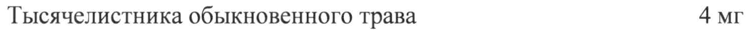
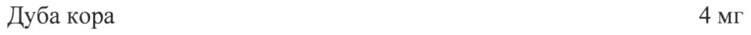
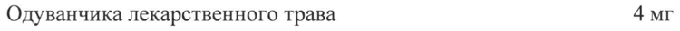

# Алтея лекарственного корни, ромашки аптечной цветки, хвоща полевого трава, ореха грецкого листья, тысячелистника обыкновенного трава, дуба кора, одуванчика лекарственного трава — внутрь

- Препарат: Тонзилгон® Н (таблетки, покрытые оболочкой;)
- АТХ: R02AX
- Источник: ГРЛС, инструкция по медицинскому применению, РУ П N014245/01, файл от 2024-01-30 (https://grls.rosminzdrav.ru/Grls_View_v2.aspx?routingGuid=5f575320-44fb-44ff-b68b-f1e839903932)
- Распознано автоматически (OCR): 5 из 5 стр.
- Инструкция к другому РУ того же препарата: П N014245/01 (национальное РУ, переоформленное по правилам ЕАЭС, решение от 27.12.2023). Текст может быть старше действующего
- Сомнительных строк после OCR: 3 (см. раздел «Проверка распознавания»)

## Общие сведения

от 25.12.2023 № 27064 (Входящий МЗ №42 71328)
МИНИСТЕРСТВО ЗДРАВООХРАНЕНИЯ РОССИЙСКОЙ ФЕДЕРАЦИИ
ИНСТРУКЦИЯ ПО МЕДИЦИНСКОМУ ПРИМЕНЕНИЮ ЛЕКАРСТВЕННОГО ПРЕПАРАТА
Тонзилгон® Н Регистрационный номер:
Торговое наименование: Тонзилгон® Н Международное непатентованное или группировочное наименование: —

## 3. Лекарственная форма

таблетки, покрытые оболочкой
таблетки, покрытые оболочкой

## 2. Состав

(на 1 таблетку):
(на 1 таблетку):
Активные компоненты - Измельченное лекарственное растительное сырье (порошок):
Алтея лекарственного корни 8 мг Ромашки аптечной цветки 6 мг
Хвоща полевого трава 10 мг Ореха грецкого листья 12 мг |
Тысячелистника обыкновенного трава 4 мг Дуба кора 4 мг
Одуванчика лекарственного трава 4 мг Вспомогательные вещества:
лактозы моногидрат, крахмал кукурузный, крахмал картофельный, стеариновая кислота, глюкозы моногидрат, кремния диоксид коллоидный безводный.

- Оболочка: кальция карбонат, клещевины обыкновенной семян масло жирное (касторовое масло), декстрин, глюкозы сироп, индигокармина лак алюминиевый (Е 132), крахмал кукурузный, воск горный гликолиевый, повидон К 25, повидон К 30, сахароза, шеллак, кремния диоксид коллоидный безводный, тальк, титана диоксид (Е 171).

Описание Круглые таблетки двояковыпуклой формы, светло-голубого цвета, покрытые оболочкой.
Фармакотерапевтическая группа Антисептическое средство растительного происхождения.
Код ATX: RO2AA20 от 25.12.2023 № 27064 (Входящий МЗ №4271328)

Фармакологические свойства Фармакологические свойства обусловлены биологически активными веществами, входящими в состав препарата. Тонзилгон® Н обладает противовоспалительным и антисептическим действием. Активные компоненты входящих в состав препарата ромашки, алтея и хвоща, способствуют повышению активности неспецифических факторов защиты организма. Полисахариды, эфирные масла и флавоноиды ромашки, алтея и тысячелистника, танины коры дуба оказывают противовоспалительное действие и способствуют уменьшению отека слизистой оболочки дыхательных путей.

& Показания к применению Острые и хронические заболевания верхних дыхательных путей (тонзиллит, фарингит, ларингит).
Профилактика осложнений при респираторных вирусных инфекциях и как дополнение к терапии антибиотиками при бактериальных инфекциях.

## 4.3. Противопоказания

Повышенная чувствительность к любому из компонентов препарата, к растениям семейства сложноцветных.
Повышенная чувствительность к любому из компонентов препарата, к растениям семейства сложноцветных.
Детский возраст до 6 лет.
Пациентам с редкой наследственной формой непереносимости галактозы,

=“ непереносимостью фруктозы, дефицитом лактазы, глюкозо-галактозной мальабсорбцией или дефицитом сахаразы-изомальтазы, применение препарата противопоказано (из-за содержания в препарате лактозы, глюкозы и сахарозы).

## 4.6. Применение при беременности и в период грудного вскармливания

Нет достаточных данных о применении препарата у беременных. Применение препарата в случае, если потенциальная польза для матери превышает потенциальный риск для плода и ребенка, возможно только после консультации с врачом.

## 4.2. Способ применения и дозы

Внутрь. Таблетки проглатывают целиком, не разжевывая, запивая небольшим количеством воды.
Внутрь. Таблетки проглатывают целиком, не разжевывая, запивая небольшим количеством воды.

от 25.12.2023 № 27064 (Входящий МЗ №4271328)
Если врач не назначил другой режим дозирования, следует придерживаться следующих режимов дозирования:
В острый период развития заболевания:
Взрослым и детям от 12 лет и старше — по 2 таблетки 5—6 раз в день.
Детям от 6 до 12 лет — по 1 таблетке 5—6 раз в день.
После исчезновения острых симптомов заболевания (боль в горле) следует продолжить лечение препаратом в течение еще 1 недели.
После исчезновения острых симптомов:
Взрослым и детям от 12 лет и старше — по 2 таблетки 3 раза в день.
Детям от 6 до 12 лет - по 1 таблетке 3 раза в день.
Если на фоне применения препарата симптомы заболевания сохраняются без улучшения в w течение 7 дней необходимо обратиться к врачу. Если после завершения курса лечения препаратом жалобы возобновляются, необходимо проконсультироваться с врачом.
Применяйте препарат только согласно тем показаниям, тому способу применения и в тех дозах, которые указаны в инструкции.

## 4.8. Побочное действие

Указанные ниже нежелательные реакции приведены в соответствие со следующими градациями частоты их возникновения:
Указанные ниже нежелательные реакции приведены в соответствие со следующими градациями частоты их возникновения:
Очень часто (>1/10)
Часто (>1/100 до <1/10)
Нечасто (>1/1000 до <1/100)
- Редко (>1/10000 до <1/1000)
Очень редко (<1/10000)
Частота неизвестна (по имеющимся данным установить частоту возникновения не представляется возможным).
Редко: возможны аллергические реакции (такие как кожная сыпь, крапивница) и желудочно-кишечные расстройства.
Если у Вас отмечаются побочные эффекты, указанные в инструкции, или они усугубляются, или Вы заметили любые другие побочные эффекты, не указанные в инструкции, прекратите прием препарата и сообщите об этом врачу.
от 25.12.2023 № 27064 (Входящий МЗ №4271328)

## 4.9. Передозировка

До настоящего времени случаев передозировки не зарегистрировано. В случае передозировки возможно усиление побочных эффектов со стороны желудочно-кишечного тракта. Лечение — симптоматическое.
До настоящего времени случаев передозировки не зарегистрировано. В случае передозировки возможно усиление побочных эффектов со стороны желудочно-кишечного тракта. Лечение — симптоматическое.

## 4.5. Взаимодействие с другими лекарственными средствами

Комбинация с антибактериальными лекарственными средствами возможна и целесообразна. Взаимодействие с другими лекарственными средствами в настоящее время не описано.

## 4.4. Особые указания

| Если на фоне применения препарата в течение 7 дней симптомы заболевания сохраняются или состояние больного ухудшается, следует обратиться за консультацией к врачу.
Информация для пациентов с сахарным диабетом: одна таблетка содержит менее 0,03 учитываемых «хлебных единиц» (ХЕ).

## 4.7. Влияние на способность управлять транспортными средствами, механизмами

Применение препарата не оказывает влияния на способность к выполнению потенциально опасных видов деятельности, требующих повышенной концентрации внимания и быстроты психомоторных реакций (в том числе управление транспортными средствами, работа с движущимися механизмами, работа диспетчера, оператора).

- Форма выпуска
Таблетки, покрытые оболочкой. По 25 таблеток, покрытых оболочкой, помещают в блистер из ПВХ/ЛИВДХ-пленки и алюминиевой фольги. По 1, 2 или 4 блистера помещают вместе с инструкцией по медицинскому применению в пачку картонную.

## 6.4. Условия хранения

Хранить в оригинальной упаковке (блистер, пачка картонная) при температуре не выше 25 °C.
Хранить в оригинальной упаковке (блистер, пачка картонная) при температуре не выше 25 °C.
Хранить в недоступном для детей месте!

## 6.3. Срок годности

3 года
3 года

от 25.12.2023 № 27064 (Входящий МЗ №42 71328)
Не использовать по истечении срока годности.
Условия отпуска Отпускают без рецепта.
Держатель регистрационного удостоверения
Бионорика CE, Кершенштайнерштрассе 11-15, 92318 Ноймаркт-ин-дер-Оберпифальц,
Германия Производитель Роттендорф Фарма ГмбХ, Остенфельдер Штрассе 51-61, 59320 Эннигерло, Германия
= Фасовка/Упаковка Бионорика CE, Кершенштайнерштрассе 11-15, 92318 Ноймаркт-ин-дер-Оберпфальц,
Германия ООО «Бионорика Фармасьютикалс», 396333, Россия, Воронежская обл., муниципальный район Новоусманский, сельское поселение Никольское, тер. Индустриальный парк
Масловский, ул. 1-я Парковая, зд. 2 Выпускающий контроль
Бионорика CE, Кершенштайнерштрассе 11-15, 92318 Ноймаркт-ин-дер-Оберпфальц,
Германия ООО «Бионорика Фармасьютикалс», 396333, Россия, Воронежская обл., муниципальный район Новоусманский, сельское поселение Никольское, тер. Индустриальный парк
> Масловский, ул. 1-я Парковая, зд. 2 Организация, принимающая претензии потребителей
ООО «Бионорика»
119619, г. Москва, 6-я ул. Новые сады, д.2, корп. |
Тел./факс: +7 495 502-90-19 Адрес электронной почты: info@bionorica.ru
Представитель ООО «Бионорика» LS у RON Сокур Т.В.
(2 я Fea? |3] о вопопее fs р у, од : 7 95 arses y
## Проверка распознавания

Страницы-сканы распознаны автоматически. В 3 строках с дозировками цифры могли распознаться с ошибкой — сверьте с вырезкой из оригинала:

- стр. 1: «Тысячелистника обыкновенного трава 4 мг» — низкая уверенность: «4» (75)  
  
- стр. 1: «Дуба кора 4 мг» — низкая уверенность: «4» (60)  
  
- стр. 1: «Одуванчика лекарственного трава 4 мг» — низкая уверенность: «4» (64)  
  
