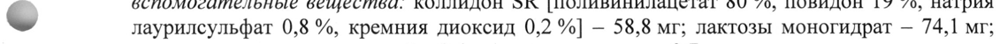
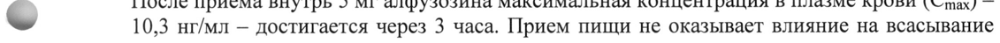

# Алфузозина гидрохлорид — внутрь

- Препарат: Алфузозин (таблетки пролонгированного действия;)
- АТХ: G04CA01
- Источник: ГРЛС, инструкция по медицинскому применению, РУ ЛП-000665, файл от 2025-03-03 (https://grls.rosminzdrav.ru/Grls_View_v2.aspx?routingGuid=f441654d-4619-44a3-81ea-d59efa39fecd)
- Распознано автоматически (OCR): 7 из 7 стр.
- Инструкция к другому РУ того же препарата: ЛП-000665 (исключено из реестра, решение от 03.03.2025). Текст может быть старше действующего
- Сомнительных строк после OCR: 2 (см. раздел «Проверка распознавания»)
- Проверено вручную строк: 4

## Общие сведения

МИНЗДРАВ psi ~000669-300721 МИНИСТЕРСТВО ЗДРАВООХРАНЕНИЯ РОССИЙСКОЙ ФЕДЕРАЦИИ
СОГЛАСОВАНО ИНСТРУК ПО МЕДИЦИНСКОМУ ПРИМЕНЕНИЮ ЛЕКАРСТВЕННОГО ПРЕПАРАТА
Алфузозин

Регистрационный номер:

Торговое наименование: Алфузозин

Международное непатентованное наименование: алфузозин

## 3. Лекарственная форма

таблетки пролонгированного действия
таблетки пролонгированного действия

## 2. Состав

1 таблетка пролонгированного действия содержит:

Дозировка 5 мг

действующее вещество: алфузозина гидрохлорид - 5,0 мг;

вспомогательные вещества: коллидон SR [поливинилацетат 80 %, повидон 19 %, натрия
- лаурилсульфат 0,8 %, кремния диоксид 0,2 %] — 58,8 мг; лактозы моногидрат — 74,1 мг;

кремния диоксид коллоидный - 1,4 мг; магния стеарат — 0,7 мг.

Дозировка 10 мг

действующее вещество: алфузозина гидрохлорид — 10,0 мг;

вспомогательные вещества: гипромеллоза (Метоцел К 4M) - 100,0 мг; крахмал

кукурузный прежелатинизированный (крахмал 1500) — 136,2 мг; кремния диоксид
© коллоидный - 1,3 мг; магния стеарат — 2,5 мг.

Описание

Круглые плоскоцилиндрические таблетки белого или белого с желтоватым оттенком

цвета с фаской (дозировка 5 мг) или с фаской и риской (дозировка 10 мг).

Фармакотерапевтическая группа

Альфа!-адреноблокатор.
w Код ATX

G04CA01

Фармакологические свойства

## 5.1. Фармакодинамика

Алфузозин является производным хиназолина, активным при пероральном применении.

Он является селективным антагонистом постсинаптических альфа!-адренорецепторов,

расположенных в предстательной железе, треугольнике мочевого пузыря и

мочеиспускательном канале.

Клинические проявления доброкачественной гиперплазии предстательной железы

(ДГПЖ) выражаются в инфравезикальной обструкции мочевыводящих путей,

обусловленной как анатомическими (статическими), так и функциональными

(динамическими) факторами. Функциональный компонент обструкции обусловлен

возбуждением альфа!-адренорецепторов, приводящим к сокрашению гладкой

мускулатуры предстательной железы, ее оболочки, треугольника мочевого пузыря и

предстательной части уретры, что приводит к увеличению сопротивления оттоку мочи из

мочевого пузыря и, по-видимому, к вторичной нестабильности мочевого пузыря.

Вследствие прямого воздействия на гладкую мускулатуру ткани предстательной железы,

связанного с блокадой альфа!-адренорецепторов, алфузозин уменьшает инфравезикальную обструкцию, давление в уретре и сопротивление оттоку мочи во время мочеиспускания. За счет этого алфузозин улучшает отток мочи и облегчает опорожнение мочевого пузыря. Эти благоприятные эффекты на уродинамику ведут к уменьшению симптомов раздражения мочевыводящих путей и симптомов, обусловленных нарушениями оттока мочи у пациентов с ДГИЖ. У пациентов с максимальной скоростью оттока мочи (Qmax) < 15 мл/сек алфузозин, уже начиная с первой дозы, значительно увеличивает Qmax (в среднем на 30%). Кроме того, у пациентов с ДГПЖ алфузозин значительно снижает давление в детрузоре мочевого пузыря и увеличивает объем мочи, вызывающий позыв к мочеиспусканию, а также значительно снижает объем остаточной мочи. Эти эффекты приводят к уменьшению обструктивных и ирритативных симптомов
ДГПЖ. Препарат не оказывает неблагоприятного действия на сексуальную функцию. В связи с селективностью действия алфузозина его влияние на альфа!-адренорецепторы сосудов и, соответственно, на артериальное давление (АД) в случае его применения в терапевтических дозах практически отсутствует.

## 5.2. Фармакокинетика

Всасывание После приема внутрь 5 мг алфузозина максимальная концентрация в плазме крови (Cmax) —
Всасывание После приема внутрь 5 мг алфузозина максимальная концентрация в плазме крови (Cmax) —
- 10,3 нг/мл — достигается через 3 часа. Прием пищи не оказывает влияние на всасывание активного вещества.
Распределение Период полувыведения из плазмы крови составляет 8 часов. Биодоступность — 45-53 %.
Связывание с белками плазмы крови около 90 %.
Метаболизм Алфузозин подвергается значительному метаболизму в печени, в основном, с помощью изофермента СУРЗА4. В моче обнаруживается только 11 % неизмененного алфузозина.
- Метаболиты не обладают фармакологической активностью.
Выведение В моче обнаруживается только 11% неизмененного алфузозина. Большинство метаболитов выводится через кишечник (75-90 %).
Фармакокинетика у особых групп пациентов
Пациенты пожилого возраста У пациентов старше 75 лет может быть увеличена абсорбция препарата, и могут достигаться более высокие Cmax. У некоторых пациентов возможно увеличение
| = биодоступности препарата и уменьшение объема распределения. При этом период полувыведения не изменяется.
Пациенты с нарушениями функции печени У пациентов с тяжелыми нарушениями функции печени увеличивается элиминационный период полувыведения и, по сравнению со здоровыми добровольцами, возрастает биодоступность препарата.
Пациенты с нарушениями функции почек У пациентов с нарушениями функции почек (клиренс креатинина (КК) менее 50 мл/мин), требующими или не требующими проведения гемодиализа, в связи с увеличением свободной фракции препарата объем распределения и клиренс алфузозина увеличиваются.
Пациенты с хронической сердечной недостаточностью
При хронической сердечной недостаточности фармакокинетический профиль алфузозина не изменяется.

## 4.1. Показания к применению

Функциональные нарушения мочеиспускания при доброкачественной гиперплазии предстательной железы.
Функциональные нарушения мочеиспускания при доброкачественной гиперплазии предстательной железы.
В качестве вспомогательного средства при использовании катетера при острой задержке мочи, связанной с доброкачественной гиперплазией предстательной железы (только для препарата Алфузозин в дозировке 10 мг).

## 4.3. Противопоказания

— гиперчувствительность к алфузозину и/или любому вспомогательному веществу в составе препарата;

— ортостатическая гипотензия (в том числе в анамнезе);

— печеночная недостаточность тяжелой степени (класс С по шкале Чайлд-Пью);

— почечная недостаточность тяжелой степени (клиренс креатинина < 30 мл/мин);

— одновременный прием других альфа!-адреноблокаторов;

— одновременный прием с мощными ингибиторами изофермента СУРЗА4 (такими как кетоконазол, итраконазол и ритонавир, см. раздел «Взаимодействие с другими лекарственными средствами»);

— дефицит лактазы, непереносимость лактозы, глюкозо-галактозная мальабсорбция
(только для препарата Алфузозин в дозировке 5 мг);

| — возраст до 18 лет.
® С осторожностью

— у пациентов, принимающих гипотензивные препараты или нитраты (возможно развитие ортостатической гипотензии, протекающей бессимптомно или сопровождающейся головокружением, слабостью, холодным потом);

— упациентов пожилого возраста (старше 75 лет);

— у пациентов с выраженной гипотензивной реакцией на другие альфа!-адреноблокаторы

| в анамнезе;
| — у пациентов с ишемической болезнью сердца (ИБС) (возможно учащение и утяжеление приступов стенокардии);

— у пациентов с врожденным или приобретенным удлинением интервала ОТ или у пациентов, принимающих лекарственные препараты, увеличивающие продолжительность интервала ОТ;

— у пациентов с ишемией головного мозга с клинической симптоматикой или без клинической симптоматики (в связи с возможностью снижения АД и усиления ишемии головного мозга).

® Применение при беременности и в период грудного вскармливания

Препарат не предназначен для применения у женщин.

## 4.2. Способ применения и дозы

Режим дозирования

Для препарата Алфузозин в дозировке 5 мг

Терапия функциональных нарушений мочеиспускания при доброкачественной гиперплазии

предстательной железы

Рекомендованная доза составляет: 5 мг 2 раза в сутки (утром и вечером).

Для препарата Алфузозин в дозировке 10 мг

Терапия функциональных нарушений мочеиспускания при доброкачественной гиперплазии

предстательной железы

Рекомендованная доза составляет: 10 мг (1 таблетка) в сутки, ежедневно, после еды.

В качестве вспомогательного средства при использовании катетера при острой

задержке мочи, связанной с доброкачественной гиперплазией предстательной железы

Рекомендованная доза составляет: 10 мг (1 таблетка) в сутки, ежедневно, после еды

начиная с первого дня катетеризации.

Препарат принимают в течение 3-4 суток, то есть 2-3 суток во время нахождения катетера

в уретре и 1 сутки — после его удаления.

Применение препарата в особых клинических группах пациентов

У детей и подростков

Безопасность и эффективность алфузозина у детей и подростков в возрасте до 18 лет не

установлены. Применение препарата Алфузозин в данной возрастной популяции

противопоказано.

Пациенты пожилого возраста шили пациенты с артериальной гипертензией,

получающие гипотензивные препараты

В качестве меры предосторожности при применении алфузозина у таких пациентов

рекомендуется начинать лечение с 5 мг 1 раз в сутки, вечером, повышая дозу в

соответствии с клиническим ответом, но не превышая дозы 10 мг в сутки (5 мг 2 раза в

сутки).

Пациенты с почечной недостаточностью

При КК более 30 мл/мин коррекция режима дозирования не требуется.

Пациенты с печеночной недостаточностью

Следует учитывать удлинение периода полувыведения алфузозина и возможность увеличения его биодоступности, поэтому лечение должно начинаться с дозы 2,5 мг 1 раз в
- сутки, которая может увеличиваться в зависимости от клинического ответа, но не должна

превышать 2,5 мг 2 раза в сутки (для обеспечения указанного режима дозирования

необходимо применять алфузозин в другой лекарственной форме: таблетки 2,5 мг).

Способ применения

Внутрь, не разжевывая и запивая достаточным количеством воды (примерно 1 стакан). He

следует измельчать, раздавливать или разламывать таблетку в порошок. Это может

привести к неправильному высвобождению алфузозина из таблетки и ускорению его
© всасывания, что повышает риск развития нежелательных реакций.

## 4.8. Побочное действие

Нежелательные реакции, возможные на фоне терапии алфузозином, распределены по

системно-органным классам, с указанием частоты их возникновения согласно

рекомендациям Всемирной организации здравоохранения (ВОЗ):

очень часто (> 10%); часто (> 1% - < 10%); нечасто (> 0,1% - < 1%); редко (> 0,01% -

< 0,1%); очень редко (< 0,01%) (включая отдельные случаи); частота неизвестна (по

имеющимся данным установить частоту возникновения нежелательной реакции не
> представляется возможным).

Нарушения со стороны крови и лимфатической системы:

частота неизвестна — тромбоцитопения, нейтропения.

Нарушения со стороны нервной системы:

часто — обморок/головокружение, головная боль, вертиго;

нечасто — синкопальное состояние, сонливость;

частота неизвестна — ишемические нарушения мозгового кровообращения у пациентов с

уже имеющейся цереброваскулярной патологией.

Нарушения со стороны органа зрения:

нечасто — нарушения зрения;

частота неизвестна — интраоперационный синдром вялой радужки (см. раздел «Особые

указания»).

Нарушения со стороны сердца:

нечасто — тахикардия, ощущение сердцебиения (пальтитация);

очень редко — учащение или утяжеление приступов стенокардии у пациентов с ИБС (см.

разделы «С осторожностью», «Особые указания»);

частота неизвестна — фибрилляция предсердий.

Нарушения со стороны сосудов:

часто — снижение АД (включая ортостатическую гипотензию);

нечасто — «приливы» крови к кожным покровам.

Нарушения со стороны дыхательной системы, органов грудной клетки и средостения:

нечасто — ринит.

Желудочно-кишечные нарушения:

часто — тошнота, боль в животе, диарея, сухость слизистой оболочки полости рта;

нечасто — рвота.

Нарушения со стороны печени и желчевыводящих путей:

частота неизвестна — гепатоцеллюлярная желтуха, печеночный холестаз.

Нарушения со стороны кожи и подкожной клетчатки:

нечасто — сыпь, зуд;

очень редко — крапивница, ангионевротический отек.

Нарушения со стороны репродуктивной системы и молочных желез:

частота неизвестна — приапизм.

Общие нарушения и нарушения в месте введения:

часто — астения, недомогание;

© нечасто — отеки, боль в груди.

## 4.9. Передозировка

Симитомы

Значительное снижение АД, рефлекторная тахикардия.

Лечение

В случае передозировки пациент должен быть госпитализирован. Пациент должен

находиться в положении «лежа», необходим постоянный мониторинг АД. Следует

проводить традиционное лечение гипотензии (введение сосудосуживающих средств,

w плазмозаменителей (для увеличения объема циркулирующей крови). После восстановления АД (устранения гипотонии) необходимо продолжать контроль АД еще приблизительно в течение суток.

Диализ неэффективен из-за высокой степени связывания алфузозина с белками плазмы

крови.

## 4.5. Взаимодействие с другими лекарственными средствами

Противопоказанные комбинации

wo — с блокаторами альфа!-рецепторов (празозин, урапидил, доксазозин) - риск развития тяжелой ортостатической гипотензии и усиления гипотензивного действия (см. раздел
«Противопоказания»);

— с мощными ингибиторами изофермента СУРЗА4 (такими как кетоконазол, итраконазол, позаконазол, вориконазол, телапревир, ритонавир, нелфинавир, кларитромицин, кобицистат, эритромицин, телитромицин) повышают риск увеличения концентрации алфузозина в плазме крови и нежелательных реакций (см. раздел
«Противопоказания»).

Взаимодействия, которые следует принимать во внимание

— с гипотензивными препаратами - усиление гипотензивного эффекта и риск развития ортостатической гипотензии (аддитивное действие) (см. раздел «Особые указания»);

— снитратами - увеличение риска развития рефлекторной тахикардии и снижения АД;

— со средствами для ингаляционной и неингаляционной общей анестезии - возможна нестабильность АД во время общей анестезии;

— с дапоксетином - увеличение риска развития нежелательных реакций, особенно таких как головокружение или обморок.

Взаимодействие, требующее соблюдения мер предосторожности

— ингибиторы фосфодиэстеразы 5 типа (силденафил, тадалафил, варденафил, аванафил) -

риск развития ортостатической гипотензии, особенно у пациентов пожилого возраста.

## 4.4. Особые указания

В течение нескольких часов после приема алфузозина (как и после приема любых других альфа!-адреноблокаторов) у некоторых пациентов, в особенности, у пациентов, принимающих гипотензивные препараты, может развиться ортостатическая гипотензия с клинической симптоматикой (головокружение, резкая слабость, холодный пот) или без нее. При развитии этих симптомов пациент должен находиться в горизонтальном положении до их полного исчезновения. Ортостатическая гипотензия обычно бывает преходящей и наблюдается, как правило, в начале приема препарата и не требует отмены лечения.
В течение нескольких часов после приема алфузозина (как и после приема любых других альфа!-адреноблокаторов) у некоторых пациентов, в особенности, у пациентов, принимающих гипотензивные препараты, может развиться ортостатическая гипотензия с клинической симптоматикой (головокружение, резкая слабость, холодный пот) или без нее. При развитии этих симптомов пациент должен находиться в горизонтальном положении до их полного исчезновения. Ортостатическая гипотензия обычно бывает преходящей и наблюдается, как правило, в начале приема препарата и не требует отмены лечения.
При пострегистрационном применении препарата у пациентов с факторами риска снижения АД (такими как заболевания сердца или сопутствующая терапия гипотензивными препаратами) сообщалось о выраженном снижении АД. Риск чрезмерного снижения АД и связанных с ним нежелательных реакций может быть выше у пациентов пожилого возраста.
Перед началом лечения пациент должен быть предупрежден о возможности

с возникновения описанных выше реакций.

- Следует соблюдать осторожность при применении алфузозина у пациентов, принимающих гипотензивные препараты или нитраты (необходим более тщательный контроль за АД, в том числе, при переходе из горизонтального положения в вертикальное, особенно в начале лечения).

Следует соблюдать осторожность при применении алфузозина у пациентов с выраженной гипотензивной реакцией в ответ на прием других блокаторов альфа!-адренорецепторов в анамнезе.

Пациентам с коронарной недостаточностью при приеме алфузозина необходимо

= продолжать антиангинальную терапию. При возобновлении или утяжелении стенокардии лечение алфузозином следует прекратить.

Следует соблюдать осторожность при применении алфузозина у пациентов с врожденным или приобретенным удлинением интервала ОТ или у пациентов, принимающих лекарственные препараты, способные удлинять интервал ОТ.
В связи с тем, что после приема алфузозина возможно снижение АД, имеется риск развития ишемического нарушения мозгового кровообращения у предрасположенных к этому пациентов (как у имеющих соответствующие симптомы, так и у тех, у которых
> предшествующие цереброваскулярные расстройства протекают бессимптомно).

Во время проведения офтальмологических операций по поводу катаракты у некоторых пациентов, принимающих или принимавших ранее некоторые альфа!-адреноблокаторы, наблюдалось развитие интраоперационного синдрома вялой радужки (вариант «синдрома узкого зрачка»). Хотя риск развития такого осложнения при приеме афлузозина представляется очень низким, перед проведением операции по поводу катаракты хирург-офтальмолог должен быть проинформирован о том, что пациент принимает альфа!-адреноблокаторы или принимал их ранее, так как развитие интраоперационного синдрома вялой радужки может увеличивать количество осложнений при данном оперативном вмешательстве. Офтальмологи должны быть готовы к возможному изменению методики оперативного вмешательства.
Есть сообщения о случаях развития приапизма (длительной болезненной эрекции полового члена, не связанной с сексуальной активностью) на фоне терапии альфа!- адреноблокаторами, включая алфузозин. Если терапия приапизма не была проведена незамедлительно, это может привести к повреждению тканей полового члена и необратимой утрате потенции. Пациентов следует информировать о серьезности этого состояния (см. раздел «Побочное действие») и необходимости немедленного обращения за медицинской помощью в случае сохранения эрекции в течение более 4 часов.

## 4.7. Влияние на способность управлять транспортными средствами, механизмами

Исследований влияния алфузозина на способность управлять транспортными средствами и механизмами не проводилось. Необходимо учитывать, что в начале лечения возможно возникновение головокружения и других нежелательных реакций, которые могут влиять на концентрацию внимания и быстроту психомоторных реакций, поэтому следует соблюдать осторожность при управлении транспортными средствами и механизмами.

## 6.5. Форма выпуска

Таблетки пролонгированного действия, 5 мги 10 мг.
Таблетки пролонгированного действия, 5 мги 10 мг.
10 или 14 таблеток в контурной ячейковой упаковке из пленки поливинилхлоридной и фольги алюминиевой.
60 таблеток в банке из полиэтилена высокой плотности.
1, 3, 5 или 6 контурных ячейковых упаковок по 10 таблеток, 1, 2 или 4 контурные ячейковые упаковки по 14 таблеток или одна банка вместе с инструкцией по применению в пачке из картона.

## 6.4. Условия хранения

Хранить в защищенном от света месте при температуре не выше 25 °С.
Хранить в защищенном от света месте при температуре не выше 25 °С.
- Хранить в недоступном для детей месте.

## 6.3. Срок годности

2 года.
2 года.
Не применять по истечении срока годности, указанного на упаковке.
Условия отпуска ч Отпускают по рецепту.
Владелец регистрационного удостоверения АО «ВЕРТЕКС», Россия
Юридический адрес: 197350, г. Санкт-Петербург, Дорога в Каменку, д. 62, лит. А.
Производитель АО «ВЕРТЕКС», Россия г. Санкт-Петербург, Дорога в Каменку, д. 62, лит. А.
Организация, принимающая претензии потребителей:
АО «ВЕРТЕКС», Россия 199106, г. Санкт-Петербург, Васильевский остров, 24-линия, д. 27, лит. А.
Тел./факс:
Представитель АО «ВЕРТЕКС» j С. А. Копатько
## Проверка распознавания

Страницы-сканы распознаны автоматически. В 2 строках с дозировками цифры могли распознаться с ошибкой — сверьте с вырезкой из оригинала:

- стр. 1: «- лаурилсульфат 0,8 %, кремния диоксид 0,2 %] — 58,8 мг; лактозы моногидрат — 74,1 мг;» — повторное чтение: «- лаурилсульфат 0,8 %, кремния диоксид 0.2 %] — 58,8 мг; лактозы моногидрат — 74,1 мг;»  
  
- стр. 2: «- 10,3 нг/мл — достигается через 3 часа. Прием пищи не оказывает влияние на всасывание» — повторное чтение: «~ 10,3 не/мл — достигается через 3 часа, Прием пищи не оказывает влияние на всасывание»  
  