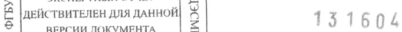

# Альфа-глутамил-триптофан — внутрь

- Препарат: Регастим Гастро (порошок для приготовления геля для приема внутрь;)
- АТХ: A16AX
- Источник: ГРЛС, инструкция по медицинскому применению, РУ ЛП-007310, файл от 2024-02-27 (https://grls.rosminzdrav.ru/Grls_View_v2.aspx?routingGuid=1ae58340-018b-4b9e-8215-0ea2f282045a)
- Распознано автоматически (OCR): 4 из 4 стр.
- Инструкция к другому РУ того же препарата: ЛП-007310 (национальное РУ, переоформленное по правилам ЕАЭС, решение от 15.02.2024). Текст может быть старше действующего
- Сомнительных строк после OCR: 1 (см. раздел «Проверка распознавания»)

## Общие сведения

м МИНИСТЕРСТВО ЗДРАВООХРАНЕНИЯ РОССИЙСКОЙ ФЕДЕРАЦИИ!
| IM - 007310-230821 ce | СОГЛАСОВАНО ПО МЕДИЦИНСКОМУ ПРИМЕНЕНИЮ ЛЕКАРСТВЕННОГО ПРЕПАРАТ. a
Тимоген“ Регистрационный номер:
Торговое наименование: Тимоген® Группировочное наименование: Альфа-глутамил-триптофан

## 3. Лекарственная форма

Порошок для приготовления геля для приёма внутрь
Порошок для приготовления геля для приёма внутрь

## 2. Состав

на 1 г порошка . Действующее вещество: альфа-глутамил-триптофан натрия (Тимоген”® натрий) (0,352 мг)
на 1 г порошка . Действующее вещество: альфа-глутамил-триптофан натрия (Тимоген”® натрий) (0,352 мг)
- в пересчете на альфа-глутамил-триптофан 0,330 мг.
Вспомогательные вещества: натрия алгинат, кармеллоза натрия, фруктоза, кремния диоксид коллоидный.
Описание: Порошок от белого до желтовато-коричневого цвета.
Фармакотерапевтическая группа: Репарации тканей стимулятор
Код ATX: Al6AX Фармакодинамика:
Оказывает репаративное, противовоспалительное и обволакивающее действие при воспалительно-дистрофических заболеваниях слизистой желудка.
Стимулирует процессы регенерации в случае их угнетения при наличии очагов атрофии
© слизистой оболочки желудка, препятствуя сокрашению количества желудочных желез.
Способствует нормализации РН желудка (за счет увеличения количества желез желудочной секреции в сохранных зонах слизистой оболочки желудка), снижению уровня гастрина-17 в крови, увеличению соотношения уровней пепсиноген Г пепсиноген II, что является показателем восстановления кислотообразующей и пепсинобразующей функций и ослабления проонкогенных процессов, связанных с данными нарушениями.
Препарат оказывает противовоспалительное действие, снижая уровень лейкоцитарной инфильтрации слизистой оболочки желудка преимущественно за счет эозинофильных гранулоцитов и макрофагов.
Оказывает регулирующее влияние на реакции клеточного, гуморального иммунитета и неспецифическую резистентность.
После эрадикационной терапии (у лиц с инфекцией Helicobacter pylori) лечение препаратом способствует более выраженному снижению титра антихеликобактерных 131604
МИНЗДРАВРОССИИ антител, уменышая активность аутоиммунного компонента () воспаления» | слизисто оболочки желудка. СОГЛАСОВАН О |

## 5.2. Фармакокинетика

ee Альфа-глутамил-триптофан высвобождается из состава геля в желудке и оказывает местное действие на слизистую оболочку желудка, системный кровоток достигает незначительная часть введенной дозы.
ee Альфа-глутамил-триптофан высвобождается из состава геля в желудке и оказывает местное действие на слизистую оболочку желудка, системный кровоток достигает незначительная часть введенной дозы.

Под воздействием пептидаз альфа-глутамил-триптофан расщепляется на
Г-глутаминовую кислоту и Г-триптофан, которые используются организмом в синтезе белков и других биологически активных соединений.

## 4.1. Показания к применению

Комплексное лечение хронического атрофического гастрита.

© Противопоказания:
Острые воспалительные заболевания желудка и двенадцатиперстной кишки, онкологические заболевания, гиперчувствительность к компонентам препарата, дефицит сахаразы/изомальтазы, глюкозо-галактозная мальабсорбция, детский возраст до 18 лет, беременность, период грудного вскармливания. Перед назначением препарата следует установить переносимость фруктозы. Противопоказано больным с наследственной непереносимостью фруктозы.
Меры предосторожности при применении: Не требуются.

## 4.6. Применение при беременности и в период грудного вскармливания

Применение препарата при беременности и в период грудного вскармливания противопоказано.

© Способ применения и дозы:
Внутрь. Препарат принимают внутрь в виде геля 2 раза в сутки натощак (утром за 20 - 30 минут до приёма пищи и вечером перед сном, не ранее чем через час после приема пищи).
Перед применением разовую дозу — 3 г порошка (1 чайную ложку) перемешать около 3-5 минут в 50 мл (1/4 стакана) горячей, HO не кипящей воде до получения геля однородной консистенции. Гель готовят непосредственно перед применением. Для удобства перемешивания рекомендуется добавлять воду в порошок, а не наоборот.
Курс лечения 28 дней.
При атрофическом гастрите, ассоциированном с Helicobacter pylori, препарат применять после курса эрадикационной терапии.
При положительной динамике лечения по назначению врача возможно проведение повторного курса через 2 недели.

131604 ИИНЗДРАВРОССИИ :

## 4.8. Побочное действие

il - 007310-230891 Классификация нежелательных реакций по частоте развития. 9 в(кодичество, зарегистрированных случаев/количество пациентов): очень часто (>1/10), часто (ST/t00-<— 1/10), нечасто (21/1000, <1/100), частота неизвестна (побочные эффекты из опыта постмаркетингового применения; частота не может быть оценена на основе имеющихся данных).
il - 007310-230891 Классификация нежелательных реакций по частоте развития. 9 в(кодичество, зарегистрированных случаев/количество пациентов): очень часто (>1/10), часто (ST/t00-<— 1/10), нечасто (21/1000, <1/100), частота неизвестна (побочные эффекты из опыта постмаркетингового применения; частота не может быть оценена на основе имеющихся данных).
Нарушения со стороны иммунной системы Частота неизвестна: аллергическая реакция, гиперчувствительность к компонентам препарата.
Нарушения со стороны желудочно-кишечного тракта
Частота неизвестна: послабление стула.
При проявлении любых побочных эффектов следует прекратить прием препарата и

© обратиться к врачу.

## 4.9. Передозировка

Случаи передозировки не известны.

## 4.5. Взаимодействие с другими лекарственными средствами

Не изучалось.

## 6.5. Форма выпуска

Порошок для приготовления геля для приема внутрь.
По 90 г в банке полимерной из полиэтилена, укупоренной пластмассовой крышкой из полиэтилена с контролем первого вскрытия или крышкой из полипропилена с контролем первого вскрытия с защитой от детей. На банку наклеивают этикетку самоклеящуюся. По
© одной банке с инструкцией по применению в пачке из картона.
Описание действий врача или пациента при пропуске приема одной или нескольких доз:
При пропуске одной или нескольких доз лечение не прекращают, рекомендовано удлинение курса лечения на количество пропущенных дней приема.

## 4.7. Влияние на способность управлять транспортными средствами, механизмами

Препарат не влияет на способность управлять транспортными средствами, работать с движущимися механизмами и заниматься другими потенциально опасными видами деятельности, требующими повышенной концентрации внимания и быстроты психомоторных реакций.

## 6.3. Срок годности

3 года. Не использовать по истечении срока годности, указанного на упаковке.

## 6.4. Условия хранения

, 191604 МИНЗДРАВРОССИИ
, 191604 МИНЗДРАВРОССИИ
Хранить при температуре не выше 25°С. Хранить в Нод уно для детей месте.
ЛП -007310-23082 1 Условия отпуска:
СОГЛАСОВАНО Отпускают по рецепту. = Производитель/владелец регистрационного удостоверения/ организация, принимающая претензии от потребителей:
Акционерное общество «Медико-биологический научно-производственный комплекс
«Цитомед».
Россия, 194356, г. Санкт-Петербург, Орлово-Денисовский пр. д. 14, стр. 1, тел 8 (800) 50503-01, www.cytomed.ru
Адрес места производства: 199178, г. Санкт-Петербург, Васильевский остров, Малый проспект, д. 57, кори. 4, лит. Ж.
S» KB о ON } Lox KX om TOU LON .
1 OSX mn \o
БЫ ag А A.H.X Генеральный директ@р/“? в .H. Хромов
° porte PBIB jg NP AO «MBHIIK «Цитоме®<5\ 2 = | Sa Es Le
Kant | ДИ /2 СА os of OES GAY 2 $$.
a <* M3 P® = >. ЭКСПЕРТНЫЙ ОТЧЕТ Е [2 | ДЕЙСТВИТЕЛЕН ДЛЯ ДАННОЙ| & 13 160%
© | ВЕРСИИ ДОКУМЕНТА 5 "я т 0000000005
## Проверка распознавания

Страницы-сканы распознаны автоматически. В 1 строках с дозировками цифры могли распознаться с ошибкой — сверьте с вырезкой из оригинала:

- стр. 4: «[2 | ДЕЙСТВИТЕЛЕН ДЛЯ ДАННОЙ| & 13 160%» — низкая уверенность: «[2» (61), «13» (46), «160%» (46); повторное чтение: «Е [действителен для данной $ | 131604»  
  
