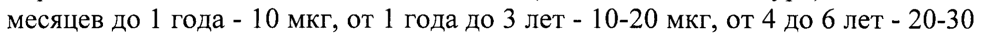

# Альфа-глутамил-триптофан натрия — парентерально

- Препарат: Тимоген® (раствор для внутримышечного введения;)
- АТХ: L03AX
- Источник: ГРЛС, инструкция по медицинскому применению, РУ ЛС-002304, файл от 2023-08-05 (https://grls.rosminzdrav.ru/Grls_View_v2.aspx?routingGuid=a4b0469a-5880-4049-a67b-ba05171c736c)
- Распознано автоматически (OCR): 3 из 3 стр.
- Инструкция к другому РУ того же препарата: ЛС-002304 (национальное РУ, переоформленное по правилам ЕАЭС, решение от 22.11.2022). Текст может быть старше действующего
- Сомнительных строк после OCR: 1 (см. раздел «Проверка распознавания»)

## Общие сведения

-002304-1
МИНИСТЕРСТВО ЗДРАВООХРАНЕНИЯ И СОЦИАЛЬНОГО РАЗВИТИЯ sen
РОССИЙСКОЙ ФЕДЕРАЦИИ ИНСТРУКЦИЯ по медицинскому применению препарата
Тимоген® Внимательно прочитайте эту инструкцию перед тем, как начать прием этого лекарства.
- Сохраните инструкцию, она может потребоваться вновь.
‚ Если у Вас возникли вопросы, обратитесь к врачу.
‘Это лекарство назначено лично Вам, и его не следует передавать другим лицам, поскольку оно может причинить им вред даже при наличии тех же симптомов, что иу Вас.
Наименование лекарственного препарата (торговое и группировочное наименования): Тимоген® (альфа-глутамил-триптофан)
Лекарственная форма с указанием наименований и количественного содержания (активности) фармацевтических субстанций и вспомогательных веществ:
Раствор для внутримышечного введения 100 мкг/мл.
1 мл препарата содержит: активное вещество: альфа-глутамил-триптофан натрия (Тимоген® натрий) 100 мкг (в пересчёте на альфа-глутамилтриптофан), вспомогательные вещества: натрия хлорид 9000 мкг, вода для инъекций до | мл.
Описание: Бесцветный прозрачный раствор без запаха.
Фармакотерапевтическая группа лекарственного препарата:
Иммуномодулирующее средство.
Фармакологическое действие.

## 5.1. Фармакодинамика

Оказывает регулирующее влияние на реакции клеточного, гуморального иммунитета и неспецифическую резистентность организма. Стимулирует процессы регенерации в случае их угнетения.
Оказывает регулирующее влияние на реакции клеточного, гуморального иммунитета и неспецифическую резистентность организма. Стимулирует процессы регенерации в случае их угнетения.
Улучшает течение процессов клеточного метаболизма. Усиливает экспрессию дифференцировочных рецепторов на лимфоцитах, нормализует количество Т-хелперов, цитотоксических Т-лимфоцитов и их соотношение у больных с различными иммунодефицитными состояниями.

## 5.2. Фармакокинетика

Препарат быстро поступает в системный кровоток после его парентерального введения. Альфа-глутамил-триптофан натрия под воздействием пептидаз расщепляется Ha Г.-глутаминовую кислоту и Гтриптофан, которые используются организмом в пептидном синтезе.
Препарат быстро поступает в системный кровоток после его парентерального введения. Альфа-глутамил-триптофан натрия под воздействием пептидаз расщепляется Ha Г.-глутаминовую кислоту и Гтриптофан, которые используются организмом в пептидном синтезе.
Показания для применения:
В комплексной терапии острых и хронических вирусных и бактериальных заболеваний, сопровождающихся снижением иммунитета:
- вирусные гепатиты;
JIC-002304-130911 - острые и хронические неспецифические заболевания легких (ХНЗЛ):
хронический бронхит, острая и хроническая пневмония;
- заболевания кожи и подкожной клетчатки (пиодермия, фурункулез, рожистое воспаление);
- в комплексной терапии тяжелых диффузных форм атопического дерматита;
- в комплексной терапии тяжелых механических, химических, радиационных и термических травм (ожоговой болезни);
- комплексное лечение раневой и хирургической инфекции, в том числе гнойно-септических осложнений в послеоперационном периоде;
- в период предоперационной подготовки при плановых хирургических операциях с целью профилактики инфекционных осложнений и стимулирования процессов регенерации.
- После лучевой терапии, химиотерапиии, а также длительной антибактериальной терапии в больших дозах.
Противопоказания для применения:
Гиперчувствительность к компонентам препарата. Детский возраст до 6 месяцев, беременность и период грудного вскармливания.

## 4.2. Способ применения и дозы

Режим дозирования, способ введения, продолжительность лечения:
Режим дозирования, способ введения, продолжительность лечения:
Внутримышечно 1 раз в сутки.
Взрослым и детям от 14 лет по 100 мкг (300-1000 мкг на курс), детям от 6 месяцев до | года - 10 мкг, от 1 года до 3 лет - 10-20 мкг, от 4 до 6 лет - 20-30 мкг, от 7 до 14 лет - 50 мкг. Длительность курса лечения от 3 до 10 дней.
Проведение повторного курса возможно не ранее, чем через | месяц. В течение года возможно проведение 4-х курсов.
Меры предосторожности при применении:
Не требуются.
Указание особенности действия лекарственного препарата при первом приёме или при его отмене, действия врача и пациента:
Препарат не имеет особенностей действия при первом приёме и при его отмене.
Возможные побочные действия при применении лекарственного препарата:
Аллергические реакции.
Симптомы передозировки и меры по оказанию помощи при передозировке:
Симптомы передозировки не описаны.

## 4.5. Взаимодействие с другими лекарственными средствами

Не выявлено.
Указание возможности и особенностей медицинского применения лекарственного препарата беременными женщинами, женщинами в период грудного вскармливания, детьми, взрослыми, имеющими хронические заболевания:
В целях безопасности, из-за недостаточного количества данных, назначение препарата в период беременности и период грудного вскармливания возможно только, если предполагаемая польза для матери превышает потенциальный риск для плода или ребенка. Особенностей применения
JIC-002304-130911 лекарственного препарата детьми и взрослыми, имеющими хронические заболевания нет.

Сведения о возможном влиянии лекарственного препарата для медицинского применения на способность управлять транспортными средствами, механизмами:
Препарат не влияет на способность управлять транспортными средствами и заниматься другими потенциально опасными видами деятельности, требующими повышенной концентрации внимания и быстроты психомоторных реакций.

## 6.5. Форма выпуска

раствор для внутримышечного введения 100 мкг/мл по | мл в ампулах бесцветного стекла с пережимом и кольцом излома, или с пережимом, насечкой и точкой. По 5 ампул в контурную ячейковую упаковку из пленки поливинилхлоридной и фольги алюминиевой или без фольги. | или 2 контурные ячейковые упаковки (с фольгой или без фольги)
раствор для внутримышечного введения 100 мкг/мл по | мл в ампулах бесцветного стекла с пережимом и кольцом излома, или с пережимом, насечкой и точкой. По 5 ампул в контурную ячейковую упаковку из пленки поливинилхлоридной и фольги алюминиевой или без фольги. | или 2 контурные ячейковые упаковки (с фольгой или без фольги)
вместе с инструкцией по применению в пачку из картона. По 5 ампул вместе с инструкцией по применению в пачку из картона.
Срок годности и указание на запрет применения лекарственного препарата по истечении срока годности:
3 года. Не использовать по истечении срока годности, указанного на упаковке.

## 6.4. Условия хранения

При температуре от 0 °C до 10°C.
Указание на необходимость хранения лекарственного препарата в местах, недоступных для детей:
Хранить в недоступном для детей месте.
Наименование, адрес производителя лекарственного препарата и адрес места производства лекарственного препарата:
Владелец регистрационного удостоверения/производитель:
ЗАО — «Медико-биологический — научно-производственный — комплекс
«Цитомед», Россия 191023, г. Санкт-Петербург, Мучной пер, д. 2, тел/факс
(812) 315-88-34, www.cytomed.ru.
Адрес места производства:
199178, г. Санкт-Петербург, Васильевский остров, Малый проспект, д. 57, корп. 4, лит. Ж;
199026, г. Санкт-Петербург, Васильевский остров, 24-я линия, д. 27, лит. А 171130, Тверская область, Вышневолоцкий район, п. Зеленогорский, ул. Советская, д. 6 А.
Условия отпуска: по рецепту.
Генеральный директор ЗАО «Медико-биологический Hay GEES производственный комплекс т
«Цитомед» _ \- kZ A.H. Xpomos

\\Cytomed [75

Raat
## Проверка распознавания

Страницы-сканы распознаны автоматически. В 1 строках с дозировками цифры могли распознаться с ошибкой — сверьте с вырезкой из оригинала:

- стр. 2: «месяцев до | года - 10 мкг, от 1 года до 3 лет - 10-20 мкг, от 4 до 6 лет - 20-30» — повторное чтение: «месяцев до | года - 10 мкг, от 1 года до 3 лет - 10-20 MKT, OT 4 до 6 лет - 20-30»  
  
