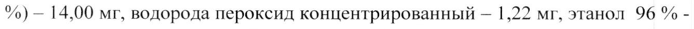

# Алюминия гидроксид + Магния гидроксид + Симетикон — внутрь

- Препарат: Сималгел-ВМ (суспензия для приема внутрь;)
- АТХ: A02AF02
- Источник: ГРЛС, инструкция по медицинскому применению, РУ ЛП-001657, файл от 2024-11-20 (https://grls.rosminzdrav.ru/Grls_View_v2.aspx?routingGuid=990a86f6-2268-4649-ba28-f2f8d5ac7840)
- Распознано автоматически (OCR): 6 из 6 стр.
- Инструкция к другому РУ того же препарата: ЛП-001657 (национальное РУ, переоформленное по правилам ЕАЭС, решение от 22.10.2024). Текст может быть старше действующего
- Сомнительных строк после OCR: 1 (см. раздел «Проверка распознавания»)

## Общие сведения

ЛП-001657-290517 | МИНИСТЕРСТВО ЗДРАВООХРАНЕНИЯ РОССИЙСКОЙ ФЕДЕРАЦИИ
| | ИНСТРУКЦИЯ ПО МЕДИЦИНСКОМУ ПРИМЕНЕНИЮ ЛЕКАРСТВЕННОГО ПРЕПАРАТА
Сималгел-ВМ наименование лекарственного препарата
| Регистрационный номер:
Торговое наименование: Сималгел-ВМ Группировочное наименование: Алгелдрат + Магния гидроксид + СиметиKOH

## 3. Лекарственная форма

Суспензия для приема внутрь.
Суспензия для приема внутрь.

## 2. Состав

на | мл препарата:
действующие вещества: алюминия гидроксид (в виде сухого геля) — 81 мг, магния гидроксид — 20 мг, симетикон — 25 мг;
вспомогательные вещества:
лимонная кислота - 0,60 мг, мяты перечной листьев масло — 0,13 мг, маннитол
— 2,50 мг, метилпарагидроксибензоат натрия — 1,00 мг, пропилпарагидроксибензоат натрия — 0,50 мг, натрия сахаринат — 0,28 мг, сорбитол (раствор 70
%) — 14,00 мг, водорода пероксид концентрированный - 1,22 мг, этанол 96% - 0,5 мг, вода очищенная — до | мл.
Описание: Гомогенная однородная суспензия молочно-белого или почти белого цвета с мятным запахом. При стоянии представляет собой расслоившуюся суспензию: нижний слой — плотный осадок белого цвета, верхний слой — почти прозрачная жидкость, на поверхности которой имеется полупрозрачное
| | ior 30 7 | в = _ _ i JI1-001657-290517 —
| студенистое образование белого цвета. При встряхивании гомогенность суспензии восстанавливается.
Фармакотерапевтическая группа: Антацидное средство + ветрогонное средство.
Код ATX: [A02AF02] Фармакологические свойства
| Фармакодинамика | Сималгел-ВМ - комбинированное средство, действие которого обусловлено входящими в его состав компонентами; оказывает антацидное, адсорбируюlee, обволакивающее и ветрогонное действие. Алгедрат (алюминия гидроксид) и магния гидроксид нейтрализуют свободную соляную кислоту в желудке, понижают кислотность желудочного сока, связывают желчные кислоты.
Послабляющее действие магния гидроксида уравновешивает способность алгедрата замедлять моторику кишечника. Симетикон затрудняет образование газовых пузырьков и способствует их разрушению. Высвобождаемые при этом газы поглощаются стенками кишечника и выводятся из организма благодаря перистальтике.

## 5.2. Фармакокинетика

Абсорбция - низкая.
Абсорбция - низкая.

## 4.1. Показания к применению

Заболевания желудочно-кишечного тракта (ЖКТ), сопровождающиеся метеоризмом:
Заболевания желудочно-кишечного тракта (ЖКТ), сопровождающиеся метеоризмом:
- острый гастрит;
- гиперацидный гастрит;
- острый дуоденит;
- язвенная болезнь желудка и двенадцатиперстной кишки (в фазе обострения);
| - симптоматические язвы ЖКТ различного генеза;
- эрозии слизистой оболочки верхних отделов ЖКТ;
бя «Е ЛП-001657-290517 - грыжа пищеводного отверстия диафрагмы;
- рефлюкс-эзофагит; |
А также можно применять при дискомфорте ЖКТ, гастралгии, изжоге (после избыточного употребления алкогольных напитков, никотина, кофе, приема лекарственных средств, погрешностей в диете).

## 4.3. Противопоказания

Повышенная чувствительность к компонентам препарата Сималгел-ВМ, вы-
Повышенная чувствительность к компонентам препарата Сималгел-ВМ, вы-
| раженное нарушение функции почек (из-за опасности повышения концентрации ионов магния и алюминия в сыворотке крови, по причине замедления их выделения почками), гипофосфатемия, болезнь Альцгеймера, дефицит сахаразы/изомальтазы, непереносимость фруктозы, глюкозо-галактозная мальабсорбция, детский возраст до 10 лет.
| С осторожностью С осторожностью применять при беременности и в период лактации, при заболеваниях печени, алкоголизме, черепно-мозговой травме, заболеваниях головного мозга, эпилепсии, детям от 10 до 18 лет.

## 4.6. Применение при беременности и в период грудного вскармливания

## 4.2. Способ применения и дозы

Суспензия для приема внутрь.
Суспензия для приема внутрь.
| Взрослым принимать по 10 мл 4 раза в сутки через | час после еды (если не указано врачом иначе). Максимальная суточная доза составляет 40 мл препарата Сималгел-ВМ (курс лечения - не более 2 недель при использовании в максимальных дозах).
iQ 7 3 | j111-001657-290517 При рефлюкс-эзофагите препарат принимают через короткое время после еды по 5 - 10 мл 4 раза в сутки. Курс лечения не должен превышать 2-3 месяца
(при использовании максимальных доз - не более 2 недель).
При эпизодическом применении (изжога, дискомфорт ЖКТ при неправильном питании) — однократно 10 мл.
Для детей старше 10 лет дозировку определяет лечащий врач (обычно % дозы для взрослых). Максимальная суточная доза составляет 20 мл препарата
Сималгел-ВМ (курс лечения - не более 2 недель при использовании в максимальных дозах ).
| Побочные действия Аллергические реакции, кишечная колика. При длительном приеме в терапев-
| тически высоких дозах - гипофосфатемия, гипокальциемия, гиперкальциурия, остеомаляция, остеопороз, гипермагниемия, гипералюминиемия, энцефалопатия, нефрокальциноз, нарушение функции почек. У больных с почечной недостаточностью возможно развитие алюминиевой, магниевой интоксикации, жажда, снижение артериального давления, гипорефлексия. Обострение костно-суставных заболеваний и болезни Альцгеймера (у пожилых людей). Со
| стороны органов ЖКТ может проявиться нарушение вкуса, тошнота, рвота,
| диарея, запор.

## 4.9. Передозировка

Симитомы: признаки нарушения обмена кальция, магния, фосфора (слабость, боль в костях, покраснения кожи, неадекватное поведение), могут наблюдаться признаки метаболического алкалоза (изменение настроения, онемение или боль в мышцах, нервозность, быстрая утомляемость, неприятные вкусовые ощущения).
Симитомы: признаки нарушения обмена кальция, магния, фосфора (слабость, боль в костях, покраснения кожи, неадекватное поведение), могут наблюдаться признаки метаболического алкалоза (изменение настроения, онемение или боль в мышцах, нервозность, быстрая утомляемость, неприятные вкусовые ощущения).
Лечение: стимуляция рвоты, промывание желудка, прием активированного уг-
| ля.
| | . 4 10159 2 ЛП-001657-290517 | Взаимодействие с другими лекарственными препаратами |
Снижает и замедляет абсорбцию дигоксина, индометацина, салицилатов, хлорпромазина, фенитоина, блокаторов Н2-гистаминовых рецепторов, бета- | адреноблокаторов, дифлунисала, кетоконазола и итраконазола, изониазида, антибиотиков тетрациклинового ряда и хинолонов, азитромицина, цефподоксима, пивампициллина, рифампицина, непрямых антикоагулянтов, барбитуратов, фексофенадина, дипиридамола, залцитабина, хенодезоксихолевой и урсодезоксихолевой кислот, пеницилламина и лансопразола. М-холиноблокаторы, замедляя опорожнение желудка, усиливают и удлиняют действие препарата.

## 4.4. Особые указания

Перед употреблением флакон с суспензией необходимо хорошо взболтать!
Перед употреблением флакон с суспензией необходимо хорошо взболтать!
При совместном применении Сималгел-ВМ и других лекарственных средств интервал между приемом должен составлять не менее 2 часов. С особой осторожностью назначают больным с нарушением функции почек, печени и пациентам пожилого возраста — назначение в этом случае проводится под контролем лечащего врача.
При длительном применении препарата рекомендуется контролировать содержание фосфора и магния в крови.
В одной дозе препарата (10 мл) содержится 0,0048 г этилового спирта (в пере-
| счете Ha абсолютный спирт).

## 4.7. Влияние на способность управлять транспортными средствами, механизмами

Не оказывает отрицательного воздействия на способность управления автотранспортом и работы с механизмами, требующими повышенной концентрации внимания и быстроты психомоторных реакций.

## 6.5. Форма выпуска

Суспензия для приема внутрь.
Суспензия для приема внутрь.
| ЛП-001657-290517 125 мл, 300 мл препарата во флаконы из темного стекла. Один флакон с дозированным колпачком вместе с инструкцией по применению в пачку картонную.

## 6.4. Условия хранения

В защищенном от света месте при температуре не выше 25 °С.
В защищенном от света месте при температуре не выше 25 °С.
После вскрытия флакона препарат использовать в течение 28 дней.
Хранить в недоступном для детей месте.

## 6.3. Срок годности

3 года.
3 года.
Не применять по истечении срока годности.
Условия отпуска Отпускают без рецепта.
Производитель/ организация, принимающая претензии
| Держатель регистрационного удостоверения:
| «Уорлд Медицин Лимитед», Великобритания
| Граунд Флор, Гэдд Хаус, Аркейдиа Авеню, Финчли, ЛОНДОН N3 2).
Адрес места производства:
Египетская Международная Фармацевтическая
Производственная Компания (Е.И.П.И.Ко), Египет, Тенс ов Рамадан Сити,
Первая Промышленная Зона ВТ, а/я 149 Тенс.
Претензии направлять в адрес представителя производителя в России:
ООО «ТРОКАС ФАРМА», Россия, 141402, Московская область, г. Химки, ул. Спартаковская д.5/7, помещение № 8.
Тел/факс: 8-800-700-45-68; майл: info@worldmedicine.com.tr
/ | <— tt < | ВЕБ АХ АО 7. , QIN Представитель фирмы Vi РА Колодезная Т.С. |
/ ‘ \ | i =)
Hise / „2 т 7, Я — ® - te ee —— мн XS fe"? р у
> | ЭКСПЕРТНЫЙ ОТЧЕТ Я | о * 2 Е [ДЕЙСТВИТЕЛЕН ДЛЯ ДАННОЙ] & | —— 7 | вЕрсии ДОКУМЕНТА | В | 107 397 6
| 0000000004 — | Ne
## Проверка распознавания

Страницы-сканы распознаны автоматически. В 1 строках с дозировками цифры могли распознаться с ошибкой — сверьте с вырезкой из оригинала:

- стр. 1: «%) — 14,00 мг, водорода пероксид концентрированный - 1,22 мг, этанол 96% -» — низкая уверенность: «96%» (70)  
  
