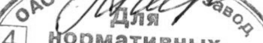

# Амантадина сульфат — внутрь

- Препарат: Мидантан (таблетки, покрытые пленочной оболочкой;)
- АТХ: N04BB01
- Источник: ГРЛС, инструкция по медицинскому применению, РУ ЛС-000721, файл от 2023-01-19 (https://grls.rosminzdrav.ru/Grls_View_v2.aspx?routingGuid=a0c23223-8733-4827-bac0-9eacc6216361)
- Распознано автоматически (OCR): 5 из 5 стр.
- Сомнительных строк после OCR: 1 (см. раздел «Проверка распознавания»)

## Общие сведения

МИНЗДРАВ РОССИИ «АС-ОбОЖЯ- 190313 МИНИСТЕРСТВО ЗДРАВООХРАНЕНИЯ Р ССИЙСКОЙ ФЕДЕРАЦИИ
СОГЛАСОВАНО ИНСТРУКЦИЯ ПО МЕДИЦИНСКОМУ ПРИМЕНЕНИЮ ЛЕКАРСТВЕННОГО ПРЕПАРАТА
МИДАНТАН

Регистрационный номер:
Торговое наименование: Мидантан Международное непатентованное наименование: амантадин

## 3. Лекарственная форма

таблетки, покрытые пленочной оболочкой.
таблетки, покрытые пленочной оболочкой.

## 2. Состав

одна таблетка содержит: действующее вещество: амантадина гидрохлорид - 100 мг; вспомогательные вещества: лактоза моногидрат, крахмал 1500, крахмал кукуруз-
одна таблетка содержит: действующее вещество: амантадина гидрохлорид - 100 мг; вспомогательные вещества: лактоза моногидрат, крахмал 1500, крахмал кукуруз-

~ ный частично прежелатинизированный, кроскармеллоза натрия, тальк, стеариновая кислота, картофельный крахмал, Опадрай П.
Состав Опадрая П:.спирт поливиниловый, частично гидролизованный, макрогол 3350 (полиэтиленгликоль), тальк, окрашивающий пигмент (титана диоксид Е 171, алюминиевый лак на основе желтого хинолинового Е 104, железа оксид желтый Е 172).

® Описание: круглые двояковыпуклые таблетки, покрытые пленочной оболочкой, желтого цвета. На поперечном разрезе видны два слоя.
Фармакотерапевтическая группа: противопаркинсоническое средство.
Код ATX: №04ВВО1.
Фармакологические свойства

© Фармакодинамика Амантадин оказывает непрямое агонистическое действие на стриарные допаминовые рецепторы. Повышает внеклеточную концентрацию допамина, посредством как интенсификации его выработки, так и блокады обратного захвата допамина пресинаптическими нейронами. В терапевтических концентрациях амантадин замедляет выработку ацетилхолина и, тем самым, оказывает антихолинергическое действие.

## 5.2. Фармакокинетика

После перорального приема пик плазменной концентрации достигается через 2-8 часов.
После перорального приема пик плазменной концентрации достигается через 2-8 часов.
При приеме 200 мг в день достигается устойчивая концентрация в плазме на уровне 400-900 нг/мл на 4-7 день. Общий клиренс составляет 17,7 + 10 л/ч на здоровых добровольцах; период полувыведения - от 10 до 30 часов, в среднем около 15 часов. Амантадин примерно на 67 % связывается с белками плазмы крови. Проникает через гематоэнцефалический барьер. Выделяется почками практически в неизменном виде (90 %

1 разовой дозы); небольшое его количество выделяется с фекалиями. Диализ малоэффективен (около 5 % за одну процедуру).

## 4.1. Показания к применению

Синдром паркинсонизма и идиопатическая болезнь Паркинсона.
Синдром паркинсонизма и идиопатическая болезнь Паркинсона.

## 4.3. Противопоказания

Гиперчувствительность к любому из компонентов препарата; тяжелая застойная сердечная недостаточность (ТУ класс по шкале Нью-Йоркской Кардиологической Ассоциации), кардиомиопатия, миокардит, атриовентрикулярная блокад П и Ш степени, брадикардия с частотой сердечных сокращений менее 55 уд/мин, удлинение интервала ОТ более 420 мс, желудочковая аритмия (в том числе трепетания желудочков), беременность и период грудного вскармливания, пониженное содержание в крови калия и магния, одновременный прием с препаратами, удлиняющими интервал ОТ, выраженная
Гиперчувствительность к любому из компонентов препарата; тяжелая застойная сердечная недостаточность (ТУ класс по шкале Нью-Йоркской Кардиологической Ассоциации), кардиомиопатия, миокардит, атриовентрикулярная блокад П и Ш степени, брадикардия с частотой сердечных сокращений менее 55 уд/мин, удлинение интервала ОТ более 420 мс, желудочковая аритмия (в том числе трепетания желудочков), беременность и период грудного вскармливания, пониженное содержание в крови калия и магния, одновременный прием с препаратами, удлиняющими интервал ОТ, выраженная
© почечная недостаточность (клиренс креатинина менее 10 мл/мин), детский возраст (до 18 лет), наследственная галактозная недостаточность, лактазный дефицит, глюкозногалактозная мальабсорбция, фенилкетонурия, сахарозо-изомальтазная недостаточность, наследственная фруктозная недостаточность, психозы (в анамнезе).

## 4.3. С осторожностью

& Гиперплазия предстательной железы, узкоугольная глаукома, почечная недостаточность различной степени тяжести (существует риск кумуляции препарата), ажитация, делирий, угнетение центральной нервной системы, экзогенный психоз (в том числе в анамнезе), совместный прием с мемантином, триамтереном/гидрохлоротиазидом.
& Гиперплазия предстательной железы, узкоугольная глаукома, почечная недостаточность различной степени тяжести (существует риск кумуляции препарата), ажитация, делирий, угнетение центральной нервной системы, экзогенный психоз (в том числе в анамнезе), совместный прием с мемантином, триамтереном/гидрохлоротиазидом.

## 4.6. Применение при беременности и в период грудного вскармливания

© Препарат противопоказан при беременности и в период грудного вскармливания, поскольку амантадин проникает через плацентарный барьер и обнаруживается в материнском молоке.

## 4.2. Способ применения и дозы

Внутрь, после еды с небольшим количеством жидкости, предпочтительнее в первую половину дня. Первые 3 дня - по 1 таблетке в день, затем повышают дозу до 2 таблеток в день, причем возможно дальнейшее повышение дозы на 1 таблетку в неделю. Обычная эффективная доза составляет от 1 до 3 таблеток дважды в день. Максимальная суточная доза - 600 мг. В случае комбинированного лечения необходимо определять дозу индивидуально. Последнюю дозу рекомендуется принимать во второй половине дня не позже 16-00.
Внутрь, после еды с небольшим количеством жидкости, предпочтительнее в первую половину дня. Первые 3 дня - по 1 таблетке в день, затем повышают дозу до 2 таблеток в день, причем возможно дальнейшее повышение дозы на 1 таблетку в неделю. Обычная эффективная доза составляет от 1 до 3 таблеток дважды в день. Максимальная суточная доза - 600 мг. В случае комбинированного лечения необходимо определять дозу индивидуально. Последнюю дозу рекомендуется принимать во второй половине дня не позже 16-00.
У пожилых пациентов, в частности, у пациентов, страдающих состоянием возбуждения и спутанности, предделирия и делирия, требуется более низкая дозировка.
При нарушениях функции почек:
фильтрации (GFR) мл/мин (мг ч)
ООО ОТ ОО ОО — 6050 [| 200, 00 попеременно | Черзлаь |
ПОЕТ О ООО СООО ООО ЗОО | 20 [| pas ene | 0 [| Зраавидею |
< | 20,100 [| оженедельно и через неделю |

## 4.8. Побочное действие

ИИ 1 ОНИ СТ ОИ ЕСТ ТО ОНИ
ИИ 1 ОНИ СТ ОИ ЕСТ ТО ОНИ
ПЕ ООО ЕСО ОИ

w Со стороны нервной системы, органов чувств и психики: Часто: бессонница, психомоторное возбуждение, параноидальный экзогенный психоз, сопровождаемый зрительными галлюцинациями (у предрасположенных пациентов пожилого возраста), головокружение, снижение остроты зрения. Очень редко: эпилептические припадки (обычно

© после приема дозы, превышающую рекомендованную), периферическая нейропатия,

временная потеря зрения, миоклония.
Со стороны сердечно-сосудистой системы: Очень редко: аритмия, тахикардия, фибрилляция желудочков, удлинение интервала ОТ, развитие или усугубление сердечной недостаточности, ортостатическая гипотензия. Часто: синдром мраморной кожи в сочетании с отеком лодыжек и голени.

- Со стороны органов желудочно-кишечного тракта: Часто: тошнота, сухость во рту.
Прочие: Часто: задержка мочи у больных с аденомой предстательной железы. Очень редко: кожные аллергические реакции, фотосенсебилизация, лейкопения, тромбоцитопения, отек роговицы глаза, обратимый после прекращения приема препарата.

## 4.9. Передозировка

Симптомы: тошнота, рвота, повышенная возбудимость, тремор, атаксия, снижение остроты зрения, летаргическое состояние, депрессия, дизартрия, эпилептические припадки, аритмия.
Симптомы: тошнота, рвота, повышенная возбудимость, тремор, атаксия, снижение остроты зрения, летаргическое состояние, депрессия, дизартрия, эпилептические припадки, аритмия.

Лечение: промывание желудка, прием активированного угля, симптоматическая тера-

Пия.

## 4.5. Взаимодействие с другими лекарственными средствами

Противопоказан одновременный прием амантадина и препаратов, вызывающих увели3 чение интервала ОТ, в частности:
- некоторые антиаритмические препараты класса ГА (например, кинидин, дизопирамид, прокаинамид) и класса Ш (например, амиодарон и соталол);
- некоторые антипсихотические препараты (например, тиоридазин, хлорпромазин, пимозид);
- некоторые трициклические и тетрациклические антидепрессанты (например, амитриптилин);
- некоторые антигистаминные препараты (например, астемизол, терфенадин);
- некоторые макролидные антибиотики (например, эритромицин, кларитромицин);
- некоторые ингибиторы гиразы (например, спарфлоксасин);
- противогрибковые средства группы азолов, и другие препараты, в частности,
| бидупин, галофантрин, ко-тримоксазол, пентамидин, цизаприд и бепридил.
© Одновременный прием мочегонных средств, представляющих собой комбинацию триамтерена/гидрохлортиазида может привести к повышению концентрации амантадина в плазме. При одновременном приеме с другими противопаркинсоническими препаратами (такими, как леводопа, бромокриптин, мемантин, тригексифенидил) может оказаться необходимым понизить дозу одновременно принимаемого препарата, либо обоих w препаратов во избежании нежелательных последствий, в частности, психотических реакций. Антихолинергические средства, симпатомиметики и мемантин: усиливают побочные эффекты. Средства, стимулирующие центральную нервную систему (в т.ч.
психостимуляторы), этанол увеличивают риск развития побочных эффектов.

## 4.4. Особые указания

© Лечение Мидантаном нельзя прекращать внезапно, так как это может привести к ухудшению симптоматики. Пациенты, страдающие сердечно-сосудистыми заболеваниями должны находиться под постоянным врачебным контролем при назначении препарата
© Лечение Мидантаном нельзя прекращать внезапно, так как это может привести к ухудшению симптоматики. Пациенты, страдающие сердечно-сосудистыми заболеваниями должны находиться под постоянным врачебным контролем при назначении препарата
Мидантан. На фоне лечения противопоказан прием алкоголя.

## 4.7. Влияние на способность управлять транспортными средствами, механизмами

С осторожностью применять во время работы водителям транспортных средств и людям, профессия которых связана с повышенной концентрацией внимания.

## 6.5. Форма выпуска

Таблетки, покрытые пленочной оболочкой, 100 мг.
Таблетки, покрытые пленочной оболочкой, 100 мг.
По 10 таблеток в контурную ячейковую упаковку из пленки поливинилхлоридной или пленки из непластифицированного ПВХ и гибкой упаковки на основе алюминиевой фольги или фольги алюминиевой или материала комбинированного марки MK л-Ф.
5 или 10 контурных ячейковых упаковок вместе с инструкцией по медицинскому приме4 нению помещают в пачку из картона.

## 6.4. Условия хранения

В сухом месте, при температуре не выше 25 °С.
В сухом месте, при температуре не выше 25 °С.
Хранить в недоступном для детей месте.

## 6.3. Срок годности

3 года.
3 года.
Не применять по истечении срока годности.
Условия отпуска Отпускают по рецепту.
Владелец регистрационного удостоверения/организация, принимающая претензии
Открытое акционерное общество «Борисовский завод медицинских препаратов», Республика Беларусь, Минская обл., г. Борисов, ул. Чапаева, 64, e-mail: market@borimed.com,
~ http://www. borimed.com, тел: +375 (177) 744280.
Производитель/адрес места производства лекарственного препарата
Открытое акционерное общество «Борисовский завод медицинских препаратов», Республика Беларусь, Минская обл., г. Борисов, ул. Чапаева, 64.
нарко директор 2 = В.В. Дереш Zo к av Я 9% 4 | рмативных ’\
%, документов } \. хе) & H C7) [3997 Son PACK HX NPENPY <
XOn ика Белз 7 5.
## Проверка распознавания

Страницы-сканы распознаны автоматически. В 1 строках с дозировками цифры могли распознаться с ошибкой — сверьте с вырезкой из оригинала:

- стр. 5: «av Я 9%» — низкая уверенность: «9%» (21); повторное чтение: «ро (/’ЩяяЯ 7 “о»  
  
