# Амлодипин + Ирбесартан — внутрь

- Препарат: Апроваск® (таблетки, покрытые пленочной оболочкой;)
- АТХ: C09DB05
- Источник: ГРЛС, инструкция по медицинскому применению, РУ ЛП-002695, файл от  (https://grls.rosminzdrav.ru/Grls_View_v2.aspx?routingGuid=96ba431d-b508-49e1-821f-83b276c88e7b)
- Распознано автоматически (OCR): 26 из 26 стр.
- Инструкция к другому РУ того же препарата: ЛП-002695 (срок действия истёк, решение от 24.06.2021). Текст может быть старше действующего
- Сомнительных строк после OCR: 16 (см. раздел «Проверка распознавания»)

## Общие сведения

т ОА 4 и - 150119 МИНИСТЕРСТВО ЗДРАВООХРАНЕНИЯ ВОССИЙСКОЙ ФЕДЕРАЦИИ
СОГЛАСОВАНО | SEED тории очи ИНСТРУКЦИЯ ПО МЕДИЦИНСКОМУ ПРИМЕНЕНИЮ ЛЕКАРСТВЕННОГО ПРЕПАРАТА
Апроваск® Регистрационный номер: Л1]-002695.
Торговое наименование: Апроваск®.
Международное непатентованное или группировочное наименование: амлодипин + ирбесартан.

## 3. Лекарственная форма

таблетки, покрытые пленочной оболочкой.
таблетки, покрытые пленочной оболочкой.

## 2. Состав

~ 1 таблетка 5 мг + 150 мг содержит: ядро: действующие вещества: амлодипина безилат — 7,0 мг (в пересчете на амлодипин — 5,0 мг), ирбесартан; вспомогательные вещества:
~ 1 таблетка 5 мг + 150 мг содержит: ядро: действующие вещества: амлодипина безилат — 7,0 мг (в пересчете на амлодипин — 5,0 мг), ирбесартан; вспомогательные вещества:
целлюлоза микрокристаллическая 50 мкм, кроскармеллоза натрия, гипромеллоза 6 мПа.с, целлюлоза микрокристаллическая 100 мкм, кремния диоксид коллоидный, магния стеарат
— 2,5 мг, оболочка: опадрай белый! — 10,0 мг.
1 таблетка 10 мг + 150 мг содержит: ядро: действующие вещества: амлодипина безилат
— 14,0 мг (в пересчете на амлодипин - 10,0 мг), ирбесартан — 150,0 мг; вспомогательные вещества: целлюлоза микрокристаллическая 50 мкм, кроскармеллоза натрия, гипромеллоза 6 мПа.с, целлюлоза микрокристаллическая 100 мкм, кремния диоксид, магния стеарат; оболочка: опадрай розовый”.
1 таблетка 5 мг + 300 мг содержит: ядро: действующие вещества: амлодипина безилат —
- 7,0 мг (в пересчете Ha амлодипин — 5,0 мг), ирбесартан — 300,0 мг; вспомогательные вещества: целлюлоза микрокристаллическая 50мкм, кроскармеллоза натрия, гипромеллоза 6 мПа.с, целлюлоза микрокристаллическая 100 мкм, кремния диоксид, магния стеарат; оболочка: опадрай желтый“.
[ таблетка 10 мг + 300 мг содержит: ядро: действующие вещества: амлодипина безилат — 14,0 мг (в пересчете Ha амлодипин — 10,0 мг), ирбесартан — 300,0 мг; вспомогательные вещества: целлюлоза микрокристаллическая 50 мкм, кроскармеллоза натрия, гипромеллоза 6 мПа.с, целлюлоза микрокристаллическая 100 мкм, кремния диоксид, магния стеарат; оболочка: опадрай белый'.
‘опадрай белый содержит гипромеллозу, титана диоксид (Е 171), макрогол-400.
?опадрай розовый содержит гипромеллозу, титана диоксид (Е 171), макрогол-400, макрогол-8000, краситель железа оксид красный (Е 172).
‘опадрай желтый содержит гипромеллозу, титана диоксид (Е 171), макрогол-400, макрогол-8000, краситель железа оксид желтый (Е 172).
Описание Таблетки 5 мг_+ 150 мг: овальные двояковыпуклые таблетки, покрытые пленочной оболочкой белого цвета, с гравировкой 150/5 на одной стороне.
Таблетки 10 мг + 150 мг: овальные двояковыпуклые таблетки, покрытые пленочной оболочкой розового цвета, с гравировкой 150/10 на одной стороне.
Таблетки 5 мг_+ 300 мг: овальные двояковыпуклые таблетки, покрытые пленочной оболочкой желтого цвета, с гравировкой 300/5 на одной стороне.
Таблетки 10 мг + 300 мг: овальные двояковыпуклые таблетки, покрытые пленочной оболочкой белого цвета, с риской и скосом к риске на одной стороне.
| Фармакотерапевтическая группа: комбинированное гипотензивное средство (блокатор
& «медленных» кальциевых каналов + ангиотензина II рецепторов антагонист).
Код ATX: CO9DBOS.
Фармакологические свойства Фармакодинамика
Фармакодинамические свойства каждого из активных веществ, входящих в состав препарата Апроваск®, амлодипина и ирбесартана, способствуют их аддитивному антигипертензивному действию при применении в комбинации по сравнению таковым при применении каждого из этих препаратов в отдельности. Как антагонисты рецепторов ангиотензина П (АРАП), так и блокаторы «медленных» кальциевых каналов (БМКК), снижают артериальное давление (АД) за счет снижения периферического сопротивления
| сосудов, блокады поступления кальция в клетку и уменьшения, обусловленного
~ воздействием ангиотензина II, сосудосуживающего действия, являются дополняющими друг друга механизмами.
Амлодипин Амлодипин является блокатором «медленных» кальциевых каналов из группы производных дигидропиридина, который ингибирует трансмембранный транспорт ионов кальция внутрь клеток миокарда и гладкой мускулатуры сосудов. Механизм антигипертензивного действия амлодипина связан с прямым расслабляющим действием на гладкую мускулатуру сосудов.
Амлодипин расширяет периферические артериолы и за счет этого уменьшает общее периферическое сопротивление сосудов (ОПСС), так называемую постнагрузку. Так как частота сердечных сокращений при приеме амлодипина практически не увеличивается, это страница 2 из 26 уменьшение нагрузки на сердечную мышцу уменьшает энергозатраты миокарда и его потребность в кислороде.
У пациентов с артериальной гипертензией прием амлодипина один раз в сутки обеспечивает клинически значимое снижение АД в положении «лежа» и «стоя» в течение 24 ч. Вследствие медленного начала своего действия амлодипин не предназначен для купирования гипертонических кризов.
У пациентов со стенокардией однократный в течение суток прием амлодипина при выполнении пробы с физической нагрузкой увеличивает общее время выполнения физической нагрузки, время до начала приступа стенокардии и время до появления депрессии сегмента ST на ЭКГ на | мм. Кроме этого, прием препарата уменьшает суточное количество приступов стенокардии и суточную потребность в приеме таблеток нитроглицерина.
© При приеме амлодипина не наблюдалось каких-либо нежелательных метаболических эффектов или изменения концентраций липидов в крови. Амлодипин можно принимать пациентам с бронхиальной астмой, сахарным диабетом и подагрой.
Ирбесартан Ирбесартан является селективным сильно действующим АРАП (подтип-АТ!). Ангиотензин
П является важным компонентом ренин-ангиотензин-альдостероновой системы (РААС), участвующим в патофизиологии развития артериальной гипертензии и в гомеостазе ионов натрия. Для проявления своего действия ирбесартан не нуждается в метаболической активации.
Ирбесартан блокирует сильное сосудосуживающее и альдостерон-секретирующее действия ангиотензина II за счет селективного антагонизма к рецепторам ангиотензина II
© (подтипа-АТ!), находящихся в клетках гладкой мускулатуры сосудов и коры надпочечников. Ирбесартан не имеет агонистической активности по отношению к
АТ!-рецепторам. Его аффинность к АТ!-рецепторам в 8500 раз больше, чем к АТ>- рецепторам (рецепторам, у которых не было показано связи с поддержанием равновесия
[гомеостаза] сердечно-сосудистой системы).
Ирбесартан не ингибирует ферменты РААС (такие как ренин, ангиотензинпревращающий фермент [АПФ], а также не влияет на другие гормональные рецепторы или ионные каналы в сердечно-сосудистой системе, участвующие в регуляции АД и гомеостаза ионов натрия.
Блокада ирбесартаном АТ!-рецепторов разрывает петлю обратной связи в ренинангиотензиновой системе, увеличивая плазменные концентрации ренина и ангиотензина П.
При применении ирбесартана снижается плазменная концентрация альдостерона, однако при применении препарата в рекомендованных дозах не происходит существенных страница 3 из 26 изменений содержания калия в сыворотке крови (среднее увеличение содержания калия в сыворотке крови составляет менее 0,1 мЭкв/л). Ирбесартан не оказывает значимого влияния на концентрации триглицеридов, холестерина или глюкозы в сыворотке крови. Ирбесартан не влияет на сывороточные концентрации мочевой кислоты или выведение мочевой кислоты почками.
Антигипертензивный эффект ирбесартана отмечается после приема первой дозы со значительным развитием терапевтического действия в течение 1-2 недель лечения с максимальным эффектом, наступающим через 4-6 недель. В долгосрочных наблюдательных исследованиях эффект ирбесартана сохранялся более | года.
Однократный прием ирбесартана в дозах до YOO мг в сутки вызывал дозозависимое снижение АД. Однократный прием ирбесартана в дозах 150-300 мг в сутки приводил к
| большему снижению систолического (САД)/диастолического (ДАД) АД (через 24 ч после
~ приема дозы) в положении «лежа» или «сидя» (в среднем Ha 8-13/5-8 мм рт. cT.), чем при приеме плацебо. Эффект препарата через 24 ч после приема дозы составлял 60-70 % от соответствующего максимального снижения ДАД и САД. Оптимальная эффективность в отношении снижения АД в течение 24 ч достигается при однократном приеме препарата в сутки.
АД снижается приблизительно в одинаковой степени в положении «стоя» и «лежа».
Ортостатический эффект возникает редко, и, как и при применении ингибиторов АПФ, его возникновение может ожидаться у пациентов с гипонатриемией или гиповолемией.
Антигипертензивное действие ирбесартана и тиазидных диуретиков является аддитивным.
У пациентов, у которых не удается достигнуть целевых значений АД при монотерапии ирбесартаном, добавление к приему ирбесартана | раз в сутки небольших доз
© гидрохлоротиазида (12,5 мг) приводит к дополнительному (по сравнению с эффектом добавления плацебо) снижению САД/ДАД, определяемых через 24 ч после их приема, на 7-10/3-6 мм рт. ст., соответственно.
Возраст и пол не влияют на эффективность ирбесартана. Как и в случае лечения другими лекарственными препаратами, влияющими на РААС, у пациентов негроидной расы наблюдается более слабое антигипертензивное действие при монотерапии ирбесартаном.
Когда ирбесартан принимается с малыми дозами гидрохлоротиазида (например, 12,5 мг в сутки), антигипертензивное действие у пациентов негроидной расы приближается к таковому у пациентов европеоидной расы.
После отмены ирбесартана АД постепенно возвращается к исходному уровню. Синдрома
«отмены» при прекращении приема ирбесартана не наблюдалось.
страница 4 из 26 Клинические доказательства эффективности комбинации ирбесартана и амлодипина с фиксированными дозами были получены в двух многоцентровых, проспективных, открытых исследованиях параллельных групп со слепой оценкой показателей эффективности: исследования I-ADD и I-COMBINE. Результаты обоих исследований продемонстрировали достоверно большую эффективность комбинаций с фиксированными дозами ирбесартана и амлодипина по сравнению с монотерапией амлодипином или монотерапией ирбесартаном.

## 5.2. Фармакокинетика

Амлодипин После приема внутрь в терапевтических дозах амлодипин хорошо абсорбируется с достижением максимальной концентрации (Cmax) в крови между 6 и 12 ч после приема.
Амлодипин После приема внутрь в терапевтических дозах амлодипин хорошо абсорбируется с достижением максимальной концентрации (Cmax) в крови между 6 и 12 ч после приема.
Абсолютная биодоступность составляет 64-90 %. Прием пищи не нарушает абсорбцию

~ амлодипина.
Объем распределения амлодипина составляет приблизительно 21 л/кг. В исследованиях т уйго было показано, что приблизительно 97,5 % находящегося в системном кровотоке амлодипина связывается с белками плазмы крови.
Амлодипин интенсивно метаболизируется в печени с образованием неактивных метаболитов. Через почки выводится 10% неизмененного амлодипина и 60% его метаболитов; период полувыведения (Т!/2) составляет приблизительно 35-504 при дозировании | раз в сутки.
У пациентов пожилого и молодого возраста время достижения Cmax амлодипина в крови является одинаковым. У пациентов пожилого возраста клиренс амлодипина имеет тенденцию к уменьшению, в результате чего увеличивается AUC и Т!/2.

~ У детей 6-12 лет и подростков 13-17 лет клиренс амлодипина при приеме препарата внутрь составлял 22,5 и 27,4 л/ч, соответственно, у мальчиков и 16,4 и 21,3 л/ч, соответственно, у девочек. Наблюдалась большая вариабельность системной экспозиции амлодипина у разных детей и подростков. Данные, полученные по применению препарата у детей младше 6 лет, являются ограниченными.
Как и у других блокаторов «медленных» кальциевых каналов, при печеночной недостаточности возможно увеличение Т1/2 амлодипина (см. разделы «С осторожностью» и
«Особые указания»).
У пациентов с хронической сердечной недостаточностью (во всех возрастных группах)
наблюдалось увеличение AUC и Ty.
Особые группы пациентов Пациенты с нарушением функции печени

страница 5 из 26 Имеется крайне ограниченный объем клинических данных о применении амлодипина у пациентов с нарушением функции печени. У пациентов с печеночной недостаточностью наблюдалось снижение клиренса амлодипина, что приводило к удлинению Ti2 и повышению AUC приблизительно на 40-60 %.
Пациенты пожилого возраста Время достижения максимальной концентрации (tmax) амлодипина в плазме крови сопоставимо у пациентов пожилого возраста и у пациентов младшей возрастной группы. У пациентов пожилого возраста показатель клиренса амлодипина имеет тенденцию к снижению с соответствующим увеличением AUC и удлинением 11/2.
Ирбесартан Ирбесартан является препаратом, активным при приеме внутрь, который не нуждается в биотрансформации для проявления своей активности. После приема внутрь ирбесартан
© быстро и полностью всасывается. Cmax ирбесартана в плазме крови достигается через 1 ,5-2 ч после приема внутрь. Абсолютная биодоступность ирбесартана при приеме внутрь составляет 60-80 %. Прием пищи не влияет на биодоступность ирбесартана.
Ирбесартан приблизительно на 96 % связывается с белками плазмы крови и практически не связывается с форменными элементами крови. Объем распределения ирбесартана составляет 53-93 л/кг.
После приема внутрь или внутривенного введения '“С ирбесартана на долю неизмененного ирбесартана в плазме крови приходится 80-85 % циркулирующей в системном кровотоке радиоактивности. Ирбесартан метаболизируется в печени путем конъюгации с глюкуроновой кислотой и окисления. Главным метаболитом, находящимся в системном кровотоке, является ирбесартана глюкуронид (приблизительно 6%). Ирбесартан
- подвергается окислению, главным образом, с помощью изофермента цитохрома
P450 — CYP2C9; изофермент СУРЗА4 играет незначительную роль в метаболизме ирбесартана. Ирбесартан не метаболизируется с помощью большинства изоферментов, обычно участвующих в метаболизме лекарственных средств, таких как изоферменты
СУР1А1, СУР1А2, CYP2A6, CYP2B6, CYP2D6 или CYP2E1, и достоверно не индуцирует или ингибирует эти изоферменты. Ирбесартан не индуцирует и не ингибирует изофермент
СУРЗА4.
Ирбесартан и его метаболиты выводятся, как печенью (с желчью), так и почками. После приема внутрь или после внутривенного введения “С ирбесартана около 20% радиоактивности обнаруживается в моче с небольшим остаточным количеством в кале.
Менее 2 % дозы выводится почками в виде неизмененного ирбесартана.
страница 6 из 26 Ti2 ирбесартана составляет 11-15 ч. Общий клиренс при внутривенном введении ирбесартана составляет 157-176 мл/мин, из которых 3,0-3,5 мл/мин приходится на долю почечного клиренса.
Ирбесартан при применении в терапевтическом диапазоне доз обладает линейной фармакокинетикой. Равновесная концентрация (Css) достигается на третий день после начала приема препарата | раз в сутки. Наблюдается ограниченное накопление ирбесартана в плазме крови (< 20 %) на фоне курсового приема препарата | раз в сутки.
У женщин с артериальной гипертензией по сравнению с мужчинами с артериальной гипертензией наблюдались более высокие (на 11-44%) плазменные концентрации ирбесартана после однократного приема, однако на фоне курсового приема ирбесартана у женщин и мужчин не наблюдалось различий в накоплении ирбесартана или в его Т!/2. Не
| наблюдалось связанных с полом различий в клинической эффективности ирбесартана.
~ У пациентов пожилого возраста без артериальной гипертензии (мужчин и женщин) (65-80 лет) с клинически нормальной функцией почек и печени площадь под фармакокинетической кривой «концентрация-время» (AUC) и Cmax в плазме крови были приблизительно на 20-50 % выше, чем у пациентов более молодого возраста (18-40 лет), однако Т!2 у пациентов молодого и пожилого возраста были сопоставимыми. Не наблюдалось значимых, связанных с возрастом, различий в клинической эффективности ирбесартана.
У пациентов негроидной расы с нормальным АД АПС и Т! ирбесартана приблизительно на 20-25 % выше, чем у пациентов европеоидной расы с нормальным АД, однако Cmax ирбесартана у них была практически одинаковой.
У пациентов с почечной недостаточностью (независимо от ее степени тяжести) и у
© пациентов, находящихся на гемодиализе, фармакокинетика ирбесартана существенно не изменяется. Ирбесартан не удаляется из крови с помощью гемодиализа.
У пациентов с печеночной недостаточностью вследствие цирроза печени легкой или средней степени тяжести фармакокинетика ирбесартана значительно не изменяется.
Исследования эффективности и безопасности применения ирбесартана у детей не проводились.
Фармакокинетика при применении комбинации ирбесартан/амлодипин у взрослых
Одновременный прием ирбесартана и амлодипина в виде фиксированных комбинаций в таблетках или в виде свободных комбинаций не оказывал влияния на фармакокинетику каждого из активных веществ этой комбинации.
Три фиксированные комбинации доз ирбесартана и амлодипина (150 мг/10 мг, 300 мг/5 мг и 300 мг/10 мг) являются биоэквивалентными свободным комбинациям доз (150 mr/10 мг, страница 7 из 26 300 мг/5 мг и 300 мг/10 мг) как в отношении скорости, так и в отношении степени

абсорбции.

При приеме по отдельности или одновременно ирбесартана в дозировке 300 мг и

амлодипина в дозировке 10 мг время до достижения медиан Cmax ирбесартана и амлодипина

в плазме крови остается неизмененным, то есть, 0,75-!1 ч и 54 после приема,

соответственно. Аналогично Cmax и AUC ирбесартана и амлодипина при приеме по

отдельности или одновременно в дозах 300 мг и 10 мг находятся в одинаковых диапазонах,

в результате чего при совместном приеме относительная биодоступность ирбесартана

составляет 95 %, a амлодипина — 98 %.

Среднее значение Т!/› для ирбесартана и амлодипина, принятых по отдельности или в

комбинации, является практически одинаковым: 17,6 ч против 17,7 ч для ирбесартана и

58,5 ч против 52,1 ч для амлодипина. Выведение ирбесартана и амлодипина не изменяется

© при их приеме по отдельности или совместно.

Фармакокинетика ирбесартана и амлодипина была линейной при совместном применении

ирбесартана в дозах от 150 мг до 300 мг и амлодипина в дозах от 5 мг до 10 мг.

Фармакокинетика при применении комбинации ирбесартан/амлодипин у детей

Отсутствует какая-либо информация по применению фиксированной комбинации

ирбесартана и амлодипина у детей.

## 4.1. Показания к применению

Артериальная гипертензия (при неэффективности монотерапии ирбесартаном или

амлодипином).

## 4.3. Противопоказания

— Повышенная чувствительность к ирбесартану, амлодипину и другим производным

- дигидропиридина, а также к вспомогательным веществам препарата;

— кардиогенный шок;

— обструкция выносящего тракта левого желудочка (включая тяжелый аортальный стеноз);

— нестабильная стенокардия;

— беременность;

— период грудного вскармливания;

— возраст до 18 лет (эффективность и безопасность не установлены);

— одновременное применение с лекарственными препаратами, содержащими алискирен, у пациентов с сахарным диабетом или с умеренно выраженной и тяжелой почечной недостаточностью (скорость клубочковой фильтрации

страница 8 из 26 [СКФ] < 60 мл/мин/1,73 м? поверхности тела) (см. разделы «Взаимодействие с другими лекарственными средствами» и «Особые указания»);

— одновременное применение с ингибиторами ангиотензинпревращающего фермента
(АПФ) у пациентов с диабетической нефропатией (см. разделы «Взаимодействие с другими лекарственными средствами» и «Особые указания»);

— тяжелая артериальная гипотензия (систолическое АД менее 90 MM рт.ст.);

— тяжелая печеночная недостаточность (функциональный класс С или более 9 баллов по шкале Чайлд-Пью.

## 4.3. С осторожностью

— При гиповолемии и гипонатриемии, возникающих, например, при интенсивном лечении диуретиками, гемодиализе, соблюдении диеты с ограничением потребления

© поваренной соли, диарее, рвоте (опасность чрезмерного снижения АД, см. раздел
«Особые указания»);

— упациентов с функцией почек, зависящей от активности РААС (таких как пациенты с артериальной гипертензией с двусторонним или односторонним стенозом почечных артерий, пациенты с хронической сердечной недостаточностью ШЧУ функционального класса [по классификации МУНА]), лечение лекарственными препаратами, влияющими на РААС; связано с развитием олигурии и/или прогрессирующей азотемии и редко — острой почечной недостаточности и/или смертью, риск развития которых нельзя исключить и при приеме АРАП, включая ирбесартан — см. раздел «Особые указания»);

— упациентов с хронической сердечной недостаточностью П-ТУ функционального класса

® по классификации МУНА неишемической этиологии (из-за наличия в составе препарата амлодипина, применение которого у таких пациентов связано с увеличением сообщений о развитии отека легких по сравнению с приемом плацебо, несмотря на отсутствие различий в частоте прогрессирования сердечной недостаточности) (см.
раздел «Особые указания»);

— у пациентов с печеночной недостаточностью (риск увеличения Т!/2 амлодипина — CM.
раздел «Особые указания»);

— у пациентов с почечной недостаточностью (из-за наличия в составе препарата ирбесартана, рекомендуется контроль содержания калия и концентрации креатинина в крови); после недавней трансплантации почки (отсутствие опыта клинического применения ирбесартана);

страница 9 из 26 — у пациентов со стенозом аортального и митрального клапана или гипертрофической обструктивной кардиомиопатией (ГОКМП);

— у пациентов с ишемической болезнью сердца и/или клинически значимым атеросклерозом сосудов головного мозга (при чрезмерном снижении АД имеется риск усиления ишемических расстройств, вплоть до развития острого инфаркта миокарда и инсульта);

— при остром инфаркте миокарда (и в течение | месяца после него)

— упациентов с синдромом слабости синусового узла (из-за наличия в составе препарата амлодипина);

— у пациентов с псориазом (в т.ч. в анамнезе) ввиду возможного обострения течения псориаза;

© — при одновременном применении с ингибиторами или индукторами изофермента
CYP3A4;

— при одновременном применении нестероидных противовоспалительных препаратов
(НПВП), включая ингибиторы циклоогсигеназы-2 (ЦОГ-2) (повышение риска развития нарушений функции почек, включая возможность развития острой почечной недостаточности и увеличения содержания калия в сыворотке крови, особенно у пациентов пожилого возраста, пациентов с гиповолемией (включая пациентов, принимающих диуретики) или у пациентов с нарушением функции почек;

— при применении в комбинации с ингибиторами АПФ или алискиреном, так как по сравнению с монотерапией при двойной блокаде РААС имеется повышенный риск развития чрезмерного снижения АД, гиперкалиемии и нарушения функции почек.

© Применение при беременности и в период грудного вскармливания

Применение препарата Апроваск® противопоказано при беременности и в период грудного

вскармливания.

Беременность

Амлодипин

Безопасность применения амлодипина во время беременности не установлена. В

доклинических исследованиях у животных наблюдались признаки репродуктивной

токсичности при применении высоких доз амлодипина.

Ирбесартан

Отсутствуют достаточные по объему и хорошо контролируемые исследования применения

ирбесартана у беременных женщин. Воздействие на плод ингибиторов АПФ, которые

страница 10 из 26 принимались беременными женщинами во втором и третьем триместрах беременности,

приводило к повреждению и смерти развивающегося плода. Как любые другие

лекарственные средства, которые непосредственно воздействуют на РААС, ирбесартан

противопоказан во время беременности. Препарат Апроваск® не должен применяться у

женщин с детородным потенциалом, если они не применяют эффективные способы

контрацепции. В случае выявления беременности во время лечения препаратом Апроваск®

следует как можно скорее прекратить его прием (см. раздел «Противопоказания»).

Период грудного вскармливания

Амлодипин: проникает в грудное молоко в количестве 3-7 % от материнской дозы

(максимально до 15 %). Влияние амлодипина на новорожденных неизвестно. В случае

лечения кормящих женщин следует отдавать предпочтение альтернативным препаратам с

более изученным профилем безопасности во время грудного вскармливания, особенно при
- кормлении новорожденного или недоношенного ребенка. Следует принять решение о

прекращении грудного вскармливания или отмене препарата с учетом необходимости его

применения для матери.

Ирбесартан: экскретируется в молоко лактирующих крыс. Неизвестно, может ли

ирбесартан/его метаболиты экскретироваться в грудное молоко человека. Во время

грудного вскармливания прием ирбесартана противопоказан. После оценки соотношения

предполагаемой пользы от приема препарата для матери и потенциального риска для

ребенка следует прекратить или грудное вскармливание, или прием ирбесартана.

Фертильность

Амлодипин: клинические данные относительно потенциального влияния амлодипина на фертильность недостаточны. В одном исследовании на крысах были обнаружены
- нежелательные явления со стороны фертильности самцов.

При применении БМКК у некоторых пациентов наблюдались биохимические изменения в

головке сперматозоидов. Объем клинических данных о потенциальном влиянии

амлодипина на фертильность является недостаточным.

Ирбесартан: в исследованиях у самцов и самок крыс ирбесартан не влиял на фертильность

и репродуктивную функцию даже в дозах, оказывающих некоторое токсическое действие

на родителей (до 650 мг/кг/день). Не наблюдалось значимого действия на количество

желтых тел, имплантируемых эмбрионов или живых плодов. Ирбесартан не влиял на

выживаемость, развитие или воспроизводство потомства.

## 4.2. Способ применения и дозы

Взрослые пациенты

Внутрь, запивая водой, вне зависимости от времени приема пищи.

страница 11 из 26 Начальная и поддерживающая доза препарата Апроваск® — | таблетка в сутки.
Препарат Апроваск® следует применять у пациентов, у которых не удается достигнуть целевых значений АД при монотерапии ирбесартаном или монотерапии амлодипином, или для продолжения лечения пациентов, уже принимающих ирбесартан и амлодипин в виде отдельных таблеток. Дозы должны подбираться индивидуально, сначала с применением отдельных препаратов ирбесартана и амлодипина. Дозы подбираются в зависимости от реакции АД на проводимую терапию и целевого значения АД.
Максимальная рекомендованная доза препарата — 10 мг + 150 мг или 10 мг + 300 мг в сутки
(в связи с тем, что максимальная суточная доза амлодипина составляет 10 мг).
Если потребуется изменение дозы одного из действующих веществ в составе препарата
(например, в связи с вновь диагностированным заболеванием, изменением состояния

| пациента или лекарственным взаимодействием), то необходим индивидуальный подбор доз

- отдельных компонентов.

Пациенты детского возраста: применение перапрата у пациентов детского возраста противопоказано, безопасность и эффективность препарата Апроваск® не установлены.
Пациенты пожилого возраста и пациенты с нарушением функции почек: коррекция дозы не требуется.
Пациенты с нарушением функции печени Препарат Апроваск® должен применяться с осторожностью в связи с наличием в составе препарата амлодипина (см. разделы «С осторожностью» и «Особые указания»).
У пациентов пожилого возраста с нарушением функции печени необходимо уменьшить начальную дозировку препарата Апроваск® до содержащей наименьшую дозу амлодипина

| (т.е. до | таблетки 5 мг+150 мг или 5мг+300 мг).

- Побочное действие
Частота возникновения нежелательных реакций (НР) определялась в соответствии с классификацией Всемирной Организации Здравоохранения: очень часто (> 1/10); часто (С 1/00 и < 1/0); нечасто (= 1/1000 и < 100):
редко (> 1/10000 и < 1/1000); очень редко (< 1/10000), частота неизвестна (не может быть подсчитана на основании имеющихся данных).
Ниже представлены нежелательные реакции, о которых сообщалось в клинических исследованиях по применению комбинации с фиксированными дозами ирбесартана и амлодипина (клинические исследования I-ADD, I-COMBINE и 1-СОМВО), в клинических исследованиях по применению монокомпонентов ирбесартана и амлодипина и при их постмаркетинговом применении.
страница 12 из 26 Частота НР, о которых сообщалось при постмаркетинговом применении препарата, определялась как «частота неизвестна», так как сведения об этих НР поступали из спонтанных сообщений, без указания количества пациентов, принимавших препарат.
В клинических исследованиях по сравнению комбинаций с фиксированными дозами амлодипин/ирбесартан с монотерапией ирбесартаном или амлодипином виды и частота возникающих во время лечения нежелательных явлений, возможно, связанных с изучаемым лечением, были подобны таковым, которые наблюдались в проведенных ранее клинических исследованиях или в постмаркетинговых сообщениях в монотерапии ирбесартаном и амлодипином. Наиболее часто встречающимся нежелательной реакцией были периферические отеки, главным образом, связанные с амлодипином.
| Системно-органный | Нежелательная реакция
> класс Амлодипин | Ирбесартан | Амлодипин
+ Ирбесартан Нарушения со | тромбоцитопения в | очень редко стороны крови и | тромбоцитопения частота лимфатической (включая неизвестна системы тромбоцитопеническую пурпуру)
Нарушения со | аллергические реакции | -. | - | очень редко стороны иммунной | реакции повышенной частота системы чувствительности неизвестна
(анафилактические реакции, включая анафилактический шок)
Нарушения со | гиперкалиемия нечасто частота стороны обмена неизвестна
% веществ и питания | гипергликемия Poof очень редко
Нарушения психики | бессонница |-> | нечасто лабильность нечасто настроения
Нарушения со | сонливость часто | im =o часто стороны нервной | головокружение часто часто часто системы головная боль часто часто часто парестезия нечасто Fo нечасто ортостатическое нечасто головокружение гипестезия [| - | нечасто тремор о - | нечасто извращения вкуса о - нечасто синкопальные нечасто состояния периферическая очень редко нейропатия страница 13 из 26
Г класс Амлодипин | Ирбесартан | Амлодипин
+ ea, | Нарушения со | зрительные нечасто стороны органа | расстройства зрения
Нарушения со стороны органа | тиннитус (звон в ушах) частота нечасто слуха и неизвестна лабиринтные нарушения стороны сердца сердцебиения тахикардия | | нею | о ан БИ ПИ ПИН
© инфаркт миокарда | - | | оченьредюо_ cue || ee сердца желудочковая очень редко тахикардия и фибрилляция предсердий
(мерцательная аритмия)
стороны сосудов гипотензия «приливы» крови к часто коже с ощущением жара
РЕ ПО ПОВАИИ ПБББИ покровов РО ПО ПИ ИБО
- АД васкулит | nents pero | стороны дыхательной Годышка [| ню | средостения стороны желудочнокишечного тракта ppora | чаю | нечасто |
Гдиспесия | | нечасто | нечасто | живота/боль в животе страница 14 из 26
Системно-органный ПТ аи | развития класс Амлодипин | Ирбесартан | Амлодипин
+ роз | глоссодиния/ часто часто нарушения со стороны языка заюр_ | нею | - | нечасто | диарея [нею | изжога Г маю | | - |
Е ОБЕ ПОНИ el дефекации [и | | оболочек полости рта панкреатит | - | tet редко _ гастрит | | oer pert | гиперплазия десен | | | оченьредюо | стороны печени и неизвестна путей неизвестна повышение показателей частота очень редко функциональных неизвестна (главным
«печеночных» проб образом, связанное с холестазом)
Нарушения со алоеция | | - | нечасто | нечасто | стороны кожи и | контактный дерматит || [| чаю = кожный зуд | Ню — nypnypa р нечасто | о ОИ ООО ПОНИ Иов потоотделение
& изменение нечасто пигментации кожи (появление обесцвеченных частков кожи)
Gorowacmmensoem |_| wemasonm |_| фоточувствительности неизвестна анны, | lament | обострение псориаза) неизвестна
Ен ПИБ 9 ae отек неизвестна _многоформная эритема | | - | оченьредюо |
БИ ee неизвестна токсический частота эпидермальный неизвестна некролиз страница 15 из 26
М класс Амлодипин | Ирбесартан | Амлодипин
| 4 cael nail стороны скелетно- неизвестна мышечной и артралия | неасю | - | нечасто | ткани суставов мышечные судороги | Г erat | боль в спине р | чаю |
Нарушения со | протеинурия чаю | мочевыводящих мочеиспускания aa мочеиспускание
Гниктурия р чаю | © Казотемия | нечаяю |
`гиперкреатининемия | нечасто | | нарушение функции частота почек, включая неизвестна отдельные случаи почечной недостаточности у пациентов с факторами риска ее развития стороны половых | дисфункция органов и молочной | импотенция железы гинекомалия | | чаю |
Общие расстройства и © введения утомляемость a Г | = неизвестна боль в грудной клеке | - | нечасю | нечасто — ощущение недомогания | | - | нечаю — боль маю —
Лабораторные и | увеличение массы тела, нечасто инструментальные | снижение массы тела.
данные Травмы, падения нечасто осложнения манипуляций страница 16 из 26

## 4.9. Передозировка

Симптомы

При приеме взрослыми ирбесартана в дозах до 900 мг в сутки установлено отсутствие токсичности.

Имеющиеся данные для амлодипина предполагают, что сильная передозировка может привести к выраженной периферической вазодилатации и, возможно, к развитию рефлекторной тахикардии. Сообщалось о развитии выраженного и длительного чрезмерного снижения АД вплоть до развития шока со смертельным исходом.

Лечение

Пациент должен находиться под тщательным медицинским наблюдением. Лечение должно быть симптоматическим и поддерживающим основные жизненно важные функции организма.

- Отсутствует специальная информация по лечению передозировки ирбесартана.
Предлагаемые меры при передозировке препарата Апроваск® включают промывание желудка. Прием активированного угля здоровыми добровольцами сразу после или через 2 ч после приема внутрь 10 мг амлодипина показал незначительное уменьшение абсорбции амлодипина.

В связи с тем, что амлодипин имеет высокую связь с белками плазмы крови, а ирбесартан

не выводится из организма при помощи гемодиализа, маловероятно, что при передозировке

может быть полезен гемодиализ.

Если произошла очень большая передозировка, следует начать активный мониторинг

сердечной деятельности и дыхания. Необходимо частое измерение АД. Клинически

значимое снижение АД вследствие передозировки амлодипина требует активного
© поддержания сердечно-сосудистой деятельности, включая придание возвышенного

положения конечностям. Следует следить за объемом циркулирующей крови и выделением

мочи. Может потребоваться введение сосудосуживающих препаратов для восстановления

сосудистого тонуса и АД (при условии отсутствия противопоказаний к их введению).

Внутривенное введение глюконата кальция может быть полезным в ликвидации

последствий блокады кальциевых каналов.

## 4.5. Взаимодействие с другими лекарственными средствами

Комбинация ирбесартана и амлодипина

На основании фармакокинетических исследований, в которых ирбесартан и амлодипин

принимались по отдельности и в комбинации, отсутствовали фармакокинетические

взаимодействия между ирбесартаном и амлодипином.

страница 17 из 26 Не проводилось исследований по лекарственным взаимодействиям препарата Апроваск® с другими лекарственными средствами.
Амлодипин Фармакодинамические взаимодействия
Другие гипотензивные и антиангинальные препараты
Амлодипин может безопасно применяться для лечения артериальной гипертензии вместе с тиазидными диуретиками, бета-адреноблокаторами или ингибиторами АПФ.
У пациентов со стабильной стенокардией амлодипин можно применять в сочетании с другими антиангинальными средствами, например, с нитратами пролонгированного или короткого действия, бета-адреноблокаторами.
Возможно усиление антиангинального и антигипертензивного действия БМКК при одновременном применении с тиазидными и «петлевыми» диуретиками, ингибиторами
~ АПФ, бета-адреноблокаторами и нитратами.
Этанол, барбитураты, нейролептики, антидепрессанты, наркотические анальгетики, средства для общей анестезии
Возможно усиление антигипертензивного действия производных дигидропиридина и увеличение риска ортостатической гипотензии.
Другие препараты, способные снижать артериальное давление
Можно ожидать, что некоторые препараты (например, баклофен и аминофен) благодаря своим фармакологическим свойствам будут усиливать антигипертензивное действие амлодипина. Необходим контроль АД и функции почек, а также коррекция дозы амлодипина в случае необходимости.
; Кортикостероиды (минерало- и глюкокортикостероиды), тетракозактид
- Снижение антигипертензивного действия амлодипина (из-за задержки жидкости и ионов натрия в результате действия кортикостероидов).
Препараты кальция могут уменьшить эффект БМКК.
Дантролен (при внутривенном введении)
В исследованиях на животных после введения верапамила и дантролена (внутривенно)
наблюдались случаи фибрилляции желудочков с летальным исходом и сердечнососудистой недостаточности, связанной с гиперкалиемией. Учитывая риск развития гиперкалиемии, следует избегать одновременного применения БМКК (в т.ч. амлодипина) и дантролена у пациентов со злокачественной гипертермией.
Фармакокинетические взаимодействия Влияние других лекарственных средств на фармакокинетику амлодипина
Ингибиторы изофермента СУРЗА4 страница 18 из 26
При одновременном применении дилтиазема в дозе 180 мг и амлодипина в дозе 5 мгу пациентов пожилого возраста (от 69 до 87 лет) с артериальной гипертензией отмечается повышение системной экспозиции амлодипина на 57 %. Одновременное применение амлодипина и эритромицина у здоровых добровольцев (от 18 до 43 лет) не приводит к значительным изменениям экспозиции амлодипина (увеличение площади кривой
«концентрация-время» (AUC) на 22 %). Клиническое значение этих эффектов не ясно.
Ритонавир (мощный ингибитор изофермента СУРЗА4) увеличивает плазменные концентрации БМКК, в том числе амлодипина.
Не исключено, что мощные ингибиторы изофермента СУРЗА4 (например, кетоконазол, итраконазол, ринонавир) могут в большей степени увеличивать концентрацию амлодипина в плазме крови, чем дилтиазем. Следует с осторожностью применять амлодипин одновременно с ингибиторами изофермента СУРЗА4 (особенно у пожилых пациентов).
© Клартромицин Кларитромицин является ингибитором изофермента СУРЗА4. У пациентов, принимающих одновременно клариромицин и амлодипин, повышен риск снижения АД. Пациентам, принимающим такую комбинацию, рекомендуется находиться под тщательным медицинским наблюдением.
Индукторы изофермента CYP3A4 При одновременном применении индукторов изофермента СУРЗА4 концентрация амлодипина может варьировать. Необходимо контролировать АД, следует рассмотреть возможность коррекции дозы амлодипина во время и после одновременного приема, особенно с сильными индукторами изофермента СУРЗА4 (например, рифампицин и
; препараты Зверобоя продырявленного).
~ Грейпфрутовый сок

Одновременный прием 240 мг грейпфрутового сока и 10 мг амлодипина внутрь не сопровождается существенным изменением фармакокинетики амлодипина. Тем не менее не рекомендуется применять грейпфрутовый сок и амлодипин одновременно, так как при генетическом полиморфизме изофермента цитохрома 450 возможно повышение биодоступности амлодипина и вследствие этого усиление его антигипертензивного действия.
Алюминий- или магниисодержашие антациды При однократном совместном приеме не оказывают существенного влияния на фармакокинетику амлодипина.
Силденафил

страница 19 из 26 Однократный прием 100 мг силденафила у пациентов с эссенциальной гипертензией не оказывает влияние на параметры фармакокинетики амлодипина.
Циметидин Циметидин не влияет на фармакокинетику амлодипина.
Влияние амлодипина на фармакокинетику других лекарственных средств
Симвастатин Одновременное многократное применение амлодипина в дозе 10 мг и симвастатина в дозе 80 мг приводит в повышению экспозиции симвастатина на 77 %. В таких случаях следует ограничить дозу симвастатина до 20 мг.
Аторвастатин Посторное совместное применение амлодипина в дозе 10 мг и аторвастатина в дозе 80 мг не сопровождается значительными изменениями фармакокинетических показателей AUC

~ (увеличение в среднем на 18%) Cmax A TCmax аторвастатина.
Циклоспорин Исследования одновременного применения амлодипина и циклосоприна у здоровых добровольцев и всех групп пациентов, за исключением пациентов после трансплантации почки, не проводились. Различные исследования взаимодействия амлодипина с циклоспорином у пациентов после трансплантации почки показывают, что применение данной комбинации может не приводить к какому-либо эффекту либо повышать минимальную концентрацию циклоспорина в различной степени до 40 %. Следует принимать во внимание эти данные и контролировать концентрацию циклоспорина у этой группы пациентов при одновременном применении циклоспорина и амлодипина.
Такролимус

© При одновременном применении с амлодипином существует риск увеличения концентрации такролимуса в плазме крови. Для того, чтобы избежать токсичности этого препарата при одновременном применении с амлодипином, следует контролировать концентрацию такролимуса в плазме крови и корректировать дозу такролимуса в случае необходимости.
Ингибиторы mTOR (mammalian Target of Rapamycin — мишень рапамицина в клетках млекопитающих)
Ингибиторы шТОК (например, темсиролимус, сиролимус, эверолимус) являются субстратами СУРЗА4. Поскольку амлодипин является слабым ингибитором СУРЗА4, при совместном применении может увеличиваться экспозиция ингибиторов СУРЗА4.
Этанол

страница 20 из 26 Амлодипин при однократном и повторном применении в дозе 10 мг не влияет на

фармакокинетику этанола.

Препараты лития

При совместном применении БМКК с препаратами лития (для амлодипина данные

отсутствуют) возможно усиление проявления их нейротоксичности (тошнота, рвота,

диарея, атаксия, тремор, шум в ушах).

Дигоксин

Амлодипин не оказывает влияние на концентрацию дигоксина в сыворотке крови и его

почечный клиренс у здоровых добровольцев. В исследованиях in vitro амлодипин не влиял

на связывание дигоксина с белками плазмы крови.

Варфарин

Амлодипин не оказывает существенное влияние на действие варфарина (протромбиновое
~ время). В исследованиях in vitro амлодипин не влиял Ha связывание варфарина с белками

плазмы крови.

Фенитоин

В исследованиях in vitro амлодипин не влиял на связывание фенитоина с белками плазмы

крови.

Прочие взаимодействия

Амлодипин может безопасно применяться одновременно с антибиотиками и

гипогликемическими средствами для приема внутрь.

В отличие от других БМКК, не было обнаружено клинически значимого взаимодействия

амлодипина при совместном применении с НПВП, в том числе с индометацином. В

исследованиях in vitro амлодипин не влиял на связывание индометацина с белками плазмы
© крови.

Хотя при изучении амлодипина отрицательного ионотропного действия обычно не

наблюдалось, тем не менее, некоторые БМКК могут усиливать выраженность

отрицательного инотропного действия антиаритмических средств, вызывающих удлинение

интервала ОТ (например, амиодарона и хинидина).

Ирбесартан

На основании данных исследований in vitro не должно ожидаться возникновения никаких

взаимодействий с препаратами, чей метаболизм осуществляется с помощью следующих

изоферментов цитохрома Р450: CYPIAI, CYP1A2, CYP2A6, CYP2B6, CYP2D6, СУР2Е1

или CYP3A4.

Ирбесартан преимущественно метаболизируется с помощью изофермента CYP2C9, однако

во время клинических исследований по изучению взаимодействия, когда ирбесартан

страница 21 из 26 принимался одновременно с варфарином, который метаболизируется с помощью

изофермента СУР2С9, никаких значимых фармакокинетических взаимодействий не

наблюдалось.

Фармакокинетические показатели ирбесартана не нарушаются при его одновременном

применении с нифедипином и гидрохлоротиазидом.

Ирбесартан не изменяет фармакокинетику симвастатина, который метаболизируется с

помощью изофермента CYP3A4, или дигоксина (субстрата Р-гликопротеина).

Лекарственные препараты, содержащие алискирен

Одновременное применение APA II, в т.ч. ирбесартана, входящего в состав препарата

Апроваск®, с препаратами, содержащими алискирен, противопоказано у пациентов с

сахарным диабетом и/или умеренной или тяжелой почечной недостаточностью (с

СКФ < 60 мл/мин/1,73 м’ площади поверхности тела) и не рекомендуется у других
~ пациентов.

Ингибиторы АПФ

Одновременное применение АРА II, в т.ч. ирбесартана, входящего в состав препарата

Апроваск®, с ингибиторами АПФ противопоказано у пациентов с диабетической

нефропатией и не рекомендуется у других пациентов.

Препараты калия и калийсберегающие диуретики, гепарин

На основании опыта, полученного при применении других лекарственных средств,

влияющих на РААС, одновременное применение ирбесартана с препаратами калия;

заменителями соли, содержащими калий; калийсберегающими диуретиками или другими,

способными повышать содержание калия в плазме крови лекарственными средствами
| (гепарин), иногда может значительно повысить сывороточное содержание калия, что
~ требует тщательного наблюдения за показателями калия плазмы крови у пациентов BO

время лечения.

НИВИП, включая селективные ингибиторы циклооксигеназы-2 (ЦОГ-2): у пациентов

пожилого возраста, пациентов с гиповолемией (вследствие приема диуретиков) или с

нарушением функции почек одновременное применение HIIBII, включая селективные

ингибиторы циклоооксигеназы-2 (ЦОГ-2) совместно с АРАП, включая ирбесартан, может

приводить к ухудшению функции почек, включая развитие острой почечной

недостаточности. Эти эффекты обычно являются обратимыми. Следует периодически

контролировать функцию почек у пациентов, одновременно принимающих АРАП и НИВИ,

включая селективные ингибиторы ЦОГ-2.

Препараты лития: на фоне совместного применения ирбесартана с препаратами лития

было описано повышение концентраций лития в плазме крови и токсическое действие

страница 22 из 26 лития. У пациентов, принимающих ирбесартан совместно с препаратами лития, следует контролировать концентрации лития в плазме крови.
Диуретики и прочие гипотеинзивные средства: возможно усиление антигипертензивного действия. Ирбесартан может применяться с другими гипотензивными средствами. Такими как бета-адреноблокаторы, БМКК длительного действия и тиазидные диуретики.
Предшествующее лечение диуретиками в высоких дозах может приводить к гиповолемии и повышению риска чрезмерного снижения АД в начале лечения ирбесартаном.

## 4.4. Особые указания

Амлодипин Пациенты с хронической сердечной недостаточностью
Амлодипин Пациенты с хронической сердечной недостаточностью
В долгосрочном плацебо-контролируемом исследовании (PRAISE-2) амлодипина у пациентов с хронической сердечной недостаточностью Ш-ТУ функционального класса (по
- классификации МУНА) неишемической этиологии отмечалось повышение частоты развития отека легких несмотря на отсутствие достоверного различия в частоте прогрессирования сердечной недостаточности по сравнению с плацебо.
Печеночная недостаточность Как и при приеме других блокаторов «медленных» кальциевых каналов, Т1/› амлодипина увеличивается у пациентов с нарушениями функции печени, а рекомендации по режиму его дозирования при нарушении функции печени не установлены. В связи с этим препарат комбинации ирбесартан+амлодипин должен применяться с осторожностью у таких пациентов.
Гипертонический криз Безопасность и эффективность применения амлодипина при гипертоническом кризе не
~ установлены.
Синдром «отмены»
Несмотря на отсутствие у БМКК синдрома «отмены», прекращение лечения амлодипином желательно проводить, постепенно уменьшая дозу препарата.
Периферические отеки Незначительно или умеренно выраженные периферические отеки были наиболее частым нежелательным явлением амлодипина в клинических исследованиях. Частота возникновения периферических отеков возрастает с увеличением дозы (при применении амлодипина в дозе 2,5 мг, 5 мг, 10 Mr в сутки отеки возникали соответственно у 1,8 %, 3 % и 10,8 % пациентов). Следует тщательно дифференцировать периферические отеки, связанные с применением амлодипина, от симптомов прогрессирования левожелудочковой сердечной недостаточности.
страница 23 из 26 Прочее

Необходимо поддержание гигиены зубов и наблюдение у стоматолога (для предотвращения

болезненности, кровоточивости и гиперплазии десен).

Ирбесартан

Чрезмерное снижение АД: пациенты с гиповолемией и гипонатриемией

Ирбесартан редко вызывал чрезмерное снижение АД у пациентов с артериальной

гипертензией без другой сопутствующей патологии. Как и при приеме ингибиторов АПФ,

может ожидаться чрезмерное снижение АД с соответствующей симптоматикой у пациентов

с гиповолемией и гипонатриемией, к которым относятся пациенты, которым проводится

интенсивная диуретическая терапия, и/или пациенты с ограничениями в потреблении

поваренной соли или пациенты, находящиеся на гемодиализе. Гипонатриемия и

гиповолемия должны быть скорректированы перед началом лечения препаратом
~ ирбесартана и амлодипина или следует рассмотреть вопрос о применении более низких

начальных доз.

Влияние на функцию почек

Вследствие ингибирования РААС можно ожидать изменений в функции почек у

предрасположенных к этому пациентов. У пациентов с функцией почек, зависящей от

активности РААС (пациенты с артериальной гипертензией с двусторонним или

односторонним стенозом почечных артерий или пациенты с хронической сердечной

недостаточностью Ш-ГУ функционального класса [по классификации МУНА]), лечение

другими препаратами, которые воздействуют на РААС, ассоциировалось с развитием

олигурии и/или прогрессирующей азотемией и редко с острой почечной недостаточностью

и/или смертью. Нельзя исключить возможности возникновения такого эффекта при
© применении APAII, включая ирбесартан.

Трансплантация почки

Нет клинических данных по применению препарата Апроваск® у пациентов, недавно

перенесших трансплантацию почки.

Гиперкалиемия

Как и при применении других лекарственных препаратов, влияющих Ha PAAC, при лечении

препаратом Апроваск® может развиваться гиперкалиемия, особенно при наличии почечной

недостаточности и/или заболеваний сердца. У таких пациентов рекомендуется

контролировать содержание калия в сыворотке крови.

Стеноз аортального или митрального клапана, гипертрофическая обструктивная

кардиомиопатия

страница 24 из 26 Как и при применении других вазодилататоров, при приеме препарата Апроваск®

пациентами с аортальным или митральным стенозом или с гипертрофической

обструктивной кардиомиопатией необходимо соблюдать осторожность.

Первичный гиперальдостеронизм

Пациенты с первичным гиперальдостеронизмом обычно не реагируют на гипотензивные

препараты, действующие через ингибирование PAAC, поэтому применение препарата

Апроваск® в таких случаях нецелесообразно.

Пациенты с ишемической болезнью сердца и/или клинически значимым атеросклерозом

сосудов головного мозга

Kak и при применении других гипотензивных препаратов, значительное снижение АД у

пациентов с ишемической болезнью сердца и/или выраженным атеросклерозом сосудов головного мозга может привести к развитию инфаркта миокарда или инсульта. Лечение

~ таких пациентов должно осуществляться под строгим контролем АД.

Двойная блокада РААС при одновременном применении ирбесартана с ингибиторами АПФ

или с алискиреном

Двойная блокада РААС при применении комбинации ирбесартана с ингибиторами АПФ

или алискиреном не рекомендуется, так как имеется повышенный риск развития резкого

снижения АД, гиперкалиемии и нарушения функции почек.

Одновременное применение APA II, в т.ч. ирбесартана, входящего в состав препарата

Апроваск®, с препаратами, содержащими алискирен, противопоказано у пациентов с

сахарным диабетом и/или умеренной или тяжелой почечной недостаточностью (с

СКФ < 60 мл/мин/1,73 м’ площади поверхности тела) и не рекомендуется у других

пациентов.

- Одновременное применение АРА П, в т.ч. ирбесартана, входящего в состав препарата
Апроваск®, с ингибиторами АПФ противопоказано у пациентов с диабетической нефропатией и не рекомендуется у других пациентов.

Псориаз У пациентов с псориазом (в т.ч. в анамнезе) решение о применении препарата должно приниматься только после тщательной оценки соотношения риск/польза ввиду возможного обострения течения псориаза.
Применение у пациентов пожилого возраста (65 лет и старше)
У пациентов, которые принимали ирбесартан в клинических исследованиях, не наблюдалось какого-либо различия в эффективности или безопасности ирбесартана у пациентов более пожилого возраста (65 лет и старше) по сравнению с пациентами более молодого возраста.

страница 25 из 26 Применение у детей и подростков младше 18 лет
Безопасность и эффективность у детей и подростков младше 18 лет на настоящий момент не установлены.

## 4.7. Влияние на способность управлять транспортными средствами, механизмами

Влияние препарата на способность управлять транспортными средствами или заниматься другими потенциально опасными видами деятельности, требующими повышенного внимания, не изучалось. Однако, исходя из его фармакодинамических свойств, влияние препарата Апроваск® на эту способность маловероятно. В случае возникновения головокружения, вертиго, слабости необходимо воздержаться от управления транспортными средствами, механизмами.

## 6.5. Форма выпуска

Таблетки, покрытые пленочной оболочкой 5 мг + 150 мг, 10 мг + 150 мг, 5 мг + 300 мг
Таблетки, покрытые пленочной оболочкой 5 мг + 150 мг, 10 мг + 150 мг, 5 мг + 300 мг
~ и 10 mr + 300 mr. По 7 таблеток в блистер ПВХЛТЭ/ИВДХ/Алюминий. По 2 или 4 блистера вместе с инструкцией по применению в картонную пачку.

## 6.4. Условия хранения

Хранить при температуре не выше 30 °С.
Хранить при температуре не выше 30 °С.
Хранить в недоступном для детей месте.

## 6.3. Срок годности

3 года.
3 года.
Не применять препарат по истечении срока годности, указанного на упаковке.
Условия отпуска Отпускается по рецепту.
Юридическое лицо, на имя которого выдано регистрационное удостоверение
~ САНОФИ-АВЕНТИС де Мексико С.А. де C.B., Мексика.
Производитель САНОФИ-АВЕНТИС де Мексико С.А. де С.В, Мексика.
Acueducto del Alto Lerma No. 2, Zona Industrial Ocoyoacac, С.Р. 52740, Ocoyoacac, Mexico.
Претензии потребителей направлять по адресу:
АО «Санофи Россия»: 125009, г. Москва, ул. Тверская, 22;
ePHOLO Os тел.: (495) 721-14-00; факс: (495) 721-14-11. Cron KN
И/с/«Санофи-авейтис груп» \ = 5 (фрациия) >
Старший менеджер по регистрации Е И.К.
о) RS < MOCKBh страница 26 из 26
## Проверка распознавания

Страницы-сканы распознаны автоматически. В 16 строках с дозировками цифры могли распознаться с ошибкой — сверьте с вырезкой из оригинала:

- стр. 1: «~ 1 таблетка 5 мг + 150 мг содержит: ядро: действующие вещества: амлодипина безилат —» — низкая уверенность: «1» (59); повторное чтение: «- i ии 5 мг + 150 мг содержит: ядро: действующие вещества: амлодипина безилат —»  
  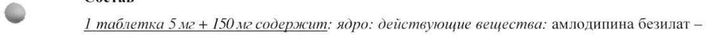
- стр. 1: «1 таблетка 10 мг + 150 мг содержит: ядро: действующие вещества: амлодипина безилат» — низкая уверенность: «1» (72), «150» (78)  
  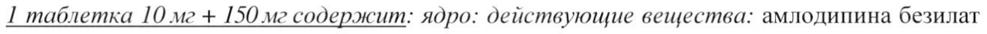
- стр. 1: «1 таблетка 5 мг + 300 мг содержит: ядро: действующие вещества: амлодипина безилат —» — низкая уверенность: «1» (74)  
  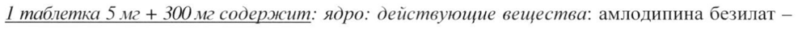
- стр. 1: «- 7,0 мг (в пересчете Ha амлодипин — 5,0 мг), ирбесартан — 300,0 мг; вспомогательные» — повторное чтение: «- бы ера “ha амлолинии - 36 sh, обета _ За irs вспомолательные»  
  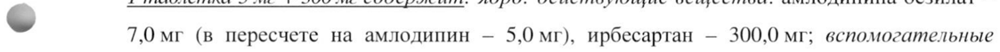
- стр. 2: «Таблетки 5 мг_+ 150 мг: овальные двояковыпуклые таблетки, покрытые пленочной» — низкая уверенность: «5» (53)  
  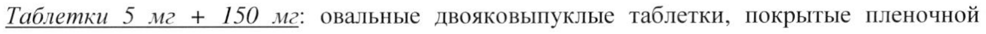
- стр. 2: «Таблетки 10 мг + 150 мг: овальные двояковыпуклые таблетки, покрытые пленочной» — низкая уверенность: «10» (63)  
  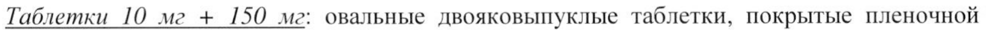
- стр. 4: «| большему снижению систолического (САД)/диастолического (ДАД) АД (через 24 ч после» — повторное чтение: «P большему снижению систолического (САД)/диастолического (ДАД) АД (через 24 4 после»  
  
- стр. 4: «© гидрохлоротиазида (12,5 мг) приводит к дополнительному (по сравнению с эффектом» — повторное чтение: «-  идрохлоротиазила. 05 зай пл ae  вннению а эффекты»  
  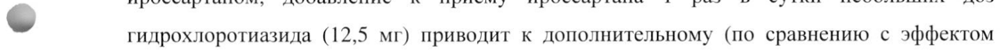
- стр. 5: «достижением максимальной концентрации (Cmax) в крови между 6 и 12 ч после приема.» — низкая уверенность: «12» (58)  
  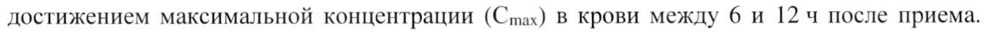
- стр. 7: «Ti2 ирбесартана составляет 11-15 ч. Общий клиренс при внутривенном введении» — низкая уверенность: «11-15» (67); повторное чтение: «Ti2 ирбесартана составляет 11-15 4. Общий клиренс при внутривенном введении»  
  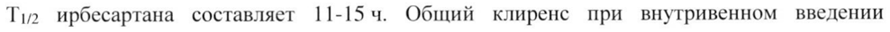
- стр. 7: «Три фиксированные комбинации доз ирбесартана и амлодипина (150 мг/10 мг, 300 мг/5 мг» — низкая уверенность: «мг/10» (78)  
  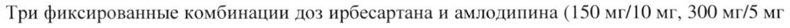
- стр. 8: «300 мг/5 мг и 300 мг/10 мг) как в отношении скорости, так и в отношении степени» — низкая уверенность: «300» (80)  
  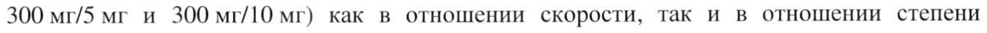
- стр. 8: «в плазме крови остается неизмененным, то есть, 0,75-!1 ч и 54 после приема,» — низкая уверенность: «0,75-!1» (17)  
  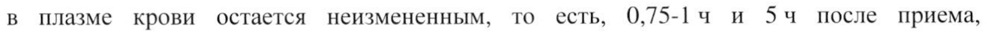
- стр. 8: «отдельности или одновременно в дозах 300 мг и 10 мг находятся в одинаковых диапазонах,» — повторное чтение: «отдельности или одновременно в дозах 300 мги 10 мг находятся в одинаковых диапазонах,»  
  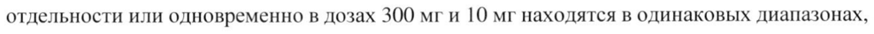
- стр. 9: «[СКФ] < 60 мл/мин/1,73 м? поверхности тела) (см. разделы «Взаимодействие с другими» — низкая уверенность: «мл/мин/1,73» (46)  
  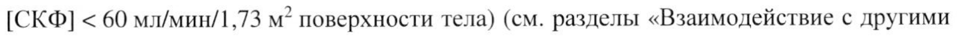
- стр. 20: «Одновременное многократное применение амлодипина в дозе 10 мг и симвастатина в дозе» — повторное чтение: «Одновременное многократное применение амлодипина в дозе 10 мги симвастатина в дозе»  
  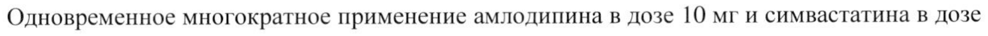
