# Амоксициллин натрия и клавуланат калия — парентерально

- Препарат: Амоксициллин+Клавулановая кислота (порошок для приготовления раствора для внутривенного введения;)
- АТХ: J01CR02
- Источник: ГРЛС, инструкция по медицинскому применению, РУ ЛСР-001490/08, файл от  (https://grls.rosminzdrav.ru/Grls_View_v2.aspx?routingGuid=565d5d5d-cedc-4564-8c6d-94b5bd3b8027)
- Распознано автоматически (OCR): 5 из 5 стр.
- Инструкция к другому РУ того же препарата: ЛСР-001490/08 (национальное РУ, переоформленное по правилам ЕАЭС, решение от 02.09.2020). Текст может быть старше действующего
- Сомнительных строк после OCR: 20 (см. раздел «Проверка распознавания»)

## Общие сведения

a ео (о JICP-001490/08-140308 — | | a | | |
| о ИНСТРУКЦИЯ № БАН. о медицинскому применению препарата | | р
О тг АМОКСИЦИЛЛИН+КЛАВУЛАНОВАЯ КИСЛОТА -
| ‚ Регистрационный номер: _ ОИ о '- Торговое название препарата: Амоксициллин+клавулановая кислота |
_ ‹ Международное непатентованное или группировочное название: | oo амоксициллин+клавулановая кислота И
- _.. Лекарственная форма: .
_. т. Порошок для приготовления раствора для внутривенного введения. :’,, | |
А ’ ` Активные вещества: амоксициллин натрия в пересчете на амоксициллин - 0,5 т, 1,0 т;
- клавуланат калия в пересчете на клавулановую кислоту - 0,1 г; 0,25
| ‚ Описание: о | | a порошок от белого до белого с желтоватым оттенком цвета. | . |
— `° Фармакотерапевтическая группа; , А |
| © антибиотик — пенициллин полусинтетический+ бета-лактамаз ингибитор , |
< ` Код ATX: [J01CRO02}. | 7 И т. ОВ Фармакологические свойства a oe |
| _ Фармакодинамика | _ . J Препарат представляет: собой комбинацию полусинтетического пенициллина амоксицил- .
| ° пинаи ингибитора бета-лактамаз - клавулановой кислоты. Действует бактерицидно, угне-
‚ таетсинтез бактериальной стенки. о О ‚ Активен в отношении: . о -
|... о. @эробных грамположительных бактерий (включая штаммы, продуцирующие бета- |.
- ° .... Пактамазы);. Зарву!ососсиз aureus, Staphylococcus epidermidis, Streptococcus pyogenes, too
Ss Streptococcus pneumoniae, Streptococcus viridans, Enterococcus spp, Corynebacterium spp., о”, Listeria‘monocytogenes;* us SO | 7
_ анаэробных грамположительных бактерий: Clostridium spp., Peptococcus spp., `
Peptostreptococcus зрр.; о °. _ im в аэробных грамотрицательных бактерий (включая штаммы, продуцирующие бетао лактамазы): °. . oO oo _ dd
_ . Escherichia coli; Proteus mirabilis, Proteus vulgaris, Klebsiella spp., Salmonella рр, Shigella | |
____. spp:, Bordetella pertussis, Yersinia enterocolitica, Gardnerella vaginalis, Neisseria meningitidis, -. | .
о - | - Мавзена gonorrhoeae, Moraxella catarrhalis, Haemophilus influenzae, Haemophilus ducteyi, |
_ . . Yersinia'multocida (ранее Pasteurella), Campylobacter jejuni; , |
И анаэробных грамотрицательных бактерий (включая штаммы, продуцирующие бета- |
` пактамазы): Bacteroides spp., включая Bacteroides fragilis. Г |
Клавулановая кислота подавляет IT, Ш, ТУ и V типы бета-лактамаз, неактивна в отноше- |
- нии бетазлактамаз I типа, продуцируемых Enterobacter зрр., Pseudomonas aeruginosa, Serra- |
- tia spp., Acinetobacter spp. Клавулановая кислота обладает высокой тропностью к пени_ циллиназам, благодаря чему образует стабильный комплекс с ферментом, что предупреж-+ =
. дает ферментативную деградацию амоксициллина под влиянием бета-лактамаз. . | ,
; _: Фармакокаветика =~ | ‘ Tlocne.Bity1paBeHHoro введения препарата в дозах 1,2 и 0,6 г средние значения максималь- | ной концентрации в плазме крови (Cmax) амоксициллина составляют 105,4 и 32,2 мкг/мл, | клавулановой кислоты - 28,5 и 10,5 мкг/мл соответственно. Оба компонента характеризу- | too: | ‚ ются хорошим объемом распределения в жидкостях и тканях организма (лег «ирифетее р | a ухо, плевральная и перитонеальная жидкости, матка, яичники). Амоксициллий Tipeapsxe eile,’ \

- oe, oo, ж= С А й oO
И Ида, | Пр an uC ) 2715 *| — О ЕН. NEN Jy

i . > ИМИ Г. я UU EPR TPE Ga Ge - |. О-о pest |
| oe ` О О | Poo | ЛСР-001490/08-140308 . = C2.
ан vanegina ЮЖе В, CHHOBHAIDHYIO жидкость, печень, предстательную железу, небные миндалины, - о `””' мышечную“‘ткань, желчный пузырь, секрет придаточных пазух носа, бронхиальный сек- ,
.. . рег Амоксициллин и клавулановая кислота не проникают через гематоэнцефалический :
° барьер при невоспаленных мозговых оболочках. a
° Активные вещества проникают через плацентарный барьер и в следовых концентрациях :
_ выделяются с грудным молоком. о | ..
Связывание с белками плазмы крови составляет для амоксициллина 17-20%, для клавула- ©
| новой кислоты - 22-30%. . О ‚ _ Метаболизируются оба компонента в печени. Амоксициллин частично метаболизируется-
- лаз 10%`от-введенной дозы, клавулановая кислота подвергается ‘интенсивному метаболизму- Го
‚^^ 50% огвведённой дозы. ^^. - А | : После внутривенного введении амоксициллина+клавулановая кислота в дозах 1,2 и 0,6 т | период полувыведения (T1/2) для амоксициллина составляет 0,9 и 1,07 4, для клавулановой кислоты 0,9 и 1,124. . о т |
| | Амоксициллин выводится почками (50-78% от введенной дозы) практически в неизме-
- ненном виде путем канальцевой секреции и клубочковой фильтрации. Клавулановая кио слота выводится почками путем клубочковой фильтрации в неизменном виде, частично в |
! виде метаболитов (25-40% от введенной дозы) в течение 6 часов после приема препарата. |
— Небольшие количества могут выводиться через кишечник и легкие. ‚|
© | ‚о У пациентов с тяжелой почечной недостаточностью период полувыведения увеличивается © | й до 7,5 часов для амоксициллина и до 4,5 часов для клавулановой кислоты. |
| Оба компонента удаляются гемодиализом и незначительные количества - перитонеальным диализом: ‘* -' __ | а |

## 4.1. Показания к применению

|.
|.
| Инфекционно-воспалительные заболевания, вызванные чувствительными штаммами мик- : | |
_ роортанизмов = С - | © ` эндокардит, менингит, сепсис, перитонит; — А "
© ‘инфекции верхних отделов дыхательных путей (в том числе ЛОР-органов): | острый и хронический синусит, острый и хронический средний ‘отит, заглоточный абс- | цесс, тонзиллит, фарингит; о в
© инфекции нижних отделов дыхательных путей: | |
| острый бронхит с бактериальной суперинфекцией, хронический бронхит, пневмония;
© инфекции мочеполовой системы: о о | . ‚ пиелонефрит, пиелит, цистит, уретрит, простатит, мягкий шанкр, гонорея;
°° инфекции в гинекологии: . о о | о “`первицит, сальпингит, сальпингоофорит, тубоовариальный абсцесс, эндометрит, бактем риальный вагинит, септический аборт;
| . инфекции кожи и мягких тканей:
рожа; импетиго, вторично- инфицированные дерматозы, абсцесс, флегмона, раневая |
| инфекция; °. | | , » инфекции костной и соединительной тканей: 4 e ‚инфекции желчных путей: | _
‘ холецистит, холангит;
© одонтогенные инфекции | | ® профилактика’инфекций в хирургии. | |
| Противопоказания Индивидуальная непереносимость компонентов, входящих в состав препарата, повышен- |
_ ная чувствительность к антибактериальным препаратам группы цефалоспоринов Feapyram бета-лактамным антибиотикам, инфекционный мононуклеоз (в тч. при появуяфкойее >
- подобной сыпи). | a oN,
; Не pt oy | Х/К р о \:
И. . | , `. *i sa ен - :
т <\ че /> ||.
| | И ть о ee 15 д oe | . , ., . AD “о a So Ra Stan st i ee | т | о В | ne й . | JICP-001490/08-140308 | 7 ts fos Sea | ‚ a С.3 | |

## 4.3. С осторожностью

^^ т _ | | | Беременность, период лактации, тяжелая печеночная недостаточность, заболевания желудочно-кишечного тракта (в т.ч. колит в анамнезе, связанный с применением пенициллинов), хроническая почечная недостаточность. a 5.“
^^ т _ | | | Беременность, период лактации, тяжелая печеночная недостаточность, заболевания желудочно-кишечного тракта (в т.ч. колит в анамнезе, связанный с применением пенициллинов), хроническая почечная недостаточность. a 5.“
Г ^ ss, Орименениев период беременности и лактации = _^ о |
`’. ` 5. Препарат может назначаться во время беременности только в тех случаях, когда предпо- |
- лагаемая польза для матери превышает потенциальный риск для плода.

° Амоксициллин и клавулановая кислота в небольших количествах проникают в грудное | молоко, поэтому при необходимости применения препарата в период лактации следует решить вопрос с прекращении грудного вскармливания. |

` Способ применения и дозы: | |

: Препарат вводится внутривенно. Режим дозирования устанавливают индивидуально в за-
`. ... BHOHMOCTH от тяжести течения; покализации инфекции и чувствительности возбудителя. | | oa Взрослым и детям старше 12 лет: препарат назначают в дозе 1,2 г- каждые 8 часов (3 раза в. |

и сутки), в случае тяжелого течения инфекции — каждые 6 4 (4 раза в сутки). |

>) Максимальная суточная доза - бт. | | | Детям в возрасте до 3 месяцев: недоношенным и в перинатальном периоде - в дозе 30
| мг/кг (в расчете на весь препарат) 2 раза в сутки, в постперинатальном периоде — в дозе 30 | мг/кг (в расчете на весь препарат) 3 раза в Cy1KH. _ |
Детям в возрасте от 3 месяцев до 12 лет: в дозе 30 мг/кг (в расчете на весь препарат) 3
_. +> раза всугки; в случае тяжелого течения инфекции - 4 раза в сутки. ее = i foe: -: Продолжительность лечения от 5 до 14 дней. ооо | | ee ‚ Для профилактики послеоперационных инфекций при операциях, продолжительностью a °. менее 1 ч, BO время вводной анестезии вводят в дозе 1,2 г. При более длительных опера- |
: ‘циях - по 1,2 г, каждые 6 4 в течение суток. При высоком риске инфицирования введение |
| может быть продолжено в ‘течение нескольких дней. - | О
| - Для пациентов с почечной недостаточностью доза и/или интервал между введе-
| | ниями препарата должны быть скорректированы в зависимости от степени недостаточности: при клиренсе креатинина больше 30 мл/мин уменьшения дозы не требует7 ’ ся; pid клиренсе креатинина 10-30 мл/мин лечение начинают с введения 1,2 г, затем a по 0,6 г каждые 12 часов; при клиренсе креатинина меньше 10 мл/мин - 1,2 г, затем
| по 0,6 г/сутки. - ° | | о Для детей дозы и кратность введения следует уменьшать таким же образом. |
Поскольку 85% препарата удаляется гемодиализом, в конце каждой процедуры ге-
| ° модиализа необходимо вводить обычную дозу препарата. - т |
| | При перитонеальном диализе коррекции доз не требуется. И |
Правила приготовления и введения растворов для в/в инъекций:
| _. Следует! растворить содержимое флакона 600 мг (500 мг+100 мг) в 10 мл воды для иньекций или 1,2 г (1000 мг+200 мт) - в 20 мл воды для инъекций. ° "о |
В/в вводить медленно (в течение 3-4 мин.) | |
| Правила приготовления и введения растворов для 6/6 инфузи. |
Для инфузионного введения препарата необходимо дальнейшее разведение: приготовленные растворы, содержащие 600 мг (500 мг+100 mr) или 1,2 г (1000 мг+200 мг) препарата, должны‘ быть разведены в 50 мл или 100 мл раствора для инфузий, соответственно. Про-
| | должительность инфузии 30-40 мин. | В: качестве растворителя для внутривенных инфузий могут использоваться уе i
° инфузионные!растворы: изотонический раствор натрия хлорида, раствор РИНгера раба ор й калияулорила «© | NES ee? \
, | ae , 4 ig Hes й) .
: г. SLL) ta ЕСН - ЛСР-001490/08-140308 В . , —: | С. 4
_ Побочное действие. | | _ сс @:Co: стороны желудочно-кишечного тракта: потеря аппетита, тошнота, ‘рвота, диарея;
о. о редко нарушение функции печени, повышение активности аланинаминотрансферазы
— (AJIT) или аспарагинаминотрансферазы (ACT); в единичных случаях - холестатиче- | ская желтуха, гепатит, псевдомембранозный колит. . - | | e Аллергические реакции: зуд, крапивница, эритематозные высыпания; редко — мульти-
| `° формная экссудативная эритема, антионевротический отек, анафилактический шок; в единичных случаях - эксфолиативный дерматит, синдром Стивенса — Джонсона. |
® Co стороны кроветворной системы: обратимое увеличение протромбинового времени, 2... ops. лейкопения, обратимые агранулоцитоз и гемолитическая анемия. > - |
< ср от“ ФА ;Сойстороны центральной нервной системы: головокружение, головная боль, обратио `` мые гиперактивность и судороги. |
® Со стороны почек и мочевыводящих путей: интерстициальный нефрит, кристаллурия.
oe ® Прочие: кандидоз и другие виды суперинфекции. | 7 |
» Местные реакции: в отдельных случаях - флебит в месте внутривенного введения.
® Передозировка | В большинстве случаев симптомы передозировки включают расстройства со стороны же-
‚ °°) Дудочно-кишечного тракта (боль в животе, диарея, рвота), возможны также тревожное о возбуждение, бессонница, ‘головокружение, в единичных случаях - судорожные припадПри передозировке пациент должен находиться под наблюдением врача, лечение - сим-
| птоматическое. Амоксициллин+клавулановая кислота удаляется гемодиализом.
=. | | Взаимодействие с другими лекарственными средствами
Бактерицидные антибиотики (в т.ч. аминогликозиды, цефалоспорины, циклосерин, ванкоИ мицин, рифампицин) оказывают синергидное действие; бактериостатические лекарственa ные ‘средства (макролиды, хлорамфеникол, линкозамиды, тетрациклины, сульфанилами7 ды) — антагонистическое. |
| Препарат повышает эффективность непрямых антикоагулянтов (подавляя кишечную микрофлору, снижает синтез витамина К и протромбиновый индекс). При одновременном
. приеме препарата с антикоагулянтами необходимо следить за показателями свертываемо-
| | сти крови. ‘. | Gy Амоксициллин+клавулановая кислота снижает эффективность пероральных контрацепти- | вов. При одновременном применении препарата с этинилэстрадиолом или с препаратами, | |
. в процессё:метаболизма которых образуется парааминобензойная кислота (ПАБК) возни- |
_ кает риск развития кровотечений "прорыва". |
Диуретики,: аллопуринол, фенилбутазон, НПВП (нестероидные противовоспалительные |
| препараты) и другие лекарственные средства, блокирующие канальцевую секрецию, по- | вышают концентрацию амоксициллина (клавулановая кислота выводится в основном пу- | тем клубочковой фильтрации). |
Аллопуринол повышает риск развития кожной сыпи. |
При одновременном применении препарата с метотрексатом повышается токсичность по- | - a ememuerolssh! г — oa |
Следует избегать одновременного применения с дисульфирамом. |
Фармацевтически несовместим с растворами, содержащими кровь, протеины, липидь |
_ глюкозу, декстран, бикарбонат. Нельзя смешивать в шприце или инфузионном,4Такене
. другими лекарственными средствами. Несовместим с аминогликозидами. В 64 2. |
| р, : . | * Pf Big Neh я ai WL fie cu. a №. И fp:
vi ean о | те Aa dds Y) , |. ЕО С р.
to, i SE | ое, НН т А Po и . ян Ом a | JICP-001490/08-140308
; и И С.5 | - Особые указания ‹ | | о mo ’ При курсовом лечении необходимо проводить контроль за состоянием функции органов кроветворения, печени, почек. ( ae
‚ У пациентов с тяжелыми нарушениями функции почек требуется адекватная коррекция дозы ‘или увеличение интервалов между дозированием. о И .‘
Лабораторные анализы: высокие концентрации амоксициллина дают ложноположитель-
-. ную реакцию мочи на тлюкозу при использовании реактива Бенедикта или раствора Фе-
"Mma. Рекомендуется использовать ферментативные реакции с глюкозидазой. т
: . а. Данных об. отрицательном влиянии препарата в рекомендуемых дозах на способности к
| _: | _. - УПравлению автомобилем или работе с механизмами нет. ' |
| Форма выпуска | .. 7 Но - Порошок для приготовления раствора для внутривенного введения по 0,5 г + 0,1 г или 1,0 г + 0,2 т активных веществ во флаконах вместимостью 10 мл.
= an 1 флакон вместе с инструкцией по применению помещают в пачку.
10 флаконов вместе с инструкцией по применению помещают в коробку из.картона. о
‚ Для стационара; 50 флаконов и 5 инструкций по применению помещают в коробку из кар-
` TOHA 17.” | Условия хранения | Список Б; В сухом, защищенном от света месте, при температуре не выше 15 °С.
о Хранить в недоступном для детей месте. , | |
| Срок годности. `` ^_ | . 2 года. He использовать по истечении срока годности. oO ; ` vs . И ЕАН, ба...
| о Условия ‘отпуска из аптек А | ` Порецету. ' | т
. ы ‘ в и.о ‘i. у у an Претензии от покупателей принимает предприятие-производитель: |
- ОАО «Красфарма» Россия, | uo 660042 г. Красноярск, ул. 60 лет Октября, 0.2. |
Тел/ факс (3912) 61-25-90 / . | | оси КО ZO", COUACTa Vy .. а
. es ean or хЗохрёмения Hon ON { ede DB a le OO Инет %% |
. . ve, © 29 т 9% | & - ob . #29 доклини зв ской 72 В о Pion. 25 и клинической 2 } oS | , is ag Экспертизь /М О м |
И aa vexaperacns = . a | ' $ й ” | С. И.О. Директора ИДКЭК stom nth Leen А.Н.Васильев |
. , р \ хе Ч !
, COWLES SMocne x Po oye te => | . . . | .
т Mee р oC CH oe . j - co ds ; $ се общей |
| ’ (Генеральный директор а) Lf %, < , С " O/ fe TZ i о т р
ОАО «Красфарма» . $ ( i) Re , . H. Шкатов |
_ a NOI CYCG | No №9 ay, ia AcHO jo р ae = occ:
‹ yoe 0 6" 2 :
| .. . 2? с, - : .
. co peep cies darts th |. , . “г. у © ч $ i
; JO tgs Bag pon, у у ЕС: é3 у ie aes | В:
| НН . ® И 2 oe oe sy} 8) И О FA F ay AG
## Проверка распознавания

Страницы-сканы распознаны автоматически. В 20 строках с дозировками цифры могли распознаться с ошибкой — сверьте с вырезкой из оригинала:

- стр. 1: «- клавуланат калия в пересчете на клавулановую кислоту - 0,1 г; 0,25» — низкая уверенность: «0,25» (39)  
  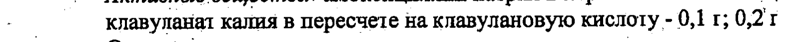
- стр. 1: «‘  Tlocne.Bity1paBeHHoro введения препарата в дозах 1,2 и 0,6 г средние значения максималь- |» — низкая уверенность: « Tlocne.Bity1paBeHHoro» (19)  
  
- стр. 1: «ной концентрации в плазме крови (Cmax) амоксициллина составляют 105,4 и 32,2 мкг/мл, |» — повторное чтение: «ной концентрации в плазме крови (Cmax) амоксициллина составляют 105,4 и 32,2 мк/мл, © |»  
  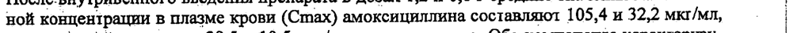
- стр. 2: «- лаз 10%`от-введенной дозы, клавулановая кислота подвергается ‘интенсивному метаболизму- Го» — низкая уверенность: «10%`от-введенной» (41)  
  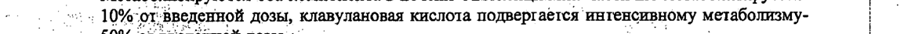
- стр. 2: «‚^^ 50% огвведённой дозы. ^^. - А» — повторное чтение: «»  
  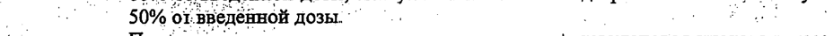
- стр. 3: «oa Взрослым и детям старше 12 лет: препарат назначают в дозе 1,2 г- каждые 8 часов (3 раза в. |» — повторное чтение: «Г Взрослым и детям старше 12 лет: препарат назначают в дозе 1,2 т- каждые 8 часов (3 рзаво = |»  
  
- стр. 3: «и сутки), в случае тяжелого течения инфекции — каждые 6 4 (4 раза в сутки). |» — повторное чтение: «т в в аварий |»  
  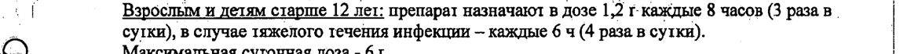
- стр. 3: «| мг/кг (в расчете на весь препарат) 2 раза в сутки, в постперинатальном периоде — в дозе 30 |» — повторное чтение: «»  
  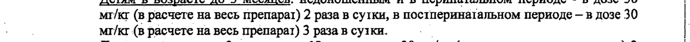
- стр. 3: «мг/кг (в расчете на весь препарат) 3 раза в Cy1KH. _ |» — низкая уверенность: «Cy1KH.» (73)  
  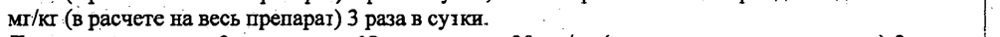
- стр. 3: «a °. менее 1 ч, BO время вводной анестезии вводят в дозе 1,2 г. При более длительных опера- |» — повторное чтение: «a - | -. | еее Г. во время ВВОДНОЙ анестезии дя, В move 12 При более  лительных опера, | |»  
  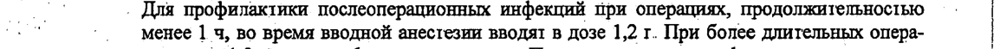
- стр. 3: «: ‘циях - по 1,2 г, каждые 6 4 в течение суток. При высоком риске инфицирования введение |» — низкая уверенность: «1,2» (59), «4» (78); повторное чтение: «| _  циях -10 1,2 г, каждые 6 ч в течение суток. При высоком риске инфицирования введение»  
  
- стр. 3: «7 ’ ся; pid клиренсе креатинина 10-30 мл/мин лечение начинают с введения 1,2 г, затем» — низкая уверенность: «7» (26); повторное чтение: «’  Фупри клиренее креатинина 10-30 мл/мин лечение начинают с введения 1,2 т, затем»  
  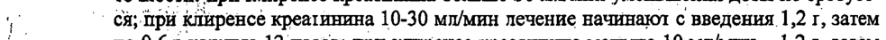
- стр. 3: «| по 0,6 г/сутки. - ° | |» — повторное чтение: «— то бук |»  
  
- стр. 3: «| _. Следует! растворить содержимое флакона 600 мг (500 мг+100 мг) в 10 мл воды для иньек-» — повторное чтение: «| _. Следует! растворить содержимое флакона 600 мг (500 мт+100 Мг) в 10 мл воды для иньек-»  
  
- стр. 3: «ций или 1,2 г (1000 мг+200 мт) - в 20 мл воды для инъекций. ° "о |» — низкая уверенность: «мг+200» (77), «20» (34); повторное чтение: «ций или 1,2 1 (1000 мг+200 мт) - в 20 мл воды для иньекций Го |»  
  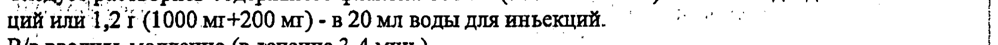
- стр. 3: «ные растворы, содержащие 600 мг (500 мг+100 mr) или 1,2 г (1000 мг+200 мг) препарата,» — повторное чтение: «ные растворы, содержащие 600 мг (500 мг+100 MI) или 1,21 (1000 мг+200 мг) препарата,»  
  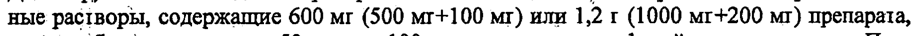
- стр. 3: «| | должительность инфузии 30-40 мин. |» — повторное чтение: «| | должительность инфузии 30-40 ъ —_ a4vVvV м4 en 54557 >44 НИИ _ |»  
  
- стр. 5: «Но - Порошок для приготовления раствора для внутривенного введения по 0,5 г + 0,1 г или 1,0» — повторное чтение: «4 _ Порошок для приготовления раствора для внутривенного введения по 0,51 +0,1 т или 1,0»  
  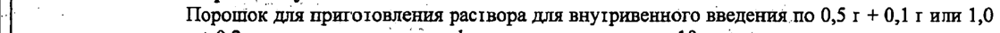
- стр. 5: «uo 660042 г. Красноярск, ул. 60 лет Октября, 0.2. |» — низкая уверенность: «0.2.» (66)  
  
- стр. 5: «. . ve, © 29 т 9% |» — низкая уверенность: «29» (55), «9%» (36); повторное чтение: «"Я RSL ARCS LN»  
  
