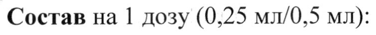
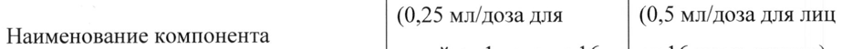
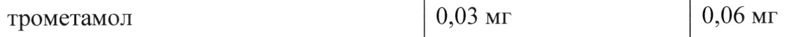
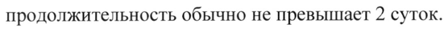

# Антиген инактивированного вируса клещевого энцефалита — парентерально

- Препарат: Клещ-Э-Вак (Вакцина клещевого энцефалита культуральная очищенная концентрированная инактивированная сорбированная) (суспензия для внутримышечного введения;)
- АТХ: J07BA01
- Источник: ГРЛС, инструкция по медицинскому применению, РУ ЛП-001584, файл от 2023-10-09 (https://grls.rosminzdrav.ru/Grls_View_v2.aspx?routingGuid=245ee300-7d64-4000-ab8b-ded51091a060)
- Распознано автоматически (OCR): 8 из 8 стр.
- Инструкция к другому РУ того же препарата: ЛП-001584 (национальное РУ, переоформленное по правилам ЕАЭС, решение от 25.09.2023). Текст может быть старше действующего
- Сомнительных строк после OCR: 4 (см. раздел «Проверка распознавания»)

## Общие сведения

[ И | МИНЗДРАВ POCCHH | | MM00758 4- 73 n> 4 |
МИНИСТЕРСТВО ЗДРАВООХРАНЕНИЯ ВОССИЙСКОЙ ФЕДЕРАЦИИ |
ИНСТРУКЦИЯ ———_— ВОВ ||| ПО МЕДИЦИНСКОМУ ПРИМЕНЕНИЮ ЛЕКАРСТВЕННОГО ПРЕПАРАТА
Клещ-Э-Вак (Вакцина клещевого энцефалита культуральная очищенная концентрированная инактивированная сорбированная)
Регистрационный номер Торговое наименование
Клещ-Э-Вак (Вакцина клещевого энцефалита культуральная очищенная концентрированная инактивированная сорбированная)
& Группировочное наименование Вакцина для профилактики клещевого энцефалита

## 3. Лекарственная форма

Суспензия для внутримышечного введения
Суспензия для внутримышечного введения
Состав на 1 дозу (0,25 мл/0,5 мл):
© Количество Количество Е НСЕИНиВ HOMTTORERT (0,25 мл/доза для (0,5 мл/доза для лиц детей от 1 года до 16 | or 16 лет и старше)
лет)
Инактивированный антиген титр не менее 1:128 титр не менее 1:128 ое ИТТ ежи [иен
Соли буферной системы:
натрия хлорид 1,9 мг 3,8 мг трометамол 0,03 мг 0,06 мг
Препарат не содержит формальдегида, антибиотиков и консервантов.
000000000 Описание Гомогенная суспензия белого цвета без посторонних включений, при отстаивании разделяющаяся на бесцветную прозрачную жидкость и рыхлый осадок белого цвета. При встряхивании хлопья, конгломераты и посторонние частицы должны отсутствовать.
Характеристика Вакцина представляет собой очишенную концентрированную — суспензию инактивированного формалином вируса клещевого энцефалита (КЭ) штамм «Софьин», полученного путем репродукции в первичной культуре клеток эмбрионов кур, сорбированного на алюминия гидроксиде.
Фармакотерапевтическая группа МИБП-вакцина

& Код ATX: JO7BAO1 Фармакологические свойства
Вакцина стимулирует выработку клеточного и гуморального иммунитета к вирусу клещевого энцефалита. После двух инъекций препарата (курс вакцинации)
вируснейтрализующие антитела обнаруживаются не менее, чем у 90 % привитых.

© Показания к применению - специфическая профилактика клещевого энцефалита для лиц от 16 лет и старше в дозе 0,5 мл и для детей от 1 года до 16 лет в дозе 0,25 мл;
- иммунизация доноров с целью получения специфического иммуноглобулина.
Контингенты, подлежащие специфической профилактике:
1. Население, проживающее на энзоотичных по клещевому энцефалиту территориях.

w 2. Прибывшие на эти территории лица, выполняющие следующие работы:
- сельскохозяйственные, гидромелиоративные, строительные, по выемке и перемещению грунта, заготовительные, промысловые, геологические, изыскательские, экспедиционные, дератизационные и дезинсекционные;
- по лесозаготовке, расчистке и благоустройству леса, зон оздоровления и отдыха населения.
3. Лица, посещающие эндемичные по клещевому энцефалиту территории с целью отдыха, туризма, работы на дачных и садовых участках.
4. Лица, работающие с материалами, содержащими вирус клещевого энцефалита.

## 4.3. Противопоказания

1. Острые инфекционные и неинфекционные заболевания, хронические заболевания в стадии обострения-прививки проводят не ранее, чем через 1 месяц после выздоровления (ремиссии).

2. Тяжелые аллергические реакции в анамнезе; бронхиальная астма; аутоиммунные заболевания.
3. Аллергия к компонентам препарата в анамнезе.
4. Тяжелая реакция (повышение температуры выше 40 °С; в месте введения вакцины — отек, гиперемия более 8 см в диаметре) или осложнения на предыдущую дозу вакцины.
5. Дети до 1 года.
При вакцинации доноров следует учитывать противопоказания, перечисленные выше, а также противопоказания, относящиеся к отбору доноров.
В каждом случае заболевания, не содержащегося в настоящем перечне противопоказаний, вакцинация проводится по разрешению врача, исходя из состояния здоровья вакцинируемого и риска заражения клещевым энцефалитом. С целью выявления
| противопоказаний врач (фельдшер) проводит в день прививки опрос и осмотр прививаемого с обязательной термометрией.

## 4.6. Применение при беременности и в период грудного вскармливания

Клинические исследования безопасности применения вакцины Клещ-Э-Вак при беременности не проводились. Влияние на детей, находящихся на грудном вскармливании, после введения вакцины Клещ-Э-Вак их матерям, не изучалось.
© Применение вакцины Клещ-Э-Вак, как и других инактивированных вакцин, связано с низким риском нарушений развития плода, однако вакцинацию во время беременности и в период грудного вскармливания следует проводить только в случаях явного риска инфицирования после оценки лечащим врачом соотношения клинической необходимости и потенциального риска применения.
| Способ применения и дозы Внимание! Не вводить внутривенно!
Вакцину вводят внутримышечно в дельтовидную мышцу плеча. Перед вскрытием ампулы необходимо провести её визуальный осмотр (см. раздел «Особые указания»).
Непосредственно перед введением вакцину в ампуле встряхивают до получения гомогенной суспензии. Препарат вводят сразу после вскрытия ампулы. Процедура вакцинации должна проводиться при строгом соблюдении правил асептики и антисептики.
1. Профилактическая вакцинация
1.1. Плановая вакцинация
Первичный курс вакцинации состоит из двух внутримышечных инъекций по 1 дозе с интервалом 1-7 мес. Одна прививочная доза составляет:
для лиц от 16 лет и старше - 0,5 мл; для детей от 1 года до 16 лет - 0,25 мл.
Прививки можно проводить в течение всего года, в том числе и в эпидсезон. Посещение очага клещевого энцефалита в эпидсезон допускается не раньше, чем через 2 недели после проведения второй вакцинации.
Наиболее оптимальный интервал между первой и второй прививками равен 5-7 месяцам
(осень - весна).
1.2. Экстренная вакцинация
По эпидемическим показаниям может проводиться экстренная вакцинация. В этом случае вакцину вводят двукратно с интервалом 2 недели лицам от 16 лет и старше в дозе 0,5 мл;
детям от 1 года до 16 лет в дозе 0,25 мл.
Посещение очага клещевого энцефалита в эпидсезон допускается не ранее, чем через 2 недели после второй прививки.
©, Первую ревакцинацию при обеих схемах проводят однократно через 1 год после завершения первичного курса вакцинации дозой 0,5 мл для лиц от 16 лет и старше и дозой 0,25 мл для детей от 1 года до 16 лет.
Последующие отдаленные ревакцинации проводят каждые три года однократно в возрастной дозировке.
< Общая схема вакцинации представлена в таблице.
Вид вакцинации Первичная Первая Последующие вакцинация ревакцинация ревакцинации
Первая Вторая Плановая 0 день Через 1-7 вакцинации 1 месяцев после Через [2 Каждые 3 года первой месяцев после вакцинации второй wr Экстренная Через 2 вакцинации недели после первой вакцинации
Доза для лиц от 0,5 мл 0,5 мл 0,5 мл 0,5 мл 16 лет и старше
Доза для детей от 0,25 мл 0,25 мл 0,25 мл 0,25 мл 1 года до 16 лет
2. Вакцинация доноров
Курс вакцинации — две внутримышечные инъекции по 0,5 мл с интервалом 5-7 месяцев или три инъекции по 0,5 мл с интервалом 3-5 недель между прививками. Первая схема обеспечивает лучший иммунизационный эффект. Ревакцинация — однократно дозой 0,5 мл через 6-12 месяцев. Первый забор крови у доноров следует проводить через 14-30 суток после курса вакцинации.

## 4.8. Побочное действие

После введения вакцины в отдельных случаях могут развиваться местные и общие реакции.

Использовались следующие критерии оценки частоты встречаемости нежелательных

явлений: очень часто (>1/10), часто (>1/100 до <1/10), нечасто — (> 1/1000 до <1/100), редко

(> 1/10000 до <1/1000), очень редко (<1/10000).

Для лиц от 16 лет и старше

Местные реакции:

часто - покраснение, припухлость, болезненность в месте введения;

очень редко - развитие инфильтрата, небольшое увеличение регионарных лимфатических

узлов.

Местные реакции могут проявиться в течение 2 суток после прививки. Продолжительность w местных реакций обычно He превышает 3 суток.

Общие реакции:

часто — общее недомогание, головная боль, тошнота, повышение температуры до 37,5 °С;

нечасто — повышение температуры от 37,5 до 38,5 °С;

редко - повышение температуры выше 38,5 °С.
© Общие реакции могут развиваться в течение 2 суток после прививки, их

продолжительность обычно не превышает 2 суток.

Для детей от I года до 16 лет.

Местные реакции:

часто — покраснение, припухлость, болезненность в месте введения;

очень редко - развитие инфильтрата, небольшое увеличение регионарных лимфатических w узлов.

Местные реакции могут проявиться в течение 2 суток после прививки. Продолжительность

местных реакций обычно не превышает 3 суток.

Общие реакции:

очень часто — повышение температуры до 37,5 °С;

часто — общее недомогание, головная боль, тошнота, повышение температуры до 38,5 °С;

редко - повышение температуры свыше 38,5 °С.

Общие реакции могут развиваться в течении 3 суток после прививки, их

продолжительность обычно не превышает 3 суток.

Местные и общие реакции чаще развиваются после первой прививки.

В единичных случаях прививки могут сопровождаться развитием аллергических реакций

немедленного типа, в связи с чем привитые должны находиться под медицинским

наблюдением в течение 30 мин после вакцинации. Места проведения прививок должны

быть обеспечены средствами противошоковой и противоаллергической терапии.

## 4.9. Передозировка

Случаев передозировки не выявлено. С учётом формы выпуска в виде одной дозы в ампуле

риск передозировки вакцины минимален.

## 4.5. Взаимодействие с другими лекарственными средствами

Клинические исследования взаимодействия с другими вакцинами или лекарственными

средствами не проводились.

Допускается одновременное введение вакцины Клещ-Э-Вак с другими инактивированными

вакцинами Национального календаря профилактических прививок и прививок по

эпидемическим показаниям при условии их введения разными шприцами в разные участки
| тела. Интервал между вакцинациями при раздельном введении инактивированных вакцин

или введении живых вакцин должен составлять не менее 1 месяца (за исключением

препаратов, назначаемых по жизненным показаниям).

## 4.4. Особые указания

Прививки осуществляют при строгом соблюдении правил асептики и антисептики.
© Помещение должно быть снабжено средствами противошоковой и противоаллергической

терапии.

Перед вскрытием ампулы необходимо провести ее визуальный осмотр.

Не пригоден препарат в ампулах с нарушенной целостностью, маркировкой, при

обнаружении посторонних включений, при наличие крупных неразбивающихся

конгломератов, при истекшем сроке годности, при нарушении температурного режима
& хранения или транспортирования.

В день вакцинации проводят медицинский осмотр с целью опроса и осмотра прививаемого

с обязательной термометрией (температура не должна превышать 36,9 °С) и изучением

медицинского анамнеза с целью исключения противопоказаний.

Непосредственно перед инъекцией вакцину в ампуле встряхивают до получения

гомогенной суспензии. Препарат вводят сразу после вскрытия ампулы внутримышечно в

дельтовидную мышцу плеча.

Вакцинированный должен находиться под медицинским наблюдением не менее 30 мин

после вакцинации с целью минимизации риска в случае развития аллергических реакций.

Проведенные прививки регистрируют в установленных учетных формах с указанием

наименования препарата, даты прививок, дозы, номера серии, предприятия производителя,

реакции на прививку.

## 4.7. Влияние на способность управлять транспортными средствами, механизмами

Выраженные общие реакции на введение вакцины (повышение температуры, головная боль) являются противопоказанием для управления транспортными средствами и механизмами.

## 6.5. Форма выпуска

Суспензия для внутримышечного введения, (0,25 мл/доза; 0,5 мл/доза).
Суспензия для внутримышечного введения, (0,25 мл/доза; 0,5 мл/доза).
Первичная упаковка Вакцина по 0,5 мл (1 доза для лиц от 16 лет и старше) или по 0,25 мл (1 доза для детей от 1 года до 16 лет) в ампулах объемом 1 мл из стекла 1-го гидролитического класса.
Вторичная упаковка 10 ампул в пачке из картона коробочного с инструкцией по применению и ножом
1 ампульным при необходимости. При упаковке ампул, имеющих кольцо излома или точку для вскрытия, нож ампульный не вкладывают.

## 6.4. Условия хранения

Хранить при температуре от 2 до 8 °С включительно. Замораживание не допускается.
Хранить при температуре от 2 до 8 °С включительно. Замораживание не допускается.
Хранить в недоступном для детей месте.
© Условия транспортирования В соответствии с СП 3.3.2.3332-16 при температуре от 2 до 8 °С включительно. Допускается кратковременное (не более 24 часов) транспортирование при температуре от 9 до 20 °С включительно. Замораживание не допускается.

## 6.3. Срок годности

2 года.
2 года.
- Препарат с истекшим сроком годности применению не подлежит.
Условия отпуска Для лечебно-профилактических учреждений.
Производитель Федеральное государственное бюджетное научное учреждение «Федеральный научный центр исследований и разработки иммунобиологических препаратов им. М.П. Чумакова
РАН» (ФГБНУ «ФНЦИРИП им. М.П. Чумакова РАН»), Россия г. Москва, поселение Московский, посёлок Института полиомиелита.
Владелец регистрационного удостоверения/организация, принимающая претензии потребителя
ФГБНУ «ФНЦИРИП им. М.П. Чумакова РАН», Россия 108819, г. Москва, поселение Московский, посёлок Института полиомиелита, домовладение 8, корп. |
Тел.: (495) 841-90-02, факс (495) 841-93-21, (495) 549-67-60.
E-mail: sue_polio@chumakovs.su Сведения о рекламации на качество препарата направлять в адрес ФГБНУ «ФНЦИРИП им. М.П. Чумакова PAH» (e-mail: sue_polio@chumakovs.su), о случаях повышенной реактогенности или развития поствакцинальных осложнений направлять в службу фармаконадзора ФГБНУ «ФНЦИРИП им. М.П. Чумакова РАН» (e-mail:
pv@chumakovs.su) и в Федеральную службу по надзору в сфере здравоохранения (в базу
АИС Росздравнадзор http://external.roszdravnadzor.ru/ WIM e-mail:
info@roszdravnadzor.gov.ru)
Первый заместитель — генерального директора ФГБНУ и
«ФНЦИРИП им. М.П. Чумакова РАН» ли x, А.Ю. Афонин
© Bi Wee Ly АЙ го ®- и а Rae)
cae Looe ыы 5
## Проверка распознавания

Страницы-сканы распознаны автоматически. В 4 строках с дозировками цифры могли распознаться с ошибкой — сверьте с вырезкой из оригинала:

- стр. 1: «Состав на 1 дозу (0,25 мл/0,5 мл):» — низкая уверенность: «мл/0,5» (78)  
  
- стр. 1: «Е НСЕИНиВ HOMTTORERT (0,25 мл/доза для (0,5 мл/доза для лиц» — повторное чтение: «Наименование компонента | esas m о | И wos on ih»  
  
- стр. 1: «трометамол 0,03 мг 0,06 мг» — повторное чтение: «трометамол | 0,03 мг | 0,06 мг»  
  
- стр. 5: «продолжительность обычно не превышает 2 суток.» — повторное чтение: «продолжительность обычно не превышает р, суток.»  
  
