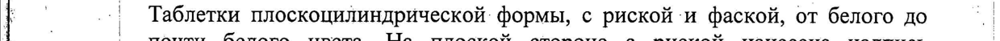
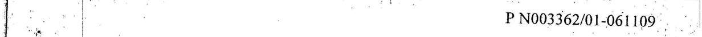
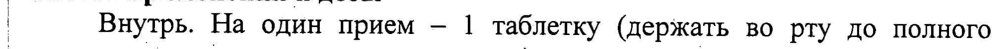
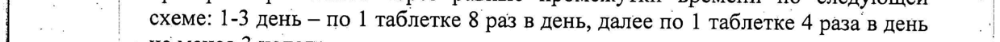
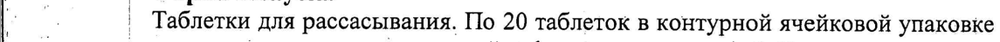

# Антитела к гамма интерферону человека афинно очищенные — внутрь

- Препарат: Анаферон (таблетки для рассасывания;)
- АТХ: L03
- Источник: ГРЛС, инструкция по медицинскому применению, РУ Р N003362/01, файл от 2024-11-12 (https://grls.rosminzdrav.ru/Grls_View_v2.aspx?routingGuid=9b6f2754-5ce3-4c3c-a199-9884c2ba957c)
- Распознано автоматически (OCR): 4 из 4 стр.
- Инструкция к другому РУ того же препарата: Р N003362/01 (срок действия истёк, решение от 20.08.2019). Текст может быть старше действующего
- Сомнительных строк после OCR: 5 (см. раздел «Проверка распознавания»)

## Текст

Poe | Р №003362/01-061109 : | Га | | .

to |

1 3 | ИНСТРУКЦИЯ 7 | Ре | по медицинскому применению препарата.
Та | _АНАФЕРОН `` | | | | Регистрационный номер H дата: >
{ | Торговое название: Анаферон | | “| q i р
] . | | р |. | Лекарственная форма: таблетки для рассасывания |
| _ ‚ Состав о 1 _ | Активные компоненты: антитела к гамма интерферону человека аффинно |
_ © | очищенные — 0,003 r* |

jo | Вспомогательные вещества: лактоза, целлюлоза микрокристаллическая,

i | магния стеарат. .
| | | * вводятся в виде водно-спиртовой смеси активной формы действующего вещества’
| | .
| | Описание ° ` | | 1 , i . . > ых И . |
| | 7 Таблетки плоскоцилиндрической формы, с pHCKOM Hu фаской, от белого до |
: | почти белого цвета. На плоской стороне с риской нанесена надпись a
| | MATERIA MEDICA, на другой плоской стороне нанесена надпись | 1 | АМАЕЕКОМ. . |

|. |

to | Фармакотерапевтическая группа 4 1. о ' Иммуномодуляторы. Противовирусные средства. | В
| © | Коды ATX | ;
f° . | L03;,J0S5AX | | | _ | | | | Фармакологическое действие

| | | При профилактическом и лечебном применении препарат оказывает |
1. ‚ иммуномодулирующее и противовирусное действие. Экспериментально и

; | клинически установлена эффективность в отношении вирусов гриппа (в TOM |
| ‚ числе гриппа птиц), парагриппа, вирусов простого герпеса | и 2 типов

| (лабиальный герпес, генитальный герпес), других герпес-вирусов (ветряная

т. | ‚оспа, инфекционный мононуклеоз), энтеровирусов, вируса клещевого

. | .

a _ энцефалита, ротавируса, коронавируса, калицивируса, аденовируса,
Jo _| респираторно-синцитиального (РС вируса). Препарат снижает концентрацию

то вируса в пораженных тканях, влияет на систему эндогенных интерферонов и

q | .’ 1... - - J} (et .
1. | ‚ | Активная форма действующего вещества — активная форма с содержанием не более 107" нг/г действуюpow | | щего вещества.
| , | |

| | 1. | -, ee | | Р 'N003362/01-061109 г:
| ВОИ и | Сопряженных с ними цитокинов, индуцирует образование эндогенных |
| .°%. | "ранних" интерферонов (ИФН a/B) и гамма-интерферона (ИФН у). | 1 о 7 | Стимулирует гуморальный и клеточный иммунный ответ. Повышает. | о |. продукцию антител (включая секреторный IgA), активизирует функции Т- |
|. | ‚эффекторов, Т-хелперов (Tx), нормализует их соотношение. Повышает ‘.
poo | функциональный резерв Тх и других клеток, участвующих в иммунном "| awe, | ответе. Является индуктором смешанного Txl и Тх2-типа иммунного ответа:
+) | Повышает выработку цитокинов Тх!| (ИФНу, ИЛ-2) и Тх2 (ИЛ-4, 10), "7
Bo | нормализует (модулирует) баланс Tx1/Tx2 активностей. Повышает :.
As .., ` функциональную активность фагоцитов и естественных клеток-киллеров (ЕК. ь
| клеток). Обладает антимутагенными свойствами. | мо | fe ‚| Показания к npuMenennio—
| о | Профилактика и лечение острых респираторных вирусных инфекций (в
“| ТОМ числе гриппа). | © | ‘Комплексная терапия инфекций, вызванных герпес-вирусами pF i: (инфекционный мононуклеоз, ветряная оспа, лабиальный герпес,
`` | генитальный герпес). .
И | Комплексная терапия и профилактика рецидивов хронической 1 ee | герпесвирусной инфекции, в TOM числе лабиального и генитального герпеса.
и. Комплексная терапия и профилактика других острых и хронических И
Be `- вирусных инфекций, вызванных вирусом клещевого - энцефалита, .
``. | ЭНТеровирусом, ротавирусом, коронавирусом, калицивирусом. | о | ; Применение в составе комплексной терапии бактериальных инфекций п. Комплексная терапия вторичных иммунодефицитных состояний —
: ‚| различной этиологии, в том числе профилактика и лечение осложнений
; о | вирусных и бактериальных инфекций. | "|
| т Противопоказания |’ © | | Повышенная индивидуальная чувствительность к компонентам препарата.
`’. | Детям и лицам моложе 18 лет показано применение препарата Анаферон
"о | Детский. | | a | Беременность и период лактации | poo at | Безопасность. применения Анаферона у беременных и в период лактации не
— | изучалась. При необходимости приема препарата следует учитывать
| ‚ соотношение риск/польза.
т | Способ применения и дозы | Внутрь. На один прием — 1 таблетку (держать BO рту до полного
| растворения - не во время приема пищи).
| | ОРВИ, грипп, кишечные инфекции, герпесвирусные инфекции, , а’ неироинфекции. Лечение следует начинать, как можно раньше — при
>. | Появлении первых признаков острой вирусной инфекции по следующей |
| | схеме: в первые 2 часа препарат принимают каждые 30 минут, затем в pe ! 20
— | | 54040 | и foo | a | | о Р №003362/01-061109 ©... | i: | течение первых суток осуществляют еще три приема ‘через равные
| ' промежутки времени. Со вторых суток и далее принимают по | таблетке 3
| р os | = раза в день до полного выздоровления. : | п”
|. т “Tipu отсутствии улучшения, на третий день лечения препаратом острых |
1. | респираторных вирусных инфекций и гриппа - следует обратиться к врачу. |
| _ | B эпидемический сезон с профилактической целью препарат принимают |
| | .@KeqHeBHo 1 раз в день в течение 1-3 месяцев. | | _ | yoo | Генитальный герпес. При острых проявлениях генитального герпеса |
/ | Препарат принимают через равные промежутки времени по следующей |
| -——s exeme: 1-3 день — по 1 таблетке 8 раз в день, далее по 1 таблетке 4 раза в день 7 i _ | He MeHee 3 недель. |
| | Для профилактики рецидивов хронической герпесвирусной инфекции —
1. _- по | таблетке в день. Рекомендуемая продолжительность профилактического .
| | курса определяется индивидуально и может достигать 6 месяцев.
| 7 | При употреблении препарата для лечения и профилактики
© | иммунодефицитных. состояний, в комплексной терапии бактериальных
Jo | инфекций — принимать по | таблетке в день.
| | При необходимости препарат можно сочетать с другими.
1. | противовирусными и симптоматическими средствами. 4
| ° | Побочное действие | 7 | - | При использовании препарата по указанным показаниям и в указанных .
1. ‘дозировках побочных действий: не выявлено.
} | | Возможны проявления повышенной индивидуальной чувствительности к |
| | _ компонентам препарата.
= | |. | Передозирбвка | ° | Случаев передозировки до настоящего времени не зарегистрировано. »
a | При случайной передозировке возможны диспепсические явления,
© | обусловленные входящими в состав препарата наполнителями.
jo. | Взаимодействие с другими лекарственными средствами о - | Случаев несовместимости с другими лекарственными средствами до
. ^^ | настоящего времени не выявлено. "4 a
^. | При необходимости. препарат можно сочетать с другими противовирусными, =|
_ антибактериальными и симптоматическими средствами. |
| - | Особые указания о ‚ В состав препарата входит лактоза, в связи с чем его не рекомендуется
. | назначать пациентам с врожденной галактоземией, синдромом
| т | мальабсорбции глюкозы либо при врожденной лактазной недостаточности. | не | Форма выпуска |
: 7 | Таблетки для рассасывания. По 20 таблеток в контурной ячейковой упаковке fe ah | из пленки поливинилхлоридной и фольги алюминиевой. Каждую контурную ‘||
Е | | 3 “! о 5404 0 j | a ь | | ` foc | | | Р N003362/01-061109 |
| . ; | a ‚ ячейковую упаковку вместе с инструкцией по медицинскому применению
Г ol | помещают в пачку из картона.
. | * . iy | . - ..| Условия хранения | В сухом, защищенном от света месте, при температуре не выше 25°С.
1. | Хранить в недоступном для детей месте.
| | Срок годности. | | В | А | 3 года. | . .
о | He применять по истечении срока годности.
| | з ' Условия отпуска из аптек.
‚. Без рецепта. | | | | Производитель/Организация, принимающая претензии
| © ‚ ООО «НПФ «MATEPHA МЕДИКА ХОЛДИНГ »; 127473, Россия, г. Москва,
| й | 3-й Самотечный пер., д.9. Тел./факс: (495) 684-43-33. |
| .
| | | | й | | :
| | | | | у Ё е_ | | | | | . > |.
| Заместитель Генерального директора по peru Wigner SA |
| a | . . PAY & 8 | i $ „ИЕ =\\ | ООО «НПФ «МАТЕРИА МЕДИКА ХОЛД нЕ Py ph ‚0 <. Прокофьев |
| Kaphedi VN, |5] | . . A | а feffiane Ba |
. АСИ Toner ogy ky | | | OS “OHhAYH, KY | | TESS |
: | | . . РОСЗДРАВНАДЗО Е: : Е ЕРТНЫЙ ОТЧЕТ |< +f
| | ral ЕЙСТВИТЕЛЕН ДЛЯ ДАННОЙ Е Ty | | | в] — ВЕРСИИ ДОКУМЕНТА :
Г. 00.0 0 90000 3 —_ | | | . - = : _ | : : 54040 4
| | |
## Проверка распознавания

Страницы-сканы распознаны автоматически. В 5 строках с дозировками цифры могли распознаться с ошибкой — сверьте с вырезкой из оригинала:

- стр. 1: «| | 7 Таблетки плоскоцилиндрической формы, с pHCKOM Hu фаской, от белого до |» — низкая уверенность: «7» (63); повторное чтение: «| | Таблетки плоскоцилиндрической формы, с риской ‘и фаской, от белого no»  
  
- стр. 2: «ee | | Р 'N003362/01-061109 г:» — низкая уверенность: «'N003362/01-061109» (8); повторное чтение: «| г. | | | | о Р4003362/01-061109_ 7»  
  
- стр. 2: «| Внутрь. На один прием — 1 таблетку (держать BO рту до полного» — повторное чтение: «| Внутрь. Ha один прием _1 таблетку (держать во рту до полного»  
  
- стр. 3: «| -——s exeme: 1-3 день — по 1 таблетке 8 раз в день, далее по 1 таблетке 4 раза в день 7» — низкая уверенность: «7» (29); повторное чтение: «— | “| схеме: 1-3 день - по | таблетке 8 раз в день, далее по 1 таблетке 4 нача в neue ,»  
  
- стр. 3: «: 7 | Таблетки для рассасывания. По 20 таблеток в контурной ячейковой упаковке» — низкая уверенность: «7» (30)  
  
