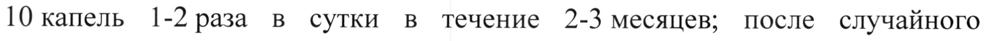

# Антитела к мозгоспецифическому белку S-100 аффинно очищенные — внутрь

- Препарат: Пропротен®-100 (капли для приема внутрь;)
- АТХ: N07BB
- Источник: ГРЛС, инструкция по медицинскому применению, РУ ЛП-№(000030)-(РГ-RU), файл от 2022-10-14 (https://grls.rosminzdrav.ru/Grls_View_v2.aspx?routingGuid=f25a7222-23b9-445a-b13a-b6382504caa5)
- Распознано автоматически (OCR): 3 из 3 стр.
- Инструкция к другому РУ того же препарата: ЛП-№(000030)-(РГ-RU) (прежняя редакция, решение от 09.09.2022). Текст может быть старше действующего
- Сомнительных строк после OCR: 1 (см. раздел «Проверка распознавания»)

## Общие сведения

ИНСТРУКЦИЯ ПО МЕДИЦИНСКОМУ ПРИМЕНЕНИЮ ЛЕКАРСТВЕННОГО ПРЕПАРАТА
ПРОПРОТЕН?-100 Регистрационный номер МИНЗДРАВ
Торговое название POCCHH Пропротен®-100 09.09. 2027
СОГЛАСОВАНО Лекарственная форма ee, Капли для приема внутрь.
Состав на 1 г капель для приема внутрь Действующее вещество:
ow антитела к мозгоспецифическому белку S-100 аффинно очищенные — 25 000 EMJI*.
Вспомогательные вещества: этиловый спирт 95 %, вода очищенная.
* ЕМД - единицы модифицирующего действия.
Описание Бесцветная прозрачная жидкость с характерным спиртовым запахом.
Фармакотерапевтическая группа Препараты, применяемые при алкогольной зависимости.
Код АТХ NO7BB.
- Фармакологические свойства

## 5.1. Фармакодинамика

Препарат модифицирует функциональную активность белка S-100, осуществляющего в мозге сопряжение информационных и метаболических процессов. Сенситизирует нейрональную — мембрану, — модулирует синаптическую пластичность нейронов. Оказывает модифицирующее действие на функциональное состояние структур мозга, участвующих в формировании алкогольной зависимости: гипоталамуса, гиппокампа и др.
Препарат модифицирует функциональную активность белка S-100, осуществляющего в мозге сопряжение информационных и метаболических процессов. Сенситизирует нейрональную — мембрану, — модулирует синаптическую пластичность нейронов. Оказывает модифицирующее действие на функциональное состояние структур мозга, участвующих в формировании алкогольной зависимости: гипоталамуса, гиппокампа и др.
При алкогольной зависимости оказывает нормализующее влияние на систему позитивного эмоционального подкрепления, что приводит к снижению частоты самостимуляции латерального гипоталамуса. Снижает пачечную активность нейронов гиппокампа; уменьшает количество циркулирующих иммунокомплексов в периферической крови, что коррелирует со снижением потребления этанола. Способствует усилению а в Эр § р
| & 9 && 3 тормозных влияний ГАМК в ЦНС. Экспериментально установлено, что препарат восстанавливает нейромедиаторный баланс и условнорефлекторную деятельность. Повышает устойчивость мозга к гипоксии и к токсическим воздействиям.

## 5.2. Фармакокинетика

Чувствительность современных физико-химических методов анализа
(газожидкостная хроматография, высокоэффективная жидкостная хроматография, хромато-масс-спектрометрия) не позволяет оценивать содержание действующего вещества препарата Пропротен®-100 в биологических жидкостях, органах и тканях, что делает технически невозможным изучение фармакокинетики.

## 4.1. Показания к применению

eS Пропротен®-100 показан к применению у взрослых.

Применяется при алкогольной зависимости для уменьшения влечения к алкоголю и снижения вероятности рецидивов алкоголизма.

## 4.3. Противопоказания

Повышенная индивидуальная чувствительность к компонентам препарата.

## 4.6. Применение при беременности и в период грудного вскармливания

Возраст до 18 лет.

Применение при беременности и в период грудного вскармливания
Препарат Пропротен®-100 противопоказан к применению у женщин в период беременности и грудного вскармливания.

© Способ применения и дозы

На один прием — 10 капель в столовой ложке воды (не во время приема пищи). Для профилактики рецидивов алкоголизма препарат принимают по 10 капель 1-2 раза в сутки в течение 2-3 месяцев; после случайного употребления алкоголя принять дополнительно 10 капель препарата 2 раза — днем и на ночь.

## 4.8. Побочное действие

Возможны реакции индивидуальной повышенной чувствительности к компонентам препарата.

## 4.9. Передозировка

До настоящего времени случаев передозировки не наблюдалось.

## 4.5. Взаимодействие с другими лекарственными средствами

Случаев несовместимости с другими лекарственными средствами до настоящего времени не выявлено.

## 4.4. Особые указания

Данный лекарственный препарат содержит небольшое количество этанола
Данный лекарственный препарат содержит небольшое количество этанола
(алкоголя), менее 100 мг на 10 капель препарата.

## 4.7. Влияние на способность управлять транспортными средствами, механизмами

В период лечения алкогольной зависимости, учитывая специфику заболевания, следует воздержаться от управления автотранспортом.

## 6.5. Форма выпуска

Капли для приема внутрь. По 25 мл во флаконы из окрашенного стекла,
Капли для приема внутрь. По 25 мл во флаконы из окрашенного стекла,
> укупоренные крышками с контролем первого вскрытия, с капельницей.
Каждый флакон вместе с инструкцией по медицинскому применению помещают в пачку из картона.

## 6.4. Условия хранения

При температуре не выше 25 °С.
При температуре не выше 25 °С.
После вскрытия флакон хранить при температуре не выше 25 °С в течение 35 дней.
Хранить в недоступном для детей месте.
Не замораживать.

## 6.3. Срок годности

© 2 года.
© 2 года.
Не использовать по окончании срока годности.
Условия отпуска Без рецепта.
Владелец регистрационного удостоверения/организация, принимающая претензии от потребителя
ООО «НПФ «МАТЕРИА МЕДИКА ХОЛДИНГ»;
Россия, 127473, г. Москва, 3-й Самотечный пер. д. 9.
Тел./факс: +7 (495) 684-43-33.
Телефоны «Горячей линии»: +7 (495) 681-09-30, +7 (495) 681-93-00.
E-mail: hotline@materiamedica.ru Адрес места производства лекарственного препарата
Россия, 454139, г. Челябинск, ул. Бугурусланская, д. 54.
. 3 149443
## Проверка распознавания

Страницы-сканы распознаны автоматически. В 1 строках с дозировками цифры могли распознаться с ошибкой — сверьте с вырезкой из оригинала:

- стр. 2: «10 капель 1-2 раза в сутки в течение 2-3 месяцев; после случайного» — низкая уверенность: «1-2» (44)  
  
