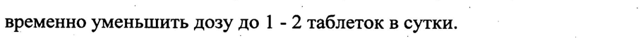
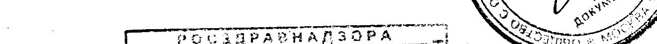

# Антитела к человеческому фактору некроза опухоли альфа аффинно очищенные — внутрь

- Препарат: Артрофоон (таблетки для рассасывания;)
- АТХ: M01
- Источник: ГРЛС, инструкция по медицинскому применению, РУ Р N000373/01, файл от 2026-02-24 (https://grls.rosminzdrav.ru/Grls_View_v2.aspx?routingGuid=9a192e6b-da30-4003-b78c-5a5b2aa26b2d)
- Распознано автоматически (OCR): 4 из 4 стр.
- Инструкция к другому РУ того же препарата: Р N000373/01 (срок действия истёк, решение от 25.09.2019). Текст может быть старше действующего
- Сомнительных строк после OCR: 2 (см. раздел «Проверка распознавания»)

## Общие сведения

Р N000373/01-060810 ae ~ ИНСТРУКЦИЯ _ ae co
| _ по медицинскому применению препарата .
АРТРОФООН

Регистрационный номер — Торговое название: Артрофоон

## 3. Лекарственная форма

таблетки для рассасывания.
таблетки для рассасывания.

## 2. Состав

|
|

@ Активные компоненты: антитела к человеческому фактору некроза опухоли альфа аффинно очищенные - 0,003 г*.
Вспомогательные вещества: лактозы моногидрат, целлюлоза

‚ микрокристаллическая, магния стеарат.
* наносятся на лактозу в виде водно-спиртовой смеси с содержанием не более 10° нг/г активной формы действующего вещества — | | |
Описание | | | Таблетки плоскоцилиндрической формы, с риской и фаской, от белого до почти
‚ белого цвета. На` плоской стороне .с риской нанесена надпись MATERIA
MEDICA, на другой OCKOH ороне нанесена надпись ARTHROFON.
‚ Фармакотерапевтическая группа:
Противовоспалительное средство. Иммуномодулирующее средство..
’ Коды ATX — | | | M01 1.03 _ Фармакологические свойства | | |

## 5.1. Фармакодинамика

| Экспериментально и клинически доказано, что препарат модулирует выработку и функциональную активность эндогенного фактора некроза опухоли альфа (DHOa)
| Экспериментально и клинически доказано, что препарат модулирует выработку и функциональную активность эндогенного фактора некроза опухоли альфа (DHOa)
при ревматоидном артрите, остеоартрозе, остеохондрозе, боли в спине;.
6134} Р N000373/01-060810 _ неспецифическом язвенном колите (НЯК). Оказывает противовоспалительное и —
| ^ анальгезирующее . действие. _ За. счет уменьшения | продукции ряда провоспалительных цитокинов, | медиаторов воспаления препятствует прогрессированию воспалительного поражения тканей и органов-мишеней при воспалительно-дегенеративных заболеваниях суставов и НЯК.

## 5.2. Фармакокинетика

Чувствительность современных физико-химических методов анализа
Чувствительность современных физико-химических методов анализа
(газожидкостная хроматография, высокоэффективная жидкостная хроматография, хромато-масс-спектрометрия) не позволяет оценивать содержание сверхмалых доз антител в биологических жидкостях, органах и тканях, что делает технически
_ невозможным изучение фармакокинетики препарата артрофоон. | e |

## 4.1. Показания к применению

Ревматоидный артрит, остеоартроз (в том числе спондилоартроз) и другие заболевания суставов. В период ремиссии возможно применение .
Ревматоидный артрит, остеоартроз (в том числе спондилоартроз) и другие заболевания суставов. В период ремиссии возможно применение .
препарата в составе монотерапии, в период обострения - в составе комплексной
| терапии (с нестероидными противовоспалительными средствами). |
‚ Неспецифический. язвенный колит легкой и средней степени тяжести.
° Противопоказания | — Повышенная индивидуальная чувствительность к компонентам препарата. о
| Не рекомендуется для применения у детей и подростков в возрасте do 18 лет
(ввиду отсутствия опыта клинического применения).

## 4.6. Применение при беременности и в период грудного вскармливания

Безопасность применения Артрофоона у беременных и в период лактации не изучалась. При необходимости приема препарата следует учитывать соотношение риск/польза. | | |
_ Способ применения и дозы | | | Внутрь. На один прием - 2 таблетки (держать во рту до полного растворения - не во время приема пищи). о о _ 7 | | | ,
| _ 61341 Р N000373/01-060810 - Ревматоидный артрит, остеоартроз (в том числе спондилоартроз) и другие |
, заболевания суставов. | - 7 .. — | | Препарат принимать дважды в день, вечером и утром (до и после сна).
Рекомендуемая длительность приема препарата — до 6 месяцев.
При выраженном болевом синдроме в первые 2-4 недели терапии рекомендован прием препарата до 4 раз в сутки, в составе комплексной терапии. При улучшении состояния постепенно перейти на прием 2 таблеток 2 раза в сутки.
Неспецифический язвенный колит.
Препарат принимать дважды в день, вечером и утром (до и после сна).
Рекомендуемая длительность приема препарата — доб месяцев. |
| При выраженном обострении заболевания (боли в животе, диарея) в первые 2-4 = e недели терапии рекомендован прием препарата до 4 раз в сутки. При улучшении состояния постепенно перейти на прием 2 таблеток 2 раза в сутки.

## 4.8. Побочное действие

‹ | Возможны реакции повышенной индивидуальной чувствительности к компонентам =
‹ | Возможны реакции повышенной индивидуальной чувствительности к компонентам =
_ препарата.

## 4.9. Передозировка

| | | | При случайной передозировке возможны диспепсические явления, обусловленные входящими в состав препарата наполнителями. ва (та
| | | | При случайной передозировке возможны диспепсические явления, обусловленные входящими в состав препарата наполнителями. ва (та

## 4.5. Взаимодействие с другими лекарственными средствами

Случаи несовместимости с другими лекарственными препаратами до настоящего
| времени не зарегистрированы. Возможно сочетание препарата с нестероидными противовоспалительными средствами. | | |
_ Особые указания На 3-5 сутки после начала лечения возможно умеренно выраженное преходящее усиление болевого синдрома или местных проявлений воспаления, не требующее
| изменений в режиме фармакотерапии. В отдельных случаях при выраженном - усилении болевого синдрома или местных признаков воспаления необходимо временно уменьшить дозу до 1 - 2 таблеток в сутки. | | 61341
Р N000373/01-060810 | _В состав препарата входит лактоза, в связи с чем его не рекомендуется назначать | пациентам с врожденной галактоземией, синдромом мальабсорбции глюкозы или
Го галактозы, либо при врожденной лактазной недостаточности. ,
Артрофоон не оказывает влияния на способность управления транспортными
| средствами и другими потенциально опасными механизмами.

## 6.5. Форма выпуска

Таблетки для рассасывания. По 20 таблеток в контурной ячейковой упаковке из пленки поливинилхлоридной и фольги алюминиевой. | |
Таблетки для рассасывания. По 20 таблеток в контурной ячейковой упаковке из пленки поливинилхлоридной и фольги алюминиевой. | |
По 1, 2 или 5 контурных‘ ячейковых упаковок вместе с инструкцией по © медицинскому применению помещают в пачку из картона.
® Условия хранения В сухом, защищенном от света месте, при температуре не выше 25° С. Хранить в недоступном для детей месте.

## 6.3. Срок годности

3 года.
3 года.
Не использовать после истечения срока годности.
Условия отпуска из аптек | _. Безрецепта. с. т о а
_ Владелец регистрационного удостоверения/Производитель |
| ООО «НПФ «МАТЕРИА МЕДИКА ХОЛДИНГ»; 127473, Россия, г. Москва, 3-ий Самотечный пер. д. 9. Тел./факс: (495) 684-43-33.
° Заместитель Генерального директора по регистряййи ss ‹ _\
Lisl wr «УХ a ae м 1) = ООО «НПФ «МАТЕРНА МЕДИКА ХОЛДИНГЕ x < [Я |0. А. Прокофьев —
=) RNS iP 9 “a? iy © ии ; er we im НИЕ 25 5 4%
| Г БОЕЗИРАВНАЛЗЬРА = | Nano И SKCHEPTHBIA OT4ET 1 ae al ПЕЙСТВИТЕВЕН ДЛЯ ДАННОЙ 2! |
© ВЕРСИИ ДОКУМЕНТА | 4 Ъ——————ы—ы—ыы——_—щ——- 6600 9 OG 0 9 8 | 61341
## Проверка распознавания

Страницы-сканы распознаны автоматически. В 2 строках с дозировками цифры могли распознаться с ошибкой — сверьте с вырезкой из оригинала:

- стр. 3: «временно уменьшить дозу до 1 - 2 таблеток в сутки. | |» — низкая уверенность: «2» (63); повторное чтение: «временно уменьшить дозу до | - 2 таблеток в сутки. | |»  
  
- стр. 4: «; er we im НИЕ 25 5 4%» — низкая уверенность: «25» (50), «5» (29), «4%» (21); повторное чтение: «| f ТЕСТАРАРНАЛЗАРА ¢ RK»  
  
