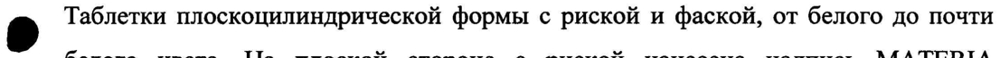
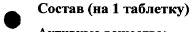
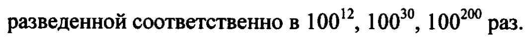

# Антитела к эндотелиальной NO синтазе аффинно очищенные, антитела к С-концевому фрагменту бета-субъединицы рецептора инсулина аффинно очищенные — внутрь

- Препарат: Субетта (таблетки для рассасывания;)
- АТХ: A10BX
- Источник: ГРЛС, инструкция по медицинскому применению, РУ ЛСР-007376/10, файл от  (https://grls.rosminzdrav.ru/Grls_View_v2.aspx?routingGuid=b7a7b4b3-da1c-4c2d-9511-c1c319841ba8)
- Распознано автоматически (OCR): 5 из 5 стр.
- Инструкция к другому РУ того же препарата: ЛСР-007376/10 (срок действия истёк, решение от 16.09.2019). Текст может быть старше действующего
- Сомнительных строк после OCR: 3 (см. раздел «Проверка распознавания»)

## Общие сведения

JICP-007376/10-290710 $ ИНСТРУКЦИЯ ъ по медицинскому применению препарата о SS CYBETTA rr ee
Регистрационный номер Торговое название Субетта
Лекарственная форма таблетки для рассасывания.
@ Состав (на 1 таблетку)
Активные вещества:
антитела к С-концевому фрагменту бета-субъединицы рецептора инсулина аффинно очищенные - 0,006 г* антитела к эндотелиальной МО синтазе аффинно очищенные - 0,006 г*
Вспомогательные вещества: изомальт, кросповидон, магния стеарат
* наносятся на изомальт в виде смеси трех активных водно-спиртовых разведений субстанции, разведенной соответственно в 10012, 100°, 100” pas.
Описание
9 Таблетки плоскоцилиндрической формы с риской и фаской, от белого до почти белого цвета. На плоской стороне с риской нанесена надпись МАТЕВТА
MEDICA, на другой плоской стороне нанесена надпись ЗОВЕТТА.
Фармакотерапевтическая группа Гипогликемические и другие средства в комбинациях
Код ATX А10ВХ Фармакологические свойства

## 5.1. Фармакодинамика

Антитела к _ С-концевому _ фрагменту _В-субъединицы через механизмы аллостерической модуляции сенситизируют рецептор инсулина, повышают его чувствительность как к эндогенному, так и вводимому инсулину, что
Антитела к _ С-концевому _ фрагменту _В-субъединицы через механизмы аллостерической модуляции сенситизируют рецептор инсулина, повышают его чувствительность как к эндогенному, так и вводимому инсулину, что
| 64252 JICP-007376/10-290710 у ИНСТРУКЦИЯ
` по медицинскому применению препарата Dn nnn eo ee eS CYBETTA — es
Регистрационный номер Торговое название Субетта
Лекарственная форма таблетки для рассасывания.
e Состав (на 1 таблетку)
Активные вещества:
антитела к С-концевому фрагменту бета-субъединицы рецептора инсулина аффинно очищенные - 0,006 г* антитела к эндотелиальной NO синтазе аффинно очищенные — 0,006 r*
Вспомогательные вещества: изомальт, кросповидон, магния стеарат
* наносятся на изомальт в виде смеси трех активных водно-спиртовых разведений субстанции, разведенной соответственно в 10072, 100°, 10020 раз.
Описание Таблетки плоскоцилиндрической формы с риской и фаской, от белого до почти 9 белого цвета. На плоской стороне с риской нанесена надпись MATERIA
МЕГГСА, на другой плоской стороне нанесена надпись ЗОВЕТТА.
Фармакотерапевтическая группа Гипогликемические и другие средства в комбинациях
Коды ATX E11, E16 Фармакологические свойства
Фармакодинамика Антитела к С-концевому фрагменту _В-субъединицы через механизмы аллостерической модуляции сенситизируют рецептор инсулина, повышают его чувствительность как к эндогенному, так и вводимому инсулину, что 64252
JICP-007376/10-290710 + сопровождается активацией метаболизма инсулин-зависимой глюкозы.
- Экспериментально показано наличие у антител к В-субъединице умеренно выраженного гипогликемического эффекта (снижение уровня гликемии натощак
_— на 0,7-1,4 ммолыл), при этом длительное применение не сопровождалось _ развитием таких побочных эффектов, как гипогликемия, ацидоз, повышение массы тела, нарушения гемостаза и кроветворения.
Антитела к эндотелиальной МО-синтазе повышают активность эндотелиальной
МО-синтазы, что сопровождается повышением содержания NO, оказывающего эндотелиопротективное действие, способствует снижению реактивности сосудов, уменьшению сосудистого спазма, нормализации уровня артериального давления и улучшению периферической микроциркуляции.
® Антитела к эндотелиальной МО-синтазе обладают умеренно выраженным психотропным действием в виде противотревожного, антиастенического, вегетостабилизирующего эффектов.
При совместном применении компонентов в составе комплексного препарата
«Субетта» наблюдается синергическое влияние на чувствительность соматических клеток к инсулину — за счет неспецифической МО-зависимой активации внутриклеточной трансдукции сигнала от инсулинового рецептора, что позволяет повысить эффективность инсулинотерапии, стабилизировать применяемые дозы и снизить риск развития побочных эффектов.
Препарат уменьшает выраженность осложнений диабета: сердечно-сосудистых 9 нарушений, нейропатий, нефропатий.

## 5.2. Фармакокинетика

Чувствительность современных физико-химических методов — анализа
Чувствительность современных физико-химических методов — анализа
(газожидкостная хроматография, высокоэффективная жидкостная хроматография, хромато-масс-спектрометрия) не позволяет оценивать содержание сверхмалых доз антител в биологических жидкостях, органах и тканях, что делает технически невозможным изучение фармакокинетики препарата Субетта.

## 4.1. Показания к применению

В составе комплексной терапии больных сахарным диабетом при наличии резистентности к инсулину.
В составе комплексной терапии больных сахарным диабетом при наличии резистентности к инсулину.
64252 ЛСР-007376/10-290710 ‘ Противопоказания
- Повышенная индивидуальная чувствительность к компонентам препарата.

## 4.2. Способ применения и дозы

_ Внутрь. На один прием — 1 таблетка (держать во рту до полного растворения He | во время приема пищи). Таблетку следует держать во рту, не проглатывая, до полного растворения.
_ Внутрь. На один прием — 1 таблетка (держать во рту до полного растворения He | во время приема пищи). Таблетку следует держать во рту, не проглатывая, до полного растворения.
Частота приема устанавливается врачом и может варьироваться от 2 до 4-х раз в сутки — в зависимости от степени компенсации диабета.

## 4.8. Побочное действие

| Возможны реакции повышенной индивидуальной чувствительности к компонентам препарата.
| Возможны реакции повышенной индивидуальной чувствительности к компонентам препарата.
r Передозировка При случайной — передозировке возможны — диспепсические явления, обусловленные входящими в состав препарата наполнителями.

## 4.5. Взаимодействие с другими лекарственными средствами

Случаев несовместимости с другими лекарственными средствами до настоящего времени не зарегистрировано.

## 4.4. Особые указания

Субетта не оказывает влияния на способность управления транспортными средствами и другими потенциально опасными механизмами.
Субетта не оказывает влияния на способность управления транспортными средствами и другими потенциально опасными механизмами.

## 6.5. Форма выпуска

© Таблетки для рассасывания. По 20 таблеток в контурной ячейковой упаковке из пленки поливинилхлоридной или фольги алюминиевой. По 1, 2 или 5 контурных
© Таблетки для рассасывания. По 20 таблеток в контурной ячейковой упаковке из пленки поливинилхлоридной или фольги алюминиевой. По 1, 2 или 5 контурных
| ячейковых упаковок вместе с инструкцией по медицинскому применению | помещают в пачку из картона.

## 6.4. Условия хранения

В защищенном от света месте, при температуре не выше 25 °С.
В защищенном от света месте, при температуре не выше 25 °С.
Хранить в недоступном для детей месте.
64259 ЛСР-007376/10-290710 ; (Срок хранения
. Згода Не применять по истечении срока годности.
Условия отпуска из аптек —ssss—s—SsSS Без рецепта.
Владелец регистрационного удостоверенияЛТроизводитель
ООО «НПФ «МАТЕРИА МЕДИКА ХОЛДИНГ»; 127473, Россия, г. Москва 3-й Самотечный пер., д.9. Тел. (495) 684-43-33.
Заместитель Генерального директора по И \
О, ante “HAYYHO Sy ® ООО «НПФ «МАТЕРИА МЕДИКА ХОЛДИЫ в», Via A. Прокофьев я Иру \\ 6 ay ial eutd а) XO.1Ar i j а ДОКУМЕНТОВ г о merece”
[—"POCSRPABHARAOPA | |. ЭКСПЕРТНЫЙ ОТЧЕТ | о ДЕИУНИТЕВЕЙ ДЛЯ ДАЧНОЙ ©
$] _ ВЕРСИИ ДОКУМЕ! He Pore ee a ere | | 64252
## Проверка распознавания

Страницы-сканы распознаны автоматически. В 3 строках с дозировками цифры могли распознаться с ошибкой — сверьте с вырезкой из оригинала:

- стр. 1: «9 Таблетки плоскоцилиндрической формы с риской и фаской, от белого до почти» — повторное чтение: «фо RENCE Формы из Е Васко, КЕ ВЕЛО ДО Пети»  
  
- стр. 2: «e Состав (на 1 таблетку)» — повторное чтение: «@ O° aT таблетку)»  
  
- стр. 2: «разведенной соответственно в 10072, 100°, 10020 раз.» — низкая уверенность: «10072,» (67), «100°,» (50), «10020» (53); повторное чтение: «разведенной соответственно в 10012, 100°, 100°” pa3.»  
  
