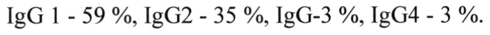
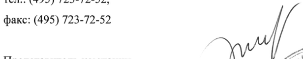

# Антитела против вируса гепатита В — парентерально

- Препарат: Неогепатект (раствор для инфузий;)
- АТХ: J06BB04
- Источник: ГРЛС, инструкция по медицинскому применению, РУ П N015018/01, файл от 2025-07-02 (https://grls.rosminzdrav.ru/Grls_View_v2.aspx?routingGuid=13fd4f5b-1c75-4c3a-bb62-c812a6ddefcb)
- Распознано автоматически (OCR): 14 из 14 стр.
- Инструкция к другому РУ того же препарата: П N015018/01 (национальное РУ, переоформленное по правилам ЕАЭС, решение от 18.06.2025). Текст может быть старше действующего
- Сомнительных строк после OCR: 2 (см. раздел «Проверка распознавания»)

## Общие сведения

— ы | / МИНЗДРАВ РОССИИ Я ОИ тат МИНИСТЕРСТВО ЗДРАВООХРАНЕНИЯ РОССИЙСКОЙ ФЕДЕРАЦИИ ры _ COFHACOBAHO .
ПО МЕДИЦИНСКОМУ ПРИМЕНЕНИЮ ЛЕКАРСТВЕННОГО ПРЕПАРАТА
Неогепатект Регистрационный номер:
Торговое наименование препарата: Неогепатект
Международное непатентованное или группировочное наименование:
Иммуноглобулин человека против гепатита В

## 3. Лекарственная форма

раствор для инфузий
раствор для инфузий

## 2. Состав

В 1 мл раствора содержится:
В 1 мл раствора содержится:
© Действующее вещество:
белки плазмы человека 50 мг из НИХ:
иммуноглобулин С* не менее 96 % иммуноглобулин А (IgA) не более 2 мг (4%)
Содержание антител против вируса гепатита В: 50 МЕ
Вспомогательные вещества:
Глицин 300 мкмоль Вода для инъекций до 1 мл
* Распределение подклассов иммуноглобулина С (IgG):
IgG 1 - 59 %, 1202 - 35 %, IgG-3 %, 1204 - 3 %.
© Описание Бесцветная или светло-желтая, прозрачная или слабо опалесцирующая жидкость.
Фармакотерапевтическая группа Иммуноглобулин.
Код ATX: JO6BB04.
Фармакологические свойства Фармакодинамика
Неогепатект содержит преимущественно иммуноглобулин G (IgG) с особо высоким содержанием антител к поверхностному антигену вируса гепатита В (HBsAg).

## 5.2. Фармакокинетика

Биодоступность Неогепатект при внутривенном введении составляет 100 %.
Биодоступность Неогепатект при внутривенном введении составляет 100 %.

Распределение между плазмой и внесосудистой жидкостью происходит быстро, период

полувыведения Неогепатект составляет в среднем 22 дня. Период полувыведения может

различаться у разных пациентов. Иммуноглобулин С и комплексы IgG утилизируются

клетками ретикулоэндотелиальной системы.

Данные доклинической безопасности

Иммуноглобулины являются нормальными составляющими человеческого организма.

Испытания токсичности при многократном введении и исследования эмбриофетальной

токсичности не целесообразны из-за индукции и интерференции антител. Влияние

лекарственного препарата на иммунную систему новорожденного не изучалось.

Поскольку опыт клинического применения не дает никаких указаний на канцерогенное и
© мутагенное действие иммуноглобулинов, экспериментальные исследования, в частности

на гетерологичных видах, не считаются необходимыми.

## 4.1. Показания к применению

- Иммунопрофилактика гепатита В у новорожденных, родившихся от матерей-носителей

вируса гепатита В.

- Иммунопрофилактика гепатита В у пациентов, не вакцинированных против гепатита В

или не имеющих документального подтверждения о проведенных прививках и

подвергшихся опасности заражения гепатитом В из-за контакта с материалом, в

отношении которого имелись подозрения на его инфицирование.

В таких случаях введение препарата рекомендуется осуществлять одновременно с

вакцинацией против гепатита В (одновременная активная и пассивная иммунизация).

Начатую таким образом вакцинацию следует продолжать в соответствии с инструкцией
- по применению вакцины.

- Пациентам с повышенным риском заражения вирусом гепатита В до или одновременно с

вакцинацией против гепатита В (перед операциями, повторной гемотрансфузией,

гемодиализом и т.п.).

- Профилактика реинфицирования вирусом гепатита В пациентов после трансплантации

печени в связи с печеночной недостаточностью, индуцированной вирусом гепатита В.

- Пациентам, у которых не наблюдается иммунный ответ (отсутствует достаточное

количество антител к вирусу гепатита В) после вакцинации, и которым нужна постоянная

профилактика из-за непрекращающегося риска инфицирования вирусом гепатита В.

## 4.3. Противопоказания

* Гиперчувствительность к действующему веществу, или к любому из вспомогательных

веществ, или к иммуноглобулину человека.

* Пациенты с селективным дефицитом IgA, вырабатывающие антитела к IgA, так как

введение препарата, содержащего IgA, может привести к анафилаксии.

## 4.6. Применение при беременности и в период грудного вскармливания

Безопасность применения данного лекарственного препарата во время беременности в

рамках контролируемых клинических исследований не установлена, поэтому беременным

и кормящим грудью женщинам его следует применять с осторожностью.

Беременность

Была показана способность внутривенно введенного иммуноглобулина С проникать через

плаценту, возрастающая в течение третьего триместра беременности. Опыт медицинского
© применения иммуноглобулинов не позволяет ожидать никакого вредного влияния на

течение беременности, а также на плод и новорожденного.

Период грудного вскармливания

Иммуноглобулины выделяются в материнское молоко. Никаких отрицательных эффектов

на новорожденных/младенцев, находящихся на грудном вскармливании, не

предполагается.

Фертильность

Опыт медицинского применения иммуноглобулинов показывает, что никаких

неблагоприятных эффектов на фертильность не должно ожидаться.

## 4.2. Способ применения и дозы

Способ введения

Перед введением Неогепатекта необходимо визуально проверить содержимое флакона.
w Раствор должен быть прозрачным или слабо опалесцирующим, от бесцветного до светло-

желтого. Мутный или содержащий частицы раствор применять запрещается. Перед

введением препарат должен быть доведен до комнатной температуры или температуры

тела. Неогепатект предназначен для внутривенной инфузии.

Препарат используется без предварительного разведения.

Начальная скорость инфузии должна составлять 0,1 мл/кг массы тела/час (см. раздел

«Особые указания»). В случае возникновения нежелательных реакций должна быть

снижена скорость введения препарата или инфузия должна быть прекращена. При

хорошей переносимости препарата через 10 мин после начала введения скорость можно

постепенно увеличить до 1 мл/кг массы тела/час.

Клинический опыт применения Неогепатект у новорожденных, родившихся от матерейносителей вируса гепатита В, показал, что препарат в дозе 2 мл, введенный в течение 5-15 мин, хорошо переносится.
Не допускается смешивать Неогепатект как с другими лекарственными средствами, так и с любыми другими препаратами иммуноглобулина человека для внутривенного введения.
Нельзя добавлять никакие другие препараты в раствор Неогепатекта, так как любое изменение концентрации электролита или значения рН может вызвать осаждение или денатурацию белков.
Раствор следует вводить сразу же после вскрытия флакона. Неиспользованный препарат и использованные материалы следует утилизировать в соответствии с местными требованиями.
© Рекомендуемые дозировки препарата:
Если не назначено иного, то рекомендуется следующее:
Для иммунопрофилактики гепатита В у новорожденных, родившихся от матерейносителей вируса гепатита В:
В периоде родоразрешения или сразу, как только будет возможно после рождения ребенка, однократно вводят 30 - 100 МЕ (0,6-2 мл) Неогепатект на кг массы тела.
Рекомендована срочная вакцинация против гепатита В. Первое введение вакцины может быть осуществлено в тот же день, что и введение Неогепатект, только в разные участки тела.
Для иммунопрофилактики гепатита В у неиммунизированных пациентов после контакта с материалом, подозрительным на содержание вируса гепатита В:
в зависимости от характера контакта, не менее 500 МЕ (10 мл), как можно раньше после w контакта, предпочтительно в течение 24-72 часов.
Для иммунопрофилактики при высоком риске заражения гепатитом В (например, в отделениях гемодиализа):
вводят однократно 8-12 ME (0,16-0,24 мл)/кг, максимально 500 МЕ (10 мл) каждые 2 месяца до формирования сероконверсии после вакцинации.
Пациентам, у которых не наблюдается иммунный ответ (отсутствует измеримое количество антител к вирусу гепатита В) после вакцинации, и которым нужна постоянная профилактика:
следует применять дозу 500 МЕ (10 мл) в случае взрослых и 8 МЕ (0,16 мл)/кг в случае детей, каждые 2 месяца; минимальный профилактический титр антител составляет 10 мМЕ/мл.
Профилактика реинфицирования вирусом гепатита В после трансплантации печени в связи с печеночной недостаточностью, индуцированной вирусом гепатита В:
Взрослые:
10000 МЕ в день трансплантации периоперационно, затем 2000-10000 МЕ (40-200 мл)/день в течение 7 дней, и при необходимости для поддержания уровня антител выше 100-150 МЕ/лу НВУ-ДНК-отрицательных пациентов и выше 500 МЕ/л у НВУ-ДНКположительных пациентов.
Дети:

& Дозировка должна корректироваться в зависимости от площади поверхности тела на основе 10000 ME/1,73 м".
Введение иммуноглобулина регистрируют в установленных учетных формах с указанием номера серии, даты выпуска, срока годности, предприятия-изготовителя, даты введения, дозы, реакции на введение.
Нарушение функции печени Отсутствуют данные, указывающие на необходимость корректировки дозы.
Нарушение функции почек Коррекция дозы не требуется, кроме случаев, когда это клинически обосновано (см.
раздел «Особые указания»).
Пациенты пожилого возраста Коррекция дозы не требуется, кроме случаев, когда это клинически обосновано (см.

- раздел «Особые указания»).

## 4.8. Побочное действие

Резюме профиля безопасности
Резюме профиля безопасности
Нежелательные реакции, вызываемые иммуноглобулинами человека нормальными (по убыванию частоты) включают (см. также раздел «Особые указания»):
* озноб, головную боль, головокружение, лихорадку, рвоту, аллергические реакции, тошноту, артралгию, пониженное артериальное давление и умеренную боль в нижней части спины обратимые гемолитические реакции; особенно у пациентов с группами крови A, Ви АВ и (редко) гемолитическую анемию, требующую переливания крови

* (редко) внезапное падение артериального давления и, в единичных случаях, анафилактический шок, даже если пациент при предыдущем введении препарата не проявлял гиперчувствительности
* (редко) транзиторные кожные реакции (включая кожную красную волчанку - частота неизвестна)
* (очень редко) тромбоэмболические реакции, такие как инфаркт миокарда, инсульт, эмболия легких, тромбозы глубоких вен
* случаи обратимого асептического менингита
* случаи повышения содержания креатинина в сыворотке крови и/или возникновения острой почечной недостаточности
* случаи связанного с трансфузией острого повреждения легких (ТКАЦШ-синдром).
© Табличное резюме нежелательных реакций
Ниже представлена таблица в соответствии с системно-органной классификацией
MedDRA (системно-органный класс и предпочтительный термин).
Частота встречаемости оценивалась в соответствии со следующими условными обозначениями: очень часто (>1/10); часто (>1/100, <1/10); нечасто (>1/1000, <1/100);
редко (>1/10000, <1/1000); очень редко (<1/10000); неизвестно (не может быть оценена на основании доступных данных).
Нежелательные реакции на основании клинических исследований:
В четырех клинических исследованиях побочных реакций Неогепатекта выявлено не было.
Нежелательные реакции на основании пострегистрационного опыта применения и неинтервенционных исследований (частота не известна — не может быть оценена на
- основании доступных данных):
медицинскому словарю для нормативно-правовой деятельности
MedDRA системы гиперчувствительность системы
Нарушения со стороны Тошнота

желудочно-кишечного

тракта

подкожных тканей

месте введения

Информацию о безопасности в отношении передающихся инфекционных агентов см. в разделе «Особые указания».
Дети

Предполагается, что нежелательные реакции у детей будут такими же, как у взрослых.
Сообщение о подозреваемых нежелательных реакциях

Важно сообщать о подозреваемых нежелательных реакциях после регистрации

© лекарственного препарата. Это позволяет обеспечить непрерывный мониторинг

соотношения "польза - риск" лекарственного препарата. Медицинским работникам рекомендуется сообщать о любых подозреваемых нежелательных реакциях лекарственного препарата через национальные системы сообщения.

## 4.9. Передозировка

Передозировка иммуноглобулинов может приводить к гиперволемии и повышению вязкости крови, в особенности у пациентов группы риска, в частности, у пациентов пожилого возраста, а также у пациентов с сердечной недостаточностью или нарушением функции почек (см. раздел «Особые указания»).

## 4.5. Взаимодействие с другими лекарственными средствами

Живые аттенуированные вирусные вакцины

В период не менее 6 недель и до 3 месяцев после введения иммуноглобулины могут

ww снижать эффективность применения живых аттенуированных вирусных вакцин против

таких заболеваний как корь, краснуха, эпидемический паротит и ветряная оспа.
Вакцинацию против этих заболеваний следует проводить не ранее чем по прошествии 3 месяцев после введения Неогепатекта.

Интервал между введением иммуноглобулина и коревой вакцины может быть увеличен до
1 года. В связи с этим пациентов, которым нужно сделать прививку против кори, необходимо вначале обследовать на наличие специфических антител.

Петлевые диуретики

Исключение одновременного применения петлевых диуретиков.

Дети

Перечисленные взаимодействия применимы для взрослых и детей.

## 4.4. Особые указания

Прослеживаемость Чтобы улучшить прослеживаемость биологических лекарственных препаратов, следует четко фиксировать наименование и номер серии вводимого препарата.
Прослеживаемость Чтобы улучшить прослеживаемость биологических лекарственных препаратов, следует четко фиксировать наименование и номер серии вводимого препарата.
Меры предосторожности при применении Мониторинг уровня антител к НВ$ антигену:
Пациенты должны находиться под регулярным наблюдением на предмет уровня антител к
HBs антигену вируса гепатита В в сыворотке. Дозировка должна корректироваться для поддержания терапевтических уровней антител, и чтобы избежать лечения недостаточными дозами (см. раздел «Способ применения и дозы»).
© Зачастую возможных осложнений можно избежать, удостоверившись, что пациенты:

* не проявляют чувствительность к иммуноглобулинам человека, путем предварительного медленного введения препарата (0,1 мл/кг массы тела/час).
* во время всего периода инфузии тщательно мониторируются на предмет возникновения любых симптомов. В частности, пациенты, никогда ранее не получавшие терапию препаратами иммуноглобулина человека, пациенты, переведенные с лечения другими иммуноглобулинами, или при длительном интервале с момента предыдущей инфузии.
Этих пациентов следует наблюдать в стационарном лечебном учреждении в течение первой инфузии и 1 час после ее окончания, с целью выявления возможного появления симптомов побочного действия. Все остальные пациенты должны находиться под наблюдением, по крайней мере, в течение 20 минут после окончания введения препарата.

| Особенно при применении в высоких дозах, внутривенное введение иммуноглобулина

- человека требует:
достаточного потребления жидкости до начала инфузии иммуноглобулинов человека
* контроля объема выделяемой мочи * контроля содержания креатинина в сыворотке крови
* исключения одновременного приема петлевых диуретиков (см. раздел «Взаимодействие с другими лекарственными средствами»).
В случае появления нежелательной реакции необходимо либо уменьшить скорость введения, либо прекратить введение препарата. Требуемое лечение зависит от характера и степени тяжести нежелательной реакции.
Инфузионные реакции Определенные нежелательные реакции (например, головная боль, приливы, озноб, миалгия, свистящее дыхание, тахикардия, боль в нижней части спины, тошнота и гипотензия) могут зависеть от скорости инфузии. Необходимо строго соблюдать скорость введения, рекомендуемую в разделе «Способ применения и дозы. Способ введения».
Необходимо проводить тщательный мониторинг и внимательное наблюдение пациентов на предмет возникновения любых симптомов на протяжении периода инфузии.
Нежелательные реакции могут возникать более часто

* в случае высокой скорости инфузии,

* у пациентов с гипо- или агаммаглобулинемией с дефицитом IgA или без него,

* у пациентов, получающих иммуноглобулины человека впервые, или, в редких случаях, при переходе на другой препарат иммуноглобулина человека, или при длительном

© интервале с момента предыдущей инфузии,

* у пациентов с нелеченной инфекцией или сопутствующим хроническим воспалением.
Гиперчувствительность Реакции гиперчувствительности встречаются редко.
Неогепатект содержит небольшое количество IgA. У лиц с дефицитом IgA вероятно образование антител к IgA, иу них могут наблюдаться анафилактоидные реакции после введения компонентов крови, содержащих IgA. Перед введением Неогепатект необходимо оценить соотношение пользы от применения препарата и потенциального риска возникновения реакций гиперчувствительности.
В редких случаях иммуноглобулин человека против гепатита В может вызвать падение кровяного давления с анафилактоидной реакцией даже у пациентов, которые ранее

| хорошю переносили лечение иммуноглобулином.

- При подозрении на реакции аллергического или анафилактического типа необходимо немедленно прекратить инъекцию. В случае шока следует применять стандартные методы противошоковой терапии.

Влияние на серологические тесты После введения Неогепатекта временное повышение различных пассивно введенных антител в крови пациента может привести к ложноположительным результатам серологического тестирования.
Пассивный перенос антител к антигенам эритроцитов, например, А, В, О, может искажать результаты некоторых серологических тестов на антитела к эритроцитам, например, прямого антиглобулинового теста (ПАГТ, прямая проба Кумбса).

Передающиеся инфекционные агенты Стандартные меры по предотвращению передачи инфекций вследствие применения лекарственных препаратов, изготовленных из крови или плазмы человека, включают отбор доноров, тестирование индивидуальных единиц крови или плазмы и пулов плазмы на наличие характерных маркеров инфекций и включение в производственный процесс эффективных этапов для инактивации/удаления вирусов. Несмотря на это, при применении лекарственных препаратов, приготовленных из крови или плазмы человека, невозможно полностью исключить вероятность передачи инфекционных агентов. Это положение применимо в том числе в отношении неизвестных или недавно открытых вирусов и других патогенов.
Предпринимаемые меры считаются эффективными в отношении вирусов с оболочкой,

S таких Как, вирус иммунодефицита человека (ВИЧ), вирус гепатита В (HBV) и вирус гепатита С (НСУ). Предпринимаемые меры могут быть малоэффективны против таких безоболочечных вирусов, как вирус гепатита A (HAV) и парвовирус B19.
Существует обнадеживающий клинический опыт относительно отсутствия передачи вируса гепатита А или парвовируса В19 с препаратами иммуноглобулинов, а также предполагается, что содержание антител вносит важный вклад в обеспечение вирусной безопасности.
Следующие нежелательные реакции были связаны с использованием иммуноглобулина человека нормального для внутривенного введения:
Тромбоэмболические осложнения Существуют клинические данные о возможной взаимосвязи между введением

| иммуноглобулина человека нормального для внутривенного введения и явлениями

- тромбоэмболии, такими как инфаркт миокарда, острое нарушение мозгового кровообращения (включая инсульт), эмболия лёгких и тромбозы глубоких вен, которые, как предполагается, связаны с относительным увеличением вязкости крови вследствие поступления высокой дозы иммуноглобулина у пациентов группы риска.
Следует соблюдать осторожность при назначении и проведении инфузии иммуноглобулина человека нормального для внутривенного введения пациентам с ожирением и с ранее установленными факторами риска развития тромбоэмболических осложнений (такими как, пожилой возраст, артериальная гипертензия, сахарный диабет и болезни сосудов или явления тромбозов в анамнезе, приобретенные или наследственные тромбофильные нарушения у пациентов, долгое нахождение пациентов в неподвижном

состоянии, тяжелая гиповолемия у пациентов, заболевания, при которых повышается вязкость крови, у пациентов).
У пациентов с риском развития тромбоэмболических нежелательных реакций препараты иммуноглобулина человека нормального для внутривенного введения следует вводить с минимальной скоростью инфузии и использовать в минимально возможной дозе.
Острая почечная недостаточность Сообщались случаи развития острой почечной недостаточности у пациентов, получавших терапию иммуноглобулином человека нормальным для внутривенного введения. В большинстве случаев были установлены факторы риска, такие как ранее установленная почечная недостаточность, сахарный диабет, гиповолемия, избыточная масса тела, сопутствующее лечение лекарственными препаратами, оказывающими нефротоксическое
© действие, или возраст старше 65 лет.
Перед инфузией иммуноглобулина человека нормального для внутривенного введения следует провести оценку функции почек, особенно у пациентов с потенциальным повышенным риском развития острой почечной недостаточности, а также повторно с определенными интервалами. У пациентов с риском развития острой почечной недостаточности препараты иммуноглобулина человека нормального для внутривенного введения следует вводить с минимальной скоростью инфузии и использовать в минимально возможной дозе. В случае нарушения функции почек следует рассмотреть необходимость отмены терапии иммуноглобулином человека нормальным для внутривенного введения.
Среди сообщений о случаях развития нарушения функции почек и острой почечной
| недостаточности, развивающихся на фоне приема многих зарегистрированных препаратов
- иммуноглобулина человека нормального для внутривенного введения, содержащих в своем составе различные вспомогательные вещества, такие как, сахароза, глюкоза и мальтоза, доля препаратов, содержащих в качестве стабилизатора сахарозу, была непропорционально высока.
У пациентов, находящихся в группе риска, может быть рассмотрено применение препаратов иммуноглобулина человека, которые не содержат указанные вспомогательные вещества. Неогепатект не содержит в своем составе сахарозу, мальтозу или глюкозу.
Синдром асептического менингита (САМ)
При лечении иммуноглобулином человека нормальным для внутривенного введения были зарегистрированы случаи развития САМ. Синдром обычно развивается в течение периода от нескольких часов до двух дней после терапии иммуноглобулином человека нормальным для внутривенного введения. При проведении исследования спинномозговой жидкости (СМЖ) часто наблюдается плеоцитоз до нескольких тысяч клеток на мм?, преимущественно, за счет клеток гранулоцитарного ряда, а также повышенная концентрация белка, до нескольких сотен мг/дл.
САМ может развиваться чаще на фоне применения иммуноглобулина человека нормального для внутривенного введения в высоких дозах (2 г/кг).
Пациенты с такими признаками и симптомами должны пройти полное неврологическое обследование, включая исследования СМЖ, чтобы исключить другие причины менингита.
Прекращение терапии иммуноглобулином человека нормальным для внутривенного введения приводило к ремиссии САМ в течение нескольких дней без каких-либо

© последствий.
Гемолитическая анемия Препараты иммуноглобулина человека нормального для внутривенного введения могут содержать антитела против антигенов групп крови, которые могут действовать как гемолизины и вызывать склеивание эритроцитов под действием иммуноглобулина in Vivo, что может являться причиной положительного прямого антиглобулинового теста (проба
Кумбса) и, редко, гемолиза. Гемолитическая анемия может развиться после терапии иммуноглобулином человека нормальным для внутривенного введения в связи с повышенной секвестрацией эритроцитов. Необходимо проводить мониторинг клинических признаков и симптомов гемолиза у пациентов, получающих терапию иммуноглобулином человека нормальным для внутривенного введения (см. раздел
«Побочное действие»).

- Нейтропения/лейкопения
Сообщалось о транзиторном снижении числа нейтрофилов и/или эпизодах нейтропении, иногда тяжелой, после лечения иммуноглобулином человека нормальным для внутривенного введения. Данное явление обычно развивается в течение нескольких часов или дней после введения иммуноглобулина человека нормального для внутривенного введения и исчезает самопроизвольно в течение 7-14 дней.
Связанное с трансфузией острое повреждение легких (ТКАШ-синдром)
Зарегистрировано некоторое количество сообщений о случаях острого некардиогенного отека легких (ТКАП-синдром) у пациентов, получавших лечение иммуноглобулином человека нормальным для внутривенного введения. ТКАШ-синдром характеризуется

Ie тяжелой гипоксией, одышкой, тахипноэ, цианозом, лихорадкой и гипотензией. Симптомы
ТКАП-синдрома обычно развиваются во время или в течение 6 часов после трансфузии, часто в течение 1-2 часов. Поэтому пациенты, получающие терапию иммуноглобулином человека нормальным для внутривенного введения, должны контролироваться на предмет легочных нежелательных реакций и инфузия иммуноглобулина человека нормального для внутривенного введения должна быть немедленно остановлена в случае появления таких реакций. ТКАЦ-синдром — это потенциально угрожающее жизни состояние, требующее немедленной госпитализации в отделение интенсивной терапии.

## 4.7. Влияние на способность управлять транспортными средствами, механизмами

Неогепатект оказывает незначительное влияние на способность управлять транспортными средствами и механизмами. Для пациентов, у которых наблюдаются нежелательные

© реакции во время лечения, управление транспортными средствами или механизмами возможно только после исчезновения симптомов нежелательных реакций.

## 6.5. Форма выпуска

Раствор для инфузий, 50 МЕ/мл.
Раствор для инфузий, 50 МЕ/мл.
По 2 мл или 10 мл препарата во флаконах из бесцветного стекла, укупоренных пробками с алюминиевыми колпачками, снабженными крышками из полипропилена («флип-офф»)
для предохранения центральной части.
По 40 мл препарата во флаконах из бесцветного стекла, укупоренных пробками с алюминиевыми колпачками.
По 1 флакону вместе с инструкцией по применению в картонной пачке.
Картонная пачка заклеена сверху и снизу самоклеящейся пленкой (контроль первого вскрытия).

- Условия хранения
Хранить при температуре от 2 до 8 °С в сухом защищенном от света месте.
Не замораживать!
Хранить в недоступном для детей месте.
Транспортирование При температуре от 2 до 8 °С. Не замораживать!

## 6.3. Срок годности

2 года.
2 года.
Не применять по истечении срока годности.
Условия отпуска

Отпускают по рецепту.
Производитель BIOTEST Pharma GmbH Биотест Фарма ГмбХ
Landsteinerstrasse 5, Ландштайнерштрассе 5,
D-63303 Dreieich, D-63303 Драйайх, Germany Германия
Представительство Биотест Фарма ГмбХ в России/организация, принимающая претензии:
119334, г. Москва, ул. Вавилова, д. 5, тел.: (495) 723-72-52, факс: (495) 723-72-52 Г
© Представитель компании Е 2 Pymep Л.Н ИУ м Ам
| Sy < $ ь A\\ = wed 5. \^\ (3-f oO Fe \e 5 ao 32 AS al —\ Nn & é a)
Фи 0007 Se Bund
## Проверка распознавания

Страницы-сканы распознаны автоматически. В 2 строках с дозировками цифры могли распознаться с ошибкой — сверьте с вырезкой из оригинала:

- стр. 1: «IgG 1 - 59 %, 1202 - 35 %, IgG-3 %, 1204 - 3 %.» — низкая уверенность: «1204» (66); повторное чтение: «IgG 1 - 59 %, 1202 - 35 %, [20-3 %, 1204 - 3 %.»  
  
- стр. 14: «факс: (495) 723-72-52 Г» — повторное чтение: «mo me Sif»  
  
