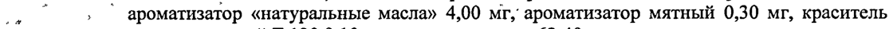
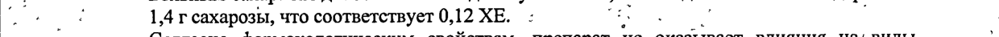

# Аскорбиновая кислота + Тетракаина гидрохлорид + Хлоргексидина диацетат — внутрь

- Препарат: Анти-Ангин® Формула (пастилки;)
- АТХ: R02AA20
- Источник: ГРЛС, инструкция по медицинскому применению, РУ П N015460/02, файл от 2023-06-26 (https://grls.rosminzdrav.ru/Grls_View_v2.aspx?routingGuid=e3c735ea-9887-42d9-be12-630befb7150a)
- Распознано автоматически (OCR): 4 из 4 стр.
- Инструкция найдена по торговому наименованию: Анти-Ангин® Формула, РУ П N015460/02
- Сомнительных строк после OCR: 3 (см. раздел «Проверка распознавания»)

## Общие сведения

| `` .. И cys . .* П№15460/02-290411 ' ; , .
. * ‘ ., `, 5 . „ ы | й . a 4 м ИНСТРУКЦИЯ | по медицинскому применению препарата
АНТИ-АНГИН ФОРМУЛА - Регистрационный помер: ТИ А
7 Торговое название: . .
у АНТИ-АНГИН ФОРМУЛА . у °, fart te ee ee
: . Международное непатентованное название или группировочное название: .
| . Тетракаин + Хлоргексидин + Аскорбиновая кислота & |
| Лекарственная форма:
® Пастилки ; | , , Состав на одну пастилку: | | р A, ;
. Активные вещества: , ; . , Хлоргексидина диацетат 2,00 мг у
‹ * Тетракаина гидрохлорид 0,20 мг me, , .
co Аскорбиновая кислота 50,00 мг .. , Se, |
. Вспомогательные вещества: декстрозы сироп 945,00 - мг, сахароза 1435,00 мг, | 4 ‚ ароматизатор «натуральные масла» 4,00 мг, ароматизатор мятный 0,30 мг, краситель
| .. кармин красный Е 120 0,10 мг, вода очищенная 63,40 мг. р : ; |
+ 4 м ° : 4 ay `. : Описание: 4 2’ ` | ры
: о Плоские круглые, со скошенным краем пастилки с шероховатой поверхностью от |
О розового до розовато-красного цвета ‘co специфическим запахом. Допускается неравномерность окрашивания, наличие пузырьков воздуха в карамельной массе и
” ` . Незначительная неровность краев. ,’ - . - ,
‘, ® Фармакотерапевтическая группа: .
` Антисептическое средство + местноанестезирующее средство. , |
; Код ATX: [RO2AA20] . . | Фармакологическое действие:
Хлоргексидин оказывает бактерицидное и бактериостатическое действие.
Обладает широким антибактериальным спектром действия ‘в отношении грамположительных и грамотрицательных бактерий, активен в отношении Candida albicans. Хлоргексидин особенно активен в отношении Streptococcus mutans, |
Streptococcus salivarius, Escherichia coli и анаэробных бактерий. ` Менее эффективен в | отношении таких видов микроорганизмов как Streptococcus spp., Proteus spp.,
- Pseudomonas spp., Klebsiella spp., Veillonella spp. . И | р Анестетик тетракаин, оказывает местноанестезирующее действие. Анестезирующий |
; ‚ “ эффект наступает через 1-2 минуты после применения. °`.. |
: 7 ° ‘ ; ' ы ~ poe . _ ° . > - | et | . р |
‘ a | 7 53414 a р ’ ve - st ang 4 * , 1, у р у "_
, К О КО : . JIN015460/02-290411 | , ‘ . . | oo Аскорбиновая кислота участвует в процессе синтеза коллагена и тканевой регенерации, |
, регулировании окислительно-восстановительных процессов, усиливает иммунные |
. реакции. За счет снижения проницаемости капилляров, способствует уменьшению
- воспаления и отека слизистых оболочек полости рта и глотки. |
; Показания: а о Профилактика и лечение инфекционно-воспалительных заболеваний полости рта и а глотки (в том числе тонзиллита, фарингита, начальной стадии ангины, стоматита, . :
a гингивита, пародонтоза, состояния после тонзиллэктомии или экстракции зуба).
и: "7°" Противопоказания: ^^ 77 обоя соя еее ет ое a
. . Повышенная чувствительность к компонентам препарата, детский возраст до 5 лет, о I триместр беременности, дефицит сахаразы / изомальтазы, непереносимость фруктозы,
| глюкозо-галактозная мальабсорбция, гиперчувствительность (в том числе, к другим |
| , местноанестезирующим ‘лекарственным средствам группы эфиров или |
® ‚’., парааминобензойной кислоте и ее производным).'. ‚ _ ( р |
“’ ‚ С осторожностью: | a 7 a - ИИ ВИ | -` Во Пи Ш триместрах беременности по назначению врача, В ‘период.лактанции, при
, . ‚ сахарном. диабете, дефиците глюкозо-6-фосфатдегидрогеназы, гемохроматозе, |
, т сидеробластной‘ анемии, талассемии, гипероксалурии, оксалозе и мочекаменной
И болезни. 7 . Loe, ne 7 : ‚ Способ применения: =, | | Г. ; 4 о - :
oe Местно. Медленно рассасывать до полного растворения во рту.’ -’’`. т те - Взрослые и дети с 15 лет: по 1 пастилке каждые 2 часа, но не более 6 пастилок в
_ _ день. | , | . : . ” ° . | о -` Дети с 10 до 15 лет: по 1 пастилке каждые 3 часа, но не более 4 пастилок в день.
, - Дети с 5 до 10 лет: по 1 пастилке каждые 4 часа, но не более 3 пастилок в день. | |
К Курс лечения составляет не более 5 дней © |’ `..- ; .
co Побочные действия: › а, И | . ®.. . Возможны аллергические реакции (у пациентов с повышенной чувствительностью к компонентам препарата). : °
‘ Превышение рекомендуемого срока терапии ` может ` вызвать кратковременное a . нарушение вкуса); также возможно повреждение зубной эмали (окрашивание, |
° отложение зубного камня). ` Передозировка:
Симптомы: головокружение, общая слабость, цианоз, возбуждение, беспокойство, | мышечный тремор, нарушение дыхания, тошнота, рвота. |
Лечение: промывание желудка, назначение солевых слабительных; симптоматическая терапия. . |

## 4.5. Взаимодействие с другими лекарственными средствами

OS : ‘ . одновременное применение с йодом. Этанол усиливает эффект препарата. т, |
| о 5341472 _ ot oe BT ett, С... , | „. П №015460/02-290411 | ee
| о Тетракаин снижает антибактериальную активность сульфаниламидных препаратов.
| Сосудосуживающие средства удлиняют эффект и уменьшают токсичность тетракаина. |
, Аскорбиновая кислота повышает концентрацию в крови бензилпенициллина и |
> тетрациклинов. Улучшает ‚всасывание в кишечнике препаратов’ железа. Снижает |
: эффективность гепарина и непрямых антикоагулянтов. Увеличивает риск развития | кристаллурии при лечении салицилатами и сульфаниламидами короткого действия, | снижает концентрацию в крови пероральных контрацептивов. и

## 4.4. Особые указания

‚^ ; - ‘ | Не рекомендуется применять одновременно с препаратами для лечения полости рта и |
‚^ ; - ‘ | Не рекомендуется применять одновременно с препаратами для лечения полости рта и |
~~ ГДотки, содержащими” Hon” (раствор "Люголя, повидон-йод).- Аскорбиновая - кислота; --.--— и, ` входящая в состав препарата, может ‘изменять результаты некоторых лабораторных | т тестов, о чем следует сообщить при проведении анализов. : и . | oo Больным сахарным диабетом необходимо учитывать, что в одной пастилке содержится
| oe 1,4 г сахарозы, что соответствует 0,12 ХЕ. : Ee, _ | |
| @ . Согласно фармакологическим свойствам, препарат He оказывает влияния Ha‘ виды 7
‚деятельности, ‘требующие повышенной концентрации‘ внимания и ‘быстроты _ 7 психомоторных реакций. ; | К СЗО о. : `Применение препарата более 5 дней‘ нежелательно из-за возможного ` нарушения 7 woth нормальной микрофлоры полости рта и глотки. Не ‚следует принимать ‚пастилки | о непосредственно перед приемом пищи или во время еды.’ После приема препарата не | а рекомендуется чистить зубы, поскольку содержащиеся в зубной пасте поверхностно- |
| | активные вещества способны инактивировать хлоргексидин. ^“ ‘2.7 “” Г. | ae Препарат может повлиять на результаты антидопингового контроля. ‚ = ue и Форма выпуска: soo м Spt | и Пастилки. —- SM ols ST |
| : По 2, 4, 6, 8, 10, 12 пастилок в блистере ПВХ/А1. и. (о |
По 1, 2, 3, 4, 5, 10, 15 блистеров в картонной пачке, ‹ В | 5 - с инструкцией по применению. © ° Te в. = | й Условия хранения: | ° А a В |
® ”. При температуре не выше 25 °С. , .’ и” |
Хранить в недоступном для детей месте! | ‚ ^ . |
; - Срок годности: - | : 3 roma. sf `` | oo He применять по истечении срока годности. ` | О |
| | | Условия отпуска из аптек: | ‘ Без рецепта.
| | Производитель:
Натур Продукт Европа Б.В., о Твейберг 17, 5246 XL Розмален, Нидерланды ,
' . ye ‘ .’ ет, т. 1 ont у у . .. 53414 3
. а a , . ..* ;
TI №015460/02-290411 Представительство в России/адрес организации принимающей претензии:
ЗАО «Натур Продукт Интернэшнл»
194044, Санкт-Петербург, Финляндский пр., д. 4, литер A
Тел.: 8-800-100-03-08 (Звонок по России бесплатный).
Представитель фирмы: ont | иректор медицинского департа ета рн og у
АО «Натур Продукт Интернэцй 3 y SIN И.В. Каулина-Оржешковская
#2 KAN ^ НЫЙ + ol yam” ЕЕ a7. $ ® ее.
Ска “ ope 5 M3CP РФ x > ЭКСПЕРТНЫЙ ОТЧЕТ |= lo ДЕЙСТВИТЕЛЕН ДЛЯ ДАННОЙ
8 ВЕРСИИ ДОКУМЕНТА =
20 9 90 6 0000.
53414
## Проверка распознавания

Страницы-сканы распознаны автоматически. В 3 строках с дозировками цифры могли распознаться с ошибкой — сверьте с вырезкой из оригинала:

- стр. 1: «. Вспомогательные вещества: декстрозы сироп 945,00 - мг, сахароза 1435,00 мг, |» — низкая уверенность: «945,00» (16); повторное чтение: «Ё | Вспомогательные вещества: декстрозы сироп 945,00 - мг, сахароза 1435,00 мг, |»  
  
- стр. 1: «4 ‚ ароматизатор «натуральные масла» 4,00 мг, ароматизатор мятный 0,30 мг, краситель» — низкая уверенность: «4» (79); повторное чтение: «о ‚ ` ароматизатор «натуральные масла» 4,00 мг, ароматизатор мятный 0,30 мг, краситель»  
  
- стр. 3: «| oe 1,4 г сахарозы, что соответствует 0,12 ХЕ. : Ee, _ | |» — повторное чтение: «“+ БЫ гоажарозы, что соответетвует 0,12 ХЕ 2»  
  
