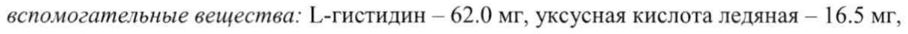
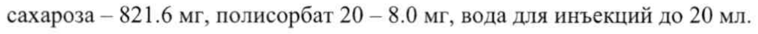
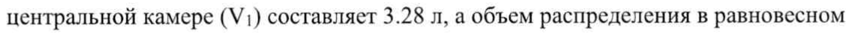
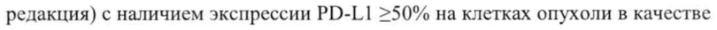
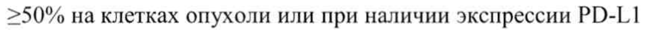
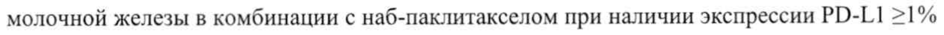

# Атезолизумаб — парентерально

- Препарат: Тецентрик® (концентрат для приготовления раствора для инфузий;)
- АТХ: L01FF05
- Источник: ГРЛС, инструкция по медицинскому применению, РУ ЛП-004652, файл от 2022-11-29 (https://grls.rosminzdrav.ru/Grls_View_v2.aspx?routingGuid=5c16b963-32c3-44d5-a47b-7cf1aafab9be)
- Распознано автоматически (OCR): 37 из 37 стр.
- Инструкция к другому РУ того же препарата: ЛП-004652 (национальное РУ, переоформленное по правилам ЕАЭС, решение от 09.11.2022). Текст может быть старше действующего
- Сомнительных строк после OCR: 6 (см. раздел «Проверка распознавания»)

## Общие сведения

МИНИСТЕРСТВО ЗДРАВООХРАНЕНИЯ РОССИЙСКОЙ ФЕДЕРАЦИИ
ИНСТРУКЦИЯ ПО МЕДИЦИНСКОМУ ПРИМЕНЕНИЮ ЛЕКАРСТВЕННОГО ПРЕПАРАТА
ТЕЦЕНТРИК® Регистрационный номер eT TT ae
ЛП-004652 | | 091177 | СОГЛАСОВАНО Торговое наименование L = ны
Тецентрик® Международное непатентованное или группировочное наименование
Атезолизумаб Лекарственная форма Концентрат для приготовления раствора для инфузий

## 2. Состав

1 флакон 20 мл с препаратом содержит:
1 флакон 20 мл с препаратом содержит:
действующее вещество: атезолизумаб — 1200 мг;
вспомогательные вещества: 1.-гистидин — 62.0 мг, уксусная кислота ледяная - 16.5 мг, сахароза — 821.6 mr, полисорбат 20 - 8.0 мг, вода для инъекций до 20 мл.
| 1 флакон 14 мл с препаратом содержит:
действующее вещество: атезолизумаб - 840 мг;
вспомогательные вещества: [.-гистидин - 43.4 мг, уксусная кислота ледяная — 11.5 мг, сахароза — 575.1 mr, полисорбат 20 — 5.6 мг, вода для инъекций до 14 мл.
Описание Прозрачная или опалесцирующая жидкость от бесцветного до коричневато-желтого цвета.
| Фармакотерапевтическая группа Противоопухолевое средство — антитела моноклональные.
В Код АТХ ГОТЕЕО5 Фармакологические свойства

## 5.1. Фармакодинамика

Механизм действия При связывании лиганда РО-Г.1 (лиганд рецептора программируемой клеточной смерти 1, также называемого РО-1) с рецепторами РО-1 и B7.1, находящимися на Т-лимфоцитах, происходит угнетение цитотоксической активности Т-лимфоцитов. Данное угнетение происходит посредством ингибирования пролиферации Т-лимфоцитов и продукции цитокинов. РО-[.1 может экспрессироваться на опухолевых клетках и инфильтрирующих опухоль иммунных клетках и участвовать в подавлении противоопухолевого иммунного ответа в микроокружении опухоли.
Механизм действия При связывании лиганда РО-Г.1 (лиганд рецептора программируемой клеточной смерти 1, также называемого РО-1) с рецепторами РО-1 и B7.1, находящимися на Т-лимфоцитах, происходит угнетение цитотоксической активности Т-лимфоцитов. Данное угнетение происходит посредством ингибирования пролиферации Т-лимфоцитов и продукции цитокинов. РО-[.1 может экспрессироваться на опухолевых клетках и инфильтрирующих опухоль иммунных клетках и участвовать в подавлении противоопухолевого иммунного ответа в микроокружении опухоли.
Атезолизумаб — это гуманизированное моноклональное антитело из класса иммуноглобулинов С1 (IgG1) с видоизмененным Ес-фрагментом, которое непосредственно связывается с PD-L1 и блокирует его взаимодействие с рецепторами PD1 и B7.1. Таким образом, атезолизумаб способствует прекращению опосредованного PD-
@ L1/PD-1 подавления иммунного ответа и вызывает реактивацию противоопухолевого

иммунитета. Атезолизумаб не затрагивает взаимодействие рецептора РО-1 с лигандом PDL2. Блокада рецептора PD-L1 у мышей с генетически родственными моделями опухолей приводит к уменьшению опухолевого роста.
Мутации в кодоне 600 (V600) гена ВКАЕ (v-raf murine sarcoma viral oncogene homolog B1)
вызывают гиперактивацию сигнального пути MAPK (митоген-активируемой протеинкиназы), что приводит к пролиферации опухолевых клеток, повышению их выживаемости и подавлению их распознавания иммунной системой. Двойное ингибирование МАРК пути посредством ингибиторов BRAF u MEK (митогенактивируемая внеклеточная сигнал-регулируемая киназа) подавляет опухолевый рост и повышает иммуногенность опухоли. Это происходит за счет улучшения презентации антигена при увеличении инфильтрации Т-лимфоцитов в опухоль. В животных моделях

добавление атезолизумаба к кобиметинибу и вемурафенибу в дальнейшем уменьшает

| опухолевый рост и приводит к более высокой клеточной инфильтрации и активации по сравнению с применением только таргетной терапии.
Иммуногенность При применении атезолизумаба возможно развитие реакции со стороны иммунной системы. Положительные результаты анализа на возникшие после начала терапии

| антитела к атезолизумабу (АТА) отмечались у 13.1-36.4% пациентов. Положительные результаты анализа на нейтрализующие антитела к атезолизумабу (НАА) отмечались у 4.3-19.7% пациентов. Статус АТА и HAA не оказывал клинически значимого влияния на фармакокинетику, эффективность или безопасность атезолизумаба.
Данные по иммуногенности в значительной степени зависят от различных факторов, таких как чувствительность и специфичность метода, методология проведения анализа, а также обращение с образцами и время их забора, прием сопутствующих препаратов и характер основного заболевания. Таким образом, сравнение частоты встречаемости антител к препарату Тецентрик® и частоты встречаемости антител к другим препаратам может быть некорректным.
Доклинические данные безопасности Канцерогенность: канцерогенный потенциал атезолизумаба не исследовался.
Генотоксичность: мутагенный потенциал атезолизумаба не исследовался.
Влияние на фертильность: исследования фертильности при применении атезолизумаба не
| проводились. Тем не менее, в рамках исследования хронической токсичности у яванских макак было выявлено, что препарат Тецентрик® оказывал влияние на менструальный цикл у всех самок обезьян, получавших дозу препарата 50 мг/кг, что проявлялось
& нерегулярностью цикла BO время фазы дозирования и коррелировало с отсутствием вновь сформированного желтого тела в яичниках при терминальной некропсии. Данный эффект был обратим после отмены препарата. Влияние на мужские репродуктивные органы не отмечалось.
Репродуктивная токсичность: исследования тератогенности или токсичности в отношении репродуктивной системы при применении препарата Тецентрик*® не проводились. Установлено, что путь передачи сигнала PD-L1/PD-1| является ключевым для установления иммунологической толерантности материнского организма к плоду, а значит и для выживаемости плода во время беременности. Ожидается, что применение препарата Тецентрик® будет оказывать неблагоприятное влияние на течение беременности, а также подвергать плод риску и потенциально вызывать гибель эмбриона.

## 5.2. Фармакокинетика

Фармакокинетические параметры атезолизумаба при введении в дозе 840 мг | разв 2 недели и в дозе 1200 мг | раз в 3 недели сопоставимы.
Фармакокинетические параметры атезолизумаба при введении в дозе 840 мг | разв 2 недели и в дозе 1200 мг | раз в 3 недели сопоставимы.
Фармакокинетика атезолизумаба изучалась при применении доз 0.01-20 мг/кг и фиксированной дозы 1200 мг каждые 3 недели, а также фиксированной дозы 840 мг каждые 2 недели у различных пациентов. Экспозиция атезолизумаба повышалась пропорционально дозе в диапазоне доз от | мг/кг до 20 мг/кг.
| ИИ Фармакокинетика атезолизумаба описана с использованием линейной двухкамерной модели распределения с элиминацией первого порядка для диапазона доз 1-20 мг/кг.
Согласно фармакокинетическому моделированию общая экспозиция атезолизумаба была сопоставима при применении в дозе 840 мг каждые 2 недели, 1200 мг каждые 3 недели и 1680 мг каждые 4 недели. При этом равновесное состояние достигалось через 6-9 недель при многократном введении атезолизумаба. Коэффициент максимального системного накопления для различных режимов дозирования составляет 3.3.
На основании анализа экспозиции, данных профиля эффективности и безопасности следующие факторы не оказывали клинически значимого эффекта: возраст 21-89 лет,

| масса тела, пол, наличие ATA, уровень альбумина, опухолевая нагрузка, нарушение

| функции почек, нарушение функции печени легкой степени тяжести, уровень экспрессии
PD-LI1 или статус по шкале ECOG (шкала Восточной Кооперативной Группы

| Исследования Paka), а также регион или этническая принадлежность пациента.
Всасывание Препарат Тецентрик* вводится внутривенно. Другие пути введения препарата не

| изучались.
Распределение

Ф Согласно результатам анализа популяционной фармакокинетики объем распределения в

центральной камере (V1) составляет 3.28 л, а объем распределения в равновесном состоянии (Vss) — 6.91 л у среднестатистического пациента.
Метаболизм Исследований метаболизма атезолизумаба не проводилось. Как и другие антитела, атезолизумаб преимущественно подвергается катаболизму.
Выведение Клиренс атезолизумаба составляет 0.200 л/день, а среднестатистический период полувыведения (11/2) — 27 дней (согласно результатам анализа популяционной фармакокинетики).
Фармакокинетика у особых групп пациентов
Пациенты пожилого возраста

| У пациентов пожилого возраста отдельных исследований фармакокинетики атезолизумаба

не проводилось.
Согласно результатам анализа популяционной фармакокинетики у пациентов в возрасте от 21 года до 89 лет возраст не оказывает значимого влияния на фармакокинетику атезолизумаба. Клинически значимых различий фармакокинетики атезолизумаба у пациентов младше 65 лет, в возрасте 65-75 лет и пациентов старше 75 лет не наблюдалось

(см. подраздел «Особые указания по дозированию» раздела «Способ применения и дозы»). |
Пациенты с нарушением функции почек У пациентов с нарушением функции почек отдельных исследований фармакокинетики атезолизумаба не проводилось.
Согласно результатам анализа популяционной фармакокинетики не наблюдалось клинически значимых различий клиренса атезолизумаба у пациентов с нарушением функции почек легкой (расчетная скорость клубочковой фильтрации (рСКФ) 60-89 мл/мин/1,73 м²) или средней (рСКФ 30-59 мл/мин/1,73 м²) степеней тяжести по сравнению с пациентами с нормальной функцией почек (pCK® более или равно 90 мл/мин/1,73 м²).
Нарушение функции почек тяжелой степени (pCK® 15-29 мл/мин/1,73 м²) отмечалось у небольшого количества пациентов в клинических исследованиях, в связи с чем не известно оказывает ли тяжелая почечная недостаточность влияние на фармакокинетику атезолизумаба (см. подраздел «Особые указания по дозированию» раздела «Способ применения и дозы»).
Пациенты с нарушением функции печени Отдельных исследований фармакокинетики атезолизумаба у пациентов с нарушением

® функции печени не проводилось. Не наблюдалось клинически значимых различий клиренса атезолизумаба у пациентов с нарушением функции печени легкой степени тяжести (концентрация билирубина < верхней границы нормы (ВГН) и активность аспартатаминотрансферазы (АСТ) > ВГН или концентрация билирубина >1.0-1.5 х ВГН при любой активности АСТ) или средней степени тяжести (концентрация билирубина
>1.5-3.0 х ВГН при любой активности АСТ).
Данные для пациентов с нарушением функции печени тяжелой степени тяжести
(концентрация билирубина >3.0 х ВГН при любой активности АСТ) отсутствуют.
Нарушение функции печени определялось в соответствии с критериями Национального института рака (NCI) (см. подраздел «Особые указания по дозированию» раздела «Способ применения и дозы»).

## 4.1. Показания к применению

Уротелиальный рак
Уротелиальный рак
Монотерапия местнораспространенного или метастатического уротелиального рака у взрослых пациентов
- Местнораспространенный или метастатический уротелиальный рак у пациентов, которые ранее получали платиносодержащую химиотерапию.

- Местнораспространенный или метастатический уротелиальный рак с наличием экспрессии PD-L1 >5% на иммунокомпетентных клетках, инфильтрирующих ткань опухоли, при невозможности лечения цисплатином.
- Местнораспространенный или метастатический уротелиальный рак при невозможности проведения любой платиносодержащей химиотерапии независимо от уровня экспрессии
РО-Г1.
Немелкоклеточный рак легкого Адъювантная монотерапия немелкоклеточного рака легкого у взрослых пациентов |
Немелкоклеточный рак легкого стадий II - ША (система стадирования UICC/AJCC, 7-я редакция) с наличием экспрессии РО-Г1 >50% на клетках опухоли в качестве адъювантной терапии после полной хирургической резекции и последующей химиотерапии на основе препаратов платины.
Монотерапия местнораспространенного или метастатического немелкоклеточного рака легкого у взрослых пациентов
- Метастатический немелкоклеточный рак легкого с наличием экспрессии PD-L1
>50% на клетках опухоли или при наличии экспрессии PD-L1
>10% на иммунокомпетентных клетках, инфильтрирующих ткань опухоли, при

® отсутствии EGFR или ALK геномной опухолевой мутации, в первой линии терапии.
- Местнораспространенный или метастатический немелкоклеточный рак легкого после предшествующей химиотерапии независимо от уровня экспрессии РО-1[.1. Пациенты с
EGFR или ALK геномной опухолевой мутацией должны также получить таргетную терапию перед началом терапии препаратом Тецентрик®.
Комбинированная терапия метастатического неплоскоклеточного немелкоклеточного рака легкого у взрослых пациентов независимо от уровня экспрессии PD-L]
- Метастатический неплоскоклеточный немелкоклеточный рак легкого в комбинации с бевацизумабом, паклитакселом и карбоплатином в первой линии терапии. У пациентов с немелкоклеточным раком легкого с EGFR или ALK геномной опухолевой мутацией препарат Тецентрик® в комбинации с бевацизумабом, паклитакселом и карбоплатином показан только после неэффективности соответствующей таргетной терапии.
- Метастатический неплоскоклеточный немелкоклеточный рак легкого в комбинации с наб-паклитакселом и карбоплатином в первой линии терапии при отсутствии EGFR или
ALK геномной опухолевой мутации.
Мелкоклеточный рак легкого Комбинированная терапия мелкоклеточного рака легкого у взрослых пациентов

| | | Распространенный мелкоклеточный рак легкого в комбинации с карбоплатином и этопозидом в первой линии терапии независимо от уровня экспрессии PD-L1.
Тройной негативный рак молочной железы Комбинированная терапия неоперабельного местнораспространенного или метастатического тройного негативного рака молочной железы у взрослых пациентов
Неоперабельный местнораспространенный или метастатический тройной негативный рак молочной железы в комбинации с наб-паклитакселом при наличии экспрессии РО-Г1 21% на иммунокомпетентных клетках, инфильтрирующих ткань опухоли, у пациентов без предшествующей химиотерапии по поводу метастатического заболевания.
Гепатоцеллюлярная карцинома Комбинированная терапия гепатоцеллюлярной карциномы у взрослых пациентов
Неоперабельная гепатоцеллюлярная карцинома в комбинации с бевацизумабом у пациентов без предшествующей системной терапии независимо от уровня экспрессии PDLl.
Меланома Комбинированная терапия неоперабельной или метастатической меланомы у взрослых пациентов
6 Неоперабельная или метастатическая меланома с BRAF V600 мутацией в комбинации с препаратами Котеллик® и Зелбораф® независимо от уровня экспрессии РО-1.1.

## 4.3. Противопоказания

Гиперчувствительность к атезолизумабу или любому компоненту препарата в анамнезе.
Гиперчувствительность к атезолизумабу или любому компоненту препарата в анамнезе.

## 4.6. Применение при беременности и в период грудного вскармливания

Детский возраст до 18 лет (эффективность и безопасность применения препарата
Тецентрик® у детей и подростков <18 лет не изучались).

## 4.3. С осторожностью

Нарушение функции печени тяжелой (концентрация билирубина >3.0 x ВГН и любая активность АСТ) степени тяжести (эффективность и безопасность применения препарата
Нарушение функции печени тяжелой (концентрация билирубина >3.0 x ВГН и любая активность АСТ) степени тяжести (эффективность и безопасность применения препарата
Тецентрик* не изучались).
| Аутоиммунные заболевания (эффективность и безопасность применения препарата
Тецентрик® не изучались).
Нарушение функции почек тяжелой степени тяжести.
Тяжелые или жизнеугрожающие нежелательные кожные реакции на лечение другими
| иммуностимулирующими противоопухолевыми средствами в анамнезе.
| Применение во время беременности и в период грудного вскармливания
Фертильность Согласно результатам исследований у животных препарат Тецентрик® может оказывать влияние на фертильность у женщин с сохранной репродуктивной функцией.
Контрацепция Женщины с сохранной репродуктивной функцией должны использовать высокоэффективные методы контрацепции и принимать активные меры для предотвращения беременности в период лечения препаратом Тецентрик* и в течение минимум 5 месяцев после последней инфузии препарата (см. раздел «Особые указания» и подраздел «Репродуктивная токсичность» раздела «Фармакологические свойства»).
Беременность Применение препарата Тецентрик*® может оказывать отрицательное воздействие на плод в силу механизма действия. Исследования на животных показали, что ингибирование пути
PD-L1/PD-1 может приводить к повышенному риску иммуноопосредованного отторжения развивающегося плода и его гибели. Необходимо проинформировать беременную женщину о наличии риска для плода.
@ Клинические исследования препарата Тецентрик® у беременных женщин не проводились.

Препарат Тецентрик® не следует применять во время беременности (см. подраздел
«Репродуктивная токсичность» раздела «Фармакологические свойства»).
Применение препарата Тецентрик* в ходе родов и родоразрешения не изучалось.
Период грудного вскармливания Неизвестно, выводится ли атезолизумаб с грудным молоком. Влияние препарата на образование грудного молока или присутствие препарата Тецентрик* в грудном молоке не исследовались. Поскольку возможность отрицательного воздействия на ребенка, находящегося на грудном вскармливании, неизвестна, следует прекратить либо грудное вскармливание, либо применение препарата Тецентрик®.

## 4.2. Способ применения и дозы

Общие рекомендации
Общие рекомендации
Замена препарата на какой-либо другой биологический лекарственный препарат требует

согласования с лечащим врачом. Препарат Тецентрик® должен вводиться медицинским

| персоналом. Препарат предназначен для введения как в амбулаторно-поликлинических,

так и в стационарных условиях.

| 8 Препарат Тецентрик® необходимо вводить только в виде внутривенной (6/6)
инфузии.
Вводить препарат Тецентрик® струйно или болюсно нельзя.
Одновременно вводить другие медицинские препараты через одну инфузионную систему нельзя.
Первую дозу препарата Тецентрик® необходимо вводить в течение 60 минут.
При хорошей переносимости первой инфузии все последующие инфузии можно проводить в течение 30 минут.
Рекомендуемая доза препарата Тецентрик® при применении в качестве монотерапии или комбинированной терапии составляет:
| e 840 mr вв виде в/в инфузии каждые 2 недели или e 1200 мг вв виде в/в инфузии каждые 3 недели или |
| e 1680 mr B виде в/в инфузии каждые 4 недели.
Монотерапия препаратом Тецентрик® | Для решения вопроса о целесообразности терапии препаратом Тецентрик® пациентам
| следует пройти валидированный тест на экспрессию РО-[.1 в следующих случаях:
| & - до начала терапии местнораспространенного или метастатического уротелиального рака при невозможности лечения цисплатином;
| - до начала адъювантной терапии немелкоклеточного рака легкого;
| - до начала терапии метастатического немелкоклеточного рака легкого при отсутствии
EGFR или ALK геномной опухолевой мутации, в первой линии терапии.
Монотерапия местнораспространенного или метастатического уротелиального рака и монотерапия местнораспространенного или метастатического немелкоклеточного рака легкого
Препарат Тецентрик® применяется согласно схеме, указанной выше, в виде в/в инфузии, до момента утраты клинического эффекта или развития признаков неприемлемой токсичности.
Адъювантная монотерапия немелкоклеточного рака легкого
Препарат Тецентрик® применяется согласно схеме, указанной выше, в виде в/в инфузии, в течение одного года, при отсутствии рецидива заболевания или развития признаков неприемлемой токсичности.
Комбинированная терапия препаратом Тецентрик®
Рекомендации по дозированию в комбинированной терапии также см. в соответствующих

инструкциях по медицинскому применению. В случае применения в один день, препарат

Тецентрик® следует вводить перед внутривенной комбинированной терапией.

Неплоскоклеточный немелкоклеточный рак легкого в первой линии терапии в комбинации |

с бевацизумабом, паклитакселом и карбоплатином

Начальная доза: препарат Тецентрик® применяется согласно схеме, указанной выше, в

виде в/в инфузии. Бевацизумаб, паклитаксел и карбоплатин применяются каждые 3

недели в течение 4 или 6 циклов.

Поддерживающая доза (следует за начальной дозой): препарат Тецентрик® применяется

согласно схеме, указанной выше, в виде в/в инфузии без сопутствующего применения

химиотерапии. Бевацизумаб применяется каждые 3 недели.

Препарат Тецентрик® применяется до момента утраты клинического эффекта или

развития признаков неприемлемой токсичности. Бевацизумаб применяется до

прогрессирования заболевания или развития признаков неприемлемой токсичности.

Неплоскоклеточный немелкоклеточный рак легкого в первой линии терапии в комбинации

с наб-паклитакселом и карбоплатином

Начальная доза: препарат Тецентрик® применяется согласно схеме, указанной выше, в |
$ виде в/в инфузии. Наб-паклитаксел и карбоплатин применяются каждые 3 недели в

течение 4 или 6 циклов. Наб-паклитаксел и карбоплатин применяются в день | каждого

21-дневного цикла. Наб-паклитаксел дополнительно применяется в день 8 и день 15.

Поддерживающая доза (следует за начальной дозой): препарат Тецентрик® применяется

согласно схеме, указанной выше, в виде в/в инфузии без сопутствующего применения |

химиотерапии. Препарат Тецентрик® применяется до момента утраты клинического

эффекта или развития признаков неприемлемой токсичности.

Распространенный мелкоклеточный рак легкого в первой линии терапии в комбинации с

карбоплатином и этопозидом |

Начальная доза: препарат Тецентрик® применяется согласно схеме, указанной выше, в

виде в/в инфузии. Карбоплатин и этопозид применяются в виде в/в инфузии каждые 3

недели на протяжении 4 циклов. Карбоплатин и этопозид применяются в первый день |

каждого цикла. Далее этопозид также применяется на 2 и 3 дни цикла.

Поддерживающая доза (следует за начальной дозой): препарат Тецентрик® применяется |

согласно схеме, указанной выше, в виде в/в инфузии без сопутствующего применения |

химиотерапии. Препарат Тецентрик® применяется до момента утраты клинического

эффекта или развития признаков неприемлемой токсичности.

| Тройной негативный рак молочной железы в первой линии терапии в комбинации с набпаклитакселом (экспрессия PD-L] >1%)
Препарат Тецентрик*® применяется согласно схеме, указанной выше, в виде в/в инфузии.
Наб-паклитаксел применяется в дозе 100 мг/м? в день 1, 8 и 15 каждого 28-дневного

| цикла.
Препарат Тецентрик® применяется до прогрессирования заболевания или развития признаков неприемлемой токсичности.
При отсутствии признаков прогрессирования заболевания или развития признаков неприемлемой токсичности наб-паклитаксел применяется в течение, как минимум, 6 циклов. Терапия препаратом Тецентрик® может продолжаться даже в случае развития неприемлемой токсичности наб-паклитаксела.
Для решения вопроса о назначении препарата Тецентрик® в первой линии терапии пациентам с тройным негативным раком молочной железы следует пройти валидированный тест на экспрессию РО-[.1.
Неоперабельная гепатоцеллюлярная карцинома в комбинации с бевацизумабом
Препарат Тецентрик” применяется согласно схеме, указанной выше, в виде в/в инфузии.
Бевацизумаб применяется в дозе 15 мг/кг каждые 3 недели в виде в/в инфузии. Препарат

@ Тецентрик® в комбинации с бевацизумабом применяются до момента утраты клинического эффекта или развития признаков неприемлемой токсичности.
Неоперабельная или метастатическая меланома с ВКАЕ V600 мутацией в комбинации с препаратами Котеллик* и Зелбораф®
Препарат Тецентрик® применяется согласно схеме, указанной выше, в виде в/в инфузии в комбинации с препаратами Котеллик® и Зелбораф®. Препарат Котеллик® применяется внутрь в дозе 60 мг один раз в сутки (с 1 по 21 дни терапии, 7 дней перерыва). Препарат
Зелбораф* применяется внутрь в дозе 720 мг два раза в сутки. Перед началом терапии препаратом Тецентрик* пациенты должны завершить 28-дневный курс терапии препаратами Котеллик* (60 мг внутрь один раз в сутки (с | по 21 дни терапии, 7 дней перерыва)) и Зелбораф* (960 мг внутрь два раза в сутки (с 1 по 21 дни) и 720 мг внутрь два раза в сутки (с 22 по 28 дни)). Перед применением комбинированной терапии должен быть проведен валидированный тест на наличие ВКАЕ V600 мутации.
Препараты Тецентрик*, Зелбораф® и Котеллик® применяются до прогрессирования заболевания или развития признаков неприемлемой токсичности.
Пропуск в плановом введении При пропуске в плановом введении препарата Тецентрик® необходимо в кратчайшие сроки ввести препарат в рекомендуемой дозе. График введений препарата Тецентрик® должен быть скорректирован с целью поддержания соответствующего интервала между введениями.
Коррекция дозы Снижение дозы препарата Тецентрик® не рекомендуется.
Коррекция режима дозирования при иммуноопосредованных нежелательных реакциях
Таблица 1. Рекомендации по коррекции режима дозирования препарата Тецентрик*.
Иммуноопосредов Степень тяжести Коррекция терапии анная нежелательная реакция
Пневмонит 2-я степень Приостановить терапию препаратом Тецентрик*.
Терапия может быть возобновлена после купирования или снижения тяжести явления до 0-ой или 1ой степени в течение 12 недель, а также после снижения дозы 6 глюкокортикостероидов
(преднизолона или его эквивалента) до <10 мг/сут.
3-я или 4-я степень Полностью прекратить терапию препаратом
Тецентрик®.
Гепатит 2-я степень Приостановить терапию
(пациенты без (активность AJIT или АСТ в 3-5 | препаратом Тецентрик*.
гепатоцеллюлярно | раз превышает верхнюю Терапия может быть й карциномы) границу нормы (ВГН) возобновлена после или купирования или снижения билирубин в крови в 1.5-3 раза | тяжести явления до 0-ой или 1превышает ВГН) ой степени в течение 12 недель, а также после снижения дозы глюкокортикостероидов
(преднизолона или его эквивалента) до <10 мг/сут.
3-я или 4-я степень Полностью прекратить
(активность АЛТ или АСТв>5 | терапию препаратом раз превышает ВГН Тецентрик*.
или билирубин в крови в >3 раза превышает ВГН)
|

Гепатит Активность АЛТ/АСТ в Приостановить терапию

(пациенты с пределах нормы на начальном | препаратом Тецентрик*.

гепатоцеллюлярно | уровне с последующим Терапия может быть

й карциномой) увеличением в пределах >3 - возобновлена после
<10 ВГН купирования или снижения или тяжести явления до 0-ой или 1Активность АЛТ/АСТ >1 - <3 ой степени в течение 12 недель,
ВГН на начальном уровне с а также после снижения дозы последующим увеличением в глюкокортикостероидов переделах >5 - <10 ВГН (преднизолона или его или эквивалента) до <10 мг/сут.
Активность АЛТ/АСТ >3 - <5 ВГН на начальном уровне с последующим увеличением в переделах >8 - <10 ВГН
Активность АЛТ/АСТ >10 ВГН | Полностью прекратить или общий билирубин >3 ВГН | терапию препаратом

Тецентрик®.

Колит Диарея 2-ой или 3-ей степени Приостановить терапию
(увеличение числа препаратом Тецентрик*.
дефекаций/сутки >4 по Терапия может быть сравнению с начальным возобновлена после

$ уровнем) купирования или снижения или тяжести явления до 0-ой или 1Симптоматический колит ой степени в течение 12 недель, а также после снижения дозы глюкокортикостероидов
(преднизолона или его эквивалента) до <10 мг/сут.
Диарея 4-ой степени или колит | Полностью прекратить
(жизнеугрожающий, показано | терапию препаратом срочное вмешательство) Тецентрик®.
Гипотиреоз или Симптоматический Приостановить терапию гипертиреоз препаратом Тецентрик*.
Гипотиреоз Терапия может быть возобновлена в случае, если симптомы контролируются с помощью заместительной терапии тиреоидным гормоном, и уровень ТТГ снижается.
Гипертиреоз Терапия может быть возобновлена в случае, если симптомы контролируются с помощью антитиреоидного препарата, и функция щитовидной железы улучшается.
Надпочечниковая | Симптоматическая Приостановить терапию недостаточность препаратом Тецентрик*.
Терапия может быть возобновлена после купирования или снижения | тяжести явления до 0-ой или | - | ой степени в течение 12 недель, | а также после снижения дозы | глюкокортикостероидов |
(преднизолона или его эквивалента) до <10 мг/сут при условии, что состояние пациента стабильно при приеме заместительной терапии.
Гипофизит 2-я или 3-я степень Приостановить терапию препаратом Тецентрик*.
Терапия может быть возобновлена после @ купирования или снижения тяжести явления до 0-ой или 1ой степени в течение 12 недель, а также после снижения дозы глюкокортикостероидов
(преднизолона или его эквивалента) до <10 мг/сут при условии, что состояние пациента стабильно при приеме | заместительной терапии.
4-я степень Полностью прекратить терапию препаратом
Тецентрик®.
Сахарный диабет | Гипергликемия 3-ей или 4-ой Приостановить терапию 1-го типа степени (уровень глюкозы препаратом Тецентрик*.
натощак >250 мг/дл или 13.9 Лечение может быть ммоль/л) возобновлено, когда достигнут метаболический контроль с помощью заместительной терапии инсулином.
Инфузионные 1-я или 2-я степень Снизить скорость инфузии или реакции прервать инфузию.
Терапия может быть возобновлена, когда явление разрешилось.
3-я или 4-я степень Полностью прекратить терапию препаратом
Тецентрик®.
Сыпь/Тяжелые 3-я степень или подозрение на | Приостановить терапию кожные синдром Стивенса-Джонсона препаратом Тецентрик®.
нежелательные или токсический Терапия может быть реакции эпидермальный некролиз! возобновлена после купирования или снижения тяжести явления до 0-ой или 1ой степени в течение 12 недель, а также после снижения дозы глюкокортикостероидов
(преднизолона или его эквивалента) до <10 мг/сут.
4-я степень или Полностью прекратить подтвержденный синдром терапию препаратом
Стивенса-Джонсона или Тецентрик®.
токсический эпидермальный некролиз!
Миастенический | Все степени тяжести Полностью прекратить
@ синдромЗзлокачес терапию препаратом твенная Тецентрик*.
миастения, синдром ГийенаБарре, менингит и энцефалит
Панкреатит Активность амилазы или Приостановить терапию липазы в сыворотке крови в>2 | препаратом Тецентрик*.
раза превышает ВГН или Терапия может быть панкреатит 2-ей или 3-ей возобновлена после снижения степени активности амилазы и липазы до 0-ой или 1-ой степени в течение 12 недель, или разрешения симптомов панкреатита, а также после | снижения дозы глюкокортикостероидов |
(преднизолона или его эквивалента) до <10 мг/сут.
4-я степень или любая степень | Полностью прекратить рецидивирующего панкреатита | терапию препаратом
Тецентрик®.
Миокардит >2-я степень Полностью прекратить терапию препаратом
Тецентрик®.
Нефрит 2-я степень (уровень Приостановить терапию креатинина в >1.5-3.0 препаратом Тецентрик*.
превышает начальный уровень | Терапия может быть или >1.5-3.0 ВГН) возобновлена после | купирования или снижения тяжести явления до 0-ой или 1ой степени в течение 12 недель, а также после снижения дозы глюкокортикостероидов
(преднизолона или его эквивалента) до <10 мг/сут.
3-я или 4-я степень (уровень Полностью прекратить креатинина в >3.0 превышает терапию препаратом начальный уровень или >3.0 Тецентрик*.
ВГН)
Миозит 2-я или 3-я степень Приостановить терапию 4-я степень или 3-я степень Полностью прекратить рецидивирующего миозита терапию препаратом
® Тецентрик®.
Перикардиальные | >2-я степень Полностью прекратить нарушения терапию препаратом
Тецентрик*.
Другие 2-я или 3-я степень Приостановить терапию до иммуноопосредова купирования или снижения | нные тяжести явления до 0-ой или 1нежелательные ой степени в течение 12 недель, реакции а также после снижения дозы глюкокортикостероидов |
(преднизолона или его эквивалента) до <10 мг/сут. | 4 степень или рецидивирующее | Полностью прекратить явление 3-ей степени терапию препаратом
Тецентрик® (за исключением эндокринопатий, которые контролируется с помощью заместительной гормональной терапии).
Критерии токсичности указаны в соответствии с общими критериями терминологии Национального
Института Рака для нежелательных явлений, в. 4.0.
| — независимо от степени тяжести.
При возникновении иных иммуноопосредованных нежелательных реакций (в зависимости от типа и тяжести) 2-ой или 3-ей степеней тяжести терапию препаратом Тецентрик® необходимо приостановить и начать терапию глюкокортикостероидами (1-2 мг/кг/сут преднизолона или его эквивалента).
При купировании или снижении тяжести реакции до < 1-ой степени необходимо постепенно снижать дозу глюкокортикостероидов согласно клиническим показаниям.
Терапия препаратом Тецентрик® может быть возобновлена после купирования или снижения тяжести явления до < 1-ой степени в течение 12 недель, а также после снижения дозы глюкокортикостероидов (преднизолона или его эквивалента) до <10 мг/сут перорально.
Терапию препаратом Тецентрик® необходимо полностью прекратить при возникновении иммуноопосредованных нежелательных реакций 4-ой степени тяжести или при невозможности снизить дозу глюкокортикостероидов (преднизолона или его эквивалента)
до <10 мг/сут в течение 12 недель после возникновения соответствующих реакций.
Особые указания по дозированию Дети Препарат Тецентрик*® не одобрен к применению у пациентов в возрасте <18 лет.
® Эффективность и безопасность применения препарата Тецентрик® у данной популяции

пациентов не установлены. В ходе исследования клиническая польза препарата не была продемонстрирована.

| Пожилой и старческий возраст Коррекции дозы препарата Тецентрик® у пациентов в возрасте >65 лет не требуется
(см. подраздел «Применение у особых групп пациентов» раздела «Фармакокинетические свойства»).
Нарушение функции почек Коррекции дозы у пациентов с нарушением функции почек легкой и средней степени тяжести не требуется (см. подраздел «Применение у особых групп пациентов» раздела
«Фармакокинетические свойства»). Применение препарата у пациентов с нарушением функции почек тяжелой степени тяжести не изучалось.
Нарушение функции печени Коррекции дозы у пациентов с нарушением функции печени легкой и средней степеней тяжести не требуется. Применение препарата Тецентрик® у пациентов с нарушением функции печени тяжелой степени тяжести не изучалось (см. подраздел «Применение у особых групп пациентов» раздела «Фармакокинетические свойства»).
Правила приготовления и хранения раствора для инфузий

Подготовка препарата к введению должна проводиться в асептических условиях. Следует использовать стерильную иглу и шприц для приготовления раствора для инфузий препарата Тецентрик*.

Препарат не содержит консервантов, каждый флакон предназначен только для

однократного использования.

Смешивать препарат Тецентрик® с другими препаратами нельзя.

Следует утилизировать любое неиспользованное количество препарата, оставшееся во

флаконе.

Приготовление раствора 1680 мг

1) Отобрать 28 мл препарата Тецентрик* из двух флаконов.

2) Развести препарат в инфузионном пакете из поливинилхлорида (ПВХ), полиэтилена
(ПЭ), полиолефина или полипропилена (ПП), содержащем 250 мл 0.9% стерильного раствора натрия хлорида для инъекций. После разведения препарата 1 мл полученного раствора содержит около 6 мг атезолизумаба (1680 мг/278 мл). Разбавлять необходимо только 0.9% стерильным раствором хлорида натрия для инъекций.

3) Инфузионный пакет осторожно перевернуть для перемешивания раствора, избегая при этом пенообразования. Приготовленный раствор для инфузий должен использоваться

® сразу после его приготовления.

4) Раствор для парентерального введения перед использованием следует визуально

| проверить на наличие частиц и изменение цвета. В случае обнаружения частиц или
| изменения цвета раствор использовать нельзя.

Приготовление раствора 1200 мг

1) Отобрать 20 мл препарата Тецентрик® из флакона.

2) Развести препарат в инфузионном пакете из поливинилхлорида (ПВХ), полиэтилена
(ПЭ), полиолефина или полипропилена (ПП), содержащем 250 мл 0.9% стерильного раствора натрия хлорида для инъекций. После разведения препарата | мл полученного раствора содержит около 4.4 мг атезолизумаба (1200 мг/270 мл). Разбавлять необходимо только 0.9% стерильным раствором хлорида натрия для инъекций.

3) Инфузионный пакет осторожно перевернуть для перемешивания раствора, избегая при этом пенообразования. Приготовленный раствор для инфузий должен использоваться сразу после его приготовления.

4) Раствор для парентерального введения перед использованием следует визуально проверить на наличие частиц и изменение цвета. В случае обнаружения частиц или изменения цвета раствор использовать нельзя.

Приготовление раствора 840 мг

1) Отобрать 14 мл препарата Тецентрик® из флакона.

2) Развести препарат в инфузионном пакете из поливинилхлорида (ПВХ), полиэтилена
(ПЭ), полиолефина или полипропилена (ПП), содержащем 250 мл 0.9% стерильного раствора натрия хлорида для инъекций. После разведения препарата | мл полученного раствора содержит около 3.18 мг атезолизумаба (840 мг/264 мл). Разбавлять необходимо только 0.9% стерильным раствором хлорида натрия для инъекции.

3) Инфузионный пакет осторожно перевернуть для перемешивания раствора, избегая при этом пенообразования. Приготовленный раствор для инфузий должен использоваться сразу после его приготовления.

4) Раствор для парентерального введения перед использованием следует визуально проверить на наличие частиц и изменение цвета. В случае обнаружения частиц или |

; изменения цвета раствор использовать нельзя.

С точки зрения микробиологической чистоты раствор для инфузии должен быть

использован сразу после приготовления.

В исключительных случаях готовый раствор может храниться не более 24 часов при

| температуре 2-8 °С или 8 часов при комнатной температуре (<30 °С). Если препарат не используется сразу, то время и условия хранения приготовленного раствора являются
® ответственностью пользователя.

Совместимость

Препарат Тецентрик” совместим с инфузионными пакетами с контактирующей

поверхностью из поливинилхлорида (ПВХ), полиэтилена (11Э) или полиолефина, а также

с мембранами инфузионных фильтров из полиэфирсульфона или полисульфона,

| инфузионными системами и другими приспособлениями для инфузий из ПВХ, ПЭ, полибутадиена или полиэфируретана.

## 4.8. Побочное действие

|
|

Для описания частоты нежелательных реакций используется следующая классификация:

очень часто (>1/10), часто (>1/100 и <1/10), нечасто (>1/1000 и <1/100), редко (>1/10000 и

<1/1000) и очень редко (<1/10000).

Монотерапия препаратом Тецентрик®

В Таблице 2 представлены объединенные данные о нежелательных реакциях (НР),

наблюдавшихся при монотерапии препаратом Тецентрик® у пациентов с различными

типами опухолей.
Таблица 2. НР у пациентов, получавших монотерапию препаратом Тецентрик® в ходе клинических исследований.
Класс систем Очень часто Часто Нечасто Редко
| органов Инфекционные | Инфекции и паразитарные | мочевыводящего заболевания тракта!
Нарушения со Тромбоцитопени стороны крови я 4 и лимфатической системы
Нарушения со Реакции стороны гиперчувствител иммунной ьности системы
Нарушения со Гипотиреоз” Надпочечникова | Гипофизит"° стороны я эндокринной недостаточность системы 3, сахарный диабет°, гипертиреоз*

® Нарушения со Снижение Гипокалиемия””, стороны аппетита гипонатриемия??
обмена веществ ‚ гипергликемия и питания
Нарушения со Головная боль Синдром Миастенический стороны Гийена-Барре°, | синдром?° нервной менингоэнцефал системы ит’
Нарушения со Снижение Миокардит'!
стороны артериального сердечно- давления, сосудистой перикардиальны системы е нарушения"?
Нарушения со Одышка, кашель | Гипоксия““, стороны пневмонит?, дыхательной назофарингит?* системы, органов грудной клетки и средостения
Нарушения со Диарея ‘°, Дисфагия, Панкреатит!

ОВО ОТОС СОСО СООО ООО ООО СООО СОТОК Е СООО ССОО ССД СС ДО eee Cc CC ОСИ СЦ ООД, CU TCU OTT ee тт со о Е
| | желудочно- животе, боль в кишечного ротоглотке!
тракта Нарушения со Повышение стороны печени активности АЛТ, и повышение желчевыводящи активности АСТ, х путей гепатит"?
Нарушения со Сыпь", зуд Сухость кожи Псориатические стороны кожи состояния”, и подкожных тяжелые кожные тканей нежелательные реакции?
Нарушения со | Артралгия, боль Миозит-%, 21 стороны в спине, боль в скелетномышеч | мышцах и ной и костях!
соединительной ткани Нарушения со Повышение Нефрит” стороны почек концентрации и креатинина в
® мочевыводящих крови?” путей Общие Повышенная Озноб, расстройства и | утомляемость, гриппоподобный нарушения в астения, синдром, месте введения | лихорадка инфузионные реакции!
] — данные исследований, не вошедших в объединенную базу данных. Частота встречаемости основана на экспозиции препарата в рамках всей программы.
2 — сообщения включали гипотиреоз, повышение активности тиреотропного гормона в крови, снижение активности тиреотропного гормона в крови, тиреоидит, аутоиммунный гипотиреоз, эутиреоидный патологический синдром, микседему, отклонения в результатах тестов функционального состояния щитовидной железы, острый тиреоидит и снижение активности тироксина.
3 — сообщения включали гипертиреоз, диффузный токсический 306, эндокринную офтальмопатию, экзофтальм.
4 — сообщения включали надпочечниковую недостаточность, первичную надпочечниковую недостаточность.
5 — сообщения включали сахарный диабет, сахарный диабет 1-го типа, диабетический кетоацидоз и кетоацидоз.
6 — сообщения включали синдром Гийена-Барре и демиелинизирующую полинейропатию.
7 — сообщения включали энцефалит, менингит, светобоязнь.
8— сообщения включали пневмонит, инфильтрацию легких, бронхиолит, интерстициальную болезнь легких, лучевой пневмонит.
9- сообщения включали колит, аутоиммунный колит, ишемический колит, микроскопический колит, язвенный колит.
10 — сообщения включали панкреатит, аутоиммунный панкреатит, острый панкреатит, увеличение активности липазы и амилазы.
11 — сообщения включали инфузионные реакции и синдром высвобождения цитокинов.
12 — сообщения включали асцит, аутоиммунный гепатит, гепатоцеллюлярное повреждение, гепатит, острый гепатит, гепатотоксичность, нарушение функции печени, лекарственно-индуцированное повреждение печени, печеночную недостаточность, жировой гепатоз, очаговое поражение печени, кровотечение варикозных вен пищевода, варикозное расширение вен пищевода.
13 — сообщения включали сыпь, макулезно-папулезную сыпь, эритему, зудящую сыпь, акнеиформный дерматит, экзему, дерматит, эритематозную сыпь, язву кожных покровов, папулезную сыпь, фолликулит, макулезную сыпь, шелушение кожи, пустулезную сыпь, фурункул, акне, лекарственный дерматит, синдром ладонно-подошвенной эритродизестезии, себорейный дерматит, аллергический дерматит, эритему кожи век, токсическое поражение кожи, сыпь на коже век, стойкую эритему, папулосквамозную сыпь, везикулярную сыпь, волдыри, волдыри на губах, пемфигоид и кровавый волдырь в полости рта.
14 — сообщения включали тромбоцитопению и снижение числа тромбоцитов.
15 - сообщения включали диарею, частые дефекации и усиление желудочно-кишечной моторики.
16 — сообщения включали инфекции мочевыводящего тракта, цистит, пиелонефрит, инфекции мочевыводящего тракта, вызванные энтеробактериями рода Escherichia, острый пиелонефрит, бактериальные инфекции мочевыводящего тракта, инфекции почек, грибковые инфекции мочевыводящего тракта, инфекции мочевыводящего тракта, вызванные бактериями рода Pseudomonas.
17 — сообщения включали боль в ротоглотке, раздражение горла, дискомфорт в ротоглотке.
18 — сообщения включали скелетно-мышечную боль, миалгию и боль в костях.
19 — сообщения включали нефрит и нефрит с пурпурой Шенлейна-Геноха.
20- сообщения включали миозит, рабдомиолиз, ревматическую полимиалгию, дерматомиозит, абсцесс мышц, наличие миоглобина в моче.
21 — фатальные случаи отмечались в клинических исследованиях, не вошедших в исследовательский пул данных.
22- сообщения включали гипокалиемию и снижение уровня калия в крови.
23 — сообщения включали гипонатриемию и снижение уровня натрия в крови.
24- сообщения включали гипоксию, снижение насыщения кислородом (сатурация), снижение парциального давления кислорода (PO2).
25 — сообщения включали гипофизит и нарушение температурной регуляции.
26 - сообщения включали тяжелую псевдопаралитическую миастению (миастения gravis).
27- сообщения включали повышение концентрации креатинина в крови и гиперкреатининемию.
28 — сообщения включали назофарингит, заложенность носа и ринорею.
29 — сообщения включали псориазиформный дерматит и псориаз.
30 — сообщения включали буллезный дерматит, эксфолиативную сыпь, многоформную эритему,

* генерализованный эксфолиативный дерматит, токсическую кожную сыпь и токсический эпидермальный некролиз.
31- сообщения включали перикардит, перикардиальный выпот, тампонаду полости перикарда, констриктивный перикардит.
32- данные нежелательные реакции отмечались в рамках пострегистрационного применения и He вошли в объединенную базу данных. Частота встречаемости основана на экспозиции препарата в рамках всей программы.
Комбинированная терапия препаратом Тецентрик®
В Таблице 3 представлены дополнительные данные о нежелательных реакциях (НР), наблюдавшихся в ходе клинических исследований при применении препарата Тецентрик* в составе комбинированной терапии.
В Таблице 3 также представлены НР, имеющие клинически значимые отличия при комбинированной терапии по сравнению с монотерапией препаратом Тецентрик* (см.
Таблицу 2 выше).
Меланома У пациентов, получавших препарат Тецентрик® в комбинации с препаратами Котеллик*® и
Зелбораф®, чаще отмечались отклонения функциональных показателей печени (ФПП)
(49.6%), панкреатит (38.7%), гипотиреоз (26.1%), гипертиреоз (18.7%), пневмонит (12.6%), менингоэнцефалит (2.6%), сахарный диабет (1.7%), миозит (1.3%), нефрит (1.3%) и гипофизит (0.9%).

| Таблица 3. НР у пациентов, получавших комбинированную терапию препаратом
Тецентрик® в ходе клинических исследований.

Класс систем Очень часто Часто Нечасто органов
Инфекционные и Инфекция Сепсис!” паразитарные легкого*® заболевания
Нарушения со Анемия*, Лимфопения*!!
стороны крови и нейтропения*"', лимфатической тромбоцитопения*“ системы 2, лейкопения*
Нарушения со Реакции стороны иммунной гиперчувствительн системы ости
Нарушения со Гипотиреоз*“° Гипертиреоз" Гипофизит°, стороны эндокринной надпочечниковая системы недостаточность“
Нарушения со Гипомагниемия*!, | Гипокалиемия', стороны обмена снижение аппетита | гипонатриемия'?
веществ и питания & Нарушения co Периферическая Дисгевзия*, стороны нервной нейропатия*6 обморок*, системы головокружение*
Нарушения со Повышение стороны сосудов артериального давления*"“
Нарушения со Назофарингит!? Дисфония* стороны дыхательной системы, органов грудной клетки и средостения
Нарушения со Тошнота, диарея?°, | Стоматит*, стороны желудочно- | запор*, рвота дисгевзия кишечного тракта
Нарушения со Сыпь"', зуд, Тяжелые кожные стороны кожи и алопеция! нежелательные | подкожных тканей реакции‘, псориаз
Нарушения со Артралгия, боль в стороны скелетно- мышцах и костях??, мышечной и боль в спине соединительной ткани
| Нарушения со Протеинурия*”, Нефрит“?
стороны почек и повышение мочевыводящих путей концентрации креатинина в крови
Влияние на Повышение результаты активности лабораторных и щелочной инструментальных фосфатазы в крови исследований
Общие расстройства | Периферический и нарушения в месте | отек*, гипертермия, введения утомляемость, астения
* — НР, встречающиеся с частотой >5% (все степени тяжести) или >2% (3-4-я степени тяжести) по сравнению с контрольной группой.
а — наблюдаемая частота в комбинированной терапии представляет клинически значимые отличия по сравнению с монотерапией препаратом Тецентрик*.
| — сообщения включали нейтропению, снижение числа нейтрофилов, фебрильную нейтропению, нейтропенический сепсис и гранулоцитопению.
2 — сообщения включали тромбоцитопению и снижение числа тромбоцитов.
3 — сообщения включали гипотиреоз, повышение активности тиреотропного гормона в крови, снижение активности тиреотропного гормона в крови, аутоиммунный тиреоидит, 306, тиреоидит, снижение концентрации свободного тироксина, снижение концентрации свободного трийодтиронина, нарушение функций щитовидной железы, повышение концентрации свободного тироксина, повышение концентрации тироксина, снижение концентрации трийодтиронина, повышение концентрации свободного
® трийодтиронина, патологическая концентрация тиреотропного гормона, синдром эутироидной слабости,

микседематозная кома, патологические результаты при оценке функций щитовидной железы, снижение концентрации тироксина, патологическая концентрация трийодтиронина, бессимптомный тиреоидит и хронический тиреоидит.
4 — сообщения включали надпочечниковую недостаточность, снижение уровня кортизола, острую недостаточность коры надпочечников и вторичную недостаточность коры надпочечников, патологические результаты теста стимуляции адренокортикотропного гормона, болезнь Аддисона, воспаление надпочечника и недостаточность адренокортикотропного гормона.
5 — сообщения включали гипофизит и нарушение температурной регуляции.
6 — сообщения включали периферическую нейропатию, периферическую сенсорную нейропатию, полинейропатию, опоясывающий лишай, периферическую двигательную нейропатию, аутоиммунную нейропатию, невралгическую амиотрофию, периферическую сенсорно-моторную нейропатию, аксональную нейропатию, пояснично-крестцовую плексопатию, нейропатическую артропатию, токсическую нейропатию и инфекцию периферических нервов.
7 — сообщения включали протеинурию, наличие белка в моче, гемоглобинурию, нефротический синдром, патологические изменения мочи и альбуминурию.
8 — сообщения включали пневмонию, бронхит, инфекцию нижних дыхательных путей, трахеобронхит, инфекционное обострение хронической обструктивной болезни дыхательных путей, инфекционный плевральный выпот, параканкрозную пневмонию, атипичную пневмонию, абсцесс легкого, инфекцию плевры и пневмоторакс.
9 — сообщения включали снижение числа лейкоцитов и лейкопению.
10 — сообщения включали гипомагниемию и снижение уровня магния в крови. | 1 | — сообщения включали лимфопению и снижение числа лимфоцитов.
12 — сообщения включали нефрит, тубулоинтерстициальный нефрит, аутоиммунный нефрит, аллергический нефрит, гломерулонефрит, нефротический синдром и мезангиопролиферативный гломерулонефрит.
13 — сообщения включали алопецию, мадароз, очаговую алопецию, тотальную алопецию и гипотрихоз.
14 — сообщения включали гипертензию, повышение кровяного давления, гипертонический криз, повышение систолического давления, диастолическую гипертензию, неадекватный контроль кровяного давления и гипертоническую ретинопатию.
15 — сообщения включали назофарингит, заложенность носа и ринорею.

16 — сообщения включали буллезный дерматит, экфолиативную сыпь, многоформную эритему, генерализованный эксфолиативный дерматит, токсическую кожную сыпь, синдром Стивенса-Джонсона, лекарственную реакцию с эозинофилией и системными симптомами, токсический эпидермальный некролиз и кожный васкулит (случаи синдрома Стивенса-Джонсона и лекарственной реакции с эозинофилией и системными симптомами отмечались в исследованиях вне объединенных данных).
17 — сообщения включали сепсис, септический шок, уросепсис, нейтропенический сепсис, легочный сепсис, бактериальный сепсис, сепсис, вызванный бактериями рода Klebsiella, абдоминальный сепсис, сепсис, вызванный грибами рода Candida, сепсис, вызванный бактериями рода Escherihia, Pseudomonas,
Staphylococcus.
18 — сообщения включали гипокалиемию и снижение уровня калия в крови.
19 -— сообщения включали гипонатриемию и снижение уровня натрия в крови.
20 — сообщения включали диарею, позывы к дефекации, частые дефекации, геморрагическую диарею и усиление желудочно-кишечной моторики.
21 — сообщения включали акне, пустулезные акне, волдыри, кровавые волдыри, дерматит, акнеиформный | дерматит, аллергический дерматит, эксфолиативный дерматит, лекарственный дерматит, экзему, инфицированную экзему, эритему, эритему кожи век, сыпь на коже век, стойкую эритему, фолликулит, фурункул, дерматит кожи рук, волдыри на губах, кровавые волдыри в полости рта, синдром ладонноподошвенной эритродизестезии, сыпь, эритематозную сыпь, фолликулярную сыпь, генерализованную сыпь, макулезную сыпь, макулезно-папулезную сыпь, папулезную сыпь, папулосквамозную сыпь, зудящую сыпь, пустулезную сыпь, везикулярную сыпь, дерматит мошонки, себорейный дерматит, шелушение кожи, токсическое поражение кожи, язвы на коже.
22 — сообщения включали боль в мышцах и костях, миалгию и боль в спине.
23 - сообщения включали повышение концентрации креатинина в крови и гиперкреатининемию.
Описание отдельных нежелательных реакций
Указанные данные представлены для значимых НР при монотерапии препаратом
Тецентрик®. Данные о важных НР представлены в случае их клинически значимого

® отличия при комбинированной терапии по сравнению с монотерапией препаратом
Тецентрик®. Дополнительная информация по контролю перечисленных ниже состояний представлена в разделе «Особые указания».
Иммуноопосредованный пневмонит Развитие пневмонита наблюдалось у 2.7% пациентов, получавших монотерапию препаратом Тецентрик*; у одного пациента данная нежелательная реакция привела к летальному исходу. Медиана времени до начала проявления признаков пневмонита составила 3.4 месяца (диапазон: 0.1-24.8 месяца). Медиана длительности течения пневмонита составила 1.4 месяца (диапазон: от 0 до 21.2 месяца). У 12 пациентов (0.4%)
пневмонит стал причиной постоянной отмены препарата Тецентрик®. Пневмонит, требующий сопутствующего применения глюкокортикостероидов, был зарегистрирован у 1.6% пациентов, получавших препарат.
Иммуноопосредованный гепатит Развитие гепатита наблюдалось у 2.0% пациентов, получавших монотерапию препаратом
Тецентрик*, 2 явления были фатальными. Медиана времени до начала проявления признаков гепатита составила 1.5 месяца (диапазон: 0.2-18.8 месяца). Медиана длительности течения гепатита составила 2.1 месяца (диапазон: 0-22.0 месяца). У 6 пациентов (0.2%) гепатит стал причиной отмены препарата Тецентрик*. Гепатит,

25 | требующий сопутствующего применения глюкокортикостероидов, был зарегистрирован у 0.6% пациентов, получавших препарат.
Иммуноопосредованный колит Развитие колита наблюдалосьу 1.1% пациентов, получавших препарат Тецентрик*. |
Медиана времени до проявления признаков колита составила 4.7 месяца (диапазон: 0.517.2 месяца). Медиана длительности течения колита составила 1.2 месяца (диапазон: 0.117.8 месяца). У 8 пациентов (0.3%) колит стал причиной отмены препарата Тецентрик*.
Колит, требующий сопутствующего применения глюкокортикостероидов, был зарегистрирован у 0.6% пациентов, получавших препарат.
Иммуноопосредованные эндокринопатии Нарушения функции щитовидной железы
Развитие гипотиреоза наблюдалось у 5.2% пациентов, получавших монотерапию препаратом Тецентрик*. Медиана времени до проявления признаков гипотиреоза составила 4.9 месяца (диапазон: от 0 до 31.3 месяца).
Развитие гипертиреоза наблюдалось у 0.9% пациентов, получавших монотерапию препаратом Тецентрик”. Медиана времени до проявления признаков гипертиреоза составила 2.1 месяца (диапазон: от 0.7 до 15.7 месяца). Медиана длительности течения я гипертиреоза составила 2.6 месяца (диапазон: 0-17.1 месяца).
Развитие гипертиреоза наблюдалось у 4.9% пациентов, получавших препарат Тецентрик" в комбинации с карбоплатином и наб-паклитакселом. У | пациента (0.2%) развитие гипертиреоза привело к отмене терапии препаратом Тецентрик®.
Надпочечниковая недостаточность Развитие надпочечниковой недостаточности наблюдалось у 0.3% пациентов, получавших монотерапию препаратом Тецентрик”. Медиана времени до проявления признаков надпочечниковой недостаточности составила 5.5 месяца (диапазон: от 0 до 19.0 месяцев).
Медиана длительности течения надпочечниковой недостаточности составила 16.8 месяца
(диапазон: 0-16.8 месяца). У | пациента (<0.1%) развитие надпочечниковой недостаточности привело к отмене терапии препаратом Тецентрик®. Надпочечниковая недостаточность, требующая сопутствующего применения глюкокортикостероидов, была зарегистрирована у 0.3% пациентов, получавших препарат.
Развитие надпочечниковой недостаточности наблюдалось у 1.5% пациентов, получавших | препарат Тецентрик® в комбинации с карбоплатином и наб-паклитакселом.
Надпочечниковая недостаточность, требующая сопутствующего применения глюкокортикостероидов, была зарегистрирована у 0.8% пациентов, получавших препарат
Тецентрик® в комбинации с карбоплатином и наб-паклитакселом.
Гипофизит Развитие гипофизита наблюдалось у <0.1% пациентов, получающих монотерапию препаратом Тецентрик*. Медиана времени до проявления признаков гипофизита составляла 7.2 месяца (диапазон: от 0.8 до 13.7 месяца). Одному пациенту потребовалось применение глюкокортикостероидов и отмена терапии препаратом Тецентрик®.
Развитие гипофизита наблюдалось у 0.8% пациентов, получающих препарат Тецентрик® в комбинации с бевацизумабом, паклитакселом и карбоплатином. Медиана времени до проявления признаков гипофизита составила 7.7 месяца (диапазон: от 5.0 до 8.8 месяца).
Двум пациентам потребовалось применение глюкокортикостероидов. Гипофизит стал причиной отмены терапии у одного пациента.
Сахарный диабет Развитие сахарного диабета наблюдалось у 0.3% пациентов, получавших монотерапию препаратом Тецентрик*. Медиана времени до проявления признаков сахарного диабета составила 4.2 месяца (диапазон: от 0.1 до 9.9 месяца). Медиана длительности течения сахарного диабета составила 1.6 месяца (диапазон: 0.1-15.2 месяца). У 3 пациентов
(<0.1%) сахарный диабет стал причиной отмены препарата Тецентрик".
Иммуноопосредованный менингоэнцефалит ® Развитие менингоэнцефалита наблюдалось у 0.4% пациентов, получавших монотерапию

препаратом Тецентрик®. Медиана времени до проявления признаков менингоэнцефалита составила 0.5 месяца (диапазон: от 0 до 12.5 месяца). Медиана длительности течения менингоэнцефалита составила 0.7 месяца (диапазон: от 0.2 до 14.5 месяца).
Менингоэнцефалит, требующий сопутствующего применения глюкокортикостероидов, наблюдался у 0.2% пациентов, получающих препарат Тецентрик®, при этом у 4 (0.1%)
пациентов терапия препаратом Тецентрик® была прекращена.

Иммуноопосредованные нейропатии Развитие нейропатии, включая синдром Гийена-Барре и демиелинизирующую полинейропатию, наблюдалось у 0.2% пациентов, получавших монотерапию препаратом

| Тецентрик®. Медиана времени до проявления признаков нейропатии составила 7.0 месяцев (диапазон: от 0.6 до 8.1 месяца). Медиана длительности течения нейропатии составила 8.0 месяцев (от 0.6 до 8.3 месяца). У | пациента (<0.1%) синдром Гийена-Барре стал причиной отмены препарата Тецентрик”. Синдром Гийена-Барре, требующий применения глюкокортикостероидов, был зарегистрирован у 2 пациентов (<0.1%), получающих терапию препаратом Тецентрик®.
Иммуноопосредованный панкреатит

|

Развитие панкреатита, включая повышение активности амилазы и липазы, наблюдалось у 0.6% пациентов, получавших монотерапию препаратом Тецентрик®. Медиана времени до проявления признаков панкреатита составила 5.0 месяцев (диапазон: от 0.3 до 16.9 месяца). Медиана длительности течения панкреатита составила 0.8 месяца (диапазон: от 0.1 до 12.0 месяцев). Отмена терапии препаратом Тецентрик® вследствие развития панкреатита отмечалась у 3 пациентов (<0.1%). Панкреатит, требующий сопутствующего применения глюкокортикостероидов, был зарегистрирован у 4 пациентов (0.1%), получавших препарат.
Иммуноопосредованный миозит Развитие миозита наблюдалось у 0.4% пациентов, получавших монотерапию препаратом
Тецентрик®. Медиана времени до проявления признаков миозита составила 5.1 месяца
(диапазон: от 0.7 до 11.0 месяцев). Медиана длительности течения миозита составила 5.0 месяца (диапазон: от 0.7 до 22.6 месяца). Отмена терапии препаратом Тецентрик® вследствие развития миозита отмечалась у | пациента (<0.1%). Миозит, требующий сопутствующего применения глюкокортикостероидов, был зарегистрирован у 7 пациентов
(0.2%), получавших препарат.
Иммуноопосредованный нефрит ® Развитие нефрита наблюдалось у <0.1% пациентов, получавших монотерапию препаратом
Тецентрик®. Медиана времени до проявления признаков нефрита составила 13.1 месяца
(диапазон: от 9.0 до 17.5 месяца). Медиана длительности течения нефрита составила 2.8 месяца (диапазон: от 0.5 до 9.5 месяцев). Отмена терапии препаратом Тецентрик* вследствие развития нефрита отмечалась у 2 пациентов (<0.1%). Нефрит, требующий сопутствующего применения глюкокортикостероидов, был зарегистрирован у | пациента, получавшего препарат.
`Иммуноопосредованные тяжелые кожные нежелательные реакции
Тяжелые кожные нежелательные реакции наблюдались у 0.7% пациентов, получавших монотерапию препаратом Тецентрик®.
Медиана времени до проявления признаков тяжелых кожных нежелательных реакций составила 5.9 месяцев (диапазон: от 0.1 до 15.5 месяцев).
Медиана длительности составила 1.6 месяцев (диапазон: от 0 до 22.1+ месяца; + обозначает цензурированное значение).
Отмена терапии препаратом Тецентрик* вследствие развития тяжелых кожных нежелательный реакций отмечалась у 3 пациентов (<0.1%).
| Тяжелые кожные нежелательные реакции, требующие сопутствующего применения

глюкокортикостероидов, были зарегистрированы у 0.2% пациентов, получавших

| монотерапию препаратом Тецентрик®.

Иммуноопосредованные перикардиальные нарушения
Перикардиальные нарушения отмечались у 1.4% пациентов, получавших монотерапию препаратом Тецентрик”. Медиана времени до развития перикардиальных нарушений составила 1.4 месяцев (диапазон: от 0.2 до 17.5 месяцев). Медиана длительности составила 1.4 месяцев (диапазон: от 0 до 19.3 месяцев). Отмена терапии препаратом Тецентрик® вследствие развития перикардиальных нарушений отмечалась у 3 пациентов (<0.1%).
Перикардиальные нарушения, требующие сопутствующего применения глюкокортикостероидов, были зарегистрированы у 0.2% пациентов.
Пострегистрационное применение В ходе пострегистрационного применения препарата Тецентрик® отмечались случаи перикардиальных нарушений (см. раздел «Особые указания»).

## 4.9. Передозировка

Информация о передозировке препарата Тецентрик® отсутствует.

@

## 4.5. Взаимодействие с другими лекарственными средствами

Отдельных фармакокинетических исследований взаимодействия атезолизумаба с другими

лекарственными средствами не проводилось.

Поскольку атезолизумаб выводится посредством катаболизма, метаболического

| лекарственного взаимодействия не ожидается.
Перед применением атезолизумаба следует избегать использования системных глюкокортикостероидов или иммунодепрессантов из-за их потенциального влияния на фармакодинамическую активность и эффективность атезолизумаба. Тем не менее, после начала терапии атезолизумабом системные глюкокортикостероиды или другие иммунодепрессанты могут использоваться для лечения иммуноопосредованных нежелательных реакций (см. раздел «Особые указания» и «Способ применения и дозы»).

## 4.4. Особые указания

| В медицинской документации пациента следует указывать торговое наименование

| (Teuentpuk") и номер серии введенного препарата.

Иммуноопосредованный пневмонит

ere rr—_r_—=~=—_—_—_—_—_eeee ИИА В ходе клинических исследований препарата Тецентрик® наблюдались случаи пневмонита, в том числе с летальным исходом (см. раздел «Побочное действие»).
Необходимо тщательно наблюдать за пациентами на предмет возникновения признаков и симптомов пневмонита.
Рекомендации по коррекции режима дозирования при иммуноопосредованном пневмоните указаны в разделе «Способ применения и дозы», Таблица 1.
Иммуноопосредованный гепатит В клинических исследованиях препарата Тецентрик® наблюдались случаи гепатита, в том числе с летальным исходом (см. раздел «Побочное действие»). Необходимо тщательно отслеживать возникновение признаков и симптомов гепатита.
Следует мониторировать активность аспартатаминотрансферазы (АСТ), аланинаминотрансферазы (АЛТ) и концентрацию билирубина до начала терапии препаратом Тецентрик* и периодически в ходе лечения.
У пациентов с отклонениями ФИТ, выявленными на исходном уровне, следует рассмотреть вопрос о проведении соответствующего лечения.
Рекомендации по коррекции режима дозирования при иммуноопосредованном гепатите указаны в разделе «Способ применения и дозы», Таблица 1.
& Иммуноопосредованный колит В клинических исследованиях препарата Тецентрик® наблюдались случаи диареи или колита (см. раздел «Побочное действие»). За пациентами необходимо тщательно наблюдать на предмет возникновения признаков/симптомов колита.
Рекомендации по коррекции режима дозирования при иммуноопосредованном колите
| указаны в разделе «Способ применения и дозы», Таблица 1.
Иммуноопосредованные эндокринопатии В ходе клинических исследований препарата Тецентрик® наблюдались случаи
| гипотиреоза, гипертиреоза, гипофизита, надпочечниковой недостаточности и сахарного диабета 1-го типа, включая диабетический кетоацидоз (см. раздел «Побочное действие»).
За пациентами необходимо тщательно наблюдать на предмет возникновения признаков и симптомов эндокринопатий. Требуется наблюдение за изменениями функции щитовидной железы до начала терапии препаратом Тецентрик* и периодически в ходе лечения. У пациентов с отклонениями функциональных показателей щитовидной железы на исходном уровне следует рассмотреть вопрос о проведении соответствующего лечения.
Пациенты с бессимптомными отклонениями функциональных показателей щитовидной | железы могут получать терапию препаратом Тецентрик*.
| | | 30 | Рекомендации по коррекции режима дозирования при иммуноопосредованных эндокринопатиях указаны в разделе «Способ применения и дозы», Таблица 1.
Иммуноопосредованный менингоэнцефалит

| В ходе клинических исследований препарата Тецентрик*® наблюдались случаи менингоэнцефалита (см. раздел «Побочное действие»). За пациентами необходимо тщательно наблюдать на предмет возникновения признаков и симптомов менингита или энцефалита.
Рекомендации по коррекции режима дозирования при иммуноопосредованном менингоэнцефалите указаны в разделе «Способ применения и дозы», Таблица 1.
Иммуноопосредованные нейропатии В ходе клинических исследований препарата Тецентрик® наблюдались случаи миастенического синдрома/злокачественной миастении или синдрома Гийена-Барре, которые могли иметь угрожающий жизни характер (см. раздел «Побочное действие»). За пациентами необходимо тщательно наблюдать на предмет возникновения симптомов моторной и сенсорной нейропатии.

| Рекомендации по коррекции режима дозирования при иммуноопосредованных

нейропатиях указаны в разделе «Способ применения и дозы», Таблица 1.

© Иммуноопосредованный панкреатит

В клинических исследованиях препарата Тецентрик* отмечались случаи панкреатита, включая повышение активности амилазы и липазы сыворотки (см. раздел «Побочное действие»). За пациентами необходимо тщательно наблюдать на предмет возникновения признаков и симптомов развития острого панкреатита.
Рекомендации по коррекции режима дозирования при иммуноопосредованном панкреатите указаны в разделе «Способ применения и дозы», Таблица 1.
Иммуноопосредованный миокардит В клинических исследованиях препарата Тецентрик® отмечались случаи миокардита, в том числе с летальным исходом (см. раздел «Побочное действие»). За пациентами необходимо тщательно наблюдать на предмет возникновения признаков и симптомов развития миокардита. Миокардит может также быть клиническим проявлением миозита,

| что требует проведения соответствующей терапии.

| Рекомендации по коррекции режима дозирования при иммуноопосредованном

миокардите указаны в разделе «Способ применения и дозы», Таблица 1.
Иммуноопосредованный миозит

| В клинических исследованиях препарата Тецентрик* наблюдались случаи миозита, в TOM числе с летальным исходом (см. раздел «Побочное действие»). За пациентами необходимо

О ДИ ОР ЙО ЙО 9ООООВВЙ Р АЙ ДВ М ЕЕВ о а к тщательно наблюдать на предмет возникновения признаков/симптомов миозита. За | пациентами с подозрением на миозит следует наблюдать на предмет признаков миокардита. Рекомендации по коррекции режима дозирования при иммуноопосредованном миозите указаны в разделе «Способ применения и дозы»,
Таблица 1.
Иммуноопосредованный нефрит В клинических исследованиях препарата Тецентрик” отмечались случаи нефрита (см.
раздел «Побочное действие»). Необходимо тщательно наблюдать за пациентами на предмет изменения функций почек.

Рекомендации по коррекции режима дозирования при иммуноопосредованном нефрите указаны в разделе «Способ применения и дозы», Таблица 1.

| Инфузионные реакции В ходе клинических исследований препарата Тецентрик® наблюдались случаи инфузионных реакций (ИР) (см. раздел «Побочное действие»).

Рекомендации по коррекции режима дозирования при развитии инфузионных реакций указаны в разделе «Способ применения и дозы», Таблица 1.
Иммуноопосредованные тяжелые кожные нежелательные реакции

Ф При применении препарата Тецентрик® отмечались случаи иммуноопосредованных тяжелых кожных нежелательных реакций, включая случаи синдрома Стивенса-Джонсона и токсический эпидермальный некролиз.
Пациентов следует мониторировать на предмет подозреваемых тяжелых кожных реакций, следует также исключить другие причины.
Препарат Тецентрик* следует приостановить на основании тяжести нежелательной реакции, а именно при развитии кожной реакции 3 степени тяжести до ее разрешения до
<1 степени тяжести или полностью прекратить при развитии кожной реакции 4 степени тяжести и ввести глюкокортикостероиды (см. раздел «Способ применения и дозы»).
При подозрении на тяжелые кожные нежелательные реакции пациентов следует направить к специалисту для дальнейшей постановки диагноза и контроля.
Препарат Тецентрик* следует приостановить у пациентов с подозрением на синдром
Стивенса-Джонсона или токсический эпидермальный некролиз. В случае подтвержденного синдрома Стивенса-Джонсона или токсического эпидермального некролиза терапию препаратом Тецентрик® следует полностью прекратить.
Необходимо соблюдать осторожность при рассмотрении назначения препарата
Тецентрик® пациенту с тяжелыми или жизнеугрожающими нежелательными кожными

EOE EOE EO eee Я О о eee Ee | реакциями на лечение другими иммуностимулирующими противоопухолевыми средствами в анамнезе.
Перикардиальные нарушения В клинических исследованиях препарата Тецентрик® отмечались перикардиальные нарушения, включая перикардит, перикардиальный выпот и тампонаду полости перикарда, некоторые из которых приводили к летальному исходу (см. раздел «Побочное действие»). Пациентов следует мониторировать на предмет клинических признаков и симптомов перикардиальных нарушений. Рекомендации по коррекции режима дозирования при развитии перикардиальных нарушений указаны в разделе «Способ применения и дозы», Таблица 1.
Меры предосторожности при определенных заболеваниях
Применение атезолизумаба в комбинации с бевацизумабом, паклитакселом и карбоплатином при метастатическом неплоскоклеточном немелкоклеточном раке легкого
Перед началом терапии лечащим врачам следует тщательно оценить комбинацию рисков при применении схемы лечения, состоящей из четырех препаратов: атезолизумаб, бевацизумаб, паклитаксел и карбоплатин (см. раздел «Побочное действие»).
Ф Применение атезолизумаба в комбинации с наб-паклитакселом при метастатическом

тройном негативном раке молочной железы Нейтропения и периферические нейропатии, которые отмечались при применении атезолизумаба и наб-паклитаксела, могут быть обратимыми в случае прерывания введения

наб-паклитаксела. Лечащим врачам следует обратиться к инструкции по медицинскому применению наб-паклитаксела в отношении отдельных мер предосторожности и противопоказаний для данного лекарственного препарата.
Применение атезолизумаба при ранее нелеченном уротелиальном раке при невозможности проведения терапии цисплатином
Исходные и прогностические характеристики заболевания в соответствующей группе пациентов в исследовании были в целом сопоставимы с таковыми у пациентов в клинической практике, которым было невозможно провести терапию цисплатином, но было возможно провести комбинированную терапию на основе карбоплатина.
Данных в подгруппе пациентов, которым было невозможно провести любую химиотерапию, недостаточно.
Таким образом, применять атезолизумаб у таких пациентов необходимо с осторожностью после тщательной оценки потенциального баланса пользы и риска на индивидуальной основе.

ОИСИ Применение атезолизумаба в комбинации с бевацизумабом, паклитакселом и карбоплатином
Пациенты с немелкоклеточным раком легкого и с четкой инфильтрацией опухоли в торакальные магистральные сосуды или четкой кавитацией легочных очагов (которые видны на снимках) исключались из соответствующего опорного клинического

|

исследования после сообщения о нескольких случаях легочных кровотечений с летальным исходом, что является общеизвестным фактором риска для терапии бевацизумабом.

Ввиду отсутствия данных, у таких пациентов атезолизумаб необходимо применять с осторожностью после тщательной оценки баланса пользы и риска для каждого пациента.
Применение атезолизумаба в комбинации с бевацизумабом, паклитакселом и карбоплатином у ЕСЕК+ пациентов с немелкоклеточным раком легкого и прогрессированием заболевания при терапии эрлотинибом и бевацизумабом

| В соответствующем опорном исследовании He было получено данных по эффективности атезолизумаба в комбинации с бевацизумабом, паклитакселом и карбоплатином у ЕСЕК+ пациентов, у которых ранее отмечалось прогрессирование заболевания при применении эрлотиниба и бевацизумаба.

Применение атезолизумаба в комбинации с бевацизумабом при гепатоцеллюлярной
@ карциноме Данные у пациентов с гепатоцеллюлярной карциномой и заболеванием печени класса В по шкале Чайлд-Пью, которые получали атезолизумаб в комбинации с бевацизумабом очень ограничены; данные о пациентах с гепатоцеллюлярной карциномой и заболеванием печени класса С по шкале Чайлд-Пью на сегодняшний день отсутствуют.
Риск кровотечений повышен у пациентов, получающих бевацизумаб.
Отмечались случаи тяжелых желудочно-кишечных кровотечений, включая случаи с летальным исходом, у пациентов с гепатоцеллюлярной карциномой, которые получали атезолизумаб в комбинации с бевацизумабом. Необходимо провести скрининг и последующее лечение варикоза вен пищевода в соответствии с клинической практикой у пациентов с гепатоцеллюлярной карциномой перед началом терапии атезолизумабом в комбинации с бевацизумабом. Применение бевацизумаба следует полностью прекратить у пациентов с кровотечениями 3 или 4 степени тяжести, которые получают | комбинированную терапию. См. инструкцию по медицинскому применению бевацизумаба.
При применении атезолизумаба в комбинации с бевацизумабом может развиться сахарный диабет. Лечащим врачам следует мониторировать показатели глюкозы крови
| перед началом и периодически во время лечения атезолизумабом в комбинации с бевацизумабом в соответствии с клиническими показаниями.
Применение атезолизумаба в виде монотерапии первой линии метастатического немелкоклеточного рака легкого
Лечащим врачам следует учесть отсроченное начало эффекта терапии атезолизумабом до начала монотерапии первой линии у пациентов с немелкоклеточным раком легкого.
Более высокое число летальных случаев в рамках 2.5 месяцев после рандомизации с последующей более длительной пользой по показателю выживаемости отмечалось при применении атезолизумаба по сравнению с химиотерапией. Специфических факторов, связанных с ранними летальными исходами, установить не удалось.
Особые группы пациентов Пациенты с аутоиммунными заболеваниями не подлежали включению в программу клинических исследований препарата Тецентрик®, данные изучения эффективности и безопасности препарата у таких пациентов отсутствуют. У пациентов с аутоиммунными заболеваниями препарат Тецентрик® необходимо применять с осторожностью после оценки потенциального риска и пользы.
Инструкции по уничтожению неиспользованного препарата или препарата с

® истекшим сроком годности Попадание лекарственного препарата Тецентрик® в окружающую среду должно быть сведено к минимуму. Не следует утилизировать препарат с помощью сточных вод или вместе с бытовыми отходами. По возможности необходимо использовать специальные системы для утилизации лекарственных препаратов.

## 4.7. Влияние на способность управлять транспортными средствами, механизмами

Влияние препарата Тецентрик* на способность управлять автомобилем и работать с | механизмами не изучалось. |

## 6.5. Форма выпуска

| Концентрат для приготовления раствора для инфузий 60 мг/мл |
| Концентрат для приготовления раствора для инфузий 60 мг/мл |
По 1200 мг/20 мл или 840 мг/14 мл препарата во флакон бесцветного стекла
(гидролитический класс | ЕФ/Ф.США/ЯФ), укупоренный пробкой из бутилкаучука, ламинированного фторполимером, обжатый алюминиевым колпачком и закрытый пластмассовой крышкой.
1 флакон с препаратом вместе с инструкцией по применению помещают в картонную пачку.
С целью контроля первого вскрытия на пачку наносится защитная голографическая наклейка.

## 6.3. Срок годности

3 года.
3 года.
Не применять по истечении срока годности.

## 6.4. Условия хранения

Хранить при температуре 2-8 °С в картонной пачке для защиты от света.
Хранить при температуре 2-8 °С в картонной пачке для защиты от света.
Хранить в недоступном для детей месте.
Условия отпуска По рецепту.
Владелец Регистрационного удостоверения Ф. Хоффманн-Ля Рош Лтд., Швейцария
Е. Hoffmann-La Roche Ltd, Grenzacherstrasse 124, 4070 Basel, Switzerland
Производитель Для флаконов 20 мл Рош Диагностикс ГмбХ, Германия
Roche Diagnostics GmbH, Sandhofer Strasse 116, 68305 Mannheim, Germany
Для флаконов 14 мли 20 мл Ф. Хоффманн-Ля Рош Лтд., Швейцария
| F. Hoffmann-La Roche Ltd, Wurmisweg, 4303 Kaiseraugst, Switzerland
| | | Фасовщик (первичная упаковка)
Для флаконов 20 мл Рош Диагностикс ГмбХ, Германия
Roche Diagnostics GmbH, Sandhofer Strasse 116, 68305 Mannheim, Germany
| Для флаконов 14 мли 20 мл | Ф. Хоффманн-Ля Рош Лтд., Швейцария
Е. Hoffmann-La Roche Ltd, Wurmisweg, 4303 Kaiseraugst, Switzerland
Упаковщик (вторичная/лотребительская упаковка)
Ф. Хоффманн-Ля Рош Лтд., Швейцария Е. Hoffmann-La Roche Ltd, Wurmisweg, 4303 Kaiseraugst, Switzerland
Выпускающий контроль качества Ф. Хоффманн-Ля Рош Лтд., Швейцария
Е. Hoffmann-La Roche Ltd, Wurmisweg, 4303 Kaiseraugst, Switzerland
Организация, принимающая претензии от потребителей
Претензии потребителей направлять в компанию АО «Рош-Москва» по адресу:
107031, Россия, г. Москва, Трубная площадь, д. 2, помещение 1, этаж 1, комната 42 ру тел. (495) 229 29 99, факс (495) 229 79 99 или через форму обратной связи на сайте:
www.roche.ru “ ef В а т | wy, / St <8, SO
Н.Н. Назарова LEY JA. yn SOR $ of pe" \$ vy
Руководитель отдела регистрации и о юния кач RIC x D5 Soren 52| 54 ns $ ] р 4) fag rn aa 2
АС И 2 > >< у oes а <2 ЕО |
## Проверка распознавания

Страницы-сканы распознаны автоматически. В 6 строках с дозировками цифры могли распознаться с ошибкой — сверьте с вырезкой из оригинала:

- стр. 1: «вспомогательные вещества: 1.-гистидин — 62.0 мг, уксусная кислота ледяная - 16.5 мг,» — низкая уверенность: «1.-гистидин» (3)  
  
- стр. 1: «сахароза — 821.6 mr, полисорбат 20 - 8.0 мг, вода для инъекций до 20 мл.» — повторное чтение: «сахароза — 821.6 мг, полисорбат 20 - 8.0 мг, вода для инъекций до 20 мл.»  
  
- стр. 4: «центральной камере (V1) составляет 3.28 л, а объем распределения в равновесном» — низкая уверенность: «(V1)» (78)  
  
- стр. 6: «редакция) с наличием экспрессии РО-Г1 >50% на клетках опухоли в качестве» — низкая уверенность: «РО-Г1» (35)  
  
- стр. 6: «>50% на клетках опухоли или при наличии экспрессии PD-L1» — низкая уверенность: «PD-L1» (74)  
  
- стр. 7: «молочной железы в комбинации с наб-паклитакселом при наличии экспрессии РО-Г1 21%» — низкая уверенность: «РО-Г1» (43), «21%» (77); повторное чтение: «молочной железы в комбинации с наб-паклитакселом при наличии экспрессии РО-Г1 >1%»  
  
