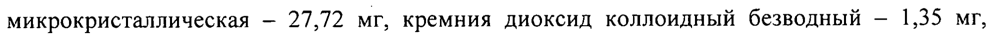
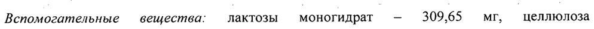
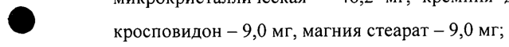
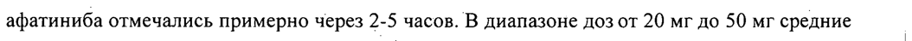
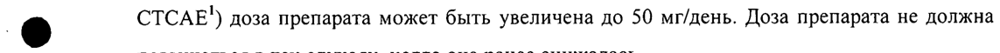

# Афатиниба дималеат — внутрь

- Препарат: Гиотриф® (таблетки, покрытые пленочной оболочкой;)
- АТХ: L01EB03
- Источник: ГРЛС, инструкция по медицинскому применению, РУ ЛП-002275, файл от  (https://grls.rosminzdrav.ru/Grls_View_v2.aspx?routingGuid=a61a1dac-070a-453e-9b0f-310024fe18e7)
- Распознано автоматически (OCR): 15 из 15 стр.
- Инструкция к другому РУ того же препарата: ЛП-002275 (срок действия истёк, решение от 12.03.2021). Текст может быть старше действующего
- Сомнительных строк после OCR: 6 (см. раздел «Проверка распознавания»)

## Общие сведения

МИНЗДРАВ РОССИИ _ в 004.45 180116 МИНИСТЕРСТВО ЗДРАВООХРАНЕНИЯ РОССИЙСКОЙ ФЕДЕРАЦИИ
СОГЛАСОВАНО | ИНСТРУКЦИЯ по медицинскому применению лекарственного препарата
Гиотриф® Регистрационный номер: Л11-002275 | |
Торговое название: ГИОТРИФ ‚ Международное непатентованное название: афатиниб (afatinib).. ..
’ . Лекарственная форма: таблетки, покрытые пленочной оболочкой | — |
— Состав © Одна таблетка 20 мг содержит:
Активное вещество: афатиниба дималеат - 29,56 мг, что соответствует 20 мг афатиниба
_ основания;
Вспомогательные вещества: лактозы моногидрат — 123,86 мг, целлюлоза микрокристаллическая — 18,48 мг, кремния диоксид коллоидный безводный — 0,9 мг,
©® кросповидон — 3,6 мг, магния стеарат — 3,6 мг;
Пленочная оболочка: гипромеллоза 2910 - 2,5 мг, макрогол 400 - 0,5 мг, титана диоксид
(E171) - 1,2 мг, тальк — 0,65 мг, полисорбат 80 — 0,15 мг.
Одна таблетка 30 мг содержит:
©® Активное вещество: афатиниба дималеат — 44,34 мг, что соответствует 30 мг афатиниба основания; |
Вспомогательные вещества: лактозы моногидрат -— 185,79 мг, целлюлоза микрокристаллическая — 27,72 мг, кремния диоксид коллоидный безводный - 1,35 мг, кросповидон - 5,4 мг, магния стеарат - 5,4 мг;
Пленочная оболочка: гипромеллоза` 2910 — 3,5 мг, макрогол 400 - 0,7 мг, титана диоксид
(E171) — 0,6825 мг, тальк — 1,6625 мг, полисорбат 80 — 0,21 мг, краситель индигокармин лак
‚ алюминиевый 11-14 % - 0,245 мг.
| Одна таблетка 40 мг содержит:
| Активное вещество: афатиниба дималеат — 59,12 мг; что соответствует 40 мг афатиниба
‚ основания; | Вспомогательные вещества: лактозы моногидрат — 247,72 мг, целлюлоза микрокристаллическая — 36,96 мг, кремния диоксид коллоидный безводный — 1,8 мг, кросповидон — 7,2 мг, магния стеарат - 7,2 мг;
Пленочная оболочка: гипромеллоза 2910 - 4,0 мг, макрогол 400 - 0,8 мг, титана диоксид
(E171) - 1,808 мг, тальк - 1,04 мг, полисорбат 80 - 0,24 мг, краситель индигокармин лак алюминиевый 11-14 % — 0,112 mr.
Одна таблетка 50 мг содержит:
ее _ Активное вещество: афатиниба дималеат — 73,9 мг, что соответствует 50 мг афатиниба
- основания; -. о и
Вспомогательные вещества: лактозы моногидрат — 309,65 мг, целлюлоза микрокристаллическая — 46,2 мг, кремния диоксид коллоидный безводный - 2,25 мг,
©® кросповидон — 9,0 мг, магния стеарат — 9,0 мг;
Пленочная оболочка: гипромеллоза 2910 - 5,0 мг, макрогол 400 — 1,0 мг, титана диоксид
(E171) - 0,975 мг, тальк — 2,375 мг, полисорбат 80 - 0,3 мг, краситель индигокармин лак алюминиевый 11-14 % — 0,35 мг.
©® Описание Таблетки 20 мг Круглые двояковыпуклые со скошенными краями таблетки, покрытые пленочной оболочкой от белого до слабо желтоватого цвета, на поперечном разрезе ядро почти белого цвета, с гравировкой символа компании Берингер Ингельхайм на одной стороне и «Т20» на
® другой стороне таблетки. | Таблетки 30 мг
Круглые двояковыпуклые со скошенными краями таблетки, покрытые пленочной оболочкой синего цвета, на поперечном разрезе ядро почти белого цвета, с гравировкой символа компании Берингер Ингельхайм на одной стороне и «ТЗ0» на другой стороне таблетки.
Таблетки 40 мг Круглые двояковыпуклые со скошенными краями таблетки, покрытые пленочной оболочкой голубого цвета, на поперечном разрезе ядро почти белого цвета, с гравировкой | символа компании Берингер Ингельхайм Ha одной стороне и «Т40» на другой стороне таблетки. .. . .
Таблетки 50 мг | | 2 Овальные двояковыпуклые таблетки, покрытые пленочной оболочкой синего цвета, на поперечном разрезе ядро почти белого цвета, с гравировкой символа компании Берингер
Ингельхайм на одной стороне и «Т50» на другой стороне таблетки.
Фармакотерапевтическая группа противоопухолевое средство - протеинтирозинкиназы ингибитор
Код ATX: LO1XE13 т Фармакологические свойства о no ee а.
’ - Фармакодинамика Афатиниб — мощный, селективный и необратимый блокатор. протеинтирозинкиназы рецепторов семейства ErbB (рецепторы эпидермального фактора роста). Афатиниб
® ковалентно связывается и необратимо блокирует передачу сигналов от всех гомо- и гетеродимеров, образованных семейством ErbB (EGFR (ErbB1), НЕК? (ErbB2), ErbB3 и
ErbB4).
Передача искаженного сигнала oT ErbB, вызванного, например, мутациями и/или амплификацией EGFR, амплификацией или мутацией НЕЕ? и/или избыточной экспрессией
©® лиганда ErbB, способствует развитию злокачественного фенотипа у пациентов с различными типами рака.
‚ На доклинических моделях опухолей, создаваемых путем нарушений регуляции системы
ErbB, афатиниб, применяющийся в качестве единственного препарата, эффективно блокирует рецепторы ErbB, и приводит к ингибированию опухолевого роста или к perpeccy
| ® опухоли. Особенно чувствительны к лечению афатинибом модели немелкоклеточного рака легкого (НМРЛ), вызываемого мутациями EGFR (L858R или Del 19). Афатиниб сохраняет существенную противоопухолевую активность in vitro на клеточных линиях НМРЛ и т vivo на моделях опухолей (модели с использованием ксенотрансплантатов или трансгенные модели), которые индуцируются мутантными изоформами EGFR (например, Т790М) с известной резистентностью к обратимым ингибиторам EGFR, таким как эрлотиниб и гефитиниб.

## 5.2. Фармакокинетика

-. , ` -.
-. , ` -.
Всасывание и распределение о mo, to После применения препарата ГИОТРИФ внутрь максимальные концентрации (Cmax)
афатиниба отмечались примерно через 2-5 часов. В диапазоне дозот 20 мг до 50 мг средние | значения Cmax и AUC... (площадь под кривой «концентрация-время») увеличивались в - пропорциональной степени. Применение препарата вместе с пищей с высоким содержанием жиров приводило к существенному уменьшению экспозиции афатиниба в крови примерно на 50% (Cmax) и на 39% (AUC...) по сравнению с применением натощак.
Установлено, что в случае употребления пищи в течение 3-х часов до приема препарата
ГИОТРИФ Л и до 1 часа после приема препарата значения AUC, +; (в стационарных условиях на период дозирования) уменьшались в среднем на 26%. Таким образом, пища не должна приниматься в этот период времени. После приема внутрь в виде таблеток средняя относительная биодоступность по сравнению с раствором для приема внутрь составляет
_ ‚ 92% (отношение скоррегированных средних величин AUC o.0).. о
- Связь афатиниба с ‘белками плазмы in уйго`составляет у. человека около 95%.
| | В исследованиях in vitro было показано, что афатиниб является субстратом и ингибитором переносчика белка резистентности рака молочной железы (ВСКР).
© Метаболизм и выведение Метаболические реакции, катализируемые ферментами, играют незначительную роль в метаболизме афатиниба in vivo. Основными циркулирующими метаболитами афатиниба являются продукты ковалентной связи с белками.
После приема раствора внутрь, содержащего 15 мг афатиниба, 85,4% от величины дозы
© обнаруживалось в кале и 4,3% - в моче. Неизмененный афатиниб составлял 88% от величины выводящейся дозы. Конечный период полувыведения составляет 37 часов.
Равновесная концентрация афатиниба в плазме достигается в течение 8 дней после многократного применения афатиниба.
Фармакокинетика у особых групп пациентов
® Возраст , Значимого влияния возраста (диапазон: 28-87 лет) на фармакокинетику афатиниба не установлено. Специальных исследований у детей не проводилось. |
Macca mena | По сравнению с пациентом с массой тела 62 кг (средняя масса тела пациентов во всей популяции пациентов) экспозиция афатиниба в плазме крови (оценка AUC , ss) у пациента с массой тела 42 кг увеличивается на 26 %, а у пациента с массой тела 95 кг уменьшается на 22%. =
Пол a a , У женщин концентрация афатиниба в плазме (оценка AUC +, ss с коррекцией в отношении массы тела) была на 15% выше, чем у мужчин.
Раса _ | Статистически значимого различия фармакокинетики афатиниба между различными расами не отмечалось.
Нарушения функции почек Через почки выводится менее 5% от однократной дозы афатиниба. Экспозиция афатиниба умеренно увеличивается по мере снижения клиренса креатинина. Например, у пациентов с клиренсом креатинина 60 или 30 мл/мин экспозиция афатиниба (AUC , ss) увеличивается до 13 и 42% соответственно; и снижается до би 20% у пациентов с клиренсом креатинина 90 или 120 мл/мин соответственно. Безопасность, фармакокинетика и эффективность у
. _ пациентов с почечной недостаточностью специально не изучались. Основываясь на данных популяционной фармакокинетики, взятых из клинических исследований различных типов
_ опухолей, у пациентов с легкими или средней степени тяжести нарушениями функции | почек изменение дозы не требуется.
© Нарушения функции печени Афатиниб выводится, главным образом, с желчью и затем с калом. У пациентов с легкими
(класс А по шкале Чайлд-Пью) или средней степени тяжести (класс В по шкале Чайлд-Пью)
нарушениями функции печени и у здоровых испытуемых после применения однократной дозы препарата (50 мг) экспозиция афатиниба в крови была сходной. У пациентов с
® легкими или средней степени тяжести нарушениями функции печени изменения начальной дозы не требуются. У пациентов с тяжелыми нарушениями функции печени (класс С по шкале Чайлд-Пью) фармакокинетика афатиниба не изучалась.
Другие характеристики / особенности пациентов |
Влияние на экспозицию афатиниба активности лактатдегидрогеназы, щелочной фосфатазы
® и концентрации общего белка, оценки по опроснику ECOG (Eastern Cooperative Oncology
Group, Восточная Объединенная Онкологическая Группа) было клинически не значимо.
Наличие в анамнезе курения, употребления алкоголя или метастазов в печени не оказывали значимого влияния на фармакокинетику афатиниба.

## 4.1. Показания к применению

ГИОТРИФ показан в качестве монотерапии для лечения:
ГИОТРИФ показан в качестве монотерапии для лечения:
- местно-распространенного или метастатического немелкоклеточного рака легкого
(НМРЛ) с мутацией (мутациями) рецептора эпидермального фактора роста ЕСЕК;
` - местно-распространенного или метастатического плоскоклеточного. НМРЛ. у пациентов, прогрессирующих на фоне или после химиотерапии-на основе препаратов платины.

## 4.3. Противопоказания

- гиперчувствительность к афатинибу или к любому компоненту препарата;
- гиперчувствительность к афатинибу или к любому компоненту препарата;
- тяжелые нарушения функции печени; .
- детский возраст до 18 лет;
- беременность и период грудного вскармливания.

## 4.3. С осторожностью

- кератит;
- кератит;
- язвенный кератит; |
- выраженная сухость глаз;
‚- интерстициальная болезнь легких; °. _ oo,
-. ‚ -нарушения фракции выброса левого желудочка; д oo
- сопутствующие заболевания сердца; | |
- непереносимость галактозы, синдром нарушения всасывания галактозы/глюкозы или
© дефицит лактазы.

## 4.6. Применение при беременности и в период грудного вскармливания

Беременность Исследований у беременных женщин не проводилось. Поэтому потенциальный риск для
® человека неизвестен. В доклинических исследованиях афатиниба при использовании доз, достигавших и превышавших летальные дозы для самок животных, признаков тератогенности не отмечалось. Нежелательные изменения отмечались только при использовании доз, значительно превышавших токсические.
Женщинам с сохраненной способностью к зачатию следует рекомендовать избегать
® беременности во время лечения. Во время терапии и в течение, по крайней мере, 2 недель после применения последней дозы препарата должны использоваться адекватные методы контрацепции. Если ГИОТРИФ используется во время беременности, или если беременность развивается во время использования препарата ГИОТРИФ, пациентка должна быть проинформирована о потенциальной опасности для плода.
Грудное вскармливание На основании данных доклинических исследований проникновение афатиниба в грудное
‚ молоко считается вероятным. Нельзя исключить наличие ‘риска для грудного ребенка. Во. |
° ` время лечения пациентам следует рекомендовать отказываться от кормления грудью. . о
Фертильность `. о Исследований фертильности с использованием ‘препарата ГИОТРИФ у человека не проводилось. Существующие доклинические ‘данные о токсикологии свидетельствуют о влиянии препарата на репродуктивные органы в случае применения высоких доз. Поэтому
| р исключить отрицательное воздействие терапии на фертильность у человека не представляется возможным.

## 4.2. Способ применения и дозы

Таблетки принимают внутрь, натощак, не менее чем за | час до приема пищи или спустя 3 часа после приема пищи. Таблетки проглатывают целиком, запивая водой.
Таблетки принимают внутрь, натощак, не менее чем за | час до приема пищи или спустя 3 часа после приема пищи. Таблетки проглатывают целиком, запивая водой.
У пациентов с НМРЛ и положительным результатом теста на мутации EGFR, ранее не получавших терапию ингибиторами тирозинкиназы EGFR, рекомендуемая доза составляет
40. мг один раз в день. т | ‚ -. У пациентов с НМРЛ и положительным результатом теста на мутации EGFR, ранее .’.
| получавших терапию ингибиторами тирозинкиназы EGFR, составляет 50 Mr один раз в | день.
® У пациентов с плоскоклеточным НМРЛ, которые ранее получали терапию первой линии на основе соединений платины, рекомендуемая доза составляет 40 мг один раз в день.
Лечение должно продолжаться до прогрессирования заболевания или развития признаков неприемлемой токсичности (см. Таблицу 1).
Максимальная суточная доза во всех клинических случаях составляет 50 мг.
® Особые указания по дозированию Повышение дозы
В случае переносимости препарата ГИОТРИФ в начальной дозе 40 мг/день в течение первого цикла лечения, т.е. в случае отсутствия диареи, кожной сыпи, стоматита и других вызываемых препаратом нежелательных явлений (степень тяжести >1 по классификации
| ® CTCAE') доза препарата может быть увеличена до 50 мг/день. Доза препарата не должна повышаться в тех случаях, когда она ранее снижалась.
Изменение дозы в случае развития нежелательных реакций
Преодолеть нежелательные реакции организма (например, тяжелую непрекращающуюся диарею или кожную сыпь) можно путем перерыва в лечении и уменьшения дозы препарата
(см. Таблицу 1).
.. ‚ Таблица 1. Информация 06 изменении дозы в случае нежелательных реакций
Нежелательное явление, Рекомендуемые методы дозирования препарата вызываемое препаратом (в | ГИОТРИФ | |.
| соответствии с ` | классификацией СТСАЕ')
7.
1 или 2 степень тяжести Перерыв не | Дозирование не изменяется
| требуется?
2 степень тяжести Перерыв до | Возобновление со снижением дозы на 10
(затянувшиеся” или снижения мг непереносимые реакции) степени или тяжести до
>3 степени тяжести 0/12 ' Единые терминологические критерии ‘для нежелательных явлений МС] (NCI Common a в Terminology Criteria for Adverse Events v3.0) | . : о | ..
2 В случае развития диареи должны незамедлительно применяться противодиарейные средства (например, лоперамид). Их применение продолжается до прекращения диареи.
© 3 Для диареи — более 48 часов, для сыпи - более 7 дней.
* Если пациент не переносит дозу 20 мг/день, следует иметь в виду окончательную .
отмену препарата.
Если у пациента развиваются острые или усиливаются хронические респираторные симптомы, следует принимать во внимание возможность развития ИБЛ. В этих случаях
® ГИОТРИФ должен временно отменяться до получения результатов обследования. Если наличие ИБЛ подтверждается, лечение препаратом следует отменить. При необходимости проводится соответствующее лечение.
Пропуск дозы Если доза препарата пропущена, ее нужно принять в тот же день, как только пациент
©® вспомнит об этом. Но если до приема следующей запланированной дозы осталось не более 8 часов, пропущенную дозу принимать не следует.
Нарушение функции почек У пациентов с легкими или средней степени тяжести нарушениями функции почек изменения начальной дозы препарата не требуется. Лечение препаратом ГИОТРИФ пациентов с тяжелыми нарушениями функции почек (клиренс креатинина <30 мл/мин) не рекомендуется.
| Нарушения функции печени `` | У пациентов с легкими или средней степени тяжести нарушениями функции печени (класс —
— А иВ по шкале Чайлд-Пью) изменения‘ начальной дозы препарата: не требуется. У - пациентов с тяжелыми нарушениями функции печени (класс С по шкале Чайлд-Пью)
| афатиниб не изучался. Лечение препаратом ГИОТРИФ у этих пациентов не рекомендуется.
Возраст, раса, пол И | Изменения дозы в зависимости от возраста, расы или пола пациентов не требуется. |
Альтернативный способ приема | Если прием целых таблеток препарата невозможен, они могут быть диспергированы примерно в 100 мл негазированной питьевой воды. Другие жидкости для этого не | используются. Таблетку следует поместить в воду, не разламывая, и периодически размешивать взвесь в течение 15 минут до тех пор, пока таблетка не распадется на очень мелкие частицы. Полученную взвесь нужно принять незамедлительно. Стакан следует | ополоснуть примерно 100 мл воды, которую также нужно выпить. Дисперсия также может
И применяться с помощью желудочного зонда. . . | . |
| Побочное действие | | | | :
> | Частота побочных реакций, приведенных ниже, изложена в соответствии со следующей |
| e градацией: очень часто (> 1/10); часто (> 1/100; < 1/10); нечасто (> 1/1000; < 1/100); редко |
(>1/10000; <1/1000); очень редко (< 1/10000).
Нарушения со стороны нервной системы | Часто — нарушение вкусовой чувствительности. |
| Нарушения со стороны органа зрения ® Часто — конъюнктивит, сухость глаз; нечасто — кератит. |
Нарушения со стороны дыхательной системы |
Очень часто — кровотечение из носа; часто — ринорея; нечасто — интерстициальная болезнь | | легких; одышка*, кашель*, пневмонит*, дистресс-синдром*.
Нарушения со стороны желудочно-кишечного тракта |
® Очень часто — диарея, тошнота, рвота, стоматит; часто — хейлит, диспепсия; нечасто - | панкреатит; запор*. |
Нарушения co стороны гепатобилиарной системы
Часто — повышение активности аланинаминотрансферазы (AJIT), аспартатаминотрансферазы (АСТ); повышение концентрации общего билирубина*, 3 цитолитический гепатит*, печеночная недостаточность*. |

Нарушения со стороны кожи и подкожных тканей
Очень часто — сыпь, акнеформный дерматит, зуд, сухость кожи; часто — ладонноa подошвенный синдром (эритродизестезия); изменения ногтей*. |
| Нарушения со стороны сердечно-сосудистой системы -
‘Сердечная недостаточность*. = a о Нарушения со стороны скелетно-мышечной системы и соединительной ткани

—_ Часто — спазмы мышц; боль в спине*. — о
: 9 Нарушения со стороны почек и мочевыводящих путей
Часто — нарушение функции почек/почечная недостаточность.
Инфекции и инвазии Очень часто - паронихия; часто - цистит.
Метаболические нарушения и нарушения питания
Очень часто — снижение аппетита; часто — обезвоживание, гипокалиемия.
| Нарушения общего характера Часто — пирексия; утомляемость*.
Нарушения, выявленные при исследованиях -
Часто — уменьшение веса; анемия*, нейтропения*, повышение активности щелочн09ой tis фосфатазы*. — | |
*- данные побочные реакции наблюдались при проведении клинических
® исследований, однако связь с приемом препарата ГИОТРИФ не доказана.

## 4.9. Передозировка

Симитомы В клинических исследованиях у ограниченного числа пациентов изучались дозы 160 мг
Симитомы В клинических исследованиях у ограниченного числа пациентов изучались дозы 160 мг
©® один раз в день в течение 3 дней и 100 мг один раз в день в течение 2 недель.
Нежелательными явлениями, наблюдавшимися при использовании этих доз, были, прежде всего, кожные высыпания (сыпь/акне) и желудочно-кишечные расстройства (в основном, диарея). Применение препарата в дозе 360 мг совместно с другими лекарственными средствами сопровождалось следующими нежелательными явлениями: тошнота, рвота,
® астения, головокружение, головная боль, боли в животе и повышение уровня амилазы
(превышавший верхнюю границу нормы более чем в 1,5 раза).
Лечение Специфического антидота на случай передозировки нет. При подозрении на передозировку необходимо отменить ГИОТРИФ и проводить симптоматическую терапию. При наличии показаний удалить невсосавшийся афатиниб можно путем промывания желудка или вызвав рвоту. |

## 4.5. Взаимодействие с другими лекарственными средствами

Взаимодействия с индукторами/ингибиторами гликопротеина- Р т
На основании данных, полученных in vitro, установлено, что афатиниб является субстратом | для гликопротеина-Р. Изменения концентраций других субстратов гликопротеина-Р в
. плазме во время применения препарата ГИОТРИФ считается маловероятным. Клинические 10 |
| данные указывают, что одновременное применение сильных ингибиторов или индукторов гликопротеина-Р может изменять воздействие афатиниба.
| ГИОТРИФ может безопасно комбинироваться с ингибиторами гликопротеина-Р (такими как ритонавир) одновременно с приемом или после приема препарата ГИОТРИФ. Если же сильные ингибиторы гликопротеина-Р (включая, например, ритонавир, циклоспорин, кетоконазол, итраконазол, эритромицин, верапамил, хинидин, такролимус, нелфинавир, саквинавир и амиодарон) применяются до приема препарата ГИОТРИФ, возможно увеличение воздействия афатиниба; в этих случаях ГИОТРИФ необходимо применять с
| осторожностью. о oe о 7 | `’ Сильные индукторы гликопротеина-Р (включая, например, ‘карбамазепин, . фенитоин,
| фенобарбитал или Зверобой продырявленный (Hypericum perforatum) могут уменьшать экспозицию афатиниба.
©® Лекарственные транспортные системы Данные, полученные in vitro, свидетельствуют о TOM, что межлекарственные
| взаимодействия с афатинибом вследствие ингибирования транспортных молекул
| OATBIB1, OATP1B3, ОАТР2В1, OAT1, OAT3, OCT1, OCT2 и ОСТЗ маловероятны.
Исследования in vitro показали, что афатиниб является субстратом и ингибитором
©® транспортера белка резистентности к раку молочной железы.
Влияния индукторов и ингибиторов изоферментов CYP на афатиниб
Данные, полученные in vitro, свидетельствуют о том, что межлекарственные взаимодействия с афатинибом вследствие ингибирования или индукции изоферментов СУР одновременно применяющимися лекарственными препаратами маловероятны. У человека
® установлено, что метаболические реакции, катализируемые ферментами, играют в метаболизме афатиниба незначительную роль. Приблизительно 2% от величины дозы афатиниба метаболизировались ЕМОЗ и путем СУРЗА4-зависимого М-деметилирования, содержание метаболитов было настолько низким, что не определялось количественно.
ОБР-глюкуронозилтрансфераза 1А1 Данные, полученные {м vitro, свидетельствуют о TOM, что межлекарственные взаимодействия с афатинибом вследствие ингибирования ОЮР-глюкуронозилтрансферазы 1A] маловероятны.
. Особые указания sO i | Оценка статуса мутации ЕСЕК - | .
1] Для оценки статуса мутации EGFR у пациента важно использовать хорошо апробированный и надежный метод, чтобы избежать ложноотрицательных или ложноположительных результатов.
Диарея Профилактическое лечение диареи имеет важное значение, особенно в первые 6 недель терапии при появлении первых признаков. Лечение состоит в восполнении потери воды организмом и одновременном применении антидиарейных средств (лоперамид), дозу которых при необходимости следует повышать до максимально рекомендуемой.
’ Антидиарейные средства должны находиться в распоряжении пациентов, чтобы лечение‘.
| | могло начинаться при первых признаках диареи и продолжаться до тех ‘пор, пока жидкий |
| | стул не будет отсутствовать в течение 12 часов. У пациентов с тяжелой auapeeii может | потребоваться прерывание лечения, уменьшение дозы или прекращение терапии. В случае
® развития обезвоживания может потребоваться внутривенное применение электролитов и жидкостей.
Кожные реакции Пациентам, которые вынуждены находиться на солнце, рекомендуется носить солнцезащитную одежду и/или использовать солнцезащитные экраны. Своевременное
©® вмешательство при дерматологических реакциях (например, смягчающие средства, | антибиотики) может позволить продолжить лечение. |
У пациентов с затянувшимися или выраженными кожными реакциями могут также ] потребоваться временное прерывание терапии, уменьшение дозы, дополнительное | терапевтическое вмешательство и консультация специалиста, имеющего опыт лечения
® подобных дерматологических реакций. В случае развития у пациента серьезной буллезной | сыпи, волдырей или эксфолиативных изменений лечение препаратом нужно прервать или прекратить. |
Женский пол, низкая масса тела и сопутствующие нарушения функции почек |
У женщин, у пациентов с более низкой массой тела и при сопутствующих нарушениях | функции почек может повышаться риск развития нежелательных явлений, таких как диарея, сыпь/акне и стоматит. При наличии этих факторов риска рекомендуется более
- тщательный контроль состояния пациентов. | '
„ Интерстициальные болезни легких (ИБЛ) 4
‚Исследований у пациентов с наличием ИБЛ в анамнезе не проводилось. Сообщалось о | развитии ИБЛ или ИБЛ-подобных состояний (такие как легочная инфильтрация, | р пневмонит, острый респираторный дистресс-синдром, аллергический альвеолит), включая | фатальные, у пациентов, принимавших афатиниб для лечения НМРЛ. Ассоциированные с |
!
О | | препаратом ИБЛ-подобные нежелательные явления наблюдались у 0,7% пациентов, принимавших ГИОТРИФ во время клинических исследований (включая 0,5% пациентов с
>3 степени тяжести по СТСАЕ). У всех пациентов с острым началом и/или с необъяснимым усилением легочных симптомов (одышка, кашель, лихорадка) должно проводиться тщательное обследование для исключения ИБЛ. До завершения этого обследования прием препарата нужно прервать. Если диагноз ИБЛ установлен, ГИОТРИФ следует отменить.
При необходимости должно назначаться соответствующее лечение.
Значительные нарушения функции печени У пациентов с сопутствующими заболеваниями печени рекомендуется периодическая’.
. Проверка ‘функции печени. В случае ухудшения функции печени может потребоваться‘ прерывание лечения препаратом. У пациентов с тяжелыми нарушениями функции печени лечение препаратом нужно прекратить.
9 Кератит
В случае возникновения таких впервые возникших или усилившихся симптомов, как воспаление глаз, слезотечение, светобоязнь, нечеткость зрения, боль в глазах и/или покраснение глаз, пациент должен незамедлительно проконсультироваться с офтальмологом. Если диагноз язвенного кератита подтверждается, лечение препаратом
© ГИОТРИФ нужно прервать или прекратить. Необходимо тщательно взвесить пользу и риск продолжения лечения. У пациентов с KepaTHTOM, язвенным кератитом или выраженной сухостью глаз в анамнезе ГИОТРИФ должен использоваться с осторожностью. Фактором риска возникновения кератита и язв роговицы также является использование контактных
ЛИНЗ.
® Функция левого желудочка сердца Ингибирование рецептора НЕК2 может приводить к дисфункции левого желудочка. В суточной дозе 50 мг после однократного и многократного применения у пациентов с рецидивирующими или рефрактерными солидными опухолями не вызывает существенного удлинения интервала QTcF. Изменений показателей, которые бы вызывали клиническую обеспокоенность, не наблюдалось, что свидетельствует об отсутствии существенного влияния на интервал QTcF. Однако у пациентов с нарушениями фракции выброса левого |
Г. желудочка или у пациентов с серьезными сопутствующими заболеваниями сердца |
ГИОТРИФ не изучался. У ‘пациентов. с факторами риска заболеваний сердца и заболеваниями, которые могут. нарушать фракцию выброса левого желудочка, перед ‘ назначением препарата ГИОТРИХФ и во время лечения рекомендуется оценивать фракцию | выброса левого желудочка. В случае развития во время лечения признаков/симптомов поражения сердца следует проводить мониторирование состояния сердца, включая оценку фракции выброса левого желудочка. |
В тех случаях, когда значения фракции выброса левого желудочка снижаются ниже нижней границы нормы, установленной в данном медицинском учреждении, рекомендуется консультация кардиолога и рассмотрение вопроса о прерывании или прекращении лечения препаратом. |
Взаимодействие с гликопротеином-Р Сильные ингибиторы гликопротеина-Р, назначаемые до приема препарата ГИОТРИФ,
‚ -.. Могут привести к увеличению экспозиции афанитиба и. поэтому должны назначаться с осторожностью. При необходимости ингибиторы гликопротеина-Р должны назначаться.
одновременно или после приема препарата ГИОТРИФ. Совместный прием с сильными | индукторами гликопротеина-Р может снижать экспозицию афатиниба.
© Влияние препарата на способность управления транспортными средствами, механизмами
Исследований по влиянию препарата на способность управлять транспортными средствами и занятию другими потенциально опасными видами деятельности, требующими |
@ повышенной концентрации внимания и быстроты психомоторных реакций не проводилось. |

## 6.5. Форма выпуска

| Таблетки, покрытые пленочной оболочкой 20 мг, 30 мг, 40 мги 50 мг.
| Таблетки, покрытые пленочной оболочкой 20 мг, 30 мг, 40 мги 50 мг.
По 30 таблеток во флакон из полипропилена с навинчивающейся пластиковой крышкой с
® поглотителем влаги. Один флакон вместе с инструкцией по применению в картонную :
пачку. | Условия хранения Хранить в плотно укупоренном флаконе в сухом, защищенном от света месте при температуре не выше 25°С.
Хранить в недоступном для детей месте.

## 6.3. Срок годности

- О: a ' 3 года. ; о о Не использовать после истечения срока годности. ` | у р
- О: a ' 3 года. ; о о Не использовать после истечения срока годности. ` | у р
| | | | Условия отпуска Отпускается по рецепту.
Наименование и адрес юридического лица, на имя которого выдано регистрационное удостоверение
Берингер Ингельхайм Интернешнл ГмбХ | Бингер Штрассе 173, 55216 Ингельхайм-на-Рейне, Германия
Наименование и адрес места осуществления производства лекарственного препарата
| “_ Берингер Ингельхайм Фарма ГмбХ и Ко.КГ. т о
Бингер Штрассе 173, 55216 Ингельхайм-на-Рейне, Германия
© Получить дополнительную информацию о препарате, а также направить свои претензии и информацию о нежелательных явлениях можно по следующему адресу в
России ООО «Берингер Ингельхайм» | 125171, Москва, Ленинградское шоссе, 16А, стр.3
©® Тел: +7 (495) 544 50 44 Факс: +7 (495) 544 56 20 р ссы * HM, > 4 / kan fs 5, = Ay. ©
Старший менеджер по регистрац MS зу =" ООО «Берингер Ингельхайм» 3 2/& 8) Новинская Т.П.
\ UST S/8 ‘a, (= 9 ©® . = “ CY | . ‘7 у 15 |
## Проверка распознавания

Страницы-сканы распознаны автоматически. В 6 строках с дозировками цифры могли распознаться с ошибкой — сверьте с вырезкой из оригинала:

- стр. 1: «микрокристаллическая — 27,72 мг, кремния диоксид коллоидный безводный - 1,35 мг,» — повторное чтение: «микрокристаллическая — 27,72 Mr, кремния диоксид коллоидный безводный — 1,35 мг,»  
  
- стр. 2: «Вспомогательные вещества: лактозы моногидрат — 309,65 мг, целлюлоза» — повторное чтение: «Вспомогательные вещества: лактозы моногидрат - 309,65 MI, ` целлюлоза»  
  
- стр. 2: «©® кросповидон — 9,0 мг, магния стеарат — 9,0 мг;» — повторное чтение: «®  росповидон — до мг, магния стеарат —9.0мг;»  
  
- стр. 3: «афатиниба отмечались примерно через 2-5 часов. В диапазоне дозот 20 мг до 50 мг средние |» — повторное чтение: «афатиниба отмечались примерно через 2-5 часов. В диапазоне дозот 20 мгдо 50 мг средние |»  
  
- стр. 4: «_ ‚ 92% (отношение скоррегированных средних величин AUC o.0).. о» — низкая уверенность: «o.0)..» (6)  
  
- стр. 7: «| ® CTCAE') доза препарата может быть увеличена до 50 мг/день. Доза препарата не должна» — повторное чтение: «(© —_—_CTCAE') Hosa mpenapara может быть увеличена до 50 мидень. Доза препарата не должна»  
  
