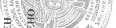

# Ацикловир — наружно

- Препарат: Зовиракс (крем для наружного применения)
- АТХ: D06BB03
- Источник: ОХЛП, Единый реестр ЛС ЕАЭС, запись 64e5a82dfb44f13b9518db8e, документ от 2026-03-18
- Распознано автоматически (OCR): 2 из 16 стр.
- Сомнительных строк после OCR: 2 (см. раздел «Проверка распознавания»)

## Общие сведения

ОБЩАЯ ХАРАКТЕРИСТИКА ЛЕКАРСТВЕННОГО ПРЕПАРАТА

## 1. Наименование лекарственного препарата

Зовиракс, 5 %, крем для наружного применения.

## 2. Качественный и количественный состав

Действующее вещество: ацикловир.
Каждые 100 г препарата содержат 5 г ацикловира.
Вспомогательные вещества, наличие которых надо учитывать в составе лекарственного препарата: пропиленгликоль, цетостеариловый спирт (см. раздел 4.4).
Полный перечень вспомогательных веществ приведен в разделе 6.1.

## 3. Лекарственная форма

Крем для наружного применения.
Однородный крем белого или почти белого цвета, без мелких, крупных и посторонних частиц, без признаков расслоения.

## 4. Клинические данные

## 4.1. Показания к применению

Зовиракс показан к применению у взрослых и детей для лечения вирусных инфекций, вызванных вирусом Herpes simplex, губ и кожи лица (рецидивирующий герпес губ).

## 4.2. Режим дозирования и способ применения

Режим дозирования Взрослые Препарат рекомендуется наносить 5 раз в день, примерно каждые 4 часа, за исключением ночного времени на пораженные и граничащие с ними участки кожи.
Длительность лечения не менее 4 дней. В случае отсутствия заживления лечение может быть продолжено до 10 дней. В случае сохранения симптомов заболевания более 10 дней, следует обратиться к врачу.
Особые группы пациентов Пациенты с почечной и печеночной недостаточностью
Несмотря на то, что в основном ацикловир выводится почками, систематическая абсорбция ацикловира после наружного применения несущественна.
Соответственно, нет необходимости для изменения дозы пациентам с почечными или печеночными нарушениями.

Дети Режим дозирования для детей не отличается от режима дозирования для взрослых.
Способ применения Наружно.
Применяйте препарат только согласно тем показаниям, тому способу применения и в тех дозах, которые указаны в ОХЛП.
Важно как можно раньше начинать лечение, желательно при появлении первых признаков и симптомов (в продромальном периоде или при покраснении). Лечение также может начаться на более поздних стадиях (папула или пузырь).
Чтобы не допустить ухудшения состояния и предупредить распространение инфекции, необходимо мыть руки до и после нанесения препарата, не тереть и не прикасаться к пораженным участкам кожи полотенцем.

## 4.3. Противопоказания

Гиперчувствительность к ацикловиру, валацикловиру, пропиленгликолю или к любому из вспомогательных веществ, перечисленных в разделе 6.1.

## 4.4. Особые указания и меры предосторожности при применении

Препарат Зовиракс следует применять исключительно при герпесе кожи губ и лица. Не рекомендуется применять на слизистые оболочки полости рта, глаз и влагалища. Не применяйте с целью лечения генитального герпеса. Избегайте попадания крема в глаза.
При выраженных проявлениях рецидивирующего герпеса рекомендуется проконсультироваться с врачом.
Пациентам с герпесом губ следует избегать передачи вируса, особенно при наличии активных поражений.
Пациентам с иммунодефицитным состояниями не рекомендуется применять препарат
Зовиракс. Такие пациенты при лечении любых инфекционных заболеваний должны следовать рекомендациям врача.
Вспомогательные вещества Зовиракс содержит пропиленгликоль, который может раздражать кожу, и цетостеариловый спирт, который может вызывать местные кожные реакции (например, контактный дерматит).

## 4.5. Взаимодействие с другими лекарственными препаратами и другие виды взаимодействия

При наружном применении взаимодействие с другими лекарственными средствами не выявлено.

## 4.6. Фертильность, беременность и лактация

Беременность Применение возможно только в тех случаях, когда предполагаемая польза превышает потенциальный и неизвестный риск, однако системная экспозиция при местном применении крема очень низкая.
В результате пострегистрационного опыта применения ацикловира были получены данные, содержащие информацию по результатам беременности у женщин, получавших препарат
Зовиракс в любой лекарственной форме. Данные не демонстрируют увеличение числа врожденных пороков развития среди пациентов, получавших лечение ацикловиром, по сравнению с общей популяцией, и не было зарегистрировано врожденных дефектов, которые бы являлись уникальными или характеризовались постоянным набором признаков, указывающих на общую причину.
Лактация Ограниченные данные показывают, что при регулярном применении препарат попадает в грудное молоко. Однако дозировка, которую получает младенец, находящийся на грудном вскармливании, будет незначительна.
4.7. Влияние на способность управлять транспортными средствами и работать с механизмами
Препарат Зовиракс не влияет на способность управлять транспортом или заниматься другими потенциально опасными видами деятельности, требующими повышенной концентрации внимания и быстроты психомоторных реакций.

## 4.8. Нежелательные реакции

Частота нежелательных реакций определялась в соответствии с классификацией

Всемирной организации здравоохранения: очень часто (≥1/10); часто (≥1/100, но <1/10);
нечасто (≥1/1 000, но <1/100); редко (≥1/10 000, но <1/1 000); очень редко (<1/10 000), частота неизвестна (на основании имеющихся данных оценить невозможно).
Нарушения со стороны кожи и подкожных тканей:
Нечасто: кратковременные жжение, покалывание на участках нанесения препарата, небольшая сухость или шелушение, зуд;

Редко: покраснение, контактный дерматит после нанесения, чаще связанный с реакцией на вспомогательные вещества, чем на ацикловир.
Нарушения со стороны иммунной системы:
Очень редко: реакции повышенной чувствительности немедленного типа, в том числе ангионевротический отек, крапивница.
Сообщение о подозреваемых нежелательных реакциях
Важно сообщать о подозреваемых нежелательных реакциях после регистрации лекарственного препарата с целью обеспечения непрерывного мониторинга соотношения
«польза – риск» лекарственного препарата. Медицинским работникам рекомендуется сообщать о любых подозреваемых нежелательных реакциях лекарственного препарата через национальные системы сообщения о нежелательных реакциях государств – членов
Евразийского экономического союза.
Российская Федерация Федеральная служба по надзору в сфере здравоохранения
Адрес: 109012, г. Москва, Славянская площадь, д. 4, стр. 1
Тел.: +7 (800) 550-99-03 Эл. почта: pharm@roszdravnadzor.gov.ru
Сайт: https://www.roszdravnadzor.gov.ru Республика Армения
«Научный центр экспертизы лекарств и медицинских технологий им. академика
Э. Габриеляна» АОЗТ Адрес: 0051, г. Ереван, пр. Комитаса 49/4
Тел.: (+374 10) 20-05-05, (+374 96) 22-05-05
Эл. почта: admin@pharm.am Сайт: www.pharm.am
Республика Беларусь Министерство здравоохранения Республики Беларусь, Республиканское унитарное предприятие «Центр экспертиз и испытаний в здравоохранении»
Адрес: 220037, г. Минск, Товарищеский пер., 2а
Тел.: +375-17-242-00-29 Эл. почта: rcpl@rceth.by
Сайт: www.rceth.by

Республика Казахстан РГП на ПХВ «Национальный центр экспертизы лекарственных средств и медицинских изделий» Комитета медицинского и фармацевтического контроля Министерства здравоохранения Республики Казахстан
Адрес: 010000, г. Астана, район Байконыр, ул. А. Иманова, 13
Тел.: +7 (7172) 235-135 Эл. почта: farm@dari.kz
Сайт: www.ndda.kz Кыргызская Республика Департамент лекарственных средств и медицинских изделий при Министерстве здравоохранения Кыргызской Республики
Адрес: 720044, г. Бишкек, ул. 3-я линия, 25
Тел.: + 996 (312) 21-92-88 Эл. почта: vigilance@pharm.kg
Сайт: www.pharm.kg

## 4.9. Передозировка

Из-за минимального системного воздействия не ожидается возникновение нежелательных эффектов при приеме внутрь или при местном нанесении всего содержимого потребительской упаковки крема Зовиракс.

## 5. Фармакологические свойства

## 5.1. Фармакодинамические свойства

Фармакотерапевтическая группа:
антибиотики и противомикробные препараты, применяемые в дерматологии; противомикробные препараты для наружного применения;
противовирусные препараты.
Код АТХ: D06BB03 Механизм действия и фармакодинамические эффекты
Ацикловир – противовирусный препарат – высоко активен in vitro в отношении вируса
Herpes simplex (HSV) 1 и 2 типов. Низкая токсичность к клеткам хозяина–млекопитающего.
После попадания в клетки, инфицированные вирусом герпеса, ацикловир фосфорилируется до активного соединения ацикловира трифосфат. Первый этап данного процесса зависит от присутствия HSV-закодированного фермента тимидинкиназы. Ацикловира трифосфат действует как ингибитор и субстрат герпес-специфичной ДНК полимеразы, препятствуя дальнейшему синтезу вирусной ДНК, при этом не оказывая воздействия на нормальные клеточные процессы.

## 5.2. Фармакокинетические свойства

Фармакологические исследования показали минимальную системную абсорбцию при повторном применении крема ацикловир.

## 6. Фармацевтические свойства

6.1. Перечень вспомогательных веществ
Полоксамер 407, Цетостеариловый спирт, Парафин белый мягкий,
Натрия лаурилсульфат, Парафин жидкий, Глицерол моностеарат,
Макрогола стеарат, Пропиленгликоль, Диметикон,
Вода очищенная.

## 6.2. Несовместимость

Не применимо.

## 6.3. Срок годности (срок хранения)

В алюминиевой тубе – 3 года, в пластиковом флаконе с дозирующим устройством – 2 года.
6.4. Особые меры предосторожности при хранении
Хранить при температуре не выше 25 °С. Не замораживать.
6.5. Характер и содержание первичной упаковки
По 2 г, 5 г или 10 г препарата в алюминиевую тубу с навинчивающимся колпачком пластмассовым или по 2 г в пластиковый флакон с дозирующим устройством, укупоренный крышкой пластиковой.
Алюминиевую тубу или пластиковый флакон помещают в картонную пачку вместе с листком-вкладышем.
На первичной и вторичной упаковке допускается наличие контроля первого вскрытия.
6.6.

## 6.4. Особые меры предосторожности при хранении

Особые требования отсутствуют.

## 7. Держатель регистрационного удостоверения

Российская Федерация АО «Хелеон Рус»
123112, г. Москва, наб. Пресненская, д. 10, помещ. III, комната 9, эт 6
Тел.: +7 (495) 777-98-50 Телефон бесплатной «Горячей линии»: 8 (800) 333-46-94
Эл. почта: rus.info@haleon.com
7.1. Представитель держателя регистрационного удостоверения
Претензии потребителей направлять по адресу:
Российская Федерация АО «Хелеон Рус»
123112, г. Москва, наб. Пресненская, д. 10, помещ. III, комната 9, эт 6
Тел.: +7 (495) 777-98-50 Телефон бесплатной «Горячей линии»: 8 (800) 333-46-94
Эл. почта: rus.info@haleon.com

## 8. Номер регистрационного удостоверения

ЛП-№(004177)-(РГ-RU).

## 9. Дата первичной регистрации

(ПОДТВЕРЖДЕНИЯ РЕГИСТРАЦИИ,

ПЕРЕРЕГИСТРАЦИИ)
Дата первой регистрации: 27 декабря 2023 г.
10. ДАТА ПЕРЕСМОТРА ТЕКСТА

Общая характеристика лекарственного препарата Зовиракс доступна на информационном портале Евразийского экономического союза в информационно-коммуникационной сети
«Интернет» http://eec.eaeunion.org/.

<A os 7;
: Se ails Mitty 4 ро НУ ем В - РЕВ:
6 АХ ewes ЕЕ,
New - 4) Czy gs es В =f 2% = ACY ee) SF |
BND BY, Фей = = i SY a че sok о ys 7 ean, OP"

& ree ° <3) О =, ге Ф № Ее ga ЕР ЕЯ ох

i — |. Dy FSS.
aZeis< | Ser = | с 8 << | oa = & ce a xo а © =
= = = = = [= 3 ы = 9

is

UY = ДӘРІЛІК ПРЕПАРАТТЫҢ ЖАЛПЫ СИПАТТАМАСЫ
1. ДӘРІЛІК ПРЕПАРАТТЫҢ АТАУЫ
Зовиракс, 5%, сыртқа қолдануға арналған крем.
2. САПАЛЫҚ ЖӘНЕ САНДЫҚ ҚҰРАМЫ
Әсер етуші зат: ацикловир.
Әр 100 г препаратта 5 г ацикловир бар.
Дәрілік препараттың құрамында болуы ескерілетін қосымша заттар: пропиленгликоль, цетостеарил спирті (4.4 бөлімін қараңыз).
Қосымша заттардың толық тізімін 6.1 бөлімінен қараңыз.
3. ДӘРІЛІК ТҮРІ
Сыртқа қолдануға арналған крем.
Ақ немесе ақ дерлік түсті, ұсақ, ірі және бөгде бөлшектерсіз, қатпарлану белгілерісіз біртекті крем.
4. КЛИНИКАЛЫҚ ДЕРЕКТЕР
4.1. Қолданылуы Зовиракс ересектер мен балаларда Herpes simplex вирусынан туындаған, ерін және бет терісі
(қайталанатын ерін герпесі) вирустық инфекцияларды емдеу үшін қолдануға арналған.
4.2. Дозалау режимі және қолдану тәсілі
Дозалау режимі Ересектер Препаратты күніне 5 рет, шамамен 4 сағат сайын, түнгі уақытты қоспағанда, терінің зардап шеккен және олармен шектесетін жерлеріне жағу ұсынылады.
Емдеу ұзақтығы 4 күннен кем емес. Жазылу болмаған жағдайда емдеуді 10 күнге дейін ұзартуға болады. Аурудың симптомдары 10 күннен артық сақталса, дәрігермен кеңесу керек.
Пациенттердің ерекше топтары Бүйрек және бауыр жеткіліксіздігі бар пациенттер
Негізінен ацикловир бүйрекпен шығарылатынына қарамастан, сыртқы қолданғаннан кейін ацикловирдің жүйелі сіңуі маңызды емес. Тиісінше, бүйрек немесе бауыр аурулары бар пациенттерге дозаны өзгерту қажет емес.

Балалар Балаларға арналған дозалау режимі ересектерге арналған дозалау режимінен ерекшеленбейді.
Қолдану тәсілі Сыртқа.
Препаратты тек нұсқауларға, қолдану әдісіне және ДПЖС-да көрсетілген дозаларға сәйкес қолданыңыз.
Емдеуді мүмкіндігінше ертерек, алғашқы белгілер мен симптомдары пайда болған кезде бастау маңызды (продромальді кезеңде немесе қызарған кезде). Емдеу кейінгі кезеңдерде де басталуы мүмкін (папула немесе көпіршік).
Жағдайдың нашарлауына жол бермеу үшін және инфекцияның таралуын алдын алу үшін препаратты жаққанға дейін және одан кейін қолды жуу керек, ысқыламау керек және терінің зақымдалған жерлеріне сүлгіні тигізбеу керек.

4.3. Қолдануға болмайтын жағдайлар Ацикловирге, валацикловирге, пропиленгликольге немесе 6.1-бөлімде көрсетілген қосымша заттардың кез келгеніне аса жоғары сезімталдық.
4.4.
Айрықша нұсқаулар және қолдану кезіндегі сақтық шаралары
Зовиракс препараты тек еріндер мен бет терісінің герпесінде қолданылуы керек. Ауыз қуысының, көздің және қынаптың шырышты қабаттарына қолдану ұсынылмайды.
Генитальді герпесті емдеу мақсатында қолданбаңыз. Кремнің көзге тигізбеу керек.
Қайталанатын герпестің айқын көріністерінде дәрігермен кеңесу ұсынылады.
Ерін герпесі бар пациенттерге вирустың берілуінен аулақ болу керек, әсіресе белсенді зақымданулар болған кезде.
Иммун тапшылығы жағдайы бар пациенттерге
Зовиракс препаратын қолдану ұсынылмайды. Мұндай пациенттер кез келген инфекциялық ауруларды емдеу кезінде дәрігердің ұсынымдарын ұстануға тиіс.
Қосымша заттар Зовиракста теріні тітіркендіретін пропиленгликоль және жергілікті тері реакцияларын тудыруы мүмкін цетостеарил спирті бар (мысалы, жанаспалы дерматит).

4.5.
Басқа дәрілік препараттармен өзара әрекеттесуі және өзара әрекеттесудің басқа да түрлері
Сыртқы қолдану кезінде басқа дәрілік заттармен өзара әрекеттесу анықталған жоқ.

4.6. Фертильділік, жүктілік және лактация
Жүктілік Қолдану болжамды пайда әлеуетті және белгісіз қауіптен асып кеткен жағдайларда ғана мүмкін болады, алайда кремді жергілікті қолданған кезде жүйелік экспозиция өте төмен болады.
Ацикловирді қолданудың тіркеуден кейінгі тәжірибесінің нәтижесінде Зовиракс препаратын кез келген дәрілік нысанда қабылдаған әйелдерде жүктілік нәтижелері бойынша ақпаратты қамтитын деректер алынды. Деректер жалпы популяциямен салыстырғанда ацикловирмен ем қабылдаған пациенттер арасында туа біткен даму кемістіктері санының артуын көрсетпейді және бірегей болып табылатын немесе жалпы себебін көрсететін белгілердің тұрақты жиынтығымен сипатталатын туа біткен кемістіктер тіркелген жоқ.
Лактация Шектеулі деректер тұрақты қолданған кезде препарат емшек сүтіне енетінін көрсетеді.
Алайда, емшек сүтімен қоректенетін нәрестенің дозасы шамалы болады.
4.7. Көлік құралдарын және қауіптілігі зор механизмдерді басқару қабілетіне ықпал етуі
Зовиракс препараты көлікті басқару қабілетіне немесе жоғары зейінді және психомоторлық реакциялардың жылдамдығын талап ететін басқа да ықтимал қауіпті әрекеттермен айналысу қабілетіне әсер етпейді.
4.8.
Жағымсыз реакциялар Жағымсыз реакциялардың жиілігі Дүниежүзілік денсаулық сақтау ұйымының жиілігіне сәйкес анықталды: өте жиі (≥1/10); жиі (≥1/100, бірақ <1/10); жиі емес (≥1/1 000, бірақ
<1/100); сирек (≥1/10 000, бірақ <1/1 000); өте сирек (<1/10 000), жиілігі белгісіз (қолда бар мәліметтер негізінде бағалау мүмкін емес).
Тері және тері асты тіндері тарапынан бұзылулар:
Сирек: қысқа мерзімді ашыту, препаратты қолдану аймақтарында шаншу, аздап құрғақтық немесе қабыршақтану, қышыну;
Сирек: қызару, қолданғаннан кейін жанаспалы дерматит, көбінесе ацикловирге қарағанда қосымша заттарға реакциямен байланысты.
Иммундық жүйе тарапынан бұзылулар:
Өте сирек: жедел типтегі жоғары сезімталдық реакциялары, соның ішіндеангионевроздық ісіну, есекжем.
Күмәнді жағымсыз реакциялар туралы хабарлама

Дәрілік препараттың «пайда-қауіп» арақатынасына үздіксіз мониторинг жүргізуді қамтамасыз ету мақсатында дәрілік препаратты тіркегеннен кейін күдікті жағымсыз реакциялар туралы хабарлау маңызды. Медициналық қызметкерлерге дәрілік препараттың кез келген күдікті жағымсыз реакциялары туралы Еуразиялық экономикалық одаққа мүше мемлекеттердің жағымсыз реакциялары туралы Ұлттық хабарлау жүйелері арқылы хабарлау ұсынылады.
Ресей Федерациясы Денсаулық сақтау саласындағы қадағалау жөніндегі федералдық қызметі
Мекенжай: 109012, Мәскеу қ., Славянская алаңы, 4 үй, 1 құр.
Тел.: +7 (800) 550-99-03 Эл. пошта: pharm@roszdravnadzor.gov.ru
Сайт: https://www.roszdravnadzor.gov.ru Армения Республикасы
"Академик Э. Габриелян атындағы Дәрілер мен медициналық технологияларды сараптау ғылыми орталығы" ЖТАҚ
Мекенжай: 0051, Ереван қ., Комитас даңғ. 49/4
Тел.: (+374 10) 20-05-05, (+374 96) 22-05-05
Эл. пошта: admin@pharm.am Сайт: www.pharm.am
Беларусь Республикасы Беларусь Республикасының Денсаулық сақтау министрлігі, "Денсаулық сақтаудағы сараптамалар мен сынақтар орталығы" республикалық унитарлық кәсіпорны
Мекенжайы: 220037, Минск қ., Товарищеский тұйық көш., 2а
Тел.: +375-17-242-00-29 Эл. пошта: rcpl@rceth.by
Сайт: www.rceth.by

Қазақстан Республикасы Қазақстан Республикасы
Денсаулық сақтау министрлігі Медициналық және фармацевтикалық бақылау комитетінің «Дәрілік заттар мен медициналық бұйымдарды сараптау ұлттық орталығы» ШЖҚ РМК
Мекенжай: 010000, Астана қ., Байқоңыр ауданы, А. Иманов көш., 13
Тел.: +7 (7172) 235-135

Эл. пошта: farm@dari.kz Сайт: www.ndda.kz
Қырғыз Республикасы Қырғыз Республикасы Денсаулық сақтау министрлігі жанындағы Дәрілік заттар мен медициналық бұйымдар департаменті
Мекенжай: 720044, Бішкек қ., 3-я линия көш., 25
Тел.: + 996 (312) 21-92-88 Эл. пошта: vigilance@pharm.kg
Сайт: www.pharm.kg

4.9. Артық дозалануы
Жүйенің ең аз әсеріне байланысты Зовиракс кремінің тұтынушылық қаптамасының ішіндегісінің барлығын ішке қабылдағанда немесе жергілікті қолданғанда жағымсыз әсерлердің пайда болуы күтілмейді.
5. ФАРМАКОЛОГИЯЛЫҚ ҚАСИЕТТЕРІ
5.1. Фармакодинамикалық қасиеттері
Фармакотерапиялық тобы: дерматологияда қолданылатын антибиотиктер және микробқа қарсы препараттар; сыртқа қолдануға арналған микробқа қарсы препараттар; вирусқа қарсы препараттар.
АТХ коды: D06BB03 Әсер ету механизмі және фармакодинамикалық әсерлер
Ацикловир – вирусқа қарсы препарат – 1 және 2 типті Herpes Simplex (HSV) вирусына қарсы in vitro жоғары белсенді. Негізгі сүтқоректі иесінің жасушаларына уыттылығы төмен.
Герпес вирусын жұқтырған жасушаларға енгеннен кейін ацикловир ацикловир трифосфатының белсенді қосылысына дейін фосфорланады. Бұл процестің бірінші кезеңі
HSV-кодталған тимидинкиназа ферментінің болуына байланысты. Ацикловир трифосфаты қалыпты жасушалық процестерге әсер етпей, вирустық ДНҚ-ның одан әрі синтезіне кедергі келтіретін полимеразаның герпес-спецификалық ДНҚ тежегіші және субстраты ретінде әсер етеді.
5.2. Фармакокинетикалық қасиеттері
Фармакологиялық зерттеулер ацикловир кремін қайта қолданған кезде жүйенің ең аз сіңуін көрсетті.
6. ФАРМАЦЕВТИКАЛЫҚ ҚАСИЕТТЕРІ
6.1. Қосымша заттардың тізбесі

Полоксамер 407, Цетостеарил спирті, Ақ жұмсақ парафин,
Натрий лаурилсульфаты, Сұйық парафин, Глицерол моностеараты,
Макрогол стеараты, Пропиленгликоль, Диметикон,
Тазартылған су.
6.2. Үйлесімсіздігі Қатысты емес.
6.3. Жарамдылық мерзімі (сақтау мерзімі)
Алюминий сықпада – 3 жыл, дозалау құрылғысы бар пластикалық құтыда – 2 жыл.
6.4. Сақтау кезіндегі айрықша сақтандыру шаралары
25 °С-ден аспайтын температурада сақтау керек. Мұздатып қатыруға болмайды.
6.5. Бастапқы қаптаманың сипаты мен мазмұны
2 г, 5 г немесе 10 г препараттан пластмассадан жасалған бұрандалы қалпақшасы бар алюминий сықпаға немесе 2 г-ден пластик қақпағымен тығындалған, дозалау құрылғысы бар пластикалық құтыға.
Алюминий сықпа немесе пластикалық құты қосымша парақпен бірге картон қорапшаға салынады.
Бастапқы және қайталама қаптамада бірінші ашуды бақылаудың болуына жол беріледі.
6.6. Пайдаланылған дәрілік препаратты немесе дәрілік препаратты қолданғаннан кейін немесе онымен жұмыс істеген соң алынған қалдықтарды жойған кездегі айрықша сақтық шаралары
Айрықша талаптар жоқ.
7. ТІРКЕУ КУӘЛІГІННІҢ ҰСТАУШЫСЫ
Ресей Федерациясы «Хелеон Рус» АҚ 123112, Мәскеу қ., Пресненская жағ., 10 үй, III үй-жай, 9 бөлме, 6 қабат
Тел.: +7 (495) 777-98-50 Тегін «Жедел желі» телефоны: 8 (800) 333-46-94

Эл. пошта: rus.info@haleon.com
7.1. Тіркеу куәлігін ұстаушысының өкілі
Тұтынушылар шағымдарын мына мекенжайға жолдау керек:
Ресей Федерациясы «Хелеон Рус» АҚ 123112, Мәскеу қ., Пресненская жағ., 10 үй, III үй-жай, 9 бөлме, 6 қабат
Тел.: +7 (495) 777-98-50 Тегін Жедел желі» телефоны: 8 (800) 333-46-94
Эл. пошта: rus.info@haleon.com
8. ТІРКЕУ КУӘЛІГІНІҢ НӨМІРІ
ЛП-№(004177)-(РГ-RU).
9. БАСТАПҚЫ ТІРКЕЛГЕН КҮНІ (ТІРКЕЛГЕНІН, ҚАЙТА ТІРКЕЛГЕНІН
РАСТАУ)
Бірінші тіркелген күні: 27 желтоқсан 2023 ж.
10. МӘТІНІ ҚАЙТА ҚАРАЛҒАН КҮН

Зовиракс дәрілік препараттың жалпы сипаттамасы Еуразиялық экономикалық одақтың ақпараттық порталында «Интернет» ақпараттық-коммуникациялық желісінде қолжетімді http://eec.eaeunion.org/

<A os 7;
: Se ails Mitty 4 ро НУ ем В - РЕВ:
6 АХ ewes ЕЕ,
New - 4) Czy gs es В =f 2% = ACY ee) SF |
BND BY, Фей = = i SY a че sok о ys 7 ean, OP"

& ree ° <3) О =, ге Ф № Ее ga ЕР ЕЯ ох

i — |. Dy FSS.
aZeis< | Ser = | с 8 << | oa = & ce a xo а © =
= = = = = [= 3 ы = 9

is

UY =
## Проверка распознавания

Страницы-сканы распознаны автоматически. В 2 строках с дозировками цифры могли распознаться с ошибкой — сверьте с вырезкой из оригинала:

- стр. 8: «2% = ACY ee) SF |» — низкая уверенность: «2%» (39); повторное чтение: «»  
  
- стр. 16: «2% = ACY ee) SF |» — низкая уверенность: «2%» (39); повторное чтение: «»  
  
