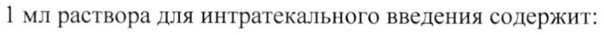
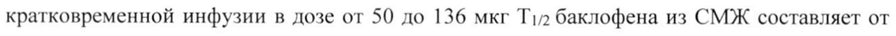
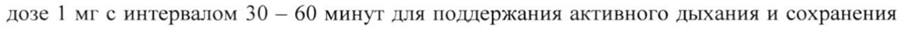

# Баклофен — парентерально

- Препарат: Лиорезал® Интратекальный (раствор для интратекального введения;)
- АТХ: M03BX01
- Источник: ГРЛС, инструкция по медицинскому применению, РУ ЛСР-008524/10, файл от 2022-05-05 (https://grls.rosminzdrav.ru/Grls_View_v2.aspx?routingGuid=b000d3c8-fc66-492c-b665-39d4188d79cf)
- Распознано автоматически (OCR): 21 из 21 стр.
- Инструкция к другому РУ того же препарата: ЛСР-008524/10 (национальное РУ, переоформленное по правилам ЕАЭС, решение от 27.04.2022). Текст может быть старше действующего
- Сомнительных строк после OCR: 3 (см. раздел «Проверка распознавания»)

## Общие сведения

МИНЗДРАВ РОССИИ Е 10917 МИНИСТЕРСТВО ЗДРАВООХРАНЕНИЯ РОССИЙСКОЙ ФЕДЕРАЦИИ
СОГЛАСОВАНО ИНСТРУКЦИЯ ПО МЕДИЦИНСКОМУ ПРИМЕНЕНИЮ ЛЕКАРСТВЕННОГО ПРЕПАРАТА
ЛИОРЕЗАЛ® ИНТРАТЕКАЛЬНЫЙ

РЕГИСТРАЦИОННЫЙ НОМЕР: ЛСР-008524/10

ТОРГОВОЕ НАИМЕНОВАНИЕ: Лиорезал® Интратекальный

МЕЖДУНАРОДНОЕ НЕПАТЕНТОВАННОЕ НАИМЕНОВАНИЕ (МНН): баклофен

## 3. Лекарственная форма

раствор для интратекального введения
раствор для интратекального введения

COCTAB

1 мл раствора для интратекального введения содержит:

действующее вещество: баклофен 0,05 мг / 0,5 мг / 2 мг;

вспомогательные вещества: натрия хлорид (9,00 мг), вода для инъекций (до 1,00 мл).

ОПИСАНИЕ: прозрачный, бесцветный раствор.

ФАРМАКОТЕРАПЕВТИЧЕСКАЯ ГРУППА: миорелаксант центрального действия.

Код ATX: МОЗВ X01

ФАаРМАКОЛОГИЧЕСКИЕ СВОЙСТВА

Механизм действия |

Баклофен подавляет передачу как моно-, так и полисинаптических рефлексов в спинном

мозге, стимулируя ГАМКв-рецепторы, являясь химическим аналогом гамма-

аминомасляной кислоты (ГАМК), ингибирующего нейромедиатора.

## 5.1. Фармакодинамика

У пациентов с неврологическими состояниями, ассоциированными со спазмом скелетных

мыщц, (например, с тетанусом) клинический эффект баклофена проявляется уменьшением

интенсивности рефлекторных мышечных сокращений, а также значимым облегчением

состояния при болезненном мышечном спазме, автоматизмах, гиперрефлексии, тризме и

клонических судорогах. Препарат способствует увеличению двигательной активности,

улучшает способность к самообслуживанию, а также облегчает проведение

восстановительной терапии. Баклофен оказывает антиноцицептивное действие и не влияет

на нервно-мышечную передачу. Вышеуказанные эффекты способствуют увеличению
| способности к самостоятельному передвижению, предотвращению развития и заживлению

уже существующих пролежней, а также улучшению качества сна в связи с устранением

болезненного мышечного спазма. Кроме вышеперечисленного отмечается улучшение

функции мочевого пузыря и сфинктеров, что облегчает катетеризацию; все

вышеперечисленное приводит к значительному улучшению качества жизни.

Баклофен обладает общим угнетающим воздействием на центральную нервную систему

1/21 j ee о т т м и о ВИЙ ть: пб Я НЯ и и Вр |
(ЦНС), вызывает седацию, сонливость, а также угнетает функцию дыхательной и сердечнососудистой систем. Кроме того, отмечен дозозависимый угнетающий эффект на эректильную функцию у мужчин, опосредованный стимуляцией ГАМКв рецепторов.
Применение препарата может быть альтернативой деструктивному нейрохирургичекому лечению. Непосредственное интратекальное введение баклофена в дозах, минимум в 100

раз меньших, чем при приеме внутрь, позволяет эффективно контролировать спастичность.

| Болюсное интратекальное введение

После однократного интратекального введения препарата начало действия обычно

отмечается через 0,5-1 час. Максимальный антиспастический эффект отмечается примерно

через 4 часа, длительность действия составляет от 4 до 8 часов. Начало, максимальная
| выраженность и продолжительность действия у отдельных пациентов могут существенно варьировать в зависимости от величины дозы, степени тяжести симптомов, метода и скорости введения препарата.
Длительное введение При длительном интратекальном введении баклофена начало антиспастического действия наблюдается через 6-8 часов. Максимальный эффект развивается в пределах 24-48 часов.

## 5.2. Фармакокинетика

Приведенные ниже показатели фармакокинетики баклофена следует рассматривать с

| учетом медленной циркуляции спинномозговой жидкости (СМЖ), а также градиента концентрации между люмбальной и цистернальной СМЖ.

Всасывание

Инфузия препарата непосредственно в субарахноидальное пространство спинного мозга

исключает процесс всасывания как таковой и обеспечивает воздействие баклофена непо-

средственно на рецепторные зоны задних рогов спинного мозга.

Распределение

После однократного интратекального введения препарата путем болюсной инъекции или

кратковременной инфузии объем распределения, вычисленный на основании определения

концентраций баклофена в СМЖ, составляет от 22 до 157 мл.

При проведении длительной интратекальной инфузии в суточной дозе от 50 до 1200 мкг

равновесная концентрация баклофена в СМЖ составляет от 130 до 1240 нг/мл. С учетом

рассчитанной продолжительности периода полувыведении (Т!/2) баклофена из СМЖ,

равновесная концентрация достигается в пределах 1-2 дней. Во время интратекальной

инфузии баклофена его концентрация в плазме крови не превышает 5 нг/мл.

Выведение

После однократного интратекального введения препарата путем болюсной инъекции или

кратковременной инфузии в дозе от 50 до 136 мкг Т!/2 баклофена из СМЖ составляет от 2/21
| | | часа до 5 часов. Т1/2 баклофена после достижения равновесной концентрации в СМЖ не установлено.
Как после однократного введения, так и после длительной субарахноидальной инфузии на уровне поясничного отдела спинного мозга (осуществляемой с помощью имплантируемой помпы), клиренс баклофена из СМЖ составляет в среднем около 30 мл/час.
Во время длительной инфузии соотношение концентраций в равновесном состоянии баклофена в СМЖ, полученной при люмбальной пункции и извлеченной из субарахноидальных цистерн, составляло 1,8:1-8,7:1 (в среднем 4:1). Этот факт имеет важное клиническое значение, поскольку подтверждает возможность эффективного лечения спастичности преимущественно нижних конечностей при одновременном слабо выраженном воздействии на мышечный тонус верхних конечностей и незначительном числе побочных реакций со стороны ЦНС, обусловленных влиянием баклофена на центры головного мозга.
Особые группы пациентов Пациенты в возрасте >65 лет
Нет данных о фармакокинетических параметрах баклофена при применении препарата у | пациентов данной возрастной группы. После однократного приема баклофена внутрь отмечалось замедление выведения по сравнению с пациентами в возрасте менее 65 лет, однако системное воздействие баклофена оставалось сходным с таковым у более молодых пациентов. Экстраполирование данных результатов на многократное введение баклофена не позволяет предположить существенные различия фармакокинетических параметров у пациентов разных возрастных групп.
Пациенты в возрасте <18 лет У пациентов в возрасте от 8 до 18 лет, получавших препарат в виде длительной
| интратекальной инфузии в дозе 77-400 мкг/сут, концентрация баклофена в плазме крови была равна или менее 10 нг/мл.
Пациенты с нарушениями функции печени Нет данных по фармакокинетическим параметрам баклофена у пациентов с нарушением функции печени после его интратекального введения. Так как печень не играет существенной роли в метаболизме баклофена при интратекальном введении, клинически значимое изменение фармакокинетических параметров при поражении печени маловероятно.
Пациенты с нарушениями функции почек Нет данных о фармакокинетических параметрах баклофена после его интратекального введения у пациентов с нарушением функции почек. Поскольку баклофен выделяется почками в неизмененном виде, нельзя исключить аккумуляцию неизмененного препарата у 3721
Ss о ee пациентов с нарушением функции почек.

## 4.1. Показания к применению

Выраженная хроническая спастичность при поражении спинного (например, вследствие травмы, при рассеянном склерозе, а также других поражениях спинного мозга) или головного мозга при неэффективности или непереносимости терапии миорелаксантами для приема внутрь.
Выраженная хроническая спастичность при поражении спинного (например, вследствие травмы, при рассеянном склерозе, а также других поражениях спинного мозга) или головного мозга при неэффективности или непереносимости терапии миорелаксантами для приема внутрь.

## 4.3. Противопоказания

Повышенная чувствительность к баклофену или любым другим компонентам препарата.
Повышенная чувствительность к баклофену или любым другим компонентам препарата.
Детский возраст менее 4 лет (эффективность и безопасность применения препарата у детей менее 4 лет не установлены).

| Нельзя вводить препарат внутривенно, внутримышечно, подкожно или эпидурально!

## 4.3. С осторожностью

При спастичности, обусловленной черепно-мозговой травмой, не следует переходить на длительную терапию баклофеном в виде интратекальной инфузии до стабилизации симптомов спастичности, т.е. минимум в течение | года после травмы.
При спастичности, обусловленной черепно-мозговой травмой, не следует переходить на длительную терапию баклофеном в виде интратекальной инфузии до стабилизации симптомов спастичности, т.е. минимум в течение | года после травмы.
Для установки имплантируемой инфузионной системы у детей необходимым условием является наличие достаточной массы тела (данная информация указана в инструкции по

эксплуатации имплантируемой инфузионной системы).
Применять препарат Лиорезал® Интратекальный в педиатрии должны только медицинские работники, имеющие соответствующие знания и опыт. Клинические данные о применении препарата у детей младше 4 лет ограничены.
Следует соблюдать осторожность у пациентов с нарушением функции почек; пациентов в возрасте старше 65 лет; пациентов с нарушением циркуляции СМЖ; пациентов с психотическими расстройствами, шизофренией, при спутанности сознания или с болезнью
Паркинсона; пациентов с эпилепсией; пациентов с вегетативной дизрефлексией в анамнезе; | пациентов o недостаточностью мозгового кровообращения, — дыхательной недостаточностью; пациентов с язвенным поражением органов желудочно-кишечного тракта в анамнезе, с гипертонусом сфинктеров; пациентов с сахарным диабетом.

## 4.6. Применение при беременности и в период грудного вскармливания

Беременность Резюме рисков Опыт применения препарата у беременных женщин ограничен. После интратекального введения небольшое количество баклофена обнаруживается в плазме крови матери. В исследованиях у животных баклофен проникал через гематоплацентарный барьер.
Применение препарата во время беременности возможно только в случае, если ожидаемая польза для матери превышает возможный риск для плода.

4/21 Данные исследований у животных

На основании данных, полученных при применении баклофена внутрь у животных,

маловероятно развитие побочного действия на фертильность, пре- или постнатальное

развитие при интратекальном введении препарата. У животных при применении в дозах, в

125 раз превышающих таковые при интратекальном введении (из расчета мг/кг массы тела),
| препарат не оказывал тератогенного эффекта. При применении баклофена внутрь у крыс в

дозах, в 500 раз превышающих таковые для интратекального введения (в пересчете на мг/кг

массы тела), у детенышей отмечено увеличение частоты развития омфалоцеле (вентральной

грыжи), однако данное явление не было зарегистрировано у кроликов и мышей. При

применении баклофена внутрь в дозах, токсичных для организма матери, у крыс и кроликов

отмечена задержка внутриутробного развития (задержка костного созревания). При

интраперитонеальном введении баклофена крысам в высоких дозах у детенышей отмечено

расширение дуг позвонков.

Грудное вскармливание

После приема внутрь в терапевтических дозах баклофен выделяется с грудным молоком в

количествах, не приводящих к развитию нежелательных явлений. Так как баклофен не

выделяется с грудным молоком при интратекальном применении, соблюдений каких-либо

особых рекомендаций кормящим женщинам не требуется.

Фертильность

По данным доклинических исследований при интратекальном введении в клинической

практике неблагоприятное влияние баклофена на фертильность маловероятно.

## 4.2. Способ применения и дозы

Препарат предназначен только для интратекального введения!

Клиническая эффективность препарата была доказана в исследованиях, проведенных

компанией Медтроник, Инк., с использованием программируемой инфузионной системы

SynchroMed®, которая представляет собой имплантируемый прибор для доставки

лекарственного препарата с повторно заполняемым резервуаром, и предназначена для

имплантации в подкожный «карман», как правило, на передней брюшной стенке. К прибору

подсоединяется спинномозговой катетер, также расположенный под кожей, который

заканчивается в субарахноидальном пространстве.

Разрешено также использование других систем при доказанной совместимости с

препаратом.

Терапию баклофеном с интратекальным введением при помощи имплантируемой |

инфузионной системы может осуществлять только врач, обладающий соответствующими

необходимыми знаниями и опытом. Следует строго придерживаться инструкций по

программированию и/или повторному заполнению резервуара имплантируемой помпы,

5/21 установленных компанией-производителем системы.
При спастичности, обусловленной черепно-мозговой травмой, не следует переходить на непрерывную терапию баклофеном в виде интратекальной инфузии до стабилизации симптомов спастичности, т.е. минимум в течение | года после травмы.
Рекомендуемые дозы Препарат Лиорезал® Интратекальный предназначен для однократного введения в тестовой дозе (через постоянный катетер, расположенный в спинномозговом канале, или при люмбальной пункции) и для длительного применения с помощью имплантируемой помпы, обеспечивающей длительное введение препарата в субарахноидальное пространство.
Для подбора оптимальной дозы и режима дозирования для каждого пациента следует провести начальную скрининговую фазу с болюсным интратекальным введением, после чего - фазу тщательного подбора дозы перед началом поддерживающей терапии. Вышеуказанные рекомендации связаны с болыпой индивидуальной вариабельностью эффективной терапевтической дозы.

Начальная/скрининговая фаза лечения Перед началом длительной интратекальной инфузии следует получить положительный терапевтический ответ на болюсное введение препарата в скрининговой фазе терапии. С этой целью тестовую дозу препарата вводят через спинномозговой катетер или при пункции спинномозгового канала.
Взрослые У взрослых начальная тестовая доза составляет 25 мкг или 50 мкг с пошаговым увеличением минимум каждые 24 часа на 25 мкг до достижения ответа с примерной продолжительностью от 4 до 8 часов. Тестовую дозу вводят методом барботажа в течение минимум одной минуты. Для тестового введения следует применять раствор с низкой концентрацией баклофена - 0,05 мг/мл. Тестовое введение препарата следует проводить в условиях немедленной доступности соответствующего реанимационного оборудования и лекарственных препаратов, необходимых для купирования жизнеугрожающих состояний или тяжелых побочных эффектов.
Положительным результатом тестового интратекального введения является значительное снижение мышечного тонуса и/или частоты и/или выраженности судорог.
Чувствительность к препарату Лиорезал® Интратекальный очень вариабельна. Известен один случай тяжелой передозировки баклофеном (с развитием комы) у взрослого пациента | после однократного введения препарата в тестовой дозе 25 мкг.
При отсутствии ответа на тестовое введение препарата в дозе 100 мкг следует отказаться от дальнейшего увеличения дозы, а также от проведения длительной интратекальной инфузии.
Дети

6/21 Начальная тестовая доза при люмбальной пункции у пациентов в возрасте от 4 до 8 лет

составляет 25-50 мкг в зависимости от возраста и массы тела. При отсутствии ответа |

возможно увеличение дозы на 25 мкг/сут каждые 24 часа. Максимальная тестовая доза у |
| пациентов данной возрастной категории не должна превышать 100 мкг/сут. |

Фаза подбора дозы (взрослые пациенты и дети в возрасте старше 4 лет)

После подтверждения терапевтического ответа на введение тестовой дозы проводят

длительную непрерывную интратекальную инфузию препарата с использованием

соответствующей инфузионной системы.

Для определения суточной дозы препарата после имплантации инфузионной помпы

следует удвоить тестовую дозу, на введение которой получен положительный ответ.

Полученную дозу вводят в течение 24 часов, за исключением случаев, когда

продолжительность эффекта тестовой дозы составила более 12 часов. В таких случаях

стартовая суточная доза равна тестовой, которую вводят непрерывно в течение 24 часов. Не

следует увеличивать дозу в течение первых 24 часов.

Спастичность вследствие поражения спинного мозга

По окончании первых 24 часов инфузии для достижения желаемого клинического эффекта

в дальнейшем суточную дозу увеличивают ежедневно на 10-30% во избежание возможной

передозировки.

Спастичность вследствие поражения головного мозга

По окончании первых 24 часов инфузии для достижения желаемого клинического эффекта

в дальнейшем суточную дозу увеличивают ежедневно на 5-15% во избежание возможной

передозировки.

При использовании программируемых инфузионных помп дозу препарата увеличивают

однократно каждые 24 часа. При использовании непрограммируемых инфузионных помп,

с катетером длиной 76 см (через который в течение суток поступает | мл препарата) для

оценки клинического ответа следует придерживаться 48-часового интервала. В случае

отсутствия клинического эффекта после значительного увеличения дозы следует

удостовериться в корректном функционировании имплантируемой системы, а также

проходимости катетера.

Опыт применения доз препарата, превышающих 1000 мкг в сутки, ограничен.

Во время скрининговой/начальной фазы и фазы подбора дозы, непосредственно после

установки имплантата, следует тщательно контролировать состояние пациента в условиях

должным образом оборудованного учреждения с обученным персоналом и

соответствующим готовым к использованию реанимационным оборудованием, а также

необходимым медикаментозным обеспечением для проведения мероприятий для

купирования жизнеугрожающих состояний или тяжелых побочных эффектов.

V2)
a I a a Сити Риби КО es ИВ" тв А ее т te ое. ДИН ды a |
| Поддерживающая терапия Клинической целью терапии является поддержание мышечного тонуса по возможности в норме для минимизации частоты и тяжести мышечных спазмов без развития непереносимых нежелательных эффектов, или подбор дозы для поддержания мышечного тонуса, необходимого для обеспечения оптимальной двигательной активности у пациентов со спастичностью церебрального генеза.
Следует применять наименьшую дозу препарата, вызывающую адекватный эффект. Для поддержания оптимального эффекта во время долгосрочного лечения у большинства пациентов со временем требуется постепенное повышение дозы препарата вследствие постепенного уменьшения чувствительности к баклофену или вследствие прогрессирования заболевания.
У некоторых пациентов с целью предотвращения возникновения чувства «паралича»
желательно сохранение некоторой степени спастичности. Кроме вышеописанного, сочетание мышечного тонуса и эпизодических спазмов может способствовать поддержанию сосудистой циркуляции и предотвращению развития тромбоза глубоких вен.
У пациентов со спастичностью при поражении спинного мозга для поддержания адекватного контроля симптомов возможно постепенное увеличение суточной дозы (на 1030%) путем увеличения скорости инфузии в системе и/или увеличения концентрации раствора баклофена в резервуаре. В случае развития побочных явлений суточная доза может быть снижена на 10-20%.
У пациентов со спастичностью при поражении головного мозга для поддержания адекватного контроля симптомов возможно постепенное увеличение суточной дозы на 520%, но не более, чем на 20% путем увеличения скорости инфузии в системе и/или увеличения концентрации раствора баклофена в резервуаре. В случае развития побочных явлений суточная доза может быть снижена на 10-20%.
Внезапно возникающая потребность в значительном увеличении дозы может указывать на осложнения со стороны катетера (например, его перекрут или смещение) или может быть связана с некорректным функционированием инфузионной помпы.
У пациентов со спастичностью при поражении спинного мозга поддерживающая доза препарата при длительном введении составляет от 12 до 2003 мкг в сутки при этом у большинства пациентов адекватный контроль поддерживается при применении 300800 мкг в сутки.
У пациентов со спиастичностью при поражении головного мозга поддерживающая доза при длительном введении составляет от 22 до 1400 мкг в сутки; средняя суточная доза к 12 месяцам терапии составляет 276 мкг, к 24 месяцам терапии - 307 мкг.
В ходе долгосрочного лечения примерно у 5% пациентов развивается рефрактерность к 8/21
| увеличивающимся дозам препарата вследствие возникающей толерантности или нарушения доставки препарата. Возможным методом коррекции данного явления является постепенное уменьшение дозы препарата в течение 2-4 недель с последующим переходом на другую антиспастическую терапию (например, сульфатом морфина). Через несколько дней чувствительность к препарату может восстанавливаться, при этом следует возобновить дальнейшую терапию препаратом с начальной дозы для длительной инфузии.
Необходимо соблюдать осторожность при переводе пациента с терапии препаратом на сульфат морфина и обратно.

Необходимость в регулярном клиническом наблюдении пациента для оценки потребности в коррекции дозы, оценки адекватного функционирования инфузионной системы, контроля возможных побочных явлений или выявления возможных инфекционных осложнений сохраняется на протяжении всего периода лечения.
Дети и подростки (от 4 до 18 лет)
У пациентов со спастичностью при поражении головного и спинного мозга начальная поддерживающая доза препарата для длительной инфузии составляет от 35 до 200 мкг в сутки (в среднем 100 мкг в сутки). Поддерживающую дозу следует корректировать в зависимости от выраженности клинического ответа, таким образом, отмечена тенденция к увеличению суммарной суточной дозы со временем. Данные о применении препарата в дозах, превышающих 1000 мкг в сутки, ограничены.
Прекращение лечения За исключением неотложных состояний, вызванных передозировкой, отмена терапии препаратом требует постепенного и последовательного уменьшения дозы. Недопустима резкая отмена терапии препаратом.
Синдром отмены Синдром отмены независимо от причины отмены поступления/применения препарата проявлялся увеличением спастичности, зудом, парестезиями, артериальной гипотензией с последующим развитием осложнений, включающих гиперреактивные состояния с неконтролируемыми судорогами, гипертермией и симптомами, схожими с проявлениями злокачественного нейролептического синдрома, т.е. изменением психического статуса и ригидностью мышц. В редких случаях отмечалась прогрессия до эпилептического припадка/эпилептического статуса, рабдомиолиза, коагулопатии, полиорганной недостаточности и летального исхода. Риск развития синдрома отмены актуален для всех
| пациентов, получающих терапию препаратом.

Некоторые клинические проявления, связанные с отменой препарата, могут быть схожими с вегетативной дизрефлексией, сепсисом, злокачественной гипертермией, злокачественным нейролептическим синдромом или другими состояниями, связанными с

9/21 гиперметаболическим состоянием или распространенным рабдомиолизом.
Следует информировать пациента и опекуна о важности регулярного заполнения резервуара помпы, а также обучить распознаванию признаков и симптомов отмены баклофена, в особенности ранних проявлений (например, приапизм).
В большинстве случаев симптомы возникают в течение от нескольких часов до нескольких дней после внезапной отмены препарата. Частыми причинами внезапной отмены терапии являются нарушения нормального функционирования катетера (в особенности его самопроизвольное отсоединение) и низкий объем препарата в резервуаре помпы.
Предупреждение случаев внезапной отмены терапии препаратом Лиорезал®
Интратекальный требует внимания к соблюдению правил по программированию и мониторингу инфузионной системы, своевременному заполнению резервуара и предупреждающим сигналам имплантируемой системы. Методом лечения синдрома отмены является возобновление интратекального введения препарата в прежней или близкой дозе к применявшейся на момент внезапной отмены. При невозможности немедленного возобновления введения препарата такие методы, как пероральное или
| энтеральное применение агонистов ГАМК рецепторов, таких как баклофен, или пероральное, энтеральное или внутривенное применение бензодиазепинов, могут предотвратить летальные последствия. Изолированное пероральное или энтеральное применение баклофена не может являться единственным методом коррекции прогрессирования синдрома отмены.
Особые группы пациентов Пациенты с нарушениями функции почек
Исследований с применением препарата у пациентов с нарушением функции почек не проводилось. Поскольку баклофен выводится почками в неизмененном виде, нельзя исключить аккумуляцию неизмененного препарата у пациентов с нарушением функции почек.
Пациенты с нарушениями функции печени Исследований с применением препарата у пациентов с нарушением функции печени не проводилось. Так как печень не играет существенной роли в метаболизме баклофена при интратекальном введении, коррекции дозы при поражении печени не требуется.
Пациенты в возрасте >65 лет В ходе клинических исследований при применении препарата Лиорезал® Интратекальный у пациентов в возрасте >65 лет переносимость препарата была сходной с таковой у пациентов более молодого возраста. Не предвидится каких-либо отклонений, специфичных для пациентов данной возрастной группы, в связи с тщательным индивидуальным подбором дозы.
10/21 Инструкции по применению Содержимое одной ампулы предназначено только для однократного использования, неиспользованный остаток раствора следует утилизировать.
Доказана стабильность раствора препарата в инфузионной системе SynchroMed®, в течение 11 недель.
Препарат нельзя применять при изменении цвета раствора и появлении видимых нерастворившихся частиц. Приготовление раствора с концентрацией баклофена, отличной
| от 50 мкг/мл, 500 мкг/мл или 2000 мкг/мл, следует проводить в асептических условиях с использованием только 0,9% раствора натрия хлорида, не содержащего консервантов.
Для введения через имплантируемую инфузионную помпу предназначен раствор баклофена в ампулах 10 мг/5 мли 10 мг/20 мл.
Непосредственная концентрация раствора и скорость введения в каждом индивидуальном случае зависит от требуемой суммарной суточной дозы. Для более подробных инструкций следует обратиться к руководству по эксплуатации компании-производителя инфузионной системы.
Режим инфузии Препарат Лиорезал® Интратекальный в большинстве случаев вводят длительно, начиная непосредственно после имплантации инфузионной системы. После достижения стабильной суточной дозы и стабилизации функционального состояния при соответствующих технических возможностях системы возможно использование более сложных режимов дозирования для оптимизации контроля спастичности в различное время суток. Например, пациентам с выраженной спастичностью в ночное время может потребоваться увеличение почасовой скорости введения на 20% в указанное время. Корректировать скорость введения следует за 2 часа до развития желаемого клинического эффекта.

## 4.8. Побочное действие

Некоторые из перечисленных ниже нежелательных лекарственных реакций (НЛР) были зарегистрированы у пациентов со спастичностью при поражении спинного мозга, но могут встречаться также и у пациентов со спастичностью при поражении головного мозга. Ниже приведены те НЛР, которые встречались наиболее часто независимо от характера заболевания.
Некоторые из перечисленных ниже нежелательных лекарственных реакций (НЛР) были зарегистрированы у пациентов со спастичностью при поражении спинного мозга, но могут встречаться также и у пациентов со спастичностью при поражении головного мозга. Ниже приведены те НЛР, которые встречались наиболее часто независимо от характера заболевания.
НЛР сгруппированы в соответствии с классификацией органов и систем органов Мед ОКА, в пределах каждого системно-органного класса распределены по частоте возникновения в порядке уменьшения важности. Частота развития НЛР оценивалась следующим образом:
очень часто (>1/10); часто (>1/100, <1/10); нечасто (>1/1000, <1/100); редко (>1/10000,
<1/1000); очень редко (<1/10000), включая отдельные сообщения.
Нарушения со стороны обмена веществ и питания: нечасто — дегидратация.
11/21 Нарушения со стороны нервной системы: очень часто — сонливость; часто — судороги,

головная боль, дизартрия, головокружение, седация, летаргия, бессонница, спутанность

сознания, парестезии, дезориентация; нечасто - атаксия, нарушения памяти, нистагм.

Судороги и головная боль встречаются чаще у пациентов со спастичностью церебрального

генеза, чем у пациентов со спастичностью спинномозгового происхождения.

Нарушения психики: часто — депрессия, тревожность, ажитация; нечасто — суицидальные

мысли и попытки, галлюцинации, паранойя, эйфория.

Нарушения со стороны органа зрения: часто - диплопия, затуманивание зрения, нарушение

аккомодации.

Нарушения со стороны сердца: нечасто — брадикардия.

Нарушения со стороны сосудов: часто — артериальная гипотензия; нечасто — артериальная

гипертензия, тромбоз глубоких вен, покраснение или побледнение кожи (различной

локализации).

Нарушения со стороны дыхательной системы, органов грудной клетки и средостения:

часто — угнетение дыхания, пневмония, одышка.

Нарушения со стороны желудочно-кишечного тракта: часто — диарея, рвота, тошнота,

запор, снижение аппетита, сухость во рту, усиление слюноотделения; нечасто —

непроходимость кишечника, дисфагия, снижение вкусового восприятия.

Тошнота и рвота встречаются чаще у пациентов со спастичностью церебрального генеза,

чем у пациентов со спастичностью спинномозгового происхождения.

Нарушения со стороны кожи и подкожных тканей: часто — отек лица и/или

периферические отеки, крапивница, кожный зуд; нечасто - повышенное потоотделение,

алопеция.

Нарушения со стороны костно-мышечной системы: очень часто - мышечная гипотония;

часто - повышение мышечного тонуса.

Нарушения со стороны почек и мочевыводящих путей: очень часто - задержка мочи,

недержание мочи.

Задержка мочи встречается чаще у пациентов со спастичностью церебрального генеза, чем

у пациентов со спастичностью спинномозгового происхождения.

Нарушения со стороны половых органов и молочной железы: часто — сексуальная
| дисфункция.

Общие расстройства и нарушения в месте введения: часто — пирексия, астения, боль,
| озноб; нечасто — гипотермия; редко - жизнеугрожающие симптомы, связанные с внезапным

прекращением поступления препарата.

Ниже перечислены НЛР, не зарегистрированные в клинических исследованиях, но

отмечавшиеся в спонтанных отчетах в пострегистрационном периоде, а также описанные в

12/21 литературе. Поскольку информация о данных реакциях получена методом спонтанных сообщений и точное число пациентов, принимавших препарат, не определено, оценить частоту возникновения данных реакций не представляется возможным, в связи с чем для них указано «частота неизвестна».
Нарушения со стороны нервной системы: дисфория.
Нарушения со стороны дыхательной системы, органов грудной клетки и средостения:
брадипноэ.
Нарушение со стороны скелетно-мышечной и соединительной ткани: сколиоз.
Нарушения со стороны половых органов и молочной железы: эректильная дисфункция.
|

Нежелательные явления, связанные с инфузионной системой
Получены сообщения о нежелательных явлениях, связанных с инфузионной системой
(например, катетерная гранулема, смещение катетера с возможными осложнениями, инфицирование тканей, окружающих имплантированную инфузионную систему, менингит, передозировка вследствие неправильного обращения с устройством), в ряде случаев, однако, причинно-следственная связь с баклофеном не может быть исключена.
Если любые из указанных в инструкции побочных эффектов усугубляются, или Вы заметили любые другие побочные эффекты, не указанные в инструкции, сообщите об этом врачу.

## 4.9. Передозировка

Следует постоянно уделять особое внимание распознаванию симптомов возможной передозировки, в особенности в период скрининга и начального подбора дозы, а также при возобновлении терапии препаратом после прерывания лечения.
Следует постоянно уделять особое внимание распознаванию симптомов возможной передозировки, в особенности в период скрининга и начального подбора дозы, а также при возобновлении терапии препаратом после прерывания лечения.
Проявления передозировки могут развиваться внезапно или постепенно.
Симптомы передозировки: чрезмерный мышечный гипотонус, сонливость, чувство слабости, головокружение, сомноленция, судороги, потеря сознания, гипотермия, избыточное слюноотделение, тошнота и рвота.
Значительная передозировка приводит к угнетению дыхания, апноэ и коме. Серьезная передозировка может возникнуть, например при случайном введении препарата через катетер, при проверке его проходимости или при диагностике его положения, другими возможными причинами передозировки могут быть ошибки в программировании инфузионной помпы, чрезмерное быстрое увеличение дозы и одновременное применение баклофена внутрь. Следует также провести проверку устройства с целью выявления возможного некорректного функционирования инфузионной системы.
Лечение Специфического антидота для лечения передозировки баклофеном не существует. В целом должны быть предприняты следующие меры:

13721 1) Необходимо как можно быстрее удалить из резервуара инфузионной помпы остаток раствора баклофена.

2) У пациентов с угнетением дыхания при необходимости следует провести интубацию трахеи вплоть до полного выведения препарата. Зарегистрированы сообщения, что внутривенное применение физостигмина может способствовать купированию действия баклофена на ЦНС, в особенности, сомноленции и угнетения дыхания.

У взрослых возможна попытка внутривенного введения физостигмина в суммарной дозе 1
— 2 мгв течение 5 — 10 минут. Во время введения следует тщательно наблюдать пациента, уделяя особое внимание признакам судорог, брадикардии, а также нарушений сердечной проводимости. При эффективности лечения возможно повторное введение физостигмина в дозе 1 мг с интервалом 30 — 60 минут для поддержания активного дыхания и сохранения сознания.

У детей возможно внутривенное введение физостигмина в дозе 0,02 кг/кг массы тела со скоростью, не превышающей 0,5 мг/мин. При наличии терапевтического эффекта возможно повторное введение препарата в той же дозе с интервалом 5-10 минут. Максимальная доза физостигмина не должна превышать 2 мг.

Изолированное применение физостигмина может быть неэффективным в случаях значительной передозировки. В таких случаях следует проводить искусственную вентиляцию легких.

При отсутствии противопоказаний на ранних этапах развития передозировки следует

рассмотреть возможность люмбальной пункции с целью удаления 30-40 мл СМЖ для

уменьшения концентрации баклофена. Проводят мероприятия, направленные на

поддержание функции сердечно-сосудистой системы. При развитии судорог внутривенно

вводят диазепам с соблюдением осторожности.

## 4.5. Взаимодействие с другими лекарственными средствами

Опыт одновременного применения препарата Лиорезал® Интратекальный с препаратами

системного действия ограничен. С учетом малой экспозиции баклофена при

интратекальном введении препарата, возможность лекарственного взаимодействия низкая.

Нерекомендуемые комбинации

Леводопа/ингибиторы ДОФА-декарбоксилазы

Одновременный прием баклофена внутрь с леводопой/ингибитором ДОФА-

декарбоксилазы приводил к увеличению риска развития нежелательных явлений, таких как

зрительные галлюцинации, спутанность сознания, головная боль и тошнота. Получены

также сообщения об усугублении симптомов паркинсонизма. В связи с вышесказанным,

следует соблюдать осторожность при интратекальном применении препарата у пациентов,

получающих терапию леводопой/ингибиторами ДОФА-декарбоксилазы. | 14/21
Комбинации, требующие особого внимания Анестетики
Одновременное интратекальное применение баклофена и препаратов для общей анестезии
(например, фентанила, пропофола) может привести к увеличению риска развития нарушений сердечной деятельности и судорог. В связи с вышесказанным следует

| соблюдать осторожность при применении данных препаратов у пациентов, получающих терапию препаратом Лиорезал® Интратекальный.
Морфин У одного из пациентов одновременное применение морфина и препарата Лиорезал®
Интратекальный привело к развитию артериальной гипотензии. Нельзя исключить возможность развития одышки и других симптомов угнетения ЦНС. Одновременное применение препарата и других лекарственных средств для интратекального введения не изучено, в связи с чем безопасность такого применения не установлена.
Алкоголь и другие вещества, влияющие на ЦНС
Угнетающее воздействие на ЦНС этанола и других веществ (например, анальгетиков, нейролептиков, барбитуратов, бензодиазепинов, анксиолитиков) может усиливать эффекты препарата.

Трициклические антидепрессанты Одновременное применение баклофена внутрь с трициклическими антидепрессантами может усиливать его действие, что приводит к выраженной мышечной гипотонии. Следует соблюдать осторожность при одновременном применении препарата с указанными средствами. =
Гипотензивные препараты Поскольку одновременное применение баклофена внутрь с гипотензивными препаратами с большой долей вероятности может приводить к еще более выраженному снижению артериального давления, возможно возникновение необходимости контроля артериального давления и соответствующей коррекции дозы гипотензивных препаратов.

## 4.4. Особые указания

Необходимое медицинское наблюдение
Необходимое медицинское наблюдение
Имплантацию инфузионной системы следует проводить только после тщательной оценки реакции пациента на однократное введение препарата Лиорезал® Интратекальный и/или проведения подбора дозы препарата. Поскольку существует риск осложнений, связанных с первоначальным введением и подбором дозы препарата Лиорезал® Интратекальный (общее угнетающее воздействие на функции ЦНС, сосудистый коллапс и/или угнетение дыхания), эти этапы применения препарата должны осуществляться под медицинским наблюдением при наличии должного оборудования и в соответствии с инструкциями, изложенными в разделе «Сиособ применения и дозы». На случай возникновения выраженной, угрожающей

15/21 жизни передозировки препаратом необходимо наличие готового к использованию соответствующего реанимационного оборудования и необходимых лекарственных средств.
Требуется соответствующее обучение врача проведению постоянной интратекальной инфузионной терапии.
Контроль состояния пациента После хирургической имплантации инфузионной помпы на протяжении начальной фазы лечения, а также после каждой коррекции дозы, скорости инфузии или концентрации баклофена, следует тщательно контролировать состояние пациента вплоть до подтверждения приемлемого и стабильного ответа на терапию.
Абсолютно необходимым условием является информированность пациента, лечащего врача, а также всего персонала, оказывающего медицинскую помощь, о рисках, связанных с данным видом лечения. Необходимо обучить всех принимающих участие в терапии, а также обеспечивающих уход за пациентом лиц, распознаванию признаков и симптомов передозировки препаратом, необходимым мероприятиям в случае ее развития, а также надлежащему адекватному уходу за имплантированной инфузионной системой и местом имплантации в домашних условиях.
Фаза скрининга Следует тщательно контролировать функцию дыхательной и сердечно-сосудистой систем
| на протяжении периода введения тестовой дозы (фаза скрининга), в особенности у пациентов с сердечно-легочными заболеваниями и слабостью дыхательной мускулатуры, а также пациентов, получающих одновременную терапию бензодиазепинами или опиатами, т.к. у пациентов данной категории повышен риск угнетения дыхательной системы.
Перед проведением фазы скрининга следует убедиться в отсутствии у пациента инфекционных состояний в связи с затрудненной оценкой ответа на болюсное введение препарата в условиях системной инфекции.
Имплантация инфузионной системы Перед проведением имплантации следует исключить инфекционные заболевания в связи с риском развития хирургических осложнений. Помимо этого, системная инфекция может осложнять попытки коррекции дозы. Местное инфекционное поражение, а также неправильное расположение катетера может приводить к внезапной отмене препарата и развитию связанных с этим симптомов.
Повторное заполнение резервуара системы | Повторное заполнение резервуара может осуществлять только персонал, обладающий должным опытом и квалификацией в соответствии с инструкциями компаниипроизводителя инфузионной системы. Необходимо тщательным образом определить периодичность повторного заполнения резервуара системы во избежание полного 16/21 опорожнения резервуара, так как это приводит к рецидиву тяжелой спастичности или развитию потенциально жизнеугрожающего синдрома отмены. Повторное заполнение резервуара следует проводить строго в асептических условиях во избежание микробной контаминации и серьезной инфекции ЦНС. Следует наблюдать пациента в течение соответствующего клинической ситуации периода, последующего за заполнением резервуара или после любой манипуляции с резервуаром.
Следует соблюдать крайнюю осторожность при повторном заполнении резервуара инфузионной системы, оснащенной портом прямого доступа к интратекальному катетеру.
Введение препарата через порт доступа непосредственно в интратекальный катетер может повлечь жизнеугрожающую передозировку препаратом.
Дополнительные предосторожности относительно подбора дозы препарата
Следует соблюдать осторожность и избегать развития чрезмерной слабости и падений в случаях, когда применение препарата предназначено для поддержания тела в вертикальном положении, сохранения равновесия при ходьбе, или в случаях, когда необходима некоторая
| степень спастичности для достижения оптимальной повседневной активности пациента и
| способности к самообслуживанию. Важным может являться сохранение некоторой степени мышечного тонуса и эпизодических спазмов, что обеспечивает поддержание сосудистой циркуляции и может способствовать профилактике тромбоза глубоких вен.
| Следует по мере возможности отменить пероральный прием антиспастических средств во избежание возможного развития передозировки или нежелательного лекарственного взаимодействия, оптимально, до начала инфузии препарата, под тщательным наблюдением лечащего врача. Следует, однако, избегать резкой отмены одновременной антиспастической терапии на фоне длительной интратекальной терапии препаратом.
Предосторожности у некоторых групп пациентов
У пациентов с нарушением циркуляции СМЖ распределение баклофена в организме, и, следовательно, распределение его антиспастической активности, может быть неадекватным.
У пациентов с психотическими расстройствами, шизофренией, спутанностью сознания или болезнью Паркинсона лечение препаратом Лиорезал® Интратекальный следует проводить с осторожностью под тщательным наблюдением, поскольку при пероральном приеме баклофена отмечены обострения данных состояний.
Особое внимание следует уделять пациентам с эпилепсией, т.к. отмечено развитие судорог при передозировке/отмене препарата, а также у пациентов, получавших поддерживающую терапию препаратом.
Следует соблюдать осторожность у пациентов с вегетативной дизрефлексией в анамнезе, тк. наличие ноцицептивных стимулов или резкая отмена препарата Лиорезал® 17/21
| Интратекальный может приводить к развитию эпизодов вегетативной дизрефлексии.
Следует с осторожностью применять баклофен у пациентов с цереброваскулярной или сердечно-легочной недостаточностью, т.к. баклофен может усугублять данные состояния.
Маловероятно влияние препарата Лиорезал® Интратекальный на течение сопутствующих соматических заболеваний, не затрагивающих ЦНС, т.к. системная биодоступность баклофена после интратекального введения существенно ниже таковой после приема внутрь.
Несмотря на вышесказанное, результаты наблюдений при пероральной терапии баклофеном дают основания для соблюдения осторожности при применении препарата
Лиорезал® Интратекальный у пациентов с язвенным поражением органов желудочнокишечного тракта в анамнезе, а также с гипертонусом сфинктеров.
У пациентов со спастичностью вследствие черепно-мозговой травмы не следует начинать долгосрочное длительное интратекальное введение препарата до стабилизации симптомов спастичности (т.е. минимум в течение года после травмы).
Меры предосторожности при применении у детей |
Для установки имплантируемой инфузионной системы у детей необходимым условием является наличие достаточной массы тела (данная информация указана в инструкции по
| эксплуатации имплантируемой инфузионной системы). Применять препарат Лиорезал®
Интратекальный в педиатрии должны медицинские работники, имеющие соответствующие знания и опыт. Клинические данные о применении препарата у детей младше 4 лет ограничены.
Нарушение функции почек После перорального применения баклофена у пациентов с нарушением функции почек наблюдались тяжелые неврологические последствия. Таким образом, следует соблюдать осторожность при интратекальном введении баклофена у пациентов с нарушением функции почек.
Пациенты старше 65 лет У пациентов старше 65 лет может отмечаться повышенная восприимчивость к эффектам баклофена в период подбора дозы при его приеме внутрь, что также применимо к препарату
Лиорезал® Интратекальный.
Симптомы отмены Резкая отмена терапии, независимо от причины, проявляется увеличением спастичности, кожным зудом, парестезиями, артериальной гипотензией с последующим развитием осложнений, включающих гиперреактивные состояния с неконтролируемыми судорогами, гипертермией и симптомами, схожими с проявлениями — злокачественного нейролептического синдрома, т.е. изменениями психического статуса и ригидностью 18/21 мышц. В редких случаях отмечена прогрессия до — эпилептического припадка/эпилептического статуса, рабдомиолиза, коагулопатии, полиорганной недостаточности, летального исхода. Риск развития синдрома отмены актуален для всех пациентов, получающих терапию препаратом.
Некоторые клинические проявления, связанные с отменой препарата, могут быть схожими с вегетативной дизрефлексией, сепсисом, злокачественной гипертермией, злокачественным нейролептическим синдромом или другими состояниями, связанными с гиперметаболическим состоянием или распространенным рабдомиолизом.
Следует информировать пациента и опекуна о важности регулярного заполнения резервуара помпы, а также обучить распознаванию признаков и симптомов отмены баклофена, в особенности ранних его проявлений (например, приапизм).
В большинстве случаев симптомы возникают в течение от нескольких часов до нескольких дней после внезапной отмены препарата. Частыми причинами внезапной отмены терапии являются нарушения функционирования катетера (в особенности его самопроизвольное отсоединение) и низкий объем препарата в резервуаре помпы. Предупреждение случаев внезапной отмены терапии препаратом Лиорезал® Интратекальный требует внимания к соблюдению правил программирования и мониторинга инфузионной системы, своевременному заполнению резервуара и предупреждающим сигналам имплантированной системы. Методом лечения синдрома отмены является возобновление интратекального введения препарата в прежней или близкой к применявшейся дозе на момент внезапной отмены. При невозможности немедленного возобновления введения препарата такие методы, как пероральное или энтеральное применение агонистов ГАМК, таких как баклофен, или пероральное, энтеральное или внутривенное применение бензодиазепинов, могут предотвратить летальные последствия. Изолированное пероральное или энтеральное применение баклофена не может являться единственным методом коррекции прогрессирования синдрома отмены.
Гранулема на конце интратекального катетера
Описаны случаи возникновения гранулемы на конце имплантированного катетера, приводящей к различным серьезным неврологическим поражениям, включая параличи.
Наиболее частыми симптомами, ассоциированными с катетерной гранулемой, являются:
1) снижение терапевтического ответа (усугубление спастичности, рецидив на фоне успешного контроля спастичности, симптомы отмены препарата, недостаточный ответ на увеличение дозы или необходимость в частом и значительном увеличении дозы);
2) боль;
3) неврологические расстройства/нарушения.
Следует тщательно наблюдать пациента, получающего интратекальную инфузию | 19/21
|

относительно развития новых неврологических симптомов, в особенности в случае одновременной медикаментозной терапии с опиатами.
При появлении новых неврологических признаков или симптомов, позволяющих заподозрить наличие катетерной гранулемы, следует рассмотреть возможность неврологического обследования, т.к. многие симптомы катетерной гранулемы схожи с

симптомами, связанными с тяжелой спастичностью. В некоторых случаях проведение диагностической визуализации позволяет исключить или подтвердить диагноз катетерной гранулемы.
Сколиоз На фоне терапии препаратом Лиорезал® Интратекальный отмечено развитие или усугубление уже существующего сколиоза. Необходимо наблюдать пациента относительно симптомов и признаков сколиоза.

## 4.7. Влияние на способность управлять транспортными средствами, механизмами

У некоторых пациентов, получавших терапию препаратом, отмечены симптомы угнетения
ЦНС, такие как сонливость и седативный эффект, а также атаксия, галлюцинации, диплопия и признаки синдрома отмены. Следует предупредить пациента о необходимости соблюдать осторожность при управлении транспортными средствами и занятии потенциально опасными видами деятельности, требующей повышенного внимания, в период терапии.

## 6.5. Форма выпуска

Раствор для интратекального введения 0,05 мг/мл: по 1 мл в ампулы из стекла гидролитического класса 1, на капилляр ампулы нанесены три кодировочных кольца и точка разлома. По 5 ампул вместе с инструкцией по применению в картонной пачке с картонным держателем для ампул.
Раствор для интратекального введения 0,05 мг/мл: по 1 мл в ампулы из стекла гидролитического класса 1, на капилляр ампулы нанесены три кодировочных кольца и точка разлома. По 5 ампул вместе с инструкцией по применению в картонной пачке с картонным держателем для ампул.
Раствор для интратекального введения 0,5 мг/мл: по 20 мл в ампулы из стекла гидролитического класса 1, на капилляр ампулы нанесены три кодировочных кольца и точка разлома. По 1 ампуле вместе с инструкцией по применению в картонной пачке с картонным держателем для ампулы.
Раствор для интратекального введения 2 мг/мл: по 5 мл в ампулы из стекла гидролитического класса 1, на капилляр ампулы нанесены три кодировочных кольца и точка разлома. По 1 ампуле вместе с инструкцией по применению в картонной пачке с картонным держателем для ампулы.

## 6.4. Условия хранения

Препарат нельзя замораживать и подвергать стерилизации с помощью высоких температур.
Препарат нельзя замораживать и подвергать стерилизации с помощью высоких температур.
При температуре не выше 30 °С. | Хранить в недоступном для детей месте.

20/21 СРОК ГОДНОСТИ 3 года.
Не применять по истечении срока годности.
УСЛОВИЯ ОТПУСКА Отпускают по рецепту.
НАИМЕНОВАНИЕ И АДРЕС ЮРИДИЧЕСКОГО ЛИЦА, НА ИМЯ КОТОРОГО ВЫДАНО
РЕГИСТРАЦИОННОЕ УДОСТОВЕРЕНИЕ Новартис Фарма АГ, Лихтштрассе 35, 4056 Базель, Швейцария / Novartis Pharma AG,
| Lichtstrasse 35, 4056 Basel, Switzerland
ПРОИЗВОДИТЕЛЬ Новартис Фарма Штейн АГ, Шаффхаузерштрассе, 4332 Штейн, Швейцария / Novartis
Pharma Stein AG, Schaffhauserstrasse, 4332 Stein, Switzerland
| ПОЛУЧИТЬ ДОПОЛНИТЕЛЬНУЮ ИНФОРМАЦИЮ О ПРЕПАРАТЕ, А ТАКЖЕ НАПРАВИТЬ
ПРЕТЕНЗИИ И ИНФОРМАЦИЮ О НЕЖЕЛАТЕЛЬНЫХ ЯВЛЕНИЯХ МОЖНО ПО СЛЕДУЮЩЕМУ
АДРЕСУ В РОССИИ:
ООО «Новартис Фарма»
125315, г. Москва, Ленинградский проспект, дом 72, корпус 3
| тел. (495) 967 12 70;
факс (495) 967 12 68.
Ginnie С уважением, Vey ~ ON 3/ | © Стародубова М.В.
&/ Hapa ие Фа | Е |. "Nov те же р отдела регулирования 3 fe itt 1 ay | лекарственных средств
№ ah L 58 eZ OOO «Новартис Фарма»
| | 21/21
## Проверка распознавания

Страницы-сканы распознаны автоматически. В 3 строках с дозировками цифры могли распознаться с ошибкой — сверьте с вырезкой из оригинала:

- стр. 1: «1 мл раствора для интратекального введения содержит:» — повторное чтение: «| мл раствора для интратекального введения содержит:»  
  
- стр. 2: «кратковременной инфузии в дозе от 50 до 136 мкг Т!/2 баклофена из СМЖ составляет от» — низкая уверенность: «Т!/2» (52)  
  
- стр. 14: «дозе 1 мг с интервалом 30 — 60 минут для поддержания активного дыхания и сохранения» — низкая уверенность: «1» (78)  
  
