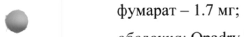
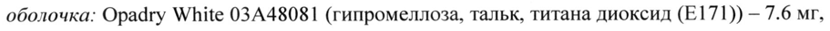
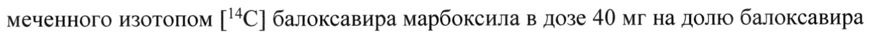
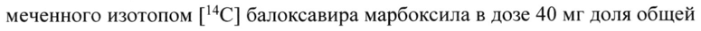
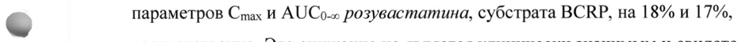
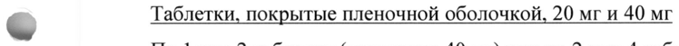

# Балоксавир марбоксил — внутрь

- Препарат: КСОФЛЮЗА® (таблетки, покрытые пленочной оболочкой;)
- АТХ: J05AX25
- Источник: ГРЛС, инструкция по медицинскому применению, РУ ЛП-006451, файл от  (https://grls.rosminzdrav.ru/Grls_View_v2.aspx?routingGuid=674d70c0-4376-448a-9c4e-ad2bb0656c71)
- Распознано автоматически (OCR): 15 из 15 стр.
- Инструкция к другому РУ того же препарата: ЛП-006451 (срок действия истёк, решение от 10.06.2021). Текст может быть старше действующего
- Сомнительных строк после OCR: 6 (см. раздел «Проверка распознавания»)
- Проверено вручную строк: 1

## Общие сведения

МИНИСТЕРСТВО ЗДРАВООХРАНЕНИЯ РОССИЙСКОЙ ФЕДЕРАЦИИ
ИНСТРУКЦИЯ ПО МЕДИЦИНСКОМУ ПРИМЕНЕНИЮ ЛЕКАРСТВЕННОГО ПРЕПАРАТА
КСОФЛЮЗА® Регистрационный номер | ЛП-006451 МИНЗДРАВ РОССИИ | om | и Mp- 006 $87 4006211 | орговое наименование СОГЛАСОВАНО
Ксофлюза® - Международное непатентованное или группировочное наименование
Балоксавир марбоксил Лекарственная форма |
Таблетки, покрытые пленочной оболочкой Состав
Одна таблетка, покрытая пленочной оболочкой, 20 мг содержит:
действующее вещество: балоксавир марбоксил — 20 мг;
вспомогательные вещества: лактозы моногидрат — 77.9 мг, натрия кроскармеллоза- 5.5 мг, повидон К25 — 5.5 мг, целлюлоза микрокристаллическая — 11.4 мг, натрия стеарил
© фумарат - 1.7 мг;
оболочка: Opadry White 03А48081 (гипромеллоза, тальк, титана диоксид (Е171)) — 4.8 мг, тальк — 0.2 мг.
Одна таблетка, покрытая пленочной оболочкой, 40 мг содержит:
действующее вещество: балоксавир марбоксил — 40 мг;
вспомогательные вещества: лактозы моногидрат — 155.8 мг, натрия кроскармеллоза — 11 мг, повидон К25 — 11 мг, целлюлоза микрокристаллическая — 22.8 мг, натрия стеарил фумарат - 3.4 мг;
оболочка: Opadry White 03448081 (гипромеллоза, тальк, титана диоксид (Е171)) — 7.6 мг, тальк — 0.3 мг.
Описание Дозировка 20 мг: овальные двояковыпуклые таблетки, покрытые пленочной оболочкой, от белого до светло-желтого цвета. На одной стороне таблетки выгравированы торговый знак производителя и «772», на другой стороне таблетки — «20».
Дозировка 40 мг: овальные двояковыпуклые таблетки, покрытые пленочной оболочкой, от белого до светло-желтого цвета. На одной стороне таблетки выгравированы «ВХМ40».
Фармакотерапевтическая группа Противовирусное средство.
Код АТХ © JO5AX25 Фармакологические свойства

## 5.1. Фармакодинамика

Механизм действия Балоксавир марбоксил представляет собой пролекарство, которое в процессе гидролиза
Механизм действия Балоксавир марбоксил представляет собой пролекарство, которое в процессе гидролиза
© преобразуется в активный метаболит балоксавир, обладающий действием в отношении вируса гриппа. Балоксавир воздействует на кэп-зависимую эндонуклеазу (СЕМ) — специфичный для вируса гриппа фермент в полимеразной кислой субъединице комплекса вирусной РНК-полимеразы. Тем самым балоксавир ингибирует транскрипцию генома вируса гриппа, приводя к подавлению вирусной репликации.
Вирусы с мутацией PA/I38T/M/F/N, отобранные в исследованиях in vitro или в
© клинических исследованиях, показали сниженную чувствительность к балоксавиру.

Балоксавир обладает активностью в отношении штаммов, резистентных к ингибитору нейраминидазы, включая следующие мутации: Н274У для вируса подтипа А/НИМ1; E119V и R292K для вируса подтипа A/H3N2; R152K и D198E для вируса типа В; H274Y для вируса подтипа А/Н5М1 и R292K для вируса подтипа A/H7N9.
Взаимосвязь между противовирусной активностью в клеточной культуре и ингибированием репликации вируса гриппа у человека не установлена.
Прочее Ксофлюза® не вызывает увеличения интервала QTc.
Доклинические данные по безопасности

В ходе доклинических исследований, основанных на результатах стандартных исследований фармакологической безопасности и исследований острой токсичности и токсичности при многократном введении, не было выявлено особого риска для человека.
Канцерогенность Исследования канцерогенности балоксавира марбоксила не проводились.
Резистентность Изоляты вируса гриппа А с развившимися в ходе терапии замещениями аминокислот РА белка (фермент в полимеразной кислой субъединице комплекса вирусной РНКполимеразы) в положении 138T/F/M/N были сопряжены с более чем 10-кратным снижением чувствительности к балоксавиру. Изоляты вируса гриппа В с замещениями аминокислот в положении 138T были сопряжены с более чем 5-кратным снижением чувствительности к балоксавиру. Клиническое значение данной сниженной

- чувствительности неясно.
В ходе клинических исследований не было обнаружено изолятов вируса с исходными (не связанными с терапией) замещениями аминокислот, которые ассоциировались со сниженной чувствительностью к балоксавиру. В контролируемых клинических исследованиях вирус гриппа с мутацией РАЛЗ8Т/М был обнаружен у 9.7% пациентов,

© инфицированных вирусом гриппа без сопутствующих заболеваний; вирус гриппа с

мутацией PA/I38T/M/N был обнаружен у 5.2% пациентов, инфицированных вирусом гриппа с высоким риском развития осложнений, получающих препарат Ксофлюза®.
В исследовании постконтактной профилактики у 2.7% пациентов в группе препарата
Ксофлюза® были обнаружены аминокислотные замены в положении РАЛЗ8Т/М.
Перекрестная резистентность

> Замещения аминокислот, которые могут обеспечивать перекрестную резистентность балоксавира и ингибиторов нейраминидазы (например, перамивира, осельтамивира, занамивира), не обнаруживались. Тем не менее, вирус может нести аминокислотные замещения в РА белке, связанные со сниженной чувствительностью к балоксавиру, а также замещения аминокислот в нейраминидазе, связанные со сниженной чувствительностью к ингибиторам нейраминидазы. Таким образом, вирус может проявлять сниженную чувствительность к обоим классам ингибиторов. Клиническое значение оценки фенотипической перекрестной резистентности не установлено.
Иммуногенность Исследований взаимодействия вакцин против гриппа и балоксавира марбоксила не проводилось. Препарат Ксофлюза® не оказывал влияния на нормальный ответ со стороны

гуморальных антител в ходе исследований после инфицирования пациентов естественным и экспериментальным путями.

## 5.2. Фармакокинетика

После перорального применения балоксавир марбоксил экстенсивно превращается в свой активный метаболит балоксавир, преимущественно под действием арилацетамиддеацетилазы в просвете ЖКТ, эпителии кишечника и в печени. Плазменная концентрация балоксавира марбоксила при этом оказывалась очень низкой или ниже предела количественного определения (<0.100 нг/мл).
После перорального применения балоксавир марбоксил экстенсивно превращается в свой активный метаболит балоксавир, преимущественно под действием арилацетамиддеацетилазы в просвете ЖКТ, эпителии кишечника и в печени. Плазменная концентрация балоксавира марбоксила при этом оказывалась очень низкой или ниже предела количественного определения (<0.100 нг/мл).
Параметры фармакокинетики (ФК) метаболита балоксавира после однократного перорального применения балоксавира марбоксила в дозе 80 мг в состоянии натощак у здоровых взрослых добровольцев европейского происхождения представлены в таблице 1.
Таблица 1. Параметры ФК балоксавира в плазме у здоровых добровольцев европейского
~ происхождения после однократного перорального применения балоксавира марбоксила в дозе 80 мг в состоянии натощак.
ИИ Параметры | (КВ%)
w Площадь под кривой «концентрация-время» от нуля до последней поддающейся определению концентрации, 6305 (21.2)
AUCo-noca (нг*ч/мл)
fom soon | 6551 (22.5)
бесконечности, AUCo-« (нг`ч/мл)
-
Всасывание После однократного перорального применения балоксавира марбоксила в дозе 80 мг максимальная плазменная концентрация (Tmax) балоксавира в состоянии натощак достигалась через ^4 часа. Абсолютная биодоступность балоксавира марбоксила не установлена.
Влияние приема пищи Исследование применения балоксавира марбоксила у здоровых добровольцев в состоянии натощак и после приема пищи (примерно 400-500 ккал, включая 150 ккал в виде жира)
выявило, что после приема пищи показатели Cmax и AUC балоксавира снижались Ha 48% и 36%, соответственно. В присутствии пищи показатель Tmax не изменялся. В клинических исследованиях при применении препарата Ксофлюза® натощак или после приема пищи у пациентов с гриппом клинически значимых различий эффективности не наблюдалось.
Распределение В условиях т уйго показатель связывания балоксавира с белками плазмы человека, преимущественно с альбумином, составил 92.9-93.9%. После перорального применения балоксавира марбоксила в дозе 80 мг объем распределения балоксавира у пациентов европеоидной расы составил ^1180 литров.
Метаболизм В условиях in vitro было показано, что превращение балоксавира марбоксила в метаболит балоксавир преимущественно осуществляется арилацетамид-деацетилазой, которая содержится в просвете ЖКТ, эпителии кишечника и в печени. Балоксавир в первую очередь метаболизируется под действием фермента UGT1A3 (уридиндифосфат-
~ глюкуронозилтрансфераза 1-3). Минимальный вклад в этот процесс также обеспечивает

изофермент CYP3A4.
В исследовании баланса массы у человека после однократного перорального применения меченного изотопом [14С] балоксавира марбоксила в дозе 40 мг на долю балоксавира приходилось 82.2% от показателя AUC для общей радиоактивности в плазме. В плазме

w также обнаруживались балоксавир глюкуронид (16.4% от показателя AUC для общей радиоактивности в плазме) и (12aR,5R,11S) балоксавир сульфоксид (1.5% от показателя
AUC для общей радиоактивности в плазме). Это подтверждает реализацию метаболизма балоксавира марбоксила в условиях in vivo посредством гидролиза эфира с образованием балоксавира. Последний подвергается последующему метаболизму с формированием сульфоксидов и глюкуронида.

& Выведение Балоксавир марбоксил и его метаболит балоксавир выводятся у человека преимущественно через кишечник. После однократного перорального применения меченного изотопом [14С] балоксавира марбоксила в дозе 40 мг доля общей экскретируемой кишечником радиоактивности составила 80.1% от введенной дозы, а для мочи данный показатель составил 14.7%. Количество экскретируемого почками балоксавира составило 3.3% от введенной дозы.
После однократного перорального применения балоксавира марбоксила кажущийся терминальный период полувыведения (ti/2,z) балоксавира у европейских пациентов составил 79.1 часа (см. таблицу 1).
После однократного перорального применения балоксавира марбоксила в дозах от 6 мг до 80 мг в состоянии натощак отмечалась линейная фармакокинетика балоксавира.
Фармакокинетика в особых группах пациентов
Масса тела На основании анализа популяционной фармакокинетики масса тела была важной ковариатой. Следовательно, у взрослых пациентов и подростков дозу корректировали с учетом массы тела. Рекомендованная доза у взрослых пациентов и подростков составляет 40 мг (при массе тела от 40 до <80 кг), а также 80 мг (при массе тела >80 кг).
Пол Анализ популяционной фармакокинетики не выявил клинически значимого влияния пола на фармакокинетику балоксавира. Коррекция дозы не требуется.
Раса На основании анализа популяционной фармакокинетики сделан вывод, что помимо массы тела раса также является ковариатой показателя CL/F (кажущийся общий клиренс)

® балоксавира. Тем не менее, коррекция дозы балоксавира марбоксила в зависимости от расы не требуется.
Возраст В анализе популяционной фармакокинетики с использованием плазменных концентраций балоксавира, полученных в ходе клинических исследований балоксавира марбоксила у

& пациентов в возрасте от 12 лет до 64 лет, возраст не был определен в качестве клинически

значимой ковариаты для фармакокинетики балоксавира.
Пациенты детского возраста Фармакокинетика препарата Ксофлюза® у пациентов детского возраста (<12 лет) не установлена.
Пациенты пожилого возраста

© Данные фармакокинетики, полученные у пациентов >65 лет, показали, что экспозиция балоксавира сопоставима с таковой у пациентов в возрасте от 12 лет (включительно) до 64 лет.
Пациенты с нарушением функции почек Анализ популяционной фармакокинетики не выявил клинически значимого влияния функции почек на фармакокинетику балоксавира у пациентов с клиренсом креатинина
(CrCl) >50 мл/мин. Влияние тяжелого нарушения функции почек на фармакокинетику балоксавира марбоксила или его активного метаболита балоксавира не изучалось.
Пациенты с нарушением функции печени Соотношения геометрических средних (90%-ный доверительный интервал) показателей
Cmax И AUC балоксавира у пациентов с нарушением функции печени средней степени тяжести (класса В по шкале Чайлд-Пью) и здоровых добровольцев составили 0.80 (0.50-

1.28) и 1.12 (0.78-1.61), соответственно. Поскольку клинически значимых различий фармакокинетики балоксавира у пациентов с нарушением функции печени средней степени тяжести (класс В по шкале Чайлд-Пью) и у здоровых добровольцев с нормальной функцией печени не выявлено, можно сделать вывод о том, что у пациентов с нарушением функции печени легкой или средней степеней тяжести коррекция дозы не требуется.
У пациентов с тяжелым нарушением функции печени (класс С по шкале Чайлд-Пью)
фармакокинетика не изучалась.

## 4.1. Показания к применению

Лечение гриппа Лечение гриппа у пациентов в возрасте 12 лет и старше, у которых симптомы гриппа отмечаются на протяжении не более 48 часов и у которых нет дополнительных
Лечение гриппа Лечение гриппа у пациентов в возрасте 12 лет и старше, у которых симптомы гриппа отмечаются на протяжении не более 48 часов и у которых нет дополнительных
~ заболеваний.

Лечение гриппа у пациентов в возрасте 12 лет и старше, у которых симптомы гриппа отмечаются на протяжении не более 48 часов, и которые подвержены высокому риску развития осложнений гриппа.
Постконтактная профилактика гриппа

& Постконтактная профилактика гриппа: после контакта с заболевшим гриппом человеком у пациентов в возрасте 12 лет и старше.
Ограничение применения Вирусы гриппа изменяются со временем, и такие факторы, как тип или подтип вируса, появление резистентности или изменение вирусной вирулентности могут снижать клиническую пользу противовирусных препаратов. При принятии решения о применении

= препарата Ксофлюза® необходимо изучить доступную информацию о восприимчивости циркулирующих штаммов вируса гриппа к лекарственному препарату.

## 4.3. Противопоказания

Повышенная чувствительность к балоксавиру марбоксилу или к другим вспомогательным веществам препарата в анамнезе (см. раздел «Побочное действие», подраздел
Повышенная чувствительность к балоксавиру марбоксилу или к другим вспомогательным веществам препарата в анамнезе (см. раздел «Побочное действие», подраздел
«Пострегистрационное применение»).
Одновременное применение со слабительными средствами или антацидными средствами, содержащими поливалентные катионы, а также с пищевыми добавками, содержащими железо, цинк, селен, кальций, магний (снижение концентрации балоксавира в плазме крови).
Непереносимость лактозы, недостаточность лактазы, глюкозно-галактозная мальабсорбция.
Детский возраст до 12 лет.

## 4.3. С осторожностью

Нарушение функции почек.
Нарушение функции почек.
Тяжелое нарушение функции печени (класс С по шкале Чайлд-Пью).

## 4.6. Применение при беременности и в период грудного вскармливания

Фертильность Согласно результатам исследований у животных балоксавир марбоксил не оказывает влияние на фертильность.
~ Беременность Отдельных контролируемых исследований препарата Ксофлюза® у беременных женщин не проводилось. Потенциальный риск применения препарата Ксофлюза® у беременных женщин неизвестен. Препарат Ксофлюза® не следует назначать во время беременности, за исключением случаев, когда потенциальная польза превышает возможный риск в
| отношении плода.
Доклинические данные Балоксавир марбоксил не вызывал пороков развития у крыс или кроликов. Используемые у беременных кроликов высокие дозовые уровни балоксавира марбоксила обладали токсичностью в отношении материнского организма, приводящей к развитию случаев невынашивания и увеличения частоты малых нарушений со стороны скелета кроликов,
© однако пороки развития отсутствовали. Данные эффекты не отмечались у крыс.
Роды и родоразрешение Безопасность применения препарата Ксофлюза® во время родов не установлена.
Период грудного вскармливания В настоящее время неизвестно способен ли балоксавир марбоксил и его активный метаболит балоксавир проникать в грудное молоко человека. При применении в дозе 1 мг/кг у кормящих крыс балоксавир марбоксил или его метаболиты секретировались в молоко.
Таким образом, решение о прекращении грудного вскармливания или о начале лечения препаратом Ксофлюза® следует принимать с учетом потенциальной пользы данного препарата для кормящей матери, а также с учетом потенциального риска для ребенка.

## 4.2. Способ применения и дозы

| Общие рекомендации
| Общие рекомендации
Внутрь, запивая водой.
Препарат Ксофлюза® применяется однократно, как с пищей, так и натощак (см. раздел
«Фармакологические свойства»).
Препарат Ксофлюза® не следует принимать со слабительными или антацидными средствами, содержащими поливалентные катионы, а также с пищевыми добавками, содержащими железо, цинк, селен, кальций, магний.
Терапия гриппа Однократную дозу препарата Ксофлюза® следует принять как можно скорее в течение 48 часов после начала развития симптомов гриппа.
Постконтактная профилактика гриппа

we Однократную дозу препарата Ксофлюза® следует принять как можно скорее в течение 48 часов после близкого контакта с заболевшим гриппом человеком.
Режим дозирования Лечение или постконтактная профилактика гриппа у взрослых пациентов и подростков
(>12 лет)

& Рекомендованная однократная доза препарата Ксофлюза® в зависимости от массы тела представлена в таблице 2.
Таблица 2. Доза препарата Ксофлюза® в зависимости от массы тела пациента.
—_ Macca тела пациента (кг)
приема внутрь

< Дозирование в особых случаях Пациенты детского возраста и подростки
Безопасность и эффективность применения препарата Ксофлюза® у пациентов детского возраста <12 лет не установлены. Рекомендации по применению препарата Ксофлюза® у подростков >12 лет см. выше в подразделе «Общие рекомендации».
Пациенты пожилого возраста Коррекции дозы у пациентов пожилого возраста >65 лет не требуется (см. раздел
«Фармакологические свойства», подраздел «Фармакокинетика в особых группах пациентов», секция «Пациенты пожилого возраста»).
Пациенты с нарушением функции почек

Анализ популяционной фармакокинетики не выявил клинически значимого влияния функции почек на фармакокинетику балоксавира у пациентов с клиренсом креатинина
(CrCl) >50 мл/мин. Влияние тяжелого нарушения функции почек на фармакокинетику балоксавира марбоксила или его активного метаболита балоксавира не изучалось.
Пациенты с нарушением функции печени Коррекция дозы у пациентов с нарушением функции печени легкой (класс А по шкале
Чайлд-Пью) или средней (класс В по шкале Чайлд-Пью) степеней тяжести не требуется
(см. раздел «Фармакологические свойства», подраздел «Фармакокинетика в особых группах пациентов», секция «Пациенты с нарушением функции печени»). Применение препарата Ксофлюза® у пациентов с тяжелым нарушением функции печени (класс С по шкале Чайлд-Пью) не изучалось.
~ Побочное действие Поскольку клинические исследования проводились в различных условиях, частоту нежелательных лекарственных реакций, наблюдаемых в ходе клинических исследований препарата нельзя напрямую сравнивать с частотой нежелательных реакций, наблюдаемых в ходе клинических исследований другого препарата. Частота нежелательных
& лекарственных реакций, наблюдаемых в ходе клинических исследований, может не отражать частоту нежелательных реакций в реальной практике.
Лечение гриппа Профиль безопасности препарата Ксофлюза® основан на данных из 3 плацебоконтролируемых клинических исследований, в которых 1640 пациентов получали препарат: 1334 пациента (81%) в возрасте от 18 до 64 лет, 209 пациентов (13%) в возрасте
© >65 лет и 97 пациентов (6%) в возрасте от 12 до 17 лет. В данных исследованиях принимали участие взрослые пациенты и подростки без дополнительных заболеваний
(N=910), а также пациенты с высоким риском развития осложнений гриппа (N=730). Из всех пациентов 1440 человек получали препарат Ксофлюза® в рекомендованной дозе.
В таблице 3 приведены наиболее часто встречающиеся нежелательные явления
(независимо от наличия связи с исследуемым препаратом), отмечавшиеся, как минимум, у 1% взрослых пациентов и подростков, получавших препарат Ксофлюза® в рекомендованной дозе в ходе клинических исследований 1,2 и 3.
Таблица 3. Частота нежелательных явлений, отмечавшихся, как минимум, у 1% пациентов, получавших препарат Ксофлюза® в ходе исследований 1, 2 и 3 при остром неосложненном гриппе.
р м | м )
Постконтактная профилактика гриппа

В ходе плацебо-контролируемого клинического исследования постконтактной профилактики гриппа при участии 374 пациентов, получавших препарат Ксофлюза®, нежелательных лекарственных реакций выявлено не было.

Наиболее частым нежелательным явлением в исследовании постконтактной профилактики гриппа был назофарингит.

® Пострегистрационное применение Указанные ниже нежелательные лекарственные реакции были выявлены в ходе пострегистрационного применения препарата Ксофлюза®. Поскольку данные нежелательные реакции сообщались добровольно в популяции пациентов неизвестного размера, достоверно оценить частоту их развития или наличие связи с препаратом

> Ксофлюза® не представляется возможным.
Нарушения психики: делирий, аномальное поведение и галлюцинации.
Нарушения со стороны желудочно-кишечного тракта: рвота, кровавая диарея, мелена,
KOJIMT.
Нарушения со стороны кожи и подкожных тканей: сыпь, крапивница, многоформная эритема.

w Общие расстройства и нарушения в месте введения: отек лица, век или языка, дисфония, ангионевротический отек, анафилактические реакции, анафилактический шок, анафилактоидные реакции.

## 4.9. Передозировка

Сообщения о передозировке препарата Ксофлюза® были получены в клинических исследованиях и в период пострегистрационного применения. В большинстве случаев передозировки нежелательных явлений не наблюдалось. Однако, в ограниченном количестве случаев передозировки отмечались нежелательные явления, тем не менее данных для определения того, какие симптомы можно ожидать в результате передозировки, не достаточно.
Сообщения о передозировке препарата Ксофлюза® были получены в клинических исследованиях и в период пострегистрационного применения. В большинстве случаев передозировки нежелательных явлений не наблюдалось. Однако, в ограниченном количестве случаев передозировки отмечались нежелательные явления, тем не менее данных для определения того, какие симптомы можно ожидать в результате передозировки, не достаточно.

Терапия: для препарата Ксофлюза® не существует известного специфического антидота. В случае передозировки следует оказать стандартную поддерживающую медицинскую помощь на основании имеющихся у пациента признаков и симптомов передозировки.
Маловероятно, что балоксавир может быть в существенном количестве удален при помощи диализа по причине высокого связывания с белками сыворотки.

## 4.5. Взаимодействие с другими лекарственными средствами

Не ожидается клинически значимых лекарственных взаимодействий между балоксавиром марбоксилом или его активным метаболитом балоксавиром и субстратами, ингибиторами или индукторами цитохрома Р450 (изоферменты СУР), ингибиторами фермента уридин-5дифосфат глюкуронилтрансферазы (УГТ), а также переносчиками в кишечнике, почках или печени.

~ Поливалентные катион-содержащие препараты могут снижать плазменную концентрацию балоксавира. Препарат Ксофлюза® не следует принимать со слабительными средствами или антацидными средствами, содержащими поливалентные катионы, а также с пищевыми добавками, содержащими железо, цинк, селен, кальций, магний.
Взаимодействие с вакцинами

& Взаимодействие препарата Ксофлюза® с интраназальной живой аттенуированной

вакциной против гриппа (LAIV) не изучалось. Одновременное применение противовирусных препаратов может ингибировать вирусную репликацию ГАТУ и, таким образом, снижать эффективность вакцинации ГАТУ. Взаимодействие препарата
Ксофлюза® с инактивированной вакциной против гриппа не изучалось.
Влияние других препаратов на балоксавир марбоксил или его активный метаболит

© балоксавир Итраконазол, ингибитор Р-гликопротеина (Р-гп), увеличивал показатели Cmax и AUCo-« балоксавира в 1.33 раза и 1.23 раза, соответственно. Увеличение данных показателей не расценивалось в качестве клинически значимого.
Ингибитор фермента УГТ иробенецид снижал показатели Cmax и АО Со-» балоксавира на 21% и 25%, соответственно. Снижение данных показателей не расценивалось в качестве клинически значимого.
Влияние балоксавира марбоксила или его активного метаболита балоксавира на другие препараты
В условиях in vitro балоксавир марбоксил и его активный метаболит балоксавир (при применении в клинически значимых концентрациях) не ингибировали ни один из нижеперечисленных изоферментов CYP или УГТ: СУР1А2, CYP2B6, CYP2C8, CYP2C9,

CYP2C19, CYP2D6, CYP3A4, УГТ1ТА1, УГТТАЗ, УГТ1ТА4, УГТТА6, УГТТА9, УГТ2В7 и
УГТ2В15. В условиях in vitro балоксавир марбоксил и балоксавир (при применении в клинически значимых концентрациях) не вызывали значимой индукции цитохромов
СУР1А2, CYP2B6 и CYP3A4. В исследованиях переносчиков в условиях т vitro балоксавир марбоксил и балоксавир в клинически значимых концентрациях ингибировали эффлюксный переносчик (Р-гп). Балоксавир вызывал ингибирование ВСКР (белка устойчивости к раку молочной железы), хотя у балоксавира марбоксила данный эффект не наблюдался.
На основании исследований переносчиков в условиях in vitro не ожидается, что балоксавир будет являться ингибитором переносчиков ОАТР1В1, OATP1B3, OCT1,
ОСТ2, OAT1, ОАТЗ, MATE1 или MATE2K в условиях т vivo (даже несмотря на слабый ингибирующий потенциал балоксавира в условиях in vitro). Таким образом, значимого

- фармакокинетического взаимодействия между балоксавиром и препаратами субстратами данных переносчиков не ожидается.
Однократный прием балоксавир марбоксила в дозе 40 мг не оказывал влияния на фармакокинетику мидазолама, субстрата изофермента СУРЗА4. Предполагается, что балоксавир марбоксил или балоксавир не влияют на фармакокинетику одновременно

& применяемых препаратов-субстратов изофермента CYP3A.

Однократный прием балоксавира марбоксила в дозе 80 мг не оказывал влияния на фармакокинетику дигоксина, субстрата Р-гп. Предполагается, что балоксавир марбоксил или балоксавир не влияют на фармакокинетику одновременно применяемых препаратовсубстратов P-rn.
Олднократный прием балоксавира марбоксила в дозе 80 мг приводил к снижению

© параметров Cmax и AUCo-« розувастатина, субстрата BCRP, на 18% и 17%, соответственно. Это снижение не является клинически значимым и свидетельствует о том, что влияния балоксавира марбоксила или балоксавира на фармакокинетику одновременно применяемых препаратов-субстратов BCRP не ожидается.

## 4.4. Особые указания

Реакции гиперчувствительности
Реакции гиперчувствительности
В ходе пострегистрационного применения препарата Ксофлюза® отмечались случаи анафилаксии, крапивницы, ангионевротического отека и многоформной эритемы. В случае возникновения реакции, подобной аллергической или подозрении на нее следует начать соответствующее лечение. Применение препарата Ксофлюза® противопоказано у

пациентов с повышенной чувствительностью к препарату Ксофлюза® в анамнезе (см.
разделы «Противопоказания» и «Побочное действие»).
Риск развития бактериальных инфекций Доказательства эффективности препарата Ксофлюза® при любых заболеваниях, вызванных какими-либо возбудителями, кроме вирусов гриппа, отсутствуют. Серьезные бактериальные инфекции могут начинаться с гриппоподобных симптомов, могут сопутствовать гриппу или возникать как осложнение гриппа. Препарат Ксофлюза® не предотвращает такие осложнения. При назначении препарата Ксофлюза® следует принять во внимание потенциальное возникновение вторичных бактериальных инфекций и назначить соответствующее лечение.
Инструкции по уничтожению неиспользованного препарата или препарата с истекшим

сроком годности

~~ Попадание лекарственного препарата в окружающую среду должно быть сведено к минимуму. Не следует утилизировать препарат в сточных водах или вместе с бытовыми отходами.
Уничтожение неиспользованного препарата или расходных материалов должно проводиться в соответствии с локальными требованиями.

=

## 4.7. Влияние на способность управлять транспортными средствами, механизмами

Исследований влияния препарата Ксофлюза® на способность управлять транспортными средствами и механизмами не проводилось.

## 6.5. Форма выпуска

© Таблетки, покрытые пленочной оболочкой, 20 мги 40 мг
По 1 или 2 таблетки (дозировка 40 мг) или по 2 или 4 таблетки (дозировка 20 мг) в контурную ячейковую упаковку (блистер) из ламината холодного формования, состоящего из ориентированного полиамида (ОПА)/алюминиевой фольги
(АГ.)/поливинилхлорида (ПВХ) с защитной фольгой с термосвариваемым слоем на основе
ПВХ.
По | блистеру вместе с инструкцией по применению помещают в картонную пачку.
С целью контроля первого вскрытия на пачку наносится защитная голографическая наклейка.

## 6.3. Срок годности

2 года. Не применять по истечении срока годности.
2 года. Не применять по истечении срока годности.

## 6.4. Условия хранения

Хранить при температуре не выше 30 °С в оригинальной упаковке (блистер в пачке) для защиты от влаги.
Хранить при температуре не выше 30 °С в оригинальной упаковке (блистер в пачке) для защиты от влаги.
Хранить в недоступном для детей месте.
Условия отпуска Отпускают по рецепту.
Владелец регистрационного удостоверения Ф. Хоффманн-Ля Рош Лтд., Швейцария
Адрес: Грензахерштрассе 124, 4070 Базель w F. Hoffmann-La Roche Ltd, Grenzacherstrasse 124, 4070 Basel, Switzerland
Производитель Шионоги Фарма Ko., Лтд., Япония
Адрес: Завод Сеццу, 2-5-1, Мисима, Сеццу, Осака 566-0022
Shionogi Pharma Co., Ltd, Settsu Plant, 2-5-1, Mishima, Settsu, Osaka 566-0022, Japan
Организация, принимающая претензии от потребителя
Претензии потребителей направлять в компанию АО «Рош-Москва» по адресу:
107045, Россия, г. Москва, Трубная площадь, д. 2, помещение 1, этаж 1, комната 42 тел. (495) 229 29 99, факс (495) 229 79 99
© или через форму обратной связи на сайте:
www.roche.ru Н.Н. Назарова AB i? Tog, NOM
/ B/S) Pag CH HHT, \ SA Руководитель отдела/ регистрацииии; ‚обе ‚нечения качества ЛС
J ЦЕЙ "а eae | 8]
4 NSM Хостел, уж
Wah (‹ Я. & | Qe red) Alp Qn US VAI аескВА * AD
РЕЙ»
## Проверка распознавания

Страницы-сканы распознаны автоматически. В 6 строках с дозировками цифры могли распознаться с ошибкой — сверьте с вырезкой из оригинала:

- стр. 1: «© фумарат - 1.7 мг;» — повторное чтение: «© рик РУ»  
  
- стр. 1: «оболочка: Opadry White 03448081 (гипромеллоза, тальк, титана диоксид (Е171)) — 7.6 мг,» — низкая уверенность: «03448081» (18)  
  
- стр. 5: «меченного изотопом [14С] балоксавира марбоксила в дозе 40 мг на долю балоксавира» — низкая уверенность: «[14С]» (61)  
  
- стр. 5: «меченного изотопом [14С] балоксавира марбоксила в дозе 40 мг доля общей» — низкая уверенность: «[14С]» (54)  
  
- стр. 13: «© параметров Cmax и AUCo-« розувастатина, субстрата BCRP, на 18% и 17%,» — повторное чтение: «w Sp aM Om Se STE = a Oa ЗЫ»  
  
- стр. 14: «© Таблетки, покрытые пленочной оболочкой, 20 мги 40 мг» — повторное чтение: «< ane, a ООС a и = =»  
  
