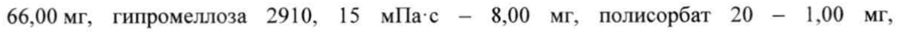
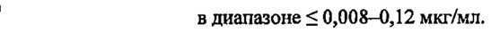
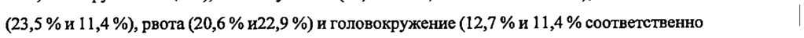

# Бедаквилина фумарат — внутрь

- Препарат: Сиртуро (таблетки;)
- АТХ: J04AK05
- Источник: ГРЛС, инструкция по медицинскому применению, РУ ЛП-002281, файл от 2024-02-26 (https://grls.rosminzdrav.ru/Grls_View_v2.aspx?routingGuid=38ba7643-e4bd-40fb-9079-f54cb2ab0046)
- Распознано автоматически (OCR): 18 из 18 стр.
- Инструкция к другому РУ того же препарата: ЛП-002281 (национальное РУ, переоформленное по правилам ЕАЭС, решение от 12.02.2024). Текст может быть старше действующего
- Сомнительных строк после OCR: 4 (см. раздел «Проверка распознавания»)

## Общие сведения

от 08.02.2024 № 2383 (Входящий МЗ №4255469) |
МИНИСТЕРСТВО ЗДРАВООХРАНЕНИЯ РОССИЙСКОЙ ФЕДЕРАЦИИ
ИНСТРУКЦИЯ ПО МЕДИЦИНСКОМУ ПРИМЕНЕНИЮ ЛЕКАРСТВЕННОГО ПРЕПАРАТА
Сиртуро | Регистрационный номер:
Торговое наименование: Сиртуро | Международное непатентованное наименование: бедаквилин

## 3. Лекарственная форма

таблетки | Состав на одну таблетку 1
таблетки | Состав на одну таблетку |
Действующее вещество: бедаквилина фумарат — 120,89 мг, в пересчете на бедаквилин — 100,00 мг.
Вспомогательные вещества: лактозы моногидрат — 152,91 мг, крахмал кукурузный — 66,00 мг, гипромеллоза 2910, 15 мПа-с - 8,00 мг, полисорбат 20 — 1,00 мг, микрокристаллическая целлюлоза — 82,20 мг, кроскармеллоза натрия — 23,00 мг, кремния | диоксид коллоидный - 1,40 мг, магния стеарат — 4,60 мг.
Описание:
Круглые двояковыпуклые таблетки белого или почти белого цвета, с выдавленной надписью «Т» над «207» на одной стороне и «100» на другой стороне.
Фармакотерапевтическая группа: средства, активные в отношении микобактерий;
противотуберкулезные средства; другие противотуберкулезные средства.
Код ATX: JO4AK05 Фармакологические свойства

## 5.1. Фармакодинамика

Бедаквилин относится к группе диарилхинолинов — новому классу противотуберкулезных соединений. Бактерицидное действие препарата обусловлено специфическим ингибированием протонной помпы АТФ-синтазы микобактерий (аденозин 5'трифосфатсинтазы) - фермента, играющего основную роль в процессе клеточного дыхания
Бедаквилин относится к группе диарилхинолинов — новому классу противотуберкулезных соединений. Бактерицидное действие препарата обусловлено специфическим ингибированием протонной помпы АТФ-синтазы микобактерий (аденозин 5'трифосфатсинтазы) - фермента, играющего основную роль в процессе клеточного дыхания
Mycobacterium tuberculosis. Угнетение синтеза АТФ приводит к нарушению выработки энергии и, как результат, к гибели микробной клетки (делящихся и находящихся в покое микроорганизмов).
САО ООО ООО СООО ООО СООО ООС ООО ИОИНОНИНОНОСИСООСООЯИОИОИИИОИИИИОИОСИООООСИОИОЯИООООООЯЯОООССОСОССОСССОСЯ ООИИИИИИНИСИСУООСОСОТИОИИИИИИИИИИИИИОИИИИОИИИСИОЯОСЯИООИДИИИО СООО ОИЯИ ИИА, |
СООТВЕТСТВУЕТ ЭКСПЕРТНОМУ ОТЧЕТУ Входящий МЗ №4255469
Бедаквилин активен в отношении лекарственно-чувствительных и лекарственноустойчивых (в том числе с множественной и широкой лекарственной устойчивостью)
штаммов Mycobacterium tuberculosis с минимальной ингибирующей концентрацией (МИК)
| в диапазоне < 0,008—0,12 мкг/мл.
Не предполагается, что метаболит М-монодесметила (М2) оказывает значительное воздействие на клиническую эффективность, учитывая пониженный средний уровень воздействия у человека (от 23 % до 31 %) и пониженную противомикобактериальную активность (в 3-6 раз ниже) по сравнению с исходным веществом.
Внутриклеточная бактерицидная активность бедаквилина в первичных перитонеальных | макрофагах и макрофагоподобных клеточных линиях была выше, чем внеклеточная активность. Бедаквилин также оказывает бактерицидное воздействие на дремлющие
| `` (находящиеся в покое) туберкулезные микобактерии. На мышиной модели, разработанной
— для изучения туберкулезной инфекции, бедаквилин продемонстрировал бактерицидную и стерилизующую активность.
Бедаквилин обладает бактериостатической активностью в отношении многих
| нетуберкулезных микобактерий. Mycobacterium xenopi, Mycobacterium novocastrense,
Mycobacterium shimoidei и немикобактериальные виды считаются устойчивыми к действию | бедаквилина.

## 4.5. Взаимодействие с другими лекарственными средствами

Взаимодействие фармакокинетических и фармакодинамических свойств у пациентов не наблюдалось в пределах диапазона концентрации, достигаемой при приеме терапевтической дозы.
Механизмы развития резистентности | | -( | у Механизмы приобретенной резистентности, влияющие на МИК бедаквилина, включают
~ мутации в гене atpE, кодирующем АТФ-синтазу-мишень, и гене Rv0678, регулирующем ;
экспрессию MmpS5-MmpL5 эффлюксной помпы. Целевые мутации, созданные в ходе доклинических исследований, привели к 8-133-кратному увеличению МИК бедаквилина, в результате чего диапазон МИК составил 0,25-4,0 мг/л. Мутации, основанные на активации эффлюксной помпы, наблюдались в доклинических и клинических штаммах. Это привело к 2-8-кратному увеличению МИК бедаквилина, в результате чего диапазон МИК составил 0,25-0,50 мкг/л. Изоляты с эффлюксным механизмом резистентности также менее чувствительны к клофазимину.
Большинство штаммов, фенотипически резистентных к бедаквилину, обладают перекрестной устойчивостью к клофазимину. Штаммы, резистентные к клофазимину, могут сохранять чувствительность к бедаквилину.
СООТВЕТСТВУЕТ ЭКСПЕРТНОМУ ОТЧЕТУ Входящий МЗ №4255469
Вклад изначально высокого уровня МИК бедаквилина, изначального наличия мутаций
Rv0678 и/или увеличенного МИК бедаквилина на микробиологические результаты представляется неясным, в связи с малым количеством таких случаев в клинических | исследованиях П фазы.
Предельные значения при проверке чувствительности
Клинические микробиологические лаборатории по необходимости должны предоставлять врачам результаты проверки чувствительности in vitro для противомикробных препаратов, используемых в больницах, в качестве периодических отчетов, описывающих профиль
| чувствительности нозокомиальных и внебольничных патогенов. Эти отчеты должны способствовать выбору комбинации противомикробных препаратов для проведения терапии.
| _ Предельные значения ~~ Предельные значения МИК приведены ниже:
Наивысшее значение МИК в распределении МИК микроорганизмов немутантного типа
(ECOFF) - 0,25 мг/л.
Границы классификации устойчивости микроорганизмов:
Ч < 0,25 мг/л;
У > 0,25 мг/л; | Ч = чувствительные; | У = устойчивые. |
; Чувствительные виды Mycobacterium tuberculosis
По определению устойчивые микроорганизмы
S Mycobacterium xenopi Mycobacterium novocastrense
Mycobacterium shimoidei Немикобактериальные виды

## 5.2. Фармакокинетика

Оценка фармакокинетических свойств бедаквилина проводилась у взрослых здоровых добровольцев и взрослых пациентов, инфицированных туберкулезом с множественной лекарственной устойчивостью. Экспозиция бедаквилина у пациентов, инфицированных
Оценка фармакокинетических свойств бедаквилина проводилась у взрослых здоровых добровольцев и взрослых пациентов, инфицированных туберкулезом с множественной лекарственной устойчивостью. Экспозиция бедаквилина у пациентов, инфицированных
| туберкулезом с множественной лекарственной устойчивостью была ниже, чем у здоровых добровольцев.
| Всасывание и СООТВЕТСТВУЕТ ЭКСПЕРТНОМУ ОТЧЕТУ
Входящий МЗ №4255469 При пероральном приеме отмечена высокая абсорбция бедаквилина. Максимальная концентрация в плазме (Cmax) достигается приблизительно через 5 часов после приема | препарата. Cmax и площадь под кривой «концентрация-время» (AUC) увеличиваются пропорционально возрастанию дозы вплоть до самых высоких исследованных доз (700 мг в сутки однократно и 400 мг в несколько приемов). Наибольшая биодоступность достигается при приеме с пищей, которая примерно в 2 раза превышает биодоступность при приеме натощак. Таким образом, для повышения биодоступности бедаквилин следует принимать во время еды.
Распределение Связывание с белками плазмы составляет > 99,9% для всех исследованных видов, включая человека. Связывание с белками плазмы метаболита М-монодесметила (М2) у человека
‘ - составляет не менее 99,8 %. У животных бедаквилин и его активный метаболит N-
| ~ монодесметила (M2) активно распределялся в большинстве тканей, однако проникновение в мозг было на незначительном уровне.
Метаболизм | Основным изоферментом CYP, участвующим в метаболизме бедаквилина и образовании
M2 in vitro, является CYP3A4.
В исследованиях in vitro бедаквилин He оказывал значимого воздействия На активность каких-либо из исследованных изоферментов СУР450 (не ингибирует CYP1A2, CYP2A6,
CYP2C8/9/10, CYP2C19, CYP2D6, CYP2E1, CYP3A4, СУРЗА4/5 и CYP4A и не индуцирует активность CYP1A2, CYP2C9 или CYP2C19). В исследованиях in vitro бедаквилин и Nмонодесметил (М2) не являлись субстратами Р-гликопротеина.
Бедаквилин, в отличие от М2, представлял собой слабый субстрат OCTI, ОАТР1В] и
| oo OATP1B3 в исследованиях in vitro. Бедаквилин и M2 в клинически значимых
~ концентрациях не ингибировали транспортеры Р-гликопротеин, ОАТР1В1, OATP1B3,
BCRP, OAT1, ОАТЗ, OCT1, OCT2, МАТЕ1 и MATE2 в исследованиях in vitro.
Исследование in vitro показало, что бедаквилин в концентрациях, достигаемых в кишечнике после перорального применения, может ингибировать BCRP. Клиническая значимость не установлена.
Выведение Бедаквилин выводится из организма главным образом через кишечник. В клинических исследованиях выведение неизмененного бедаквилина почками составило <0,001 % от
| введенной дозы, что свидетельствует о незначительном почечном клиренсе неизмененного препарата. После достижения Cmax концентрация бедаквилина в плазме снижается три-
| экспоненциальным образом. Терминальный период полувыведения (Т и терм) бедаквилина и ee
TY СООТВЕТСТВУЕТ ЭКСПЕРТНОМУ ОТЧЕТУ | Входящий МЗ №4255469 |
М2 составляет около 5 месяцев (в среднем от 2 до 8 месяцев), что, вероятно, отражает медленное высвобождение бедаквилина и М2 из периферических тканей.
Различные группы Пациенты с недостаточностью функции печени
| После однократного приема бедаквилина (400 мг) у 8 пациентов с умеренным нарушением
| функции печени (класс В по шкале Чайлд-Пью), АОС6т2ч для бедаквилина и М2 была на 19
% ниже по сравнению со здоровыми добровольцами. Коррекция дозы для пациентов с легким или умеренным нарушением функции печени не требуется. Фармакокинетика бедаквилина у пациентов с тяжелой печеночной недостаточностью не изучалась (см. раздел
«Способ применения и дозы», см. раздел «Особые указания»). |
Пациенты с недостаточностью функции почек
(7. Бедаквилин исследовали главным образом среди пациентов с нормальной функцией почек.
~ Выведение неизмененного бедаквилина через почки незначительно (<0,001 %). По результатам популяционного фармакокинетического анализа пациентов, получавших по 200 мг бедаквилина три раза в неделю, клиренс креатинина (диапазон 40-227 мл/мин) не оказывал влияния на фармакокинетические параметры бедаквилина. Поэтому предполагается, что почечная недостаточность легкой или умеренной степени не будет иметь клинически значимое влияние на фармакокинетику бедаквилина. У пациентов с | тяжелой почечной недостаточностью (клиренс креатинина <30 мл/мин) или терминальной стадией почечной недостаточности с необходимостью применения гемодиализа или перитонеального диализа концентрация препарата может увеличиваться за счет изменения | всасывания, распределения и метаболизма препарата на фоне нарушения функции почек. |
Так как бедаквилин в значительной степени связывается с белками плазмы, то количество
> бедаквилина, удаляемого при проведении процедуры гемодиализа или перитонеального диализа, будет низким (см. разделы «Способ применения и дозы», «Особые указания»).
Дети Ожидаемая средняя экспозиция бедаквилина в плазме крови (AUCi¢6s ч) на 24 неделе - 178 мкг*ч/мл (90 % интервал прогнозирования: 55,8-383 мкг*а/мл) у подростков в возрасте от 12 до 18 лет с массой тела не менее 30 кг при применении бедаквилина в дозе, используемой у взрослых (400 мг 1 раз в сутки в течение первых двух недель и 200 мг 3 раза/неделю в течение следующих 22 недель). У подростков с массой тела от 30 до 40 кг ожидаемая средняя экспозиция бедаквилина в плазме крови (AUCi6sn) на 24 неделе в
| среднем: 224 мкг*ч/мл; 90 % интервал прогнозирования: 77,4-474 мкг*ч/мл) по сравнению
| со взрослыми пациентами.
| О | СООТВЕТСТВУЕТ ЭКСПЕРТНОМУ ОТЧЕТУ Входящий МЗ №4255469
Ожидаемая средняя экспозиция бедаквилина в плазме крови (AUCisss) на 24-й неделе у взрослых составила 127 мкг*ч/мл (90 % интервал прогнозирования: 39,7-249 мкг*ч/мл).
Фармакокинетика бедаквилина у детей в возрасте до 14 лет или с массой тела менее 38 кг не изучалась.
Пожилые пациенты (>65 лет)
Данные о фармакокинетике бедаквилина у пациентов, с диагнозом туберкулез легких, в возрасте 65 лет и старше ограничены (п=2). |
Исследование фармакокинетических свойств бедаквилина в группе пациентов, инфицированных туберкулезом (возрастной диапазон от 18 до 68 лет), не выявило влияние возраста на фармакокинетические свойства бедаквилина.
Этническая принадлежность _— По результатам популяционного фармакокинетического анализа пациентов с диагнозом
| ~ туберкулез легких, получающих лечение бедаквилином, была установлена более низкая
| экспозиция бедаквилина у пациентов негроидной расы по сравнению с пациентами других
| рас. Описанная пониженная экспозиция не рассматривалась как клинически значимая ввиду отсутствия четкой связи между экспозицией бедаквилина и ответом на терапию.
Кроме того, частота положительных ответов у пациентов разных рас, прошедших курс лечения бедаквилином, была сопоставимой.
Пол По результатам популяционного фармакокинетического анализа пациентов с диагнозом туберкулез легких, получающих лечение бедаквилином, не установлено связанных с полом клинически значимых различий в фармакокинетике бедаквилина.
. () Показания к применению | Препарат Сиртуро показан к применению у взрослых и подростков (от 12 до 18 лет с массой тела не менее 30 кг) в составе комбинированной терапии туберкулеза легких, вызванного штаммами Mycobacterium tuberculosis с множественной лекарственной устойчивостью.
Препарат следует использовать в случае, когда не может быть назначен другой эффективный режим терапии при устойчивости возбудителя или непереносимости других антибактериальных препаратов.
"Противопоказания * Гиперчувствительность к препарату и/или любому другому компоненту препарата; | период грудного вскармливания;
* детский возраст до 12 лет;
СООТВЕТСТВУЕТ ЭКСПЕРТНОМУ ОТЧЕТУ | Входящий МЗ №4255469
* масса тела менее 30 кг;
* тяжелая почечная недостаточность (клиренс креатинина < 30 мл/мин/1,73 м²);
* тяжелая печеночная недостаточность (в связи с отсутствием клинических данных по безопасности препарата в этой группе);
‚ врожденная непереносимость лактозы, дефицит лактазы, глюкозо-галактозная мальабсорбция.

## 4.3. С осторожностью

* Удлинение интервала ОТ с коррекцией по формуле Фредерика (QTcF) >450 мс (с подтверждением при помощи повторного ЭКГ-исследования);
* Удлинение интервала ОТ с коррекцией по формуле Фредерика (QTcF) >450 мс (с подтверждением при помощи повторного ЭКГ-исследования);
| › декомпенсированная сердечная недостаточность;
oO * у пациентов с личным или семейным анамнезом врожденного удлинения интервала QT,
~ или с развитием аритмии по типу «torsade de pointes»;
* у пациентов с брадиаритмией, в том числе в анамнезе;
. у пациентов с электролитными нарушениями (гипокальциемия, гипомагниемия, гипокалиемия);
* у пациентов с гипотиреозом, в том числе в анамнезе;
* одновременное применение с препаратами, удлиняющими интервал ОТ (в частности с антибиотиками группы фторхинолонов: с гатифлоксацином, моксифлоксацином, спарфлоксацином).

## 4.6. Применение при беременности и в период грудного вскармливания

Беременность oe Данные о применении бедаквилина беременными женщинами ограничены. В‘
~ . доклинических исследованиях прямой или косвенной репродуктивной токсичности выявлено не было. Применение препарата Сиртуро при беременности возможно только в тех случаях, когда потенциальная польза для матери превышает риск для плода.
Период грудного вскармливания Бедаквилин выделяется с грудным молоком. |
В ограниченном количестве публикаций сообщалось о более высоких концентрациях бедаквилина в грудном молоке, чем в плазме крови матери. У одного ребенка, находящегося на грудном вскармливании, однократно была зафиксирована случайная концентрация бедаквилина в плазме крови, аналогичная концентрации бедаквилина в плазме крови матери; у матери определялась высокая концентрация бедаквилина в грудном молоке, при соотношении с концентрацией в плазме крови 14:1. Это согласуется с данными
| СООТВЕТСТВУЕТ ЭКСПЕРТНОМУ ОТЧЕТУ Входящий МЗ №4255469 доклинических исследований. Имеющиеся данные свидетельствуют о том, что системное воздействие бедаквилина у детей, находящихся на грудном вскармливании, может достигать уровней, аналогичных тем, которые наблюдались у кормящих матерей, получавших бедаквилин. Клиническая значимость этого воздействия неизвестна.
Женщинам, получающим бедаквилин, следует отказаться от грудного вскармливания.
Фертильность Данные о воздействии бедаквилина на репродуктивную функцию человека отсутствует.
Лечение бедаквилином не влияло на спаривание или фертильность самок крыс, однако некоторые эффекты наблюдались у самцов крыс.

## 4.2. Способ применения и дозы

| ` Лечение должно осуществляться под непосредственным наблюдением специалиста,
| ` Лечение должно осуществляться под непосредственным наблюдением специалиста,
`° имеющего опыт лечения МЛУ-ТБ.
Бедаквилин необходимо применять в комбинации с не менее чем 3 препаратами, к которым in vitro доказана чувствительность штамма Mycobacterium tuberculosis, выделенного у пациента. |
Если результаты исследования лекарственной устойчивости in vitro отсутствуют,
| бедаквилин необходимо применять в комбинации с 4 другими препаратами, к которым возможно сохранена чувствительность штамма Mycobacterium tuberculosis, выделенного у пациента. При выборе схемы и продолжительности приема противотуберкулезных препаратов резерва в составе комбинированной терапии лечащий врач должен
| руководствоваться государственными стандартами лечения туберкулеза, данными о лекарственной устойчивости микобактерий по региону с учетом лекарственной
| С. чувствительности штамма, выделенного от больного туберкулезом и данными клиникорентгенологического обследования.
| Бедаквилин рекомендуется принимать внутрь во время еды, так как одновременный прием с пищей увеличивает биодоступность препарата (см. раздел «Фармакокинетика»).
Таблетку бедаквилина рекомендуется проглатывать целиком, запивая водой.
Рекомендуемый режим дозирования бедаквилина:
1-2 неделя: 400 мг (4 таблетки по 100 мг) 1
Подростки (от 12 до 18 лет, с массой тела 1 раз в сутки, ежедневно;
не менее 30 кг) 3-24 неделя: 200 мг (2 таблетки по 100 мг) 3 раза в неделю, с перерывом не менее 48 часов между приемом препарата.
о и СООТВЕТСТВУЕТ ЭКСПЕРТНОМУ ОТЧЕТУ Входящий МЗ №4255469 |
Продолжительность лечения Общая продолжительность курса лечения бедаквилином составляет 24 недели.
Данных по применению бедаквилина с большей продолжительностью для лечения туберкулеза недостаточно.
У пациентов с широкой лекарственной устойчивостью продолжительность лечения с
| бедаквилином может быть увеличена только в индивидуальном порядке и при условии контроля за безопасностью терапии (побочными реакциями) (см. раздел «Побочное действие»).
| Пропуски приема препарата | Пациенты должны быть предупреждены о необходимости приема бедаквилина в соответствии с указаниями врача. Необходимо подчеркнуть важность приема полного
| курса терапии.
^^ При пропуске приема препарата в течение первых 2 недель лечения пропущенную дозу принимать не следует. Необходимо продолжать прием в обычном режиме.
При пропуске суточной дозы препарата начиная с 3-й недели (200 мг в сутки, 3 раза в неделю), следует принять пропущенную дозу как можно раньше, а затем продолжить прием
| в обычном режиме.
| Особые группы пациентов .
: Дети Безопасность и эффективность бедаквилина у детей до 12 лет и массой тела менее 30 кг не установлены (см. раздел «Особые указания»).
| Бедаквилин может быть включен в схему лечения подростков в возрасте 12 лет и старше с
| массой тела не менее 30 кг и подтвержденным или вероятным диагнозом МЛУ-ТБ, oe установленным на основании клинических признаков и симптомов легочного МЛУ-ТБ с учетом эпидемиологической ситуации и принимая ВО внимание
| | международные/национальные руководства (см. раздел «Показания к применению»).
Пожилые пациенты (> 65 лет)
Данные о применении бедаквилина у пожилых пациентов (n=2) ограничены (см. раздел
«Особые указания»).
Пациенты с почечной недостаточностью Для пациентов с легкой или умеренной почечной недостаточностью коррекция дозы не требуется. Пациентам с тяжелой почечной недостаточностью (клиренс креатинина <30 мл/мин) или терминальной стадией почечной недостаточности, требующей гемо- или перитонеального диализа, бедаквилин применять не рекомендовано (см. раздел «Особые указания»).
EEE EEE OO OOO ААА ААВ ООО СООТ ООО ООО OOo СТОИЛО ТИК ОСИННИКИ ИИА КОИ ПОИСКИ ИИА
| СООТВЕТСТВУЕТ ЭКСПЕРТНОМУ ОТЧЕТУ | | Входящий МЗ №4255469
Пациенты с печеночной недостаточностью У пациентов с легкой или умеренной печеночной недостаточностью изменения в режиме дозирования бедаквилина не требуется. У пациентов с тяжелой печеночной недостаточностью эффективность’и безопасность не изучена и применять бедаквилин в данной группе пациентов не рекомендовано (см. раздел «Особые указания»).

## 4.8. Побочное действие

Нежелательные реакции на препарат Сиртуро были определены на основании обобщенных данных исследований (контролируемых и неконтролируемых) проведенных у 335 пациентов, получавших препарат Сиртуро в сочетании с фоновой терапией противотуберкулезными лекарственными средствами. Наиболее частыми побочными a реакциями (>10,0 % пациентов) во время лечения были: тошнота (35,3 % в группе Сиртуро
Нежелательные реакции на препарат Сиртуро были определены на основании обобщенных данных исследований (контролируемых и неконтролируемых) проведенных у 335 пациентов, получавших препарат Сиртуро в сочетании с фоновой терапией противотуберкулезными лекарственными средствами. Наиболее частыми побочными a реакциями (>10,0 % пациентов) во время лечения были: тошнота (35,3 % в группе Сиртуро
— и 25,7 % в группе плацебо), боль в суставах (29,4 % и 20,0 % соответственно), головная боль
(23,5 %и 11,4%), рвота (20,6 % и22,9 %) и головокружение (12,7 % и 11,4 % соответственно | в группе Сиртуро и группе плацебо).
Список нежелательных реакций, представленный в виде таблицы
Нежелательные реакции на препарат Сиртуро, установленные во время контролируемых исследований с участием 102 пациентов, получающих лечение препаратом Сиртуро, приведены в таблице ниже. Нежелательные реакции на препарат Сиртуро перечислены в соответствии с системами классов органов и частотой развития (очень часто (> 1/10), часто
(от> 1/100 до <1/10), нечасто (от > 1/1000 до <1/100), редко (от> 1/10000 до <1/1000), очень редко (<1/10000)).
Cy Система классов органов | Категория частоты Нежелательные реакции
(СКО)
Со стороны — нервной | Очень часто Головная боль, головокружение системы |
Со стороны печени и | Часто Повышение активности желчевыводящих путей трансаминаз*
СООТВЕТСТВУЕТ ЭКСПЕРТНОМУ ОТЧЕТУ Входящий МЗ №4255469 мышечной и | Часто Миалгия !
соединительной ткани * повышение активности трансаминаз включает увеличение (аланинаминотрансферазы
(АЛТ), аспартатаминотрансферазы (АСТ)); повышение активности ферментов печени;
нарушение функции печени.

## 4.9. Передозировка

| Информация о случаях намеренной или случайной острой передозировки бедаквилином отсутствует. В исследовании с участием 44 здоровых добровольцев, получавших i однократно 800 мг бедаквилина, побочные реакции соответствовали тем, которые
| Информация о случаях намеренной или случайной острой передозировки бедаквилином отсутствует. В исследовании с участием 44 здоровых добровольцев, получавших i однократно 800 мг бедаквилина, побочные реакции соответствовали тем, которые
“ наблюдались при приеме рекомендуемой дозы (см. раздел «Побочное действие»). |
Лечение. Опыт лечения острой передозировки бедаквилином отсутствует. В случае преднамеренной или случайной передозировки следует принимать общие меры поддержания основных жизненно важных функций и проводить ЭКГ-мониторинг интервала ОТ. Дальнейшее лечение должно осуществляться в соответствии с клиническими показаниями. Так как бедаквилин в значительной степени связывается с белками плазмы, эффективность диализа для удаления препарата из плазмы будет низкой.
По возможности следует продолжать клиническое наблюдение за пациентом.
Взаимодействие с другими лекарственными препаратами
Выведение бедаквилина in vivo полностью не охарактеризовано. СУРЗА4 является м основным изоферментом CYP, задействованным в метаболизме бедаквилина in vitro и
| формировании метаболита М-монодесметила (М2). Выведение бедаквилина с мочой несущественно. Бедаквилин и М2 не являются субстратами или ингибиторами Ргликопротеина.
Индукторы CYP3A4 Экспозиция бедаквилина может снизиться при совместном применении с индукторами
СУРЗА4. у В исследовании лекарственного взаимодействия бедаквилина и рифампицина, | применяемых однократно, у здоровых добровольцев AUC бедаквилина снизилась на 52 %
[90% ДИ (-57; -46)]. В связи с возможностью уменьшения терапевтического эффекта
| бедаквилина по причине снижения его системного действия, следует избегать совместного применения препарата с умеренными или сильными индукторами СУРЗА4 (например,
СООТВЕТСТВУЕТ ЭКСПЕРТНОМУ ОТЧЕТУ Входящий МЗ №4255469

эфавиренз, этравирин, рифамицины, включая рифампицин, рифапентин и рифабутин, карбамазепин, фенитоин, зверобой продырявленный (Hypericum реМоганит)), назначаемыми системно.
Ингибиторы CYP3A4 Экспозиция бедаквилина может повыситься при совместном применении с ингибиторами
СУРЗА4. При кратковременном совместном применении кетоконазола и бедаквилина у здоровых добровольцев AUC бедаквилина увеличилась на 22 % [90 % ДИ (12; 32)]. Более выраженное воздействие бедаквилина может наблюдаться во время длительного совместного применения с кетоконазолом или другими ингибиторами CYP3A4.
Клинические данные по безопасности при многократном применении бедаквилина больше указанной дозы отсутствуют.

-_ В связи с потенциальным риском возникновения нежелательных реакций за счет увеличения терапевтического действия бедаквилина, следует избегать длительного совместного применения (более 14 дней) бедаквилина с умеренными или мощными ингибиторами СУРЗА4 (ципрофлоксацин, эритромицин, флуконазол, кларитромицин, кетоконазол, ритонавир), назначаемыми системно. В случае необходимого совместного применения рекомендуется более частый мониторинг ЭКГ и активности «печеночных»
трансаминаз (см. раздел «Особые указания»).

Другие противотуберкулезные препараты

Совместное применение бедаквилина с изониазидом/пиразинамидом у здоровых

добровольцев не вызвало клинически значимых изменений АПС бедаквилина, изониазида

или пиразинамида. При совместном применении бедаквилина с изониазидом или

пиразинамидом коррекции дозы не требуется. В плацебо-контролируемом клиническом
~ исследовании у пациентов с МЛУ ТБ не наблюдалось значительного влияния бедаквилина

_ На фармакокинетику этамбутола, канамицина, пиразинамида, офлоксацина или циклосерина при их совместном применении.

Антиретровирусные препараты | При изучении взаимодействия однократного приема бедаквилина и многократного приема лопинавира/ритонавира AUC бедаквилина увеличилась на 22 % [90 % ДИ (11; 34)]. Более выраженное воздействие на содержание бедаквилина в плазме может наблюдаться во время длительного совместного применения с лопинавиром/ритонавиром. Опубликованные данные о пациентах, проходивших лечение бедаквилином в рамках лечения туберкулеза с лекарственной устойчивостью и антиретровирусной терапии, основанной на лопинавире/ритонавире, показали, что за 48 часов воздействие бедаквилина (АПС)
увеличивается приблизительно в два раза. Это увеличение происходит вероятнее всего из12 и
СООТВЕТСТВУЕТ ЭКСПЕРТНОМУ ОТЧЕТУ Входящий МЗ №4255469 за ритонавира. Если польза значительно превышает риски, бедаквилин можно с осторожностью применять совместно с лопинавиром/ритонавиром. Увеличение содержания бедаквилина в плазме предполагается при его применении совместно © другими усиленными ритонавиром ингибиторами протеазы ВИЧ. Следует отметить, что не рекомендуется изменять дозировку бедаквилина в случаях комбинированной терапии с лопинавиром/ритонавиром или другими ингибиторами протеазы ВИЧ, усиливаемыми ритонавиром. Данные, подтверждающие уменьшенную дозу бедаквилина в подобных случаях, отсутствуют.
Совместное применение однократного приема бедаквилина и многократного приема невирапина не привело к клинически значимым изменениям содержания бедаквилина в
| плазме крови. Клинические данные по совместному применению антиретровирусных
| препаратов и бедаквилина у ВИЧ-инфицированных пациентов с МЛУ ТБ отсутствуют (см.
| _ раздел «Особые указания»). Эфавиренз является умеренным индуктором активности
CYP3A4, и при системном применении его совместное применение с бедаквилином может привести к снижению AUC бедаквилина и потере активности, и, следовательно, не рекомендуется.
Препараты, удлиняющие интервал ОТ Информация о возможном фармакодинамическом взаимодействии между бедаквилином и препаратами, удлиняющими интервал ОТ, ограничена.
Наблюдался аддитивный или синергический эффект в отношении удлинения интервала ОТ при совместном применении бедаквилина с препаратами, которые удлиняют интервал ОТ.
В клиническом исследовании лекарственного взаимодействия кетоконазола и бедаквилина после повторного совместного приема препаратов наблюдалось более значительное |
| | влияние на QTc, чем после повторного приема каждого из этих препаратов по отдельности.
№ Аддитивный или синергический эффект в отношении удлинения интервала QT при совместном применении бедаквилина с препаратами, которые удлиняют интервал ОТ не исключается. Рекомендуется проводить периодический мониторинг (см. раздел «Особые указания»).
Интервал ОТ и совместное применение клофазимина
| В открытом исследовании 26 фазы на 24 неделе терапии у 17 взрослых пациентов, которые использовали в комбинации клофазимин среднее увеличение интервала ОТ с коррекцией по формуле Фредерика (QTcF) было больше (среднее отклонение от стандартного значения 31,9 мс), чем у пациентов, не применяющих клофазимин в комбинации (среднее отклонение от стандартного значения 12,3 мс). (см. раздел «Особые указания»).
| Дети — СООТВЕТСТВУЕТ ЭКСПЕРТНОМУ ОТЧЕТУ
Входящий МЗ №4255469 Исследования лекарственного взаимодействия проводились только для взрослых пациентов. |

## 4.4. Особые указания

Лечение должно осуществляться под непосредственным наблюдением специалиста.
Лечение должно осуществляться под непосредственным наблюдением специалиста.
Отсутствуют клинические данные по использованию бедаквилина для лечения следующих заболеваний:
© экстрапульмональный туберкулез (например, туберкулез центральной нервной системы, костей)
¢ микобактериальные инфекции, кроме вызванных Mycobacterium tuberculosis e латентная инфекция, вызванная Mycobacterium tuberculosis
_ Клинические данные по применению бедаквилина в составе комбинированной терапии 7 туберкулеза легких, вызванного бактериями Mycobacterium tuberculosis, чувствительными
| к препарату, отсутствуют.
Устойчивость к бедаквилину Бедаквилин следует использовать только в соответствующей комбинированной схеме лечения MJIY-Tb, как это рекомендовано государственными стандартами лечения туберкулеза, для предотвращения развития резистентности к препарату.
Влияние на летальность В клиническом исследовании С208 на протяжении 120 недель, в процессе которого препарат Сиртуро принимался 24 недели в сочетании с фоновой терапией, в группе препарата Сиртуро отмечено увеличение количества летальных исходов по сравнению с группой плацебо. Причина дисбаланса не установлена; признаки причинной взаимосвязи с
| о лечением препаратом Сиртуро отсутствуют.
| Влияние на сердечно-сосудистую систему
Бедаквилин удлиняет интервал ОТ. Необходимо выполнить электрокардиограмму перед началом лечения бедаквилином и далее не менее одного раза в месяц после начала лечения.
Перед началом терапии необходимо определить уровень калия, кальция и магния в крови и при отклонении от нормы необходима коррекция. При удлинении интервала ОТ необходимо осуществлять контроль электролитов (см. разделы «Взаимодействие с другими лекарственными препаратами» и «Побочное действие»).
При одновременном применении бедаквилина с препаратами, удлиняющими интервал ОТ
(включая деламанид и левофлоксацин) нельзя исключать аддитивный или синергетический
| эффект, который может приводить к удлинению интервала ОТ (см. раздел
«Взаимодействие с другими лекарственными препаратами»). Необходимо соблюдать
СООТВЕТСТВУЕТ ЭКСПЕРТНОМУ ОТЧЕТУ Входящий МЗ №4255469 осторожность при одновременном назначении бедаквилина с препаратами способными вызвать удлинение интервала ОТ. В случае совместного применения таких лекарственных препаратов с бедаквилином, необходимо проводить клинический мониторинг, в том числе регулярный мониторинг ЭКГ. В случае необходимости совместного применения клофазимина с бедаквилином рекомендуется клиническое наблюдение пациента, в том числе регулярный мониторинг ЭКГ (см. раздел «Взаимодействие с другими лекарственными препаратами»).
Не рекомендуется начинать прием бедаквилина пациентам со следующими состояниями, за
| исключением случаев, когда польза бедаквилина значительно превышает возможные риски:
° сердечная недостаточность;
| р ° интервал ОТ с коррекцией по формуле Фредерика (QTcF) >450 мс (с подтверждением при повторном ЭКГ-исследовании);
® личный или семейный анамнез врожденного удлинения интервала ОТ или развитие аритмии по типу «torsade de pointes»;
. гипотиреоз, в том числе в анамнезе;
e брадиаритмия, в ТОМ числе в анамнезе;
e совместное применение с антибиотиками группы фторхинолонов, вызывающими значительное удлинение интервала ОТ (например, гатифлоксацин, моксифлоксацин,
, спарфлоксацин);
e гипокалиемия.
Прием бедаквилина необходимо прервать в случае, если у пациента развивается:
| _— . клинически значимая желудочковая аритмия
CU ° интервал ОТ с коррекцией по формуле Фредерика (QTcF) >500 мс (с подтверждением при повторном ЭКГ-исследовании).
При синкопальном состоянии необходимо сделать ЭКГ для определения удлинения интервала ОТ.
Влияние на функцию печени В ходе клинических исследований при лечении бедаквилином в сочетании с фоновой терапией наблюдались повышенные показатели трансаминаз или повышение активности аминотрансфераз со значением общего билирубина > 2х верхней границы нормы (см.
раздел «Побочное действие»). Пациентов необходимо наблюдать в течение курса лечения в виду того, что наблюдалось медленное повышение уровня печеночных ферментов с постепенным увеличением в течение 24 недель. Необходимо контролировать появление
| | Входящий МЗ N24255469 | симптомов и результаты лабораторных тестов (АЛТ, АСТ, щелочная фосфатаза и билирубин) в начале терапии, ежемесячно в ходе лечения и при необходимости. В случае
| если АСТ и АЛТ в 5 раз превышает верхнюю границу нормы, необходимо пересмотреть
| режим лечения, а также необходимо прекратить лечение бедаквилином и/или любую
| фоновую терапию гепатотоксическими препаратами.
В ходе лечения бедаквилином следует избегать прием других гепатотоксических лекарственных препаратов и алкоголя, особенно пациентам с нарушенной функцией печени.
Дети Предполагается, что у подростков с массой тела от 30 до 40 кг средняя экспозиция будет выше по сравнению со взрослыми пациентами (см. подраздел «Фармакокинетика»). Это 7 может быть связано с повышенным риском удлинения интервала QT или
° гепатотоксичности.
Совместное применение с другими лекарственными препаратами |
Индукторы CYP3A4 Бедаквилин метаболизируется цитохромом CYP3A4. Совместный прием бедаквилина с лекарственными средствами, являющимися индукторами СУРЗА4, может привести к снижению плазменной концентрации бедаквилина и уменьшить терапевтический эффект.
Следовательно, необходимо избегать систематического совместного применения бедаквилина с умеренными или сильными индукторами СУРЗА4 (см. раздел
«Взаимодействие с другими лекарственными препаратами»).
Ингибиторы СУРЗАЯ Совместный прием бедаквилина с лекарственными средствами, являющимися умеренными oO или сильными ингибиторами CYP3A4, может привести к усилению системного
—. воздействия бедаквилина, что может увеличить риск нежелательных реакций (см. раздел
«Взаимодействие с другими лекарственными препаратами»). Следовательно, необходимо избегать систематического совместного применения бедаквилина и умеренных или сильных ингибиторов СУРЗА4 последовательно в течение 14 дней. При необходимости такого совместного применения, рекомендуется более частый мониторинг ЭКГ и показателей трансаминаз.
Применение бедаквилина у ВИЧ-инфицированных пациентов
Клинические данные по безопасности и эффективности применения бедаквилина совместно с антиретровирусными препаратами отсутствуют.
Клинические данные по эффективности бедаквилина у ВИЧ-инфицированных пациентов, не подвергающихся антиретровирусной терапии (АРТ), ограничены. У всех пациентов, |
OO | СООТВЕТСТВУЕТ ЭКСПЕРТНОМУ ОТЧЕТУ | Входящий МЗ №4255469 участвующих в исследовании, количество клеток CD4+ превышало значение 250 x 10° клеток/л (М = 22; см. раздел «Взаимодействие с другими лекарственными препаратами»).
Непереносимость лактозы, дефицит лактазы
Препарат Сиртуро содержит лактозу. Пациенты с редкой наследственной
| непереносимостью галактозы, лактазной недостаточностью или глюкозо-галактозной мальабсорбцией не должны принимать данное лекарственное средство.

## 4.7. Влияние на способность управлять транспортными средствами, механизмами

При возникновении побочных реакций co стороны ЦНС (например, головокружение) На фоне применения бедаквилина пациентам рекомендуется воздержаться от управления автотранспортом и занятий другими потенциально опасными видами деятельности,
| требующих повышенной концентрации внимания, быстроты психомоторных и
| ~ двигательных реакций (см. раздел «Побочное действие»).

## 6.5. Форма выпуска

Таблетки 100 мг.
Таблетки 100 мг.
По 188 таблеток во флакон из полиэтилена высокой плотности, укупоренный полипропиленовой крышкой с системой защиты от вскрытия детьми и контролем первого вскрытия.
По 1 флакону вместе с инструкцией по применению в картонную пачку.

## 6.3. Срок годности

2 года. Не применять после истечения срока годности.
2 года. Не применять после истечения срока годности.
| А х - Условия хранения При температуре не выше 25 °С в оригинальной упаковке (во флаконе).
Хранить в недоступном для детей месте.
Условия отпуска Отпускают по рецепту.
Владелец регистрационного удостоверения/организация, принимающая претензии потребителей
Открытое акционерное общество «Фармстандарт-Уфимский витаминный завод»
(ОАО «Фармстандарт-УфаВИТА»), Россия ООС
СООТВЕТСТВУЕТ ЭКСПЕРТНОМУ ОТЧЕТУ от 08.02.2024 № 2383
(Входящий МЗ №4255469)
450077, Республика Башкортостан, г. Уфа, ул. Худайбердина, д. 28, | тел./факс: (347) 272-92-85, www.pharmstd.ru
Производитель Открытое акционерное общество «Фармстандарт-Уфимский витаминный завод»
(ОАО «Фармстандарт-УфаВИТА»), Россия Республика Башкортостан, г. Уфа, ул. Худайбердина, д. 28, тел./факс: (347) 272-92-85, www.pharmstd.ru
Представитель <“ ВЫ ОАО «Фармстандарт-УфаВИТА» ИРИ a he Т.Н. Быкова
|
## Проверка распознавания

Страницы-сканы распознаны автоматически. В 4 строках с дозировками цифры могли распознаться с ошибкой — сверьте с вырезкой из оригинала:

- стр. 1: «66,00 мг, гипромеллоза 2910, 15 мПа-с - 8,00 мг, полисорбат 20 — 1,00 мг,» — повторное чтение: «66,00 мг, гипромеллоза 2910, 15 мПа-с - 8,00 мг, полисорбат 20 — 1,00 мг,»  
  
- стр. 2: «| в диапазоне < 0,008—0,12 мкг/мл.» — повторное чтение: «| в диапазоне < 0,008-0,12 мкг/мл.»  
  
- стр. 10: «— и 25,7 % вгруппе плацебо), боль в суставах (29,4 % и 20,0 % соответственно), головная боль» — низкая уверенность: «25,7» (0)  
  
- стр. 10: «(23,5 %и 11,4%), рвота (20,6 % и22,9 %) и головокружение (12,7 % и 11,4 % соответственно |» — повторное чтение: «35 %и1 14 %), ppora (20,6 % 22,9 %) и г ловокружение (12,7 % и 11,4 % соответственно |»  
  
