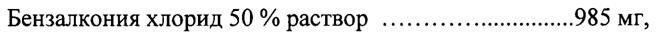
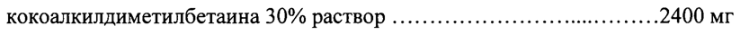
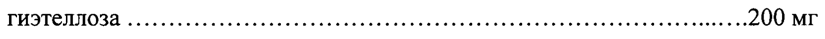
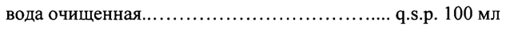

# Бензалкония хлорид 50 % раствор, хлоргексидина диглюконат 20 % раствор — наружно

- Препарат: Бактодерм (раствор для местного и наружного применения;)
- АТХ: D08AC52
- Источник: ГРЛС, инструкция по медицинскому применению, РУ ЛСР-007051/09, файл от 2022-07-11 (https://grls.rosminzdrav.ru/Grls_View_v2.aspx?routingGuid=31aec673-6176-4d81-ba16-54bc75dec675)
- Распознано автоматически (OCR): 3 из 3 стр.
- Инструкция к другому РУ того же препарата: ЛСР-007051/09 (национальное РУ, переоформленное по правилам ЕАЭС, решение от 12.05.2022). Текст может быть старше действующего
- Сомнительных строк после OCR: 4 (см. раздел «Проверка распознавания»)

## Общие сведения

Ом ЛСР-007051/09-040716 в Е МИНИСТЕРСТВО ЗДРАВООХРАНЕНИЯ РОССИЙСКОЙ ФЕДЕРАЦИИ “it
ИНСТРУКЦИЯ по применению лекарственного препарата для медицинского применения
БАКТОДЕРМ

Регистрационный номер:
Торговое название: Бактодерм Лекарственная форма: раствор для наружного и местного применения
Состав на 100 мл раствора Действующие вещества:
Бензалкония хлорид 50 % раствор ........... «+++... ....989 МГ,

что соответствует бензалкония хлориду............. 500 мг

® Хлоргексидина диглюконат 20 % раствор............... 1065 мг,

что соответствует хлоргексидина диглюконату .....200 мг
Вспомогательные вещества:
кокоалкилдиметилбетаина 30% раствор .......... ее eee eestee tees eee-2400 МГ сополимер оксида этилена и оксида пропилена ...... ......................2400 МГ
ГИЭТеллоЗа .......... нение ини ини нина нь. 1.200 МГ лимонной кислоты моногидрат ............. eee ee cece eee eee ee LOO МГ натрия цитрат ............. ле estes essere eee GS. PH= 5,3-5,7 вода очищенная.......... ние ннннннннннь +. 9.3.р. 100 мл
Описание Бесцветная, прозрачная жидкость, слегка вязкая, пенится при взбалтывании,

® с запахом эфира.
Фармакотерапевтическая группа: антисептическое средство
Код ATX: DO8AC52 | _ Фармакологические свойства
Бензалкония хлорид и хлоргексидин являются антисептиками широкого спектра действия, эффективны в отношении грамположительных и грамотрицательных бактерий, вирусов и грибов. Препарат сохраняет активность (хотя несколько сниженную) в присутствии крови, гноя, различных секретов и других органических веществ.
Бактодерм очищает и дезинфицирует кожу, не нарушая целостности кожных покровов, практически не всасывается с поверхности кожи. .

## 4.1. Показания к применению

943918 _ ЛСР-007051/09-040716
943918 _ ЛСР-007051/09-040716

Профилактика иглечение инфицированных поражений кожи и:Слизистых оболочек. an

## 4.3. Противопоказания

Повышенная чувствительность к хлоргексидину, бензалкония хлориду и другим компонентам препарата, дерматиты.
Повышенная чувствительность к хлоргексидину, бензалкония хлориду и другим компонентам препарата, дерматиты.
Не использовать для промывания слизистой оболочки глаз и слухового канала.
Применение во время беременности и в период грудного вскармливания
При беременности и в период грудного вскармливания применяется только в случае, когда предполагаемая польза для матери превосходит возможный риск для плода или ребенка. Не следует применять препарат для обработки кожи молочной железы во время грудного вскармливания.

® Способ применения и дозы Для наружного и местного применения.
Раствор применяется в неразведенном или разведенном виде 1-2 раза в день в течение 7-10 дней.
Для обработки поверхности кожи используют неразведенный раствор.
Для местной обработки слизистых оболочек используют раствор, разведенный водой 1/10.
Разведенный раствор готовится непосредственно перед применением и не должен храниться.
Раствор наносится на кожу на 5 — 10 минут, затем смывается водой. |

## 4.8. Побочное действие

Сухость кожи и слизистых оболочек, зуд, дерматит, раздражение кожи, аллергические реакции.
Сухость кожи и слизистых оболочек, зуд, дерматит, раздражение кожи, аллергические реакции.

® Если любые из указанных в инструкции побочных эффектов усугубляются, или отмечаются любые другие побочные эффекты не указанные в инструкции, следует немедленно сообщить об этом врачу. |

## 4.9. Передозировка

Не указано.
Не указано.

## 4.5. Взаимодействие с другими лекарственными средствами

Фармацевтически несовместим с мылом, щелочами и другими анионными соединениями
(коллоиды, гуммиарабик, карбоксиметилцеллюлоза).

## 4.4. Особые указания

; С осторожностью применять. препарат при обработке обширной поверхности кожи, особенно у — детей.

94318 т ЛСР-007051/09-040716 "`; we Невиспользовать окклюзионные повязки’.Неглиспользовать для промывания глаз. Избегать
.. попадания препарата в барабанную полость.
Не применять для дезинфекции хирургических инструментов и оборудования.
Открытый флакон хранить не более 15 дней.

## 4.7. Влияние на способность управлять транспортными средствами, механизмами

Препарат не влияет на способность управлять транспортом или заниматься другими потенциально опасными видами деятельности, требующими повышенной концентрации и быстроты психомоторных реакций.

## 6.5. Форма выпуска

©® Раствор для наружного и местного применения.
©® Раствор для наружного и местного применения.
125 мл или 300 мл в прозрачный пластмассовый флакон коричневого цвета с белой навинчиваемой пластмассовой крышкой с пластмассовой прокладкой. По одному флакону в картонную пачку вместе с инструкцией по применению.

## 6.4. Условия хранения

Хранить при температуре не выше 25 °С.
Хранить при температуре не выше 25 °С.
Хранить в недоступном для детей месте.

## 6.3. Срок годности

2 года. Не использовать по истечении срока годности, указанного на упаковке.
2 года. Не использовать по истечении срока годности, указанного на упаковке.
Условия отпуска из аптек ©® Отпускают без рецепта.
Юридическое лицо, на имя которого выдано регистрационное удостоверение: |
Лаборатория Иннотек Интернасиональ к a ОТЧЕ 22 авеню Аристид Бриан, 94110 Аркей, Франция Е ЕЙСТВИТЕЛЕН ДЛЯ ДАННОЙ,
| © | ВЕРСИИ ДОКУМЕНТА __| Произведено: Иннотера Шузи 00000000014
Рю Рене Шантеро, Л'Исль Вер, 41150 Шузи-Сюр-Сис, Франция
Претензии потребителей направлять по адресу:
Представительство АО «Лаборатория Иннотек Интернасиональ» (Франция):
127051, г. Москва, ул. Петровка, д.20/1, тел. (495) 775-41-12, факс: (495) 287-87-68 e-mail: innotech@innotech.ru, www.innotech.ry о аь ON 67 | wa
/=/" . $ \\ ы Представитель фирмы | - Д proper al Л.В. Кривова
Ne 9 ция) ° /S| > 94318 - СКВА
## Проверка распознавания

Страницы-сканы распознаны автоматически. В 4 строках с дозировками цифры могли распознаться с ошибкой — сверьте с вырезкой из оригинала:

- стр. 1: «Бензалкония хлорид 50 % раствор ........... «+++... ....989 МГ,» — низкая уверенность: «....989» (0)  
  
- стр. 1: «кокоалкилдиметилбетаина 30% раствор .......... ее eee eestee tees eee-2400 МГ» — низкая уверенность: «eee-2400» (0)  
  
- стр. 1: «ГИЭТеллоЗа .......... нение ини ини нина нь. 1.200 МГ» — низкая уверенность: «1.200» (42); повторное чтение: «ГИЭТеллоза ........... ни инииининиининиии нии ини нии ни нии ии анала ани... 200 МГ»  
  
- стр. 1: «вода очищенная.......... ние ннннннннннь +. 9.3.р. 100 мл» — низкая уверенность: «9.3.р.» (64)  
  
