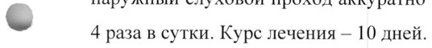
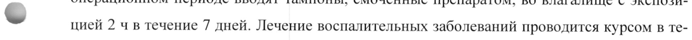

# Бензилдиметил3- — наружно

- Препарат: Зилекса септ (раствор для местного применения;)
- АТХ: D08AJ
- Источник: ГРЛС, инструкция по медицинскому применению, РУ ЛП-008045, файл от 2022-04-26 (https://grls.rosminzdrav.ru/Grls_View_v2.aspx?routingGuid=16999835-ae29-49c1-a6c5-9c4401920105)
- Распознано автоматически (OCR): 8 из 8 стр.
- Инструкция к другому РУ того же препарата: ЛП-008045 (национальное РУ, переоформленное по правилам ЕАЭС, решение от 14.04.2022). Текст может быть старше действующего
- Сомнительных строк после OCR: 2 (см. раздел «Проверка распознавания»)

## Общие сведения

МИНИСТЕРСТВО ЗДРАВООХРАНЕНИЯ РОССИЙСКОЙ ФЕДЕРАЦИИ
ИНСТРУКЦИЯ ПО МЕДИЦИНСКОМУ ПРИМЕНЕНИЮ ЛЕКАРСТВЕННОГО ПРЕПАРАТА
Зилекса септ

Регистрационный номер:

Торговое наименование: Зилекса септ

Международное непатентованное или группировочное наименование: бензилдиметил-

миристоиламино-пропиламмоний

## 3. Лекарственная форма

раствор для местного применения
раствор для местного применения

## 2. Состав

© 1 мл препарата содержит:

Действующее вещество: бензилдиметил[3-(миристоиламино)пропил]аммоний хлорид

моногидрат — 0,104 мг, в пересчете на безводное вещество — 0,1 мг

Вспомогательное вещество: вода для инъекций — до 1,0 мл

%® Описание

Прозрачная бесцветная жидкость.

Фармакотерапевтическая группа: антисептическое средство.

Код ATX: 208 А]

Фармакологические свойства

- Фармакодинамика

Препарат обладает широким спектром антимикробного действия, включая госпитальные

штаммы, резистентные к антибиотикам.

Препарат оказывает выраженное бактерицидное действие в отношении грамположитель-

ных (Staphylococcus spp., Streptococcus spp., Streptococcus pneumoniae), грамотрицательных

(Pseudomonas aeruginosa, Escherichia coli, Klebsiella spp.), аэробных и анаэробных бакте-

рий, определяемых в виде монокультур и микробных ассоциаций, включая госпитальные

штаммы с полирезистентностью к антибиотикам.

Препарат оказывает противогрибковое действие Ha аскомицеты рода Aspergillus и рода

Penicillium, дрожжевые (Rhodotorula rubra, Torulopsis glabrata) и дрожжеподобные грибы

(Candida albicans, Candida tropicalis, Candida krusei, Pityrosporum orbiculare (Malassezia furfur), дерматофиты (Trichophyton rubrum, Trichophyton mentagrophytes, Trichophyton ver-

rucosum, Trichophyton schoenleini, Trichophyton violacent, Epidermophyton Kaufman-Wolf,

Epidermophyton floccosum, Microsporum gypseum, Microsporum canis) в виде монокультур и

микробных ассоциаций, включая грибковую микрофлору с резистентностью к химиотера-

певтическим препаратам.

Препарат обладает противовирусным действием, активен в отношении сложноустроенных

вирусов (вирусы герпеса, иммунодефицита человека).

Препарат действует на возбудителей заболеваний, передающихся половым путем

(Chlamydia spp., Treponema spp., Trichomonas vaginalis, Neisseria gonorrhoeae).

Эффективно предотвращает инфицирование ран и ожогов, активизирует процессы регене-

рации. Стимулирует защитные реакции в месте применения за счет активации поглоти-

тельной и переваривающей функции фагоцитов, потенцирует активность моноцитарно-
© макрофагальной системы. Обладает выраженной гиперосмолярной активностью, вслед-

ствие чего купирует раневое и перифокальное воспаление, абсорбирует гнойный экссудат,

способствуя формированию сухого струпа. Не повреждает грануляции и жизнеспособные

клетки кожи, не угнетает краевую эпителизацию. Не обладает местнораздражающим дей-
© ствием и аллергизирующими свойствами.

## 5.2. Фармакокинетика

При местном и наружном применении не обладает способностью всасываться через кожу

и слизистые оболочки.

## 4.1. Показания к применению

Оториноларингология: комплексное лечение острого и хронического наружного отита,
© гайморита, тонзиллита, ларингита, фарингита.

Стоматология: лечение и профилактика инфекционно-воспалительных заболеваний по-

лости рта: стоматитов, гингивитов, пародонтитов. Гигиеническая обработка съемных про-

тезов.

Хирургия, травматология: профилактика нагноений и лечение гнойных ран. Лечение

гнойно-воспалительных процессов опорно-двигательного аппарата.

Акушерство, гинекология: профилактика и лечение нагноений послеродовых травм, ран

промежности и влагалища, послеродовых инфекций, воспалительных заболеваний (вуль-

вовагинит).

Комбустиология: лечение поверхностных и глубоких ожогов П и ША степени, подготовка

ожоговых ран к дерматопластике.

Дерматология: лечение и профилактика пиодермий и дерматомикозов, кандидозов кожи и слизистых оболочек, микозов стоп. |
Венерология: индивидуальная профилактика заболеваний, передающихся половым путем
(сифилис, гонорея, хламидиоз, трихомониаз, генитальный герпес, генитальный кандидоз).
Урология: комплексное лечение острых и хронических уретритов и уретропростатитов специфической (хламидиоз, трихомониаз, гонорея) и неспецифический этиологии.

## 4.3. Противопоказания

Повышенная чувствительность к действующему веществу.

Не рекомендуется применение препарата в форме спрея для орошения горла и миндалин детям в возрасте до 3 лет ввиду риска реактивного ларингоспазма.

© Применение при беременности и в период грудного вскармливания
Согласно имеющимся данным применение препарата при беременности и в период грудного вскармливания возможно, так как препарат не обладает системным действием при его применении в соответствии с инструкцией, однако остается на усмотрение врача.

## 4.2. Способ применения и дозы

- Местно.
- Местно.

Препарат готов к применению.

Указания по использованию полимерной ампулы:

1. Взять ампулу и встряхнуть ее, удерживая за горлышко.

2. Сдавить ампулу рукой, при этом не должно происходить выделение препарата, и вращающими движениями повернуть и отделить клапан.

ww 3. Нажатием Ha ампулу извлечь раствор.

Указания по использованию упаковки с насадкой гинекологической:

1. Удалить навинчиваемую крышку с флакона с аппликатором урологическим.

2. Извлечь прилагаемую насадку гинекологическую из защитной упаковки (при ее наличии).
3. Навинтить насадку гинекологическую на флакон, не снимая аппликатор урологический.
Указания по использованию упаковки с 2 насадками (помпа с нажимным распыляющим устройством и помпа с нажимным распыляющим устройством со складывающейся канюлей):
1. Удалить навинчиваемую крышку с флакона.

2. Извлечь необходимую насадку из защитной упаковки (при ее наличии).

3. Навинтить насадку на флакон.

4. Активировать насадку двойным нажатием.

Указания по использованию упаковки с диспенсером:
1. Удалить навинчиваемую крышку с флакона.
2. Извлечь диспенсер из защитной упаковки (при ее наличии).
3. Навинтить диспенсер на флакон.
4. Активировать диспенсер двойным нажатием.
Оториноларингология Взрослые и дети При гайморитах — во время пункции верхнечелюстная пазуха промывается достаточным количеством препарата.
При остром и хроническом наружном отите — в наружный слуховой проход с помощью пипетки закапывают до 5 капель препарата 4 раза в сутки или, вместо закапывания, в наружный слуховой проход аккуратно вводят марлевую турунду, смоченную препаратом,
- 4 раза в сутки. Курс лечения — 10 дней.
Тонзиллиты, фарингиты и ларингиты Дети в возрасте 3-6 лет: однократным нажатием на головку насадки-распылителя или 3-5 мл на одно полоскание, 3-4 раза в сутки.
© Дети в возрасте 7-14 лет: двукратным нажатием на головку насадки-распылителя или 5-7 мл на одно полоскание, 3-4 раза в сутки.
Дети старше 14 лет и взрослые: 3-4-х кратным нажатием на головку насадки-распылителя или 10-15 мл на одно полоскание, 3-4 раза в сутки.
Длительность терапии составляет от 4 до 10 дней в зависимости от сроков наступления ремиссии.
Стоматология © Взрослые и дети При стоматитах, гингивитах, пародонтитах рекомендуется полоскание ротовой полости 10-15 мл препарата, 3-4 раза в сутки. В случае невозможности полоскания допускается местное применение марлевых или ватных тампонов, смоченных раствором препарата.
Хирургия, травматология, комбустиология Взрослые и дети
С целью лечения и профилактики вторичного инфицирования ран поверхность раны орошают раствором препарата.
Марлевые тампоны, смоченные раствором препарата, фиксируют на поверхности раны.
В случае необходимости возможно тампонирование раны и/или свищевых ходов во время выполнения хирургических манипуляций.
Возможно проведение активного дренирования ран и/или полостей с суточным расходом до 1 л препарата.
Акушерство, гинекология Взрослые Профилактика и лечение нагноений послеродовых травм, ран промежности и влагалища, послеродовых инфекций: препарат применяется в виде влагалищных орошений до родов
(5-7 дней), в родах (после каждого влагалищного исследования). В послеродовом периоде вводится с помощью тампонов, смоченных 50 мл препарата, с дальнейшей экспозицией тампона на протяжении 2 ч в течение 5 дней.
При родоразрешении женщин путем кесарева сечения непосредственно перед операцией обрабатывают влагалище, во время операции — полость матки и разрез на ней, а в послеоперационном периоде вводят тампоны, смоченные препаратом, во влагалище с экспози-
~ цией 2 ч в течение 7 дней. Лечение воспалительных заболеваний проводится курсом в Teчение 2-х недель путем внутривлагалищного введения тампонов с препаратом, а также методом лекарственного электрофореза.
Комплексное лечение воспалительных заболеваний в гинекологии (вульвовагинит): в виде
® влагалищных орошений или введения тампона, смоченного препаратом, с экспозицией 2 4 B течение 7-14 дней (продолжительность лечения и кратность введения определяются по назначению врача).
Дети Способ применения, продолжительность лечения и кратность введения определяются по назначению врача.
Дерматология © Взрослые и дети Лечение и профилактика пиодермий и дерматомикозов, кандидозов кожи и слизистых оболочек, микозов стоп: препарат наносят на пораженный участок кожи путем протирания стерильными марлевыми тампонами, обильно смоченными препаратом. Препарат применяется 3 раза в день на пораженных участках кожи.
Венерология Взрослые Для профилактики венерических заболеваний препарат эффективен, если он применяется не позже 2-х часов после полового акта. Содержимое флакона с помощью аппликатора урологического ввести в мочеиспускательный канал на 2-3 мин: мужчинам (2-3 мл), женщинам в мочеиспускательный канал (1-2 мл) и во влагалище (5-10 мл). Для удобства ре5 комендуется использование гинекологической насадки. Обработать кожу внутренних по-

верхностей бедер, лобка, половых органов. После процедуры рекомендуется не мочиться

в течение 2-х часов.

Урология

Взрослые

В комплексном лечении уретритов и уретропростатитов проводят впрыскивание в уретру

2-3 мл препарата 1-2 раза в день, курс — 10 дней.

Дети

Способ применения, продолжительность лечения и кратность введения определяются по

назначению врача.

Если после лечения улучшения не наступает или симптомы усугубляются, или появляются новые симптомы, необходимо проконсультироваться с врачом. Применяйте препарат
~ только согласно тому способу применения и в тех дозах, которые указаны в инструкции.

## 4.8. Побочное действие

Параметры частоты нежелательных реакций определяются следующим образом: очень

часто (> 1/10); часто (> 1/100, < 1/10); нечасто (> 1/1000, < 1/100); редко (> 1/10000,
- < 1/1000); очень редко (< 1/10000); частота неизвестна (не может быть оценена по имею-

щимся данным).

Очень редко:

- легкое жжение, которое проходит самостоятельно через 15-20 сек, и не требует отмены

препарата;

- аллергические реакции.

& Если у Bac отмечаются побочные эффекты, указанные в инструкции по медицинскому применению, или они усугубляются, или Вы заметили любые другие эффекты, не указанные в инструкции, сообщите об этом врачу.

## 4.9. Передозировка

Данные по передозировке препарата отсутствуют.
Данные по передозировке препарата отсутствуют.

## 4.5. Взаимодействие с другими лекарственными средствами

При одновременном применении с антибиотиками отмечено усиление их противобактериальных и противогрибковых свойств.

## 4.4. Особые указания

Использование одного флакона более чем одним лицом может привести к распространению инфекции.
Использование одного флакона более чем одним лицом может привести к распространению инфекции.

## 4.7. Влияние на способность управлять транспортными средствами, механизмами

Не влияет на способность управлять транспортными средствами и другими механизмами.

## 6.5. Форма выпуска

Раствор для местного применения 0,01 %.
Раствор для местного применения 0,01 %.
По 5 или 10 мл в ампулы из полиэтилена низкой плотности (Политвист).
По 5, 10, 15 или 20 ампул вместе с инструкцией по применению в пачке из картона.
По 50 мл во флаконы из полиэтилена с аппликатором урологическим из полиэтилена и
& навинчиваемой крышкой из полиэтилена в комплекте с насадкой гинекологической полипропиленовой в полипропиленовом пакете или без него.
По 50 мл во флаконы из полиэтилена, снабженные полимерной помпой с нажимным распыляющим устройством со складывающейся полипропиленовой канюлей или без нее.
По 150 мл во флаконы из полиэтилена с навинчиваемой полипропиленовой крышкой в
© комплекте с двумя насадками: полимерная помпа с нажимным распыляющим устройством и полимерная помпа с нажимным распыляющим устройством со складывающейся полипропиленовой канюлей в полипропиленовых пакетах или без них.
По 500 или 1000 мл во флаконы из полиэтилена с навинчиваемой крышкой из полиэтилена в комплекте с полимерным диспенсером в полипропиленовом пакете или без него, или без диспенсера.
> По 1 флакону вместе с инструкцией по применению в пачке из картона.
Для стационаров 14 или 15 флаконов по 500 мл или 9 или 12 флаконов по 1000 мл с диспенсерами или без них вместе с инструкциями по применению в гофрокоробе из картона.

## 6.4. Условия хранения

При температуре не выше 25 °С.
При температуре не выше 25 °С.
Хранить в недоступном для детей месте.

## 6.3. Срок годности

3 года.
3 года.
Не применять после окончания срока годности!
Условия отпуска Отпускают без рецепта.
Владелец регистрационного удостоверения ООО «Цитера»
Россия, 195279, г. Санкт-Петербург Индустриальный проспект, д. 71, корп. 2, лит. А
Производитель / Организация, принимающая претензии от потребителей
ООО «Гротекс»
Россия, 195279, г. Санкт-Петербург Индустриальный проспект, д. 71, корп. 2, лит. А
© Тел.: +7 812 385 47 87 Факс: +7 812 385 47 88 wr www.solopharm.com 7
STON Rp 27 ох ря

Начальник отдела регистрации В®/ <

Ba | П A Oy ()y |S¥ OOO «Цитера» aS (UA ia |. | С. В. Сергеев

a ee / og

№5 Ag

TE
## Проверка распознавания

Страницы-сканы распознаны автоматически. В 2 строках с дозировками цифры могли распознаться с ошибкой — сверьте с вырезкой из оригинала:

- стр. 4: «- 4 раза в сутки. Курс лечения — 10 дней.» — повторное чтение: «»  
  
- стр. 5: «~ цией 2 ч в течение 7 дней. Лечение воспалительных заболеваний проводится курсом в Te-» — повторное чтение: «aay 7 saGonenant проводится sypeou 8 te»  
  
