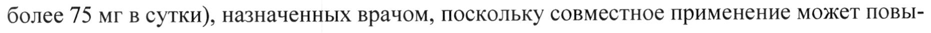

# Бензилдиметил-миристоиламино-пропиламмоний + Флурбипрофен — наружно

- Препарат: МИТРАСЕПТИН®-ПРОЛОР (спрей для местного применения дозированный;)
- АТХ: R02AX01
- Источник: ГРЛС, инструкция по медицинскому применению, РУ ЛП-008095, файл от 2022-05-17 (https://grls.rosminzdrav.ru/Grls_View_v2.aspx?routingGuid=d5db268a-15f7-42d2-8c2b-57b86f31b37a)
- Распознано автоматически (OCR): 15 из 15 стр.
- Инструкция к другому РУ того же препарата: ЛП-008095 (срок действия истёк, решение от 25.04.2022). Текст может быть старше действующего
- Сомнительных строк после OCR: 2 (см. раздел «Проверка распознавания»)

## Общие сведения

МИНИСТЕРСТВО ЗДРАВООХРАНЕНИЯ РОССИЙСКОЙ ФЕДЕРАЦИИ
| ] БА ИНСТРУКЦИЯ ПО МЕДИЦИНСКОМУ ПРИМЕНЕНИЮ ЛЕКАРСТВЕННОГО ПРЕПАРАТА
МИТРАСЕПТИН®-ПРОЛОР

Регистрационный номер:
Торговое наименование препарата: МИТРАСЕПТИН®-ПРОЛОР
Международное непатентованное или группировочное наименование:
бензилдиметил-миристоиламино-пропиламмоний+флурбипрофен

## 3. Лекарственная форма

спрей для местного применения дозированный
спрей для местного применения дозированный

## 2. Состав

~ Состав на 1 дозу: действующие вещества: флурбипрофен - 8,750 мг, бензилдиметил-миристоиламино-пропиламмоний (в пересчете на 100 % вещество) - 0,051 мг; вспомогательные вещества: бетадекс - 22,830 мг, натрия гидрофосфата додекагидрат - 17,190 мг, гидроксипропилбетадекс - 12,090 мг, макрогола глицерилрицинолеат - 5,100 мг, натрия гидроксид - 1,300 мг, метилпарагидроксибензоат - 1,180 мг, лимонной кислоты моногидрат - 0,630 мг, натрия сахаринат - 0,270 мг, пропилпарагидроксибензоат - 0,240 мг, эвкалиптовое масло - 0,090 мг, масло мяты перечной - 0,045 мг, вода очищенная - до 510 мкл.
Описание: Прозрачный бесцветный или с желтоватым оттенком раствор с характерным запахом. Допускается легкая опалесценция.

© Фармакотерапевтическая группа: препараты для лечения заболеваний горла; другие препараты для лечения заболеваний горла.
Код ATX: RO2AX Фармакологические свойства
МИТРАСЕПТИН®-ПРОЛОР- это комбинированный лекарственный препарат с действующими веществами флурбипрофен и бензилдиметил-миристоиламино-пропиламмоний.

## 5.1. Фармакодинамика

Флурбипрофен Флурбипрофен является нестероидным противовоспалительным препаратом (НИВП), производным пропионовой кислоты.
Флурбипрофен обладает обезболивающим, противовоспалительным и жаропонижающим эффектом за счет подавления циклооксигеназы-1 (ЦОГ-1) и циклооксигеназы-2 (ЦОГ-2), с некоторой селективностью по отношению к ЦОГ-1, в результате чего снижается продукция простагландинов — медиаторов боли, воспаления и гипертермической реакции.
При применении препарата в однократной дозе (3 нажатия на дозатор), уменьшение болезненности и затруднения при глотании отмечается через 5 минут, значительное снижение интенсивности боли - 20 минут, уменьшение отека через 30 минут после применения. Обезболивающее и противоотечное действие препарата продолжается до 6 часов.
Бензилдиметил-миристоиламино-пропиламмоний.
Бензилдиметил-миристоиламино-пропиламмоний обладает широким спектром антимик-
~ робного действия, включая госпитальные штаммы, резистентные к антибиотикам.
Препарат оказывает выраженное бактерицидное действие в отношении грамположительных (Staphylococcus spp., Streptococcus spp., Streptococcus pneumoniae), грамотрицательных
(Pseudomonas aeruginosa, Escherichia coli, Klebsiella spp.), аэробных и анаэробных бактерий, определяемых в виде монокультур и микробных ассоциаций, включая госпитальные штаммы с полирезистентностью к антибиотикам.
Оказывает противогрибковое действие на аскомицеты рода Aspergillus и рода Penicillium, дрожжевые (Rhodotorula rubra, Torulopsis gabrata), и дрожжеподобные грибы (Candida albicans, Candida tropicalis, Candida krusei, Pityrosporum orbiculare (Malassezia furfur), дерматофиты (Trychophyton rubrum, Trychophyton mentagrophytes, Trychophyton verrucosum,
Trychophyton — schoenleini, Trychophyton violacent, Epidermophyton Kaufman-Wolf,
© Epidermophyton floccosum, Microsporum gypseum, Microsporum canis), а также Ha др. патогенные грибы, в виде монокультур и микробных ассоциаций, включая грибковую микрофлору с резистентностью к химиотерапевтическим препаратам.
Обладает противовирусным действием, активен в отношении сложноустроенных вирусов
(вирусы герпеса, вирус иммунодефицита человека).
Бензилдиметил-миристоиламино-пропиламмоний действует на возбудителей заболеваний, передающихся половым путем (Chlamydia spp., Treponema spp., Trichomonas vaginalis, Neisseria gonorrhoeae).
Эффективно предотвращает инфицирование ран и ожогов. Активизирует процессы регенерации. Стимулирует защитные реакции в месте применения, за счет активации поглотительной и переваривающей функции фагоцитов, потенцирует активность моноцитарно-
;.
макрофагальной системы. Обладает выраженной гиперосмолярной активностью, вследствие чего купирует раневое и перифокальное воспаление, абсорбирует гнойный экссудат, способствуя формированию сухого струпа. Не повреждает грануляции и жизнеспособные клетки кожи, не угнетает краевую эпителизацию.
Не обладает местно-раздражающим действием и аллергизирующими свойствами.

## 5.2. Фармакокинетика

Флурбипрофен Всасывание При нанесении однократной дозы препарата (3 нажатия на дозатор) на слизистую оболочку ротоглотки флурбипрофен быстро всасывается и определяется в плазме крови через 2-5 минут.
Флурбипрофен Всасывание При нанесении однократной дозы препарата (3 нажатия на дозатор) на слизистую оболочку ротоглотки флурбипрофен быстро всасывается и определяется в плазме крови через 2-5 минут.
Максимальная концентрация флурбипрофена в плазме крови достигает 30 минут после при-
- менения и составляет 1,6 мкг/мл, что в 4 раза ниже, чем при приеме внутрь 50 мг флурбипрофена.
Распределение Флурбипрофен быстро связывается с белками плазмы крови и распределяется по всему организму.
Метаболизм Флурбипрофен метаболизируется, в основном, путем гидроксилирования и выводится почками, период полувыведения (Т1/2) составляет 3-6 часов.
Выведение Примерно 20-25 % пероральной дозы флурбипрофена выводится почками в неизмененном виде.
© Бензилдиметил-миристоиламино-пропиламмоний.
При местном применении бензилдиметил-миристоиламино-пропиламмоний не обладает способностью всасываться через кожу и слизистые оболочки.

## 4.1. Показания к применению

В качестве симптоматического средства для облегчения боли в горле при инфекционновоспалительных заболеваниях верхних дыхательных путей.
В качестве симптоматического средства для облегчения боли в горле при инфекционновоспалительных заболеваниях верхних дыхательных путей.

## 4.3. Противопоказания

Гиперчувствительность к действующим веществам и/или любому вспомогательному веществу в составе препарата.
Гиперчувствительность к действующим веществам и/или любому вспомогательному веществу в составе препарата.
° Наличие в анамнезе реакций гиперчувствительности (бронхиальная астма, бронхос-

пазм, ринит, отек Квинке, крапивница, рецидивирующий полипоз носа или околоносовых

пазух) в ответ на применение ацетилсалициловой кислоты или других НПВП.

й Эрозивно-язвенные заболевания органов желудочно-кишечного тракта (в том числе,

язвенная болезнь желудка и двенадцатиперстной кишки), язвенное кровотечение в актив-

ной фазе или анамнезе (два или более подтвержденных эпизода язвенной болезни или яз-

венного кровотечения).

. Кровотечение или перфорация язвы желудочно-кишечного тракта, язвенный колит,

геморрагические и гемопоэтические нарушения в анамнезе, спровоцированные примене-

нием НПВП.

| ° Беременность (Ш триместр).
. Период грудного вскармливания.
° Детский возраст до 18 лет.
~ . Тяжелая печеночная недостаточность или заболевание печени в активной фазе.

° Почечная недостаточность тяжелой степени тяжести (клиренс креатинина < 30

мл/мин).

° Декомпенсированная сердечная недостаточность.

e Период после аортокоронарного шунтирования.

. Подтвержденная гиперкалиемия.

. Дефицит глюкозо-6-фосфат дегидрогеназы.

. Гемофилия и другие нарушения свертываемости крови (в том числе гипокоагуля-

ция), геморрагические диатезы.

Если у Вас одно из перечисленных заболеваний состояний, перед приемом препарата обя-

зательно проконсультируйтесь с врачом.

® С осторожностью

При наличии заболеваний и/или состояний, указанных в данном разделе, перед примене-

нием препарата следует обратиться к врачу.

Одновременный прием других НПВП, в том числе селективные ингибиторы циклооксиге-

назы-2; наличие в анамнезе однократного эпизода язвенной болезни желудка или язвенного

кровотечения ЖКТ; заболевания желудочно-кишечного тракта в анамнезе (язвенный колит,

болезнь Крона), гастрит, энтерит, колит, наличие инфекции Helicobacter pylori; бронхиаль-

ная астма или аллергические заболевания в стадии обострения или в анамнезе - возможно

развитие бронхоспазма; системная красная волчанка и другие системные аутоиммунные за-

болевания соединительной ткани (повышенный риск развития асептического менингита) - при кратковременном применении флурбипрофена риск незначительный; артериальная гипертензия и/или сердечная недостаточность, отеки; почечная недостаточность в том числе при обезвоживании (клиренс креатинина менее 60 мл/мин), нефротический синдром, печеночная недостаточность, цирроз печени с портальной гипертензией, гипербилирубинемия
(при кратковременном применении флурбипрофена риск незначительный); одновременный прием лекарственных средств, которые могут увеличить риск возникновения язв или кровотечения, в частности пероральных глюкокортикостероидов (в том числе преднизолона), антикоагулянтов (в том числе варфарина), антиагрегантов (в том числе ацетилсалициловой кислоты, клопидогрела), селективных ингибиторов обратного захвата серотонина (в том числе циталопрама, флуоксетина, пароксетина, сертралина); алкоголизм; 1-П триместр беременности; пожилой возраст.
Если у Вас есть одно из перечисленных выше заболеваний/ состояний или факторов риска перед применением препарата необходимо проконсультироваться с врачом.

© Применение при беременности и в период грудного вскармливания
Противопоказано применение препарата в Ш триместре беременности.
Следует избегать применения флурбипрофена во 1-П триместрах беременности, при необходимости применения препарата следует проконсультироваться с врачом.
Имеются данные о том, что флурбипрофен может проникать в грудное молоко без какихлибо отрицательных последствий для здоровья ребенка, однако, из-за возможных побочных эффектов применение препарата в период грудного вскармливания не рекомендуется.
Беременность Ингибирование синтеза простагландинов может оказать нежелательное влияние на течение беременности и/или развитие эмбриона/плода. Данные эпидемиологических исследований

© подтверждают повышенный риск самопроизвольного аборта, пороков сердца и гастрошизиса при применении ингибиторов синтеза простагландинов на ранних сроках беременности.
Абсолютный риск возникновения патологий сердечно-сосудистой системы увеличился с менее | % до приблизительно 1,5 %. Предполагается, что риск возрастает с увеличением дозы и длительности терапии. Во время первого и второго триместра беременности назначать флурбипрофен не рекомендуется. Применение любых ингибиторов синтеза простагландинов в третьем триместре беременности может привести к следующим отрицательным последствиям для плода: кардиопульмональной токсичности (с преждевременным закрытием артериального протока и развитием легочной гипертензии); почечной дисфункции, прогрессирующей до почечной недостаточности, и олигогидрамниону.

Прием ингибиторов синтеза простагландинов матери и новорожденного в конце беременности может привести к возможному увеличению времени кровотечения, антиагрегационному эффекту даже при очень низких дозах; ингибированию сокращений маточных мышц, что приводит к задержке начала родовой деятельности и увеличению продолжительности родов. Вследствие этого прием флурбипрофена противопоказан в течение третьего триместра беременности.
Период грудного вскармливания Имеются данные о том, что флурбипрофен в незначительных количествах может проникать в грудное молоко без каких-либо отрицательных последствий для здоровья ребенка, однако, из-за возможных побочных эффектов НПВП применение препарата в период грудного вскармливания противопоказано.
Фертильность Информация для женщин, планирующих беременность: препарат подавляет циклооксиге-

~ назу и синтез простагландинов и может воздействовать Ha овуляцию, нарушая женскую peпродуктивную функцию (обратимо после отмены лечения).
Перед применением препарата МИТРАСЕПТИН®-ПРОЛОР, если Вы беременны или предполагаете, что Вы могли бы быть беременной, или планируете беременность, необходимо проконсультироваться с врачом.

## 4.2. Способ применения и дозы

Внимательно прочтите инструкцию перед применением препарата.
Внимательно прочтите инструкцию перед применением препарата.
Для местного применения. Только для кратковременного применения.
Взрослые: 1 дозу препарата (3 нажатия на дозатор) распылять по задней стенке ротоглотки каждые 3-6 часов, не более 5 доз в течение 24 часов.

© Продолжительность курса терапии: не более 3 дней.
Не вдыхать при распылении.
Перед первым применением препарата необходимо сделать не менее четырех нажатий на дозатор в противоположную от себя сторону до появления равномерного распыления.
Перед каждым последующим применением необходимо сделать не менее одного нажатия на дозатор в противоположную от себя сторону до появления равномерного распыления.
Если после лечения улучшение не наступает, или симптомы усугубляются, или появляются новые симптомы, необходимо проконсультироваться с врачом. Применяйте препарат только согласно тем показаниям, тому способу применения и в тех дозах, которые указаны в инструкции.

## 4.8. Побочное действие

Применение некоторых НПВП, в особенности в высоких дозах и в течение продолжитель-

ного периода времени, может быть связано с небольшим повышением риска развития арте-

риальных тромботических явлений (например, инфаркта миокарда или инсульта). Имею-

щихся данных недостаточно для исключения подобного риска для флурбипрофена в лекар-

ственной форме спрей, 8,75 мг/доза при приеме не более 5 доз в течение 24 часов.

Сообщалось о развитии реакций гиперчувствительности к НПВП, которые могут прояв-

ляться в виде:

- неспецифических аллергических и анафилактических реакций;

- гиперреактивности дыхательных путей, в том числе астма, обострение астмы, бронхо-

спазм, одышка;

- различных кожных реакций, например, зуд, крапивница, ангионевротический отек и, реже,

эксфолиативный и буллезный дерматоз (включая эпидермальный некролиз и многоформ-
~ ную эритему).

Отмечались случаи возникновения отека, артериальной гипертензии и сердечной недоста-

точности у пациентов, принимавших НПВП.

Риск возникновения побочных эффектов можно свести к минимуму, если применять пре-

парат коротким курсом и в минимальной эффективной дозе, необходимой для устранения

симптомов.

Нижеперечисленные побочные реакции отмечались при кратковременном применении пре-

парата. При лечении хронических состояний и при длительном применении возможно по-

явление других побочных реакций.

Оценка частоты возникновения побочных реакций произведена на основании следующих

критериев: очень часто (>1/10), часто (от > 1/100 до <1/10), нечасто (от >1/1000 до <1/100),
© редко (от >1/10 000 до <1/1000), очень редко (<1/10 000), частота неизвестна (данные по

оценке частоты отсутствуют).

Нарушения со стороны крови и лимфатической системы:

Частота неизвестна: анемия, тромбоцитопения.

Нарушения со стороны нервной системы:

Часто: головокружение, головная боль, парестезия.

Нечасто: сонливость.

Нарушения со стороны иммунной системы:

Редко: анафилактические реакции.

Очень редко: аллергические реакции, легкое жжение.

Нарушения со стороны cepoua:

a Частота неизвестна: сердечная недостаточность, отеки.
Нарушения со стороны сосудов:
Частота неизвестна: повышение артериального давления.
Нарушения со стороны дыхательной системы, органов грудной клетки и средостения:
Часто: чувство раздражения в горле.
Нечасто: обострение бронхиальной астмы и бронхоспазм, одышка, свистящее дыхание, волдыри в полости рта и глотки, фарингеальная гипестезия (снижение чувствительности в полости рта и глотки).
Желудочно-кишечные нарушения:
Часто: диарея, изъязвление полости рта, тошнота, боль в ротовой полости, парестезия ротовой полости, боль в полости рта и глотки, дискомфорт в полости рта (ощущение тепла, чувство жжения или покалывания во рту).
Нечасто: вздутие живота, боль в животе, запор, сухость во рту, диспепсия, метеоризм, глос-
~ салгия (синдром жжения полости рта), дисгевзия (изменение восприятия вкуса), дизестезия полости рта, рвота.
Нарушения со стороны кожи и подкожных тканей:
Нечасто: кожная сыпь, зуд.
Частота неизвестна: тяжелые кожные реакции, такие как буллезные реакции, включая синдром Стивенса-Джонсона и токсический эпидермальный некролиз (Синдром Лайелла).
Нарушения со стороны печени и желчевыводящих путей:
Частота неизвестна: гепатит.
Психические нарушения:
Нечасто: бессонница.
Общие нарушения и реакции в месте введения:
© Нечасто: лихорадка, боль.
Если любые из указанных в инструкции побочных эффектов усугубляются, или Вы заметили любые другие побочные эффекты, не указанные в инструкции, сообщите об этом врачу.

## 4.9. Передозировка

Симптомы: тошнота, рвота, боль в эпигастральной области, реже диарея. Также возможны шум в ушах, головная боль, желудочно-кишечное кровотечение. В более тяжелых случаях наблюдаются следующие проявления со стороны центральной нервной системы: сонливость, редко - возбуждение, нечеткое зрение, дезориентация или кома. В редких случаях у пациентов отмечаются судороги. В случаях тяжелого отравления НПВП могут развиваться метаболический ацидоз, увеличение протромбинового времени, что, вероятно, связано с влиянием на действие факторов свертывания крови. Могут развиваться острая почечная недостаточность и поражение печени, снижение артериального давления, угнетение дыхания и цианоз. У пациентов с бронхиальной астмой возможно обострение этого заболевания.
Симптомы: тошнота, рвота, боль в эпигастральной области, реже диарея. Также возможны шум в ушах, головная боль, желудочно-кишечное кровотечение. В более тяжелых случаях наблюдаются следующие проявления со стороны центральной нервной системы: сонливость, редко - возбуждение, нечеткое зрение, дезориентация или кома. В редких случаях у пациентов отмечаются судороги. В случаях тяжелого отравления НПВП могут развиваться метаболический ацидоз, увеличение протромбинового времени, что, вероятно, связано с влиянием на действие факторов свертывания крови. Могут развиваться острая почечная недостаточность и поражение печени, снижение артериального давления, угнетение дыхания и цианоз. У пациентов с бронхиальной астмой возможно обострение этого заболевания.
Лечение: симптоматическое, с обязательным обеспечением проходимости дыхательных путей, мониторингом ЭКГ и основных показателей жизнедеятельности вплоть до нормализации состояния пациента. Рекомендуется пероральное применение активированного угля или промывание желудка в течение 1 часа после приема потенциально токсической дозы флурбипрофена. Частые или продолжительные судороги следует купировать внутривенным введением диазепама или лоразепама. В случае обострения бронхиальной астмы рекомендовано применение бронходилататоров. Специфического антидота к флурбипрофену не существует.
- При появлении симптомов передозировки следует прекратить прием препарата и немедленно обратиться к врачу.

## 4.5. Взаимодействие с другими лекарственными средствами

Флурбипрофен Следует избегать одновременного применения препарата со следующими лекарственными средствами:
- Ацетилсалициловая кислота: за исключением низких доз ацетилсалициловой кислоты (не более 75 мг в сутки), назначенных врачом, поскольку совместное применение может повысить риск возникновения побочных эффектов.
- Другие НПВП, в том числе ибупрофен и селективные ингибиторы циклооксигеназы-2:
© следует избегать одновременного применения двух и более препаратов из группы НИВИ из-за возможного увеличения риска возникновения побочных эффектов.
С осторожностью применять одновременно со следующими лекарственными средствами:
- Антикоагулянты: НПВП могут усиливать эффекты антикоагулянтов, в том числе варфарина.
- Антиагреганты и селективные ингибиторы обратного захвата серотонина: повышение риска желудочно-кишечного кровотечения.
- Гипотензивные средства (ингибиторы АПФ и антагонисты ангиотензина IT) и диуретики:
НПВП могут снижать эффективность препаратов этих групп и могут повышать нефротоксичность вследствие ингибирования циклооксигеназы, особенно у пациентов с нарушением почечной функции (необходимо обеспечить адекватное возмещение жидкости у таких пациентов).
- Этанол: может повысить риск развития побочных реакций, особенно желудочно-кишечного кровотечения.
- Сердечные гликозиды: одновременное применение НПВП и сердечных гликозидов может привести к усугублению сердечной недостаточности, снижению скорости клубочковой фильтрации и увеличению концентрации сердечных гликозидов в плазме крови.
- Циклоспорин: повышение риска развития нефротоксичности.
- Глюкокортикостероиды: повышенный риск образования язв желудочно-кишечного тракта и желудочно-кишечного кровотечения.
- Препараты лития: существуют данные о вероятности увеличения концентрации лития в плазме крови на фоне применения НПВП.
- Метотрексат: существуют данные о вероятности увеличения концентрации метотрексата
- в плазме крови на фоне применения НПВП. Необходимо принимать НПВП за 24 часа до или после приёма метотрексата.
- Мифепристон: прием НПВП следует начать не ранее, чем через 8-12 дней после окончания применения мифепристона, поскольку НПВП могут снижать эффективность мифепристона.
- Антибиотики хинолонового ряда: у пациентов, получающих совместное лечение НПВП и антибиотиками хинолонового ряда, возможно увеличение риска возникновения судорог.
- Селективные ингибиторы обратного захвата серотонина (СИОЗС): повышенный риск образования язв желудочно-кишечного тракта и желудочно-кишечного кровотечения.
- Такролимус: при совместном применении с НПВП, возможно повышение риска нефротоксичности.
© - Зидовудин: при совместном применении с НПВП, возможно повышение риска гематотоксичности.
- Пероральные гипогликемические препараты: возможно изменение концентрации глюкозы в крови (рекомендуется увеличить частоту контроля концентрации глюкозы в крови).
- Фенитоин: возможно повышение концентрации фенитоина в сыворотке крови (рекомендуется контроль концентрации фенитоина в сыворотке крови и, при необходимости, коррекция дозы).
- Калийсберегающие диуретики: совместное применение калийсберегающих диуретиков и флурбипрофена может привести к гиперкалиемии.
- Пробенецид и сульфинпиразон: лекарственные препараты, содержащие пробенецид или сульфинпиразон, могут задерживать выведение флурбипрофена.
- Толбутамид и антациды: к настоящему времени исследования не выявили взаимодействий между флурбипрофеном и толбутамидом или антацидами.
Бензилдиметил-миристоиламино-пропиламмоний
При одновременном применении с антибиотиками, отмечено усиление их противобактериальных и противогрибковых свойств.
Если Вы применяете выше перечисленные или другие лекарственные препараты (в том числе безрецептурные) перед применением препарата МИТРАСЕПТИН®-ПРОЛОР проконсультируйтесь с врачом.

## 4.4. Особые указания

Внимательно прочитайте инструкцию по применению перед тем, как начать применение этого препарата, так как она содержит важную для Вас информацию.
Внимательно прочитайте инструкцию по применению перед тем, как начать применение этого препарата, так как она содержит важную для Вас информацию.
~ ® Сохраняйте инструкцию, она может понадобиться вновь.

e Еслиу Вас возникли вопросы, обратитесь к врачу.

e Лекарственное средство, которым Вы лечитесь, предназначено лично Вам, и его не следует передавать другим лицам, поскольку оно может причинить им вред, даже при наличии тех же симптомов, что иу Вас

Рекомендуется принимать препарат максимально возможным коротким курсом и в минимальной эффективной дозе, необходимой для устранения симптомов.
При появлении симптомов гастропатии показан тщательный контроль, включающий проведение эзофагогастродуоденоскопии, общий анализ крови (определение гемоглобина), анализ кала на скрытую кровь.
При необходимости определения 17-кетостероидов препарат следует отменить за 48 часов
© до исследования.

В период лечения не рекомендуется прием алкоголя.
При появлении раздражения в полости рта, кожной сыпи, поражения слизистой оболочки и других проявлениях аллергической реакции, следует прекратить применение препарата и обратиться к врачу.
В случае ухудшения существующих симптомов или появления новых, в том числе при появлении признаков бактериальной инфекции, необходимо незамедлительно обратиться к врачу для пересмотра терапии.
Инфекции

Поскольку в отдельных случаях во временной связи с применением системных НИВП как класса описывалось ухудшение инфекционных воспалений (например, развитие некротического фасциита), пациенту рекомендуется незамедлительно обратиться к врачу при появлении или усугублении признаков бактериальной инфекции во время лечения препаратом
МИТРАСЕПТИН®-ПРОЛОР. Следует рассмотреть возможность назначения антибактериальной терапии при инфекционном заболевании.
В случаях гнойного бактериального фарингита/тонзиллита пациенту рекомендуется проконсультироваться с врачом, так как требуется пересмотр лечения.
Продолжительность терапии не должна превышать три дня.
Сердечно-сосудистые и цереброваскулярные эффекты
Пациентам с артериальной гипертензией и/или сердечной недостаточностью в анамнезе следует начинать прием препарата с осторожностью (необходима консультация с врачом или фармацевтом), поскольку сообщалось о задержке жидкости, артериальной гипертензии

- и отеках, связанных с приемом НПВП.
Данные клинических и эпидемиологических исследований свидетельствуют о том, что применение некоторых НПВП (главным образом, в высоких дозах и в течение длительного времени) может быть связано с незначительным повышением риска артериальных тромботических явлений (например, инфаркта миокарда или инсульта). Имеющихся данных недостаточно для исключения подобного риска для флурбипрофена при применении в суточной дозе не более 5 доз (3 распыления/доза).
Нарушения со стороны нервной системы В случае длительного применения анальгетиков может развиться головная боль, для лечения которой нельзя использовать более высокие дозы лекарственного препарата.
Желудочно-кишечные средства

© Пациентам с заболеваниями желудочно-кишечного тракта (язвенный колит, болезнь Крона)
следует с осторожностью назначать НПВП в связи с возможным обострением указанных заболеваний. Прием НПВП может привести к желудочно-кишечному кровотечению, образованию язв и перфораций, которые в некоторых случаях приводили к летальным исходам, независимо от наличия предупреждающих симптомов или серьезных заболеваний со стороны желудочно-кишечного тракта в анамнезе.
У пациентов с язвой в анамнезе, в особенности осложненной кровотечением или перфорацией, а также у пациентов пожилого возраста риск желудочно-кишечных кровотечений, изъявления или перфорации при увеличении дозы НПВП повышается, однако данный эффект, как правило, не наблюдается у препаратов для краткосрочного применения, например, МИТРАСЕПТИН®-ПРОЛОР.

При появлении симптомов кровотечения или язвообразования пациентам следует прекратить прием препарата МИТРАСЕПТИН®-ПРОЛОР.
Гематологические эффекты Флурбипрофен, как и другие НПВП, могут ингибировать агрегацию тромбоцитов и продлевать кровотечение. Препарат МИТРАСЕПТИН®-ПРОЛОР рекомендуется использовать с осторожностью у пациентов с риском развития кровотечения.
Нарушения со стороны кожи Серьезные кожные реакции, в некоторых случаях со смертельным исходом, в том числе эксфолиативный дерматит, синдром Стивенса-Джонсона и токсический эпидермальный некролиз, диагностировались на фоне применения НПВП только в очень редких случаях.
При первых признаках кожной сыпи, поражении слизистых оболочек или других признаках гиперчувствительности, применение препарата МИТРАСЕПТИН®-ПРОЛОР следует прекратить.
~ Почечная и печеночная недостаточность Сообщалось, что прием НПВП приводит к различным формам нефротоксичности, включая интерстициальный нефрит, нефротический синдром и почечную недостаточность. Максимальный риск развития подобной реакции наблюдается у пациентов с почечной, сердечной и печеночной недостаточностью, которые принимают мочегонные препараты, либо у пожилых, однако подобный эффект, как правило, не наблюдается для препаратов для краткосрочного применения, например, МИТРАСЕПТИН®-ПРОЛОР.
Пациентам с почечной или печеночной недостаточностью, а также пожилым пациентам и пациентам, принимающим диуретики, необходимо проконсультироваться с врачом перед применением препарата, поскольку существует риск ухудшения функционального состояния почек. При кратковременном применении препарата риск является незначительным.
© Во время введения препарата баллон следует держать вертикально (см. рисунок)!
GY (6 iim \ Pe Gs 9:
GOs He превышать максимальные сроки и рекомендованные дозы при самостоятельном применении препарата. В случае отсутствия уменьшения или при утяжелении симптомов заболевания необходимо обратиться к врачу.

## 4.7. Влияние на способность управлять транспортными средствами, механизмами

Пациентам, отмечающим головокружение, сонливость, заторможенность или нарушения зрения при приеме флурбипрофена, следует избегать управления транспортными средствами или механизмами.

## 6.5. Форма выпуска

Спрей для местного применения дозированный, 0,051 мг + 8,75 мг/доза.
Спрей для местного применения дозированный, 0,051 мг + 8,75 мг/доза.
По 15 мл (20 доз) или 30 мл (45 доз) во флаконы пластиковые из полиэтилена низкого давления. Флаконы завальцовывают дозирующими насосами в комплекте с распылителем и защитным колпачком, или с распылителем с поворотной канюлей и с манжетой.
На флакон наклеивают самоклеящуюся этикетку.
Каждый флакон в комплекте с распылителем и защитным колпачком, или с распылителем с поворотной канюлей и с манжетой, и инструкцией по применению помещают в пачку из
- картона.

## 6.4. Условия хранения

Хранить при температуре от 15 до 25 °С.
Хранить при температуре от 15 до 25 °С.
Хранить в недоступном для детей месте.

## 6.3. Срок годности

2 года. Не применять по истечении срока годности.
2 года. Не применять по истечении срока годности.
Условия отпуска Отпускают без рецепта.
-
Владелец регистрационного удостоверения/организация, принимающая претензии потребителей
Открытое акционерное общество "Фармстандарт-Лексредства"
(ОАО "Фармстандарт-Лексредства"), Россия 305022, Курская обл., г. Курск, ул. 2-я Агрегатная, д. 1а/18, тел./факс: (4712) 34-03-13, www.pharmstd.ru
Производитель Открытое акционерное общество "Фармстандарт-Лексредства"
(ОАО "Фармстандарт-Лексредства"), Россия
Курская обл., г. Курск, ул. 2-я Агрегатная, д. 1a/18
Представитель hp & ОАО "Фармстандарт-Лексредства" Jefe Lh < Толстова Е.В.
РИ
## Проверка распознавания

Страницы-сканы распознаны автоматически. В 2 строках с дозировками цифры могли распознаться с ошибкой — сверьте с вырезкой из оригинала:

- стр. 3: «- менения и составляет 1,6 мкг/мл, что в 4 раза ниже, чем при приеме внутрь 50 мг флурби-» — повторное чтение: «~ менения и составляет 1,6 мкг/мл, что в 4 раза ниже, чем при приеме внутрь 50 mr флурби-»  
  
- стр. 9: «более 75 мг в сутки), назначенных врачом, поскольку совместное применение может повы-» — повторное чтение: «более 75 мгв сутки), назначенных врачом, поскольку совместное применение может повы-»  
  
