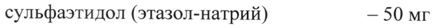

# Бензокаин + Облепихи крушиновидной плодов масло + Сульфаэтидол — ректально

- Препарат: Олестезин® (суппозитории ректальные;)
- АТХ: C05AD03
- Источник: ГРЛС, инструкция по медицинскому применению, РУ Р N001104/01, файл от 2023-12-15 (https://grls.rosminzdrav.ru/Grls_View_v2.aspx?routingGuid=cb2a441e-4719-4f1f-be0d-55d352d220b6)
- Распознано автоматически (OCR): 4 из 4 стр.
- Инструкция к другому РУ того же препарата: Р N001104/01 (национальное РУ, переоформленное по правилам ЕАЭС, решение от 17.11.2023). Текст может быть старше действующего
- Сомнительных строк после OCR: 1 (см. раздел «Проверка распознавания»)

## Общие сведения

„МИНИСТЕРСТВО ЗДРАВООХРАНЕНИЯ РОССИЙСКОЙ ФЕДЕРАЦИИ
ИНСТРУКЦИЯ ПО МЕДИЦИНСКОМУ ПРИМЕНЕНИЮ ЛЕКАРСТВЕННОГО ПРЕПАРАТА | |
| МИНЗДРАВ РОССИИ ОЛЕСТЕЗИН® | | | 7806 1 2 |
| СОГЛАСОВАНО | Внимательно прочитайте эту инструкцию перед “mem, как начать › применение этого препарата, так как она содержит важную для Вас информацию.
© Сохраняйте инструкцию, она может понадобиться вновь.
Если у Вас возникли вопросы, обратитесь к врачу.
Лекарственное средство, которым Вы лечитесь, предназначено лично Вам, и его не следует передавать другим лицам, поскольку оно может причинить им вред даже при наличии тех же симптомов, что иу Bac.
- Регистрационный номер:
Торговое наименование: Олестезин”® Международное непатентованное или группировочное наименование:
Бензокаин+Облепихи крушиновидной плодов масло-+Сульфаэтидол
, Лекарственная форма: суппозитории ректальные.
© Состав на один суппозиторий:
Действующие вещества:
облепихового масла концентрат — 330 мг (с содержанием суммы каротиноидов в пересчете на В-каротин 300 мг/%)
сульфаэтидол (этазол-натрий) — 50 мг бензокаин (анестезин) — 100 мг
Вспомогательные вещества: полисорбат 80 (твин 80) — 40 мг, макрогол 400
(полиэтиленоксид 400) — 60 мг, макрогол 1500 (полиэтиленоксид 1500) — 980 мг, макрогол 4000 (полиэтиленоксид 4000) — достаточное количество для получения суппозитория массой 2,35 г.
Описание: суппозитории от темно-оранжевого до красновато-коричневого цвета, торпедообразной формы.
Фармакотерапевтическая группа: геморроя средство лечения.
Код ATX: COSAX.
Фармакологические свойства Комбинированный препарат обладает местноанестезирующим, противовоспалительным и антисептическим действием; способствует регенерации тканей при трещинах и эрозиях заднего прохода; оказывает крово-
© останавливающее действие; снимает боль и уменьшает дискомфорт; ликвидирует воспаление и восстанавливает упругость капилляров, что обеспечивает уменьшение внутренних и наружных геморроидальных узлов.

## 4.1. Показания к применению

Геморрой, анальные трещины, анальный зуд.
Геморрой, анальные трещины, анальный зуд.
& Противопоказания Повышенная чувствительность к компонентам препарата, возраст до 18 лет.

## 4.6. Применение при беременности и в период грудного вскармливания

Применение препарата при беременности и в период грудного вскармливания возможно, если ожидаемая польза для матери превышает
- потенциальный риск для плода или ребенка. — Необходимо проконсультироваться с врачом.

## 4.2. Способ применения и дозы

Ректально после гигиенических процедур по 1 суппозиторию 2 раза в сутки.
Ректально после гигиенических процедур по 1 суппозиторию 2 раза в сутки.
При необходимости по 2-3 суппозитория 2 раза в сутки.
Курс лечения — 5-7 дней (не более 10 дней).
Если после лечения улучшения не наступает или симптомы усугубляются, или появляются новые симптомы, необходимо проконсультироваться с врачом. Применяйте препарат только согласно тем показаниям, тому способу применения и в тех дозах, которые указаны в инструкции.

## 4.8. Побочное действие

Общие расстройства и нарушения в месте введения

Местное раздражение, отек, сыпь в месте введения.

Нарушения со стороны иммунной системы

Аллергические реакции.

Нарушения со стороны желудочно-кишечного тракта

Диарея.

Нарушения со стороны крови и лимфатической системы
© Метгемоглобинемия.

Нарушения со стороны кожи и подкожных тканей

Синдром Стивенса-Джонсона, токсический эпидермальный некролиз.

Если у Вас отмечаются побочные эффекты, указанные в инструкции, или они

усугубляются, или Вы заметили любые другие побочные эффекты, не
> указанные в инструкции, сообщите об этом врачу.

## 4.9. Передозировка

Симптомы

В случае значительного превышения рекомендованных разовых и суточных

доз препарата может произойти передозировка бензокаина. Симптомы wr передозировки могут проявляться сонливостью, — беспокойством,

возбуждением, в тяжелых случаях — судорогами. Крайне редко большие дозы

бензокаина могут вызвать метгемоглобинемию, которая проявляется

дыхательными расстройствами и цианозом.

Лечение

Внутривенное введение метиленового синего является специфическим

средством в лечении этого состояния.

## 4.5. Взаимодействие с другими лекарственными средствами

Не описано.

## 4.7. Влияние на способность управлять транспортными средствами, механизмами

Данные о влиянии препарата на способность к выполнению потенциально опасных видов деятельности, требующих повышенной концентрации внимания и быстроты психомоторных реакций (управление транспортными средствами, работа с движущимися механизмами) отсутствуют.

## 6.5. Форма выпуска

Суппозитории ректальные.
Суппозитории ректальные.
© По 5 суппозиториев в контурную ячейковую упаковку. Две контурные упаковки вместе с инструкцией по применению помещают в пачку из картона.

## 6.4. Условия хранения

В защищенном от света месте при температуре не выше 15 °С.
В защищенном от света месте при температуре не выше 15 °С.
~ Хранить в недоступном для детей месте.

## 6.3. Срок годности

2 года. Не применять по истечении срока годности.
2 года. Не применять по истечении срока годности.
Условия отпуска Отпускают без рецепта.
© Владелец регистрационного удостоверения/ производитель/ организация, принимающая претензии потребителей:
АО «Алтайвитамины»
659325, Россия, Алтайский край, г. Бийск, ул. Заводская, д. 69.
тел.: (3854) 338-719, 326-948;
факс (3854) 326-943.
/ Генеральный директор Ode А.Ф.Балушкин АО «Алтайвитамины»
## Проверка распознавания

Страницы-сканы распознаны автоматически. В 1 строках с дозировками цифры могли распознаться с ошибкой — сверьте с вырезкой из оригинала:

- стр. 1: «сульфаэтидол (этазол-натрий) — 50 мг» — низкая уверенность: «50» (71)  
  
