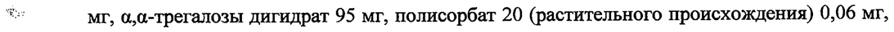
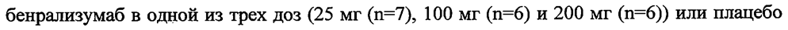
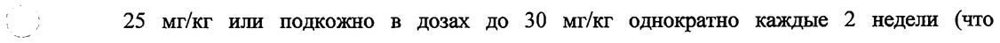

# Бенрализумаб — парентерально

- Препарат: ФАЗЕНРА (раствор для подкожного введения;)
- АТХ: R03DX10
- Источник: ГРЛС, инструкция по медицинскому применению, РУ ЛП-005492, файл от 2025-04-02 (https://grls.rosminzdrav.ru/Grls_View_v2.aspx?routingGuid=16014be9-403e-489a-b6e2-d3cf49bb8d00)
- Распознано автоматически (OCR): 22 из 22 стр.
- Инструкция к другому РУ того же препарата: ЛП-005492 (национальное РУ, переоформленное по правилам ЕАЭС, решение от 25.03.2025). Текст может быть старше действующего
- Сомнительных строк после OCR: 3 (см. раздел «Проверка распознавания»)

## Общие сведения

МИНЗДРАВ РОССИИ.
| nak 0821 МИНИСТЕРСТВО ЗДРАВООХРАНЕНИЯ ОССИЙСКОЙ ФЕДЕРАЦИИ
ИНСТРУКЦИЯ ПО МЕДИЦИНСКОМУ ПРИМЕНЕНИЮ ЛЕКАРСТВЕННОГО ПРЕПАРАТА
ФАЗЕНРА наименование лекарственного препарата
Регистрационный номер: JITI-005492 Торговое наименование: ФАЗЕНРА
Международное непатентованное наименование: бенрализумаб
| р Лекарственная форма: раствор для подкожного введения

## 2. Состав

| Один шприц/одна шприц-ручка содержит:
| Один шприц/одна шприц-ручка содержит:
Действующее вещество: бенрализумаб 30 мг
Вспомогательные вещества: Г.-гистидин 1,4 мг, Г.-гистидина гидрохлорида моногидрат 2,3 ee мг, 0.,0-Tperano3bl дигидрат 95 мг, полисорбат 20 (растительного происхождения) 0,06 мг,
| вода для инъекций приблизительно 910 мг. |
Описание От прозрачной до опалесцирующей, от бесцветной до желтого цвета жидкость.
oe | ~ Фармакотерапевтическая группа: другие лекарственные препараты системного действия, применяемые при обструктивных заболеваниях дыхательных путей |
Код ATX: RO3DX10 Фармакологические свойства

## 5.1. Фармакодинамика

Механизм действия Бенрализумаб — представляет собой антиэозинофильное гуманизированное, афукозилированное, моноклональное антитело (12С1/каппа). Бенрализумаб связывается с альфа-субъединицей рецептора к человеческому интерлейкину-5 (П.-5Ка), обладая высоким сродством (16 пМ) и специфичностью. Рецептор к IL-5 находится на поверхности
Механизм действия Бенрализумаб — представляет собой антиэозинофильное гуманизированное, афукозилированное, моноклональное антитело (12С1/каппа). Бенрализумаб связывается с альфа-субъединицей рецептора к человеческому интерлейкину-5 (П.-5Ка), обладая высоким сродством (16 пМ) и специфичностью. Рецептор к IL-5 находится на поверхности
| эозинофилов и базофилов. Отсутствие фукозы в Fe домене бенрализумаба облегчает
| процесс связывания (45,5 HM) с ЕсуКШ-рецепторами на поверхности иммунных эффекторных клеток, таких как натуральные киллеры, что приводит к апоптозу эозинофилов и базофилов посредством антителозависимой клеточноопосредованной цитотоксичности (АЗКЦ).
Эозинофильное воспаление является важным компонентом патогенеза бронхиальной астмы. В эозинофилах содержатся медиаторы воспаления (такие как эйкозаноиды, лейкотриены, цитокины) и белковые гранулы (такие как эозинофильный катионный белок, зозинофильная пероксидаза, эозинофильный нейротоксин и главный основной белок).
Бенрализумаб, посредством АЗКЦ, уменьшает эозинофильное воспаление.
Фармакодинамические свойства Фармакодинамический ответ (уменьшение количества эозинофилов в крови) после о подкожного введения препарата пациентам с бронхиальной астмой изучалось в 12недельном исследовании фазы П. Пациенты получали в виде подкожных инъекций бенрализумаб в одной из трех доз (25 мг (n=7), 100 мг (n=6) и 200 мг (п=6б)) или плацебо
(n=6) однократно каждые 4 недели (всего 3 дозы). Исходная медиана количества эозинофилов до начала лечения составляла 400, 200, 120 и 200 клеток/мкл для групп бенрализумаба 25 мг, 100 мг, 200 мг и плацебо, соответственно.
Снижение количества эозинофилов в крови после подкожного введения бенрализумаба было отмечено для всех доз и не наблюдалось в группе плацебо. Через 24 ч после введения препарата отмечалось полное или практически полное снижение медианы количества эозинофилов в крови (0, 0 и 5 клеток/мкл, соответственно). В группе плацебо медиана количества эозинофилов в крови не изменилась. Эффект в отношении количества о) эозинофилов сохранялся на протяжении терапии.
В клиническом исследовании фазы I изучалось влияние бенрализумаба на эозинофилы в слизистой оболочке дыхательных путей у пациентов с бронхиальной астмой, с
| содержанием эозинофилов в мокроте 2,5% и более. Пациенты получали бенрализумаб 100
1 мг или 200 мг подкожно однократно каждые четыре недели в течение 8 недель (общее количество пациентов в общей группе бенрализумаба п=9) или плацебо (п=5). По окончании 12-недельного периода лечения медиана снижения количества эозинофилов в слизистой оболочке дыхательных путей в общей группе бенрализумаба составила 96% по сравнению с 47% в группе плацебо (статистически значимое различие, р=0,039).
В клиническом исследовании фазы | лечение бенрализумабом также сопровождалось
| снижением уровня базофилов крови, и в исследованиях фазы Ги фазы I] — снижением сывороточной концентрации веществ, содержащихся в гранулах эозинофилов, таких как эозинофильный нейротоксин и эозинофильный катионный белок.
| | | . 3 В исследованиях SIROCCO и CALIMA после подкожного введения бенрализумаба в рекомендованной дозе медиана абсолютного количества эозинофилов в крови составила 0
| клеток/мкл, что соответствует медиане снижения на 100%. Это снижение было отмечено уже при первом измерении, после 4 недель терапии, и сохранялось на протяжении терапии.
Снижение количества эозинофилов отмечалось на протяжении 56 недель продленной фазы лечения (исследование ВОКА), что соответствовало результатам предшествовавших исследований.
Иммуногенность В целом, антитела к исследуемому препарату были обнаружены у 107 из 809 (13%)
пациентов, получавших препарат ФАЗЕНРА по рекомендованной схеме в течение 48 и 56 недель лечения в плацебо-контролируемых исследованиях 3 фазы. У большинства м й пациентов с наличием антител были выявлены нейтрализующие антитела. Наличие антител к бенрализумабу ассоциировалось с повышением клиренса бенрализумаба и повышенным уровнем эозинофилов в крови у пациентов с высокими титрами антител к препарату в сравнении с пациентами без антител. Данных о наличии связи между образованием антител к препарату и эффективностью и безопасностью препарата не получено.
На протяжении второго года лечения этих пациентов в плацебо-контролируемых исследованиях 3 фазы еще у 18 из 510 пациентов (4%) были выявлены антитела к
| бенрализумабу, появившиеся на фоне терапии. В целом, в предшествовавших исследованиях титры антител оставались стабильными или снижались в течение второго года лечения. Как и в проведенных ранее исследованиях, данных о наличии связи между
| образованием антител к препарату и эффективностью и безопасностью препарата не
О получено.
Представленные данные были получены у пациентов с наличием антител к бенрализумабу по результатам специфических методов определения. Наблюдаемая частота образования антител (в том числе, нейтрализующих) может зависеть от нескольких факторов, включая анализ чувствительности и специфичности, метод определения антител, хранение проб, время сбора проб, применение сопутствующих препаратов и основное заболевание. По этим причинам сравнение частоты случаев образования антител к бенрализумабу с таковой к другим препаратам в других исследованиях может давать недостоверные результаты.

## 5.2. Фармакокинетика

Фармакокинетика бенрализумаба у пациентов с бронхиальной астмой изменялась ‹ пропорционально дозе подкожно вводимого бенрализумаба (от 2 мг до 200 мг).
Фармакокинетика бенрализумаба у пациентов с бронхиальной астмой изменялась ‹ пропорционально дозе подкожно вводимого бенрализумаба (от 2 мг до 200 мг).
Всасывание После подкожного введения пациентам с бронхиальной астмой период полуабсорбции составлял 3,5 дня. На основании результатов популяционного анализа фармакокинетики
| расчетная абсолютная биодоступность составила приблизительно 59%, клинически значимые различия в биодоступности при введении в область живота, бедра или плеча не наблюдались.
Распределение На основании результатов популяционного анализа фармакокинетики центральный и периферический объем распределения бенрализумаба составил 3,1 ли 2,5 JO, соответственно, у пациента с массой тела 70 кг.
Метаболизм Бенрализумаб представляет собой гуманизированное моноклональное антитело класса
- 1201. Бенрализумаб расщепляется с участием протеолитических ферментов, которые широко распределены по всему организму человека и не локализованы только в печени.
Выведение Популяционный анализ фармакокинетики бенрализумаба продемонстрировал, что фармакокинетика препарата носит линейный характер, и его выведение из организма не
| зависит от связывания с каким-либо рецептором. Рассчитанный системный клиренс бенрализумаба составляет 0,29 л/день у пациента с массой тела 70 кг. После подкожного введения период полувыведения составляет приблизительно 15,5 дней.
| Фармакокинетика у особых групп пациентов
Пожилой возраст (> 65 лет)
Популяционный анализ фармакокинетики показал, что возраст пациента не влиял на
\ _ фармакокинетику бенрализумаба.
Пол, раса Популяционный анализ фармакокинетики показал, что пол и расовая принадлежность существенно не влияли на клиренс бенрализумаба.
Нарушение функции почек Клинических исследований для изучения влияния нарушения функции почек на фармакокинетические параметры бенрализумаба не проводилось. Популяционный анализ фармакокинетики показал, что клиренс бенрализумаба у пациентов с клиренсом креатинина от 30 до 80 мл/мин сопоставим с клиренсом бенрализумаба у пациентов с нормальной функцией почек. Данные о пациентах с клиренсом креатинина менее 30 мл/мин ограничены; тем не менее, бенрализумаб не выводится почками.
Нарушение функции печени Клинических исследований бенрализумаба у пациентов с нарушением функции печени не
| 5 проводилось. Метаболизм в печени не является основным способом выведения моноклональных антител класса IgG; изменение функции печени не должно сопровождаться изменением клиренса бенрализумаба. Согласно результатам популяционного анализа фармакокинетики, исходные параметры биомаркеров функции печени (АЛТ, АСТ и билирубин) не оказывают клинически значимого эффекта на клиренс бенрализумаба.

Детский возраст Популяционный анализ фармакокинетики показал, что фармакокинетика бенрализумаба у подростков в возрасте 12-17 лет соответствовала таковой у взрослых. Бенрализумаб не изучался у детей в возрасте 5-11 лет (см. раздел «Способ применения и дозы»).
Лекарственные взаимодействия

т Ожидается, что применение бенрализумаба не будет оказывать какого-либо влияния на фармакокинетику одновременно применяемых препаратов. Согласно результатам популяционного анализа, часто применяемые одновременно с бенрализумабом препараты у пациентов с бронхиальной астмой не оказывают никакого влияния на клиренс бенрализумаба.

## 4.1. Показания к применению

Тяжелая бронхиальная астма с эозинофильным фенотипом у взрослых пациентов в качестве дополнительной поддерживающей терапии.
Тяжелая бронхиальная астма с эозинофильным фенотипом у взрослых пациентов в качестве дополнительной поддерживающей терапии.

## 4.3. Противопоказания

: ® Повышенная чувствительность к бенрализумабу или вспомогательным веществам,

входящим в состав препарата.
® Детский возраст до 18 лет.

## 4.3. С осторожностью

беременность и период грудного вскармливания, пациенты с повышенным риском развития глистных инвазий.
беременность и период грудного вскармливания, пациенты с повышенным риском развития глистных инвазий.

## 4.6. Применение при беременности и в период грудного вскармливания

Беременность Данных о применении препарата у беременных в клинических исследованиях недостаточно для информирования о рисках, связанных с применением препарата.
Моноклональные антитела, такие как бенрализумаб, проникают через плацентарный барьер, и по мере прогрессирования беременности проницаемость плаценты для бенрализумаба увеличивается. Следовательно, потенциальное воздействие на плод наиболее вероятно во втором и третьем триместрах беременности.

| В исследовании влияния препарата на развитие плода в пренатальный и постнатальный

| периоды беременные яванские макаки получали бенрализумаб с 20 по 22 день гестации (в зависимости от срока определения беременности), на 35 день гестации, один раз в 14 дней в течение всего периода гестации и затем спустя 1 месяц после родов в дозах 10 мг/кг и 30

1 мг/кг внутривенно болюсно. Применение бенрализумаба не сопровождалось развитием | нежелательных реакций у матери, плода или новорожденного, а также нарушением постнатального развития.
Рекомендуется избегать применения препарата ФАЗЕНРА при беременности. Назначение препарата ФАЗЕНРА беременным женщинам возможно только в случае, если ожидаемая

В - р польза для матери превышает любые возможные риски для плода.

| Период грудного вскармливания |

| | Неизвестно, проникает ли бенрализумаб в молоко животных или грудное молоко человека,

поэтому нельзя исключить риск для ребенка, получающего грудное вскармливание.

| Следует оценить пользу грудного вскармливания для здоровья и развития новорожденного, пользу от терапии бенрализумабом для матери и принять решение либо о прекращении

грудного вскармливания, либо о приостановлении/прекращении терапии бенрализумабом.

| Фертильность Исследований по изучению влияния препарата на фертильность у человека не проводилось.
Влияние бенрализумаба на фертильность изучалось в исследовании с повторным введением препарата на протяжении 9 месяцев яванским макакам внутривенно в дозах до

| 7 р 25 мг/кг или подкожно в дозах до 30 мг/кг однократно каждые 2 недели (что

приблизительно в 409 и 275 раз выше максимальной рекомендованной дозы у человека на основании AUC, ив 396 и 193 раза выше максимальной рекомендованной дозы у человека на основании Cmax). Влияния бенрализумаба на репродуктивную функцию у самцов и самок отмечено не было.

## 4.2. Способ применения и дозы

Для подкожного введения. В соответствии с требованиями клинической практики рекомендуется проводить наблюдение за пациентами после инъекции биологических препаратов (см. раздел «Особые указания», Реакции гиперчувствительности). Препарат вводят в область бедра или живота. Если инъекцию препарата выполняет медицинский работник или лицо, осуществляющее уход за пациентами, он может быть введен в область плеча. Не следует вводить препарат в участки с болезненной и поврежденной кожей, в
Для подкожного введения. В соответствии с требованиями клинической практики рекомендуется проводить наблюдение за пациентами после инъекции биологических препаратов (см. раздел «Особые указания», Реакции гиперчувствительности). Препарат вводят в область бедра или живота. Если инъекцию препарата выполняет медицинский работник или лицо, осуществляющее уход за пациентами, он может быть введен в область плеча. Не следует вводить препарат в участки с болезненной и поврежденной кожей, в
| область гематомы, покраснения или уплотнения.
Препарат ФАЗЕНРА в шприце предназначен для применения медицинскими работниками.
Препарат ФАЗЕНРА в шприц-ручке предназначен для применения медицинскими работниками, пациентами и лицами, осуществляющими уход за пациентами. После обучения технике подкожной инъекции в соответствии с Руководством по использованию пприц-ручки препарата ФАЗЕНРА, пациенты и лица, осуществляющие уход 3a пациентами, могут вводить препарат ФАЗЕНРА. самостоятельно, если медицинский работник/врач считает это возможным. При этом терапию следует начинать под контролем медицинского работника/врача и в дальнейшем проводить наблюдение за пациентом.
Перед введением препарат ФАЗЕНРА в оригинальной упаковке необходимо оставить в помещении при комнатной температуре от 20 до 25 °С в течение 30 минут. Не следует
№ ; встряхивать препарат. Препарат ФАЗЕНРА не следует применять, если он был заморожен.
При необходимости, препарат может храниться при комнатной температуре от 20 до 25 °С в течение не более 14 дней, в течение которых он должен быть использован. По истечении этого срока извлеченный из холодильника препарат не может применяться и должен быть утилизирован. Не подвергайте препарат воздействию высоких температур.
Дополнительная информация и инструкции по подготовке и введению препарата
ФАЗЕНРА в шприце приводится далее по тексту в данном разделе. Дополнительная информация и инструкции по подготовке и проведению инъекции препарата ФАЗЕНРА в шприц-ручке приводится в Руководстве по использованию шприц-ручки препарата
ФАЗЕНРА, вложенному в картонную пачку для этой формы выпуска препарата.
= Дозы Рекомендуемая доза препарата ФАЗЕНРА составляет 30 мг. Препарат необходимо вводить один раз в 4 недели (первые 3 инъекции) и затем один раз в 8 недель. Если инъекция препарата пропущена в запланированное время, следует ее выполнить как можно быстрее;
двойная доза в связи с пропуском препарата не может быть назначена.
Применение у особых групп пациентов Дети
Безопасность и эффективность бенрализумаба у пациентов младше 18 лет не были установлены.
Пациенты пожилого возраста | Пациентам пожилого возраста коррекция дозы не требуется (см. раздел
«Фармакокинетика»).
| | | 8 Нарушение функции почек и печени
Пациентам с нарушением функции почек и печени коррекция дозы не требуется (см. раздел
«Фармакокинетика»).
Инструкция по использованию препарата ФАЗЕНРА в шприце с безопасной системой введения (для медицинских работников)
Фиксаторы Корпус — Этикетка с Защитный колпачок устройства шприца указанием срока NIA иглы защиты иглы 1 годности
=) erence cas Голова | === — = THA (fleet ЕЕ
Поршень Упор Смотровое Игла ДлЯ окно пальцев
В целях предотвращения преждевременной активации устройства защиты иглы не касайтесь фиксаторов устройства защиты иглы.

г 1 Возьмите шприц за корпус, не касаясь поршня, и извлеките из упаковки.
Проверьте этикетку с указанием срока годности. Перед введением препарата ФАЗЕНРА осмотрите его на наличие частиц и изменение цвета. Препарат ФАЗЕНРА должен быть от прозрачного до опалесцирующего, от бесцветного до желтого цвета и может содержать несколько прозрачных или от белого до почти белого цвета частиц. Не используйте препарат ФАЗЕНРА, если раствор мутный, имеет другой цвет или при наличии крупных частиц или инородных тел. В шприце может быть небольшой пузырёк воздуха; это нормально. Не пытайтесь удалить пузырёк перед введением препарата.
2 Не снимайте защитный колпачок для иглы до
| момента непосредственного взведения. Держите
| : ail шприц одной рукой и снимите колпачок, потянув за у < | у я Е него. В процессе снятия колпачка не держитесь за aS 5 | 4 iC поршень или головку поршня; в противном случае поршень может переместиться. Если шприц поврежден или нестерилен (например, упал на пол без колпачка), его необходимо утилизировать и использовать новый.
о 3 Аккуратно сформируйте кожную складку и введите
Ss иглу (например, в область плеча, бедра или живота).
а А } £ LP?
Seat,
1 Ур é $...
4 Введите весь препарат, нажимая на поршень до м упора, пока головка поршня не окажется целиком за
< .
OS < фиксаторами устройства защиты иглы. Это
Ks YOY необходимо для активации устройства защиты pot J 95 иглы.
| | 5 После введения препарата извлеките иглу из кожи,
| продолжая нажимать Ha поршень большим пальцем.
| “Se O° Прекратите оказывать давление на поршень для
| LD активации устройства защиты иглы. Не надевайте ey
| CH защитный колпачок для иглы на шприц.
6 Утилизируйте шприц в соответствии с локальными требованиями.
| | Побочное действие | 10 Профиль безопасности
В клинических исследованиях с участием пациентов с тяжелой бронхиальной астмой и эозинофильным фенотипом наиболее часто отмечаемыми побочными реакциями были ' |
| головная боль и фарингит.
Побочные реакции | В двух плацебо-контролируемых исследованиях фазы Ш продолжительностью от 48 до 56 недель лечения 1663 пациента с тяжелой неконтролируемой бронхиальной астмой получали бенрализумаб. В Таблице 1 представлены побочные реакции, отмеченные в двух плацебо-контролируемых исследованиях Ш фазы у пациентов, получавших бенрализумаб 30 мг однократно каждые 4 недели (первые 3 дозы), а затем каждые 8 недель. Частота возникновения побочных реакций представлена в следующей градации: очень часто (>
| a, 1/10), часто (> 1/100, < 1/10), нечасто (> 1/1000, < 1/100), редко (> 1/10000, < 1/1000), очень редко (< 1/10000), неуточненной частоты (частота не может быть определена на основании имеющихся данных). Внутри одной категории частоты реакции представлены в порядке убывания серьезности.
Таблица 1. Перечень побочных реакций бенрализумаба
_ | | Общие нарушения и Лихорадка часто | | нарушения в месте введения | Реакции в месте введения и Нарушения иммунной Реакции часто системы гиперчувствительности?
' Фарингит включал в себя следующие термины: «фарингит», «бактериальный фарингит», «вирусный фарингит», «стрептококковый фарингит».
?* Реакции гиперчувствительности включали в себя следующие термины:
| «крапивница», «папулёзная крапивница» и «кожная сыпь» (см. раздел «Особые указания»).
Описания отдельных побочных реакций Реакции в месте введения
В плацебо-контролируемых исследованиях реакции в месте введения (такие как боль, эритема, кожный зуд, папула) имели место у 2,2% пациентов, получавших бенрализумаб в рекомендованной дозе, и у 1,9% пациентов в группе плацебо.
| | | Безопасность при длительном применении

842 пациента с бронхиальной астмой из исследований SIROCCO, САМА и ZONDA

получали препарат ФАЗЕНРА в рекомендованной дозе в двойном слепом плацебо-

контролируемом исследовании продолжающейся терапии длительностью 56 недель и при

этом оставались в исследовании. Профиль отмеченных побочных эффектов в целом

соответствовал описанному выше профилю безопасности в исследованиях у пациентов с

бронхиальной астмой.

Постмаркетинговые данные

Как правило, достоверная оценка частоты побочных реакций не представляется возможной,

поскольку информацию получают в виде спонтанных сообщений от популяции
— ; неустановленного размера. Следовательно, такие побочные реакции являются реакциями

| неуточненной частоты (частота не может быть определена на основании имеющихся

данных). |

Со стороны иммунной системы: анафилаксия (определяемая групповыми терминами

предпочтительного употребления: «анафилактическая реакция», «ангионевротический

отек»).

## 4.9. Передозировка

В клинических исследованиях пациенты с эозинофилией получали препарат подкожно в

дозах до 200 мг, при этом каких-либо дозозависимых токсических реакций не наблюдалось.

Специфическое лечение передозировки бенрализумаба отсутствует. В случае
ВИ передозировки необходимо проводить поддерживающую терапию и вести наблюдение за

состоянием пациента.

## 4.5. Взаимодействие с другими лекарственными средствами

В рандомизированном двойном слепом исследовании в параллельных группах с участием

103 пациентов в возрасте 12-21 года с тяжелой бронхиальной астмой после вакцинации

против гриппа наблюдался сопоставимый гуморальный иммунный ответ (выработка.

антител) в группе бенрализумаба 30 мг и плацебо.

Ферменты семейства цитохрома Р450, эффлюксные насосы и механизмы связывания с

белками не вовлечены в клиренс бенрализумаба. Экспрессия IL-5Ra на гепатоцитах не была

установлена. Снижение количества эозинофилов не сопровождается системным

изменением уровня провоспалительных цитокинов.

## 4.4. Особые указания

Препарат ФАЗЕНРА не предназначен для лечения обострения бронхиальной астмы.
Препарат ФАЗЕНРА не предназначен для лечения обострения бронхиальной астмы.
Следует информировать пациентов о необходимости обратиться к врачу, если после начала терапии добиться контроля заболевания не удалось, или имеет место ухудшение течения заболевания.
После начала применения препарата ФАЗЕНРА не следует резко отменять пероральные глюкокортикостероиды. При необходимости, снижение дозы — пероральных глюкокортикостероидов следует производить поэтапно и под наблюдением врача.
Лечашему врачу следует периодически повторно оценивать необходимость продолжения терапии препаратом.
7 | р Реакции гиперчувствительности
2 После введения препарата ФАЗЕНРА отмечались реакции гиперчувствительности (такие как анафилаксия, ангионевротический отек, крапивница, папулезная крапивница, кожная сыпь). Эти реакции могут развиваться в течение нескольких часов после введения препарата ФАЗЕНРА, однако, в некоторых случаях реакции развиваются позже (спустя несколько дней). При симптомах реакции гиперчувствительности пациенту следует прекратить применение препарата ФАЗЕНРА.
Глистные инвазии (гельминтозы)
Эозинофилы могут принимать непосредственное участие в развитии иммунологической реакции организма в ответ на глистную инвазию. Пациенты с гельминтозами были
ВИ исключены из клинических исследований. Вероятность изменения реакции организма на гельминтоз при введении препарата ФАЗЕНРА не установлена.
Перед началом применения препарата ФАЗЕНРА необходимо провести лечение ранее выявленного гельминтоза. Если глистная инвазия развилась на фоне применения препарата
ФАЗЕНРА, и пациент не отвечает на применение противогельминтных средств, необходимо прекратить лечение препаратом ФАЗЕНРА до разрешения гельминтоза.

## 4.7. Влияние на способность управлять транспортными средствами, механизмами

Препарат ФАЗЕНРА не влияет или оказывает незначительное влияние на способность к управлению транспортными средствами и механизмами.

## 6.5. Форма выпуска

_Раствор для подкожного введения, 30 мг/мл.
_Раствор для подкожного введения, 30 мг/мл.

Шприц:
По 1,0 мл в стеклянный шприц (тип Г Евр. Ф.) с иглой, защитным колпачком для иглы, безопасной системой введения и вытянутым упором для пальцев. По 1 ширицу в запечатанной контурной ячейковой упаковке. По 1 контурной ячейковой упаковке с инструкцией по применению препарата в картонной пачке с контролем первого вскрытия.
Шприц-ручка:
По 1,0 мл в стеклянный ишриц (тип I Евр. Ф.) с иглой и защитным колпачком для иглы, встроенный в шприц-ручку, состоящую из блока привода и блока для итрица. По 1 шприцручке с инструкцией по применению препарата и руководством по использованию шприцручки в картонной пачке с контролем первого вскрытия.

В | р Условия хранения

При температуре от 2 до 8 °С, в оригинальной упаковке, в защищенном от света месте. Не замораживать. |
Хранить в местах, недоступных для детей.

## 6.3. Срок годности

3 года.
3 года.
Не применять по истечении срока годности, указанного на упаковке.
Условия отпуска Отпускают по рецепту.
Наименование и юридический адрес держателя (владельца) регистрационного удостоверения
АстраЗенека АБ, SE-151 85 Содерталье, Швеция
AstraZeneca AB, SE-151 85 Sodertalje, Sweden
Производитель, фасовщик (первичная упаковка)
Каталент Индиана, ЛЛС, США 1300 Саут Паттерсон Драйв, Блумингтон, Индиана 47403, США
Catalent Indiana, LLC, USA 1300 South Patterson Drive, Bloomington, IN 47403, USA
Упаковщик (вторичная (потребительская) упаковка) |
Каталент Индиана, ЛЛС, США (шприц)
1300 Саут Паттерсон Драйв, Блумингтон, Индиана 47403, США
Catalent Indiana, LLC, USA . , | 1300 South Patterson Drive, Bloomington, IN 47403, USA
Амилин Огайо ЭлЭлСи, США (шириц-ручка: сборка шприц-ручки и вторичная упаковка)
8814 Трейд Порт Драйв, Уэст Честер, Огайо 45071, США |
Amylin Ohio LLC, USA 8814 Trade Port Drive, West Chester, Ohio 45071, USA
Выпускающий контроль качества | - АстраЗенека Фармасьютикалс ЛП 7 633 Ресерч Корт, Фредерик, Мэриленд (MD) 21703, США
AstraZeneca Pharmaceuticals LP 633 Research Court, Frederick, Maryland (MD) 21703, USA
Амилин Огайо ЭлЭлСи, США (шириу-ручка)
8814 Трейд Порт Драйв, Уэст Честер, Огайо 45071, США
Amylin Ohio LLC, USA 8814 Trade Port Drive, West Chester, Ohio 45071, USA
Наименование, адрес организации, уполномоченной держателем или владельцем 7 3 регистрационного удостоверения лекарственного препарата для медицинского применения на принятие претензий от потребителя:
Представительство АстраЗенека ЮК Лимитед, Великобритания, в г. Москве и ООО Астра3Зенека Фармасьютикалз 123100, г. Москва, 1-й Красногвардейский проезд, д. 21, стр. 1, этаж 30, комнаты 13 и 14 тел. +7495 7995699 | факс +7495 7995698 | |
© AstraZeneca 2018-2020 | | Руководство по использованию шприц-ручки препарата
ФАЗЕНРА, раствор для подкожного введения, 30 мг
До начала использования шприц-ручки препарата ФАЗЕНРА медицинский работник
| должен обучить Вас или лицо, осуществляющее за Вами уход, ее правильному
| использованию.
Прочитайте данное Руководство до начала использования шприц-ручки и всякий раз при применении препарата из новой пачки, так как информация может обновляться.
Представленная в Руководстве информация не заменяет беседу с медицинским работником/лечащим врачом о Вашем заболевании и проводимом лечении.
При возникновении вопросов у Вас или у лица, осуществляющего за Вами уход, следует a обратиться к медицинскому работнику/лечащему врачу.
| _ | Важная информация Препарат ФАЗЕНРА следует хранить в холодильнике при температуре от 2 до 8 °С в оригинальной упаковке до момента использования. Препарат ФАЗЕНРА может храниться при комнатной температуре от 20 до 25 °С в течение не более 14 дней. После
| извлечения из холодильника препарат ФАЗЕНРА должен быть использован в течение 14 дней, в противном случае он должен быть утилизирован.
.
Не используйте шприц-ручку препарата Не следует:
ФАЗЕНРА, если: е трясти шприц-ручку — препарата a e препарат был заморожен ФАЗЕНРА 7 e шприц-ручку уронили, или она ® использовать шприц-ручку препарата
| повреждена ФАЗЕНРА повторно или для ® контроль первого вскрытия Ha нескольких пациентов
| картонной пачке нарушен e срок годности препарата истек
В перечисленных выше случаях следует утилизировать шприц-ручку препарата ФАЗЕНРА с использованием контейнера, устойчивого к прокалыванию, и использовать другую
| шприц-ручку препарата ФАЗЕНРА.
Каждая шприц-ручка содержит 1 дозу препарата ФАЗЕНРА и предназначена для однократного применения.
Храните шприц-ручку препарата ФАЗЕНРА в недоступном для детей месте.
| | Шприц-ручка препарата ФАЗЕНРА Не снимайте колпачок птриц-ручки ранее, чем дойдете до Шага 6 этого Руководства и будете готовы сделать инъекцию препарата ФАЗЕНРА. |
До использования ` После использования | Смотровое окно
К р | i= | = ИИ ne Колпачок .
Раствор Этикетка с . Устройство Поршень указанием защиты зеленого срока ИГЛЫ цвета
. 1 годности Шах 1 — подготовьте необходимые материалы e 1 шприц-ручка препарата ФАЗЕНРА (достаньте из холодильника)
e 1 спиртовая салфетка e 1 ватный шарик или марлевый тампон e | контейнер, устойчивый к прокалыванию
(См. Шаг 10 — безопасно утилизируйте шприц-ручку препарата ФАЗЕНРА)
Дании | _ , ани —— с, 1 Unpun-pyaka Спиртовая Ватный шарик или Контейнер, препарата салфетка марлевый тампон устойчивый к
| ФАЗЕНРА прокалыванию | | Шаг 2 — подготовьте к использованию шприц-ручку препарата -
| ФАЗЕНРА Проверьте срок годности препарата. Не используйте препарат с 30
M истекшим сроком годности.
Перед введением препарат ФАЗЕНРА необходимо оставить при
| 17 | комнатной температуре от 20 до 25 °С в течение 30 минут. |
Не следует подогревать препарат ФАЗЕНРА другими способами.
Например, не разогревайте его в микроволновой печи или горячей воде, не кладите рядом с источниками тепла.
После извлечения из холодильника препарат ФАЗЕНРА должен быть использован в течение 14 дней.
Не снимайте колпачок штриц-ручки ранее, чем дойдете до Шага 6 этого Руководства.
Шаг 3 — проверьте раствор Через смотровое окно осмотрите раствор, a as находящийся внутри шприц-ручки препарата
_ Е =] о ФАЗЕНРА. Раствор должен быть от прозрачного до хз опалесцирующего, от бесцветного до желтого цвета и 2 может содержать несколько прозрачных или от белого до почти белого цвета частиц.
Препарат нельзя использовать, если раствор мутный, имеет другой цвет или при наличии крупных частиц или инородных тел.
Допускается наличие в растворе небольшого пузырька воздуха. Это нормально, дополнительных действий предпринимать не нужно.
— Шаг 4 - выберите место инъекции | — Е `` И Рекомендуемое место введения препарата — передняя 3 — a | . . г Место для поверхность бедра. Также препарат можно вводить в .
ОВО _. ЕН введения НА me | только нижнюю часть области живота.
| о - \ медицинск р Ра работником Не вводите препарат:
| В a или лицом, | e — вобласти диаметром 5 см непосредственно вокруг
N Го ns] ухаживающ ИИ им за нунка iff |\-/ | пациентами | e вучастки с болезненной или поврежденной кожей, в область гематомы, шелушения или уплотнения
¢ врубцы и в поврежденную кожу | ® через одежду
Медицинский работник или лицо, осуществляющее уход за пациентами, могут вводить препарат в область плеча, бедра и живота.
Если Вы вводите препарат самостоятельно, не вводите препарат в область плеча.
Для каждой последующей инъекции следует выбирать новое место не ближе 3 см от места предшествующей инъекции.
- Шаг 5 — обработайте место инъекции
_ | Тщательно вымойте руки с мылом. Круговыми движениями yo р . обработайте место инъекции спиртовой салфеткой. Дайте
ГИ... , ‚.’ | коже высохнуть 7\ {. _ He касайтесь обработанной области до момента инъекции.
Не сушите феном обработанную область и не дуйте на нее.
lar 6 — снимите | колпачок Ne Держите шприц-ручку препарата ФАЗЕНРА одной рукой.
Другой рукой аккуратно снимите колпачок.
ESS Z| Отложите колпачок в сторону, чтобы потом выбросить.
НЕЕ Ш = № Теперь видно устройство защиты иглы зеленого цвета. Оно
| VI предназначено для защиты иглы OT касания.
< Не трогайте устройство защиты иглы или иглу.
Не пытайтесь надеть колпачок обратно на шприц-ручку препарата ФАЗЕНРА. Это может вызвать преждевременное
| высвобождение препарата или повреждение иглы.
Сразу после снятия колпачка выполните остальные шаги, описанные в Руководстве.
Шаг 7 — Введите препарат ФАЗЕНРА Следуйте инструкциям медицинского работника касательно введения препарата.
Можно аккуратно сформировать кожную складку или выполнить’ инъекцию, не формируя кожной складки.
Введите препарат ФАЗЕНРА, последовательно выполняя шаги, изображенные на рисунках а, b, си 4.
Удерживайте шприц-ручку препарата ФАЗЕНРА на месте в процессе введения препарата.
В Не меняйте положение шприца-ручки ФАЗЕНРА после начала выполнения инъекции
:
. э GS ‘tf Ne ix CONE WS BT _ Положение шприц-ручки препарата ФАЗЕНРА в месте инъекции
Расположите устройство защиты иглы под прямым углом (90 °) к поверхности кожи.
Убедитесь, что Вы видите смотровое окно.
~ < b _ С № а © в у ` 4 an ee в Ga) Nw J 4 q - > ? :
© № А NL @ Ъ yo “ns | . ВАЙ
9 Мих © мох :. р и res Ч jen = №
Ее SS Se oe и Плотно прижмите. Плотно прижимая, Поднимите шприц-ручку
Вы услышите щелчок. удерживайте в течение 15 препарата ФАЗЕНРА.
Щелчок означает, что секунд. При этом устройство введение препарата Вы услышите второй защиты иглы выйдет и началось. В смотровом окне щелчок. Второй щелчок займет место вокруг иглы.
будет видно продвижение означает, что введение

| поршня зеленого цвета вниз препарата завершено. При по мере введения этом смотровое OKHO препарата. занимает поршень зеленого цвета.
Шаг 8 — Проверьте смотровое окно Проверьте смотровое окно, чтобы убедиться, что раствор
| был введен полностью.
(нити)
_ | № Если поршень зеленого цвета не занимает смотровое a © окно полностью, возможно, Вы He получили полную дозу препарата. В таком случае, а также при возникновении других вопросов следует обратиться к лечащему врачу.
инъекции ааа KS инъекции Шаг 9 — Проверьте место инъекции
- В месте инъекции может быть небольшое количество и
Looe, | KpOBH или жидкости. Это нормально.
\ _. и. Слегка прижмите ватный тампон или марлевую салфетку
СИ. у a ИА 4 к месту инъекции, пока кровотечение не прекратится.
{oe He растирайте место инъекции.
\^ У При необходимости, можно наложить небольшую повязку на место инъекции.
Шаг 10 — безопасно утилизируйте шприц-ручку препарата ФАЗЕНРА
| | di ES oc |e Каждая ишриц-ручка препарата ФАЗЕНРА содержит одну дозу препарата и не предназначена для
| повторного использования.
a e Сразу после использования утилизируйте шприц-
(|, ручку препарата @A3EHPA в контейнер,
SD 4 устойчивый к прокалыванию.
Не утилизируйте шприц-ручку препарата ФАЗЕНРА вместе с бытовым мусором.
Колпачок и остальные расходные материалы могут быть утилизированы вместе с бытовым мусором.
о ‚о Инструкция по утилизации Утилизируйте наполненный контейнер, следуя инструкциям фармацевта или медицинского работника. |
Не утилизируйте устойчивый к прокалыванию контейнер вместе с бытовым мусором.
Устойчивый к прокалыванию контейнер не подлежит вторичной переработке.
ВЕСТА lr»
Руководитель группы по работе с инструкция 3) aid scnexs * -\ и клинической частью регуляторного досье | inf + i ck я ё ‘ Репина И.Б.
fo & LOKy yeni O& < . / . | ni — | | | И
| 1 МИНЗДРАВ РОССИИ >
7 А чип:
OOS GE" 100821 | . . | и дюн a4 : . : 5 = Ее
| ” COP MACOBAHO Sa PEELE ' © ЕАК | ESSES, S
| | у ФЕ | | | р ог S , | | | | i HS gy | | | . 3 aS 23 р
| | | > 5 Е я g о '.
: : . о BESS ;
з НЕЕ:
сом: © my , =A 88 = | a oe. Rig A x о | | +5 Эн": Sloe = |
| HP = Ses. #5 Аз 5 g | ols ВЕНЕ гай Е:
SoM В sacle 2 | < У AS SLES SSP о Е сиу I м №
ОРЛЕ Иа). в | “ee | | | | | | | . | р | |
## Проверка распознавания

Страницы-сканы распознаны автоматически. В 3 строках с дозировками цифры могли распознаться с ошибкой — сверьте с вырезкой из оригинала:

- стр. 1: «ee мг, 0.,0-Tperano3bl дигидрат 95 мг, полисорбат 20 (растительного происхождения) 0,06 мг,» — низкая уверенность: «0.,0-Tperano3bl» (0)  
  
- стр. 2: «бенрализумаб в одной из трех доз (25 мг (n=7), 100 мг (n=6) и 200 мг (п=6б)) или плацебо» — низкая уверенность: «(п=6б))» (64)  
  
- стр. 6: «| 7 р 25 мг/кг или подкожно в дозах до 30 мг/кг однократно каждые 2 недели (что» — низкая уверенность: «7» (62)  
  
