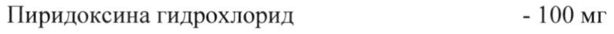
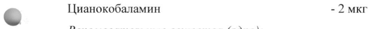
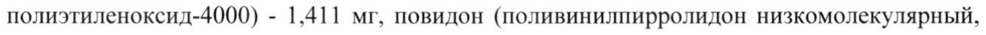
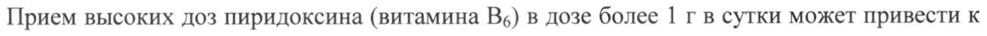

# Бенфотиамин + Пиридоксин + Цианкобаламин — внутрь

- Препарат: Комбилипен® табс (таблетки, покрытые пленочной оболочкой;)
- АТХ: A11AB
- Источник: ГРЛС, инструкция по медицинскому применению, РУ ЛС-002530, файл от 2024-06-18 (https://grls.rosminzdrav.ru/Grls_View_v2.aspx?routingGuid=9ffd8af1-d610-4bd6-8b4b-0df3ece3a13b)
- Распознано автоматически (OCR): 4 из 4 стр.
- Инструкция к другому РУ того же препарата: ЛС-002530 (национальное РУ, переоформленное по правилам ЕАЭС, решение от 04.06.2024). Текст может быть старше действующего
- Сомнительных строк после OCR: 4 (см. раздел «Проверка распознавания»)
- Проверено вручную строк: 1

## Общие сведения

| МИНЗДРАВ РОССИИ | MC-004530- 261210 МИНИСТЕРСТВО ЗДРАВООХРАНЕНИЯ госсийской nT ha |
ИНСТРУКЦИЯ ПО МЕДИЦИНСКОМУ ПРИМЕНЕНИЮ ЛЕКАРСТВЕННОГО ПРЕПАРАТА
Комбилипен” табс Регистрационный номер: ЛС-002530
Торговое наименование: Комбилипен” табс Международное непатентованное или группировочное наименование:
Бенфотиамин+Пиридоксин+Цианокобаламин © Лекарственная форма: таблетки, покрытые пленочной оболочкой
Состав на одну таблетку.
Действующие вещества:
Бенфотиамин - 100 мг Пиридоксина гидрохлорид - 100 мг
© Цианокобаламин -2 мкг | Вспомогательные вещества (ядро):
Кармеллоза натрия - 4,533 мг, повидон (поливинилпирролидон, повидон K-30) - 16,233 мг, целлюлоза микрокристаллическая - 12,673 мг, тальк - 4,580 мг, кальция стеарат - 4,587 мг, полисорбат 80 (твин 80) - 0,660 мг, сахароза (сахар белый) - 206,732 мг.
Вспомогательные вещества (оболочка):
© Гипромеллоза (гидроксипропилметилцеллюлоза) - 3,512 мг, макрогол (макрогол-4000, полиэтиленоксид-4000) - 1,411 мг, повидон (поливинилпирролидон низкомолекулярный, повидон К-17) - 3,713 мг, титана диоксид - 3,511 мг, тальк - 1,353 мг.
Описание: круглые двояковыпуклые таблетки, покрытые пленочной оболочкой белого или почти белого цвета. На поперечном разрезе ядро почти белого цвета.
Фармакотерапевтическая группа: поливитаминное средство
Код АТХ: АПАВ Фармакологические свойства
Комбинированный поливитаминный комплекс. Действие препарата определяется свойствами витаминов, входящих в его состав.
Бенфотиамин - жирорастворимая форма тиамина (витамин В). Участвует в проведении нервного импульса.
Пиридоксина гидрохлорид (витамин Be) - участвует в обмене белков, углеводов и жиров, необходим для нормального кроветворения, функционирования центральной и периферической нервной системы. Обеспечивает синаптическую передачу, процессы торможения в центральной нервной системе, участвует в транспорте сфингозина, входящего в состав оболочки нерва, участвует в синтезе катехоламинов.
Цианокобаламин (витамин В12) - участвует в синтезе нуклеотидов, является важным фактором нормального роста, кроветворения и развития эпителиальных клеток; необходим для метаболизма фолиевой кислоты и синтеза миелина.

## 4.1. Показания к применению

Применяется в комплексной терапии следующих неврологических заболеваний:
Применяется в комплексной терапии следующих неврологических заболеваний:
- невралгия тройничного нерва;

© - неврит лицевого нерва;
- болевой синдром, вызванный заболеваниями позвоночника (межреберная невралгия, люмбоишиалгия, поясничный синдром, шейный синдром, шейно-плечевой синдром, корешковый синдром, вызванный дегенеративными изменениями позвоночника);
- полинейропатия различной этиологии (диабетическая, алкогольная).

© Противопоказания Повышенная чувствительность к компонентам препарата, тяжелые и острые формы декомпенсированной сердечной недостаточности, детский возраст.

## 4.3. С осторожностью

При применении пиридоксина (Bes) в дозе 100 мг в сутки на протяжении более 6 месяцев возможно развитие нейропатии.
При применении пиридоксина (Bes) в дозе 100 мг в сутки на протяжении более 6 месяцев возможно развитие нейропатии.

© Применение при беременности и в период грудного вскармливания
Применение препарата Комбилинен® табс при беременности и в период грудного вскармливания не рекомендовано.

## 4.2. Способ применения и дозы

Таблетки следует принимать после еды, не разжевывая и запивая небольшим количеством жидкости. Назначают Комбилипен” табс по 1 таблетке 1 - 3 раза в сутки.
Таблетки следует принимать после еды, не разжевывая и запивая небольшим количеством жидкости. Назначают Комбилипен” табс по 1 таблетке 1 - 3 раза в сутки.
Не рекомендовано лечение высокими дозами препарата (3 таблетки в сутки) в течение более 4 недель. После 4 недель лечения врач принимает решение о необходимости продолжения приема препарата в высокой дозе и рассматривает возможность снижения дозировки до 1 таблетки в сутки. Продолжительность курса лечения - по рекомендации врача.

## 4.8. Побочное действие

По данным Всемирной организации здравоохранения (ВОЗ) нежелательные эффекты классифицированы в соответствии с их частотой развития следующим образом: очень ча-
По данным Всемирной организации здравоохранения (ВОЗ) нежелательные эффекты классифицированы в соответствии с их частотой развития следующим образом: очень ча-

р.
сто (21/10), часто (>1/100, <1/10), нечасто (>1/1000, <1/100), редко (>1/10000, <1/1000) и очень редко (<1/10000); частота неизвестна (частоту возникновения явлений нельзя определить на основании имеющихся данных).
Со стороны желудочно-кишечного тракта Очень редко: тошнота.
Со стороны иммунной системы Очень редко: реакции гиперчувствительности (зуд, крапивница, отек Квинке).
Со стороны кожи и подкожных тканей Частота неизвестна: повышенное потоотделение.
Со стороны сердечно-сосудистой системы Частота неизвестна: тахикардия.
© Если указанные в инструкции побочные эффекты, усугубляются, или Вы заметили любые другие побочные эффекты не указанные в инструкции, сообщите об этом врачу.

## 4.9. Передозировка

Прием высоких доз пиридоксина (витамина Be) в дозе более 1 г в сутки может привести к
Прием высоких доз пиридоксина (витамина Be) в дозе более 1 г в сутки может привести к
© кратковременному появлению нейротоксических эффектов.
Учитывая широкий терапевтический диапазон, передозировка бенфотиамина при приеме внутрь является маловероятной.
Первая помощь: промывание желудка, прием активированного угля, назначение симптоматической терапии.

## 4.5. Взаимодействие с другими лекарственными средствами

© Леводопа уменьшает эффект терапевтических доз витамина Bs. Витамин В1› несовместим с солями тяжелых металлов. Этанол резко снижает всасывание тиамина. Во время приема препарата не рекомендуется прием поливитаминных комплексов, включающих в состав витамины группы В.

## 4.4. Особые указания

Препарат содержит 100 мг витамина Be, в этой связи при применении на протяжении Ooлее 6 месяцев возможно развитие сенсорной периферической нейропатии. При длительной терапии рекомендуется контролировать состояние пациента. При появлении признаков периферической сенсорной нейропатии необходимо скорректировать дозу и, при необходимости, прекратить прием препарата. Прием цианокобаламина может маскировать симптомы дефицита фолиевой кислоты.
Препарат содержит 100 мг витамина Be, в этой связи при применении на протяжении Ooлее 6 месяцев возможно развитие сенсорной периферической нейропатии. При длительной терапии рекомендуется контролировать состояние пациента. При появлении признаков периферической сенсорной нейропатии необходимо скорректировать дозу и, при необходимости, прекратить прием препарата. Прием цианокобаламина может маскировать симптомы дефицита фолиевой кислоты.

## 4.7. Влияние на способность управлять транспортными средствами, механизмами

Информация о предостережении относительно применения препарата Комбилипен” табс водителям транспортных средств и лицам, работающими с потенциально опасными механизмами, отсутствует.

## 6.5. Форма выпуска

Таблетки, покрытые пленочной оболочкой.
Таблетки, покрытые пленочной оболочкой.
По 15 таблеток в контурную ячейковую упаковку из пленки поливинилхлоридной и фольги алюминиевой.
По 1, 2, 3 или 4 контурные ячейковые упаковки вместе с инструкцией по применению помещают в пачку из картона.

## 6.4. Условия хранения

© При температуре He выше 25 °С.
© При температуре He выше 25 °С.
Хранить в недоступном для детей месте.

## 6.3. Срок годности

2 года.
2 года.
Не применять по истечении срока годности, указанного на упаковке.
= Условия отпуска Отпускают по рецепту.
Производитель/организация, принимающая претензии потребителей
ОАО «Фармстандарт-УфаВИТА», Россия, 450077, Республика Башкортостан, г. Уфа, ул. Худайбердина, д. 28, тел./факс: (347) 272 92 85,
© www.pharmstd.ru Ve SEEN a gg Представитель ( VA, it \ у. this я \:
ОАО «Фармстандарт-УфаВИТА» x с Ас, ; Е.В. Толстова
\ \ Е: г a . /S3E4 SS Serta yw
## Проверка распознавания

Страницы-сканы распознаны автоматически. В 4 строках с дозировками цифры могли распознаться с ошибкой — сверьте с вырезкой из оригинала:

- стр. 1: «Пиридоксина гидрохлорид - 100 мг» — низкая уверенность: «100» (50)  
  
- стр. 1: «© Цианокобаламин -2 мкг» — повторное чтение: «фо ме о том»  
  
- стр. 1: «полиэтиленоксид-4000) - 1,411 мг, повидон (поливинилпирролидон низкомолекулярный,» — повторное чтение: «полиэтиленоксид-4000) - 1,41] мг, повидон (поливинилпирролидон низкомолекулярный,»  
  
- стр. 3: «Прием высоких доз пиридоксина (витамина Be) в дозе более 1 г в сутки может привести к» — низкая уверенность: «1» (79)  
  
