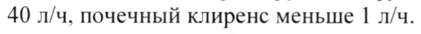

# Бенциклан — внутрь

- Препарат: Галидор® (таблетки)
- АТХ: C04AX11
- Источник: ОХЛП, Единый реестр ЛС ЕАЭС, запись 5f22a989fb44f12d65d91df2, документ от 2023-11-06
- Распознано автоматически (OCR): 7 из 7 стр.
- Сомнительных строк после OCR: 1 (см. раздел «Проверка распознавания»)
- Проверено вручную строк: 1

## Общие сведения

ЛП-№(000118)-(РГ-ВИ)-180121 ОБЩАЯ ХАРАКТЕРИСТИКА ЛЕКАРСТВЕННОГО ПРЕПАРАТА

## 1. Наименование лекарственного препарата

Галидор, 100 мг, таблетки

## 2. Качественный и количественный состав

Действующее вещество: бенциклан Каждая таблетка содержит 100 мг бенциклана фумарата.
Полный перечень вспомогательных веществ приведен в разделе 6.1.

## 3. Лекарственная форма

Таблетки. | Белые или серовато-белые, плоские круглые таблетки с фаской, с гравировкой
«HALIDOR» на одной стороне, со слабым характерным запахом. =

## 4. Клинические данные

4.1. — Показания к применению Сосудистые заболевания
Заболевания периферических сосудов: болезнь Рейно, другие заболевания с акроцианозом и спазмом сосудов, а также хронические облитерирующие заболевания
© артерий.
Заболевания мозговых сосудов: в комплексной терапии острой и хронической церебральной ишемии.
Устранение спазма внутренних органов Желудочно-кишечные заболевания: гастроэнтериты различной этиологии (особенно инфекционные), инфекционные и воспалительные колиты, функциональные заболевания толстого кишечника, тенезмы, послеоперационный метеоризм, холецистит, желчнокаменная болезнь, состояние после холецистэктомии, нарушения моторики при дискинезии сфинктера Одди, язва желудка или двенадцатиперстной кишки - в сочетании с другими лекарственными препаратами.
Урологические синдромы: спазмы и тенезмы мочевого пузыря, сопутствующая терапия мочекаменной болезни (в сочетании с анальгетиками при почечной колике).

## 4.2. Режим дозирования и способ применения

Режим озирования и ес ое ~~ oes BS FO }

ь | ЭКСПЕРТНЫЙ ОТЧЕ | 4 |

-„ ЩЕИСТВИТЕЛЕН ДЛЯ ДАННОЙ! & 1

7 | ВЕРСИИ ДОКУМЕНТА | &

2000000001 ” ' аа ЛП-№(000118)-(РГ-КО)-180121
Сосудистые заболевания По 1 таблетке 3 раза в день на протяжении 2 - 3 месяцев.
Максимальная суточная доза 400 мг.
Интервал между курсами лечения должен составлять 2-3 месяца.
Устранение спазма внутренних органов 1-2 таблетки однократно, не более 4 таблеток в сутки. Для поддерживающей терапии: по 1] таблетке 3 раза в день в течение 3 - 4 недель. затем по | таблетке 2 раза в день.
Продолжительность лечения определяется индивидуально по исчезновению симптомов заболевания и, как правило, не должен превышать 1-2 месяца.
Дети Безопасность и эффективность препарата Галидор у детей в возрасте от 0 до 18 лет на данный момент не установлены.
Способ применения Таблетки для приема внутрь.

## 4.3. Противопоказания

-
- _ Гиперчувствительность к бенциклану или к любому из вспомогательных веществ, перечисленных в разделе 6.1.
- _ Тяжелая дыхательная, почечная или печеночная недостаточность.
- Декомпенсированная сердечная недостаточность, острый инфаркт миокарда, атриовентикулярная блокада. |
- _ Пароксизмальная суправентрикулярная или желудочковая тахикардия. mt
- _ Эпилепсия или другие формы спазмофилии.
- _ Недавно перенесенный гемморрагический инсульт.
- _ Черепно-мозговая травма (за последние 12 месяцев).
- _ Беременность и кормление грудью (см. раздел 4.6). ,
- _ Детский возраст до 18 лет (ввиду отсутствия клинический данных).

## 4.4. Особые указания и меры предосторожности при применении

При длительной терапии бенцикланом рекомендуется регулярный контроль реологических свойств крови (примерно один раз в 2 месяца).
© При одновременном применении с препаратами, вызывающими гипокалемию, сердечными гликозидами, препаратами, оказывающими угнетающее влияние на миокард, суточная доза препарата Галидор не должна превышать 150-200 мг.

## 4.5. Взаимодействие с другими лекарственными препаратами и другие виды взаимодействия

Следует соблюдать осторожность при комбинации со следующими средствами:
— анестетиками и седативными - их эффекты могут усиливаться;
— лекарственными средствами для общей анестезии — усиление их действия;
— симпатомиметиками - из-за риска предсердных и желудочковых тахиаритмий;
— средствами, снижающими уровень калия крови и хинидином - из-за возможной суммации проаритмогенных эффектов;
— препаратами наперстянки - повышается риск аритмии при передозировке наперстянки;
ЛП-№(000118)-(РГ-ВО)-180121 — бета-адреноблокаторами - из-за противоположности хронотропных эффектов
(отрицательный у бета-адреноблокаторов и положительный у бенциклана) может возникнуть необходимость подбора дозировки бета-блокатора;
— блокаторами кальциевых каналов и другими антигипертензивными препаратами - из-за возможности усиления их эффекта;
— лекарственными средствами, вызывающих побочные эффекты в виде спазмофилии - из-за возможности суммации этих эффектов;
— ацетилсалициловая кислота - из-за усиления торможения агрегации тромбоцитов.

## 4.6. Фертильность, беременность и лактация

Беременность Данные доклинических исследований не выявили никаких эмбриотоксических или тератогенных эффектов. Однако, достаточных достоверных исследований о применении препарата во время беременности и кормления грудью у человека проведено не было.
Поэтому введение препарата пациенткам в первом триместре беременности не
& рекомендуется.
Лактация В период лактации следует воздержаться от назначения препарата, либо решить вопрос о прекращении грудного вскармливания во время лечения.
4.7 Влияние на способность управлять транспортными средствами и работать с механизмами
В начале курса лечения вождение транспортных средств и выполнение работ с повышенным риском несчастных случаев требует особой осторожности.

## 4.8. Нежелательные реакции

Резюме нежелательных реакций Нарушения со стороны нервной системы: беспокойство, головная боль, головокружение, нарушение походки, тремор, нарушение сна, снижение памяти, иногда
© преходящее спутанное состояние сознания, галлюцинации, астения, очень редко - симптомы очагового поражения центральной нервной системы (ЦНС), эпилептиформные припадки.
Нарушения со стороны сердца: иногда может возникать предсердная или желудочковая тахиаритмия (особенно при совместном введении с другими проаритмогенными препаратами).
Желудочно-кишечные нарушения: сухость во рту, боль в животе, чувство сытости, снижение аппетита, тошнота, рвота, диарея.
Общие нарушения и реакции в месте введения: общее недомогание, увеличение веса тела, аллергические реакции.
Лабораторные и инструментальные данные: преходящее повышение активности аспарат-аминотрансферазы и аламин-аминотрансферазы, лейкопения.
Сообщение о подозреваемых нежелательных реакциях
ЛП-№(000118)-(РГ-ВО)-180121 Важно сообщать о подозреваемых нежелательных реакциях после регистрации лекарственного препарата с целью обеспечения непрерывного мониторинга соотношения «польза — риск» лекарственного препарата. Медицинским работникам рекомендуется сообщать о любых подозреваемых нежелательных реакциях лекарственного препарата через национальные системы сообщения о нежелательных реакциях государств — членов Евразийского экономического союза.
Российская Федерация Адрес: 109074, Москва, Славянская площадь, д. 4, стр. 1
Федеральная служба по надзору в сфере здравоохранения Российской Федерации
Телефон: +7 (495) 698-45-38, +7 (499) 578-02-30
Электронная почта: pharm a@roszdravnadzor.ru
Сайт: |ittp:/\www.roszdravnadzor.ru/ Республика Казахстан
Адрес: 010000, г. Нур-Султан, пр. Мэнгйик Ел, 20
PIT на ПХВ «Национальный центр экспертизы лекарственных средств и
& медицинских изделий» Комитета контроля качества и безопасности товаров и услуг
Министерства здравоохранения Республики Казахстан
Тел.: 8 (7172) 78-98-28 Электронная почта: farm @ darikz
Сайт: http:/www.ndda.kz/ Республика Беларусь
Адрес: 220037, Минск, Товарищеский пер., 2а
Республиканское унитарное предприятие «Центр экспертиз и испытаний в здравоохранении»
Тел.: +375-17-299-55-14 Факс: +375-17-299-53-58
Электронная почта: replarceth.by Сайт: http:/www.rceth.by/
Республика Армения Адрес: 0051, Ереван, пр. Комитаса 49/4
«Научный Центр экспертизы лекарств и медицинских технологий им. академика Э.
Габриеляна» АОЗТ & Тел.: (+374 10) 23 08 96
Факс: (+374 10) 232118, 232942 Электронная почта: vigilance pharm.am
Сайт: http:/Avww.pharm.am/

## 4.9. Передозировка

Симптомы:
Учащение сердечных сокращений, снижение артериального давления, коллапс, недержание мочи, сонливость, беспокойство, а в тяжелых случаях - эпилептиформные судорожные припадки. Значительная передозировка может вызвать тонико-клонические судороги.
Лечение:
Специфический антидот не известен. При передозировке следует промыть желудок и назначить симптоматическое лечение. Данных о возможном выведении бенциклана посредством диализа нет.
ЛП-№(000118)-(РГ-ВО)-180121

## 5. Фармакологические свойства

## 5.1. Фармакодинамические свойства

Фармакотерапевтическая группа: спазмолитическое средство
Код ATX: С04А X11 Механизм действия. фармакодинамические эффекты
Бенциклан — миотропный спазмолитик с выраженным вазодилатирующим действием.
Сосудорасширяющее действие бенциклана в основном связано с его способностью блокировать кальциевые каналы, антисеротониновым действием, и в меньшей степени - с блокадой симпатических ганглиев. Кроме того, бенциклан обладает спазмолитическим действием на висцеральную мускулатуру (желудочно-кишечного тракта, мочеполовых органов. органов дыхания). Препарат вызывает некоторое повышение частоты сердечных сокращений. Известно также его слабое транквилизирующее действие.

& Бенциклан может вызывать дозо-зависимое подавление Na/K -зависимой АТФазы и агрегации тромбоцитов и эритроцитов, а также повышение эластичности эритроцитов.
Эти эффекты наблюдаются в основном в периферических сосудах, коронарных артериях и мозговых сосудах.

5.2 — Фармакокинетические свойства

АбсорбцияБенциклан хорошо всасывается из желудочно-кишечного тракта.

Максимальная концентрация в плазме крови достигается через 2 - 8 часов (обычно через

3 часа) после приема внутрь.

Распределение

Из-за метаболизма первого прохождения через печень биодоступность препарата после

приема внутрь составляет 25 - 35 %. Примерно 30 - 40% количества бенциклана в

циркулирующей крови связано с белками плазмы, 30% с эритроцитами, 10% с

тромбоцитами; свободная фракция составляет 20%.

Биотрансформация

Метаболизм осуществляется в печени, в основном по двум путям: деалкилирование дает деметилированное производное, а разрыв эфирной связи дает бензойную кислоту,

= которая в дальнейшем превращается в гиппуровую.

ЭлиминацияОсновная часть введенной дозы выделяется с мочой, в основном в виде

метаболитов, однако также и в неизмененном виде (2 - 3 %).

Значительное большинство метаболитов (90%) выделяются в неконъюгированном виде,

а небольшая часть выделяется в конъюгированном виде (примерно 50% в виде

конъюгата с глюкуроновой кислотой).

Период полувыведения составляет 6 - 10 часов; этот параметр не изменяется у пожилых

пациентов, а также при нарушении функций почек и печени. Общий клиренс составляет

40 л/ч, почечный клиренс меньше | л/ч.

## 6. Фармацевтические свойства

6.1 Перечень вспомогательных веществ

Крахмал картофельный

ЛП-№(000118)-(РГ-КИ)-180121

поливинилацетат

магния стеарат

карбомер 934 P

натрия карбоксиметилкрахмал (тип A)

кремния диоксид коллоидный безводный

тальк

## 6.2. Несовместимость

Не применимо.

## 6.3. Срок годности (срок хранения)

3 лег.

& 6.4 Особые меры предосторожности при хранении

Хранить при температуре не выше 25 °С.

6.5 Характер и содержание первичной упаковки `
По 50 таблеток во флаконе из темного стекла с ПЭ крышкой с контролем первого вскрытия с гармошкой-амортизатором. 1 флакон вместе с инструкцией по применению в картонной пачке.

6.6 Особые меры предосторожности при уничтожении использованного лекарственного препарата или отходов, полученных после применения лекарственного препарата и другие манипуляции с препаратом

Особые требования отсутствуют.Весь оставшийся лекарственный препарат и отходы следует уничтожить в установленном порядке.

## 7. Держатель регистрационного удостоверения

ЗАО «Фармацевтический завод ЭГИС», Венгрия

1106 Будапешт, ул. Керестури, 30-38

Телефон: (36-1) 803-5555

Факс: (36-1) 803-5529

Электронная почта: mailbox@egis.hu
7.1. Представитель держателя регистрационного удостоверения

Претензии потребителей следует направлять:

В Российской Федерации:

ООО «ЭГИС-РУС»

121108, г. Москва, ул. Ивана Франко, д. 8.

ЛП-№(000118)-(РГ-ВИ)-180121 Телефон: +7 (495) 363-39-66.
Факс: +7(495) 789-66-31 Электронная почта: pharmacovigilanceWegis.ru
В Республике Казахстан:
Представительство в РК ЗАО «Фармацевтический завод ЭГИС»
050060, г. Алматы. ул. Жарокова 286 Г Телефон: + 7 (727) 247 63 34, + 7 (727) 247 63 33
Факс: + 7 (727) 247 61 41 Электронная почта: egis@egis.kz
В Республике Беларусь:
Представительство ЗАО «Фармацевтический завод ЭГИС» в Республике Беларусь 220053, г. Минск, пер. Ермака, д. 6A
Телефон: (017) 380-00-80, (017) 227-35-51(52)
Факс: (017) 227-35-53 © Электронная почта: шо{@ес1$.Бу
В Республике Армения:
Представительство ЗАО «Фармацевтический завод ЭГИС» в Республике Армения 0025, Ереван. ул. Чаренца, дом 1
Телефон: +374-10-574509, +374-10-574686 ,
Электронная почта: info‘wegis.am

## 8. Номер регистрационного удостоверения

## 9. Дата первичной регистрации

(ПОДТВЕРЖДЕНИЯ-ФЕГИСТРАЦИИ,

ПЕРЕРЕГИСТРАЦИИ)
19. ДАТА ПЕРЕСМОТРА ТЕКСТА
& Общая характеристика лекарственного препарата доступна на информационном портале
Евразийского экономического союза в информационно-коммуникационной сети
«Интернет» http://www.eurasiancommission.org.
м Гы | ЭКСПЕРТНЫЙ ОЯТ || | 2 ДЕЙСТВИТЕЛЕН длЯ дляной! & vi
## Проверка распознавания

Страницы-сканы распознаны автоматически. В 1 строках с дозировками цифры могли распознаться с ошибкой — сверьте с вырезкой из оригинала:

- стр. 5: «40 л/ч, почечный клиренс меньше | л/ч.» — повторное чтение: «40 л/ч, почечный клиренс меньше 1 л/ч.»  
  
