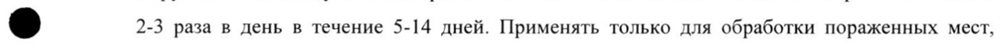

# Бетаметазона дипропионат, эквивалентный бетаметазону + Мупироцин — наружно

- Препарат: Супироцин-Б (мазь для наружного применения;)
- АТХ: D07CC01
- Источник: ГРЛС, инструкция по медицинскому применению, РУ ЛСР-004419/09, файл от 2026-01-27 (https://grls.rosminzdrav.ru/Grls_View_v2.aspx?routingGuid=d5ab0431-8005-4cbf-991b-4f469ac860f5)
- Распознано автоматически (OCR): 7 из 7 стр.
- Инструкция к другому РУ того же препарата: ЛСР-004419/09 (национальное РУ, переоформленное по правилам ЕАЭС, решение от 18.12.2025). Текст может быть старше действующего
- Сомнительных строк после OCR: 1 (см. раздел «Проверка распознавания»)

## Общие сведения

| МИНЗДРАВ РОССИИ | РОО 9611 | СОГЛАСОВАНО |
МИНИСТЕРСТВО ЗДРАВООХРАНЕНИЯ РОССИЙСКОЙ ФЕДЕРАЦИИ
ИНСТРУКЦИЯ | ПО МЕДИЦИНСКОМУ ПРИМЕНЕНИЮ ЛЕКАРСТВЕННОГО ПРЕПАРАТА
СУПИРОЦИН-Б Регистрационный номер:
Торговое наименование: Супироцин-Б Международное непатентованное или группировочное наименование:
Бетаметазон + Мупироцин Лекарственная форма: мазь для наружного применения

## 2. Состав

| | В 100 гмази содержится: | Действующие вещества: бетаметазона дипропионат, эквивалентный бетаметазону — 0,05 г, мупироцин - 2,0 г;
| | В 100 гмази содержится: | Действующие вещества: бетаметазона дипропионат, эквивалентный бетаметазону — 0,05 г, мупироцин - 2,0 г;
e Вспомогательные вещества: макрогол 400 (полиэтиленгликоль 400), макрогол 4000
(полиэтиленгликоль 4000).
Описание: однородная мазь белого цвета. |
Фармакотерапевтическая группа: глюкокортикостероиды в комбинации с антибиотиками
Код ATX: DO7CCO1 | Фармакологические свойства
Комбинированный препарат для наружного применения, действие которого обусловлено входящими в его состав компонентами.

## 5.1. Фармакодинамика

Механизм действия Мупироцин представляет собой новый антибиотик, который получают путем ферментации
Механизм действия Мупироцин представляет собой новый антибиотик, который получают путем ферментации
Pseudomonas fluorescens. Мупироцин подавляет изолейцил-трансфер-РНК-синтетазу, блокируя синтез белка в бактериальной клетке.
Вследствие специфического механизма действия и уникальной химической структуры мупироцин не характеризуется перекрестной резистентностью с другими применяемыми в клинической практике антибиотиками.
При местном применении в минимальных подавляющих концентрациях (МПК) мупироцин
| | | ae | обладает бактериостатическими, а в более высоких концентрациях — бактерицидными свойствами.
Фармакодинамические эффекты Активность Мупироцин является антибактериальным веществом для местного применения, демонстрирующим in vivo активность против Staphylococcus aureus (включая метициллинрезистентные штаммы), 5. epidermidis и бета-гемолитических штаммов Streptococcus species.
Спектр активности in vitro включает следующие бактерии:
Чувствительные виды:
- Staphylococcus aureus’;
- Staphylococcus epidermidis’;
- коагулазонегативные staphylococci'”;
- Streptococcus species’;
- Haemophilus influenzae;
| - Neisseria gonorrhoeae;
| - Neisseria meningitidis;
| = - Moraxella catarrhalis;
- Pasteurella multocida.
| ! - Клиническая эффективность продемонстрирована для изолятов чувствительных бактерий по зарегистрированным клиническим показаниям к применению.
? - Включая штаммы, продуцирующие бета-лактамазу, и метициллин-резистентные штаммы.
| Устойчивые виды - Corynebacterium species;
- Enterobacteriaceae;
| - грамотрицательные неферментирующие палочки;
- Micrococcus species;
| - анаэробы.
Пограничные концентрации чувствительности к мупироцину (МПК) для Staphylococcus spp.
| Чувствительные: ниже или равно 1 мкг/мл.
| Промежуточная чувствительность: от 2 до 256 мкг/мл.
Устойчивые: выше 256 мкг/мл.
Бетаметазон — глюкокортикостероид для наружного применения.
| 3 | Оказывает противовоспалительное местное, противоаллергическое, противоотечное и
| антипролиферативное действие. Обладает более сильным вазоконстрикторным действием, чем другие фторпроизводные глюкокортикостероиды; системные эффекты выражены незначительно из-за ограниченного всасывания через кожные покровы. При воздействии на кожу происходит предупреждение краевого скопления нейтрофилов, что приводит к уменьшению экссудации, продукции цитокинов, торможению миграции макрофагов, приводящее в конечном итоге к уменьшению процессов инфильтрации и грануляции.

## 5.2. Фармакокинетика

Мупироцин плохо всасывается через неповрежденную кожу человека.
Мупироцин плохо всасывается через неповрежденную кожу человека.
В случае всасывания через поврежденную кожу мупироцин быстро метаболизируется до неактивной мониевой кислоты.
Мупироцин быстро выводится из организма путем метаболического превращения в неактивный метаболит — мониевую кислоту, которая быстро выводится почками.
Бетаметазона дипропионат является липофильным веществом и легко всасывается через роговой слой кожи, не подвергаясь биотрансформации. Абсорбция увеличивается при нанесении на кожу в области складок тела, на кожу с поврежденным эпидермисом или на
@ область воспаления, при частом применении препарата или после нанесения на значительную поверхность кожи. Всасывание бетаметазона дипропионата через кожу у детей происходит
| быстрее, чем у взрослых.
Показания для применения Применяется для лечения атопического дерматита, диффузного нейродермита, контактного дерматита (простого и аллергического), эксфолиативного дерматита, крапивницы, герпетиформного дерматита, себорейного дерматита, экземы, псориаза, осложненных вторичными бактериальными инфекциями.
| | Противопоказания Повышенная чувствительность к мупироцину, бетаметазона дипропионату или любому другому компоненту, входящему в состав препарата, в анамнезе; кожные проявления сифилиса; туберкулез кожи; бактериальные, вирусные, грибковые кожные заболевания;
| трофические язвы голени, связанные с варикозным расширением вен; рак кожи; невус, атерома, меланома, гемангиома, ксантома, саркома; розацеа, вульгарные угри,
| | | поствакцинальные кожные реакции, период беременности и грудного вскармливания, детский возраст до 12 лет.

## 4.3. С осторожностью

Почечная недостаточность средней и тяжелой степени.
Почечная недостаточность средней и тяжелой степени.
Для пациентов с сахарным диабетом, глаукомой, туберкулезом, катарактой не рекомендуется длительное применение мази на обширных участках кожи.
С осторожностью следует применять при атрофии подкожной клетчатки, особенно у лиц | пожилого возраста.

## 4.6. Применение при беременности и в период грудного вскармливания

Препарат противопоказан к применению при беременности и в период лактации (грудного вскармливания).

## 4.2. Способ применения и дозы

Наружно. Рекомендуемая дозировка: наносить мазь тонким слоем на пораженное место
Наружно. Рекомендуемая дозировка: наносить мазь тонким слоем на пораженное место
©® 2-3 раза в день в течение 5-14 дней. Применять только для обработки пораженных мест, имеющих длину не более 10 см или площадь — не более 100 см?. Если в течение 3-5 дней у
| пациентов не наблюдается клинической реакции, их нужно обследовать повторно.
| Побочное действие Жжение, зуд, раздражение, сухость кожи, фолликулит, гипертрихоз, угревидные высыпания,
| гипопигментация, периоральный дерматит, аллергический контактный дерматит, мацерация кожи, вторичная инфекция, атрофия кожи, потница, аллергические реакции (в том числе, анафилаксия, генерализованная сыпь, крапивница и ангионевротический отек.
| | Передозировка Симптомы: обратимое угнетение гипоталамо-гипофизарно-надпочечниковой системы,
| проявления синдрома Иценко-Кушинга, гипергликемия, глюкозурия.
| Лечение: симптоматическое.
| | | | | | |

## 4.5. Взаимодействие с другими лекарственными средствами

Не отмечено взаимодействия с другими лекарственными препаратами. |

## 4.4. Особые указания

Избегать попадания мази в глаза, на слизистые оболочки, а также на открытые раны и ожоги.
Избегать попадания мази в глаза, на слизистые оболочки, а также на открытые раны и ожоги.
Как и в случае с другими антибактериальными веществами, длительное применение мази может привести к чрезмерному росту нечувствительных микроорганизмов, в том числе

| грибов.

Макрогол (полиэтиленгликоль) может всасываться через раневую поверхность или через другие повреждения кожных покровов и выводиться почками.

Мази на основе макрогола нельзя применять на обширных поверхностях при состояниях, сопровождающихся повышенным всасыванием полиэтиленгликоля, особенно при умеренной и тяжелой почечной недостаточности.
Учитывая наличие в составе препарата сильнодействующего глюкокортикостероида, препарат необходимо применять в остром периоде заболевания, кратковременно, на незначительной поверхности кожи.

@ Не следует применять препарат на коже лица в связи с возможностью появления телеангиэктазий, периорального дерматита. На коже в подмышечной и паховой области препарат следует применять только в случаях крайней необходимости.

Не следует применять препарат под окклюзионной повязкой, так как это может привести к атрофии эпидермиса, появлению стрий, развитию суперинфекции.

При применении антибиотиков были описаны случаи развития псевдомембранозного колита, степень тяжести которого может варьировать от легкой до угрожающей жизни. Таким образом, важно рассматривать возможность диагноза у пациентов в случае развития диареи на фоне или после применения антибиотиков. Несмотря на то, что вероятность развития этого явления при наружном применении мупироцина меньше, в случае развития продолжительной или выраженной диареи или спазмов в животе, лечение следует немедленно прекратить и провести дополнительное обследование пациента. Нельзя использовать препарат в офтальмологии, интраназально, в сочетании с использованием катеторов.
| Влияние на способность управлять транспортными средствами и механизмами
Не изучалось.
Формы выпуска Мазь для наружного применения.
По 5 ги 15 гв алюминиевые тубы, изнутри лакированные латексом, имеющие сопло с закрытым концом, с крышкой, имеющей острие для прокалывания.
Одна туба вместе с инструкцией по применению помещается в картонную пачку.

## 6.4. Условия хранения

При температуре не выше 25 °С. Не замораживать.
При температуре не выше 25 °С. Не замораживать.
Хранить в недоступном для детей месте.

## 6.3. Срок годности

2 года.
2 года.
Не применять препарат по истечении срока годности.
Условия отпуска из аптек Отпускают по рецепту.
Наименование и адрес юридического лица, на имя которого выдано регистрационное
| удостоверение:
Гленмарк Фармасьютикалз Лтд., Индия Glenmark Pharmaceuticals Ltd., India
| B/2 Mahalaxmi Chambers, 22 Bhulabhai Desai Road, Mahalaxmi, Mumbai — 400026, India.
Название производителя и фактический адрес места производства лекарственного препарата:
Гленмарк Фармасьютикалз Лтд., Индия Plot № Е 37, 39, MIDC Area, Satpur, Nasik-422007, Maharashtra, India.
Претензии потребителей направлять по адресу:
ООО «ГЛЕНМАРК ИМПЭКС»
115114, г. Москва, ул. Летниковская, дом 2, строение 3, 2 этаж; тел.: 8 (499) 951-00-00, сайт www.glenmark-pharma.ru
Директор департамента А регуляторных и нормативных вопросов els “&\ `ЛИ.В. Волкова
5 ОТДЕЛ | vl , РЕГИСТРАИНИ : |5]
3\o wo)
NO #77 АВЕ SS МОСКВА | | | |
## Проверка распознавания

Страницы-сканы распознаны автоматически. В 1 строках с дозировками цифры могли распознаться с ошибкой — сверьте с вырезкой из оригинала:

- стр. 4: «©® 2-3 раза в день в течение 5-14 дней. Применять только для обработки пораженных мест,» — повторное чтение: «©® 2-3 pasa в день в revenue 5-14 дней. Применять только для обработки пораженных мест,»  
  
