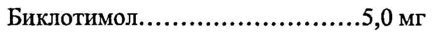
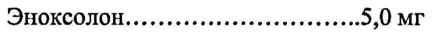

# Биклотимол + Лизоцим + Эноксолон — внутрь

- Препарат: Гексализ® (таблетки для рассасывания;)
- АТХ: R02AA20
- Источник: ГРЛС, инструкция по медицинскому применению, РУ П N008170, файл от 2023-08-30 (https://grls.rosminzdrav.ru/Grls_View_v2.aspx?routingGuid=0feb650b-216d-407a-b51d-f2d002b69e0f)
- Распознано автоматически (OCR): 4 из 4 стр.
- Инструкция к другому РУ того же препарата: П N008170 (национальное РУ, переоформленное по правилам ЕАЭС, решение от 24.08.2023). Текст может быть старше действующего
- Сомнительных строк после OCR: 2 (см. раздел «Проверка распознавания»)

## Общие сведения

П №008170-211211 МИНИСТЕРСТВО ЗДРАВООХРАНЕНИЯ И СОЦИАЛЬНОГО РАЗВИТИЯ
РОССИИСКОЙИ ФЕДЕРАЦИИ ИНСТРУКЦИЯ по применению лекарственного препарата для медицинского применения
| ГЕКСАЛИЗ

Регистрационный номер:
Торговое название: ГЕКСАЛИЗ , Лекарственная форма: таблетки для рассасывания

## 2. Состав

(на 1 таблетку):
(на 1 таблетку):
Действующие вещества:
Биклотимол....... ие ееееиньннин +. 530 МГ
Эноксолон...... ии еинининииниь 9,0 МГ Лизоцима гидрохлорид..............5,0 МГ
Вспомогательные вещества: | Лимона масло...... „аи иииннининнньи ии 0,2. МГ
Лимонной кислоты моногидрат........10,0 мг

Краситель солнечный закат

желтый (Е110)......... неее еееининиь ине ОЛ МГ |
Магния стеарат... иенннньнь и... 15,0 МГ
Акации камедь ....... ии еееиинннь и... 60,0 МГ
СЯХарОЗА, инея и вовиииннаь окиикькык ДО 1200 МР
Описание Таблетки желто-оранжевого цвета круглой плоскоцилиндрической формы с фаской, со слабым характерным запахом. Возможны вкрапления оранжевого или белого цвета.
Код ATX: К02АА20 Фармакотерапевтическая группа |
Антисептическое средство

| Fo ro о TI №008170-211211 . й у | у . |
‚ Фармакологические свойства ' .
Комплексный лекарственный препарат с противомикробным, противовирусным и | противовоспалительным действием для местного применения.
Биклотимол - антисептик, обладает антибактериальной активностью в отношении
‚ стафилококков, стрептококков и коринебактерий, а также местным обезболивающим и противовоспалительным эффектом. При местном применении характеризуется | длительным действием. , , ;
' - Лизоцим - полипентидный муколитический ' фермент. Оказывает противомикробное |
. ‚ действие. Подавляет.рост грамположительных бактерий; менее чувствительны к нему
, | ‚ грамотрицательные бактерии. Обладает способностью стимулировать неспецифическую | | в " реактивность организма, оказывать противовоспалительное и муколитическое действие. |
St ‚ `Лизоцим, образуя комплексы с ‘вирусами, проявляет противовирусную активность. .
7 Относится к естественным защитным факторам организма. | | И
; ` Эноксолон — комплексный тритерпен, выделенный из `глицирризиновой кислоты,
` Проявляет противовоспалительную активность. Благотворно действует на иммунную
` систему человека, повышая сопротивляемость различным вирусным заболеваниям. ' у Обладает противовирусным действием. | . ., |
| ‘’Фармакокинетические свойства И . | . 3
| . Медленно всасывается через слизистую оболочку полости рта, оказывает длительный местный эффект. | _ | И ot Показания для применения : ав о
. Инфекционно-воспалительные' заболевания слизистой оболочки полости рта (стоматит, ‹ ` гингивит, в т.ч. вызванный ношением зубных протезов), глотки, гортани, вызванные | чувствительными к биклотимолу, лизоциму и эноксолону возбудителями.
Местное лечение проводится по всем ‘показаниям ‘воспалительных и инфекционных °
. заболеваний носоглотки: острый и хронический фарингит, фаринголарингит, тонзиллит,
‚ состояния после тонзиллэктомии, глоссит. о
Противопоказания для применения + ‚ Детский возраст до 6 лет.
ва “ ` Гиперчувствительность к компонентам препарата. ‹ у ™
| Дефицит ‚ сахаразы/изомальтазы, непереносимость фруктозы, глюкозо-галактозная мальабсорбция. А
: Способ применения и дозы .... ...... ~ oe. me
Таблетки необходимо медленно рассасывать до полного растворения, не разжевывая и не разгрызая. |
| 2 < . . у * и СА © + + TENO08170-211211
Взрослым назначают по 1 таблетке каждые 2 часа. ‚
Максимальная суточная доза для взрослых -— 8 таблеток. ,
Детям старше 6 лет назначают по 1 таблетке каждые 4 часа.
Максимальная суточная доза для детей — 4 таблетки.
и Продолжительность лечения не должна превышать 10 дней. , ne hs ;
| Меры предосторожности при применении |
Не применимо р | | .’ ‚ Передозировка | И. .. | о |
- Her данных о случаях передозировки. в у а . ., Г 2° |
, `Побочное действие | _* & 5 ry? . ° : Hon |
, ‚ ‚Возможны местные аллергические реакции, суперинфекция. При длительном применении ,
" р _ _ дисбактериоз полости рта с риском распространения бактериальной или грибковой , , -
| 5 инфекции. р , и . | Если любые побочные эффекты, указанные в инструкции, усугубляются или Вы заметили ‘, любые другие побочные эффекты не указанные в инструкции, сообщите об этом врачу.
‚ Взаимодействие с другими лекарственными средствами р | |
Избегать одновременного применения других местных средств. | | , oo
° Особые указания | о р sos ; Больным сахарным диабетом принять во внимание, что содержание сахара в одной , 1 таблетке —1,054 т (0,1054 ХЕ). ss , . о ot, ‚ В случае, если симптомы заболевания не исчезли через 5 дней, необходимо пересмотреть’, , |
` лечение. , и, 7 , .
.. ’ Беременность и период грудного вскармливания . ``
‚‘ Применение препарата при беременности и в период грудного вскармливания возможно, если потенциальная польза для матери превышает возможный риск для плода и ребенка.

## 4.7. Влияние на способность управлять транспортными средствами, механизмами

| средствами ‘ . ro — Нет данных о влиянии препарата на способность управлять автомобилем и другими | транспортными средствами. : 3 oo ’ Форма выпуска - , : | ,
, | Таблетки для рассасывания. , = ; a |
По 10 таблеток в блистер из ПВХ/ алюминиевой фольги, 3 блистера с инструкцией по | | применению в картонной пачке. : а ии

## 6.3. Срок годности

3 | П N008170-211211 2 года.
3 | П N008170-211211 2 года.
Не применять по истечении срока годности, указанного на упаковке,

## 6.4. Условия хранения

Хранить при температуре не выше 25 °С.
Хранить при температуре не выше 25 °С.
Хранить в недоступном для детей месте.
Условия отпуска из аптек Без рецепта.
Производитель:
Лаборатории Бушара - Рекордати 68, рю Маржолен — 92300 Леваллуа-Перре, Франция
Все претензии по качеству препарата направлять:
РОССИЯ 123610 Москва, Краснопресненская наб.12,
ЦМТ, «Международная-2», офис 747 тел.: (495) 258 20 06, факс: (495) 258 20 07
| | Laborato ires > я КСЕ BOVCHARA-PECORD
Представитель фирмы gave, 27.460.000EUROs А-В. Князева 68, гие Morjolin-92300 LEVALLOIS-PERRET
В.С.5. Nanterre: В 602 056 657
## Проверка распознавания

Страницы-сканы распознаны автоматически. В 2 строках с дозировками цифры могли распознаться с ошибкой — сверьте с вырезкой из оригинала:

- стр. 1: «Биклотимол....... ие ееееиньннин +. 530 МГ» — низкая уверенность: «530» (0)  
  
- стр. 1: «Эноксолон...... ии еинининииниь 9,0 МГ» — низкая уверенность: «9,0» (23)  
  
