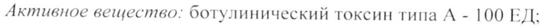

# Ботулинический токсин типа A-гемагглютинин комплекс — парентерально

- Препарат: Ботулакс (лиофилизат для приготовления раствора для внутримышечного введения;)
- АТХ: M03AX01
- Источник: ГРЛС, инструкция по медицинскому применению, РУ ЛП-003978, файл от 2026-06-04 (https://grls.rosminzdrav.ru/Grls_View_v2.aspx?routingGuid=d5ca5024-0ad9-4cac-a8cf-d695f7c640ad)
- Распознано автоматически (OCR): 15 из 15 стр.
- Сомнительных строк после OCR: 1 (см. раздел «Проверка распознавания»)
- Проверено вручную строк: 2

## Общие сведения

МИНИСТЕРСТВО ЗДРАВООХРАНЕНИЯ РОССИЙСКОЙ ФЕДЕРАЦИИ
ИНСТРУКЦИЯ по применению лекарственного препарата для медицинского применения
БОТУЛАКС Регистрационный номер:
Торговое название препарата: Ботулакс Группировочное название: Ботулинический токсин типа А — гемагглютинин комплекс

## 3. Лекарственная форма

Лиофилизат для приготовления раствора для внутримышечного введения
Лиофилизат для приготовления раствора для внутримышечного введения
Состав на один флакон:
Для дозировки 50 ЕД:

@ Активное вещество: ботулинический TOKCHH типа A - 50 ЕД:
Вспомогательные вещества: сывороточный альбумин человека - 0.25 мг.
натрия хлорид - 0,45 мг.

Для дозировки 100 ЕД:

Активное вещество: ботулинический токсин типа А - 100 ЕД:
Вспомогательные вещества: сывороточный альбумин человека - 0,5 мг, натрия хлорид - 0,9 мг.

Описание: лиофилизат белого цвета.

Фармакологическая группа: миорелаксант периферического действия.

Код ATX: MO03AX01

Фармакологические свойства

## 5.1. Фармакодинамика

Молекула ботулинического токсина типа А состоит из двух цепей: тяжелой
(с молекулярной массой 100 000 Дальтон) и легкой (с молекулярной массой 50 000 Дальтон), соединенных дисульфидной связью.
Тяжелая цепь обладает высоким сродством к специфическим рецепторам, локализованным на поверхности нейронов-мишеней. Легкая цепь характеризуется /п”-зависимой протеазной активностью. Она специфична в отношении цитоплазматических участков синаптосомально-связанного протеина с молекулярной массой 25 000 Дальтон (SNAP-25), принимающего участие в процессах экзоцитоза.
| Первая стадия действия ботулинического токсина типа А заключается в специфическом связывании молекулы с пресинаптической мембраной.
Вторая стадия - проникновение связанного токсина в цитоплазму нейронов путем эндоцитоза. Внутри клетки легкая цепь проявляет Zn *-3aBucumyto протеазную активность, избирательно разрушая SNAP-25, что на третьей стадии приводит к блокаде высвобождения ацетилхолина из пресинаптических окончаний холинергических нейронов. Конечным результатом является продолжительная хемоденервация.
Клинически отмечается выраженное расслабление мышц, в которые была
& произведена инъекция. В денервированных мышцах происходит процесс реиннервации за счет формирования латеральных отростков нервных окончаний через 12 недель после инъекции, что приводит к восстановлению мышечных сокращений. Однако, отростки эффективны частично и впоследствии регрессируют, в то время как первичная нейромышечная передача активируется.

## 5.2. Фармакокинетика

Фармакологический эффект препарата Ботулакс развивается в месте инъекции. Доказано, что пресинаптический захват и ретроградный аксональный транспорт препарата из места введения незначителен.
Фармакологический эффект препарата Ботулакс развивается в месте инъекции. Доказано, что пресинаптический захват и ретроградный аксональный транспорт препарата из места введения незначителен.
В терапевтических дозах препарат Ботулакс не проникает через гематоэнцефалический барьер.
Антитела к ботулиническому токсину типа А могут формироваться после повторных инъекций в 1-5% случаев. Продукции антител способствует введение больших доз препарата, а также повторное введение в малых дозах
| ee ee Е о ОВ В ee se lllllll——™ ee ый

через короткие промежутки времени (менее 14 дней). При формировании антител к ботулиническому токсину типа А эффект от его дальнейшего применения может быть сниженным.

## 4.1. Показания к применению

Временная коррекция внешнего вида морщин верхней трети лица
Временная коррекция внешнего вида морщин верхней трети лица
(межбровных морщин) у взрослых.

## 4.3. Противопоказания

- гиперчувствительность в анамнезе к любому компоненту препарата;
- гиперчувствительность в анамнезе к любому компоненту препарата;
- воспалительный процесс в месте предполагаемой инъекции (инъекций);
- острая фаза инфекционных заболеваний;
- выраженный гравитационный птоз тканей лица;
- выраженные «грыжи» в области верхних и нижних век;
- миастения gravis или синдром Лиаберта-Итона;
- возраст до 18 и старше 65 лет.

## 4.6. Применение при беременности и в период грудного вскармливания

e Применение препарата Ботулакс противопоказано при беременности и в период грудного вскармливания.

## 4.2. Способ применения и дозы

Приготовление раствора для инъекции и набор раствора в шприц следует проводить на рабочей поверхности, покрытой бумажным полотенцем на полиэтиленовой подкладке, что дает возможность быстро удалить пролитый препарат. Восстановление препарата Ботулакс производят только 0,9 % раствором натрия хлорида для инъекций. Раствор для инъекций готовят, прокалывая пробку стерильной иглой и вводя необходимое количество растворителя во флакон. Если не наблюдается втягивания растворителя во флакон под действием вакуума, флакон уничтожают. Перед проколом центральная часть резиновой пробки должна быть обработана спиртом. Для прокола пробки используют стерильную иглу размером 23-25 G.
Приготовление раствора для инъекции и набор раствора в шприц следует проводить на рабочей поверхности, покрытой бумажным полотенцем на полиэтиленовой подкладке, что дает возможность быстро удалить пролитый препарат. Восстановление препарата Ботулакс производят только 0,9 % раствором натрия хлорида для инъекций. Раствор для инъекций готовят, прокалывая пробку стерильной иглой и вводя необходимое количество растворителя во флакон. Если не наблюдается втягивания растворителя во флакон под действием вакуума, флакон уничтожают. Перед проколом центральная часть резиновой пробки должна быть обработана спиртом. Для прокола пробки используют стерильную иглу размером 23-25 G.
| Таблица разведение препарата Ботулакс:

Объем растворителя на Объем растворителя на

флакон, содержащий флакон, содержащий MABSYEREAA BOBB
50 ЕД (мл) 100 ЕД (мл) У Heel i. BE
0,25 0,5 20 0,5 1,0 10 1,0 2.0 5 Loo 2,5 + 2.0 4,0 2,5

4,0 8,0 1,25 Следует аккуратно вводить во флакон растворитель (см. таблицу выше), легкими вращательными движениями флакона, смешивая порошок с растворителем. Активное встряхивание флакона и образование пены могут привести к денатурации препарата. Готовый раствор представляет собой прозрачную, бесцветную или слегка желтоватую жидкость без посторонних

® включений; может наблюдаться легкая опалесценция.
Восстановленный препарат Ботулакс может храниться в холодильнике при температуре 2-8°С в течение 24 часов. Готовый раствор вводят с помощью инсулинового шприца с несъемной иглой. После разведения продукт должен быть использован в течение 24 часов при условии правильного хранения.
Неиспользованный раствор должен быть утилизирован (см. раздел Особые указания).

Единицы действия ботулинического токсина в различных препаратах не взаимозаменяемы. Рекомендованные дозы, выраженные в единицах действия для препарата Ботулакс, отличаются от таковых у других препаратов ботулинического токсина.

Инъекции препарата Ботулакс должен осуществлять квалифицированный врач, прошедший курс специальной подготовки и получивший разрешение фирмы-производителя.
Допускается проведение инъекций амбулаторно в условиях процедурного
| | esti RI EE TT кабинета.
Доза препарата Ботулакс и точки для инъекции определяются индивидуально у каждого пациента в соответствии с выраженностью и локализацией мышечной гиперактивности. В некоторых случаях для более точного установления локализаций патологического процесса используется электромиография (ЭМГ).
Раствор препарата Ботулакс (50 EJV1,25 или 100 ЕД/2,5 мл) вводят иглой размером 300.
По 4 ЕД вводят в 5 точек для инъекции: в мыпщу, сморщивающую бровь
(т. corrugator) - 2 точки с каждой стороны, в мышцу гордецов (т. procerus) -
| точка (как показано на рис. 1). Общая доза составляет 20 ЕД.
( ( Re ^— ] ©® в Я ) \ Рис.1. Иллюстрация техники введения препарата.
Перед проведением инъекции необходимо плотно прижать большой и указательный пальцы к коже ниже края глазницы, чтобы препятствовать
| распространению препарата ниже этого уровня. При проведении инъекций иглу следует направлять вверх и медиально. Для снижения риска развития птоза необходимо избегать введения препарата вблизи мышцы, поднимающей верхнее веко, особенно у пациентов с хорошо выраженной мыпщей, опускающей верхнее веко. При введении препарата в мышцу, сморщивающую бровь (m. corrugator) инъекцию необходимо проводить в центральную часть мыпщы, отступив не менее чем на | см выше дуги брови.
Сглаживание вертикальных мимических межбровных морщин происходит, как правило, в течение недели после процедуры. Эффект сохраняется до 4 месяцев.
Интервал между процедурами должен составлять не менее 3 месяцев. При

| отсутствии эффекта от введения препарата или снижении его выраженности после повторных инъекций следует рекомендовать другие методы лечения.
При неэффективности первой процедуры, т.е. отсутствии значительного клинического улучшения, по сравнению с исходным состоянием, через 1 месяц после введения препарата, необходимо:
- клиническое подтверждение действия токсина на инъецированную мыпщу
(мышцы), которое может включать ЭМГ исследование, выполняемое опытным специалистом в специализированном отделении:
- анализ причин неэффективности процедуры, например, неадекватный выбор точек для инъекции, недостаточная доза, неправильная техника инъекции, признаки фиксированной контрактуры, слабость мышцантагонистов, формирование токсин нейтрализующих антител;
- повторная оценка целесообразности лечения ботулиническим токсином
® типа А;

- при отсутствии каких-либо нежелательных эффектов, связанных с первым введением препарата, при повторной процедуре должны быть соблюдены следующие условия: коррекция дозы с учетом анализа причин неэффективности предыдущей процедуры; ЭМГ-контроль; интервал между процедурами должен составлять не менее 3-х месяцев.
При отсутствии эффекта от введения препарата или снижении его выраженности после повторных инъекций следует рекомендовать другие методы лечения.

## 4.8. Побочное действие

Как правило, нежелательные реакции проявляются в течение первых дней после инъекции и являются преходящими. В редких случаях длительность нежелательных реакций может составлять несколько месяцев и более.
Как правило, нежелательные реакции проявляются в течение первых дней после инъекции и являются преходящими. В редких случаях длительность нежелательных реакций может составлять несколько месяцев и более.
Локальная мышечная слабость отражает ожидаемое фармакологическое действие ботулинического токсина на мышцу. Однако большие дозы могут
- | вызвать слабость мышц помимо непосредственно тех, что локализованы в месте инъекций.
Как и при любой инъекционной процедуре в месте введения могут отмечаться локальная болезненность, воспаление, парестезия, гипестезия, повышенная чувствительность, отечность, эритема, локализованная инфекция, кровотечение и/или гематомы, связанные с инъекцией. Связанная с процедурой боль и/или тревога могут приводить к вазовагальным реакциям, включая транзиторную гипотензию и обмороки.
Описано повышение температуры и возникновение гриппоподобного синдрома.
Нежелательные реакции Указанные ниже побочные эффекты даются в соответствии со следующими градациями частоты их возникновения: очень часто (>1/10), часто
(>1/100 - <1/10), нечасто (>1/1000 - <1/100), редко (>1/10000 - <1/1000), очень редко (<1/10 000).
| ® Инфекционные и паразитарные заболевания:
Нечасто: инфекции.
Нарушения психики:
Часто: тревожность.
Нарушения со стороны нервной системы:
Часто: головная боль, парестезии.
Нечасто: головокружение.
Нарушения со стороны органа зрения:
Часто: блефароптоз.
Нечасто: блефариты, боль в глазах, нарушения зрения (включая снижение его остроты).
Нарушения со стороны желудочно-кишечного тракта:
Часто: тошнота.
| Нечасто: сухость во рту.
+ Нарушения со стороны кожи и подкожных тканей:
Часто: экхимозы, эритема, ощущение стянутости кожи.
Нечасто: отечность (лица, век, периорбитальной области), фотосенситизация, зуд, сухость кожи.
Нарушения со стороны скелетно-мышечной и соединительной ткани:
Часто: локальная мышечная слабость.
Нечасто: мышечные подергивания.
Общие расстройства и нарушения в месте введения:
Часто: боли в области лица, отек места инъекции, боль/жжение в месте инъекции.
| Нечасто: гриппоподобный синдром, астения, лихорадка.
Дополнительная информация Последующий перечень включает побочные реакции и прочие медицинские нежелательные явления, о которых были получены сообщения в постмаркетинговый период, независимо от показаний к применению, и
$ которые, возможно, не были перечислены выше.
Нарушения со стороны иммунной системы:
Анафилактический шок, отек Квинке, сывороточная болезнь и крапивница.
Нарушения со стороны обмена веществ и питания:
Анорексия.
Нарушения со стороны нервной системы:
Плексопатия плечевого сплетения, дисфония, дизартрия, парез лица, гипестезия мышечная слабость, миастения gravis, периферическая нейропатия, парестезии, радикулопатия, судороги, обмороки и паралич лица.
Нарушения со стороны органа зрения:
Страбизм, ослабление четкости и другие нарушения зрения.
Нарушения со стороны органа слуха и лабиринтные нарушения:
Тугоухость, шум в ушах и головокружение.
Se eS Т >> ee 2 a абы — 0 Нарушения со стороны сердца:
Аритмия, инфаркт миокарда.
Нарушения со стороны дыхательной системы, органов грудной клетки и средостения:
Аспирационная пневмония (в некоторых случаях с летальным исходом), диспноэ, бронхоспазм, угнетение дыхания и дыхательная недостаточность.
Нарушения со стороны желудочно-кишечного тракта:
Боль в животе, диарея, запор, сухость во рту, дисфагия, тошнота и рвота.
Нарушения со стороны кожи и подкожных тканей:
Алопеция, исорназоформный дерматит, многоформная эритема, гипергидроз, мадароз, зуд и сыпь.
Нарушения со стороны скелетно-мышечной _и соединительной ткани:
Мышечная атрофия и миалгия.
Общие расстройства и нарушения в месте введения:
Атрофия вследствие денервации, недомогание и лихорадка.
Ф Передозировка Симптомы передозировки проявляются через некоторое время после инъекции. При случайном введении или проглатывании препарата Ботулакс, больной должен находиться под медицинским наблюдением в течение
| нескольких дней для выявления клинических проявлений и симптомов общей слабости или паралича мышц. Чрезмерные дозы могут вызвать локальный или — дистанционный, генерализованный и глубокий нейромышечный паралич.
Больные с симптомами отравления ботулиническим токсином А (общей слабостью, птозом, диплопией, затруднением глотания и расстройством речи
| или парезом дыхательной мускулатуры) должны быть госпитализированы.
Описан случай тяжелого генерализованного паралича мышц при передозировке препарата.
Пациентам с параличем дыхательной мускулатуры требуется интубация и перевод на искусственную вентиляцию легких до улучшения состояния больного. В дополнение к другим мерам общего поддерживающего лечения, может потребоваться проведение трахеостомии и продолжительная

искусственная вентиляция.

## 4.5. Взаимодействие с другими лекарственными средствами

Теоретически, эффект ботулинического токсина может усиливаться при одновременном применении с антибиотиками группы аминогликозидов или спектиномицином, а также с другими лекарственными средствами, влияющими на нейромышечную передачу (например, миорелаксантами).
Эффект введения различных серотипов ботулинического нейротоксина одновременно или с интервалом в несколько месяцев неизвестен. Возможно усугубление нейромышечной слабости при введении другого ботулинического токсина до исчезновения эффектов ранее введенного ботулинического токсина.
Исследования по лекарственному взаимодействию не проводились.
Клинически значимых случаев лекарственного взаимодействия не описано.
# Особые указания Препарат Ботулакс применяется в специализированных медицинских учреждениях. Препарат хранится в отдельной закрытой маркированной коробке в холодильнике.
Оставшийся после проведения инъекций неиспользованный раствор препарата а также вспомогательные инструменты и материалы, |
| находившиеся в контакте с препаратом (шприцы, иглы и т.д.), должны быть утилизированы в соответствии с действующими правилами уничтожения биологических отходов.
Рекомендуемые дозы и частота введения препарата Ботулакс не должны быть превышены в связи с потенциальным риском передозировки, чрезмерной мышечной слабости, дистантного распространения токсина и формирования нейтрализующих антител. При первичном курсе лечение необходимо начинать с самой низкой рекомендуемой дозы для конкретного показания к применению.
1] Врачи и пациенты должны быть осведомлены, что побочные эффекты могут возникнуть, несмотря на хорошую переносимость предыдущих инъекций.
Необходимо соблюдать осторожность и внимательность при каждой процедуре.
Были зарегистрированы побочные эффекты, связанные с распространением токсина от места введения, иногда с летальным исходом, связанным в некоторых случаях с дисфагией, пневмонией и/или выраженной мышечной слабостью. Данные симптомы согласуются с механизмом действия ботулинического токсина и проявляются в период от нескольких часов до нескольких недель после инъекции. Риск возникновения этих побочных эффектов наиболее высок у пациентов с сопутствующими заболеваниями и состояниями, предрасполагающими к развитию данных симптомов, в том числе у детей и взрослых, получающих лечение по поводу спастичности в высоких дозах.
Пациенты, получающие препарат в терапевтических дозах, могут также
@ испытывать выраженную мышечную слабость. К пожилым и ослабленным пациентам следует относиться с осторожностью.
| Следует оценить соотношение риска и пользы для конкретного пациента,
| прежде чем приступать к лечению препаратом Ботулакс.
Было сообщено о дисфагии, последовавшей за инъекциями в участки помимо мышц шеи.
| Ботулакс следует применять с крайней осторожностью и под постоянным контролем у пациентов, имеющих субклинические или клинические признаки нарушения нервно-мышечной передачи, например при миастении gravis или синдроме Ламберта-Итона, у больных периферическими моторными нейропатическими заболеваниями (например, боковым амиотрофическим склерозом или моторной нейропатией), а также у
| пациентов с сопутствующей неврологической патологией.
Эти пациенты могут иметь повышенную чувствительность к данной группе препаратов даже в терапевтических дозах, что может приводить к развитию выраженной мышечной слабости и высокому риску возникновения клинически значимых системных эффектов, включая тяжелую дисфагию и нарушения дыхания. В таких случаях ботулинический токсин должен быть использован под контролем специалиста и только тогда, когда польза от лечения превышает риск. Больные с дисфагией и аспирацией в анамнезе должны лечиться с особой осторожностью.
Пациентам и лицам, осуществляющим уход следует рекомендовать немедленно обратиться за медицинской помощью в случае возникновения нарушений глотания, речи или дыхания.
Как и при любом методе лечения, дающем ранее обездвиженным больным возможность вернуться к физической активности, пациента следует предупредить о важности восстанавливать активность постепенно.
Перед инъекцией препарата Ботулакс необходимо уточнить анатомию | соответствующих областей и любые изменения анатомии в результате предшествовавших операций; следует избегать инъекций в легко
® повреждаемые анатомические структуры.
Серьёзные побочные реакции, в том числе со смертельным исходом, | отмечались у пациентов, которым Ботулакс вводился по неутвержденным показаниям - инъекции препарата непосредственно в слюнные железы, оролингво-фарингеальную область, пищевод и желудок. У некоторых пациентов была предшествующая дисфагия или выраженная слабость.
О развитии серьезных и/или немедленных реакций гиперчувствительности на фоне применения препарата Ботулакс, таких как анафилаксия, сывороточная болезнь, крапивница, отек мягких тканей или диспноэ сообщалось нечасто.
Реакции были зарегистрированы как в случаях монотерапии препаратом, так и при применении его в сочетании с другими препаратами, способными
| вызвать подобные симптомы.
В случае развития таких реакций дальнейшее введение препарата Ботулакс должно быть прекращено и немедленно начата соответствующая медикаментозная терапия, в частности эпинефрином.
Как и при любых инъекциях могут наблюдаться осложнения, связанные с процедурой. Инъекции могут приводить к локальным инфекциям, болезненности, воспалению, парестезии, гипестезии, повышенной | чувствительности, отеку, эритеме, кровотечениям/гематомам. Связанная с инъекцией боль и/или тревога могут приводить к вазовагальным реакциям, например, обморокам, гипотензии и др.
Необходимо соблюдать осторожность при слабости или атрофии мышц, в которые планируется введение препарата.
Описаны редкие нежелательные реакции со стороны сердечно-сосудистой системы, включая аритмии и инфаркт миокарда, в некоторых случаях с летальным исходом. У части этих пациентов изначально присутствовали факторы риска, в том числе заболевания сердечно-сосудистой системы.
Отмечались впервые появившиеся или повторные эпилептические припадки, как правило, у предрасположенных к этим состояниям больных. Точная связь межу этими явлениями и введением токсина не установлена. Припадки

$ отмечали преимущественно среди больных ДЦП.

Формирование нейтрализующих антител к ботулиническому токсину может снижать эффективность препарата Ботулакс, за счет инактивации биологической активности токсина. По данным клинических исследований, введение препарата Ботулакс с большей частотой и в больших дозах может приводить к росту случаев формирования антител. Потенциальное формирование антител может быть минимизировано путем введения наименьших эффективных доз с максимальными клинически допустимыми интервалами между инъекциями.
Клинические флюктуации при повторном применении препарата Ботулакс
(как и для всех богулинических токсинов) могут быть результатом различий в технике разведения препарата, интервалах между инъекциями и инъецируемых мышцах, а также небольших колебаний значений активности препарата, определяемой биологическим методом.
SES RR бе Соб а о со а Морщины верхней трети лица (межбровные морщины)
Редкое моргание, связанное с введением ботулинического токсина в круговую мышцу глаза, может приводить к повреждению роговицы, персистирующим дефектам эпителия и эрозиям роговицы, особенно у пациентов с патологией УП пары черепно-мозговых нервов.
Ботулакс необходимо с осторожностью применять в следующих случаях:
- при выраженной асимметрии лица,
- при птозе, дерматохалазисе, глубоких рубцах,
- у пациентов с плотной кожей или при отсутствии значительного сглаживания вертикальных мимических межбровных морщин при механическом растяжении кожи.

## 4.7. Влияние на способность управлять транспортными средствами, механизмами

Препарат Ботулакс способен приводить к астении, мышечной слабости, головокружению и расстройствам зрения. В случае развития таких
® симптомов может создаваться опасность при управлении автомобилем или работе с движущимися механизмами.

## 6.5. Форма выпуска

По 50 ЕД или 100 ЕД препарата во флакон из боросиликатного стекла типа |
По 50 ЕД или 100 ЕД препарата во флакон из боросиликатного стекла типа |
(Евр. Фарм.) вместимостью 5 мл, герметически укупоренный резиновой пробкой и алюминиевым колпачком с контролем первого вскрытия.
По | флакону вместе с инструкцией по применению в пачку из картона.

## 6.4. Условия хранения

При температуре от 2 до 8 °С.
При температуре от 2 до 8 °С.
Хранить в недоступном для детей месте.

## 6.3. Срок годности

3 года.
3 года.
Не применять по истечении срока годности, указанного на упаковке.
Условия отпуска Для использования в специализированных медицинских учреждениях.
Производитель Хюгель Инк., Республика Корея 61-20, Sinbuk-ro, Sinbuk-eup, Chuncheon-si, Gangwon-do, Republic Korea
Организация, принимающая претензии ООО «АЛЬЯНЗА», Россия 111123, Россия, г. Москва, ул. 2-ая Владимирская, дом 12, строение 2
«СТВЕНЫ <> SN tS “ а cy © Генеральный дирек з .
> x = = wah” 2 4 > N O00 «AJIbAHBAAE| ab 5 | Паневин А. В.
о\ « Е ¥ (5 <> К
55 OCR
## Проверка распознавания

Страницы-сканы распознаны автоматически. В 1 строках с дозировками цифры могли распознаться с ошибкой — сверьте с вырезкой из оригинала:

- стр. 1: «Активное вещество: ботулинический токсин типа А - 100 ЕД:» — повторное чтение: «Активное вещество. ботулинический токсин типа А - 100 ЕЛ;»  
  