# Бролуцизумаб — глаза

- Препарат: Визкью® (раствор для внутриглазного введения;)
- АТХ: S01LA06
- Источник: ГРЛС, инструкция по медицинскому применению, РУ ЛП-006598, файл от 2024-06-05 (https://grls.rosminzdrav.ru/Grls_View_v2.aspx?routingGuid=a00d4290-af87-45dd-9918-12922b048019)
- Распознано автоматически (OCR): 25 из 25 стр.
- Инструкция к другому РУ того же препарата: ЛП-006598 (национальное РУ, переоформленное по правилам ЕАЭС, решение от 31.05.2024). Текст может быть старше действующего
- Сомнительных строк после OCR: 16 (см. раздел «Проверка распознавания»)
- Проверено вручную строк: 1

## Общие сведения

| МИНИСТЕРСТВО ЗДРАВООХРАНЕНИЯ РОССИЙСКОЙ ФЕДЕРАЦИИ
| ИНСТРУКЦИЯ ‚ ПО МЕДИЦИНСКОМУ ПРИМЕНЕНИЮ ЛЕКАРСТВЕННОГО ПРЕПАРАТА |
Визкью® | Регистрационный номер: ЛП-006598
Торговое наименование: Визкью® . | Международное непатентованное наименование: бролуцизумаб
Е © Лекарственная форма: раствор для внутриглазного введения

## 2. Состав

1 мл раствора содержит:
1 мл раствора содержит:
действующее вещество — бролуцизумаб — 120 мг; | вспомогательные вещества — сахароза, натрия цитрат, полисорбат 80, натрия гидроксид, вода для инъекций. |
Описание От бесцветного до слегка коричневато-желтого цвета, от прозрачного до слегка опалесцирующего раствор.
Фармакотерапевтическая группа: средства, препятствующие новообразованию сосудов. |
| с Код ATX: SOLLA06 | Фармакологические свойства
Механизм действия Бролуцизумаб представляет собой одноцепочечный Fv (scFv) фрагмент гуманизированного моноклонального антитела с молекулярной массой ~26 кДа.
Патологический ангиогенез в глазу и отек сетчатки связан с повышенной активизацией сигнального пути фактора роста эндотелия сосудов А (УЕСЕ-А). Бролуцизумаб с высокой аффинностью связывается с различными изоформами VEGF-A (в частности, с VEGFi10,
УЕОЕ!21 и УЕСЕ165), тем самым препятствуя связыванию VEGF-A с его рецепторами
VEGFR-1 и VEGFR-2. Подавляя связывание VEGF-A, бролуцизумаб угнетает пролиферацию
| эндотелиальных клеток, таким образом уменьшая патологическую неоваскуляризацию и
| | | | | .
| | | | : снижая проницаемость сосудов. |
| Фармакодинамика | | Неоваскулярная (влажная) форма возрастной макулярной дегенерации (нВМД) |
В исследованиях HAWK и HARRIER решения о лечении принимались на основании оценки | активности заболевания, включающей оценку соответствующих анатомических параметров. У |
| | пациентов, получавших бролуцизумаб, уже через 4 недели после начала лечения и вплоть до | 48 и 96 недель наблюдалось снижение толщины центральной зоны сетчатки (ТЦЗС) и количества интраретинальной/субретинальной жидкости (ИРЖ/СРЖ) или жидкости, находящейся под пигментным эпителием сетчатки (ПЭС).
| В обоих исследованиях снижение ТЦЗС на 16 неделе в случае применения бролуцизумаба |
| © статистически значимо превышало соответствующее снижение в случае применения
| афлиберцепта (HAWK: -161 против -134 микрон; HARRIER: -174 против -134 микрон).
Разница снижения ТЦЗС относительно исходного уровня была также статистически значимой на 48 неделе (HAWK: -173 против -144 микрон; HARRIER: -194 против -144 микрон) и
: сохранялась до окончания исследования на 96 неделе (HAWK: -175 против -149 микрон;
HARRIER: -198 против -155 микрон).
В обоих исследованиях снижение процентного соотношения пациентов с ИРЖ и/или СРЖ на | 16 неделе в случае применения бролуцизумаба статистически значимо превышало соответствующее снижение в случае применения афлиберцепта (HAWK: 34% против 52%; |
HARRIER: 29% против 45%). Эта разница была также статистически значимой на 48 неделе
(HAWK: 31% против 45%; HARRIER: 26% против 44%) и сохранялась до окончания
| исследования на 96 неделе (HAWK: 24% против 37%; HARRIER: 24% против 39%).
~ В обоих исследованиях снижение процентного соотношения пациентов с жидкостью под
| пигментным эпителием на 16 неделе в случае применения бролуцизумаба статистически
| значимо превышало соответствующее снижение в случае применения афлиберцепта (HAWK:
19% против 27%; HARRIER: 16% против 24%). Эта разница ‘была также статистически значимой на 48 неделе (HAWK: 14% против 22%; HARRIER: 13% против 22%) и сохранялась |
_ до окончания исследования на 96 неделе (HAWK: 11% против 15%; HARRIER: 17% против 22%).
В этих исследованиях уменьшение размера очага патологической хориоидальной неоваскуляризации (ХНВ) у пациентов, получавших бролуцизумаб, наблюдалось уже через 12 недель и сохранялось через 48 и 96 недель после начала лечения.
Страница 2 из 25 | _ _ | Диабетический макулярный отек (ДМО)
В исследованиях КЕЗТВЕГ и KITE решения о лечении принимались на основании оценки активности заболевания, включающей оценку соответствующих анатомических параметров.
Снижение ТДЗС и количества ИРЖ/СРЖ у пациентов, получавших лечение бролуцизумабом, наблюдалось уже с 4 недели и до 52 недели. Данные изменения в виде уменьшения ТЦЗС и | количества ИРЖ/СРЖ сохранялись вплоть до 100 недели.
Клиническая эффективность и безопасность
Неоваскулярная ВМД Безопасность и эффективность бролуцизумаба оценивали в 2 рандомизированных многоцентровых двойных слепых исследованиях Ш фазы с активным контролем (НАУК и
© HARRIER) у пациентов с нВМД. В этих исследованиях лечение в течение 2 лет получали в общей сложности 1817 пациентов (1088 — бролуцизумаб; 729 — препарат сравнения афлиберцепт). Возраст пациентов варьировал от 50 до 97 лет; средний возраст составил 76 лет.
В обоих исследованиях пациенты из групп бролуцизумаба после 3 первых ежемесячных инъекций (0, 4 и 8 неделя) получали препарат каждые 12 недель с возможностью изменения интервала дозирования до | раза в 8 недель в зависимости от активности заболевания.
Активность заболевания оценивал врач в первый 12-недельный интервал (на 16 и 20 неделях)
и в каждый из последующих плановых визитов, в рамках которых проводились инъекции с интервалом 12 недель. Пациентам, у которых в какой-либо из этих визитов выявляли активность заболевания (например, снижение остроты зрения, увеличение ТЦЗС и/или | наличие жидкости в сетчатке (ИРЖ/СРЖ, жидкость под ПЭС)), интервал между инъекциями | уменьшали до | раза в 8 недель. Препарат сравнения афлиберцепт вводили каждые 8 недель }
> после первых 3 ежемесячных доз. | Результаты |
Первичной конечной точкой эффективности в обоих исследованиях являлось изменение относительно исходного уровня максимальной корригированной остроты зрения (МКОЗ) к 48 неделе, которую оценивали по буквенной шкале ETDRS (исследование «Лечение диабетической ретинопатии на ранней стадии»). Основная цель заключалась в демонстрации
, не меньшей эффективности бролуцизумаба по сравнению с афлиберцептом. В обоих исследованиях было показано, что бролуцизумаб (применяемый по схеме | раз/12 недель/ 1 раз/8 недель) по своей эффективности не уступает афлиберцепту 2 мг (применяемому по схеме | раз/8 недель). Повышение остроты зрения, достигнутое в течение первого года, сохранялось и в течение второго года.
| | Страница 3 из 25 Результаты обоих исследований представлены в таблице | и на рисунке 1 ниже.
Таблица! Результаты оценки остроты зрения на 48 и 96 неделях в исследованиях
Ш фазы - исследования HAWK и HARRIER р |
Показатель Неделя Бролуцизумаб | Афлиберцепт Разность Бролуцизумаб | Афлиберцепт Разность эффективно- бмг 2мг (95% ДИ) бмг 2 мг (95% ДИ)
сти (n=360) (n=360) бролуцизумаб (n=370) (n=369) бролуцизумаб-—
- афлиберцепт афлиберцепт
Среднее 48 6,6 6,8 -0,2 6,9 7,6 -0,7 изменение (CO =0,71) (CO =0,71) (-2,1, 1,8) (CO =0,61) (СО = 0,61) (-2,4, 1,0)
MKO3 (по Р< 0,0001 P <0,0001® шкале ETDRS) 36-485 67 6,7 0,0 6,5 77 “1,2 относительно (CO =0,68) (CO =0,68) (-1,9, 1,9) (CO = 0,58) (CO = 0,58) (-2,8, 0,4)
исходного Р<0,0001° Р=0,00039 значения [eke [elie | абы [ба | аб | ба
CO =0,78 СО =0,78 -1,6, 2,7 CO =0,73 CO = 0,73 -2,5, 1.6
Доля 48 33,6 25,4 8,2 29,3 29,9 -0,6 © пациентов, у | (2,2, 15,0) (-7,1, 5,8)
которых острота зрения 72 24 лучшилаеь > “4s yy renee vom 34,2 27,0 (1,4, 13,8) 29,1 31,5 (-8,8. 4,1)
на 15 букв, % Доля 48 6,4 5,5 0,9 3,8 4,8 -1,0 пациентов, у (-2,7, 4,3) (-3,9, 2,2)
которых .
острота зрения 0,7 -0,4 -| снизилась, % 2 ;
на > 15 букв .
МКОЗ: Максимальная корригированная острота зрения; отсутствующие данные вменялись по методу переноса вперед последнего доступного наблюдения (LOCF)
ETDRS: Early Treatment of Diabetic Retinopathy Study / Исследование «Лечение диабетической ретинопатии на ранней стадии»
СО - стандартная ошибка, ДИ — доверительный интервал
9 Р-значение, относящееся к гипотезе о неменьщей эффективности с границей неменьшей эффективности 4,0 буквы
Ключевая вторичная конечная точка, учитывающая различия в схемах терапии бролуцизумабом и афлиберцептом
Страница 4 из 25 | СООТВЕТСТВУЕТ ЭКСПЕРТНОМУ ОТЧЕТУ от 24.11.2023 № 24772
| (Входящий МЗ №4268926)
Рисунок! Среднее изменение остроты зрения от исходного уровня до 96 недели в исследованиях HAWK и HARRIER
HAWK | 10 ы —®— Бролуцизумаб 6 мг (М = 360) --@-- Афлиберцепт 2 мг (N=360)
| se, | Pa яр B- ~m-.
j ir) Е -ir > > i 5 Ro 6 “a ь. es : ac 7A ‘B- - `
£68 a : aS | Q — ea" 88 ° = | © ° | 0 4 8 12 16 20 24 28 32 36 40 44 48 52 56 60 64 68 72 76 80 84 88 92 96
| Время (недели)
HARRIER | 10 —@— Бролуцизумаб 6 мг (М = 370) --@-' Афлиберцепт 2 мг (N=369)
| = 3 я > . в.
| Ф > м. - -- #- в. - 3: - в - | Bs ase" a `` в.в. eB.
| до -i--B - | ЕЕ BE ; i-% 4] |: o ; S¢s| №
Г р с = ь Е ‘i 1 23 р ; = ЕЯ:
3 ise)
| Е | @ Е 0 4 8 12 16 20 24 28 32 36 40 44 48 52 56 60 64 68 72 76 80 84 88 92 96
| Время (недели)
На 48 неделе такое повышение остроты зрения в исследованиях HAWK и HARRIER было
| достигнуто у 56% и 51% пациентов, получавших бролуцизумаб 6 мг каждые 12 недель
, соответственно, а на неделе 96 — у 45% и 39% пациентов. Среди пациентов, которые по
| результатам оценки, проведенной в первом 12-недельном интервале, соответствовали 1 критериям продолжения инъекций с интервалом | раз/ 12 недель, 85% и 82% пациентов продолжали получать препарат каждые 12 недель вплоть до 48 недели. Из числа пациентов, получавших препарат с интервалом 12 недель на 48 неделе, 82% и 75% пациентов продолжали
| получать препарат каждые 12 недель вплоть до 96 недели.
Страница 5 из 25 Терапевтические эффекты в изученных подгруппах (например, различающихся по возрасту, полу, расе, исходной остроте зрения, исходной толщине сетчатки, типу и размеру очага ХНВ,
‚ статусу жидкости) в обоих исследованиях в целом соответствовали эффектам, наблюдаемым в общей популяции пациентов, включенных в данные исследования.
| Активность заболевания оценивали по изменениям остроты зрения и/или анатомических параметров, включающих ТЦЗС и/или наличие жидкости в сетчатке (ИРЖ/СРЖ, жидкость под
ПЭС). В обоих исследованиях активность заболевания оценивали в течение всего исследования. Значения анатомических параметров, свидетельствующих об активности заболевания, на 48 неделе и на 96 неделе в группе бролуцизумаба были ниже, чем в группе афлиберцепта (см. подраздел «Фармакодинамика»). |
© Разница долей пациентов с активностью заболевания на 16-й неделе была статистически значимо ниже в группе применения бролуцизумаба 6 мг по сравнению с группой применения афлиберцепта (24 % и 35 % в исследовании HAWK, р = 0,0013; 23 % и 32 % в исследовании
HARRIER, р = 0,0021).
| В обоих исследованиях применение бролуцизумаба 6 мг приводило к клинически значимому улучшению относительно исходного уровня заранее определенной вторичной конечной точки | эффективности, а именно исходов, оцениваемых самими пациентами по опроснику
Национального института глаза для оценки зрительной функции (NEI VFQ-25). По величине эти изменения были примерно такими же, что и в ранее опубликованных исследованиях:
МКОЗ повышалась на 15 букв. Улучшения, отмеченные пациентами, сохранялись и в течение второго года. о
| | Клинически значимых различий между группами бролуцизумаба и афлиберцепта ни в
> изменениях общего показателя по шкале NEI VFQ-25, ни в изменениях показателей по отдельным подшкалам (зрение в целом, боль в глазу, зрение вблизи, зрение вдаль, социальное функционирование, психическое здоровье, ролевые трудности, зависимость, вождение автомобиля, цветное зрение и периферическое зрение) к 48 неделе относительно исходного уровня выявлено не было.
Результаты исследований HAWK и HARRIER, в которых первые три дозы (загрузочные)
препарата Визкью® вводили каждые 4 недели (ежемесячно) с последующим введением
| препарата через каждые 12 или 8 недель, совпали с результатами исследования, полученными
. в ходе имитационной популяционной фармакокинетической / фармакодинамической
(ФК / ФД) модели, в котором первые 2 или 3 дозы (загрузочные) препарата Визкью® вводили
` каждые 6 недель, с последующим введением препарата через каждые 12 или 8 недель.
Страница 6 из 25 | | | | | ДМО | Безопасность и эффективность бролуцизумаба 6 мг оценивали в 2 рандомизированных
| многоцентровых двойных слепых исследованиях Ш фазы с активным контролем (KESTREL и
| KITE) у пациентов с нарушением зрения, связанным с ДМО. В этих исследованиях лечение в течение двух лет получали в общей сложности 926 пациентов (558 — бролуцизумаб; 368 — афлиберцепт в дозе 2 мг). Возраст пациентов варьировал от 23 до 87 лет; средний возраст составил 63 года.
В обоих исследованиях после первых 5 доз (на 0, 6, 12, 18 и 24 неделях) бролуцизумаба пациентов переводили на лечение с инъекциями каждые 12 недель с возможностью сокращения интервала до 8 недель на основании активности заболевания. Активность
| © заболевания оценивалась лечащим врачом в течение первого 12-недельного интервала (на
.. неделях 32 и 36) и на каждом последующем запланированном визите с проведением инъекции.
Пациентам, у которых отмечалась активность заболевания (например, снижение остроты о зрения, повышение ТЦЗС) на любом из таких визитов, препарат назначали каждые 8 недель.
| На втором году применения пациентам, участвующим в исследовании KITE, у которых не было выявлено активности заболевания, интервал лечения мог быть продлен до 16 недель.
Препарат сравнения афлиберцепт применяли каждые 8 недель после первых 5 ежемесячных | доз. |
| | Результаты | | Первичной конечной точкой эффективности в этих исследованиях являлось изменение МКОЗ | к 52 неделе, которое измерялось по шкале ETDRS, при этом первичная цель заключалась в демонстрации не меньшей эффективности бролуцизумаба по сравнению с афлиберцептом
= 2 мг. В обоих исследованиях бролуцизумаб (при применении каждые 12 или 8 недель)
продемонстрировал не меньшую эффективность по сравнению с афлиберцептом 2 мг (при применении каждые 8 недель). | |
Также в исследованиях KESTREL и KITE была продемонстрирована не меньшая эффективность бролуцизумаба 6 мг по сравнению с афлиберцептом 2 мг по ключевой вторичной конечной точке (среднее изменение МКОЗ за период между 40 и 52 неделями по сравнению с исходной).
Повышение остроты зрения, наблюдаемое в первый год, сохранялось и на второй год. |
| Детальные результаты обоих исследований представлены в таблице 2 и на рисунке 2.
; Страница 7 из 25 СООТВЕТСТВУЕТ ЭКСПЕРТНОМУ ОТЧЕТУ
| от 24.11.2023 № 24772 (Входящий МЗ №4268926)
Таблица 2 — Результаты оценки эффективности на 52 и 100 неделе в исследованиях Ш фазы |
| KESTREL и KITE р | KESTREL О < ОИ Результаты Бролуцизумаб | Афлиберцепт Различие Бролуцизумаб | Афлиберцепт Различие оценки б мг 2 мг (95% Cl) б мг 2 мг (95% Cl)
эффективности (п = 189) (п = 187) бролуцизумаб (п = 179) (п = 181) бролуцизумаб
- афлиберцепт - афлиберцепт |
Изменение 52 92 10,5 -1,3 10,6 9.4 1,2 |
MKO3 по (0,57) (0,57) (-2,9, 0,3) (0,66) (0,66) (-0,6, 3,1) | сравнению с Р< 0,001* Р< 0,001* | исходной |
(измерялась по | буквенной 15 09 | шкале ETDRS)— | 40.52 9,0 10,5 (3 0.0 0) 10,3 9,4 (-0,9, 2.6) | среднее (0,53) (0,53) Serer (0,62) (0,62) P<0001" значение - - определенное методом 8,8 10,6 -1,7 10,9 8,4 2,6 наименьших (0,75) (0,75) (-3,8, 0,4) (0,85) (0,85) (0,2, 4,9)
& квадратов (SE)
Повышение -4,1 ` 9,6 ce ма» cos.
минимум на 15 букв по | сравнению с -3,0 13,6 |
. исходной или 292 qe? (-12,5, 6,3) 50,4 said (3,3, 23,5)
MKO3 > 84 буквы (%)
MKO3: Максимальная корригированная острота зрения; оценка МКОЗ после начала получения альтернативного лечения ДМО в исследовании глаза была цензурирована и замещена на последнее значение перед началом этого альтернативного лечения.
“значение P, относящееся к гипотезе о неменьшей эффективности с границей неменьшей эффективности 4,0 буквы
> значение P, относящееся к исследованию по доказательству более высокой эффективности с ошибкой I одностороннего типа в 0,025
Рисунок 2 Среднее изменение остроты зрения в исследованиях KESTREL и KITE на протяжении 100 недель |
KESTREL 12 | | и ШИ 23 | | Е ы 10 | 5 > 9 |
| ев | я Е | 66 7 eS ох 6 о Bg ° |
83 E x 8. 2 р
1 | 0 4 8 12 16 20 24 28 32 36 40 44 48 52 56 60 64 68 72 76 80 84 88 92 96 100
Время (недели) :
a, р ы Бролуцизумаб 6 мг (N=189) Афлиберцепт 2 мг (N=187)
| Страница 8 из 25 | | E .| | СООТВЕТСТВУЕТ ЭКСПЕРТНОМУ ОТЧЕТУ |
| от 24.11.2023 № 24772 | | (Входящий МЗ №4268926) |
| | | | KITE | | | | 12 11 | Ею ES 9 | | = |
| ВЫ

56 7 Bg

= 6

| о

| ве 5

| a8 4

| аз

| a6 °

| 1

|

| 0

& 0 4 8 12 16 20 24 28 32 36 40 44 48 52 56 60 64 68 72 76 80 84 88 92 96 100

|

|

| Время (недели)

| =— a

] Бролуцизумаб 6 мг (N=179) Афлиберцепт 2 mr (N=181)

i

| Достигнутые результаты по повышению остроты зрения наблюдались к 52 неделеу 55% и 50%

] пациентов, получавших бролуцизумаб 6 мг каждые 12 недель, и к 100 неделе у 44% и 37%
| пациентов, получавших бролуцизумаб 6 мг каждые 12 недель или каждые 12/16 недель, в

i исследованиях KESTREL и KITE, соответственно. Среди пациентов, у которых в течение
]

| первого 12-недельного интервала была подтверждена возможность применения

| бролуцизумаба 6 мг с интервалом каждые 12 недель, примерно 70% продолжали лечение с

] | интервалом по крайней мере 12 недель вплоть до 100 недели в обоих исследованиях. В

|

| исследовании KITE 25% пациентов получали бролуцизумаб 6 мг каждые 16 недель вплоть до i

| ® 100 недели.

i

р Эффективность терапии в сравниваемых подгруппах (например, по возрасту, полу, исходному

]

| НЬА|с, по исходной остроте зрения, исходной ТЦЗС, типу ДМО, продолжительности ДМО с

|

момента постановки диагноза, присутствию жидкости в сетчатке) в каждом исследовании была

| в целом сопоставима с результатами при применении в общих популяциях исследований.

Активность заболевания в исследованиях KITE и KESTREL оценивали по изменению остроты

| зрения и/или анатомических параметров, включая ТЦЗС и/или наличие ИРЖ/СРЖ. Снижение

i ТЦЗС по сравнению с исходным уровнем сохранялось до 100 неделе. Ha неделе 100 доля

|

| пациентов с ИРЖ/СРЖ была ниже среди пациентов, получавших лечение бролуцизумабом 6

мг (42% KESTREL и 41% KITE) по сравнению с пациентами, получавшими афлиберцепт

| (54% KESTREL и 57% KITE).

| В исследованиях KESTREL и KITE производилась оценка по шкале оценки тяжести

| Страница 9 из 25

|

] диабетической ретинопатии (DRSS). Изначально как в исследовании KESTREL, таки в
| исследовании КТТЕ у 98,1% пациентов была возможна оценка баллов по DRSS. На основании объединенного анализа, используя предел не меньшей эффективности в 10%,бролуцизумаб 6 мг продемонстрировал не меньшую эффективность по сравнению с афлиберцептом 2 мг в гтношении доли пациентов с улучшением по меньшей мере на 2 ступени от исходного уровня по шкале DRSS. Соответствующая доля пациентов составила 28,9% и 24,9% при применении бролуцизумаба 6 мг и афлиберцепта 2 мг, соответственно, что отражено в расчетной разнице, которая составила 4,0% (95% ДИ: [-0,6, 8,6]). На 100-й неделе доля пациентов с улучшением
>2 ступени по сравнению с исходным уровнем до 100-й недели по шкале DRSS составила 32,8% при применении бролуцизумаба 6 мг и 29,3% при применении афлиберцепта 2 мг в a) исследовании KESTREL и 35,8% при применении бролуцизумаба 6 мг и 31,1% при
| применении афлиберцепта 2 мг в исследовании KITE.

## 5.2. Фармакокинетика

Бролуцизумаб вводят непосредственно в стекловидное тело для того, чтобы он оказывал местное воздействие в тканях глаза.
Бролуцизумаб вводят непосредственно в стекловидное тело для того, чтобы он оказывал местное воздействие в тканях глаза.
| Всасывание/распределение После интравитреального введения бролуцизумаба в дозе 6 мг в глаз пациентам с нВМД среднее значение Cmax свободного бролуцизумаба в плазме крови составляло 49,0 нг/мл
(диапазон: 8,97-548 нг/мл); при этом Cmax достигалась через | день.
. Метаболизм/выведение Бролуцизумаб — это фрагмент моноклонального антитела, поэтому исследований метаболизма лекарственного препарата не проводили. Свободный бролуцизумаб представляет
> собой одноцепочечный фрагмент антитела и ожидается, что его выведение будет происходить за счет мишень-опосредованного распределения через связывание со свободным эндогенным
VEGF, пассивного выведения через почки и метаболизма, опосредованного протеолизом.
После интравитреальных инъекций бролуцизумаб выводился из крови с кажущимся периодом полувыведения, составлявшим 4,3+1,9 дня. Приблизительно через 4 недели после введения системные концентрации у большинства пациентов находились на нижней границе предела количественного определения или ниже (<0,5 нг/мл). При применении бролуцизумаба в виде интравитреальных инъекций каждые 4 недели не наблюдалось накопления препарата в сыворотке крови.
Страница 10 из 25 | Особые группы пациентов |
Пожилые пациенты (65 лет или старше) | | |
В исследовании с участием 22 пациентов в возрасте от 65 до 74 лет, 18 пациентов в возрасте
‚ oT 75 до 84 лет и 3 пациентов в возрасте >85 лет не было выявлено существенных различий в системной фармакокинетике после интравитреального введения. |
Нарушения функции почек Системная фармакокинетика бролуцизумаба была оценена у пациентов с нНВМД с нормальной функцией почек (>90 мл/мин [п = 21]), с легким (от 60 до <90 мл/мин [п = 22]) или умеренным |
(от 30 до <60 мл/мин [п = 7]) нарушением функции почек. Хотя средние значения системного | клиренса у пациентов с легким или умеренным нарушением функции почек, как правило, были |
© ниже, чем у пациентов с нормальной почечной функцией, значительного влияния легких и | умеренных нарушений функции почек на общее системное воздействие бролуцизумаба не | наблюдалось. Пациентов с нарушением функции почек тяжелой степени (<30 мл/мин) не изучали.
Нарушения функции печени У пациентов с нарушениями функции печени применение бролуцизумаба не изучалось.
Нарушения функции печени различной степени тяжести (от легких до тяжелых) не должны влиять на общую системную экспозицию бролуцизумаба, поскольку его метаболизм.
происходит за счет протеолиза и не зависит от функции печени.
| Показания к применению _ — Лечение неоваскулярной (влажной) формы возрастной макулярной дегенерации
> (нВМД)
— Лечение нарушения зрения, связанного с диабетическим макулярным отеком (ДМО)

## 4.3. Противопоказания

° Гиперчувствительность к бролуцизумабу или любому другому компоненту препарата. |
° Гиперчувствительность к бролуцизумабу или любому другому компоненту препарата. |
. Активные или предполагаемые инфекционные заболевания глаза или окологлазничной области.
. Активное внутриглазное воспаление.
Страница 11 из 25 | | | | , Применение при беременности и в период грудного вскармливания ,
Женщины с сохраненным репродуктивным потенциалом
Женщин с сохраненным репродуктивным потенциалом следует предупреждать о | необходимости применять эффективные методы контрацепции во время лечения препаратом | и в течение по крайней мере одного месяца после последней инъекции при прекращении | лечения бролуцизумабом. |
Беременность | Данные о применении бролуцизумаба беременными женщинами отсутствуют или ограничены. |
Нежелательных влияний в исследовании репродуктивной токсичности на яванских макаках не
| обнаружено. Исследования репродуктивной токсичности на животных являются
© недостаточными. Хотя системное воздействие после введения препарата в глаз очень незначительное, из-за его механизма действия существует потенциальный риск для эмбриофетального развития. Следовательно, бролуцизумаб не следует применять во время беременности, если потенциальная польза для матери не превышает потенциальный риск для
| плода.
Период грудного вскармливания Неизвестно, проникает ли бролуцизумаб в грудное молоко человека. В исследовании репродуктивной токсичности бролуцизумаб не был обнаружен в грудном молоке или плазме крови детенышей яванских макак. Риск для ребенка на грудном вскармливании исключить нельзя. Не рекомендуется применять бролуцизумаб во время кормления грудью. Не следует
‘начинать кормление грудью в течение по крайней мере одного месяца после последней дозы
| при прекращении лечения бролуцизумабом. Решение о прекращении грудного вскармливания
= или воздержании от терапии бролуцизумабом следует принимать с учетом пользы грудного вскармливания для ребенка и пользы терапии для женщины.
Фертильность | Исследования влияния на репродуктивную функцию и фертильность не проводились. Было показано, что подавление активности VEGF влияет на развитие фолликулов, функцию желтого тела и фертильность. Исходя из механизма действия ингибиторов. VEGF, препарат может неблагоприятно влиять на репродуктивную функцию у женщин. |

## 4.2. Способ применения и дозы

Бролуцизумаб может вводить только врач, имеющий соответствующую квалификацию.
Бролуцизумаб может вводить только врач, имеющий соответствующую квалификацию.
Страница 12 из 25 | Режим дозирования Неоваскулярная ВМД
Начало лечения — загрузочная фаза | Рекомендуемая доза препарата Визкью® составляет 6 мг бролуцизумаба (0,05 мл раствора); | первые 3 дозы вводят в виде интравитреальной инъекции каждые 4 недели (ежемесячно). Через 16 недель (4 месяца) после начала терапии следует провести оценку активности заболевания.
В качестве альтернативы первые две дозы препарата бролуцизумаб 6 мг (0,05 мл раствора)
могут вводиться каждые 6 недель. Через 12 недель (3 месяца) после начала терапии следует .
провести оценку активности заболевания. Третья доза может быть введена на 12 неделе на основании оценки активности заболевания по остроте зрения и/или анатомическим
| © параметрам. | Основное лечение После последней загрузочной дозы врач может подбирать интервалы между инъекциями в индивидуальном порядке, основываясь на активности заболевания, которая оценивается по остроте зрения и/или анатомическим параметрам.
У пациентов без признаков активности заболевания интравитреальное введение препарата осуществляется каждые 12 недель (3 месяца). У пациентов с признаками активности заболевания введение препарата может осуществляться каждые 8 недель
(2 месяца). | Если по результатам оценки анатомических параметров и остроты зрения можно сделать вывод, что пациент не получает пользы от проводимой терапии, следует прекратить терапию.
Диабетический макулярный отек (ДМО)
> Рекомендуемая доза препарата составляет 6 мг бролуцизумаба (0,05 мл раствора); первые 5 доз
_ вводят в виде интравитреальной инъекции каждые 6 недель. |

Врач может подбирать интервалы между инъекциями в индивидуальном порядке, основываясь на активности заболевания, которая оценивается по остроте зрения и/или анатомическим параметрам. У пациентов без признаков активности заболевания введение препарата следует осуществлять каждые 12 недель (3 месяца). У пациентов с признаками активности заболевания введение препарата следует осуществлять каждые 8 недель (2 месяца). После 12 месяцев лечения у пациентов без признаков активности заболевания интервалы введения препарата могут быть увеличены до 16 недель (4 месяца) (см. разделы «Фармакодинамика», «Особые группы пациентов»).
Если по результатам оценки анатомических параметров и остроты зрения можно сделать ‘

Страница 13 из 25 вывод, что пациент не получает пользы от проводимой терапии, следует прекратить инъекции.
Особые группы пациентов Пожилые пациенты (65 лет или старше)
У пациентов 65 лет или старше корректировать схему дозирования не требуется (см. раздел
«Фармакологические свойства»).
Нарушения функции почек У пациентов с нарушением функции почек корректировать схему дозирования не требуется
(см. раздел «Фармакологические свойства»).
Нарушения функции печени У пациентов с нарушениями функции печени применение бролуцизумаба не изучалось. У
© пациентов с нарушением функции печени корректировать схему дозирования не требуется
(см. раздел «Фармакологические свойства»). |
Дети и подростки (младше 18 nem)
Безопасность и эффективность бролуцизумаба у детей и подростков не установлены. Данных нет. |
Способ применения Препарат предназначен только для интравитреальных инъекций. ‘
Перед тем как вводить бролуцизумаб, следует провести его визуальный осмотр (см. раздел
«Указания по применению»). | Инъекцию препарата следует проводить в асептических условиях, что подразумевает хирургическую обработку рук медицинского персонала, использование стерильных перчаток, стерильной салфетки и стерильного векорасширителя (или его аналога). В качестве меры
> предосторожности следует держать наготове стерильные инструменты для парацентеза. До проведения интравитреальной инъекции следует внимательно изучить анамнез пациента на предмет наличия у него аллергических реакций (см. раздел «Противопоказания»). Перед введением препарата необходимо провести надлежащую анестезию, а также продезинфицировать область вокруг глаз, кожу век и поверхности глаза местным бактерицидным средством широкого спектра действия.
Инъекционную иглу следует ввести в стекловидную камеру глаза на 3,5 — 4,0 мм кзади от |
| лимба, избегая горизонтального меридиана и направляя иглу к центру глазного яблока. После этого медленно вводят 0,05 мл препарата; следующую инъекцию препарата проводят в другую половину склеры. |
Сразу после интравитреальной инъекции следует наблюдать пациентов на предмет повышения
Страница 14 из 25 | .
| | внутриглазного давления. Соответствующее обследование может состоять из проверки перфузии диска зрительного нерва или тонометрии. При необходимости следует иметь в
° наличии стерильное оборудование для парацентеза. |
После интравитреальной инъекции пациенты должны быть проинструктированы о необходимости немедленно сообщать о любых симптомах, указывающих на эндофтальмит
(например, боль в глазах, покраснение глаз, светобоязнь, нечеткость зрения). о
Флакон для однократного применения предназначен исключительно для интравитреального , введения. Каждый флакон следует использовать для введения только в один глаз.
Поскольку объем раствора во флаконе (0,23 мл) превышает рекомендованную дозу (0,05 мл), часть раствора, содержащегося во флаконе, следует утилизировать до проведения инъекции.
© Введение всего объема флакона может привести к передозировке. Перед инъекцией следует установить поршень шприца на уровне отметки 0,05 мл (или 50 мкл, содержащие 6 мг бролуцизумаба), аккуратно удалив при этом пузырьки воздуха и излишки препарата.
Ознакомьтесь с разделом «Указания по применению», где приведены инструкции по подготовке препарата к инъекции.

## 4.8. Побочное действие

| Применение при неоваскулярной BMA |
| Применение при неоваскулярной BMA |
Выборку для оценки безопасности в двух исследованиях Ш фазы составили 1088 пациентов, | из которых 730 пациентов получали препарат в рекомендованной дозе 6 мг.
К числу наиболее частых нежелательных реакций относились снижение остроты зрения ,
(7,3%), катаракта (7,0%), коньюнктивальное кровоизлияние (6,3%) и плавающие помутнения
> стекловидного тела (5,1%).
Наиболее серьезными нежелательными реакциями были слепота (0,8%), эндофтальмит (0,7%), .
окклюзия сосудов сетчатки (0,8%) и отслойка сетчатки (0,7%).
Применение при ДМО Выборку для оценки безопасности в двух исследованиях Ш фазы составили 558 пациентов, из которых 368 пациентов получали препарат в рекомендованной дозе 6 мг.
К числу наиболее частых нежелательных реакций относились катаракта (9,0%), конъюнктиавльное кровоизлияние (6,5%) и повышение внутриглазного давления (5,4%).
Наиболее серьезными нежелательными реакциями были катаракта (9,0%), окклюзия сосудов сетчатки (1,1%), окклюзия артерии сетчатки (0,8%) и эндофтальмит (0,5%). |
Сводная таблица нежелательных реакций Страница 15 из 25
| Нежелательные реакции (таблица 3) представлены по системно-органным классам словаря
MedDRA. Внутри каждого системно-органного класса нежелательные реакции приведены в порядке уменьшения их частоты. Кроме того, для каждой нежелательной реакции приведена соответствующая ей категория частоты в соответствии со следующими обозначениями: очень часто (> 1/10); часто (> 1/100, < 1/10); нечасто (> 1/1000, < 1/100); редко (> 1/10 000, < 1/1000);
очень редко (< 1/10 000); неизвестно (невозможно установить частоту по имеющимся данным).
`° Внутри каждой категории частоты нежелательные реакции представлены в порядке
| уменьшения степени их серьезности.
Таблица 3 Частота нежелательных реакций в клинических исследованиях
>) частоты ' | кожную сыпь, кожный зуд, эритему) .
| | | _ | © | | | Страница 16 из 25 | | , ,
__Moxeareanmepeanome | era | Нежелательные реакции * частоты
Воспалительная ii ee в _ камеры Опалесценция влаги передней камеры
*Категория частоты для каждой нежелательной реакции основана на |
| наиболее консервативном показателе заболеваемости из объединенных | исследований нВМД или объединенных исследований фазы Ш ДМО. |
| Описание отдельных нежелательных реакций
| Иммуногенность | Бролуцизумаб может вызывать у пациентов иммунный ответ. |
> Неоваскулярная ВМД | После применения препарата в течение 88 недель антитела к бролуцизумабу, возникшие на | фоне лечения, обнаруживались у 23-25% пациентов.
ДМО После применения препарата в течение 96 недель антитела к бролуцизумабу, возникшие на фоне лечения, обнаруживались у 16-23% пациентов.
У пациентов с нНВМД и ДМО, у которых на фоне лечения образовались антитела, наблюдалась повышенная частота внутриглазного воспаления. После детального анализа было обнаружено, что васкулит сетчатки и/или окклюзия сосудов сетчатки, сопровождающиеся, как правило, внутриглазным воспалением, являются иммуноопосредованными нежелательными реакциями, связанными с применением бролуцизумаба (см. раздел «Особые указания»).
< Антитела к бролуцизумабу не влияли на клиническую эффективность препарата.
| Нежелательные реакции, связанные с классом препарата
После интравитреального применения ингибиторов УЕСЕ существует теоретический риск возникновения артериальных тромбоэмболических осложнений, включая инсульт и инфаркт миокарда. В клинических исследованиях бролуцизумаба у пациентов с ВМД и ДМО наблюдалась низкая частота возникновения артериальных тромбоэмболических осложнений.
Существенных заметных различий между группами, получавшими бролуцизумаб и препарат сравнения, не было.
Если любые из указанных в инструкции побочных эффектов усугубляются, или Вы заметили любые другие побочные эффекты, не указанные в инструкции, сообщите об этом врачу.
Страница 17 из 25 . | | | Передозировка В случае передозировки, то есть введения препарата в объеме выше рекомендованного, может повышаться внутриглазное давление. В связи с этим при передозировке следует контролировать внутриглазное давление и начинать надлежащее лечение, если лечащий врач сочтет это необходимым. |

## 4.5. Взаимодействие с другими лекарственными средствами

Специальные исследования лекарственных взаимодействий не проводились.

## 4.4. Особые указания

| © Прослеживаемость | Следует четко обозначать наименование и серию вводимого препарата с целью обеспечения прослеживаемости биологических препаратов. .
| © Прослеживаемость | Следует четко обозначать наименование и серию вводимого препарата с целью обеспечения прослеживаемости биологических препаратов. .
Эндофтальмит, внутриглазное воспаление, травматическая катаракта, отслойка сетчатки, разрыв сетчатки, васкулит сетчатки и/или окклюзия сосудов сетчатки
На фоне проведения интравитреальных инъекций, в том числе бролуцизумаба, отмечались случаи эндофтальмита, внутриглазного воспаления, травматической катаракты, отслойки сетчатки и разрыва сетчатки (см. раздел «Побочное действие»). Инъекции препарата всегда следует проводить с соблюдением правил асептики.
Пациентов следует проинструктировать о необходимости немедленно сообщать о любых симптомах, которые могут свидетельствовать о состояниях, описанных выше.
Внутриглазное воспаление, включая васкулит сетчатки и/или окклюзию сосудов сетчатки
- > При терапии бролуцизумабом были отмечены случаи внутриглазного воспаления, включая васкулит сетчатки и/или окклюзию (см. разделы «Противопоказания» и «Побочное действие»).
Большее количество случаев внутриглазного воспаления наблюдалось среди пациентов с антителами, появившимися на фоне лечения. Эти иммуноопосредованные нежелательные явления могут развиваться после первой интравитреальной инъекции и в любой момент | лечения. Эти явления чаще наблюдались в начале лечения. |
В клинических исследованиях нежелательные явления, связанные с внутриглазным воспалением, включая васкулит сетчатки и окклюзию сосудов сетчатки, наблюдались чаще у женщин, получавших Визкью®, чем у мужчин (например, 5,3% среди женщин в сравнении с 3,2% среди мужчин в исследованиях HAWK и HARRIER) иу японцев.
В случае развития у пациентов этих явлений следует прекратить лечение препаратом и
Страница 18 из 25 и | | |

| | | | | | обеспечить своевременное лечение. |
Пациенты, получающие бролуцизумаб, с внутриглазным воспалением и/или окклюзией | сосудов сетчатки в анамнезе (в течение 12 месяцев до первой инъекции бролуцизумаба) | должны находиться под тщательным наблюдением, поскольку они подвержены повышенному риску развития васкулита сетчатки и/или окклюзии сосудов сетчатки. |
У пациентов с вВМД, которые получали бролуцизумаб каждые 4 недели в фазу - поддерживающей терапии (после трех загрузочных инъекций) наблюдалась более высокая .
частота внутриглазного воспаления (включая васкулит сетчатки) и окклюзии сосудов сетчатки по сравнению с пациентами, которые получали бролуцизумаб каждые 8 или 12 недель в фазу поддерживающей терапии в основных клинических исследованиях Ш фазы. В связи с этим
© интервал между двумя инъекциями бролуцизумаба в фазу поддерживающей терапии должен
| быть He менее 8 недель.
‚ Повышение внутриглазного давления | Как и в случае интравитреального введения других ингибиторов УЕСЕ, в течение 30 минут после инъекции бролуцизумаба отмечалось преходящее повышение внутриглазного давления
(см. раздел «Побочное действие»). Особую осторожность следует соблюдать у пациентов с неконтролируемой глаукомой (не следует вводить бролуцизумаб, если внутриглазное давление 230 мм рт. ст.). Следует контролировать внутриглазное давление и перфузию диска зрительного нерва и при необходимости проводить надлежащее лечение.
Двустороннее применение Эффективность и безопасность инъекций бролуцизумаба одновременно в оба глаза не
| изучались. | > Иммуногенность . Как и любой терапевтический белок, бролуцизумаб может вызывать у пациентов иммунный ответ (см. раздел «Побочное действие»). Врачу следует предупредить пациента о необходимости незамедлительно сообщать о появлении таких симптомов как боль в области глаза или дискомфорт, усиление красноты глаза, затуманивание или снижение зрения, увеличение количества плавающих частиц или повышенная чувствительность к свету
(см. раздел «Побочное действие»).
Одновременное применение с другими анти-ГЕСЕ-препаратами
Нет данных об одновременном применении бролуцизумаба с другими ингибиторами УЕСЕ в одном глазу. Бролуцизумаб не следует применять одновременно с другими ингибиторами
| УЕСЕ (системными и внутриглазными).
Страница 19 из 25 | | Приостановление применения
Очередную инъекцию ингибитора VEGF следует отменить и не производить до следующей запланированной инъекции в следующих случаях:
* снижение МКОЗ на >30 букв по сравнению с последним определением;
. разрыв сетчатки;
* субретинальные кровоизлияния, затрагивающие центральную часть фовеа или если площадь кровоизлияния составляет >50% площади поражения;
; . в течение 28 дней до или после внутриглазного хирургического вмешательства.
Разрыв пигментного эпителия сетчатки Пациенты с выявленной обширной и/или высокой отслойкой пигментного эпителия сетчатки
“> входят в группу риска развития разрыва пигментного эпителия сетчатки при применении антиУЕСЕ-препаратов у пациентов с нВМД. Необходимо с осторожностью начинать лечение препаратом у пациентов с такими факторами риска развития разрыва’ пигментного эпителия
| . сетчатки.
Регматогенная отслойка сетчатки или макулярное отверстие
У пациентов с регматогенной отслойкой сетчатки или макулярным отверстием 3 или 4 стадии лечение препаратом следует прекратить.
Системное действие препарата при интравитреальном введении
При интравитреальном введении ингибиторов УЕСЕ возможно развитие системных побочных эффектов, включая кровотечения внеглазной локализации и артериальные тромбоэмболии.
Существует вероятная теоретическая связь этих явлений с ингибированием УЕСЕ.
Данные по безопасности применения препарата у пациентов с ВМД и ДМО с инсультом,
> транзиторной ишемической атакой или инфарктом миокарда в анамнезе за последние 3 месяца ограничены. У таких пациентов препарат следует применять с осторожностью.
| Содержание натрия , | В одной дозе препарата содержится менее | ммоль натрия (23 мг), то есть фактически препарат
Визкью® относится к препаратам, не содержащим натрий.
Популяции с ограниченными данными ` Опыт лечения препаратом пациентов с сахарным диабетом с уровнем НЬА1с более 10% или с пролиферативной диабетической ретинопатией ограничен. Также отсутствует опыт лечения
` препаратом больных сахарным диабетом с неконтролируемой артериальной гипертензией.
Недостаток данной информации должен учитываться врачом при лечении таких пациентов.
Страница 20 из 25 | Влияние на способность управлять транспортными средствами и/или механизмами
После интравитреальной инъекции бролуцизумаба и связанного с ней исследования глаза у пациентов могут возникать временные нарушения зрения, в связи с чем им рекомендуется.
воздерживаться от управления транспортным средством и работы с механизмами до тех пор, пока зрительная функция не восстановится в достаточной степени.

## 6.5. Форма выпуска

| Раствор для внутриглазного введения, 120 мг/мл. |
| Раствор для внутриглазного введения, 120 мг/мл. |
По 0,23 мл раствора для внутриглазного введения 120 мг/мл во флакон из стекла класса | вместимостью 2 мл, укупоренный пробкой из хлорбутилового каучука, покрытого
© этилентетрафторэтиленом, обкатанной алюминиевым колпачком с полипропиленовой отщелкивающейся крышкой.
По 1 флакону в комплекте с иглой, снабженной фильтром, для извлечения препарата из флакона, вместе с инструкцией по медицинскому применению в пачку картонную.
Допускается наличие контроля первичного вскрытия на картонной пачке.

## 6.3. Срок годности

| 2 года.
| 2 года.
Препарат не следует применять по истечении срока годности.

## 6.4. Условия хранения

Хранить в защищенном от света месте при температуре от 2 до 8 °С. Не замораживать.
Хранить в защищенном от света месте при температуре от 2 до 8 °С. Не замораживать.
© Хранить в недоступном для детей месте.
Условия отпуска Отпускают по рецепту. ‘. |
Наименование и адрес юридического лица, на имя которого выдано регистрационное удостоверение
Новартис Оверсиз Инвестментс АГ, Лихтштрассе 35, 4056 Базель, Швейцария /
Novartis Overseas Investments AG, Lichtstrasse 35, 4056 Basel, Switzerland.
Страница 21 из 25 Производитель Производитель готовой лекарственной формы, фасовщик (первичная упаковка)
. «Новартис Фарма Штейн АГ», Шаффхаузерштрассе, 4332. Штейн, Швейцария / Novartis Pharma Stein
AG, Schaffhauserstrasse, 4332 Stein, Switzerland
Упаковщик (вторичная (потребительская) упаковка), выпускающий контроль качества
«Новартис Фарма Штейн АГ», Шаффхаузерштрассе, 4332 Штейн, Швейцария / Novartis Pharma Stein
AG, Schaffhauserstrasse, 4332 Stein, Switzerland
. «Лек Фармасьютикалз дд», Веровшкова 57, 1526 Любляна, Словения / Lek Pharmaceuticals d.d.,
Verovskova ulica 57, 1526 Ljubljana, Slovenia
: AO «OPTAT», 157092, Костромская обл.,.Сусанинский район, с. Северное, мкр. Харитоново, Россия /
CJSC «ORTAT», 157092, Kostroma region, Susaninsky district, p. Severnoe, md. Kharitonovo, Russia
= | | Организация, принимающая претензии потребителей
ООО «Новартис Фарма»
125315, г. Москва, Ленинградский проспект, д. 70 тел. (495) 967 12 70; :
факс (495) 967 12 68. | www.novartis.ru . . |
Указания по применению | Несовместимость
Данный лекарственный препарат не следует смешивать с другими лекарственными
© препаратами, поскольку исследования совместимости не проводились. |
Указания по применению набора, включающего флакон с препаратом Визкью®
Хранение и проверка и | Хранить в холодильнике при температуре 2-8°С; не | замораживать. Флакон следует хранить в картонной пачке во избежание попадания света.
Невскрытый флакон можно хранить при комнатной температуре (ниже 25 °С) в течение 24 часов до использования.
После вскрытия флакона следует соблюдать правила асептики.
:
Страница 22 из 25 . | | | | | - | СООТВЕТСТВУЕТ ЭКСПЕРТНОМУ ОТЧЕТУ В от 24.11.2023 № 24772 |
(Входящий МЗ №4268926) | | | | | Визкью® представляет собой раствор от бесцветного до слегка коричневато-желтого цвета, от прозрачного до слегка | опалесцирующего. |
| После извлечения препарата из холодильника и до проведения инъекции необходимо провести визуальный осмотр раствора. |
Не допускается использовать флакон при обнаружении |
| видимых частиц или помутнений; в этом случае следует |
| <> произвести надлежащую замену препарата. |
| | Содержимое флакона и фильтрующая игла являются |
| стерильными и предназначены исключительно для |
| одноразового применения. He использовать, если упаковка, |
| флакон или фильтрующая игла повреждены либо истек их срок | годности. |
| Как подготовить Визкью® к введению | |
Интравитреальную инъекцию следует проводить в асептических условиях, что подразумевает | хирургическую обработку рук медицинского персонала, использование стерильных перчаток, | стерильной салфетки, стерильного векорасширителя (или его аналога) и, при необходимости, | стерильных инструментов для парацентеза. Перед введением препарата необходимо провести | надлежащую анестезию, а также продезинфицировать область вокруг глаз, кожу век и |
| Г | | поверхность глаза местным бактерицидным средством широкого спектра действия. |
| . | | Для приготовления раствора и проведения интравитреальной инъекции требуются следующие | медицинские изделия одноразового применения:
® Инъекционная игла калибра 30G x 2", стерильная; |
& e Шприц объемом | мл с отметкой 0,05 мл, стерильный; |
| | | ® Тупая фильтрующая игла на 5 мкм (18G x 1%", 1,2 mm x 40 мм), стерильная. |
Инъекционная игла и шприц He включены в комплект поставки препарата Визкью®. |
Примечание: Доза должна быть установлена Ha 0,05 мл. |
Инъекцию следует проводить сразу после приготовления препарата к введению (этап 8). |
| | Процедура инъекции | |
1 РЕ Снимите с флакона крышку и протрите пробку флакона, |

яр И Lat | например с помощью спиртовой салфетки. | и Gi | aN |
| Страница 23 из 25 | | | | | | | | | \ |
|

|

СООТВЕТСТВУЕТ ЭКСПЕРТНОМУ ОТЧЕТУ |

м = oa т for im |

от 24.11.2023 № 24772 |

(Входящий МЗ №4268926) |

|

|

}

Е

|

| 2 В асептических условиях наденьте фильтрующую иглу на |

| шприц объемом 1 мл. |

| .. >. |

| 3 Проткните центр пробки флакона фильтрующей иглой и |

| протолкните ее вниз до тех пор, пока игла не коснется дна

| флакона. |

| |

| у }

| 4 } Держите флакон в слегка наклонном положении и ]

| у медленно наберите всю жидкость из флакона и

| Ч фильтрующей иглы. |

LB |

Ср yw При извлечении жидкости убедитесь, что поршень шприца |

| вытянут Ha достаточное расстояние, чтобы в игле не |

| осталось жидкости.

| 5 С соблюдением правил асептики отсоедините |

- |

| фильтрующую иглу от шприца и утилизируйте ее |

| & надлежащим образом. |

|

| Фильтрующая игла не предназначена для проведения |

| интравитреальной инъекции. |

| 6 В асептических условиях плотно соедините шприц с |

| инъекционной иглой 30G х 2”.

7 |

| 7 Возьмите шприц и поверните его иглой вверх, чтобы |

' проверить на наличие пузырьков с воздухом. Если |

Же» пузырьки с воздухом присутствуют, аккуратно постучите
| те.

А KS по шприцу пальцем, чтобы пузырьки поднялись вверх.

as} SS : |

| Wee |

|

|

8 № Держите шприц на уровне глаз. Тщательно удалите из

| = шприца весь воздух и подведите поршень к отметке

®) i | «0,05 мл». Шприц готов для инъекции. |

| Е: р |

| r\ № |

| & 9 Для введения раствора объемом 0,05 мл медленно |

проведите инъекцию до Tex пор, пока резиновая пробка не |

| достигнет края шприца. Убедитесь в введении полной |

|

| дозы, для чего проверьте, что резиновая пробка достигла |

края цилиндра шприца. |

|

Примечание: Неиспользованный лекарственный препарат |

и использованный материал подлежат утилизации в

| соответствии с требованиями местного законодательства. |

|

Часто задаваемые вопросы (В) и ответы (О) на них |

| |

| В: Что делать, если из флакона трудно набрать достаточное количество жидкости? |

| О: Не встряхивайте флакон перед тем, как набрать жидкость; дайте жидкости стечь на дно |

Страница 24 из 25 |

|

| |

|

| |

| |

|

|

| | СООТВЕТСТВУЕТ ЭКСПЕРТНОМУ ОТЧЕТУ от 24.11.2023 № 24772
(Входящий МЗ №4268926) | флакона. Убедитесь в том, что флакон находится в вертикальном положении и слегка наклонен. Медленно оттяните поршень и подождите, пока жидкость не появится в цилиндре шприца. Продолжайте медленно оттягивать поршень до полного опорожнения флакона и фильтрующей иглы.
В: Что делать, если из жидкости не удается удалить все пузырьки с воздухом?
О: Важно, чтобы в растворе не было пузырьков воздуха. Однако мельчайшие пузырьки воздуха, связанные с пробкой, обычно не отделяются от нее во время инъекции, поэтому они не влияют на вводимый объем.
Менеджер по регуляторным проектам АСТВЕТСТ
< LOS ч ООО «Новартис Фарма»
©) SOX HM = Vg у Абрамова Ю.В.
wp | (> §(_Hosapric Фара’ OP Pema pa \ Novartis Pharma" LLC/S er о
Vv o> Z cS МОСКВА | Страница 25 из 25
## Проверка распознавания

Страницы-сканы распознаны автоматически. В 16 строках с дозировками цифры могли распознаться с ошибкой — сверьте с вырезкой из оригинала:

- стр. 2: «соответствующее снижение в случае применения афлиберцепта (HAWK: 34% против 52%; |» — повторное чтение: «»  
  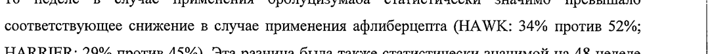
- стр. 4: «эффективно- бмг 2мг (95% ДИ) бмг 2 мг (95% ДИ)» — низкая уверенность: «2» (12); повторное чтение: «эффективио- | о | our _ | er | _ 65% ДИ) | |  6ur | ur | - (95% ДИ) р»  
  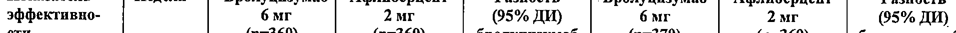
- стр. 5: «1 критериям продолжения инъекций с интервалом | раз/ 12 недель, 85% и 82% пациентов» — низкая уверенность: «1» (29)  
  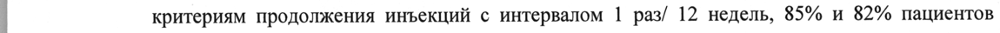
- стр. 7: «| Безопасность и эффективность бролуцизумаба 6 мг оценивали в 2 рандомизированных» — повторное чтение: «| an № a — ии *ponyiuisywaee ° м | — — ° - Г " 7 we a»  
  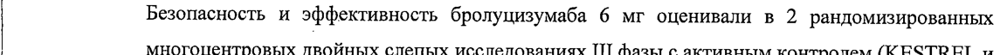
- стр. 7: «= 2 мг. В обоих исследованиях бролуцизумаб (при применении каждые 12 или 8 недель)» — повторное чтение: «- dur. В обоих  оследованиях ‘6  луцизумаб (при применении каждые. 2 ‘nm “§ недель»  
  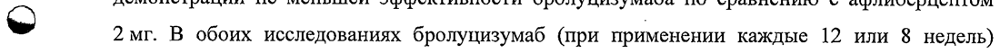
- стр. 8: «оценки б мг 2 мг (95% Cl) б мг 2 мг (95% Cl)» — низкая уверенность: «2» (29), «2» (7); повторное чтение: «щек | |  бм | 2 | 85% CD | 6бм | 2% | 85% CD»  
  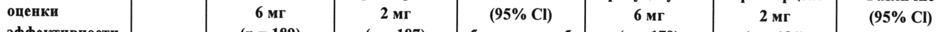
- стр. 9: «| Достигнутые результаты по повышению остроты зрения наблюдались к 52 неделеу 55% и 50%» — повторное чтение: «| В В О В а оОИ»  
  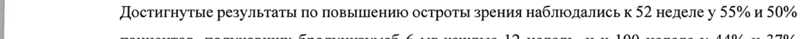
- стр. 9: «| пациентов, получавших бролуцизумаб 6 мг каждые 12 недель или каждые 12/16 недель, в» — повторное чтение: «»  
  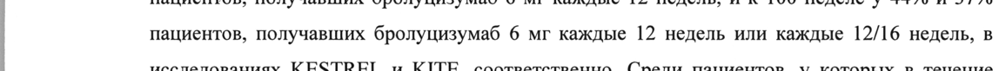
- стр. 9: «| бролуцизумаба 6 мг с интервалом каждые 12 недель, примерно 70% продолжали лечение с» — повторное чтение: «| бролуцизумаба 6 мгс интервалом каждые 12 недель,  примерво 70% продолжали, лечение с»  
  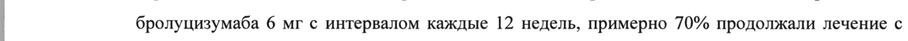
- стр. 11: «функцией почек (>90 мл/мин [п = 21]), с легким (от 60 до <90 мл/мин [п = 22]) или умеренным |» — повторное чтение: «функцией почек (290 мамин [1 =21), слегким (от 60 до <90 nave [1 = 22} или умеренным = |»  
  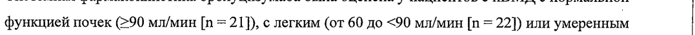
- стр. 11: «(от 30 до <60 мл/мин [п = 7]) нарушением функции почек. Хотя средние значения системного |» — повторное чтение: «(or 30 до <60 whens 70 vapymenven функции over, Xora sponte savers вино |»  
  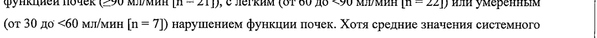
- стр. 15: «> стекловидного тела (5,1%).» — повторное чтение: «- екловидного rena 6, 1%).»  
  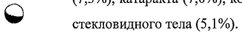
- стр. 17: «фоне лечения, обнаруживались у 23-25% пациентов.» — низкая уверенность: «23-25%» (65); повторное чтение: «фоне лечения, обнаруживались у 23—25% пациентов.»  
  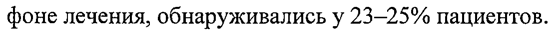
- стр. 20: «Опыт лечения препаратом пациентов с сахарным диабетом с уровнем НЬА1с более 10% или с» — низкая уверенность: «НЬА1с» (65)  
  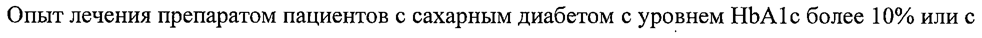
- стр. 23: «| ® Тупая фильтрующая игла на 5 мкм (18G x 1%", 1,2 mm x 40 мм), стерильная. |» — низкая уверенность: «1%",» (80)  
  
- стр. 24: «| & 9 Для введения раствора объемом 0,05 мл медленно |» — повторное чтение: «| @ 2 ря BEGHCHUA раствора GOEeMOM 0.05 ME медленно |»  
  
