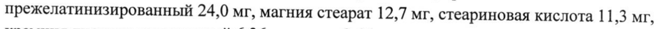
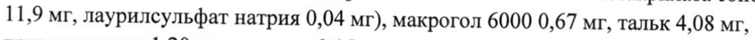
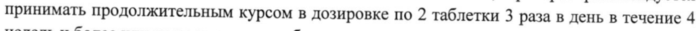
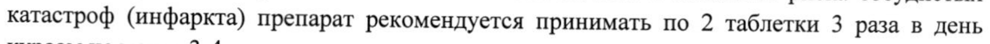

# Бромелаин + Рутозида тригидрат + Трипсин — внутрь

- Препарат: Флогэнзим (таблетки кишечнорастворимые, покрытые пленочной оболочкой;)
- АТХ: L03AX
- Источник: ГРЛС, инструкция по медицинскому применению, РУ П N012753/01, файл от 2025-04-28 (https://grls.rosminzdrav.ru/Grls_View_v2.aspx?routingGuid=935156e1-a5f7-48c7-9259-75b001757700)
- Распознано автоматически (OCR): 6 из 6 стр.
- Инструкция к другому РУ того же препарата: П N012753/01 (национальное РУ, переоформленное по правилам ЕАЭС, решение от 21.04.2025). Текст может быть старше действующего
- Сомнительных строк после OCR: 4 (см. раздел «Проверка распознавания»)

## Общие сведения

Е ИИ lr П №012753/01-220817 МИНИСТЕРСТВО ЗДРАВООХРАНЕНИЯ РОССИЙСКОЙ ФЕДЕРАЦИИ
ИНСТРУКЦИЯ ПО МЕДИЦИНСКОМУ ПРИМЕНЕНИЮ ЛЕКАРСТВЕННОГО ПРЕПАРАТА
ФЛОГЭНЗИМ Внимательно прочитайте эту инструкцию перед тем, как начать применение этого препарата, так как она содержит важную для Вас информацию.
Сохраняйте инструкцию, она может понадобиться вновь.
Если у Вас возникли вопросы, обратитесь к врачу.
Лекарственное средство, которым Вы лечитесь, предназначено лично для Вас, и его не следует передавать другим лицам, поскольку оно может причинить им вред даже при наличии таких же симптомов, что иу Вас.
Регистрационный номер: П №012753/01 от 23.04.2012 г.
Торговое наименование: ФЛОГЭНЗИМ (Phlogenzym®)

## 3. Лекарственная форма

таблетки кишечнорастворимые, покрытые пленочной оболочкой.
таблетки кишечнорастворимые, покрытые пленочной оболочкой.

## 2. Состав

| таблетка кишечнорастворимая, покрытая пленочной оболочкой, содержит:
Ядро:
Действующие вещества: бромелаин 450 FIP Ед. (90,0 mr), трипсин 1440 FIP Ед. (48,0 МГ), рутозида тригидрат 100,0 мг.
Вспомогательные вещества: лактозы моногидрат 148 мг, крахмал прежелатинизированный 24,0 мг, магния стеарат 12,7 мг, стеариновая кислота 11,3 мг, кремния диоксид коллоидный 6,36 мг, тальк 2,46 мг.
Оболочка:
| Пленочная оболочка 11,9 мг (метакриловой кислоты и метилметакрилата сополимер (1:1)
11,9 мг, лаурилсульфат натрия 0,04 мг), макрогол 6000 0,67 мг, тальк 4,08 мг, триэтилцитрат 1,20 мг, ванилин 0,15 мг.
Описание: Круглые, двояковыпуклые таблетки, покрытые пленочной оболочкой желтовато-зеленого цвета, с характерным запахом.
Фармакотерапевтическая группа: противовоспалительное, иммуномодулирующее.
Код ATX: [.03АХ | ФАРМАКОЛОГИЧЕСКИЕ СВОЙСТВА
| ФЛОГЭНЗИМ представляет собой лекарственный препарат новой генерации состоящий из комбинации высокоактивных протеолитических энзимов (ферментов) растительного и
| животного происхождения - бромелаина и трипсина в сочетании с рутином. В комбинации энзимы оказывают плейотропное (множественное) действие, обладая разнообразными фармакологическими действиями на патофизиологические и биохимические процессы.
Энзимы препарата реализуют свои лечебные эффекты через противовоспалительное, иммуномодулирующее, — антиагрегантное, фибринолитическое, тромболитическое,
| противоотечное и вторично анальгезирующее действия. Кишечнорастворимые таблетки препарата, покрытые пленочной оболочкой, транзиторно проходят верхние отделы желудочно-кишечного тракта, не травмируя желудок, всасываются в тонком кишечнике путем резорбции интактных молекул (эндоцитоз, пиноцитоз). Протеазы препарата, связываясь с транспортными белками крови (альфа-2-макроглобулин и альфа-1-
| 103481 РТН Cie a A ei Ето РИ ААВ П NO12753/01-220817 антитрипсин), образуют обратимый комплекс протеаза-антипротеаза, в котором замаскированы антигенные детерминанты экзогенных протеаз препарата, что предотвращает аллергические реакции. В результате образования комплекса с энзимами антипротеаза (альфа-2-макроглобулин) переходит в активную форму, которая выполняет функцию внеклеточного регулятора провоспалительных цитокинов и факторов роста, осуществляя их перенос, клиренс и элиминацию.
Образование активного комплекса протеаза-антипротеаза позволяет безопасно перемещать протеолитические энзимы по сосудистому руслу к очагу воспаления и к месту травмы независимо от места локализации в организме. Комплекс удерживает и замедляет выведение протеолитических энзимов препарата из организма, увеличивает время их циркуляции в сосудистом русле и, соответственно, терапевтический эффект. Попадая в очаг воспаления и раны, протеолитические энзимы расщепляют (гидролизуют) поврежденные белки, ткани и элиминируют (выводят) клеточные отломки (детрит), способствуя ускорению очищения и заживления раны.
Препарат положительно воздействует на ход воспалительного процесса, модулирует защитные реакции организма, что способствует физиологическому течению воспаления на
| разных стадиях. Протеолитические энзимы препарата ускоряют распад медиаторов воспаления, расщепляют иммунные комплексы и мембранные депозиты, повышают активность фагоцитов, естественных киллерных клеток, стимулируют интерфероногенез.
Протеазы препарата снижают уровень провоспалительных цитокинов (ИЛ-1В, ИЛ-6, ИЛ8 ИНФ-у, ®HO-a) и способствуют повышению продукции противовоспалительных цитокинов (ИЛ-4, ИЛ-10 и др.), регулируют уровень иммуноглобулинов и антител крови.
| Энзимы препарата ограничивают патологические проявления аутоиммунных и
| иммунокомплексных процессов, восстанавливают иммунологическую реактивность организма.
Протеазы препарат снижают уровень трансформирующего фактора роста-бэтта повышение которого приводит к избыточному рубцеванию. Протеолитические энзимы оказывают регуляторное воздействие на синхронизацию процессов образования базальной мембраны
(ламинина), модуляцию раневого процесса и экспрессию факторов ангиогенеза
(васкулоэндотелиального фактора роста, фактора роста фибробластов и ряда других факторов). Таким образом, энзимы препарата способствуют улучшению репаративных процессов, предупреждению образования гипертрофических и келоидных рубцов, развитию спаечной болезни после оперативных вмешательств на брюшной полости.
Энзимы препарата расщепляют и удаляют поврежденные ткани, ускоряют рассасывание гематом и отеков за счет нормализации проницаемости стенок сосудов, уменьшения | инфильтрации интерстиция плазматическими белками, увеличения элиминации белкового детрита и депозитов фибрина, улучшения микроциркуляции и трофических процессов в зоне повреждения. Оптимизация протеолитическими энзимами воспалительного процесса за счет уменьшение онкотического давления и отека тканей, снижение давления на нервные окончания, устранение ишемии и нормализация микроциркуляции, прямого протеолиза медиаторов воспаления дает возможность протеазам оказывать вторично анальгезирущее | действие. Одновременно протеолитические энзимы обеспечивают стимуляцию процессов заживления и репарации, снижают риск тромбоэмболических осложнений при длительной иммобилизации, предупреждают развитие трофических нарушений и гнойных осложнений.
Энзимы препарата положительно влияют на улучшение микроциркуляции, повышение доставки кислорода и питательных веществ в рану, уменьшение воспаления в очаге a2 £6 4 п «4 х |
[1 NO12753/01-220817 повреждения, поддержание физиологического процесса регенерации и ускорение восстановления функции органов и тканей.

Препарат улучшает реологические свойства крови (вязкость и текучесть) за счет положительного воздействия на функциональное состояние клеток крови и сосудистой стенки, пластичности (деформабельность) эритроцитов, стабилизации проницаемости эндотелия, повышения фибринолитической активности сыворотки крови, уменьшения плотности адгезивных молекул, снижения агрегации (слипания) тромбоцитов.
Протеолитические энзимы уменьшают количество активированных форм тромбоцитов
(сфероэхиноцитов) и микро и макроагрегатов, таким образом уменьшая риск тромбообразования в сосудах и одновременно участвуют в лизисе образовавшихся тромбов. Протеолитические энзимы уменьшают уровень атерогенных липидов, способствуя повышению липопротеинов высокой плотности, снижению риска развития атеросклероза и сосудистых нарушений.
Препарат улучшает кровоснабжение бронхов и легочной ткани при хронических заболеваниях дыхательных путей, в том числе обусловленных курением, улучшает вязкостные свойства бронхиального секрета, функцию мерцательного эпителия, восстанавливает дренажную функцию бронхов, разжижает мокроту, что облегчает дыхание и уменьшает кашель.
Протеолитические энзимы препарата повышают эффективность антибиотиков, одновременно снижая нежелательные эффекты антибиотикотерапии (дисбиоз, синдром раздраженного кишечника). Протеазы улучшают расщепление субстратов, оптимизируют баланс микробиоты, способствуют восстановлению эндоэкологии кишечника.

## 4.1. Показания к применению

В комплексной терапии и профилактике следующих заболеваний:
В комплексной терапии и профилактике следующих заболеваний:
Хирургия: послеоперационное восстановление и реабилитация больных (улучшение репаративных процессов и регенерации), послеоперационные гнойно-воспалительные осложнения, предупреждение развития спаечной болезни и образования келоидного рубца,
| снижение риска тромбоэмболических осложнений при длительной иммобилизации.
Травматология: переломы костей, повреждения сухожилий и связок, ушибы и гематомы мягких тканей, спортивные травмы, ожоги, улучшение интеграции эндопротезов, остеосинтез.
Ангиология: тромбофлебиты поверхностных вен, посттромботическая болезнь, облитерирующий атеросклероз артерий нижних конечностей и другие хронические ангиопатии, нарушения микроциркуляции, лимфатические отеки (лимфедема).
Урология: острые и хронические воспаления мочеполового тракта (цистит, уретрит,
| простатит).
| Гинекология: сосудистые осложнения климактерического периода, снижение частоты и
| выраженности осложнений заместительной гормональной терапии.
Кардиология: ишемическая болезнь сердца, снижение риска сосудистых катастроф и повторных инфарктов.
Гастроэнтерология: гепатиты.
Ревматология: ревматоидный артрит, анкилозирующий спондилоартрит, реактивный
| артрит, ревматическое поражение мягких тканей.
| Неврология: ишемический инсульт, рассеянный склероз.
Пульмонология: хроническая обструктивная болезнь легких.
Стоматология: предупреждение осложнений в послеоперационный период при экстракции зубов, гнойно-воспалительные заболевания челюстно-лицевой области,
ОИ:
I] NO12753/01-220817 реабилитация и восстановление после хирургических вмешательств на челюстно-лицевой области, улучшение интеграции имплантов, остеосинтез.

## 4.3. Противопоказания

Индивидуальная непереносимость компонентов препарата. Врожденные или

приобретенные нарушения свертываемости крови. Детский возраст.

## 4.3. С осторожностью

(после консультации с врачом)
(после консультации с врачом)

Проведение гемодиализа.

ПРИЕМ ПРЕПАРАТА ПРИ БЕРЕМЕННОСТИ И В ПЕРИОД ГРУДНОГО

ВСКАРМЛИВАНИЯ

Прием препарата с осторожностью после консультации с врачом.

Перед применением препарата, если Вы беременны или предполагаете, что Вы могли бы

быть беременной, или планируете беременность, необходимо проконсультироваться с

врачом. В период грудного вскармливания перед применением препарата необходимо

проконсультироваться с врачом.

## 4.2. Способ применения и дозы

Таблетки препарата принимают внутрь, не менее чем за 30 мин. до еды, не раскусывая,

запивая водой (200 мл). После операции препарат рекомендуется принимать со 2-3 дня.

Лечение

Препарат принимают после травм и операций или остром воспалении для расщепления и

удаления поврежденных тканей, рассасывания гематом, улучшения трофики тканей и

репаративных процессов, уменьшения воспаления и отека, снижения риска осложнений —
| тромбоза, развития спаечной болезни, образования келоидного рубца и нагноения раны, по 3 таблетки 3 раза в день в течение 2 недель. В случае необходимости, для улучшения восстановления и заживления курс приема препарата может быть продлен до 4 недель и

более по 2 таблетки 3 раза в день.

Предупреждение осложнений

Для предупреждения отдаленных последствий после операции — тромбоэмболических
| осложнений, развития спаечной болезни брюшной полости, трофических нарушений при длительном постельном режиме и иммобилизации больного, препарат рекомендуется

принимать продолжительным курсом в дозировке по 2 таблетки 3 раза в день в течение 4

недель и более или на весь срок иммобилизации.

Применение с антибиотиками

При назначении антибиотиков препарат применяется для повышения эффективности

антибиотикотерапии и уменьшения нежелательных эффектов антибиотиков. Препарат

рекомендуется принимать в течение всего курса антибиотикотерапии по 2 таблетки 3 раза

в день.

Применение с гормонами

При назначении длительных курсов гормонов препарат рекомендуется принимать для

снижения риска развития осложнений (тромбозов) по 2 таблетки 3 раза в день в течение

всего курса приема гормональных препаратов. При назначении заместительной

гормональной терапии (ЗГТ) для снижения риска тромбоза вен нижних конечностей,

препарат рекомендуется принимать по 2 таблетки 3 раза в день повторными курсами по 2

недели с перерывами по 3 недели 3-4 раза в год.

Профилактика

Для предупреждения тромбоза вен нижних конечностей и снижения риска сосудистых

катастроф (инфаркта) препарат рекомендуется принимать по 2 таблетки 3 раза в день

курсом не менее 3-4 недель, повторяя курсы приема препарата 3-4 раза в год.

Изменение курса и дозировок препарата рекомендуется после консультации с врачом.
Re Li. 10348 ‘ ро УОРРЕН" I] N012753/01-220817
Если после лечения улучшения не наступает или симптомы усугубляются, или появляются новые симптомы, необходимо проконсультироваться с врачом. Применяйте препарат только согласно тому способу применения и в тех дозах, которые указаны в инструкции.

## 4.8. Побочное действие

Препарат хорошо переносится пациентами. В отдельных случаях может наблюдаться учащение стула, изменение консистенции и запаха стула, которые быстро купируются при временном снижении дозировки препарата. Изредка может возникать аллергическая реакция (кожная сыпь, зуд), которая исчезает после снижения дозы или отмены препарата.
Препарат хорошо переносится пациентами. В отдельных случаях может наблюдаться учащение стула, изменение консистенции и запаха стула, которые быстро купируются при временном снижении дозировки препарата. Изредка может возникать аллергическая реакция (кожная сыпь, зуд), которая исчезает после снижения дозы или отмены препарата.
При нарушении условий применения препарата возможно возникновение тошноты, вздутия и болей в животе, головной боли, головокружения, экзантемы, общей слабости, ощущения переполненности кишечника. Данные состояния исчезают после снижения дозировки или временной отмены препарата.
Если у Вас отмечаются побочные эффекты, указанные в инструкции, или они
| усугубляются, или Вы заметили любые другие побочные эффекты, не указанные в инструкции, сообщите об этом врачу.

## 4.9. Передозировка

Случаев передозировки препарата неизвестно.
Случаев передозировки препарата неизвестно.

## 4.5. Взаимодействие с другими лекарственными средствами

Случаев несовместимости с другими лекарственными средствами не отмечалось.
Применение препарата совместно с антибиотиками повышает эффективность антибиотикотерапии. При применении с гормонами препарат снижает риск тромбообразования.
Если Вы применяете вышеперечисленные или другие лекарственные препараты (в том числе безрецептурные) перед применением препарата Флогэнзим проконсультируйтесь с врачом.

## 4.4. Особые указания

В случае инфекционных процессов ФЛОГЭНЗИМ не заменяет антибиотики.
В случае инфекционных процессов ФЛОГЭНЗИМ не заменяет антибиотики.
| В случае обострения основного заболевания при приеме препарата рекомендуется
| временное снижение дозы препарата или временная отмена препарата после консультации с врачом.
Препарат не является допингом, не оказывает негативного влияния на вождение автомобиля и выполнение работ, требующих высокой скорости психических и физических реакций.
Пациентам, страдающим сахарным диабетом, следует учитывать, что каждая таблетка препарата содержит 0,015 хлебных единиц.

## 4.7. Влияние на способность управлять транспортными средствами, механизмами

СРЕДСТВАМИ, МЕХАНИЗМАМИ Препарат Флогэнзим не влияет на способность управлять транспортными средствами, механизмами. |
УСЛОВИЯ ОТПУСКА Отпускают без рецепта. |

## 6.5. Форма выпуска

Таблетки кишечнорастворимые, покрытые пленочной оболочкой.
Таблетки кишечнорастворимые, покрытые пленочной оболочкой.
По 20 таблеток в ПВХЛТЭ/ИВДХ/алюминиевые блистеры. |
По 2, 5 или 10 блистеров вместе с инструкцией по применению в пачку картонную.
По 800 таблеток во флаконы из полиэтилена высокой плотности. По 1 флакону вместе с инструкцией по применению в пачку картонную.

## 6.4. Условия хранения

При температуре не выше 25 °С.
При температуре не выше 25 °С.
| IT N012753/01-220817 Хранить в недоступном для детей месте!

## 6.3. Срок годности

2 года.
2 года.
Не применять по истечении срока годности.
НАИМЕНОВАНИЕ ЮРИДИЧЕСКОГО ЛИЦА, НА ИМЯ КОТОРОГО ВЫДАНО
РЕГИСТРАЦИОННОЕ УДОСТОВЕРЕНИЕ Мукос Фарма ГмбХ и Ко, КГ, Германия
Мирауштрассе 17, 13509 Берлин, Германия ПРОИЗВОДИТЕЛЬ
Мукос Эмульсионс ГмбХ, Германия Мирауштрассе 17, 13509 Берлин, Германия
ИНФОРМАЦИЯ ДЛЯ ОБРАЩЕНИЙ ПОТРЕБИТЕЛЕЙ За дополнительной информацией обращаться в Представительство фирмы "Мукос Фарма
CZ" (Чешская Республика) в г. Санкт-Петербург:
191025, г. Санкт-Петербург, Невский проспект, д. 114-116, лит. А
Телефоны: (812) 315-9585; (812) 315-9295 mucos@mucos.ru г. Москва, телефоны: (495) 231-2731, (499) 240-0274
KE [i > Представитель фирмы @ и". \ Й ох a Ч. Дасгупта и < > | (a)
WO © Lk 103481 ы
## Проверка распознавания

Страницы-сканы распознаны автоматически. В 4 строках с дозировками цифры могли распознаться с ошибкой — сверьте с вырезкой из оригинала:

- стр. 1: «прежелатинизированный 24,0 мг, магния стеарат 12,7 мг, стеариновая кислота 11,3 мг,» — повторное чтение: «прежелатинизированный 24,0 Mr, магния стеарат 12,7 мг, стеариновая кислота 11,3 мг,»  
  
- стр. 1: «11,9 мг, лаурилсульфат натрия 0,04 мг), макрогол 6000 0,67 мг, тальк 4,08 мг,» — повторное чтение: «| 1,9 мг, лаурилсульфат натрия 0,04 мг), макрогол 6000 0,67 мг, тальк 4,08 ins,»  
  
- стр. 4: «принимать продолжительным курсом в дозировке по 2 таблетки 3 раза в день в течение 4» — повторное чтение: «ли 4 продолжительным курсом в дозировке по 2 таблетки 3 ‘раза в день B течение 4»  
  
- стр. 4: «катастроф (инфаркта) препарат рекомендуется принимать по 2 таблетки 3 раза в день» — повторное чтение: «ивтактроф (инфаркта) препарат рекомендуется принимать по 2 таблетки 3 pasa в день»  
  
