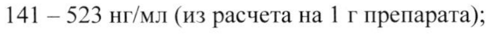
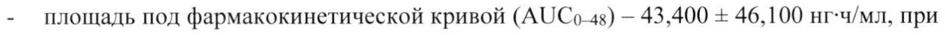
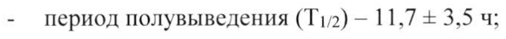

# Бромелаины — парентерально

- Препарат: НексоБрид® (лиофилизат для приготовления геля для наружного применения;)
- АТХ: D03BA03
- Источник: ГРЛС, инструкция по медицинскому применению, РУ ЛП-004965, файл от 2021-10-21 (https://grls.rosminzdrav.ru/Grls_View_v2.aspx?routingGuid=1ddb1ab4-21ef-46f7-9e6e-3314abd2d4cb)
- Распознано автоматически (OCR): 8 из 8 стр.
- Инструкция к другому РУ того же препарата: ЛП-004965 (срок действия истёк, решение от 17.11.2020). Текст может быть старше действующего
- Сомнительных строк после OCR: 3 (см. раздел «Проверка распознавания»)

## Общие сведения

МИНИСТЕРСТВО ЗДРАВООХРАНЕНИЯ РОССИЙОКОЙФВДЕРАЩИИ! |
| ЛП- 004965 - 010818 | СОГЛАСОВАНО | ИНСТРУКЦИЯ
ПО МЕДИЦИНСКОМУ ПРИМЕНЕНИЮ ЛЕКАРСТВЕННОГО ПРЕПАРАТА
НексоБрид® Регистрационный номер:
Торговое наименование препарата: НексоБрид®
Международное непатентованное наименование: бромелаины
| Лекарственная форма: лиофилизат для приготовления геля для наружного применения

## 2. Состав

| 1 флакон с лиофилизатом содержит:
| 1 флакон с лиофилизатом содержит:
действующее вещество: бромелаин - 5.0 г;
вспомогательные вещества: уксусная кислота — 208.8 мг, аммония сульфат — 34.8 мг.
1 флакон с гелевой основой содержит:
вспомогательные вещества: карбомер 980 - 1.0 г, динатрия гидрофосфат безводный — 0.80 г, натрия гидроксид — до pH 7.4, вода для инъекций — до 50 г.
Описание | Лиофилизат: лиофилизат от белого до светло-коричневого цвета.
| Гелевая основа: бесцветная прозрачная гомогенная Macca.
Смесь лиофилизата и геля: гомогенная непрозрачная масса от белого с желтоватым оттенком до светло-коричневого цвета.
Фармакотерапевтическая группа: протеолитическое средство.
Код ATX: DO3BA03.
Фармакологические свойства Фармакодинамика
Входящий в состав препарата протеолитический фермент бромелаин способствует расщеплению ожогового струпа. Кроме того, он активирует коллагеназу в живой ткани, которая расщепляет денатурированный коллаген в струпе.

## 5.2. Фармакокинетика

В исследовании у 16 пациентов с глубокими и средней глубины термическими ожогами при однократном наружном применении препарата НексоБрид® значения фармакокинетических параметров бромелаина составили:

- максимальная концентрация (Cmax) — 6020 + 5020 нг/мл, при этом у пациентов с глубокими ожогами Cmax находилась в диапазоне 788 — 900 нг/мл (из расчета на 1 г препарата), в то время как у пациентов с ожогами средней степени —

141 — 523 нг/мл (из расчета Ha 1 г препарата);

- площадь под фармакокинетической кривой (AUCo-4s) — 43,400 + 46,100 нг-ч/мл, при этом у пациентов с глубокими ожогами AUCo4g находилась в диапазоне 4500 — 9820 нг-ч/мл (из расчета на 1 г препарата), в то время как у пациентов с | ожогами средней степени — 887 — 3930 нг-ч/мл (из расчета на 1 г препарата);

- время достижения максимальной концентрации (Tmax) у 10 из 15 пациентов составляла 2 ч, у 5 из 15 пациентов - 4 4; |

- период полувыведения (T1/2) — 11,7 = 3,5 ч;

- степень системной абсорбции бромелаина зависит как от дозы препарата, так и от степени ожогового поражения.

Согласно литературным данным, приблизительно 50% бромелаина связывается с антипротеиназами плазмы крови — 92-макроглобулин и а!-антитрипсин.

## 4.1. Показания к применению

Препарат НексоБрид® показан для энзиматической некрэктомии (удаления струпа) при термических ожогах П и Ш степени при общей площади повреждения не более 15% от площади поверхности тела.
Препарат НексоБрид® показан для энзиматической некрэктомии (удаления струпа) при термических ожогах П и Ш степени при общей площади повреждения не более 15% от площади поверхности тела.

## 4.3. Противопоказания

® Повышенная чувствительность к компонентам, входящим в состав препарата.
® Повышенная чувствительность к компонентам, входящим в состав препарата.
| e Повышенная чувствительность к папаину и/или веществам, содержащимся в ананасе.
® Химические ожоги, лучевые ожоги.
| e Ожоги электрическим током в связи с отсутствием опыта применения.
e Ожоги в области половых органов и промежности в связи с отсутствием опыта применения.
e Почечная и/или печеночная недостаточность (эффективность и безопасность применения не установлены).
e Беременность, период грудного вскармливания.
a

e Детский возраст до 18 лет (эффективность и безопасность применения не

установлены).

## 4.3. С осторожностью

- ожоги лица;

- _ нарушения свертываемости крови (повышенный риск кровотечения);

- сердечная или легочная недостаточность, в том числе ожог легких или подозрение на ожог легких;

- _ синдром сердечно-легочной недостаточности.
| | Применение при беременности и в период грудного вскармливания

В экспериментальных исследованиях не выявлено данных о тератогенности и

эмбриотоксичности препарата. Тем не менее, в связи с отсутствием необходимых

клинических данных применение препарата НексоБрид®” в период беременности | противопоказано.

Не рекомендуется назначать НексоБрид® в период лактации в связи с отсутствием

достоверных клинических данных, подтверждающих безопасность применения препарата

в этот период. При необходимости применения препарата в период лактации следует

прекратить грудное вскармливание.

## 4.2. Способ применения и дозы

Наружно.

Препарат НексоБрид® должен применяться врачом, имеющим опыт лечения пациентов с ожогами. Препарат НексоБрид® предназначен для обработки ожоговых ран при общей площади ожога не более 15% от площади поверхности тела.

Инструкция по приготовлению геля:

Получение геля должно осуществляться в асептических условиях непосредственно перед

применением. Для приготовления геля содержимое флакона с лиофилизатом следует

аккуратно перенести во флакон с гелем и перемешать в течение | - 2 минут путем интенсивного встряхивания или с использованием стерильного шпателя до образования однородной светло-коричневой массы. Полученный гель предназначен для использования

у одного больного. Препарат следует использовать в течение 15 минут после

приготовления.

Подготовка раны:

За 2 4 до нанесения препарата НексоБрид® на раневую поверхность наносят антибактериальную повязку. Перед нанесением препарата Нексобрид® местно | применяемые антибактериальные средства должны быть удалены, рана должна быть тщательно очищена. В случае наличия волдырей или кератина в ране, их следует удалить.
Во избежание попадания препарата на неповрежденные участки кожи, область вокруг раны, из которой планируется удаление струпа, должна быть обработана стерильным парафином или жирной мазью. Перед непосредственным нанесением препарата
НексоБрид®, рана должна быть смочена стерильным изотоническим раствором натрия | хлорида.
Нанесение препарата:
Свежеприготовленный гель наносят толщиной 1,5-—3Змм на рану, предварительно очищенную и смоченную стерильным 0,9% раствором натрия хлорида. Далее обработанную рану покрывают окклюзионной повязкой, избегая при этом попадания воздуха под нее, и накладывают рыхлую фиксирующую повязку. Повязку оставляют на 4 часа.
Удаление струпа:
Спустя 4 часа после нанесения препарата, окклюзионную повязку и клейкий слой удаляют. Растворенный струп удаляют при помощи стерильных инструментов. Далее рану обрабатывают сначала сухой стерильной марлей/салфеткой, затем стерильной
| марлей/салфеткой, смоченной стерильным изотоническим раствором натрия хлорида до появления розоватой поверхности с точечными кровотечениями или беловатой ткани.
После удаления струпа на рану накладывают антибактериальную повязку в течение 2-х часов. Дальнейшая обработка нерастворенных участков струпа вышеописанным способом
| не проводится.
Уход за раной после удаления струпа:
Для временного закрытия раны после удаления струпа рекомендуется использование ксенотрансплантатов или других раневых покрытий, обеспечивающих антибактериальный эффект и создание оптимальной раневой среды.
Перед нанесением временных покрытий необходимо нанести влажно-высыхающую повязку.
До проведения трансплантации или перед нанесением временных повязок следует проводить обработку и очистку раны.
Трансплантация ткани должна осуществляться как можно раньше после удаления струпа
(при частичном и глубоком повреждении дермы). При глубоких ожогах особенно важно проводить аутодермопластику для восстановления анатомической целостности кожного

покрова.

Режим дозирования препарата в особых группах

Применение у пожилых людей:

Опыт применения препарата НексоБрид® у пациентов старше 65 лет ограничен. При
| назначении препарата НексоБбрид” пожилым людям следует учитывать возрастные особенности, а также наличие сопутствующих заболеваний. Коррекция дозы не требуется.

## 4.8. Побочное действие

| Нежелательные реакции, представленные ниже, перечислены в соответствии с поражением органов и систем органов и частотой встречаемости. Частота встречаемости
| Нежелательные реакции, представленные ниже, перечислены в соответствии с поражением органов и систем органов и частотой встречаемости. Частота встречаемости

определяется следующим образом: очень часто (> 1/10), часто (21/100 и < 1/10),
| нечасто (> 1/1000 и < 1/100), редко (> 1/10000 и < 1/1000), очень редко (< 1/10000), частота не установлена (в настоящее время данные о распространенности побочных |
| реакций отсутствуют). Частота представленных побочных реакций относится к
| применению препарата НексоБрид* у пациентов с термическими ожогами Пи Ш степени с использованием анальгезии и антибактериальных повязок до и после нанесения
| препарата.
| Нарушения со стороны иммунной системы: частота He установлена = —

гиперчувствительность, анафилактические реакции.

Инфекционные и паразитарные заболевания: часто — раневая инфекция, инфекции
| мочевыводящих путей, вирусные инфекции.
| | Нарушения со стороны кожи и подкожных тканей: часто — раневые осложнения

(углубление раны, деструкция ткани).

Общие расстройства и нарушения в месте введения: очень часто — повышение

температуры тела; часто — боль.

## 4.9. Передозировка

Случаев передозировки препарата НексоБрид® до настоящего времени не

зарегистрировано.

## 4.5. Взаимодействие с другими лекарственными средствами

Не следует смешивать препарат НексоБрид*® с другими лекарственными средствами.

| ЕС. аи п |

Поскольку местно применяемые антибактериальные средства могут снижать

эффективность препарата НексоБрид®, перед нанесением препарата на рану они должны

быть удалены, рана должна быть тщательно очищена.

Согласно литературным данным, пероральное применение бромелаина способствует | снижению агрегации тромбоцитов, уровня фибриногена и умеренному увеличению АЧТВ
| и протромбинового времени. В ходе клинических исследований у пациентов не было

выявлено признаков гипокоагуляции. В случае необходимости применения препарата

НексоБрид® с препаратами, влияющими на свертывающую систему крови, следует регулярно контролировать параметры свертывания крови.
| | | Препарат НексоБрид® является ингибитором СУР2С8 и CYP2C9 цитохрома P 450. При | совместном назначении с препаратами, являющимися субстратами СУР2С8 (амиодарон,

амодиахин, хлорохин, флувастатин, паклитаксел, пиоглитазон, репаглинид, росиглитазон,

сорафениб и тораземид) и CYP2C9 (ибупрофен, толбутамид, глипизид, лозартан, целекоксиб, варфарин, фенитоин), может потребоваться коррекция дозы субстратов. |

Бромелаин может усиливать действия фторурацила и винкристина.

Бромелаин может усиливать гипотензивный эффект ингибиторов АПФ.

Бромелаин может усиливать сонливость, вызванную некоторыми лекарственными

препаратами (например, бензодиазепины, барбитураты, наркотические анальгетики,

| антидепрессанты).

## 4.4. Особые указания

| Применять препарат НексоБрид® только согласно тем показаниям, тому способу применения и в тех дозах, которые указаны в инструкции.

Перед приготовлением геля необходимо проверить целостность упаковки флаконов,

входящих в состав препарата НексоБрид®. В случае повреждения упаковки, препарат не

подлежит использованию.

При приготовлении геля следует избегать вдыхания лиофилизата и его попадания на

кожу. Существуют данные, свидетельствующие о способности препарата НексоБрид®

вызывать аллергические реакции немедленного типа, в т.ч. анафилактические реакции. В

случае попадания лиофилизата в глаза или на кожу, они должны быть тщательно промыты

обильным количеством воды. Если существует риск попадания лиофилизата в глаза, их

следует смазать жирной глазной мазью.

Перед нанесением препарата НексоБрид® и удалением струпа требуется применение

анальгетических средств как минимум за 15 минут до проведения процедуры.

При использовании препарата Hexcobpua* следует дополнительно контролировать

| el параметры свертывания крови.
Не рекомендуется использование препарата НексоБрид* для повторного удаления струпа.
Неиспользованный лекарственный препарат или отходы следует утилизировать в соответствии с местными требованиями.
| Не рекомендуется использовать препарат НексоБрид® при химических ожогах, на проникающих ожоговых ранах, на ранах, загрязненных радиоактивными или другими опасными веществами.
Имеются сведения о перекрестной реакции между аллергенами бромелаина и аллергенами
| папаина, латекса, пчелиного яда, пыльцы оливкового дерева.

## 4.7. Влияние на способность управлять транспортными средствами, механизмами

Данные по влиянию применения препарата НексоБрид® на способность управлять автомобилем и другими механизмами отсутствуют. Следует соблюдать осторожность при | управлении автотранспортом и занятиях другими потенциально опасными видами деятельности.

## 6.5. Форма выпуска

Лиофилизат для приготовления геля для наружного применения.
Лиофилизат для приготовления геля для наружного применения.
| По 5 г лиофилизата во флакон бесцветного нейтрального стекла типа II, укупоренный резиновой бромбутиловой пробкой и обжатый алюминиевым колпачком.
По 50 г гелевой основы во флакон из бесцветного боросиликатного стекла типа I, герметично завинчивающийся пропиленовой крышкой с контролем первого вскрытия.
По 1 флакону с лиофилизатом для приготовления геля для наружного применения и по 1 флакону с гелевой основой вместе с инструкцией по медицинскому применению помещают в картонную пачку.

## 6.4. Условия хранения

Хранить при температуре от 2 °С до 8 °С. Не замораживать.
Хранить при температуре от 2 °С до 8 °С. Не замораживать.
Хранить в оригинальной упаковке для защиты от света.
Для гелевой основы дополнительно: хранить в вертикальном положении.
Хранить в недоступном для детей месте.

## 6.3. Срок годности

3 года.
3 года.
Срок хранения приготовленного геля -— не более 15 минут.
| Не использовать после истечения срока годности, указанного на упаковке.
Условия отпуска Отпускают по рецепту.
Держатель (владелец) регистрационного удостоверения
МедиВунд Лтд.
42 ул. Хайаркон, Явне 8122745, Израиль. |
| Производитель МедиВунд Лтд.
42 ул. Хайаркон, Явне 8122745, Израиль.
Наименование и адрес организации, уполномоченной держателем или владельцем регистрационного удостоверения лекарственного препарата на принятие претензий от потребителя
ООО «Генфа»
119421, Москва, Ленинский проспект, д. 99, этаж 2, пом. У, комн. 14-33; 33A; 34-38.
Телефон: (495) 662-50-65.
Факс: (495) 662-50-61. | Телефон горячей линии: 8 (800) 234-02-14. |
Генеральный директор О.В. Калашник ООО «Генфа» Cedi
## Проверка распознавания

Страницы-сканы распознаны автоматически. В 3 строках с дозировками цифры могли распознаться с ошибкой — сверьте с вырезкой из оригинала:

- стр. 2: «141 — 523 нг/мл (из расчета Ha 1 г препарата);» — низкая уверенность: «141» (80)  
  
- стр. 2: «- площадь под фармакокинетической кривой (AUCo-4s) — 43,400 + 46,100 нг-ч/мл, при» — низкая уверенность: «(AUCo-4s)» (43)  
  
- стр. 2: «- период полувыведения (T1/2) — 11,7 = 3,5 ч;» — низкая уверенность: «(T1/2)» (58)  
  
