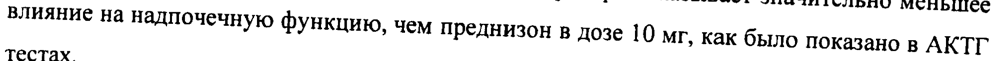
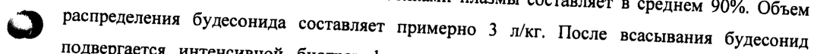
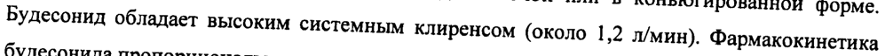
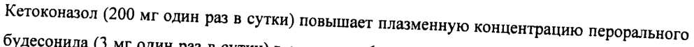
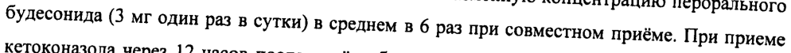
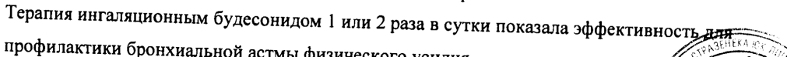
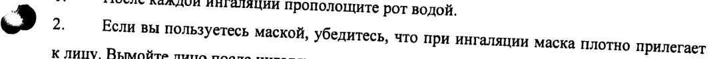

# Будесонид микронизированный — ингаляц

- Препарат: Пульмикорт® (суспензия для ингаляций дозированная;)
- АТХ: R03BA02
- Источник: ГРЛС, инструкция по медицинскому применению, РУ П N013826/01, файл от 2024-01-17 (https://grls.rosminzdrav.ru/Grls_View_v2.aspx?routingGuid=0047dcf7-46e0-4f9a-b3b0-1177390c39ef)
- Распознано автоматически (OCR): 10 из 10 стр.
- Инструкция к другому РУ того же препарата: П N013826/01 (национальное РУ, переоформленное по правилам ЕАЭС, решение от 27.11.2023). Текст может быть старше действующего
- Сомнительных строк после OCR: 7 (см. раздел «Проверка распознавания»)
- Проверено вручную строк: 5

## Общие сведения

П N013826/01-140907 Инструкция по медицинскому применению препарата
Пульмикорт® Регистрационный номер:
Торговое название: Пульмикорт (Pulmicort)
Международное непатентованное название: Будесонид (budesonide)

## 3. Лекарственная форма

суспензия для ингаляций дозированная
суспензия для ингаляций дозированная

## 2. Состав

В | мл суспензии содержится:
В | мл суспензии содержится:
ae | Активный ингредиент: будесонид (будесонид микронизированный) 0,25 мг или 0,5 мг.
Вспомогательные ингредиенты: натрия хлорид, натрия цитрат, эдетат динатрия (натриевая соль этилендиаминтетрауксусной кислоты (двузамещенная) (динатриевая соль ЭДТА), полисорбат 80, лимонная кислота (безводная), вода очищенная.
Описание Легко ресуспендируемая стерильная суспензия белого или почти белого цвета в контейнерах из полиэтилена низкой плотности, содержащих разовую дозу.
Фармакотерапевтическая группа Глюкокортикостероид для местного применения.
Код ATX: RO3BA02 Фармакологические свойства

## 5.1. Фармакодинамика

„т Будесонид, ингаляционный глюкокортикостероид, в рекомендованных дозах оказывает
„т Будесонид, ингаляционный глюкокортикостероид, в рекомендованных дозах оказывает
. противовоспалительное действие в бронхах, снижая выраженность симптомов и частоту обострений бронхиальной астмы с меньшей частотой побочных эффектов, чем при использовании системных глюкокортикостероидов. Уменьшает выраженность отека слизистой бронхов, продукцию слизи, образование мокроты и гиперреактивность дыхательных путей. Хорошо переносится при длительном лечении, не обладает минералокортикостероидной активностью.
Время начала терапевтического эффекта после ингаляции одной дозы препарата составляет несколько часов. Максимальный терапевтический эффект достигается через |- 2 недели после лечения. Будесонид оказывает профилактическое действие на течение бронхиальной астмы и не влияет на острые проявления заболевания. Nike
, ДУ «Я = ALD .\ £ Hof aA Я 7. ы 4 a и 1 le ACT QA г
; / 7. 4 mae Я nak ;
- “+ // АЕ» м. |
. f rs \, 5 №, о / WEN, у у / мл ВЕ | IT NO13826/01-140907
Показано дозозависимое воздействие на содержание кортизола в плазме и моче на фоне приёма Пульмикорта. В рекомендованных дозах препарат оказывает значительно меньшее влияние на надпочечную функцию, чем преднизон в дозе 10 мг, как было показано в АКТГ тестах.

## 5.2. Фармакокинетика

Абсорбция Ингалируемый будесонид быстро абсорбируется. У взрослых системная биодоступность будесонида после ингаляции Пульмикорта суспензии через небулайзер, составляет приблизительно 15% от общей назначаемой дозы и около 40-70% от доставленной. Максимальная концентрация в плазме крови достигается через 30 минут после начала ингаляции.
Абсорбция Ингалируемый будесонид быстро абсорбируется. У взрослых системная биодоступность будесонида после ингаляции Пульмикорта суспензии через небулайзер, составляет приблизительно 15% от общей назначаемой дозы и около 40-70% от доставленной. Максимальная концентрация в плазме крови достигается через 30 минут после начала ингаляции.
Метаболизм и распределение Связь с белками плазмы составляет в среднем 90%. Объем
№ ) распределения будесонида составляет примерно 3 л/кг. После всасывания будесонид подвергается интенсивной биотрансформации (более 90%) в печени с образованием метаболитов с низкой глюкокортикостероидной активностью. Г люкокортикостероидная активность основных метаболитов 6В-гидрокси-будесонида и 169- гидроксипреднизолона составляет менее 1% глюкокортикостероидной активности будесонида.
Выведение Будесонид метаболизируется в основном с участием фермента СУРЗА4.
Метаболиты выводятся в неизмененном виде с мочой или в коньюгированной форме.
Будесонид обладает высоким системным клиренсом (около 1,2 л/мин). Фармакокинетика будесонида пропорциональна величине вводимой дозы препарата.
Фармакокинетика будесонида у детей и пациентов с нарушением функции почек не исследовалась. У пациентов с заболеваниями печени может увеличиваться время
© нахождения будесонида в организме.

## 4.1. Показания к применению

® Бронхиальная астма, требующая поддерживающей терапии глюкокортикостероидами.
® Бронхиальная астма, требующая поддерживающей терапии глюкокортикостероидами.
® Хроническая обструктивная болезнь легких (ХОБЛ).
ПРОТИВОПОКАЗАНИЯ и.
Аи ор в Dis, i e Повышенная чувствительность к будесониду. с 9 oN,
¥, S gf cet р ® Детский возраст до 6 месяцев. Ue eg |, a i з 4..1. Й \ 7
7 Sacre gh.)
/ 12 { и 2 Vy i ;
-- МЕ;
fi яд WA : >, .
| IT NO13826/01-140907 С осторожностью (требуется более тщательное наблюдение за больными): у пациентов с активной формой туберкулеза легких; грибковыми, вирусными, бактериальными инфекциями органов дыхания, циррозом печени; при назначении следует принимать во внимание возможное проявление системного действия глюкокортикостероидов.
ПРИМЕНЕНИЕ ВО ВРЕМЯ БЕРЕМЕННОСТИ И ЛАКТАЦИИ
Беременность: наблюдение за беременными женщинами, принимавшими будесонид, не выявило аномалий развития у плода, тем не менее нельзя полностью исключить риск их развития, поэтому во время беременности в связи с возможностью ухудшения течения бронхиальной астмы следует использовать минимальную эффективную дозу будесонида.
Лактация: Будесонид проникает в грудное молоко, однако при применении Пульмикорта в
№ | терапевтических дозах воздействия на ребенка не отмечено. Пульмикорт может применяться во время грудного кормления.

## 4.2. Способ применения и дозы

Доза препарата подбирается индивидуально. В том случае, если рекомендуемая доза не превышает | мг/сутки, всю дозу препарата можно принять за один раз (единовременно). В случае приема более высокой дозы рекомендуется её разделить на два приёма.
Доза препарата подбирается индивидуально. В том случае, если рекомендуемая доза не превышает | мг/сутки, всю дозу препарата можно принять за один раз (единовременно). В случае приема более высокой дозы рекомендуется её разделить на два приёма.
Рекомендуемая начальная Доза:
Дети om 6 месяцев и старше: 0,25- 0,5 мг в сутки. При необходимости доза может быть увеличена до | мг/сутки.
© Взрослые/пожилые пациенты: 1- 2 мг в сутки.
Доза при поддерживающем лечении:
Дети om 6 месяцев и старше: 0,25- 2 мг в сутки.
Взрослые: 0,5- 4 мгв сутки. В случае тяжелых обострений доза может быть увеличена.
ME SSN .
| «И | к. a he 3 \: Vai ml а” IT NO13826/01-140907
Таблица для определения дозы Объем препарата
Доза, мг Пульмикорт суспензия для ингаляций 0,25 мг/мл 0,5 мг/мл 0,25 1 мл* - 0,5 2 мл - 0,75 Змл - 1 4 мл 2 мл 1,5 - 3 мл 2 - 4 мл
*) следует разбавить 0,9% раствором натрия хлорида до объема 2 мл
® | Для всех пациентов желательно определить минимальную эффективную поддерживающую дозу.
В случае необходимости достижения дополнительного терапевтического эффекта можно рекомендовать увеличение суточной дозы (до 1 мг/сутки) Пульмикорта вместо комбинации препарата с пероральными глюкокортикостероидами, благодаря более низкому риску развития системных эффектов.
Пациенты, получающие пероральные глюкокортикостероиды
Отмену пероральных глюкокортикостероидов необходимо начинать на фоне стабильного состояния здоровья пациента. В течение 10 дней необходимо принимать высокую дозу
Пульмикорта на фоне приема пероральных глюкокортикостероидов в привычной
© дозировке. В дальнейшем в течение месяца следует постепенно снижать дозу пероральных глюкокортикостероидов (например, по 2,5 мг преднизолона или его аналога) до минимальной эффективной дозы. Во многих случаях удаётся полностью отказаться от приёма пероральных глюкокортикостероидов.
Поскольку Пульмикорт, применяемый в виде суспензии с помощью небулайзера, попадает в легкие при вдохе важно проинструктировать пациента вдыхать препарат через мундштук небулайзера спокойно и ровно.
Нет данных о применении будесонида у пациентов с почечной недостаточностью или нарушением функции печени. Принимая во внимание тот факт, что будесонид т if ся путем биотрансформации в печени, можно ожидать увеличения длител # я И a i тия препарата у пациентов с выраженным циррозом печени. {5 ACTS - | \\
; 3 wie a Prone! } /7 4 an Пике oo П №013826/01-140907

## 4.8. Побочное действие

До 10 % пациентов, принимающих препарат, могут испытывать следующие побочные эффекты:
До 10 % пациентов, принимающих препарат, могут испытывать следующие побочные эффекты:
Частые (>1/100) Дыхательные пути: Кандидоз ротоглотки,

раздражение слизистой

оболочки горла, кашель,

охриплость голоса,

сухость во рту.
Редкие (< 1/1000) Общие: Ангионевротический

№ ) отек, головная боль.
Кожа: Крапивница, сыпь, контактный дерматит.
Дыхательные пути: Бронхоспазм Также могут наблюдаться психоневрологические симптомы, такие как нервозность, возбудимость, депрессия, нарушения поведения. Принимая во внимание риск развития кандидоза ротоглотки, пациент должен тщательно полоскать рот водой после каждой ингаляции препарата.
В редких случаях могут возникать симптомы, вызванные системным действием глюкокортикостероидов, включая гипофункцию надпочечников.
© В редких случаях наблюдалось появление кровоподтеков на коже.
Отмечались случаи раздражения кожи лица при использовании небулайзера с маской. Для предупреждения раздражения после использования маски лицо следует вымыть водой.

## 4.9. Передозировка

При острой передозировке клинических проявлений не возникает. При длительном использовании препарата в дозах, значительно превышающих рекомендуемые, может развиться системный глюкокортикостероидный эффект в виде гиперкортицизма и подавления функции надпочечников.
При острой передозировке клинических проявлений не возникает. При длительном использовании препарата в дозах, значительно превышающих рекомендуемые, может развиться системный глюкокортикостероидный эффект в виде гиперкортицизма и подавления функции надпочечников.
у Е хх и (ый NENA :
f aad eddy :
7 ° Cog FIRBEST ESL” В о П №013826/01-140907

## 4.5. Взаимодействие с другими лекарственными средствами

Не наблюдалось взаимодействия будесонида с другими препаратами, используемыми при лечении бронхиальной астмы.
Кетоконазол (200 мг один раз в сутки) повышает плазменную концентрацию перорального будесонида (3 мг один раз в сутки) в среднем в 6 раз при совместном приёме. При приеме кетоконазола через 12 часов после приёма будесонида концентрация последнего в плазме крови увеличивалась в среднем в 3 раза. Информация о подобном взаимодействии при приёме будесонида в виде ингаляции отсутствует, однако предполагается, что и в этом случае следует ожидать увеличение концентрации будесонида в плазме крови. В случае необходимости приема кетоконазола и будесонида следует увеличить время между приёмом препаратов до максимально возможного. Также следует рассмотреть возможность снижения дозы будесонида, Другой потенциальный ингибитор CYP3A4, например,
№ | итраконазол, также значительно повышает плазменную концентрацию будесонида.
Предварительная ингаляция бета-адреностимуляторов расширяет бронхи, улучшает поступление будесонида в дыхательные пути и усиливает его терапевтический эффект.
Фенобарбитал, фенитоин, рифампицин снижают эффективность (индукция ферментов микросомального окисления) будесонида.
Метандростенолон, эстрогены усиливают действие будесонида.

## 4.4. Особые указания

Для сведения к минимуму риска грибкового поражения ротоглотки следует проинструктировать пациента о необходимости тщательно полоскать рот водой после каждой ингаляции препарата.
Для сведения к минимуму риска грибкового поражения ротоглотки следует проинструктировать пациента о необходимости тщательно полоскать рот водой после каждой ингаляции препарата.

[№ Следует избегать совместного назначения будесонида с кетоконазолом, итраконазолом или другими потенциальными ингибиторами СУРЗА4. В случае, если будесонид и кетоконазол или другие потенциальные ингибиторы CYP3A4 были назначены, следует увеличить время между приемом препаратов до максимально возможного.

Из-за возможного риска ослабления функции надпочечников особое внимание необходимо уделять пациентам, которые переводятся с пероральных глюкокортикостероидов на приём
Пульмикорта. Также особое внимание следует уделять пациентам, принимавшим высокие дозы глюкокортикостероидов, или длительно получавшим максимально высокие рекомендованные дозы ингаляционных глюкокортикостероидов. В стрессовых оивхациях у таких пациентов могут проявиться признаки и симптомы На on Чен вой.

ey wie \ \

7 He ACT МЕ ae

fp ° EN Лигу. "о. | и | П №013826/01-140907 недостаточности. При стрессах или в случаях хирургического вмешательства рекомендуется проводить дополнительную терапию системными глюкокортикостероидами.
Особое внимание необходимо уделять пациентам, которые переводятся с системных на ингаляционные глюкокортикостероиды (Пульмикорт) или в случае, когда можно ожидать нарушение гипофизарно-надпочечниковой функции. У таких пациентов следует с особой осторожностью снижать дозу системных глюкокортикостероидов и контролировать гипоталамо-гипофизарно-надпочечниковую функцию. Также пациентам может потребоваться добавление пероральных глюкокортикостероидов в период стрессовых ситуаций, таких как травма, хирургическое вмешательство и т.д.
При переходе с пероральных глюкокортикостероидов на Пульмикорт пациенты могут почувствовать ранее наблюдавшиеся симптомы, такие как мышечные боли или боли B суставах. В таких случаях может понадобиться временное увеличение дозы пероральных wD глюкокортикостероидов. В редких случаях могут наблюдаться такие симптомы как чувство усталости, головная боль, тошнота и рвота, указывающие на системную недостаточность глюкокортикостероидов.
Замена пероральных глюкокортикостероидов на ингаляционные иногда приводит к проявлению сопутствующей аллергии, например, ринита и экземы, которые ранее купировались системными препаратами.
У детей и подростков, получающих лечение глюкокортикостероидами (независимо от способа доставки) в течение продолжительного периода, рекомендуется регулярно контролировать показатели роста. При назначении глюкокортикостероидов следует принимать во внимание соотношение пользы применения препарата и возможного риска замедления роста.

а Применение будесонида в дозе до 400 мкг в сутки у детей старше 3-х лет не приводило к возникновению системных эффектов. Биохимические признаки системного эффекта препарата могут встречаться при приёме препарата в дозе от 400 до 800 мкг в сутки. При превышении дозы 800 мкг в сутки системные эффекты препарата встречаются часто.

Применение глюкокортикостероидов для лечения бронхиальной астмы может вызывать нарушение роста. Результаты наблюдений за детьми и подростками, получавшими будесонид в течение длительного периода (до 11 лет), показали, что рост пациентов достигает ожидаемых нормативных показателей для взрослых.
Терапия ингаляционным будесонидом | или 2 раза в сутки показала эффективност . к профилактики бронхиальной астмы физического усилия. СР
Е “ad a \ “er re /) ia se р Z- 7 МАЛ сн | П NO13826/01-140907

## 4.7. Влияние на способность управлять транспортными средствами, механизмами

МЕХАНИЗМАМИ Пульмикорт не оказывает влияния на способность управлять автомобилем или другими механизмами.
Применение Пульмикорта с помощью небулайзера
Пульмикорт применяется для ингаляций с использованием соответствующего небулайзера, оснащенного мундштуком и специальной маской. Небулайзер соединяется с компрессором для создания необходимого воздушного потока (5- 8 л/мин), объем заполнения небулайзера должен составлять 2- 4 мл.
Важно проинформировать пациента:
~ внимательно прочитать инструкцию по использованию препарата;

uD ` для применения Пульмикорта суспензии не подходят ультразвуковые небулайзеры:

- Пульмикорт суспензию смешивают с 0,9 % раствором натрия хлорида или с растворами тербуталина, сальбутамола, фенотерола, ацетилцистеина, натрия кромогликата и ипратропиума бромида; разбавленную суспензию следует использовать в течение 30 мин.

` После ингаляции следует прополоскать рот водой для снижения развития кандидоза ротоглотки;
~ для предотвращения раздражения кожи после использования маски следует промыть кожу лица водой;
- рекомендуется регулярно проводить очистку небулайзера в соответствии с указаниями изготовителя;
о В случаях, когда ребенок не может самостоятельно сделать вдох через небулайзер, применяется специальная маска.
Как использовать Пульмикорт® с помощью небулайзера
1. Перед применением осторожно встряхните контейнер легким вращательным движением.
2. Держите контейнер прямо вертикально (как показано на рисунке) и откройте его, поворачивая и отрывая “крыло”.
3. Аккуратно поместите контейнер открытым концом в небулайзер и медлениебылавить_ содержимое контейнера. | fs и © " \\
IT №013826/01-140907 , Контейнер, содержащий разовую дозу, маркирован линией. Если контейнер перевернуть, то эта линия будет показывать объем, равный | мл.
Если необходимо использовать только | мл суспензии, содержимое контейнера выдавливают до тех пор, пока поверхность жидкости не достигнет уровня, обозначенного линией.
Открытый контейнер хранят в защищенном от света месте, Открытый контейнер должен быть использован в течение 12 часов.
Перед тем, как использовать остаток жидкости, содержимое контейнера осторожно встряхивают вращательным движением.
Примечание
1. После каждой ингаляции прополощите рот водой.
1% ) 2. Если вы пользуетесь маской, убедитесь, что при ингаляции маска плотно прилегает к лицу. Вымойте лицо после ингаляции.
Очистка Камеру небулайзера, мундштук или маску следует очищать после каждого применения.
Камеру небулайзера, мундштук или маску моют теплой водой, используя мягкий детергент или в соответствии с инструкциями производителя. Хорошо прополощите и высушите небулайзер, соединив камеру с компрессором или входным воздушным клапаном.

## 6.5. Форма выпуска

Суспензия для ингаляций дозированная 0,25 мг/мл и 0,5 мг/мл. По 2 мл препарата в о контейнер из полиэтилена низкой плотности. 5 контейнеров соединены в один лист. Лист из 5 контейнеров упакован в конверт из ламинированной фольги. 4 конверта в картонной пачке с инструкцией по применению.
Суспензия для ингаляций дозированная 0,25 мг/мл и 0,5 мг/мл. По 2 мл препарата в о контейнер из полиэтилена низкой плотности. 5 контейнеров соединены в один лист. Лист из 5 контейнеров упакован в конверт из ламинированной фольги. 4 конверта в картонной пачке с инструкцией по применению.

## 6.4. Условия хранения

При температуре ниже 30°С. Хранить в недоступном для детей месте.
При температуре ниже 30°С. Хранить в недоступном для детей месте.
Препарат в контейнерах должен быть использован в течение 3 месяцев после вскрытия конверта. Открытый контейнер должен быть использован в течение 12 часов, КОРНЕР следует хранить в конверте для защиты их от света. jf <<
He, Ny \\
9 Sa PTE RT Es ome
Й ff , а. | | TT №013826/01-140907 УСЛОВИЯ ОТПУСКА
По рецепту.

## 6.3. Срок годности

2 года. Не применять по истечении срока годности, указанного на упаковке,
2 года. Не применять по истечении срока годности, указанного на упаковке,
НАЗВАНИЕ И АДРЕС ФИРМЫ-ИЗГОТОВИТЕЛЯ АстраЗенека АБ, S- 15] 85 Содерталье, Швеция
Дополнительная информация предоставляется по требованию:
АстраЗенека ЮК Лимитед, 119021 Москва, ул. Тимура Фрунзе д.11 корп.2-5.
| | тел. 495 799 56 99, факс 495 799 56 98
Пульмикорт- товарный знак, собственность компании АстраЗенека.
©AstraZeneca 2006 Менеджер по регистрации | й f Ирина Колотушкина vo ИДКЭЛС fl? | СВ Буданов
„’ i и :
| 4 и $ LF am ох : = ACT! AA. Е НА ra
10 Ve. лек. 52
## Проверка распознавания

Страницы-сканы распознаны автоматически. В 7 строках с дозировками цифры могли распознаться с ошибкой — сверьте с вырезкой из оригинала:

- стр. 2: «влияние на надпочечную функцию, чем преднизон в дозе 10 мг, как было показано в АКТГ» — повторное чтение: «mua на надпочечную функцию, чем преднизон в yore 10 Mr, как было показано 8 АКТЕ»  
  
- стр. 2: «№ ) распределения будесонида составляет примерно 3 л/кг. После всасывания будесонид» — повторное чтение: «‘ > Oe будесонила составляет примерно 3 лиг. Поле, scacinanin бо»  
  
- стр. 2: «Будесонид обладает высоким системным клиренсом (около 1,2 л/мин). Фармакокинетика» — повторное чтение: «ai обладает высоким системным kampencom около | 2 мин) “apnaxonmernes»  
  
- стр. 6: «Кетоконазол (200 мг один раз в сутки) повышает плазменную концентрацию перорального» — повторное чтение: «тонониоя ми т один р утки) повышает плазменную концентрацию перорального»  
  
- стр. 6: «будесонида (3 мг один раз в сутки) в среднем в 6 раз при совместном приёме. При приеме» — повторное чтение: «assem мг один Pee сутки) В среднем вб pas при совместном приёме, При прием»  
  
- стр. 7: «Терапия ингаляционным будесонидом | или 2 раза в сутки показала эффективност . к» — повторное чтение: «Pepin arena булеонидом | или pasa в сути показала эффективность BA»  
  
- стр. 9: «1% ) 2. Если вы пользуетесь маской, убедитесь, что при ингаляции маска плотно прилегает» — низкая уверенность: «1%» (41); повторное чтение: «uD Eo потеть мя yea, то vn  нталяции маска плотно прилегает»  
  
