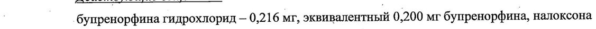
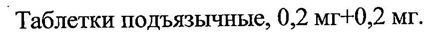

# Бупренорфин + Налоксон — под язык/за щеку

- Препарат: Бупраксон® (таблетки подъязычные;)
- АТХ: N02AE01
- Источник: ГРЛС, инструкция по медицинскому применению, РУ ЛП-003748, файл от 2023-05-04 (https://grls.rosminzdrav.ru/Grls_View_v2.aspx?routingGuid=1bdcc1d6-6798-4d56-b99a-f71673530405)
- Распознано автоматически (OCR): 12 из 12 стр.
- Инструкция к другому РУ того же препарата: ЛП-003748 (национальное РУ, переоформленное по правилам ЕАЭС, решение от 07.04.2023). Текст может быть старше действующего
- Сомнительных строк после OCR: 2 (см. раздел «Проверка распознавания»)

## Общие сведения

РО _ от 05.04.2023 № 6510 Входящий МЗ №4210636
МИНИСТЕРСТВО ЗДРАВООХРАНЕНИЯ РОССИЙСКОЙ ФЕДЕРАЦИИ
| ИНСТРУКЦИЯ ПО МЕДИЦИНСКОМУ ПРИМЕНЕНИЮ ЛЕКАРСТВЕННОГО ПРЕПАРАТА
БУПРАКСОН®

Регистрационный номер: =

Торговое наименование: Бупраксон®

, Группировочное наименование: бупренорфин+налоксон
® Лекарственная форма: таблетки подъязычные

## 2. Состав

Одна таблетка содержит: |

Действующие вещества: : |

| | бупренорфина гидрохлорид — 0,216 Mr, ocampnTennrat 0,200 мг бупренорфина, налоксона гидрохлорид — 0,222 мг, эквивалентный 0,200 мг налоксона

Вспомогательные вещества:

лактозы моногидрат — 27,729 мг, маннитол (маннит) — 18,000 мг, крахмал картофельный
— 9,000 мг, повидон K-17 — 1,233 мг, кросповидон (полипласдон XL-10) — 1,800 мг,

| лимонной кислоты моногидрат — 0,600 мг, магния стеарат — 0,600 мг, кремния диоксид |
| коллоидный (аэросил) — 0,600 мг | © Описание: круглые двояковыпуклые таблетки белого цвета. |
_ Фармакотерапевтическая группа: анальгезирующее наркотическое средство.

Наркотическое средство, внесенное в Список П «Перечня наркотических средств, психотропных веществ и их прекурсоров, подлежащих контролю в Российской
Федерации». `

Код ATX: NO2AE01 | | Фармакологические свойства

Комбинированный лекарственный препарат, содержащий бупренорфин и налоксон. При подъязычном применении фармакологическое действие определяется входящим в состав

_ препарата бупренорфином. | | А Бупренорфин
Бупренорфин — опиоидный анальгетик, полусинтетическое производное тебаина. |
Относится к частичным агонистам |Н-опиоидных рецепторов и частичным антагонистам к-опиоидных рецепторов. Цо выраженности анальгезирующего действия в эквивалентных дозах аналогичен морфину. Как частичный агонист опиоидных рецепторов угнетает дыхание, влияет на гладкую мускулатуру, хотя и в меньшей степени, чем морфин и другие опиаты, имеет меньший по сравнению с ними потенциал развития физической зависимости. В то же время, активация р-опиоидных рецепторов определяет определенный аддиктивный потенциал препарата.
Налоксон © Налоксон — антагонист опиоидных реценторов. Эффективно устраняет или ослабляет эффекты опиатов и опиоидов. Восстанавливает дыхание, уменьшает седативное и эйфоризирующее действие. Может вызывать синдром «отмены» опиатов при их предварительном введении с целью обезболивания или у наркозависимых людей, использующих опиоидные анальгетики. Фармакологическое действие развивается только при парентеральном (внутривенном, внутримышечном, подкожном) нути введения. При.
подъязычном пути введения практически не попадает в системный кровоток и не оказывает эффекта.
Фармакодинамические эффекты отсутствуют. Налоксон практически не проявляет фармакологической активности при приеме внутрь, отношение эффективности налоксона при пероральном и парентеральном введении составляет 1:50.
© Начало действия бупренорфина после подъязычного применения препарата Бупраксон® наступает через 30 минут. Максимальное действие наблюдается через 3 часа.
Длительность анальгезирующего действия — 5 часов.

## 5.2. Фармакокинетика

| Всасывание Бупренорфин |
| Всасывание Бупренорфин |
При подъязычном приеме бупренорфин хоропто всасывается. Системная биодоступность
, составляет около 50-55 %. Максимальная концентрация (Cmax) в плазме крови после приема 0,4 мг бупренорфина достигается через 2 часа и составляет в среднем 1,13 нг/мл.
Налоксон При подъязычном приеме налоксон практически не всасывается. Системная биодоступ2
Ш СООТВЕТСТВУЕТ ЭКСПЕРТНОМУ ОТЧЕТУ от 05.04.2023 № 6510 ность составляет менее 5 %. Концентрации в ‚ плазме кровииевлзйотся значительными. =
Распределение | Бупренорфин Бупренорфин хорошо проникает через гематоэнцефалический барьер. На 96 % связывается с белками плазмы крови, в первую очередь с a- и В-глобулинами. Объем распределения (Vd) бупренорфина составляет 2,5 л, что отражает высокую степень его проникновения в ткани.
Налоксон Налоксон на 45 % связывается с белками плазмы крови, главным образом, с альбумином.
Метаболизм | Бупренорфин | Бупренорфин подвергается метаболизму в печени путем М№-дезалкилирования с
> образованием норбупренорфина с участием изофермента CYP3A4, с последующим глюкуронированием, с образованием конъюгатов с глюкуроновой кислотой. Основной метаболит — норбупренорфин не обладает существенной анальгезирующей активностью и так же подвергается глюкуронированию.
| Налоксон | . | Согласно проведенным клиническим исследованиям налоксон обладает низкой биодоступностью (946 %) при подъязычном применении. Всосавшиеся незначительные количества налоксона, входящего в состав препарата Бупраксон®, не создают терапевтических концентраций в плазме крови и не оказывают влияния на эффекты и
| метаболизм бупренорфина.
© Налоксон быстро метаболизируется в печени, подвергаясь прямой глюкуронизации до налоксон-3-глюкуронида а также М-дезалкилированию и — восстановлению
| (по 6б-оксогруппе).
Выведение | | Бупренорфин Период полувыведения (T12) бупренорфина из плазмы крови составляет 2,5-8,5 часов.
Выведение метаболитов осуществляется почками (30 %) и с желчью (69 %). Всего около
° 1% препарата выделяется в неизмененном виде.
Налоксон Ti2 налоксона составляет 2-12 часов. Метаболиты выводятся преимущественно почками.
| 3 a a Показания к применению | | (Входящий МЗ №4210636)} |
Болевой синдром средней и сильной интенсивности.

## 4.3. Противопоказания

— гиперчувствительность к бупренорфину, налоксону и другим компонентам препарата,
— гиперчувствительность к бупренорфину, налоксону и другим компонентам препарата,
— состояния, которые могут повлечь за собой нарушение дыхания либо уже сопровождаются угнетением дыхательного центра или выраженным угнетением центральной нервной системы (ЦНС);
— одновременное применение с ингибиторами моноаминоксидазы (МАО), как в течение всего периода применения ингибиторов МАО, так и в течение 14 дней после их отмены
(см. раздел «Взаимодействие с другими лекарственными препаратами»);
— стоматит и мукозит, язвенно-некротические и воспалительные поражения слизистой оболочки полости рта;
> — лекарственная зависимость, в том числе опиоидная;
— судорожные состояния; | — черепно-мозговая травма; |
— острая алкогольная интоксикация;
_ бронхиальная астма, астматический статус;
— сердечно-легочная недостаточность;
— нарушения ритма сердца (наджелудочковая и желудочковая пароксизмальная тахикардия, фибрилляция и трепетание предсердий, фибрилляция и трепетание желудочков, экстрасистолия);
| — паралитический илеус; | © — острые хирургические заболевания органов брюшной полости до установления диагноза; |
— беременность и период грудного вскармливания;
— возраст до 18 лет;
— непереносимость лактозы, дефицит лактазы, глюкозо-галактозная мальабсорбция (см.
раздел «Особые указания»).

## 4.3. С осторожностью

— дыхательная недостаточность;
— печеночная и/или почечная недостаточность;
— микседема;
— гипотиреоз;
Se . о СООТВЕТСТВУЕТ ЭКСПЕРТНОМУ ОТЧЕТУ — надпочечниковая недостаточность; | | (Входящий МЗ №4210636)} |
— угнетение ЦНС;
— токсический психоз;
— гиперплазия предстательной железы;
— стриктуры уретры;
— алкоголизм;
— пожилой и старческий возраст;
— кариес, дефекты зубной эмали, инфекции полости рта;
— при длительном применении препарата возникает риск снижения уровня половых гормонов; | |
— совместное применение с препаратами, снижающими порог судорожной готовности
(ингибиторы обратного захвата серотонина, серотонина-эпинефрина, трициклические
> антидепрессанты, антипсихотические ЛС).
| Применение при беременности и в период грудного вскармливания
Беременность Препарат противопоказан к применению при беременности и в период грудного вскармливания. Контролируемые исследования применения подъязычных таблеток
Бупраксок® не проводились. Потенциальный риск для человека неизвестен.

При применении препарата в конце беременности бупренорфин может вызвать угнетение дыхания у новорожденного, даже после короткого периода применения. Длительное применение бупренорфина в течение последних трех месяцев беременности может вызвать абстинентный синдром у новорожденных (в том числе гипертония, тремор, неонатальная ажитация, миоклонус или судороги). Синдром, как правило, может

> . | | —- протекать от нескольких часов до нескольких дней после родов. .
Грудное вскармливание Неизвестно, экскретируется ли налоксон с грудным молоком. Бупренорфин и его метаболиты экскретируются из организма через материнское молоко.
В исследовании на животных, у крыс при применении бупренорфина было установлено, что он ингибирует лактацию. Таким образом, грудное вскармливание следует прекратить на время лечения препаратом Бупраксон®.
Фертильность Исследования на животных. показали снижение женской фертильности при применении бупренорфина в дозах, многократно превосходящих среднюю суточную дозу для человека. |
СООТВЕТСТВУЕТ ЭКСПЕРТНОМУ ОТЧЕТУ Способ применения и дозы | = “(Входящий МЗ №4210636) |
Таблетки Бупраксон® помещают под язык и удерживают под языком до полного растворения. ,
Дозу подбирают индивидуально. Продолжительность лечения и дозы должны
’ определяться врачом.
Рекомендованные дозы | Разовая доза для взрослых составляет 1 или 2 таблетки. Повторное применение препарата в аналогичной дозе возможно каждые 6-8 часов.
Максимальная разовая доза — 2 таблетки, максимальная суточная доза составляет 8 таблеток.
Дозу препарата Бупраксон® необходимо уменьшать у пациентов пожилого возраста, при
© гиповолемических состояниях, при риске хирургической патологии, при одновременном применении седативных средств и других наркотических анальгетиков.
Препарат Бупраксон® в уменыпенных дозах следует применять на фоне действия средств для общей анестезии, снотворных препаратов, анксиолитиков, антидепрессантов и нейролептиков во избежание чрезмерного угнетения ЦНС и подавления активности
| дыхательного центра. | | | | Побочное действие
| `Информация о частоте возникновения побочных эффектов представлена на основании данных, полученных при проведении клинических исследований и данных литературы. |
Нежелательные явления сгруппированы в соответствии с классификацией органов и систем органов MedDRA, в пределах каждой группы перечислены в порядке уменьшения.
© значимости.
Частота возникновения побочных эффектов определялась в соответствии с
. классификацией Всемирной Организации Здравоохранения: очень часто (> 1/10), часто =
(> 1/100, < 1/10), нечасто (< 1/1000, < 1/100), редко (> 1/10000, < 1/1000), очень редко
(< 1/10000), включая отдельные сообщения.

## 4.8. Побочное действие

Бупраксона® определяются входящим в его состав бупренорфином.
Бупраксона® определяются входящим в его состав бупренорфином.
Нарушения со стороны иммунной системы: редко — сыпь, крапивница. |
Нарушения со стороны обмена веществ и питания: редко — потливость. |
Нарушения психики: частота неизвестна — делирий. | |
Нарушения со стороны нервной системы: очень часто — седация, часто — слабость, головокружение, головная боль; редко — спутанность сознания, сонливость,
| 6 р | СООТВЕТСТВУЕТ ЭКСПЕРТНОМУ ОТЧЕТУ от 05.04.2023 № 6510 слабость/утомляемость, заторможенность! | замедлениволекоробти \-пейхических и — двигательных реакций, невнятная речь, парестезия, эйфория, нервозность, депрессия,
TICHXO3.
При длительном применении возможно развитие привыкания и опиоидной зависимости.
При одновременном применении препаратов, снижающих порог судорожной готовности
(ингибиторы обратного захвата серотонина, серотонина-эпинефрина, трициклические антидепрессанты, антипсихотики), увеличивается риск развития судорог.
Нарушения со стороны органа зрения: часто — миоз, нечеткость зрения, диплопия, очень редко — конъюнктивит. |
Нарушения со стороны органа слуха и лабиринтные нарушения: редко — шум в ушах.
Нарушения со стороны сердечно-сосудистой системы: часто — повышение
© артериального давления; редко — тахикардия, брадикардия, озноб/ощущение холода,
«приливы» крови. | Нарушения со стороны дыхательной системы, органов грудной клетки и средостения:
редко — угнетение дыхательного центра, одышка, гиповентиляция.
| Нарушения со стороны желудочно-кищечного тракта: часто — тошнота; редко — рвота, сухость BO рту, запор; частота неизвестна — кариес, дефекты зубной эмали, инфекции полости рта, потеря зуба (удаление вследствие лечения указанных стоматологических заболеваний).
Нарушения со стороны кожи и подкожных тканей: редко — цианоз, зуд. |
Нарушения со стороны почек и мочевыводящих путей: редко — задержка мочеиспускания.
Если любые из указанных в инструкции побочных эффектов усугубляются, или Вы
& заметили любые другие побочные эффекты, не указанные в инструкции, сообщите об этом врачу. |

## 4.9. Передозировка

- _ Симптомы передозировки определяются входящим в состав бупренорфином.
- _ Симптомы передозировки определяются входящим в состав бупренорфином.
Симптомы: тошнота, рвота, седация, сонливость, миоз, угнетение дыхания.
Лечение: парентеральное введение налоксона в дозе 0,4-2,0 мг. Если применение в указанной дозе не приносит ожидаемого эффекта, введение в той же дозе повторяют через 2-3 минуты. Введение налоксона, даже в больших дозах, не всегда приводит к восстановлению ‘адекватного дыхания, в связи с этим, проводят мероприятия, направленные на поддержание адекватной легочной вентиляции и деятельности
’ сердечно-сосудистой системы. При необходимости проводят симптоматическую терапию.
| 7 SY СООТВЕТСТВУЕТ ЭКСПЕРТНОМУ ОТЧЕТУ | от 05.04.2023 № 6510

## 4.5. Взаимодействие с другими лекарственными средствами

`° Потенцирует действие нейролептиков, бензодиазепинов, фенотиазинов, а также других транквилизаторов; анксиолитиков, седативных, снотворных средств, общих анестетиков, антигистаминных препаратов, этанола. |
При сочетании с ингибиторами МАО может развиться злокачественная гипертермия, | судороги, кома, артериальная гипертензия. | |
При сочетании Бупраксона® с «полными опиоидными агонистами», возможно развитие синдрома «отмены» опиатов. |
При применении с вальпроевой кислотойвальпроатом натрия возрастает угнетающее действие на ЦНС.
При приеме других анальгетиков может повышаться давление цереброспинальной жидкости, поэтому Бупраксон® следует применять с осторожностью в случаях, когда
© давление цереброспинальной жидкости может быть увеличено, так как бупренорфин может приводить к миозу и изменению уровня сознания.
Препараты, ингибирующие активность изофермента CYP3A4 (кетоконазол, макролиды, эритромицин и др.) или ингибиторы ВИЧ-протеазы (ритонавир) могут усилить эффекты
| и длительность действия бупренорфина, что потребует коррекции дозы одного или обоих препаратов. | |
| При совместном. приеме с индукторами изофермента CYP3A4 (в том числе
- фенобарбитал, карбамазепин, фенитоин, рифампицин) концентрация бупренорфина в
‚о плазме крови может снижаться. Поскольку взаимодействие бупренорфина со всеми индукторами изофермента СУРЗА4 не изучалось, рекомендуется контролировать состояние пациентов, получавших Бупраксон®, таблетки подьязычные, на наличие
> _ признаков и симптомов синдрома «отмены».
Фитопрепараты способны оказывать влияние на фармакологическую активность бупренорфина. Зверобой продырявленный, как индуктор изофермента СУРЗА4, способен снижать концентрацию бупренорфина в плазме крови.
| Этанол усиливает угнетение ЦНС бупренорфином. На время лечения необходимо
| отказаться от спиртных напитков. | ‚ При совместном приеме с антидепрессантами и противомигренозными лекарственными
- средствами возникает риск развития серотонинового синдрома.
Серотониновый синдром является потенциально опасным для жизни состоянием.
Симптомы серотонинового синдрома могут включать изменение психического состояния
(например, возбуждение, галлюцинации, кома), расстройство вегетативной нервной =~
—————— ЖЖ ЖЖ ЖЖ ЖЖ ЖЖ ЖЖ ЖЖ ЖЖ ЖЖ ЖЖ от 05.04.2023 № 6510

системы (например, тахикардия, лабильное § артериальнбе давление фипертермия), нервно- | мышечные патологии (например, гиперрефлексия, нарушение координации, ригидность мышц) и/или симптомы со стороны желудочно-кишечного тракта (например, тошнота,

| рвота, диарея). | Особые указания | Включение налоксона в состав препарата Бупраксон® сделано с целью увеличения — наркологической безопасности при использовании последнего. В случае немедицинского

| применения таблеток препарата Бупраксовн® (в связи с наличием в составе наркотического анальгетика), налоксон будет блокировать эффекты бупренорфина и не приведет к действию, достижение которого преследуется при злоупотреблении бупренорфином. У лиц с физической зависимостью к опиоидам это может привести к развитию синдрома
«отменых.

& Пациенты с печеночной недостаточностью (о |
Бупренорфин метаболизируется в печени. У пациентов с нарушением функции печени интенсивность и длительность действия препарата могут изменяться. Применение подъязычных таблеток Бупраксон® у таких пациентов должно контролироваться специалистом. | | | |
Пациенты с почечной недостаточностью Фармакокинетика бупренорфина при почечной недостаточности не изменяется. |
Никотинзависимые пациенты Никотин снижает фармакологическую активность препарата.

Препарат содержит лактозу Лекарственный препарат Бупраксон® в составе вспомогательных веществ содержит

О лактозу, которая может оказывать клинически значимое действие на лиц с ее непереносимостью, имеющих дефицит лактазы, глюкозо-галактозную мальабсорбцию.
Надпочечниковая недостаточность >, При применении бупренорфина, как и в случае других опиоидов, возможно развитие редкого, но - серьезного состояния, связанного с недостаточной выработкой ` надпочечниками кортизола. Необходимо пристальное наблюдение пациентов при появлении симптомов недостаточности надпочечников: тошнота, рвота, потеря аппетита, усталость, слабость, головокружение, снижение артериального давления. При подозрении на развитие недостаточности надпочечников необходимо проведение соответствующих

диагностических тестов. При подтверждении диагноза показано лечение препаратами
И | СООТВЕТСТВУЕТ ЭКСПЕРТНОМУ ОТЧЕТУ | oT 05.04.2023 № 6510 - кортикостероидов, a также снижение дозн ги постеиенназдювмена бупренорфина (если | применимо). |
Снижение уровня половых гормонов При длительном применении бупренорфина, как и в случае других опиоидов, может наблюдаться снижение уровня половых гормонов. Пациенты могут отмечать снижение либидо, эректильную дисфункцию, аменорею, бесплодие.
Совместное применение с препаратами, снижающими порог судорожной готовности
При одновременном применении препаратов, снижающих порог судорожной готовности
(ингибиторы обратного захвата серотонина, серотонина-эпинефрина, трициклические антидепрессанты, антипсихотики), увеличивается риск развития судорог.
Стоматологические нарушения Сообщалось о случаях кариеса, дефектов зубной эмали и инфекциях полости рта у
= пациентов, принимавших диснергируемые в полости рта препараты бупренорфина, в том
| числе у пациентов, не имевших стоматологических заболеваний в анамнезе. В ряде случаев данные нарушения затрагивали несколько зубов и могли приводить к удалению зуба. Среднее время до развития заболеваний полости рта составляло примерно 2 года от. |
| начала терапии, однако в некоторых случаях стоматологические проблемы возникали уже
| | через 2 недели после начала лечения.
Пациенты, принимающие диспергируемые в полости рта препараты бупренорфина,
| должны следовать дополнительным мерам минимизации риска серьезных проблем с зубами. После того, как лекарство полностью растворится, необходимо аккуратно прополоскать рот болышим глотком воды и проглотить воду. С целью избежать повреждения тканей полости рта чистить зубы рекомендуется не ранее чем через час
> после приема препарата. Необходимо сообщать своему лечащему врачу о возникшей
| стоматологической проблеме, а также запланировать посещение стоматолога вскоре после начала приема и регулярно в течение приема препарата. Необходимо сообщить стоматологу о приеме бупренорфина, а также о случаях возникновения каких-либо проблем с зубами или деснами.

## 4.7. Влияние на способность управлять транспортными средствами, механизмами

В период лечения необходимо воздерживаться от вождения автотранспорта и занятий потенциально опасными видами деятельности, требующими повышенной концентрации внимания и быстроты психомоторных реакций.
| 10 о от 05.04.2023 № 6510 Входящий МЗ №4210636

## 6.5. Форма выпуска

Таблетки подъязычные, 0,2 mr+0,2 мг.
Таблетки подъязычные, 0,2 mr+0,2 мг.
— По 10 таблеток в контурную ячейковую упаковку из пленки поливинилхлоридной и фольги алюминиевой или гибкой упаковки на основе алюминиевой фольги.
1 или 2 контурные ячейковые упаковки вместе с инструкцией по применению помещают в пачку из картона.
По 100, 200, 400 контурных ячейковых упаковок вместе с 100, 200, 400 инструкциями по применению упаковывают в коробки из картона или в ящики из гофрированного картона
(для стационаров). | В каждую коробку из картона или в ящик из гофрированного картона (для стационаров)
вкладывают талон с номером упаковщика и талон «Проверил».
> ’ Условия хранения В соответствии с правилами хранения наркотических средств, внесенных в Список И
«Перечня наркотических средств, психотропных веществ и их прекурсоров, подлежащих контролю в Российской Федерации». |
В сухом, защищенном от света месте при температуре не выше 25 °С. .
| Хранить в недоступном для детей месте. |

## 6.3. Срок годности

4 года. Не применять после истечения срока годности, указанного на упаковке.
4 года. Не применять после истечения срока годности, указанного на упаковке.
Условия отпуска. | . Отпускают по рецепту с ограничениями, предусмотренными для наркотических
. препаратов.
& | Производитель:
| Федеральное государственное унитарное предприятие «Московский эндокринный завод»
Юридический адрес: 109052, г. Москва, ул. Новохохловская, д. 25
| Производство готовой лекарственной формы: . | г. Москва, ул. Новохохловская, д. 25, стр. 2
Выпускающий контроль качества:
г. Москва, ул. Новохохловская, д. 25, стр. 1
Владелец регистрационного удостоверения/наименование, адрес организации, принимающей претензии потребителя: |
Федеральное государственное унитарное предприятие «Московский эндокринный завод»
| СООТВЕТСТВУЕТ ЭКСПЕРТНОМУ ОТЧЕТУ _ от 05.04.2023 № 6510
Россия, 109052, г. Москва, ул. Новохохловская, д.25 \” ходящий МЗ №4210636}
Тел./факс: (495) 678-00-50/911-42-10 http://www.endopharm.ru
Начальник управления по внедрению (a LZ _и регистрации лекарственных препаратов. === ый
FO OL УНИИ, ФГУП «Московский эндокринный завбй; > EN Gi | | О.В. Баклыкова f 9 oO NN 5 ) OBcK ~ \\h cA el "9K Our [Е
© | es 1 ьй
## Проверка распознавания

Страницы-сканы распознаны автоматически. В 2 строках с дозировками цифры могли распознаться с ошибкой — сверьте с вырезкой из оригинала:

- стр. 1: «| | бупренорфина гидрохлорид — 0,216 Mr, ocampnTennrat 0,200 мг бупренорфина, налоксона» — повторное чтение: «|  бупренорфина  идрохлорид — 0,216 мг, ocampnTennrat 0,200 мг бупренорфина, налоксона»  
  
- стр. 11: «Таблетки подъязычные, 0,2 mr+0,2 мг.» — повторное чтение: «Таблетки подъязычные, 0,2 мг+0,2 мг.»  
  
