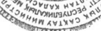

# Вакцина для профилактики дифтерии — парентерально

- Препарат: АДАСЕЛЬ® (суспензия для внутримышечного введения)
- АТХ: J07AJ52
- Источник: ОХЛП, Единый реестр ЛС ЕАЭС, запись 64898b8ffb44f11a427a1536, документ от 2026-06-08
- Распознано автоматически (OCR): 2 из 34 стр.
- Сомнительных строк после OCR: 2 (см. раздел «Проверка распознавания»)

## Общие сведения

ДӘРІЛІК ПРЕПАРАТТЫҢ ЖАЛПЫ СИПАТТАМАСЫ
1. ДӘРІЛІК ПРЕПАРАТТЫҢ АТАУЫ
Адасель, 0,5 мл/доза, бұлшықет ішіне енгізуге арналған суспензия.
Күл (құрамында антигені аз), көкжөтел (құрамында антигені аз, жасушасыз) және сіреспе профилактикасына арналған адсорбцияланған вакцина
2. САПАЛЫҚ ЖӘНЕ САНДЫҚ ҚҰРАМЫ
1 доза (0,5 мл) құрамында мынадай әсер етуші заттар бар:
Сіреспе анатоксині, адсорбцияланған1
5 Lf (20 ХБ кем емес)
Күл анатоксині, адсорбцияланған1
2 Lf (2 ХБ кем емес)
Жасушасыз көкжөтелге қарсы вакцина, құрамында:

көкжөтел анатоксині (КА), адсорбцияланған1 2,5 мкг филаментозды гемагглютинин (ФГА), адсорбцияланған1 5 мкг 2 және 3 типтегі фимбрий (ФИМ)
агглютиногендері, адсорбцияланған1 5 мкг пертактин (ПРН), адсорбцияланған1 3 мкг 1 – алюминий фосфатына адсорбцияланған (алюминийге шаққанда) – 1,5 мг (0,33 мг).
Вакцинаның 1 дозасында (0,5 мл) аз мөлшерде болатын өндірістік процестің қалдық өнімдері (олардың есептік саны көрсетілген): формальдегид (≤ 5 мкг) және глутаральдегид
(< 50 нг).
Қосымша заттардың толық тізбесі 6.1-бөлімде келтірілген.
Вакцина Тиісті өндірістік практика (GMP) талаптарына сәйкес келетін жағдайларда өндірілген.
3. ДӘРІЛІК ТҮРІ
Бұлшықет ішіне енгізуге арналған суспензия.
Ақ түсті, бұлыңғыр, біртекті суспензия.
4. КЛИНИКАЛЫҚ ДЕРЕКТЕР
4.1. Қолданылуы 4 жастағы және одан асқан тұлғаларда сіреспеге, күлге және көкжөтелге қарсы ревакцинация.
Жүкті әйелдерді иммундау арқылы нәрестелік кезеңде балаларды көкжөтелден пассивті қорғау (4.2, 4.4, 4.6 және 5.1 бөлімдерін қараңыз).
4.2. Дозалау режимі және қолдану тәсілі
Вакцинаның бір реттік дозасы 0,5 мл құрайды.

Қажет болған жағдайда, ұлттық ұсынымдарға сәйкес, Адасель вакцинасын жасы үлкен балалар мен ересектердегі күлге, сіреспеге және көкжөтелге қарсы ревакцинациялау үшін күл мен сіреспеге қарсы вакцинаның орнына қолдануға болады.
Қарым-қатынас орын алған жағдайда күлге профилактика жүргізу мүмкіндігі бойынша деректер жоқ.
Адасель вакцинасы жүкті әйелдерге жүктіліктің екінші немесе үшінші триместрінде балаларды көкжөтелден пассивті қорғауды қамтамасыз ету үшін тағайындалуы мүмкін (4.1, 4.4, 4.6 және 5.1 бөлімдерді қараңыз).
Қолдану тәсілі Вакцина иықтың дельта тәрізді бұлшықетіне бұлшықетішілік енгізіледі.
Вакцинаны бөксе бұлшықетіне енгізуге болмайды.
Вакцинаны тамырішілік енгізуге тыйым салынады. Енгізу алдында иненің қан тамырына енбегеніне көз жеткізу керек.
Вакцинаны тері астына енгізуге болмайды.
Вакцинаны енгізуге дайындау жөніндегі және кейіннен қалдықтарды утилизациялауға нұсқаулықтар 6.6-бөлімде келтірілген.
4.3. Қолдануға болмайтын жағдайлар  Ауыр аллергиялық реакциялар:
 Адасель вакцинасының әсер етуші заттарының кез келгеніне;
 6.1-бөлімде келтірілген вакцинаның қосымша заттарының кез келгеніне;
 бұрын осы вакцина немесе құрамында сондай заттар бар вакцина енгізілгеннен кейін.
 Үдемелі неврологиялық аурулар, бақыланбайтын эпилепсия немесе үдемелі энцефалопатия.
 Басқа себеп анықталмаса, құрамында көкжөтел антигендері бар вакцинаны енгізгеннен кейін 7 күн ішінде дамыған энцефалопатия (мысалы, кома, сананың бұзылуы, қайталанатын құрысулар).
 Дене температурасының жоғарылауымен, сондай-ақ жедел аурумен немесе созылмалы аурудың өршуімен бірге жүретін ауруларда вакцинацияны қалпына келгенге немесе ремиссияға дейін кейінге қалдыру керек.
4.4. Айрықша нұсқаулар және қолдану кезіндегі сақтандыру шаралары
Кез келген басқа вакцина сияқты, Адасель вакцинасы барлық егілген тұлғаларда 100% қорғауды қамтамасыз етпеуі мүмкін.

Анамнезінде бастапқы вакцинациясы аяқталмаған немесе бұрын жүргізілген вакцинация туралы ақпарат жоқ тұлғаларға Адасель вакцинасын енгізуге болады. Алайда, бустерлік жауап тек алдын-ала вакцинацияланған немесе ауруға шалдыққан адамдарда байқалады.
Аса жоғары сезімталдық Вакцина өндірісінде қолданылатын және дайын дәрілік түрде аз мөлшерде болатын формальдегид пен глутаральдегид аса жоғары сезімталдық реакцияларын тудыруы мүмкін.
Неврологиялық бұзылыстар Егер Гийен-Барре синдромы құрамында сіреспе анатоксині бар вакцинаны енгізгеннен кейін 6 апта ішінде дамитын болса, әлеуетті пайда мен ықтимал қауіптің арақатынасын мұқият бағалау негізінде Адасель вакцинасын немесе құрамында сіреспе анатоксині бар басқа вакцинаны енгізу туралы шешім қабылдануы керек.
Пациенттердің ерекше топтары.
Иммундық статустың өзгеруі Иммунитеті әлсіреген пациенттерде (аурудың салдарынан немесе иммуносупрессиялық терапия нәтижесінде) күтілетін иммундық жауапқа қол жеткізілмеуі мүмкін. Мүмкін болса, вакцинацияны иммуносупрессиялық терапия аяқталғанға дейін кейінге қалдыру керек.
Алайда, созылмалы иммун тапшылығы жағдайлары бар пациенттерді, атап айтқанда,
АИТВ-инфекциясы бар пациенттерді вакцинациялау иммундық жауап төмендеген жағдайда да жүргізілуі тиіс.
Жүкті әйелдер Ерте нәрестелік кезеңде балаларды көкжөтелге қарсы пассивті иммундау үшін жүктілік кезінде Адасель вакцинасын пайдалану жарияланған зерттеулер нәтижелері бойынша бағаланды. 2 және 3 триместрлерде жүктілік кезінде сондай мөлшерде компоненттер бар,
Адасель вакцинасын немесе күл (құрамында антигені аз), көкжөтел (жасушасыз, құрамында антигені аз), сіреспе және полиомиелит профилактикасына арналған вакцина алған әйелдерде рандомизацияланған бақыланатын 4 зерттеуде (310 жүкті әйел үшін деректер алынды) және 6 бақылау зерттеулерінде (125356 жүкті әйел үшін деректер алынды) алынған қауіпсіздік бойынша деректер вакцинамен байланысты жүктілікке немесе шарананың/жаңа туған нәрестенің денсаулық жағдайына жағымсыз әсер етпейтіндігін көрсетті. Бұл зерттеулер жүктілік кезеңінде Адасель вакцинасын қолдану мүмкіндігін растайды.
Лактация кезеңіндегі әйелдер Бала емізу кезеңінде Адасель вакцинасын енгізудің әсері бағаланбаған. Адасель белсенділігі жойылған вакцина болғандықтан, ана немесе нәресте үшін кез келген қауіп болуы екіталай. Алайда, Адасель вакцинасын аналарына енгізген кезде емшек еметін

нәрестелерге әсері зерделенбеген. Вакцинацияның қауіптері мен пайдасын бала емізетін әйелді иммундау туралы шешім қабылдағанға дейін бағалануы керек.
Вакцинаны пайдалану кезіндегі сақтандыру
 Кез келген басқа инъекциялық дәрілік препарат сияқты, инъекциядан кейін қан кетуі туындау мүмкіндігіне байланысты тромбоцитопениясы немесе қан ұю бұзылуы бар тұлғаларға вакцинаны сақтықпен енгізу керек.
 Анамнезінде бұрын Адасель вакцинасын немесе құрамында сондай әсер етуші заттар бар вакцинаны енгізгеннен кейін күрделі жағымсыз реакциялар бар тұлғаларды вакцинациялау туралы шешім тек пайда мен қауіп арақатынасын бағалау негізінде қабылдануы керек.
 Иммундау жүргізілетін емшаралық кабинет шокқа қарсы терапияның қажетті дәрідәрмектермен (1:1000 инъекцияға арналған эпинефрин гидрохлориді ерітіндісімен, глюкокортикостероидтармен және басқа да тиісті препараттармен) жабдықталуы тиіс.
Пациенттер вакцинациядан кейін кемінде 30 минут бойы медицина қызметкерінің бақылауында болуы керек.
 Жағымсыз реакциялардың пайда болу ықтималдығына байланысты сіреспе анатоксині бар вакциналарды жиі енгізуге жол бермеу керек.
 Инъекцияға дейін немесе одан кейін психогендік талып қалудың (әлсіздік, естен тану)
туындау мүмкіндігін ескере отырып, вакцинация талып қалу кезінде және құлау кезінде жарақаттануды болдырмауға мүмкіндік беретін жағдайларда медициналық көмек көрсету мүмкіндігі бар жерлерде жүргізілуі керек.
4.5. Басқа дәрілік заттармен өзара әрекеттесуі және өзара әрекеттесудің басқа түрлері
Адасель вакцинасын тұмауға қарсы вакцинамен, В гепатитінің, папилломавирус профилактикасына арналған вакцинамен, менингит профилактикасына арналған төрт валентті полисахаридті конъюгацияланған вакцинамен (A, C, Y және W-135), полиомиелит профилактикасына арналған белсенділігі жойылған вакцинамен, полиомиелит профилактикасына арналған пероральды вакцинамен бір мезгілде енгізуге болады. Ұлттық ұсынымдарға, пациенттің жасына және оның алдыңғы вакцинация кестесіне сәйкес, басқа тірі немесе белсенділігі жойылған вакциналар Адасель вакцинасымен бір мезгілде енгізілуі мүмкін.
Адасель вакцинасын және үш валентті белсенділігі жойылған тұмауға қарсы вакцинаны бір мезгілде енгізгенде де, осы вакциналарды 1 ай аралықпен енгізгенде де жасөспірімдер мен

ересектердегі (19-64 жас аралығындағы) қауіпсіздік пен иммуногенділікке қатысты салыстырмалы нәтижелер алынды.
Жасөспірімдерде (11 жастан 12 жасқа дейін) Адасель вакцинасы мен бір мезгілде де, 1 ай аралықта да тағайындалған В гепатиті профилактикасына арналған вакциналардың қауіпсіздігі мен иммуногенділігі салыстырылды. Иммундық жауаптың қалыптасуы барысында Адасель вакцинасы мен В гепатиті профилактикасына арналған вакцина бір мезгілде немесе әртүрлі уақытта енгізілгеніне қарамастан, антигендердің ешқайсысына өзара әсері байқалмады. Басқа вакциналармен бір мезгілде енгізгенде, әр вакцинаны әртүрлі шприцтермен, дененің әртүрлі аймақтарына, әртүрлі аяқ-қолдарға енгізу керек.
Иммуносупрессиялық препараттар вакцинамен бір мезгілде қолданғанда иммундық жауаптың қалыптасуына әсер етуі мүмкін. Иммуносупрессиялық терапия, соның ішінде сәулелік терапия, антиметаболиттерді, алкилдеуші препараттарды, цитоуытты препараттарды және глюкокортикостероидтарды қолдану (емдік дозадан жоғары дозада)
вакцинаға иммундық жауапты төмендетуі мүмкін.
4.6. Фертильділік, жүктілік және лактация
Жануарларды зерттеу деректері Адасель вакцинасының эмбрион мен ұрықтың дамуына әсері буаз үй қояндарындағы екі токсикологиялық зерттеу аясында зерделенді. Жануарлар буаздыққа дейін, органогенез кезеңінде (6-шы күні) және кейінірек – буаздықтың 29-шы күнінде вакцинаның екі дозасын бұлшықет ішіне қабылдады (салмағының арақатынасы бойынша енгізілген доза адамнан 17 есе асып түсті). Жүргізілген зерттеулер буаздыққа, тууға, лактацияға, эмбриондық дамуға және емізуді тоқтатқанға дейін дамуға жағымсыз әсерлерді анықтаған жоқ. Вакцинаны енгізумен байланысты дамудың туа біткен ақаулары немесе тератогендік әсер белгілері байқалмады.
Жүктілік Адасель вакцинасын ресми ұсынымдарға сәйкес жүктіліктің екінші немесе үшінші триместрінде қолдануға болады (4.2-бөлімді қараңыз).
Көптеген жарияланған зерттеулерден алынған қауіпсіздік бойынша деректер
(рандомизацияланған бақыланатын 4 зерттеу (310 жүкті әйелге арналған деректер алынды), 1 проспективті бақыланатын зерттеу (546 жүкті әйелге арналған деректер алынды), 5 ретроспективті бақыланатын зерттеу (124810 жүкті әйелге арналған деректер алынды), сондай-ақ Адасель вакцинасын немесе күлдің (құрамында антигені аз), көкжөтелдің
(жасушасыз, құрамында антигені аз), сіреспе мен полиомиелит профилактикасына арналған вакцинаны алған әйелдердің пассивті бақылау деректері вакцинамен байланысты жүктілікке немесе шарананың немесе жаңа туған нәрестенің денсаулығына жағымсыз әсер

етпеді. Басқа белсенділігі жойылған вакциналармен жағдайдағыдай, Адасель вакцинасын кез келген триместр бойы енгізу ұрыққа зиян тигізбейді деп болжамдануда.
Жануарларға жүргізілген зерттеулерде буаздыққа, эмбриондық/фетальды дамуға, тууға немесе постнатальды дамуға тікелей немесе жанама теріс әсер анықталған жоқ.
Жүкті әйелдерде Адасель вакцинасын қолдану жағымсыз реакциялардың күтілгеннен жоғары жиілігіне әкелмейді (дұрыс, жағымсыз реакциялар әлсіз немесе орташа қарқынды, әдетте өздігінен шешіледі), сондай-ақ шаранаға немесе жаңа туған нәрестеге зиян келтірмейді.
Шектеулі клиникалық деректер жүктілік кезінде вакцинациядан кейін жүкті әйелдерден шаранаға берілетін антиденелер өмірінің бірінші жылындағы балалардың басқа антигендерге (яғни күл, сіреспе, полиомиелит, пневмококк, менингококк) берілетін иммундық жауабына әсер етуі мүмкін екенін көрсетеді. Алайда, көп жағдайда антиденелердің концентрациясы қорғаныс деңгейінің шегінен жоғары болып қалады. Бұл бақылаудың клиникалық маңыздылығы белгісіз.
Жүкті әйелдерге Адасель вакцинасын енгізгеннен кейін олардың көпшілігінде көкжөтелге қарсы антигендерге антиденелер деңгейінің айтарлықтай өсуі байқалды, бұл жаңа туған нәрестелерде 2-4 ай бойы сақталған кіндік қанында өлшенген кезде аналық антиденелердің одан да жоғары деңгейіне әкелді. Сонымен қатар, өмірінің бірінші жылындағы балалардың кейіннен алғашқы вакцинация кезінде көкжөтелге қарсы меншікті антиденелер өндірісінің біршама төмендеуі байқалады. Бұл төмендеудің көкжөтелден қорғану үшін клиникалық маңызды екендігі туралы ешқандай дәлел жоқ.
Жүктілік кезінде әйелдерге Адасель вакцинасын енгізу өмірінің алғашқы үш айындағы балалар арасында көкжөтел инфекциясының профилактикасы және ауруханаға жатқызу үшін 90%-дан астам тиімді.
Лактация Адасель вакцинасының осы вакцинамен егілген бала емізетін аналардың сәбилеріне әсері зерделенбеген. Адасель вакцинасы белсенділігі жойылған вакцина болғандықтан, ана немесе нәресте үшін кез келген қауіп екіталай. Бала емізетін әйелді вакцинациялау туралы шешім қабылдамас бұрын, вакцинацияның қаупі мен пайдасын бағалау керек.
Адасель вакцинасының құрамына кіретін әсер етуші заттардың адамда емшек сүтімен бөлінетіні белгісіз, бірақ вакцинаның құрамына кіретін антигендерге антиденелер үй қояндарында сүтпен бірге берілген. Жануарларға жүргізілген екі зерттеу аналық антиденелердің постнатальды дамуына теріс әсерін көрсетпеді.
4.7. Көлік құралдарын басқару және механизмдермен жұмыс істеу қабілетіне әсері

Адасель вакцинасының автомобильді және басқа механизмдерді басқару қабілетіне әсерін зерделеу бойынша зерттеулер жүргізілген жоқ.
4.8. Жағымсыз реакциялар
Қауіпсіздік бейінінің түйіндемесі Клиникалық зерттеулер деректері
Адасель вакцинасының қауіпсіздігі клиникалық зерттеулерде зерделенді, қатысушылардың жалпы саны вакцинаның бір дозасын алған 7 292 адам (4 жастан 6 жасқа дейінгі 298 бала, 11 жастан 17 жасқа дейінгі 3 393 жасөспірім, 18 жастан 64 жасқа дейінгі 2 448 ересек және 65 жастағы және одан асқан 1 153 ересек).
Инъекция орнындағы ауырсыну ең көп таралған жергілікті реакция болды. Жергілікті реакциялардың көпшілігі вакцинациялау сәтінен кейін 3 күн ішінде байқалды, ал олардың орташа ұзақтығы 3 күннен кем болды. Жасөспірімдер мен 64 жасқа дейінгі ересектерде жиі кездесетін жалпы реакциялар бас ауыруы болды, ал 65 жастағы және одан асқан ересектерде – миалгия, балаларда жиі қажу мен сылбырлық байқалды. Келтірілген реакциялар қысқа мерзімді және әлсіз немесе орташа қарқынды болды.
Жасөспірімдер мен 64 жасқа дейінгі ересектердегі ауқымды орталықтандырылған зерттеуде Адасель вакцинасын қолданғаннан кейін жергілікті және жүйелік жағымсыз реакциялардың (ЖР) туындау жиілігі сіреспе мен күл (құрамында антигені аз)
профилактикасына арналған адсорбцияланған вакцина көмегімен жүргізілген ревакцинациямен салыстырымды болды. Екі топта да жағымсыз реакциялар ересек пациенттерге қарағанда жасөспірімдерде жиі байқалды. Кейінгі ауқымды зерттеу Адасель вакцинасын енгізгеннен кейін 65 жастағы және одан асқан ересектерде және сіреспе мен күл (құрамында антигені аз) профилактикасына арналған адсорбцияланған вакцинамен егілген бақылау тобында туындаған жергілікті және жүйелік жағымсыз реакциялар санының салыстырымдылығын көрсетті.
Төменде келтірілген жағымсыз құбылыстар жүйелік-ағзалық классқа және кездестіру жиілігіне сәйкес келтірілген. Даму жиілігі бойынша жағымсыз реакциялардың жіктелуі
Дүниежүзілік денсаулық сақтау ұйымының ұсынымдарына сәйкес ұсынылған: өте жиі
(≥1/10); жиі (≥1/100, бірақ 1/10); жиі емес (≥1/1000, бірақ 1/100); сирек (≥1/10000, бірақ 1/1000); өте сирек (1/10000); жиілігі белгісіз (қолда бар деректер негізінде бағалау мүмкін емес ).
Бұдан әрі вакцинациядан кейінгі 14 күн кезеңінде балаларда, жасөспірімдерде және ересектерде жағымсыз реакциялардың тізбесі және олардың туындау жиілігі көрсетілген ақпарат ұсынылады.
Метаболизм мен тамақтанудың бұзылуы

Өте жиі: анорексия1.
Жүйке жүйесі тарапынан бұзылулар Өте жиі: бас ауыруы1,2,3,4.
Асқазан-ішек бұзылулары Өте жиі: диарея1,2,3, жүрек айнуы2.
Жиі: жүрек айнуы1,3, құсу1,2,3.
Тері мен тері астындағы тіндер тарапынан
Жиі: тері бөртпесі1,2,3.
Бұлшықет, қаңқа және дәнекер тіндер тарапынан
Өте жиі: дененің ауыруы немесе бұлшықет әлсіздігі2,3, буын аймағындағы қабыну немесе ісіну2, миалгия4.
Жиі: дененің ауыруы немесе бұлшықет әлсіздігі1, буын аймағындағы қабыну немесе ісіну1,3.
Жалпы бұзылулар және енгізу орнындағы реакциялар
Өте жиі: инъекция орнында ауырсыну1,2,3,4, ісіну1,2,3,4, қызару1,2,3,4, қатты қажу1,2,3, қалтырау2, дімкәстану4.
Жиі: қолтықтағы лимфа түйіндерінің ұлғаюы1,2,3, қалтырау1,3, қызба1,2,3.
Сирек: қызба4.
Ескертпе: келесі жас топтарында атап өтілді: 1 - 4 жастан 6 жасқа дейінгі балалар, 2 – 11 жастан 17 жасқа дейінгі жасөспірімдер, 3 - 18 жастан 64 жасқа дейінгі ересектер, 4 - 65 жастағы және одан асқан ересектер.
16 жастан 72 жасқа дейінгі ересектерде вакцинаны 5 жылдан кейін немесе Адасель вакцинасын немесе құрамында күл немесе сіреспе компоненттері бар вакцинаны енгізгеннен кейін 10 жылдан кейін қайта енгізген кезде байқалған жергілікті және жүйелік
ЖР арасында келесі ЖР атап өтілді:
Өте жиі: инъекция орнында ауырсыну, ісіну, қызару; миалгия, бас ауыруы, дімкәстану.
Жиі: қызба.
Тіркеуден кейінгі бақылау деректері Келесі жағымсыз құбылыстар туралы ақпарат Адасель вакцинасын бүкіл әлем бойынша тіркеуден кейінгі қолдану кезеңінде өздігінен түскен хабарламалар түрінде алынды. Бұл жағымсыз құбылыстар өз еркімен жіберіліп, өлшемін анықтау қиын популяцияда алынғандықтан, олардың жиілігін және вакцинаны қолданумен себеп-салдарлық байланысын бағалау әрдайым мүмкін бола бермейді. Осы жағымсыз құбылыстар туралы ақпаратты дәрілік препараттың жалпы сипаттамасына енгізу туралы шешім мынадай факторларға негізделеді: 1) жағымсыз құбылыстың ауырлығы, 2) хабарламалардың жиілігі

және 3) Адасель вакцинасын қолданумен себеп-салдарлық байланыстың болуының болжамды мүмкіндігі.
Иммундық жүйе тарапынан бұзылулар Аса жоғары сезімталдық реакциясы (анафилаксиялық реакция): ангионевроздық ісіну, ісіну, тері бөртпесі, артериялық гипотензия.
Жүйке жүйесі тарапынан бұзылулар Парестезия, гипестезия, Гийен-Барре синдромы, иық жүйкесінің невриті, бет жүйкесінің салдануы, құрысулар, естен тану, миелит.
Жүрек тарапынан бұзылулар Миокардит.
Тері мен тері астындағы тіндер тарапынан бұзылулар
Қышыну, есекжем.
Бұлшықет, қаңқа және дәнекер тін тарапынан бұзылулар
Миозит, бұлшықеттің құрысуы.
Жалпы бұзылулар және енгізу орнындағы реакциялар
Инъекция орнында қанталау, инъекция орнында түйін, асептикалық абсцесс.
Жасөспірімдер мен ересектерде бір немесе екі буында туындаған ауқымды жергілікті реакциялар (> 50 мм) және инъекция орнының көлемді ісінуі байқалды. Бұл реакциялар әдетте вакцинациядан кейін 24-72 сағаттан соң дамыды, және инъекция орнындағы қызарумен, температураның жоғарылауымен, сезімталдық пен ауырсынумен бірге жүруі мүмкін және 3-5 күн ішінде өздігінен шешілді.
Күмәнді жағымсыз реакциялар туралы хабарлама
«Пайда – қауіп» арақатынасының үздіксіз мониторингін қамтамасыз ету мақсатында дәрілік препаратты тіркегеннен кейін күмәнді жағымсыз реакциялар туралы хабарлау маңызды.
Медицина қызметкерлеріне Еуразиялық экономикалық одаққа мүше мемлекеттердің жағымсыз реакциялар туралы хабарламаның ұлттық жүйелері арқылы дәрілік препараттың кез келген күмәнді жағымсыз реакциялары туралы хабарлау ұсынылады.
Ресей Федерациясы Денсаулық сақтау саласын қадағалау жөніндегі федералдық қызмет
Мекенжайы: 109012, Мәскеу қ., Славянская алаңы, 4-үй, 1-құр.
Телефон: + 7 (800) 550-99-03 Электрондық пошта: pharm@roszdravnadzor.gov.ru
«Интернет»
ақпараттық-телекоммуникациялық желісіндегі сайт:
http://www.roszdravnadzor.gov.ru

Беларусь Республикасы «Денсаулық сақтау саласындағы сараптамалар мен сынақтар орталығы» УК
Мекенжайы: 220037, Минск қ., Товарищеский тұйық көш., 2а
Телефон/факс: +375 17 242 00 29 Электрондық пошта: rcpl@rceth.by
«Интернет» ақпараттық-телекоммуникациялық желісіндегі сайт: www.rceth.by
Қазақстан Республикасы Қазақстан Республикасы
Денсаулық сақтау министрлігі Медициналық және фармацевтикалық бақылау комитетінің «Дәрілік заттар мен медициналық бұйымдарды сараптау ұлттық орталығы» ШЖҚ РМК
Мекенжайы: 010000, Астана қ., А. Иманов көш., 13-үй
Телефон: +7 (7172) 235 135 Электрондық пошта: pdlc@dari.kz
«Интернет» ақпараттық-телекоммуникациялық желісіндегі сайт: www.ndda.kz
Армения Республикасы «ДӘРІЛЕР ЖӘНЕ МЕДИЦИНАЛЫҚ
ТЕХНОЛОГИЯЛАРДЫ САРАПТАУ ОРТАЛЫҒЫ» МКЕҰ Дәрілердің қауіпсіздігін мониторингтеу бөлімі
Мекенжайы: Ереван қ. 0051, Комитас даңғ., 49/4
Телефон/жедел желі: (+374 60) 83-00-73 Электрондық пошта: info@ampra.am
«Интернет» ақпараттық-телекоммуникациялық желісіндегі сайт: www.pharm.am
4.9. Артық дозалану
Адасель вакцинасының артық дозалану жағдайлары туралы хабарланған жоқ.
5. ФАРМАКОЛОГИЯЛЫҚ ҚАСИЕТТЕРІ
5.1. Фармакодинамикалық қасиеттері
Фармакотерапиялық тобы: вакциналар; бактериялық инфекциялар профилактикасына арналған вакциналар, көкжөтел профилактикасына арналған вакциналар.
ATХ коды: J07AJ52.
Адасель вакцинасы құрамында күл анатоксині (Corynebacterium diphtheriae өндіретін уыттан алынған) аз мөлшерде, сіреспе анатоксині (Clostridium tetani өндіретін уыттан алынған) аз мөлшерде және бес жасушасыз көкжөтел компоненті аз мөлшерде бар стерильді суспензия болып табылады, олар Bordetella pertussis өсірінділерінен алынады:
көкжөтел анатоксині (КА), филаментозды гемагглютинин (ФГА), пертактин (ПРН) және 2 және 3 типті фимбриялар (ФИМ).

Күл, сіреспе және жасушасыз көкжөтел компоненттері алюминий фосфатына адсорбцияланады, 2-феноксиэтанолмен біріктіріледі (консервант емес) және инъекцияға арналған сумен сұйылтылады.
Балалардағы, жасөспірімдердегі және ересектердегі иммунологиялық тиімділік
Адасель вакцинасының иммуногенділігі пациенттердің жалпы саны 5 637 болатын балаларда (4 жастан 6 жасқа дейін), жасөспірімдерде (11 жастан 17 жасқа дейін) және ересектерде (18 жастан 64 жасқа дейін және одан асқан) тоғыз клиникалық зерттеуде бағаланды.
Сіреспе: сіреспеден қорғау кемінде 0,10 ХБ/мл (немесе 0,10 бірлік ИФТ/мл)
концентрациясында сіреспе анатоксиніне бейтараптандыратын антиденелер өндіру арқылы қамтамасыз етіледі. Осы зерттеулерге сәйкес, бір ревакцинациялық дозаны енгізгеннен кейін бір айдан соң барлық пациенттердің 98%-дан астамында антиденелер концентрациясының қорғаныс деңгейіне қол жеткізілді.
Күл: күлден қорғау 0,10 ХБ/мл-ден кем емес концентрацияда күл анатоксиніне бейтараптандыратын антиденелер өндіру арқылы қамтамасыз етіледі. Осы зерттеулерге сәйкес, бір ревакцинациялық дозаны енгізгеннен кейін бір ай өткен соң, 4 жастан 6 жасқа дейінгі пациенттердің 100%-ында; 11 жастан 64 жасқа дейінгі пациенттердің 85%-дан астамында және жастан асқан пациенттердің 77%-ында антиденелер концентрациясының қорғаныс деңгейіне қол жеткізілді. Сонымен қатар, 0,01 ХБ/мл ретінде анықталған серопротекцияның ең төмен деңгейіне 65 жастан асқан пациенттердің 90%- ында қол жеткізілді.
Көкжөтел: Адасель вакцинасының көкжөтел инфекциясына қатысты тиімділігі Адасель вакцинасымен бір рет егілген адамдардағы көкжөтел антигендеріне антиденелер концентрациясын 1992-1995 жж.
Швецияда жүргізілген осы вакцинаның эпидемиологиялық тиімділігін зерттеу (Sweden I Efficacy Trial) аясында құрамында сіреспе анатоксині, күл анатоксині және ұқсас жасушасыз көкжөтел компоненті (АбКДС) бар 12 айға дейінгі балаларға арналған вакцинамен үш рет иммунизациядан өткен 1 жасқа дейінгі балалардағы дәл сол антигендерге антиденелердің концентрациясымен салыстыру арқылы расталды.
АбКДС вакцинасының эпидемиологиялық тиімділігі расталған көкжөтелге қарсы (кемінде 21 күнге созылатын ұстамалы жөтелмен және Bordetella pertussis қоздырғышының бөлінуімен немесе зертханалық түрде расталған жағдаймен эпидемиологиялық байланыстың анықталуымен сипатталатын ауру) 84,9%-ды, ал көкжөтелдің жеңіл түріне қарсы (кемінде 1 күн бойы Bordetella pertussis бөлінуімен қатар жүретін жөтел ұстамалары)
77,9%-ды құрады.

АбКДС вакцинасымен салыстырғанда Адасель вакцинасының құрамында көкжөтел антигендерінің (КА) мөлшері азырақ болғанына қарамастан, балалар, жасөспірімдер және ересектер (64 жасқа дейін) арасында көкжөтел антигендеріне гуморальді жауапты клиникалық зерттеулер Адасель вакцинасының бір дозасымен ревакцинация жасау вакцина құрамындағы барлық көкжөтел антигендеріне айқын антиденелер түзілуіне әкелетінін көрсетті, бұл ретте вакцинациядан кейінгі антиденелер деңгейі Sweden I Efficacy Trial зерттеуінде байқалған деңгейден 2–5 есе жоғары деңгейде қалыптасады.
Адасель вакцинасының бір дозасын енгізгеннен кейін бір айдан соң 64 жастан асқан ересектердегі көкжөтел антигендеріне антиденелердің деңгейі вакцинацияға дейінгі сондай деңгеймен салыстырғанда 4,4 есе өсті, бұл көкжөтел инфекциясына қарсы қорғаныстың жоғарылағанын көрсетеді.
Жүкті әйелдер популяциясындағы иммуногенділік
Жүкті әйелдерде көкжөтелге қарсы антиденелер өндірілуі түріндегі иммундық жауап, әдетте, жүкті емес әйелдерге ұқсас келеді.
Жүктіліктің екінші немесе үшінші триместрінде вакцинация жасау дамып келе жатқан шаранаға антиденелерді беру үшін оңтайлы болып табылады.
Жүктілік кезінде вакцинацияланған әйелдерден туған (< 3 айлық) нәрестелердегі көкжөтелге қарсы иммуногенділік
Жарияланған екі рандомизацияланған бақыланатын зерттеудің деректері жүктілік кезінде көкжөтелге қарсы вакцинацияланбаған әйелдердің балаларымен салыстырғанда, жүктілік кезінде Адасель вакцинасымен егілген әйелдерден туған нәрестелерде туған кезде және 2 айлық жаста (яғни бастапқы вакцинация сериясы басталғанға дейін) көкжөтелге қарсы антиденелердің жоғары концентрациясын растайды.
Бірінші зерттеу аясында 33 жүкті әйелге Адасель вакцинасы тағайындалды, ал 15 қатысушыға жүктіліктің 30-32 аптасында плацебо (физиологиялық ерітінді) тағайындалды.
Вакцинацияланған әйелдердің нәрестелеріндегі КА, ФГА, ПРН және ФИМ антигендеріне антиденелердің орташа геометриялық титрлері (ОГТ) туылған кезде сәйкесінше 68,8 бірл.
ИФТ/мл, 234,2 бірл. ИФТ/мл, 226,8 бірл. ИФТ/мл, 1867,0 бірл. ИФТ/мл және 2 айлық жаста 20,6 бірл. ИФТ/мл, 99,1 бірл. ИФТ/мл, 75,7 бірл. ИФТ/мл және 510,4 бірл. ИФТ/мл құрады.
Бақылау тобындағы нәрестелерде тиісті ОГТ 14,0 бірл. ИФТ/мл, 25,1 бірл. ИФТ/мл, 14,4 бірл. ИФТ/мл және туылған кезде 48,5 бірл. ИФТ/мл және 2 айлық жаста 5,3 бірл. ИФТ/мл, 6,6 бірл. ИФТ/мл, 5,2 бірл. ИФТ/мл, 12,0 бірл. ИФТ/мл құрады. ОГТ арақатынасы (Адасель вакцинасын алған топ / бақылау тобы) туылған кезде 4,9 бірл. ИФТ/мл, 9,3 бірл. ИФТ/мл, 15,8 бірл. ИФТ/мл және 38,5 бірл. ИФТ/мл және 2 айлық жаста 3,9 бірл. ИФТ/мл, 15,0 бірл.
ИФТ/мл, 14,6 бірл. ИФТ/мл және 42,5 бірл. ИФТ/мл құрады.

Екінші зерттеу барысында 134 жүкті әйелге Адасель вакцинасы тағайындалды, ал бақылау тобының қатысушысына жүктіліктің орташа кезеңінде сіреспе мен күл профилактикасына арналған вакцина 34,5 апта тағайындалды. Вакцинацияланған әйелдердің нәрестелерінде КА, ФГА, ПРН және ФИМ антигендеріне антиденелердің ОГТысы туылған кезде тиісінше 54,2 бірл. ИФТ/мл, 184,2 бірл. ИФТ/мл, 294,1 бірл. ИФТ/мл және 939,6 бірл. ИФТ/мл және 2 айлық жаста 14,1 бірл. ИФТ/мл, 51,0 бірл. ИФТ/мл, 76,8 бірл. ИФТ/мл және 220,0 бірл. ИФТ/мл құрады. Бақылау тобындағы нәрестелерде тиісті
ОГТ туылған кезде 9,5 бірл. ИФТ/мл, 21,4 бірл. ИФТ/мл, 11,2 бірл. ИФТ/мл және 31,5 бірл.
ИФТ/мл және 2 айлық жаста 3,6 бірл. ИФТ/мл, 6,1 бірл. ИФТ/мл, 4,4 бірл. ИФТ/мл және 9,0 бірл. ИФТ/мл құрады. ОГТ арақатынасы (Адасель вакцинасын алған топ / бақылау тобы)
5,7 бірл. ИФТ/мл, 8,6 бірл. ИФТ/мл, 26,3 бірл. ИФТ/мл және 29,8 бірл. ИФТ/мл және 3,9 бірл. ИФТ/мл, 8,4 бірл. ИФТ/мл, 17,5 бірл. ИФТ/мл және 2 айлық жаста 24,4 бірл. ИФТ/мл құрады.
Антиденелердің жоғарырақ концентрациялары тиімділікті бақылау зерттеулерінде көрсетілгендей, өмірінің алғашқы 2-3 айында нәрестелерде көкжөтелге қарсы пассивті иммунитетті қамтамасыз етуі керек.
Жүктілік кезеңінде вакцинацияланған әйелдерден туған нәрестелердегі көкжөтелге қарсы вакцинацияның тиімділігі 3 бақылау зерттеуінің нәтижелері бойынша жүктіліктің үшінші триместрінде әйелдерге
Адасель вакцинасын енгізу өмірінің алғашқы үш айындағы балаларда көкжөтел профилактикасы үшін 90%-дан астам тиімді екендігі көрсетілді.
Иммундық жауаптың ұзақтығы 4 жастан 6 жасқа дейінгі Адасель вакцинасымен бір реттік ревакцинацияланған балаларда вакцинаның құрамына кіретін антигендерге антиденелер деңгейі персистенциясының ұзақ
(5 жыл бойы) бақылау тиісінше 97,3% және 86%-да сіреспе және күл анатоксиндеріне (≥ 0,10 ХБ/мл) антиденелердің қорғаныш концентрациясының сақталуын көрсетті. Осы анатоксиндерге антиденелердің ең төмен қорғаныш концентрациясы (≥ 0,01 ХБ/мл)
егілгендердің 100%-ында сақталды.
Көкжөтел анатоксиндеріне антиденелердің концентрациясы бастапқы (вакцинацияға дейін) деңгейге дейін төмендеді.
Адасель вакцинасымен бір рет ревакцинацияланған 18 жастан 64 жасқа дейінгі жасөспірімдер мен ересектерде вакцинаның құрамына кіретін антигендерге антиденелер деңгейінің персистенциясын ұзақ (10 жыл бойы) бақылау пациенттердің 100%-ында сіреспе анатоксиніне ( 0,10 ХБ/мл) антиденелердің қорғаныш концентрациясының сақталуын көрсетті. Күл ( 0,10 ХБ/мл) анатоксиніне антиденелердің қорғаныш концентрациясы жасөспірімдердің 95%-ында және ересектердің 85%-ында сақталды. Сонымен қатар, күл

анатоксиніне антиденелердің ең төмен қорғаныш концентрациясы (≥ 0,01 ХБ/мл)
жасөспірімдер мен ересектердің 99%-дан астамында сақталды. ФГА, ФИМ және ПРН-ге қарсы антиденелердің концентрациясы бастапқы деңгейден 2-10 есе жоғары болды, ал КТға қарсы антиденелердің концентрациясы бастапқы деңгейге дейін (вакцинацияға дейін)
төмендеді.
Вакцинациядан кейінгі иммунитеттің ұзақтығын зерттеу және Адасель вакцинасын қайта енгізуді зерделеу деректері оны тек сіреспе және күл анатоксиндері бар вакциналардың орнына 10 жыл аралықпен қолдану мүмкіндігін растайды. Осымен бір мезгілде жасөспірімдер мен ересектерді жылдық аралықпен
Адасель вакцинасымен вакцинациялау сіреспе, күл және көкжөтел инфекцияларына төзімді иммундық жауап қалыптастыруға мүмкіндік береді.
5.2. Фармакокинетикалық қасиеттері
Фармакокинетика зерттеулері жүргізілген жоқ.
5.3. Клиникаға дейінгі қауіпсіздік деректері
Жануарларға жүргізілген зерттеулер күтпеген деректерді тудырмады және таңдамалы ағзалық уыттылықты анықтаған жоқ.
6. ФАРМАЦЕВТИКАЛЫҚ ҚАСИЕТТЕРІ
6.1. Қосымша заттардың тізбесі  Алюминий фосфаты
 2-феноксиэтанол (консервант емес)
 Инъекцияға арналған су Адсорбент туралы ақпарат 2-бөлімде берілген.
6.2. Үйлесімсіздігі Адасель вакцинасын парентеральды енгізуге арналған кез келген препаратпен бір шприцте араластыруға тыйым салынады.
6.3. Жарамдылық мерзімі (сақтау мерзімі)
4 жыл
6.4. Сақтау кезіндегі айрықша сақтандыру шаралары
Вакцинаны жарықтан қорғау үшін түпнұсқалық қаптамасында, тоңазытқышта (2-8 °C)
температурада сақтау керек. Мұздатып қатыруға болмайды. Мұздатып қатырылған вакцина қолдануға жатпайды.
6.5. Бірінші қаптаманың сипаты мен ішіндегісі
Бұлшықет ішіне енгізуге арналған суспензия.

0,5 мл (1 доза) вакцинадан сыйымдылығы 2 мл, резеңке тығынмен (бромбутилді эластомер)
тығындалған және «flip-off» типті жұлып алынатын қаусырылған пластик қақпағымен алюминий қалпақшасы бар 1 типті мөлдір түссіз боросиликатты шыныдан жасалған құтыда.
1, 5 құтыдан (Санофи Пастер Лимитед, Канада) немесе 5, 10 құтыдан (Санофи Винтроп
Индустрия, Франция) қосымша парағы бар картон қорапшада.
6.6. Пайдаланылған дәрілік препаратты немесе дәрілік препаратты қолданудан кейін алынған қалдықтарды жою кезіндегі айрықша сақтану шаралары және препаратпен басқа да манипуляциялар
Енгізер алдында құтының ішіндегісін бөгде қосындыларға және/немесе түссізденуге қатысты бағалаңыз (3-бөлімді қараңыз). Егер қандай да бір ауытқулар байқалса, препаратты енгізуге болмайды.
Қолданар алдында құтыны біртекті, бұлыңғыр суспензия алғанша сілкіңіз.
Вакцина дозасын алмас бұрын құты тығынын антисептикпен дезинфекциялаңыз.
Тығынды және тығынды ұстайтын металл қақпақты құтыдан алып тастауға болмайды.
Асептика ережелерін сақтау қажет (қан арқылы берілетін инфекциялық агенттердің берілуін болдырмау үшін әр пациентке бөлек стерильді шприц пен инені қолдану керек.
Инелерді қайта жабуға болмайды).
Толық егу дозасын (0,5 мл) бұлшықет ішіне енгізіңіз. Препаратты енгізудің таңдаулы орны
– дельта тәрізді бұлшықет.
Пайдаланылмаған вакцинаның қалдықтары немесе медициналық қалдықтар ұлттық талаптарға сәйкес жойылуы (утилизациялануы) тиіс.
7. ТІРКЕУ КУӘЛІГІНІҢ ҰСТАУШЫСЫ
Санофи Пастер Лимитед/Sanofi Pasteur Limited 1755 Steeles Avenue West, Toronto, Ontario, Canada M2R3T4
7.1. Тіркеу куәлігі ұстаушысының өкілі
Тұтынушылардың шағымдарын мына мекенжайға жіберу керек
Ресей Федерациясы, Армения Республикасы «Санофи Россия» АҚ мекенжайы: 125375, Мәскеу қ., Тверьская көш., 22
Тел.: +7 (495) 721-14-00 электрондық пошта: Sanofi.Russia@sanofi.com
Беларусь Республикасы «Свикс Биофарма» ЖШҚ мекенжайы: 220004 Минск, Димитров көш., 5, 5/40 кеңсе тел.: +375 17 329 07 70

электрондық пошта: belarus.info@swixxbiopharma.com
Қазақстан Республикасы «Swixx Biopharma (Свикс Биофарма)» ЖШС мекенжайы: 050012, Алматы қ., Жамбыл көш., 100 үй
Тел.: +7 (727) 335 05 05 электрондық пошта: kazakhstan.info@swixxbiopharma.com
8. ТІРКЕУ КУӘЛІГІНІҢ НӨМІРІ
ЛП-№(004364)-(РГ-RU)

9. БАСТАПҚЫ ТІРКЕЛГЕН (ТІРКЕУ, ҚАЙТА ТІРКЕУ РАСТАЛҒАН) КҮН
Бірінші тіркеу күні: 22.01.2024

10. МӘТІН ҚАЙТА ҚАРАЛҒАН КҮН
Адасель дәрілік препаратының жалпы сипаттамасын
«Интернет»
ақпараттықкоммуникациялық желісіндегі Еуразиялық экономикалық одақтың http://eec.eaeunion.org/ ақпараттық порталынан қарауға болады.

И 2 2 = Е = я > A = ar | < — iz)
ЕЕ — = = > 5 2 == Ins et <i ~~ |-- = a fa
> эм = — > я ==з = cies aae BINS OSE ВЕРЕ Sart 3, ЗЕ=Ы 32 97$ яз s ae 5 £8 6 5
С ~ Я -ЗАкс, ПВ бакс SM, el 5 tot д Ze ЗВ 5 зха, сре (2 AR ae СО
А ЕН СООО ЗЛА ДА = У @ % Povey wt Oh 4 3 9% Citi m и >
ОБЩАЯ ХАРАКТЕРИСТИКА ЛЕКАРСТВЕННОГО ПРЕПАРАТА

## 1. Наименование лекарственного препарата

Адасель, 0,5 мл/доза, суспензия для внутримышечного введения.
Вакцина для профилактики дифтерии (с уменьшенным содержанием антигена), коклюша
(с уменьшенным содержанием антигена, бесклеточная) и столбняка, адсорбированная.

## 2. Качественный и количественный состав

1 доза (0,5 мл) содержит действующие вещества:
Столбнячный анатоксин, адсорбированный1
5 Lf (не менее 20 МЕ)
Дифтерийный анатоксин, адсорбированный1
2 Lf (не менее 2 МЕ)
Бесклеточная коклюшная вакцина, содержащая:

коклюшный анатоксин (КА), адсорбированный1 2,5 мкг филаментозный гемагглютинин
(ФГА), адсорбированный1 5 мкг агглютиногены фимбрий типов 2 и 3
(ФИМ), адсорбированные1 5 мкг пертактин (ПРН), адсорбированный1 3 мкг 1 – адсорбирована на алюминия фосфате (в пересчете на алюминий) – 1,5 мг (0,33 мг).
Остаточные продукты производственного процесса, присутствующие в 1 дозе вакцины
(0,5 мл) в следовых количествах (указано их расчетное количество): формальдегид (≤ 5 мкг)
и глутаральдегид (< 50 нг).
Полный перечень вспомогательных веществ приведен в разделе 6.1.
Вакцина произведена в условиях, соответствующих требованиям
Надлежащей производственной практики (GMP).

## 3. Лекарственная форма

Суспензия для внутримышечного введения.
Белая, мутная, однородная суспензия.

## 4. Клинические данные

## 4.1. Показания к применению

Ревакцинация против столбняка, дифтерии и коклюша у лиц в возрасте от 4 лет и старше.
Пассивная защита детей от коклюша в период младенчества за счет иммунизации беременных женщин (см. Разделы 4.2, 4.4, 4.6 и 5.1).

## 4.2. Режим дозирования и способ применения

Разовая доза вакцины составляет 0,5 мл.

При необходимости, в соответствии с национальными рекомендациями, вакцина Адасель может применяться вместо вакцины против дифтерии и столбняка для ревакцинации против дифтерии, столбняка и коклюша у детей старшего возраста и взрослых.
Данные по возможности профилактики дифтерии в случае контакта отсутствуют.
Вакцина Адасель может назначаться беременным женщинам во втором или третьем триместре беременности для обеспечения пассивной защиты детей от коклюша
(см. разделы 4.1, 4.4, 4.6 и 5.1).
Способ применения Вакцину вводят внутримышечно в дельтовидную мышцу плеча.
Вакцину нельзя вводить в ягодичную мышцу.
Запрещается внутрисосудистое введение вакцины. Перед введением необходимо убедиться, что игла не попала в кровеносный сосуд.
Вакцину не следует вводить подкожно.
Инструкции по подготовке вакцины к введению и последующей утилизации отходов приведены в разделе 6.6.

## 4.3. Противопоказания

 Тяжелые аллергические реакции:
 на любое из действующих веществ вакцины Адасель;
 на любое из вспомогательных веществ вакцины, перечисленных в разделе 6.1;
 после предыдущего введения этой же вакцины или вакцины, содержащей такие же вещества.
 Прогрессирующие неврологические заболевания, неконтролируемая эпилепсия или прогрессирующая энцефалопатия.
 Энцефалопатия (например, кома, нарушение сознания, повторные судороги), развившаяся в течение 7 дней после введения вакцины, содержащей коклюшные антигены, если не установлена другая причина.
 При заболеваниях, сопровождающихся повышением температуры тела, а также при остром заболевании или обострении хронического заболевания, вакцинацию следует отложить до выздоровления или ремиссии.

## 4.4. Особые указания и меры предосторожности при применении

Как и любая другая вакцина, вакцина Адасель может не обеспечить 100% защиту у всех привитых лиц.
Введение вакцины Адасель не противопоказано лицам с незавершенной первичной вакцинацией или отсутствием в анамнезе информации о ранее проведенной вакцинации.

Однако бустерный ответ наблюдается только у людей, которые были предварительно вакцинированы или перенесли заболевание.
Гиперчувствительность Формальдегид и глутаральдегид, используемые при производстве вакцины и присутствующие в следовых количествах в готовой лекарственной форме, могут вызвать реакции гиперчувствительности.
Неврологические расстройства Если синдром Гийена-Барре развивается в течение 6 недель, последовавших за введением вакцины, содержащей столбнячный анатоксин, решение о введении вакцины Адасель или другой вакцины, имеющей в составе столбнячный анатоксин, следует принимать, основываясь на тщательной оценке соотношения потенциальной пользы и возможного риска.
Особые группы пациентов.
Измененный иммунный статус У пациентов, имеющих сниженный иммунитет (вследствие заболевания или в результате иммуносупрессивной терапии), ожидаемый иммунный ответ может быть не достигнут. При возможности, вакцинацию следует отложить до окончания иммунносупрессивной терапии.
Однако, вакцинацию пациентов с хроническими иммунодефицитными состояниями, в частности, у пациентов с ВИЧ-инфекцией, следует проводить даже в случае сниженного иммунного ответа.
Беременные женщины Использование вакцины Адасель в период беременности для пассивной иммунизации детей от коклюша в период раннего младенчества оценивали по результатам опубликованных исследований.
Данные по безопасности, полученные в рандомизированных контролируемых исследованиях (получены данные для 310 беременных) и в 6 наблюдательных исследованиях (получены данные для 125356 беременных) у женщин, получавших вакцину Адасель или вакцину для профилактики дифтерии (с уменьшенным содержанием антигена), коклюша (бесклеточную, с уменьшенным содержанием антигена), столбняка и полиомиелита, содержащую такое же количество компонентов, в период беременности во 2 и 3 триместрах показали отсутствие нежелательного влияния, связанного с вакциной, на беременность или на состояние здоровья плода/новорожденного ребенка.
Эти исследования подтверждают возможность применения вакцины Адасель в период беременности.
Женщины в период лактации

Эффект от введения вакцины Адасель в период кормления грудью не оценивали. Так как вакцина Адасель является инактивированной, какой-либо риск для матери или младенца маловероятен. Однако влияние на младенцев, вскармливаемых грудью, при введении вакцины Адасель их матерям не изучалось. Риски и пользу от вакцинации следует оценивать до принятия решения об иммунизации женщины, кормящей грудью.
Предостережения при использовании вакцины
 Как и любой другой инъекционный лекарственный препарат, вакцину необходимо вводить с осторожностью лицам с тромбоцитопенией или нарушениями свертываемости крови из-за возможности возникновения кровотечения после инъекции.
 Решение о вакцинации лиц, имевших в анамнезе серьезные нежелательные реакции после предшествующего введения вакцины Адасель или вакцины, содержащей те же действующие вещества, следует принимать только на основании оценки соотношения пользы и риска.
 Процедурный кабинет, в котором проводится иммунизация, должен быть оснащен необходимыми средствами противошоковой терапии
(раствором эпинефрина гидрохлорида для инъекций 1:1000, глюкокортикостероидами и другими соответствующими препаратами). Пациенты должны находиться под наблюдением медицинского работника в течение не менее 30 мин после вакцинации.
 Следует избегать частого введения вакцин, содержащих столбнячный анатоксин, из-за большей вероятности возникновения нежелательных реакций.
 Ввиду возможности возникновения психогенного обморока (слабость, потеря сознания)
до или после инъекции, вакцинацию необходимо проводить в местах с возможностью оказания медицинской помощи при обмороке и в условиях, позволяющих избежать травмирования при падении.

## 4.5. Взаимодействие с другими лекарственными препаратами и другие виды взаимодействия

Вакцину Адасель можно вводить одновременно с противогриппозной вакциной, вакциной для профилактики гепатита B, папилломавируса, четырехвалентной полисахаридной конъюгированной вакциной для профилактики менингита (A, C, Y и W-135), вакциной для профилактики полиомиелита инактивированной, вакциной для профилактики полиомиелита пероральной. В соответствии с национальными рекомендациями, возрастом пациента и его предыдущим графиком вакцинации, иные живые или инактивированные вакцины могут быть введены одновременно с вакциной Адасель.
Как при одновременном введении вакцины Адасель и трехвалентной инактивированной противогриппозной вакцины, так и при введении этих вакцин с интервалом 1 мес, были

получены сопоставимые результаты в отношении безопасности и иммуногенности у подростков и взрослых (в возрасте от 19 до 64 лет).
У подростков (в возрасте от 11 до 12 лет) сравнивали безопасность и иммуногенность вакцины Адасель и вакцины для профилактики гепатита В, которые назначали как одновременно, так и с интервалом в 1 мес. В ходе формирования иммунного ответа не наблюдалось взаимного влияния ни на один из антигенов, независимо от того, вводились ли вакцина Адасель и вакцина для профилактики гепатита В одновременно или в разное время. При одновременном введении с другими вакцинами, каждую вакцину следует вводить разными шприцами, в разные участки тела, предпочтительно, в разные конечности.
Иммуносупрессивные средства при одновременном применении с вакциной могут оказывать влияние на формирование иммунного ответа. Иммунносупрессивная терапия, включая лучевую терапию, применение антиметаболитов, алкилирующих препаратов, цитотоксических препаратов и глюкокортикостероидов (в дозах выше терапевтических), может снижать иммунный ответ на вакцину.

## 4.6. Фертильность, беременность и лактация

Данные исследований на животных Влияние вакцины Адасель на развитие эмбриона и плода изучалось в рамках двух токсикологических исследований на беременных кроликах. Животные получали внутримышечно две дозы вакцины до беременности, в период органогенеза (на 6-й день) и позже – на 29-й день беременности (по соотношению масс, введенная доза превышала человеческую в 17 раз). Проведенные исследования не выявили нежелательных эффектов на беременность, роды, лактацию, эмбриональное развитие и развитие до прекращения вскармливания. Не отмечено врожденных пороков развития или признаков тератогенного эффекта, связанных с введением вакцины.
Беременность Адасель может применяться во втором или третьем триместре беременности (см.
раздел 4.2) в соответствии с официальными рекомендациями.
Данные по безопасности из многочисленных опубликованных исследований
(4 рандомизированных контролируемых исследования
(получены данные для 310 беременных), 1 проспективного наблюдательного исследования (получены данные для 546 беременных), 5 ретроспективных наблюдательных исследований (получены данные для 124810 беременных)), а также данные пассивного наблюдения за женщинами, которые получали вакцину Адасель или вакцину для профилактики дифтерии (с уменьшенным содержанием антигена), коклюша (бесклеточную, с уменьшенным содержанием антигена), столбняка и полиомиелита, не выявили нежелательных эффектов, связанных с вакциной, на

беременность или на здоровье плода или новорожденного. Как и в случае с другими инактивированными вакцинами, ожидается, что введение вакцины Адасель в течение любого триместра не причинит вред плоду.
В исследованиях на животных не выявлено прямого или непрямого отрицательного воздействия на беременность, эмбриональное/фетальное развитие, роды или постнатальное развитие.
Применение вакцины Адасель у беременных женщин не приводит к более высокой, чем ожидаемая, частоте нежелательных реакций (как правильно, нежелательные реакции слабые или умеренно интенсивные, обычно самопроизвольно разрешающиеся), а также не причиняет вред плоду или новорожденному.
Ограниченные клинические данные показывают, что после вакцинации во время беременности антитела, передаваемые беременными женщинами плоду, могут влиять на иммунный ответ детей первого года жизни на другие антигены (т. е. дифтерию, столбняк, полиомиелит, пневмококк, менингококк). Однако, в большинстве случаев, концентрация антител остается выше порога защитного уровня. Клиническая значимость данного наблюдения неизвестна.
После введения вакцины Адасель беременным женщинам у большинства из них наблюдался значительный рост уровней антител к коклюшным антигенам, что приводило к еще более высокому уровню материнских антител у новорожденных при измерении в пуповинной крови, который сохранялся в течение 2-4 мес. При этом отмечается некоторое снижение выработки детьми первого года жизни собственных антител против коклюша при последующей первичной вакцинации. Не имеется доказательств того, что это снижение является клинически значимым для защиты от коклюша.
Введение вакцины Адасель женщинам во время беременности эффективно более чем на 90% для профилактики коклюшной инфекции и госпитализаций среди детей первых трех месяцев жизни.
Лактация Влияние вакцины Адасель на младенцев кормящих матерей, привитых данной вакциной, не изучалось. Поскольку вакцина Адасель представляет собой инактивированную вакцину, любой риск для матери или младенца маловероятен. Прежде чем принимать решение о вакцинации кормящей женщины, следует оценить риски и пользу от вакцинации.
Неизвестно, выделяются ли действующие вещества, входящие в состав вакцины Адасель, с грудным молоком у человека, однако антитела к антигенам, входящим в состав вакцины, передавались с молоком у кроликов. Два исследования на животных не показали отрицательного воздействия материнских антител на постнатальное развитие.

4.7. Влияние на способность управлять транспортными средствами и работать с механизмами
Исследования по изучению влияния вакцины Адасель на способность к управлению автомобилем и другими механизмами не проводились.

## 4.8. Нежелательные реакции

Резюме профиля безопасности Данные клинических исследований
Безопасность вакцины Адасель была изучена в клинических исследованиях с общим количеством участников 7 292 человек, получивших одну дозу вакцины (298 детей в возрасте от 4 до 6 лет, 3 393 подростка в возрасте от 11 до 17 лет, 2 448 взрослых в возрасте от 18 до 64 лет и 1 153 взрослых в возрасте 65 лет и старше).
Болезненность в месте инъекции была наиболее частой местной реакцией. Большая часть местных реакций отмечалась в течение 3 дней от момента вакцинации, а их средняя продолжительность составила менее 3 дней. Наиболее часто встречающимися общими реакциями у подростков и взрослых в возрасте до 64 лет – была головная боль, тогда как у взрослых в возрасте 65 лет и старше – миалгия, у детей наиболее часто отмечались повышенная утомляемость и вялость. Перечисленные реакции были кратковременными и слабо или умеренно интенсивными.
В крупномасштабном централизованном исследовании у подростков и взрослых до 64 лет частота возникновения местных и системных нежелательных реакций (НР) после применения вакцины Адасель была сопоставима с таковой при ревакцинации с помощью вакцины для профилактики столбняка и дифтерии (с уменьшенным содержанием антигена), адсорбированной. В обеих группах нежелательные реакции чаще наблюдались у подростков, чем у взрослых пациентов. В последующем крупномасштабном исследовании была продемонстрирована сопоставимость количества местных и системных нежелательных реакций, возникших у взрослых в возрасте 65 лет и старше после введения вакцины Адасель и в контрольной группе, привитой вакциной для профилактики столбняка и дифтерии (с уменьшенным содержанием антигена), адсорбированной.
Нежелательные явления, представленные ниже, перечислены в соответствии с системноорганным классом и частотой встречаемости. Классификация нежелательных реакций по частоте развития представлена согласно рекомендациям Всемирной организации здравоохранения: очень часто (≥1/10); часто (≥1/100, но ˂1/10); нечасто (≥1/1000, но
˂1/100); редко (≥1/10000, но ˂1/1000); очень редко (˂1/10000); частота неизвестна (на основании имеющихся данных оценить невозможно ).

Далее представлена информация с указанием перечня нежелательных реакций и частоты их возникновения у детей, подростков и взрослых в период 14 дней после вакцинации.
Нарушения метаболизма и питания Очень часто: анорексия1.
Нарушения со стороны нервной системы Очень часто: головная боль1,2,3,4.
Желудочно-кишечные нарушения Очень часто: диарея1,2,3, тошнота2.
Часто: тошнота1,3, рвота1,2,3.
Со стороны кожи и подкожных тканей Часто: кожная сыпь1,2,3.
Со стороны мышечной, скелетной и соединительной тканей
Очень часто: боль в теле или мышечная слабость2,3, воспаление или отеки в области суставов2, миалгия4.
Часто: боль в теле или мышечная слабость1, воспаление или отеки в области суставов1,3.
Общие нарушения и реакции в месте введения
Очень часто: болезненность1,2,3,4, отек1,2,3,4, покраснение1,2,3,4 в месте инъекции, повышенная утомляемость1,2,3, озноб2, недомогание4.
Часто: увеличение подмышечных лимфатических узлов1,2,3, озноб1,3, лихорадка1,2,3.
Нечасто: лихорадка4.
Примечание: отмечалась в следующих возрастных группах: 1 - дети в возрасте от 4 до 6 лет, 2 – подростки в возрасте от 11 до 17 лет, 3 - взрослые в возрасте от 18 до 64 лет, 4 - взрослые в возрасте 65 лет и старше.
Среди местных и системных НР, наблюдаемых у взрослых в возрасте от 16 до 72 лет при повторном введении вакцины через 5 лет или через 10 лет после введения вакцины Адасель или вакцины, содержащей дифтерийный или столбнячный компоненты, были отмечены следующие НР:
Очень часто: болезненность, отек, покраснение в месте инъекции; миалгия, головная боль, недомогание.
Часто: лихорадка.
Данные пострегистрационного наблюдения Информация о следующих нежелательных явлениях была получена в виде спонтанных сообщений в период пострегистрационного применения вакцины Адасель по всему миру.
Поскольку данные нежелательные явления направляются добровольно и получены в популяции, размер которой сложно определить, не всегда представляется возможным

оценить их частоту и причинно-следственную связь с применением вакцины. Решение о включении информации об этих нежелательных явлениях в общую характеристику лекарственного препарата основано на следующих факторах: 1) тяжести нежелательного явления, 2) частоте сообщений и 3) предполагаемой возможности наличия причинноследственной связи с применением вакцины Адасель.
Нарушения со стороны иммунной системы Реакция гиперчувствительности (анафилактическая реакция): ангионевротический отек, отек, кожная сыпь, артериальная гипотензия.
Нарушения со стороны нервной системы Парестезия, гипестезия, синдром Гийена-Барре, неврит плечевого нерва, паралич лицевого нерва, судороги, обморок, миелит.
Нарушения со стороны сердца Миокардит.
Нарушения со стороны кожи и подкожных тканей
Зуд, крапивница.
Нарушения со стороны мышечной, скелетной и соединительной тканей
Миозит, мышечные судороги.
Общие нарушения и реакции в месте введения
Кровоподтек в месте инъекции, узелок в месте инъекции, асептический абсцесс.
Большие местные реакции (> 50 мм) и обширный отек от места инъекции за один или оба сустава наблюдались у подростков и взрослых. Эти реакции обычно развиваются через 2472 часа после вакцинации, могут сопровождаться покраснением, повышением температуры, чувствительностью и болезненностью в месте инъекции и самостоятельно разрешаются в течение 3-5 дней.
Сообщение о подозреваемых нежелательных реакциях
Важно сообщать о подозреваемых нежелательных реакциях после регистрации лекарственного препарата с целью обеспечения непрерывного мониторинга соотношения
«польза – риск». Медицинским работникам рекомендуется сообщать о любых подозреваемых нежелательных реакциях лекарственного препарата через национальные системы сообщения о нежелательных реакциях государств - членов Евразийского экономического союза.
Российская Федерация Федеральная Служба по надзору в cфере здравоохранения
Адрес: 109012, г. Москва, Славянская площадь, д. 4, стр. 1
Телефон: + 7 (800) 550-99-03

Электронная почта: pharm@roszdravnadzor.gov.ru
Сайт в информационно-телекоммуникационной сети
«Интернет»:
http://www.roszdravnadzor.gov.ru Республика Беларусь
УП «Центр экспертиз и испытаний в здравоохранении»
Адрес: 220037, г. Минск, пер. Товарищеский, 2а
Телефон/факс: +375 17 242 00 29 Электронная почта: rcpl@rceth.by
Сайт в информационно-телекоммуникационной сети «Интернет»: www.rceth.by
Республика Казахстан РГП на ПХВ «Национальный центр экспертизы лекарственных средств и медицинских изделий» Комитета медицинского и фармацевтического контроля Министерства здравоохранения Республики Казахстан
Адрес: 010000, г. Астана, ул. А. Иманова, д. 13
Телефон: +7 (7172) 235 135 Электронная почта: pdlc@dari.kz
Сайт в информационно-телекоммуникационной сети «Интернет»: www.ndda.kz
Республика Армения ГНКО «ЦЕНТР ЭКСПЕРТИЗЫ ЛЕКАРСТВ И МЕДИЦИНСКИХ ТЕХНОЛОГИЙ»
Отдел мониторинга безопасности лекарств Адрес: г. Ереван 0051, пр. Комитаса 49/4
Телефон/горячая линия: (+374 60) 83-00-73
Электронная почта: info@ampra.am Сайт в информационно-телекоммуникационной сети «Интернет»: www.pharm.am

## 4.9. Передозировка

Не сообщалось о случаях передозировки вакцины Адасель.

## 5. Фармакологические свойства

## 5.1. Фармакодинамические свойства

Фармакотерапевтическая группа: вакцины; вакцины для профилактики бактериальных инфекций, вакцины для профилактики коклюша.
Код АТХ: J07AJ52.
Вакцина Адасель представляет собой стерильную суспензию, которая содержит дифтерийный анатоксин (получаемый из токсина, вырабатываемого Corynebacterium diphtheriae) в уменьшенном количестве, столбнячный анатоксин (получаемый из токсина, вырабатываемого Clostridium tetani) и пять бесклеточных коклюшных компонентов, в

уменьшенном количестве, которые получают из культур Bordetella pertussis: коклюшный анатоксин (КА), филаментозный гемагглютинин (ФГА), пертактин (ПРН) и фимбрии типов 2 и 3 (ФИМ).
Дифтерийный, столбнячный и бесклеточный коклюшный компоненты адсорбируют на алюминия фосфате, комбинируют с 2-феноксиэтанолом (не консервант) и разводят водой для инъекций.
Иммунологическая эффективность у детей, подростков и взрослых
Иммуногенность вакцины Адасель оценивали в девяти клинических исследованиях у детей
(в возрасте от 4 до 6 лет), подростков (в возрасте от 11 до 17 лет) и взрослых (в возрасте от 18 до 64 лет и старше) с общим количеством пациентов 5 637 человек.
Столбняк: защита от столбняка обеспечивается путем выработки нейтрализующих антител к столбнячному анатоксину в концентрации не менее 0,10 МЕ/мл (или 0,10 ед. ИФА/мл).
Согласно данным исследований, спустя месяц после введения одной ревакцинирующей дозы защитный уровень концентрации антител достигался у более чем 98% всех пациентов.
Дифтерия: защита от дифтерии обеспечивается путем выработки нейтрализующих антител к дифтерийному анатоксину в концентрации не менее 0,10 МЕ/мл. Согласно данным исследований, спустя месяц после введения одной ревакцинирующей дозы защитный уровень концентрации антител достигался у 100% пациентов в возрасте от 4 до 6 лет; у более чем 85% пациентов в возрасте от 11 до 64 лет и у 77% пациентов в возрасте старше 65 лет. Одновременно с этим, минимальный уровень серопротекции, определенный как 0,01 МЕ/мл, достигался у почти 90% пациентов в возрасте старше 65 лет.
Коклюш: эффективность вакцины Адасель в отношении коклюшной инфекции была подтверждена путем сравнения концентрации антител к коклюшным антигенам, достигнутой у однократно привитых вакциной Адасель, с концентрацией антител к тем же антигенам, достигнутой у детей в возрасте до 1 года, получивших трехкратную иммунизацию вакциной для детей до 12 месяцев, содержащей столбнячный анатоксин, дифтерийный анатоксин и аналогичный бесклеточный коклюшный компонент (АбКДС) в рамках исследования эпидемиологической эффективности данной вакцины, проведенного в Швеции в 1992-1995 гг (Sweden I Efficacy Trial). Эпидемиологическая эффективность
АбКДС составила 84,9% против подтвержденного коклюша (заболевание с приступами судорожного кашля длительностью не менее 21 дня с выделением возбудителя Bordetella pertussis или установленной эпидемиологической связью с лабораторно-подтвержденным случаем заболевания) и 77,9% в отношении коклюша легкого течения (не менее 1 дня с приступами кашля с выделением Bordetella pertussis).

Несмотря на то, что в вакцине Адасель по сравнению с вакциной АбКДС содержится меньшее количество КА, в клинических исследованиях гуморального ответа на антигены коклюша у детей, подростков и взрослых (до 64 лет), показано, что ревакцинация одной дозой вакцины Адасель приводит к выраженному образованию антител ко всем антигенам коклюша, входящим в состав вакцины, с формированием поствакцинального уровня антител в 2-5 раз выше уровня, наблюдавшегося в исследовании Sweden I Efficacy Trial.
Через месяц после введения одной дозы вакцины Адасель уровень антител к коклюшным антигенам у взрослых в возрасте старше 64 лет увеличился в 4,4 раза по сравнению с таковым до вакцинации, что свидетельствует о повышении защиты против коклюшной инфекции.
Иммуногенность в популяции беременных женщин
Иммунный ответ в виде выработки антител против коклюша у беременных женщин в целом сходен с таковым у небеременных женщин.
Вакцинация во втором или третьем триместре беременности является оптимальной для передачи антител развивающемуся плоду.
Иммуногенность против коклюша у младенцев (в возрасте <3 месяцев), рожденных женщинами, вакцинированными в период беременности
Данные двух опубликованных рандомизированных контролируемых исследований подтверждают более высокие концентрации антител к коклюшу при рождении и в возрасте 2 месяцев (т.е. до начала первичной серии вакцинации) у младенцев, рожденных женщинами, привитыми вакциной Адасель в период беременности, по сравнению с детьми женщин, не вакцинированных против коклюша в период беременности.
В рамках первого исследования 33 беременным женщинам назначали вакцину Адасель, а 15 участницам назначали плацебо (физиологический раствор) на сроке 30-32 недели беременности. Средние геометрические титры (СГТ) антител к антигенам КА, ФГА, ПРН и
ФИМ у младенцев вакцинированных женщин составили, соответственно, 68,8 ед. ИФА/мл, 234,2 ед. ИФА/мл, 226,8 ед. ИФА/мл и 1867,0 ед. ИФА/мл при рождении, и 20,6 ед. ИФА/мл, 99,1 ед. ИФА/мл, 75,7 ед. ИФА/мл и 510,4 ед. ИФА/мл в возрасте 2 месяцев. У младенцев в контрольной группе соответствующие СГТ составили 14,0 ед. ИФА/мл, 25,1 ед. ИФА/мл, 14,4 ед. ИФА/мл и 48,5 ед. ИФА/мл при рождении и 5,3 ед. ИФА/мл, 6,6 ед. ИФА/мл, 5,2 ед. ИФА/мл и 12,0 ед. ИФА/мл в возрасте 2 месяцев.
Соотношение СГТ (группа, получившая вакцину Адасель / контрольная группа) составило 4,9 ед. ИФА/мл, 9,3 ед. ИФА/мл, 15,8 ед. ИФА/мл и 38,5 ед. ИФА/мл при рождении и 3,9 ед. ИФА/мл, 15,0 ед. ИФА/мл, 14,6 ед. ИФА/мл и 42,5 ед. ИФА/мл в возрасте 2 месяцев.

В ходе второго исследования 134 беременным женщинам назначали вакцину Адасель, а 138 участницам контрольной группы назначали вакцину для профилактики столбняка и дифтерии на среднем сроке беременности 34,5 недели. СГТ антител к антигенам КА, ФГА,
ПРН и ФИМ у младенцев вакцинированных женщин составили, соответственно, 54,2 ед. ИФА/мл, 184,2 ед. ИФА/мл, 294,1 ед. ИФА/мл и 939,6 ед. ИФА/мл при рождении, и 14,1 ед. ИФА/мл, 51,0 ед. ИФА/мл, 76,8 ед. ИФА/мл и 220,0 ед. ИФА/мл в возрасте 2 месяцев. У младенцев в контрольной группе соответствующие СГТ составили 9,5 ед. ИФА/мл, 21,4 ед. ИФА/мл, 11,2 ед. ИФА/мл и 31,5 ед. ИФА/мл при рождении и 3,6 ед. ИФА/мл, 6,1 ед. ИФА/мл, 4,4 ед. ИФА/мл и 9,0 ед. ИФА/мл в возрасте 2 месяцев.
Соотношение СГТ (группа, получившая вакцину Адасель / контрольная группа) составило 5,7 ед. ИФА/мл, 8,6 ед. ИФА/мл, 26,3 ед. ИФА/мл и 29,8 ед. ИФА/мл при рождении и 3,9 ед. ИФА/мл, 8,4 ед. ИФА/мл, 17,5 ед. ИФА/мл и 24,4 ед. ИФА/мл в возрасте 2 месяцев.
Более высокие концентрации антител должны обеспечить пассивный иммунитет против коклюша у младенцев в течение первых 2-3 месяцев жизни, как было показано в наблюдательных исследованиях эффективности.Эффективность вакцинации против коклюша у младенцев, рожденных женщинами, вакцинированными в период беременности
По результатам 3-х наблюдательных исследований было показано, что введение вакцины
Адасель женщинам во время третьего триместра беременности эффективно более чем на 90 % для профилактики коклюша у детей первых трех месяцев жизни.
Длительность иммунного ответа Длительное (в течение 5 лет) наблюдение персистенции уровня антител к антигенам, входящим в состав вакцины, у детей, однократно ревакцинированных вакциной Адасель в возрасте от 4 до 6 лет, продемонстрировало сохранение защитной концентрации антител к столбнячному и дифтерийному анатоксинам (≥ 0,10 МЕ/мл) у 97,3% и 86%, соответственно.
Минимальная защитная концентрация антител к данным анатоксинам (≥ 0,01 МЕ/мл)
сохранялась у 100% привитых. Концентрация антител к коклюшным анатоксинам снижалась до исходного (до вакцинации) уровня.
Длительное (в течение 10 лет) наблюдение персистенции уровня антител к антигенам, входящим в состав вакцины, у подростков и взрослых в возрасте от 18 до 64 лет, однократно ревакцинированных вакциной Адасель, продемонстрировало сохранение защитной концентрации антител к столбнячному анатоксину ( 0,10 МЕ/мл) у 100% пациентов.
Защитная концентрация антител к дифтерийному ( 0,10 МЕ/мл) анатоксину сохранялась у 95% подростков и 85% взрослых. Одновременно с этим минимальная защитная концентрация антител к дифтерийному анатоксину (≥ 0,01 МЕ/мл) сохранялась у более, чем 99% подростков и взрослых. Концентрация антител против ФГА, ФИМ и ПРН оставалась в

2-10 раз выше исходного уровня, а концентрация антител против КТ снижалась до исходного (до вакцинации) уровня.
Исследования продолжительности поствакцинального иммунитета и данные изучения повторных введений вакцины Адасель подтверждают возможность ее применения с интервалом в 10 лет вместо вакцин, содержащих только столбнячный и дифтерийный анатоксины. Одновременно с этим вакцинация подростков и взрослых вакциной Адасель с 10-летним интервалом позволяет сформировать устойчивый иммунный ответ на столбнячную, дифтерийную и коклюшную инфекции.

## 5.2. Фармакокинетические свойства

Исследований фармакокинетики не проводилось.
5.3. Данные доклинической безопасности
Исследования на животных не привели к получению неожиданных данных и не выявили избирательной органной токсичности.

## 6. Фармацевтические свойства

6.1. Перечень вспомогательных веществ
 Алюминия фосфат  2-феноксиэтанол (не консервант)
 Вода для инъекций Информация об адсорбенте представлена в разделе 2.

## 6.2. Несовместимость

Вакцину Адасель запрещено смешивать в одном шприце с любыми препаратами, предназначенными для парентерального введения.

## 6.3. Срок годности (срок хранения)

4 года
6.4. Особые меры предосторожности при хранении
Хранить при температуре от 2 до 8 ºС в оригинальной упаковке для защиты от света. Не замораживать. Вакцина, подвергшаяся замораживанию, применению не подлежит.
6.5. Характер и содержание первичной упаковки
Суспензия для внутримышечного введения.
По 0,5 мл (одна доза) вакцины во флаконе из прозрачного бесцветного боросиликатного стекла типа 1, вместимостью 2 мл, с резиновой пробкой (бромбутиловый эластомер) и алюминиевым колпачком под обкатку с отрывающейся пластиковой крышечкой типа «flipoff».
По 1, 5 флаконов (Санофи Пастер Лимитед, Канада) или по 5, 10 флаконов (Санофи
Винтроп Индустрия, Франция) в картонную пачку с листком-вкладышем.

6.6.

## 6.4. Особые меры предосторожности при хранении

Перед введением оцените содержимое флакона на предмет присутствия инородных включений и/или обесцвечивания (см. раздел 3). Если наблюдаются какие-либо отклонения, препарат вводить нельзя.
Перед использованием встряхните флакон до получения однородной, мутной суспензии.
Перед забором дозы вакцины продезинфицируйте пробку флакона антисептиком.
Не следует удалять с флакона пробку и металлическую крышку, удерживающую пробку.
Необходимо соблюдать правила асептики (чтобы предотвратить передачу инфекционных агентов, передающихся через кровь, использовать отдельный стерильный шприц и иглу для каждого пациента. Не следует повторно закрывать иглы).
Введите полную прививочную дозу (0,5 мл) внутримышечно. Предпочтительное место введения вакцины – дельтовидная мышца.
Остатки неиспользованной вакцины или медицинские отходы должны быть уничтожены
(утилизированы) в соответствии с национальными требованиями.

## 7. Держатель регистрационного удостоверения

Санофи Пастер Лимитед/Sanofi Pasteur Limited 1755 Steeles Avenue West, Toronto, Ontario, Canada M2R3T4
7.1. Представитель держателя регистрационного удостоверения
Претензии потребителей направлять по адресу
Российская Федерация, Республика Армения
АО «Санофи Россия»
адрес: 125375, г. Москва, ул. Тверская, 22 тел.: +7 (495) 721-14-00 адрес электронной почты: Sanofi.Russia@sanofi.com
Республика Беларусь ООО «Свикс Биофарма»
адрес: 220004 Минск, ул. Димитрова 5, офис 5/40 тел.: +375 17 329 07 70 адрес электронной почты: belarus.info@swixxbiopharma.com
Республика Казахстан ТОО «Swixx Biopharma (Свикс Биофарма)»
адрес: 050012, г. Алматы, ул. Жамбыла, дом 100 тел.: +7 (727) 335 05 05

адрес электронной почты: kazakhstan.info@swixxbiopharma.com

## 8. Номер регистрационного удостоверения

ЛП-№(004364)-(РГ-RU)

## 9. Дата первичной регистрации

(ПОДТВЕРЖДЕНИЯ РЕГИСТРАЦИИ,

ПЕРЕРЕГИСТРАЦИИ)
Дата первой регистрации: 22.01.2024

10. ДАТА ПЕРЕСМОТРА ТЕКСТА
Общая характеристика лекарственного препарата Адасель доступна на информационном портале Евразийского экономического союза в информационно-коммуникационной сети
«Интернет» http://eec.eaeunion.org/

И 2 2 = Е = я > A = ar | < — iz)
ЕЕ — = = > 5 2 == Ins et <i ~~ |-- = a fa
> эм = — > я ==з = cies aae BINS OSE ВЕРЕ Sart 3, ЗЕ=Ы 32 97$ яз s ae 5 £8 6 5
С ~ Я -ЗАкс, ПВ бакс SM, el 5 tot д Ze ЗВ 5 зха, сре (2 AR ae СО
А ЕН СООО ЗЛА ДА = У @ % Povey wt Oh 4 3 9% Citi m и >
## Проверка распознавания

Страницы-сканы распознаны автоматически. В 2 строках с дозировками цифры могли распознаться с ошибкой — сверьте с вырезкой из оригинала:

- стр. 17: «9% Citi m и >» — повторное чтение: «Я»  
  
- стр. 34: «9% Citi m и >» — повторное чтение: «Я»  
  
