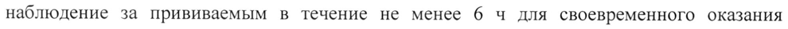

# Вакцина для профилактики ротавирусной инфекции, пентавалентная, живая — парентерально

- Препарат: Рота-V-Эйд® (лиофилизат для приготовления раствора для приема внутрь;)
- АТХ: J07BH02
- Источник: ГРЛС, инструкция по медицинскому применению, РУ ЛП-007108, файл от 2023-04-25 (https://grls.rosminzdrav.ru/Grls_View_v2.aspx?routingGuid=bd0099be-c683-4345-a633-3de57fe08bab)
- Распознано автоматически (OCR): 10 из 10 стр.
- Инструкция к другому РУ того же препарата: ЛП-007108 (национальное РУ, переоформленное по правилам ЕАЭС, решение от 19.04.2023). Текст может быть старше действующего
- Сомнительных строк после OCR: 1 (см. раздел «Проверка распознавания»)

## Общие сведения

aaa | МИНЗДРАВ РОССИ МИНИСТЕРСТВО ЗДРАВООХРАНЕНИЯ РОССИЙСКОЙ ФЕДЕРАЦИИ
| СОГЛАСОВА" О ИНСТРУКЦИЯ о ПО МЕДИЦИНСКОМУ ПРИМЕНЕНИЮ ЛЕКАРСТВЕННОГО ПРЕПАРАТА
Рота-У-Эйд® Регистрационный номер:
Торговое наименование: Рота-У-Эйд® Международное непатентованное или группировочное наименование: вакцина для профилактики ротавирусной инфекции, пентавалентная, живая

## 3. Лекарственная форма

лиофилизат для приготовления раствора для приема внутрь w
лиофилизат для приготовления раствора для приема внутрь w

## 2. Состав

Одна прививочная доза (2,5 мл) содержит:
Действующие вещества Живые реассортанты человеческого и бычьего ротавирусов, выращенные на культуре клеток Веро:
Ротавирус типа Gl - не менее 1056 ФФЕ* Ротавирус типа G2 : не менее 1055 ФФЕ*
Ротавирус типа G3 - не менее 1055 ФФЕ* Ротавирус типа G4 - не менее 10° ФФЕ*
Ротавирус типа G9 - не менее 1056 ФФЕ* & ФФЕ* - фокус флуоресцирующие единицы
Вспомогательные вещества Сахароза 50,0 мг, глицин 50,0 мг, среда МЕМ 17,0 мг.
Растворитель Лимонной кислоты моногидрата 24,0 мг, натрия бикарбоната 64,0 мг, вода для инъекций до 2,5 мл.
Примечание:
| - Вакцина и растворитель не содержат консервантов.
Описание Лиофилизат для приготовления раствора для приема внутрь - однородная пористая, рыхлая масса от розоватого до желтовато-белого цвета.
После восстановления растворителем — прозрачная жидкость от розоватого до желтоватого цвета.
Растворитель — прозрачная бесцветная жидкость.
Характеристика Препарат Рота-У-Эйд® представляет собой пероральную, пентавалентную, живую вакцину для профилактики ротавирусной инфекции, которая содержит пять реассортантных
(человеческие и бычьи реассортантные штаммы) штаммов ротавируса серотипов G1, G2,
G3, G4 и G9, выращенных на культуре клеток линии Веро. Все штаммы содержат ген VP7 соответствующего серотипа из штаммов человеческих вирусов, реассортантных с бычьим ротавирусом (UK).
При производстве вакцины используются материалы животного происхождения.

© Вакцина и растворитель не содержит консервантов. Вспомогательные вещества не содержат веществ животного происхождения.
Фармакотерапевтическая группа: МИБП - вакцина.
Код ATX: JO7BH02 Фармакологические свойства
В умеренной климатической зоне ротавирусный гастроэнтерит является основным сезонным заболеванием с увеличением заболеваемости (эпидемиями) в зимние месяцы.
При отсутствии лечения ротавирусный гастроэнтерит может привести к летальной

©, дегидратации.
Эффективность По данным клинических исследований эффективность вакцины Рота-У-Эйд® была продемонстрирована в отношении гастроэнтерита, вызванного ротавирусами серотипов
G1, G2, G3, G4, G9.
Эффективность вакцины Рота-У-Эйд® при трехкратном пероральном введении изучали в клинических исследованиях с участием 15 000 детей.
Вакцинация препаратом Рота-У-Эйд® позволила предотвратить 4,30 эпизодов тяжелого ротавирусного гастроэнтерита в расчете на 100 человеко-лет. Совокупный риск развития тяжелого ротавирусного гастроэнтерита у вакцинированных был значительно ниже, чем в группе плацебо. Отмечали увеличение эффективности вакцины по мере повышения тяжести ротавирусного гастроэнтерита любого генеза. Показатель эффективности вакцины

Рота-У-Эйд® составил 73,2%.
В результате клинических исследованиях показано, что для достижения необходимого уровня и длительности защиты против ротавирусного гастроэнтерита необходима трехкратная вакцинация.
Иммуногенность При оценке иммуногенности были получены следующие результаты:
- 2-х, 3-x и 4-х кратное увеличение величины титров IgA составило 75 % в группе, привитых вакциной Рота-У-Эйд® и 20 % в группе, получившей Плацебо.
- Уровень сероконверсии через 28 дней после введения 3-й дозы составлял 48 % в группе привитых вакциной Рота-У-Эйд® и 21 % в группе, получившей Плацебо.
В целях регистрации вакцины Рота-У-Эйд® в Российской Федерации были проведены клинические исследования с участием детей.
©, В анализ иммуногенности вакцины Рота-У-Эйд® были включены данные 97 детейучастников исследования — 48 детей из группы трехкратно привитых вакциной Рота-УЭйд® и 49 детей из группы трехкратно принимавших Плацебо. Доля детей-участников клинического исследования, которые были серопозитивными с концентрацией ротавирусспецифического IgA > 20 Ед/мл на момент их включения в исследование перед приемом первой дозы, составила 20,8 % в группе вакцины Рота-У-Эйд® и 32,7 % в группе
Плацебо. Проведение трехкратной вакцинации серопозитивных детей-участников исследования позволило достичь показателя сероконверсии до 50 %. В группе исходно серонегативных участников клинического исследования до 92,11 % привитых препаратом
Рота-У-Эйд*® имели четырехкратное и более увеличение титра специфических антител.
Увеличение специфических антител IgA после трехкратного введения вакцины Рота-У-
| Эйд® наблюдали у 90 % привитых детей-участников, при этом кратность увеличения уровня IgA в группе привитых вакциной Рота-У-Эйд® статистически значимо отличалась от кратности увеличения уровня IgA в группе Плацебо.
При изучении иммуногенности вакцины Рота-У-Эйд® в общей популяции серонегативных и серопозитивных детей-участников исследования показано, что после трехкратной иммунизации среднегеометрическая величина титра (СГТ) специфических антител в группе привитых вакциной Рота-У-Эйд® достоверно статистически значимо превышала
СГТантител в группе Плацебо и составляла 130,81 ЕД/мл. Кратность прироста СГТ антител в группе вакцины Рота-У-Эйд® составляла 39,05, в группе Плацебо — 2,80. Уровни сероконверсии (с двух-, трех- и четырехкратным приростом антител) в группе привитых вакциной Рота-У-Эйд® составляли от 79,17 % до 83,33 %.
Механизм иммунной защиты организма вакциной Рота-У-Эйд® от ротавирусного гастроэнтерита до конца не изучен. Взаимосвязь между содержанием антител к серотипам ротавируса Gl, G2, G3, G4, G9 после вакцинации ротавирусными вакцинами и степенью защиты против ротавирусного гастроэнтерита не установлена.
По данным клинических исследований после проведения полного курса вакцинации, состоящего из трех доз препарата Рота-У-Эйд®, у 92,11 % исходно серонегативных детейучастников исследования в сыворотке крови наблюдалось значительное повышение уровня анти-ротавирусного IgA.

## 4.1. Показания к применению

Активная иммунизация здоровых детей в возрасте от 6 недель до 32 недель с целью профилактики гастроэнтерита, вызванного ротавирусами серотипов Gl, G2, G3, G4, G9.
Активная иммунизация здоровых детей в возрасте от 6 недель до 32 недель с целью профилактики гастроэнтерита, вызванного ротавирусами серотипов Gl, G2, G3, G4, G9.
©, Противопоказания _ Повышенная чувствительность к любому компоненту вакцины Рота-У-Эйд®, а также на введение любой вакцины для профилактики ротавирусной инфекции в анамнезе.
- Врожденные пороки развития желудочно-кишечного тракта, предрасполагающие к инвагинации кишечника.
_ Тяжёлый комбинированный иммунодефицит (ТКИД). Поскольку у детей с ТКИД были зафиксированы случаи развития гастроэнтерита, вызванного другими живыми ротавирусными вакцинами.
_ Инвагинация кишечника в анамнезе.
- Глюкозо-галактозная мальабсорбция и непереносимость сахарозы.
- Острые инфекционные и неинфекционные заболевания и обострение хронических
- заболеваний являются временными противопоказаниями, прививки проводят через 2 недели после выздоровления.
- Тяжелая форма диареи.

## 4.3. С осторожностью

— _ Детям с ослабленным иммунитетом и детям, находящимся в тесном контакте с лицами с иммунодефицитом (отсутствие клинических данных).
— _ Детям с ослабленным иммунитетом и детям, находящимся в тесном контакте с лицами с иммунодефицитом (отсутствие клинических данных).
— _ Субфебрильная температура тела.
— _ Инфекции верхних дыхательных путей лёгкой степени тяжести.
— Заболевания ЖКТ, включая хроническую диарею.
— Задержка развития.

## 4.6. Применение при беременности и в период грудного вскармливания

Вакцина Рота-У-Эйд® предназначена только для детей. Нет данных о применении препарата у беременных женщин и в период грудного вскармливания.

## 4.2. Способ применения и дозы

Вакцина Рота-У-Эйд® предназначена только для приема внутрь!
Вакцина Рота-У-Эйд® предназначена только для приема внутрь!
Перед применением вакцину Рота-У-Эйд® необходимо развести прилагаемым растворителем (см. Рекомендации по подготовке и проведению вакцинации).
Вакцина Рота-У-Эйд® может вводиться вне зависимости от приема пищи или любой жидкости, включая грудное молоко. Вакцину Рота-У-Эйд*® нельзя смешивать с другими лекарственными средствами.
Вакцину Рота-У-Эйд® и прилагаемый в комплекте растворитель перед использованием
©, необходимо визуально проверить на отсутствие механических включений и/или изменение внешнего вида (см. раздел «Описание»). В случае их обнаружения следует отказаться от применения вакцины и растворителя.
Разведённую вакцину Рота-У-Эйд® необходимо использовать в течение 6 часов после разведения либо до конца времени иммунизации, в зависимости от того, что наступает раньше, при условии хранения при температуре от 2°С до 8°С.
Схема вакцинации Курс вакцинации состоит из трех доз препарата Рота-У-Эйд®, каждая доза по 2,5 мл.
Препарат Рота-У-Эйд® следует вводить трижды, с интервалами между введением очередной дозы не менее 4-х недель, начиная с 6-недельного возраста.
© При введении неполной дозы вакцины (например, ребенок выплюнул или срыгнул часть дозы), на усмотрение врача, можно разово применить замещающую дозу вакцины на том же визите вакцинации. Оставшиеся дозы вакцины Рота-У-Эйд® следует вводить согласно схеме вакцинации.
Согласно рекомендаций Всемирной Организации Здравоохранения, если плановая иммунизация начата позже 6 месяцев и/или интервал составляет более 4 недель, можно осуществлять введение вакцины Рота-У-Эйд® самостоятельно либо с вакцинами АКДС, инактивированной полиомиелитной вакциной, оральной полиомиелитной вакциной, вакциной против Haemophilus influenzae типа b и против гепатита В.
Рекомендовано, чтобы дети, которые получали вакцину для профилактики ротавирусной инфекции, пентавалентную, живую для первой иммунизации против ротавируса, продолжали получать дозы этой же вакцины в дальнейшем (3 дозы).
Данные о безопасности, иммуногенности или эффективности вакцины Рота-У-Эйд® при введении поочерёдно с другими зарегистрированными вакцинами для профилактики ротавирусной инфекции отсутствуют.
Рекомендации по подготовке и проведению вакцинации
Yo / 1. Снимите пластиковые колпачки с флаконов, содержащих
/ Ua am, растворитель и лиофилизат.
du +. 2. Присоедините адаптер и шприц к флакону с растворителем, нажав
> == = вниз до тех пор, пока наконечник надёжно не установится. Наберите
| весь растворитель в шприц.
Рос. 3. Уберите приспособление с флакона с растворителем. Встряхните
SS, ..
© ty yO шприц, содержащий растворитель.
= Oy я < © ия v [ar 4. Введите всё содержимое шприца во флакон, содержащий a
| лиофилизат.
_ £ 5. Встряхните флакон и просмотрите его, чтобы лиофилизат
К! полностью растворился. Разведённая вакцина представляет собой
Ч прозрачный раствор от розоватого до желтоватого цвета.
и 6. Наберите одну дозу (2,5 мл) восстановленного раствора вакцины
Se обратно в шприц.
. 7. Отсоедините шприц ОТ адаптера.
PS > Е A XE 7
8. Осторожно введите всё содержимое шприца (одна доза 2,5 мл) в
КК a <i рот ребёнка (в направлении внутренней стороны щеки). Ребёнок a 4 9. должен находиться в положении полулежа.
if es Не вводить в виде инъекции!

## 4.8. Побочное действие

На основании объединенных данных 5 клинических исследований (более 15 000 участников) перечислены нежелательные реакции, частота которых в группе вакцины РотаУ-Эйд® не превышала частоту в группе Плацебо.
На основании объединенных данных 5 клинических исследований (более 15 000 участников) перечислены нежелательные реакции, частота которых в группе вакцины РотаУ-Эйд® не превышала частоту в группе Плацебо.
Частота нежелательных реакций определялась следующим образом:
очень часто (21/10), часто (>1/100, но <1/10), нечасто (>1/1000, но <1/100), редко (>1/10000, но <1/1000), очень редко (<1/10000), неизвестно (частоту данных нежелательных реакций невозможно установить из имеющихся данных).
- Инфекционные и паразитарные заболевания
Часто: инфекции нижних дыхательных путей, бронхиолит, бронхопневмония, воспаление лёгких, инфекции верхних дыхательных путей*.
Нечасто: назофарингит*, средний отит*.
- Нарушения со стороны иммунной системы
© Неизвестно: анафилактическая реакция*.
- Нарушения со стороны дыхательной системы, органов грудной клетки и средостения
Редко: бронхоспазм*.
- Нарушения со стороны желудочно-кишечного тракта
Очень часто: гастроэнтерит, снижение аппетита, рвота, диарея.
Нечасто: гематохезия*, боль в верхних отделах живота*.
Редко: инвагинация кишечника**.
- Нарушения со стороны кожи и подкожных тканей
Нечасто: сыпь*.
Редко: крапивница*.
Неизвестно: ангиоэдема*.
© - Общие расстройства и нарушения в месте введения
Очень часто: гипертермия, раздражительность.
*Данные нежелательные реакции возможны при применении вакцины Рота-У-Эйд® и установлены в ходе проведения клинических исследований Вакцины для профилактики ротавирусной инфекции, пентавалентной, живой (РотаТек®).
** До начала первичного анализа нежелательных явлений возникло 7 случаев инвагинации кишечника, из которых 4 случая были в группе привитых вакциной для профилактики ротавирусной инфекции, пентавалентной, живой и 3 в группе Плацебо. Ни один случай не возник в течение 28 дней после введения вакцины Рота-У-Эйд®.

## 4.9. Передозировка

О случаях передозировки вакцины Рота-У-Эйд® не сообщалось.
О случаях передозировки вакцины Рота-У-Эйд® не сообщалось.
Учитывая, что вакцинация должна проводится только квалифицированным медицинским

персоналом, риск передозировки крайне низок.

При возникновении случаев передозировки вакцины Рота-У-Эйд® необходимо тщательное

наблюдение за прививаемым в течение не менее 6 ч для своевременного оказания

неотложной помощи при возникновении аллергической реакции в виде симптомов

гиперчувствительности немедленного типа и гиперчувствительности замедленного типа. В

случае передозировки также возрастает риск нежелательных явлений, связанных с

применением лекарственного препарата (см. раздел «Побочное действие»).

## 4.5. Взаимодействие с другими лекарственными средствами

Вакцину Рота-У-Эйд® можно вводить одновременно с другими вакцинами в рамках

программы иммунизации детей, включая комбинированную вакцину против коклюша,
©, дифтерии и столбняка (АКДС), инактивированную полиомиелитную вакцину (ИПВ),

оральную полиомиелитную вакцину (ОПВ), вакцину против Haemophilus influenzae типа b

(Hib) и против гепатита В. Исследования взаимодействия вакцины Рота-У-Эйд® с другими

лекарственными средствами у детей не проводились.

Иммуносупрессивная терапия, включая облучение, антиметаболиты, алкилирующие

средства, цитотоксические средства и кортикостероиды (используемые в дозах больших,

чем минимальные), могут снижать иммунный ответ на вакцинацию.

## 4.4. Особые указания

Данные по безопасности и эффективности вакцины Рота-У-Эйд® у детей с ослабленным

иммунитетом, детей, инфицированных ВИЧ или детей с хроническим гастроэнтеритом,
©, отсутствуют.

Вакцину Рота-У-Эйд® можно с осторожностью вводить детям с ослабленным иммунитетом

и детям, находящимся в тесном контакте с лицами с иммунодефицитом, если, по мнению

врача, польза значительно перевешивает риск вакцинации.

Острая инфекция или лихорадочное заболевание могут быть основанием для отсрочки

введения вакцины Рота-У-Эйд®.

Субфебрильная температура тела и инфекция верхних дыхательных путей лёгкой степени

тяжести не являются противопоказанием к введению вакцины Рота-У-Эйд®.

Доступные опубликованные данные показывают незначительное увеличение частоты

возникновения инвагинации кишечника после введения других живых пероральных вакцин

для профилактики ротавирусных инфекций, в особенности после введения первой дозы.

Данные по безопасности, полученные в клинических исследованиях вакцины Рота-У-Эйд®, не показывают увеличения риска возникновения инвагинации кишечника. Однако медицинские работники должны тщательно оценивать случаи с симптомами, напоминающими инвагинацию кишечника. Подобно другим вакцинам для профилактики ротавирусных инфекций, иммунизация вакциной Рота-У-Эйд® не может обезопасить всех реципиентов вакцины от ротавирусной инфекции.
Вакцина Рота-У-Эйд® не обеспечивает защиту от гастроэнтерита, вызванного другими патогенными организмами.

## 4.7. Влияние на способность управлять транспортными средствами, механизмами

Исследований по изучению влияния вакцины на способность к управлению транспортными средствами и механизмами не проводилось.

< Форма выпуска Лиофилизат для приготовления раствора для приема внутрь, 2,5 мл/доза.
Лиофилизат По 1 или 2 дозы лиофилизата во флаконах вместимостью 4 мл или 5 мл соответственно из бесцветного прозрачного стекла, укупоренных пробками из бромбутилкаучука серого цвета и завальцованных алюминиевыми колпачками с пластиковой крышечкой типа флип-офф лилового цвета.
Растворитель По 2,5 мл (для 1 дозы вакцины) или 5,0 мл (для 2-х доз вакцины) растворителя во флаконах вместимостью 4 мл или 5 мл соответственно из бесцветного прозрачного стекла,

©, укупоренных пробками из галогенбутилкаучука серого цвета и завальцованных алюминиевыми колпачками с пластиковой крышечкой типа флип-офф синего цвета.
Комплектность для [ дозы вакцины По 1 флакону с лиофилизатом вместимостью 4 мл, 1 флакону с растворителем вместимостью 4 мл с | адаптером и | стерильным одноразовым шприцем для перорального приема в прозрачном пластиковом контейнере. По | пластиковому контейнеру вместе с инструкцией по применению помещают в пачку картонную.
Комплектность для 2 003 вакцины По 1 флакону с лиофилизатом вместимостью 5 мл, 1 флакону с растворителем вместимостью 5 мл с | адаптером и 2 стерильными одноразовыми шприцами для перорального приема в прозрачном пластиковом контейнере. По 1 пластиковому контейнеру вместе с инструкцией по применению помещают в пачку картонную.

## 6.4. Условия хранения

Лиофилизат При температуре от 2 до 25 °С в защищенном от света месте.
Лиофилизат При температуре от 2 до 25 °С в защищенном от света месте.
Растворитель При температуре от 2 до 25 °С в защищенном от света месте. Не замораживать!
Комплект (лиофилизат, растворитель, адаптер, шприц)
При температуре от 2 до 25 °С в защищенном от света месте. Не замораживать!
Хранить в недоступном для детей месте.

## 6.3. Срок годности

Лиофилизат: 30 месяцев.
Лиофилизат: 30 месяцев.
© Растворитель: 60 месяцев.
| Срок годности комплекта указывается по наименьшему сроку годности одного из компонентов.
Не применять препарат по истечении срока годности.
Условия отпуска Упаковка с 1 дозой вакцины — «Отпускают по рецепту».
Упаковка с 2 дозами вакцины — «Для лечебно-профилактических и санитарнопрофилактических учреждений».
Производитель © Серум Инститьют оф Индия Пвт. Лтд, Индия.
Serum Institute of India Pvt. Ltd.
Адрес: 212/2, Офф Соли Пунавалла Роуд, Хадансар, Пуне-411028, Махараштра, Индия.
Владелец регистрационного удостоверения/организация, принимающая претензии потребителей
ООО «ФАРМ ЭЙД ЛТД», Россия.
107045, г. Москва, Даев переулок, д. 20, офис 517. SE, fox a ZEN i ki Е nat Е 4
Генеральный директор №) Л x a\9 р К: А. О. Метов 000 «ФАРМ ЭЙД ЛТД» XO < ornare
## Проверка распознавания

Страницы-сканы распознаны автоматически. В 1 строках с дозировками цифры могли распознаться с ошибкой — сверьте с вырезкой из оригинала:

- стр. 8: «наблюдение за прививаемым в течение не менее 6 ч для своевременного оказания» — повторное чтение: «наблюдение за прививаемым в течение не менее 6 4 для своевременного оказания»  
  
