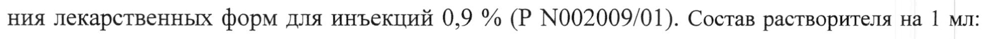

# Вакцина для профилактики сыпного тифа — парентерально

- Препарат: Вакцина Е сыпнотифозная комбинированная живая (ЖКСВ-Е) (лиофилизат для приготовления суспензии для подкожного введения;)
- АТХ: J07AR01
- Источник: ГРЛС, инструкция по медицинскому применению, РУ ЛС-001379, файл от 2022-12-14 (https://grls.rosminzdrav.ru/Grls_View_v2.aspx?routingGuid=14b69927-c5e2-4a00-8b47-2e5670ca5f7f)
- Распознано автоматически (OCR): 4 из 4 стр.
- Инструкция к другому РУ того же препарата: ЛС-001379 (национальное РУ, переоформленное по правилам ЕАЭС, решение от 01.12.2022). Текст может быть старше действующего
- Сомнительных строк после OCR: 1 (см. раздел «Проверка распознавания»)

## Общие сведения

| — МНЫЗДРАВ РОССИИ | | AC -OOfS49~) 90321 |
МИНИСТЕРСТВО SPABOOXPAHE РОССИЙСКОЙ ФЕДЕРАЦИИ \
СОГЛАСОВАНО | ИНСТРУКЦИЯ ПО МЕДИЦИНСКОМУ ПРИМЕНЕНИЮ ЛЕКАРСТВЕННОГО ПРЕПАРАТА
Вакцина Е сыпнотифозная комбинированная живая (ЖКСВ-Е)
Регистрационный номер.
Торговое наименование. Вакцина Е сыпнотифозная комбинированная живая (ЖКСВ-Е).
Группировочное наименование. Вакцина для профилактики сыпного тифа.

## 3. Лекарственная форма

Лиофилизат для приготовления суспензии для подкожного
Лиофилизат для приготовления суспензии для подкожного
~ введения.

## 2. Состав

Одна доза вакцины содержит:
Одна доза вакцины содержит:
Действующие вещества:
- живые риккетсии Провачека аттенуированного (вакцинного) штамма Е - 1000 - 100000 минимальных инфицирующих доз риккетсий для развивающихся куриных эмбрионов
~ (МИД»); | - растворимый антиген из риккетсий Провачека вирулентного штамма Брейнль - не менее 16 антигенных единиц.
Вспомогательное вещество: молоко питьевое обезжиренное стерильное.
Одна ампула содержит 20 доз. | прививочная доза — 0,25 мл (восстановленной растворителем вакцины).

- Выпускается в комплекте с растворителем — натрия хлорид растворитель для приготовления лекарственных форм для инъекций 0,9 % (Р №002009/01). Состав растворителя на 1 мл:
натрия хлорид — 9 мг; вода для инъекций - до 1 мл.

Описание. Пористая масса в виде таблетки от светло-жёлтого до тёмно-коричневого цвета. Восстановленный препарат - гомогенная суспензия светло-желтого цвета.
Характеристика препарата. Вакцина Е сыпнотифозная комбинированная живая
(ЖКСВ-Е) представляет собой взвесь живых риккетсий Провачека (Rickettsia prowazekii)
аттенуированного (вакцинного) штамма Е (Мадрид Е), выращенных в ткани желточных мешков развивающихся куриных эмбрионов, в комбинации с растворимым антигеном из риккетсий Провачека (Rickettsia prowazekii) вирулентного штамма Брейнль, лиофилизированную в стерильном обезжиренном питьевом молоке.

Фармакотерапевтическая группа. МИБП - вакцина.
Код ATX. JO7AR Фармакологические свойства. Однократное введение вакцины сопровождается развитием специфического иммунитета на 15-30 сут после вакцинации.

## 4.1. Показания к применению

Специфическая профилактика сыпного тифа в возрасте от 18 до 60 лет. Вакцина применяется по эпидемиологическим показаниям в ситуациях, представляющих для населения угрозу заражения сыпным тифом, а также для защиты персонала, работающего с риккетсиями Провачека.
Специфическая профилактика сыпного тифа в возрасте от 18 до 60 лет. Вакцина применяется по эпидемиологическим показаниям в ситуациях, представляющих для населения угрозу заражения сыпным тифом, а также для защиты персонала, работающего с риккетсиями Провачека.

## 4.3. Противопоказания

1. Сильная реакция (температура выше 40 °С, отек и гиперемия в месте введения вакцины свыше 8 см в диаметре) или поствакцинальное осложнение на предыдущее введение.
2. Острые инфекционные и неинфекционные заболевания; хронические заболевания в
- стадии обострения. Прививки проводят не ранее 1 месяца с момента выздоровления или ремиссии.
3. Аллергические заболевания (по данным анамнеза): бронхиальная астма, атопический дерматит, поллиноз и др.; аллергия на куриный белок и молоко коровье.
4. Дегенеративные и прогредиентные заболевания нервной системы.
© 5. Заболевания почек и надпочечников.
6. Системные заболевания соединительной ткани.
7. Иммунодефицитные состояния (первичные и вторичные).
8. Беременность и период лактации.
9. Возраст до 18 лет.
Возможность вакцинации лиц, страдающих заболеваниями, не указанными в данном пе-
© речне противопоказаний, определяет врач, исходя из состояния здоровья прививаемого.

## 4.6. Применение при беременности и в период грудного вскармливания

## 4.2. Способ применения и дозы

Вскрытие ампул и процедуру вакцинации проводят при строгом соблюдении правил асептики и антисептики.
В ампулу с вакциной непосредственно перед прививкой вносят 5 мл натрия хлорида растворителя для приготовления лекарственных форм для инъекций 0,9 %. Вакцина должна раствориться в течение 2 мин с образованием гомогенной суспензии светло-желтого цвета. При более длительном (более 2 мин) растворении, а также наличии в восстановленной вакцине неразбивающихся хлопьев, содержимое ампулы применению не подлежит и должно быть уничтожено, как указано выше.
Восстановленную растворителем вакцину вводят однократно подкожно в подлопаточную область в дозе 0,25 мл.
Ревакцинацию проводят дозой 0,25 мл не ранее, чем через 1 год после вакцинации.

## 4.8. Побочное действие

В ответ на введение вакцины возможно развитие побочных местных и общих реакций. Частота развития приведенных ниже побочных реакций указана согласно рекомендациям Всемирной организации здравоохранения и включает следующие категории: очень часто (>1/10); часто (>1/100 до < 1/10); нечасто (> 1/1000 до < 1/100); редко
В ответ на введение вакцины возможно развитие побочных местных и общих реакций. Частота развития приведенных ниже побочных реакций указана согласно рекомендациям Всемирной организации здравоохранения и включает следующие категории: очень часто (>1/10); часто (>1/100 до < 1/10); нечасто (> 1/1000 до < 1/100); редко
(> 1/10000 до < 1/1000); очень редко (< 1/10000).
Общие нарушения и реакции в месте введения
Очень часто: незначительная припухлость, инфильтрация тканей без четких границ и болезненности.
Часто: ранние (наступающие в ближайшие 6-72 ч после прививки): одно-двух дневное

wr повышение температуры до субфебрильной, слабость, головокружение;
Часто: поздние (являются проявлением вакцинальной инфекции и появляются спустя 918 сут (редко позже)): головная боль, недомогание, боль в мышцах, повышение температуры в течение 1-4 сут.
При ревакцинации ЖКСВ-Е реакции на введение вакцины обычно не наблюдаются.
© Передозировка. Случаи передозировки не описаны.

## 4.5. Взаимодействие с другими лекарственными средствами

## 4.4. Особые указания

Непосредственно перед прививкой врач проводит тщательный медицинский осмотр с термометрией и опрос вакцинируемых для выявления противопоказаний. При температуре выше 37 °С прививки не проводят.
Непосредственно перед прививкой врач проводит тщательный медицинский осмотр с термометрией и опрос вакцинируемых для выявления противопоказаний. При температуре выше 37 °С прививки не проводят.

& Перед применением каждую ампулу с вакциной тщательно просматривают. При наличии в ампуле трещин, посторонних включений, несвойственной вакцине окраски и других дефектов, а также нарушенной маркировки и истекшего срока годности, данную ампулу бракуют и обезвреживают кипячением в течение 30 мин или погружением разбитой ампулы в 3 % раствор хлорамина на 1 сут.

Прививку регистрируют в соответствующих учетных формах с указанием наименования и номера серии вакцины, даты вакцинации, дозы, производителя, реакции на прививку.
Восстановленная вакцина годна к употреблению в течение 30 мин при хранении под стерильной салфеткой при комнатной температуре и на протяжении 60 мин при хранении при температуре от 2 до 8 °С. Восстановленную, но не использованную вакцину уничтожают способами, указанными выше.

## 4.7. Влияние на способность управлять транспортными средствами, механизмами

## 6.5. Форма выпуска

Лиофилизат для приготовления суспензии для подкожного введения.
Лиофилизат для приготовления суспензии для подкожного введения.
Вакцина - по 20 доз в ампулах. Растворитель - натрия хлорид растворитель для приготовления лекарственных форм для инъекций 0,9 % - по 5 мл в ампулах.
5 ампул вакцины и 5 ампул растворителя помещают в пачку из картона со скарификатором ампульным и инструкцией по применению. При упаковке ампул с кольцом излома или точкой для вскрытия скарификатор ампульный не вкладывают.

## 6.4. Условия хранения

В соответствии с СП 3.3.2.3332-16 при температуре от 2 до 8 °С в недоступном для детей месте. Не замораживать.
В соответствии с СП 3.3.2.3332-16 при температуре от 2 до 8 °С в недоступном для детей месте. Не замораживать.

©, Условия транспортирования. В соответствии с СП 3.3.2.3332-16 при температуре от 2 до 8 °С. Не замораживать.

## 6.3. Срок годности

Вакцина - 2 года, растворитель - 5 лет. Срок годности комплекта определяется по наименьшему сроку годности одного из компонентов. Не применять по истечении срока годности.
Вакцина - 2 года, растворитель - 5 лет. Срок годности комплекта определяется по наименьшему сроку годности одного из компонентов. Не применять по истечении срока годности.
Условия отпуска. Для лечебно-профилактических учреждений.

> Производитель.

АО «НПО «Микроген».
Россия, 115088, г. Москва, ул. 1-я Дубровская, д. 15, стр. 2, тел. (495) 710-37-87, факс (495)
783-88-04, e-mail: info@microgen.ru.
Адрес производства:
Россия, 614089, Пермский край, г. Пермь, ул. Братская, д. 177, тел. (342) 281-94-96.

® Владелец РУ/Организация, принимающая претензии потребителя.
АО «НПО «Микроген».
Россия, 115088, г. Москва, ул. 1-я Дубровская, д. 15, стр. 2, тел. (495) 710-37-87, факс (495)
783-88-04, e-mail: info@microgen.ru.

И

Начальник управления регистрации | и i, и медицинских исследований
АО «НПО «Микроген» Vs А.Е. Ершов
## Проверка распознавания

Страницы-сканы распознаны автоматически. В 1 строках с дозировками цифры могли распознаться с ошибкой — сверьте с вырезкой из оригинала:

- стр. 1: «ния лекарственных форм для инъекций 0,9 % (Р №002009/01). Состав растворителя на 1 мл:» — низкая уверенность: «№002009/01).» (52)  
  
